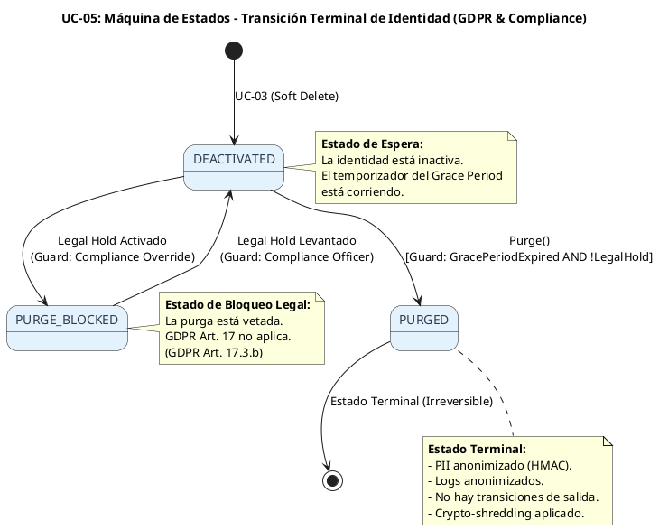
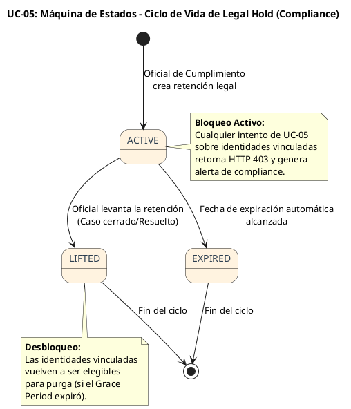
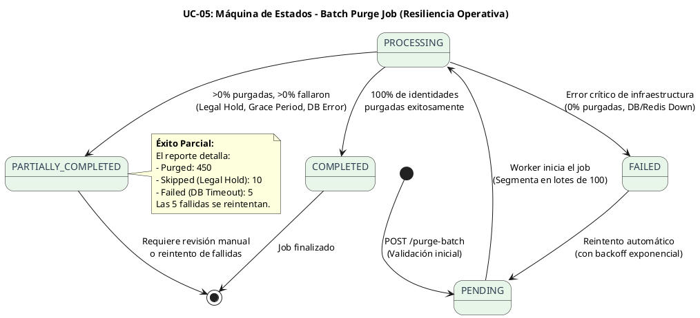
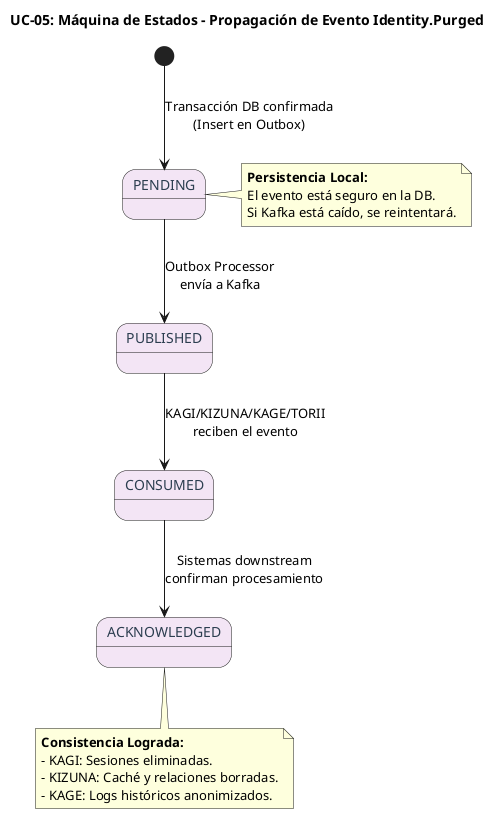

# UC-05: Purgar Identidad - Diagrama de Máquina de Estados

| Metadatos del Documento | |
| :--- | :--- |
| **Proyecto:** | SHUGO - Identity & Access Platform |
| **Caso de Uso:** | UC-05 - Purgar Identidad (Hard Delete / GDPR Right to Erasure) |
| **Documento:** | 05_State_Machine_Diagram.md |
| **Metodología:** | UML 2.5 + ICONIX + Domain-Driven Design (Terminal States & Compliance Workflows) |
| **Autor:** | Gastón Ruiz |
| **Versión Actual:** | 1.0.0 |
| **Fecha:** | 03/09/2026 |

---

## Historial de Versiones

| Versión | Fecha | Autor | Descripción de Cambios | Impacto |
| :--- | :--- | :--- | :--- | :--- |
| **1.0.0** | 03/09/2026 | Gastón Ruiz | **Creación inicial.** Definición de las máquinas de estados específicas para la purga irreversible. Se modelan cuatro máquinas críticas: (1) Transición Terminal de Identidad (bloqueada por Compliance), (2) Ciclo de Vida de Legal Hold (el bloqueador de prioridad), (3) Procesamiento de Batch de Purga (escala operativa), y (4) Propagación de Eventos Downstream (consistencia eventual). | Documento base del paquete de diseño Tier 1 del UC-05. Establece las reglas de transición, las guardas de compliance (GDPR/Legal Hold) y la lógica de resiliencia batch que garantiza la irreversibilidad y el cumplimiento normativo. |

---

## 1. Introducción y Propósito

El **Diagrama de Máquina de Estados** para el UC-05 visualiza las restricciones de comportamiento temporal y las reglas de transición que gobiernan la purga irreversible de identidades.

A diferencia de los UCs previos donde las identidades podían reactivarse o actualizarse, el UC-05 introduce el concepto de **Estado Terminal**. Una vez que una identidad entra en este estado, no hay vuelta atrás. Además, debido a la complejidad de cumplimiento normativo (GDPR vs. Legal Hold) y la necesidad de operaciones masivas (Batch), modelamos cuatro máquinas de estados interdependientes:

1. **Máquina de Transición Terminal (Identidad):** El paso irreversible de `DEACTIVATED` a `PURGED`, fuertemente custodiado por reglas de compliance.
2. **Máquina de Legal Hold (Compliance):** El ciclo de vida de las retenciones legales que actúan como bloqueadores de prioridad sobre la Máquina #1.
3. **Máquina de Batch de Purga (Operaciones):** El estado de los jobs de purga masiva, manejando escenarios de éxito parcial y fallos críticos.
4. **Máquina de Propagación Downstream (Eventos):** El flujo de consistencia eventual para notificar a KAGI, KIZUNA, KAGE y TORII.

Estas máquinas garantizan:
- **Irreversibilidad Criptográfica:** El estado `PURGED` es un sumidero (sink state).
- **Supremacía Legal:** El Legal Hold puede vetar el Derecho al Olvido en cualquier momento.
- **Resiliencia Operativa:** Los fallos en purgas masivas no corrompen el estado de las identidades ya purgadas.

---

## 2. Máquina de Estados #1: Transición Terminal de Identidad

### 2.1. Descripción

Esta máquina representa el ciclo de vida final de la identidad. A diferencia de las máquinas de UC-01 a UC-04, esta máquina tiene un **estado terminal (`PURGED`)** del cual no existen transiciones de salida.

### 2.2. Diagrama de Máquina de Estados (PlantUML)



### 2.3. Guardas (Guards) de la Transición `DEACTIVATED` → `PURGED`

Para que la transición ocurra, el `IdentityPurgeService` debe validar simultáneamente:
1. **`GracePeriodExpired`:** `DateTime.UtcNow > (DeactivatedAt + TenantConfig.RetentionDays)`.
2. **`!LegalHold`:** `ILegalHoldChecker.HasActiveHold(IdentityId) == false`.

Si cualquiera de estas guardas falla, la transición se aborta.

---

## 3. Máquina de Estados #2: Ciclo de Vida de Legal Hold

### 3.1. Descripción

Esta máquina modela el estado de las retenciones legales. Es crítica porque **controla externamente** la Máquina #1. Un cambio en esta máquina puede desbloquear o bloquear identidades para su purga.

### 3.2. Diagrama de Máquina de Estados (PlantUML)



### 3.3. Interacción entre Máquina #1 y Máquina #2

La Máquina #2 actúa como un **Aspecto de Seguridad (Security Aspect)** sobre la Máquina #1. 
- Cuando la Máquina #2 transiciona a `ACTIVE`, bloquea instantáneamente cualquier transición en la Máquina #1 hacia `PURGED`.
- Cuando transiciona a `LIFTED` o `EXPIRED`, levanta el bloqueo, permitiendo que el `IdentityPurgeService` evalúe las demás guardas.

---

## 4. Máquina de Estados #3: Procesamiento de Batch de Purga

### 4.1. Descripción

Para manejar la purga masiva (hasta 1000 identidades), el sistema utiliza un Job asíncrono. Esta máquina modela el estado del Job, permitiendo resiliencia ante fallos parciales.

### 4.2. Diagrama de Máquina de Estados (PlantUML)



### 4.3. Invariantes del Batch Job
1. **Atomicidad por Lote:** Si un lote de 100 falla a mitad de camino, se hace Rollback de ese lote específico. Los lotes anteriores confirmados permanecen purgados.
2. **Idempotencia del Job:** Si el Job se reinicia tras un fallo, no reprocesa identidades que ya alcanzaron el estado `PURGED`.

---

## 5. Máquina de Estados #4: Propagación Downstream (Eventos)

### 5.1. Descripción

Una vez que la identidad alcanza el estado `PURGED` en KAGAMI, el evento `Identity.Purged` debe propagarse a KAGI, KIZUNA, KAGE y TORII. Esta máquina modela la consistencia eventual.

### 5.2. Diagrama de Máquina de Estados (PlantUML)



---

## 6. Implementación en el Dominio (Código C#)

### 6.1. Guard Clauses para la Transición Terminal (Máquina #1)

```csharp
public class IdentityPurgeService : IIdentityPurgeService
{
    public async Task<PurgeResult> ExecutePurgeAsync(Identity identity, PurgeReason reason, Actor actor, TenantConfig config)
    {
        // Guarda 1: Validar Legal Hold (Máquina #2)
        if (await _legalHoldChecker.HasActiveHoldAsync(identity.Id))
        {
            // Transición bloqueada: DEACTIVATED -> PURGE_BLOCKED (conceptual)
            throw new LegalHoldActiveException(await _legalHoldChecker.GetActiveHoldIdAsync(identity.Id));
        }

        // Guarda 2: Validar Grace Period (Máquina #1)
        if (!_gracePeriodEvaluator.IsExpired(identity.DeactivatedAt, config))
        {
            throw new GracePeriodNotExpiredException(config.RetentionDays);
        }

        // Si las guardas pasan, se ejecuta la transición DEACTIVATED -> PURGED
        identity.Purge(reason, actor);
        
        // ... resto de la lógica de anonimización ...
    }
}
```

### 6.2. Manejo de Estados del Batch Job (Máquina #3)

```csharp
public enum BatchPurgeJobStatus
{
    Pending,
    Processing,
    Completed,
    PartiallyCompleted,
    Failed
}

public class BatchPurgeJob
{
    public BatchPurgeJobStatus Status { get; private set; }
    public int TotalIdentities { get; }
    public int PurgedCount { get; private set; }
    public int FailedCount { get; private set; }

    public void RecordSuccess() => PurgedCount++;
    public void RecordFailure() => FailedCount++;

    public void Complete()
    {
        if (FailedCount == 0)
            Status = BatchPurgeJobStatus.Completed;
        else if (PurgedCount > 0)
            Status = BatchPurgeJobStatus.PartiallyCompleted;
        else
            Status = BatchPurgeJobStatus.Failed;
    }
}
```

---

## 7. Trazabilidad con Otros Documentos del Paquete

| Documento | Relación |
| :--- | :--- |
| `01_Requirements_Specification.md` | Las invariantes de Irreversibilidad (INV-30) y Legal Hold Priority (INV-27) se hacen cumplir mediante las guardas de estas máquinas. |
| `02_Use_Case_Diagram.md` | Muestra los actores; estas máquinas definen cómo el sistema responde a sus acciones de purga a lo largo del tiempo. |
| `03_Activity_Diagram.md` | Los rombos de decisión (Grace Period, Legal Hold, Transacción exitosa) se basan directamente en las guardas de las Máquinas #1 y #3. |
| `04_Initial_Domain_Model.md` | El Aggregate Root `Identity` y el `IdentityPurgeService` son la implementación directa de la Máquina #1. |
| `06_Robustness_Diagram.md` | Mostrará cómo los objetos colaboran para ejecutar estas transiciones de estado de forma segura. |
| `10_UC_Specific_Data_Model.md` | Define las columnas físicas (`status`, `purged_at`, `legal_hold_id`) que persisten estos estados en PostgreSQL. |

---

## 8. Notas de Implementación

### 8.1. Testing de Máquinas de Estados
Cada transición y guarda definida en estas máquinas debe tener tests unitarios específicos:
1. **Terminal State Test:** Verificar que intentar llamar a cualquier método de mutación (ej. `UpdateProfile()`) sobre una identidad `PURGED` lanza `IdentityPurgedException`.
2. **Legal Hold Override Test:** Verificar que incluso si el Grace Period expiró, un Legal Hold `ACTIVE` bloquea la transición.
3. **Batch Resilience Test:** Simular un fallo de DB a mitad de un lote y verificar que el Job transiciona a `PartiallyCompleted` sin corromper los datos ya purgados.

### 8.2. Concurrencia y Locking
Dado que la purga es irreversible, la transición de estado en la base de datos debe usar **Optimistic Concurrency Control** (columna `row_version`) para prevenir condiciones de carrera donde dos administradores intenten purgar la misma identidad simultáneamente.

---
*Fin del Documento 05_State_Machine_Diagram para UC-05*