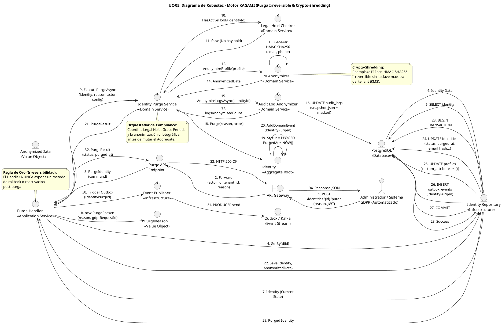

# UC-05: Purgar Identidad - Diagrama de Robustez

| Metadatos del Documento | |
| :--- | :--- |
| **Proyecto:** | SHUGO - Identity & Access Platform |
| **Caso de Uso:** | UC-05 - Purgar Identidad (Hard Delete / GDPR Right to Erasure) |
| **Documento:** | 06_Robustness_Diagram.md |
| **Metodología:** | ICONIX (Diagrama de Robustez) + Clean Architecture + DDD + GDPR Compliance + Cryptographic Anonymization |
| **Autor:** | Gastón Ruiz |
| **Versión Actual:** | 1.0.0 |
| **Fecha:** | 03/09/2026 |

---

## Historial de Versiones

| Versión | Fecha | Autor | Descripción de Cambios | Impacto |
| :--- | :--- | :--- | :--- | :--- |
| **1.0.0** | 03/09/2026 | Gastón Ruiz | **Creación inicial.** Diagrama de Robustez para UC-05, validando la arquitectura del motor KAGAMI para operaciones destructivas irreversibles. Muestra la colaboración estricta entre Boundaries (API Gateway, Purge Endpoint), Controls (Purge Handler, IdentityPurgeService, LegalHoldChecker, PIIAnonymizer, AuditLogAnonymizer), y Entities (Identity, PurgeReason, AnonymizedData, Repository). Valida el principio de "Crypto-Shredding", la supremacía del Legal Hold y la atomicidad transaccional con Outbox. | Documento base del paquete de diseño Tier 1 del UC-05. Sirve como puente crítico entre el Modelo de Dominio (04) y el Diagrama de Secuencia (07), asegurando que la arquitectura soporta la irreversibilidad, el cumplimiento normativo (GDPR/NIST) y la consistencia eventual antes de codificar. |

---

## 1. Introducción y Propósito

El **Diagrama de Robustez** para el UC-05 valida que el flujo de purga irreversible de identidades puede ser orquestado respetando las reglas estrictas de acoplamiento de **ICONIX** y los principios de **Domain-Driven Design (DDD)** y **Clean Architecture**.

A diferencia de los UCs de mutación reversible (UC-02, UC-03), el UC-05 es una **operación destructiva terminal** que introduce cinco complejidades arquitectónicas críticas:

1. **Supremacía de Compliance (Legal Hold):** La validación de retención legal debe actuar como un bloqueador de prioridad absoluto antes de cualquier modificación de datos.
2. **Crypto-Shredding (Anonimización Criptográfica):** La sustitución de PII por hashes HMAC-SHA256 irreversibles, coordinada por servicios de dominio especializados.
3. **Coordinación de Múltiples Entidades:** La purga no solo afecta al Aggregate `Identity`, sino que requiere la anonimización de `AuditLogs`, lo cual excede los límites de un solo Aggregate.
4. **Atomicidad Transaccional:** El cambio de estado, la anonimización de datos, la actualización de logs y la generación del evento Outbox deben ocurrir en una sola transacción atómica.
5. **Irreversibilidad por Diseño:** Una vez confirmada la transacción, no existe ningún flujo de retorno o "undo".

---

## 2. Diagrama de Robustez (PlantUML)

A continuación, se presenta el Diagrama de Robustez organizado de izquierda a derecha para mostrar el flujo natural: **Actor → Boundary → Control → Entity**.



---

## 3. Explicación Detallada de los Objetos

### 3.1. Boundary Objects (Objetos de Límite)

| Objeto | Responsabilidad | Mapeo a Clean Architecture |
| :--- | :--- | :--- |
| **`API Gateway`** | Valida el JWT, extrae `actor_id`, `tenant_id`, y verifica el permiso granular `identity:purge`. Inyecta la `reason` y `gdpr_request_id` en el contexto. | Middleware (Kong, AWS API Gateway). |
| **`Purge API Endpoint`** | Recibe la request HTTP `POST /identities/{id}/purge`, deserializa el payload a un DTO (`PurgeIdentityCommand`), y lo pasa al Handler. | Controller (ASP.NET Core Controller). |

### 3.2. Control Objects (Objetos de Control)

| Objeto | Responsabilidad | Mapeo a Clean Architecture |
| :--- | :--- | :--- |
| **`Purge Handler`** | **Application Service.** Orquesta el caso de uso. Carga la identidad, construye los Value Objects, delega la lógica compleja de compliance y anonimización al Domain Service, y gestiona la transacción atómica. | Command Handler / Application Service. |
| **`Identity Purge Service`** | **Domain Service.** El núcleo de la lógica de negocio. Valida las guardas de compliance (Legal Hold, Grace Period), coordina los servicios de anonimización, y ejecuta la mutación terminal en el Aggregate Root. | Domain Service. |
| **`Legal Hold Checker`** | **Domain Service (Interfaz).** Consulta el sistema de retención legal. Actúa como el bloqueador de prioridad absoluto sobre el Derecho al Olvido (GDPR Art. 17.3.b). | Domain Service / Port. |
| **`PII Anonymizer`** | **Domain Service.** Responsable de la transformación criptográfica (Crypto-Shredding). Reemplaza datos sensibles por hashes HMAC-SHA256 deterministas e irreversibles. | Domain Service. |
| **`Audit Log Anonymizer`** | **Domain Service.** Anonimiza los valores PII dentro de los `snapshot_json` de los logs de auditoría históricos, preservando la estructura del log para evidencia forense. | Domain Service. |
| **`Event Publisher`** | **Infrastructure Service.** Publica el evento `IdentityPurged` en Kafka de forma asíncrona. Si Kafka está caído, el evento permanece en el Outbox de PostgreSQL. | Infrastructure Service. |

### 3.3. Entity Objects (Objetos de Entidad)

| Objeto | Responsabilidad | Mapeo a DDD |
| :--- | :--- | :--- |
| **`Identity`** | **Aggregate Root.** Expone el método terminal `Purge()`. Valida su propia transición de estado (`DEACTIVATED` → `PURGED`) y genera el evento de dominio. | Aggregate Root. |
| **`PurgeReason`** | **Value Object.** Encapsula la justificación legal/administrativa de la purga, vinculándola opcionalmente a un `GdprRequestId`. | Value Object. |
| **`AnonymizedData`** | **Value Object.** Representa el resultado de la transformación criptográfica, conteniendo los hashes y la lista de campos afectados. | Value Object. |
| **`Identity Repository`** | **Infrastructure.** Abstrae la persistencia. Implementa la transacción atómica que actualiza la identidad, el perfil, y registra el evento en el Outbox. | Repository Interface (Domain) / Implementation (Infra). |

---

## 4. Reglas de Robustez de ICONIX (Validación del Diagrama)

Verifiquemos que nuestro diagrama cumple estrictamente las reglas de acoplamiento de ICONIX:

### ✅ Regla 1: Actor → Boundary
- **Cumplida:** El `Actor` (Admin/Sistema GDPR) interactúa solo con el `API Gateway`.

### ✅ Regla 2: Boundary → Boundary
- **Cumplida:** El `API Gateway` forward la request al `Purge API Endpoint`.

### ✅ Regla 3: Boundary → Control
- **Cumplida:** El `Purge API Endpoint` envía el Command al `Purge Handler`.

### ✅ Regla 4: Control → Control
- **Cumplida y Crítica:** El `Purge Handler` es delgado y delega toda la lógica compleja de compliance y anonimización al `Identity Purge Service`. Este a su vez coordina al `Legal Hold Checker`, `PII Anonymizer`, y `Audit Log Anonymizer`.
- **Validación:** Esto mantiene el Application Service libre de lógica de dominio y permite que las reglas de compliance y criptografía sean reutilizables y testeables de forma aislada.

### ✅ Regla 5: Control → Entity
- **Cumplida:**
  - `Purge Handler` crea el Value Object `PurgeReason`.
  - `Identity Purge Service` invoca el método `Purge()` en el Aggregate Root `Identity`.
  - `Purge Handler` llama a `Identity Repository` para persistir.
  - `Audit Log Anonymizer` actualiza directamente la tabla `audit_logs` en la DB (justificado por ser una operación de compliance transversal que no altera el estado del Aggregate `Identity`).
  - `Event Publisher` interactúa con Kafka/Outbox.

### ✅ Regla 6: NO Entity → Control / Boundary
- **Cumplida:** Ninguna entidad (`Identity`, `Reason`, `Anonymized`, `Repo`) envía mensajes de vuelta a los controles o boundaries. Solo retornan datos como respuesta a una invocación.

### ✅ Regla 7: NO Entity → Entity (Directo sin Control)
- **Cumplida:** El `Identity Purge Service` (Control) es el único que orquesta la interacción entre el Aggregate `Identity` y los servicios de anonimización. Los Value Objects son creados y pasados por los controles.

---

## 5. Consideraciones de Arquitectura (Clean Architecture + DDD)

### 5.1. Supremacía del Legal Hold (Compliance Aspect)

El diagrama valida visualmente que la consulta al `Legal Hold Checker` (Pasos 10-11) ocurre **antes** de cualquier anonimización o mutación de estado.

**Justificación:**
- **GDPR Art. 17.3(b):** "El derecho al olvido no aplica cuando el tratamiento es necesario para el cumplimiento de una obligación legal."
- **Fail-Safe:** Si el sistema de Legal Hold está caído, el `LegalHoldChecker` debe asumir el estado más conservador (bloquear la purga) para evitar violaciones legales catastróficas.

### 5.2. Crypto-Shredding y Anonimización Pre-Mutación

Los pasos 12-17 muestran que la anonimización criptográfica (`PII Anonymizer` y `Audit Log Anonymizer`) ocurre **antes** de invocar `Identity.Purge()`.

**Justificación:**
- **Principio de Inmutabilidad del Aggregate:** El Aggregate Root `Identity` no debe contener la lógica compleja de hashing HMAC o la coordinación con la tabla de `audit_logs`. Recibe el resultado (`AnonymizedData`) y simplemente actualiza su estado interno.
- **NIST SP 800-88:** El estándar define "Purge" como técnicas que hacen los datos irrecuperables. El HMAC-SHA256 sin la clave maestra cumple legalmente con esta definición.

### 5.3. Atomicidad Transaccional con Outbox

El `Identity Repository` (Pasos 22-29) ejecuta una transacción atómica que abarca:
1. `UPDATE identities` (cambio de estado a `PURGED`, `purged_at`, y hashes de PII).
2. `UPDATE profiles` (eliminación de `custom_attributes` sensibles).
3. `INSERT outbox_events` (evento de dominio `IdentityPurged`).

**Justificación:**
- **Integridad Forense:** Si la inserción del evento Outbox falla, la purga se revierte. Nunca existirá una identidad purgada sin su correspondiente notificación a los sistemas downstream.
- **Consistencia Eventual:** El evento en el Outbox garantiza que KAGI, KIZUNA, KAGE y TORII reciban la notificación eventualmente, incluso si están caídos en el momento de la purga.

---

## 6. Trazabilidad con Otros Documentos del Paquete

| Documento | Relación |
| :--- | :--- |
| `01_Requirements_Specification.md` | Este diagrama valida que los requisitos de Legal Hold Priority (INV-27), Anonimización Completa (INV-28) y Atomicidad (RN-04) pueden ser implementados con los objetos definidos. |
| `02_Use_Case_Diagram.md` | Muestra los actores y sistemas; este diagrama muestra cómo colaboran los objetos internos. |
| `03_Activity_Diagram.md` | Los carriles de actividad (Purge Handler, IdentityPurgeService, LegalHoldChecker, Anonymizers) se mapean directamente a los objetos de Control de este diagrama. |
| `04_Initial_Domain_Model.md` | Los objetos `Identity`, `PurgeReason`, `AnonymizedData` y los servicios `IdentityPurgeService`/`PIIAnonymizer` son exactamente las clases definidas en el modelo de dominio. |
| `05_State_Machine_Diagram.md` | Las transiciones de estado (ej. `DEACTIVATED` → `PURGED`) y las guardas (Legal Hold, Grace Period) se ejecutan cuando el `IdentityPurgeService` invoca `Identity.Purge()`. |
| `07_Sequence_Diagram.md` | Este diagrama define "qué objetos colaboran"; el de secuencia definirá "en qué orden temporal exacto" se envían los mensajes. |
| `08_Final_Class_Design.md` | Definirá las firmas exactas de los métodos mostrados en este diagrama (ej. `Identity.Purge()`, `PIIAnonymizer.Anonymize()`). |

---

## 7. Notas de Implementación

### 7.1. Inyección de Dependencias

El `Purge Handler` debe tener inyectados los servicios de dominio y repositorios:

```csharp
public class PurgeHandler : IPurgeHandler
{
    private readonly IIdentityPurgeService _purgeService;
    private readonly IIdentityRepository _repository;
    private readonly IEventPublisher _publisher;
    private readonly IUnitOfWork _unitOfWork;

    public PurgeHandler(
        IIdentityPurgeService purgeService,
        IIdentityRepository repository,
        IEventPublisher publisher,
        IUnitOfWork unitOfWork)
    {
        _purgeService = purgeService;
        _repository = repository;
        _publisher = publisher;
        _unitOfWork = unitOfWork;
    }
}
```

### 7.2. Flujo de Ejecución Simplificado (Código)

```csharp
public async Task<PurgeResult> Handle(PurgeCommand command, CancellationToken ct)
{
    // 1. Cargar identidad
    var identity = await _repository.GetByIdAsync(command.IdentityId);
    if (identity == null || identity.Status == IdentityStatus.PURGED)
        throw new IdentityNotFoundException(command.IdentityId);

    // 2. Construir Value Objects
    var reason = new PurgeReason(command.Reason, command.GdprRequestId);
    var actor = new Actor(command.ActorId, ActorType.Admin);
    var config = await _repository.GetTenantConfigAsync(identity.TenantId);

    // 3. Delegar al Domain Service (Orquestación de Compliance y Anonimización)
    var purgeResult = await _purgeService.ExecutePurgeAsync(identity, reason, actor, config);

    // 4. Persistencia Atómica
    await _unitOfWork.BeginTransactionAsync();
    try
    {
        await _repository.SaveAsync(identity); // Incluye estado PURGED y datos anonimizados
        await _repository.SaveOutboxEventAsync(purgeResult.DomainEvent);
        await _unitOfWork.CommitAsync();
    }
    catch (Exception ex)
    {
        await _unitOfWork.RollbackAsync();
        throw new PurgePersistenceException("Purga fallida. Los datos no han sido modificados.", ex);
    }

    // 5. Publicación Asíncrona (No bloquea la respuesta)
    _ = _publisher.PublishAsync(purgeResult.DomainEvent);

    return purgeResult;
}
```

---
*Fin del Documento 06_Robustness_Diagram para UC-05*