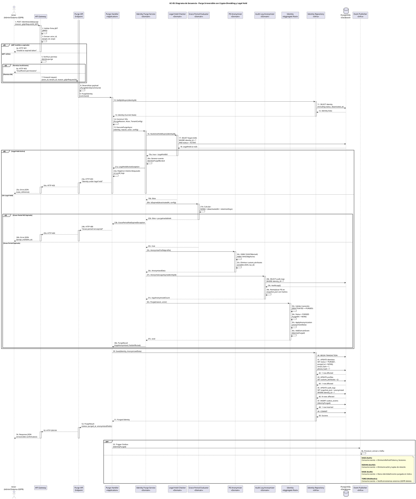

# UC-05: Purgar Identidad - Diagrama de Secuencia

| Metadatos del Documento | |
| :--- | :--- |
| **Proyecto:** | SHUGO - Identity & Access Platform |
| **Caso de Uso:** | UC-05 - Purgar Identidad (Hard Delete / GDPR Right to Erasure) |
| **Documento:** | 07_Sequence_Diagram.md |
| **Metodología:** | ICONIX (Diagrama de Secuencia) + Clean Architecture + DDD + GDPR Compliance + Cryptographic Anonymization |
| **Autor:** | Gastón Ruiz |
| **Versión Actual:** | 1.0.0 |
| **Fecha:** | 03/09/2026 |

---

## Historial de Versiones

| Versión | Fecha | Autor | Descripción de Cambios | Impacto |
| :--- | :--- | :--- | :--- | :--- |
| **1.0.0** | 03/09/2026 | Gastón Ruiz | **Creación inicial.** Diagrama de Secuencia completo para UC-05. Modela la orquestación temporal exacta de la purga irreversible de identidades, destacando la validación de Legal Hold (bloqueador de prioridad), la anonimización criptográfica de PII y audit logs (HMAC-SHA256), la ejecución del método terminal `Purge()` en el Aggregate Root, la persistencia atómica con Outbox Pattern, y la publicación asíncrona de eventos para sistemas downstream (KAGI, KIZUNA, KAGE, TORII). | Documento base del paquete de diseño Tier 1 del UC-05. Sirve como guion exacto para la codificación del `PurgeHandler`, la gestión de transacciones atómicas, y la integración de los servicios de dominio (IdentityPurgeService, LegalHoldChecker, PIIAnonymizer, AuditLogAnonymizer). |

---

## 1. Introducción y Propósito

El **Diagrama de Secuencia** para el UC-05 materializa temporalmente las colaboraciones definidas en el Diagrama de Robustez. Su propósito es:

1. **Definir el orden exacto de las operaciones:** Establecer la secuencia crítica donde la validación de Legal Hold ocurre *antes* de cualquier anonimización, y la anonimización ocurre *antes* de la mutación del estado.
2. **Modelar la Orquestación de Compliance:** Mostrar cómo el `IdentityPurgeService` coordina múltiples servicios de dominio (LegalHoldChecker, GracePeriodEvaluator, PIIAnonymizer, AuditLogAnonymizer) antes de permitir la transición terminal.
3. **Visualizar la Atomicidad Transaccional:** Detallar cómo el cambio de estado, la anonimización de PII, la actualización de audit logs, y la inserción del evento Outbox ocurren en una sola transacción atómica.
4. **Demostrar la Consistencia Eventual:** Mostrar cómo los efectos secundarios críticos (eliminación de sesiones en KAGI, caché en KIZUNA, logs en KAGE, webhooks en TORII) se disparan de forma asíncrona tras el COMMIT.
5. **Modelar los Flujos de Excepción:** Mostrar cómo cada fallo (Legal Hold activo, Grace Period no expirado, error de anonimización) retorna un código HTTP específico sin comprometer la integridad de los datos.

---

## 2. Diagrama de Secuencia - Escenario Principal (PlantUML)

A continuación, se presenta el Diagrama de Secuencia para el **Escenario Principal (purga individual exitosa)** y sus variaciones de excepción.



---

## 3. Análisis Detallado del Flujo

### 3.1. Fase 1: Autenticación y Autorización (Pasos 1-7)

**Participantes:** `Actor`, `API Gateway`

*   **Validación Local del JWT:** El API Gateway valida la firma del JWT localmente usando las claves públicas del JWKS endpoint de SHUGO. No llama a ningún servicio externo para validar el token.
*   **Extracción de Claims:** Extrae `actor_id`, `tenant_id`, y `scope` del JWT y los inyecta en el contexto de la request.
*   **Validación de Permisos:** Verifica que el usuario tenga el permiso granular `identity:purge`. Este permiso es independiente de `identity:update` y `identity:deactivate`.
*   **Fail Fast:** Si el JWT es inválido o los permisos son insuficientes, se retorna error inmediatamente (401 o 403).

**Justificación:**
- **Seguridad:** El `tenant_id` se extrae del JWT firmado, no de headers manipulables.
- **Rendimiento:** Validar el JWT localmente (con JWKS cacheado) es mucho más rápido que llamar a un servicio de autenticación.
- **Separación de Responsabilidades:** La autorización granular ocurre en el Gateway, no en la capa de aplicación.

### 3.2. Fase 2: Carga de Identidad y Construcción de VOs (Pasos 8-14)

**Participantes:** `Purge API Endpoint`, `Purge Handler`, `Identity Repository`, `PostgreSQL`

*   **Deserialización:** El endpoint deserializa el payload en un `PurgeIdentityCommand` (DTO).
*   **Carga del Aggregate:** El Handler carga la identidad completa desde PostgreSQL, incluyendo `status`, `deactivated_at`, y `profile`.
*   **Construcción de Value Objects:** Se construyen los VOs `PurgeReason` (con `gdprRequestId` opcional), `Actor`, y se carga el `TenantConfig` para evaluar el Grace Period.

**Justificación:**
- **Eficiencia:** Cargar todo el Aggregate de una vez evita múltiples round-trips a la base de datos.
- **Inmutabilidad:** Los Value Objects (`PurgeReason`, `Actor`) son inmutables y validan su propia integridad en el constructor.

### 3.3. Fase 3: Orquestación de Dominio (Pasos 15-38)

**Participantes:** `Purge Handler`, `Identity Purge Service`, `Legal Hold Checker`, `Grace Period Evaluator`, `PII Anonymizer`, `Audit Log Anonymizer`, `Identity`

Esta es la fase más crítica del flujo, donde se validan las guardas de compliance y se ejecuta la anonimización criptográfica.

#### Guarda 1: Legal Hold (Pasos 16-25a)

*   **Consulta a Legal Hold:** El `LegalHoldChecker` consulta la tabla `legal_holds` para verificar si hay una retención legal activa sobre la identidad.
*   **Bloqueo Automático:** Si hay Legal Hold activo, se lanza `LegalHoldActiveException` y se retorna HTTP 403.
*   **Registro de Intento Bloqueado:** Se registra el intento de purga bloqueado en `audit_logs` para auditoría.
*   **Notificación al Oficial de Cumplimiento:** Se genera alerta al oficial de cumplimiento (implementado como evento de dominio o llamada a servicio externo).

**Justificación:**
- **GDPR Art. 17.3(b):** "El derecho al olvido no aplica cuando el tratamiento es necesario para el cumplimiento de una obligación legal."
- **Fail-Safe:** Si el sistema de Legal Hold está caído, el `LegalHoldChecker` debe asumir el estado más conservador (bloquear la purga) para evitar violaciones legales catastróficas.

#### Guarda 2: Grace Period (Pasos 20b-26b)

*   **Evaluación Temporal:** El `GracePeriodEvaluator` calcula si `DateTime.UtcNow > (DeactivatedAt + TenantConfig.RetentionDays)`.
*   **Bloqueo Temporal:** Si el Grace Period no ha expirado, se lanza `GracePeriodNotExpiredException` y se retorna HTTP 400 con la fecha disponible para purga.

**Justificación:**
- **Prevención de Purgas Prematuras:** Permite reactivación en caso de error durante el período de gracia.
- **Flexibilidad por Tenant:** Diferentes tenants tienen diferentes requisitos legales de retención (ej. 30 días para estándar, 365 días para financiero).

#### Anonimización Criptográfica de PII (Pasos 23c-26c)

*   **HMAC-SHA256 Irreversible:** El `PIIAnonymizer` reemplaza el email y phone con hashes HMAC-SHA256 usando la clave maestra del tenant (gestionada por KMS).
*   **Eliminación de Atributos Sensibles:** Los `custom_attributes` sensibles (SSN, tax_id, bank_account) se eliminan completamente (no se anonimizan, se eliminan).
*   **Generación de AnonymizedData:** Se retorna un VO con la lista de campos afectados y metadatos de anonimización.

**Justificación:**
- **NIST SP 800-88:** El estándar define "Purge" como técnicas que hacen los datos irrecuperables. HMAC-SHA256 sin la clave maestra cumple legalmente con esta definición.
- **Crypto-Shredding:** Si la clave maestra del tenant se rota o destruye, todos los hashes se vuelven inútiles, garantizando el "Right to Erasure" absoluto.

#### Anonimización de Audit Logs (Pasos 27c-31c)

*   **Consulta de Logs Históricos:** El `AuditLogAnonymizer` consulta todos los logs de auditoría asociados a la identidad.
*   **Reemplazo de PII en snapshot_json:** Los valores PII dentro del JSON se reemplazan con hashes irreversibles, preservando la estructura del log (timestamps, actor, action).
*   **Conteo de Logs Anonimizados:** Se retorna el conteo para incluirlo en el evento de dominio.

**Justificación:**
- **Preservación de Evidencia:** Los logs de auditoría deben preservarse para investigaciones futuras, pero sin exponer PII.
- **GDPR Art. 17:** Requiere eliminación de datos personales, pero permite retención de evidencia de que la purga ocurrió.

#### Mutación del Aggregate (Pasos 32c-37c)

*   **Validación de Transición:** El método `Identity.Purge()` valida que el estado actual sea `DEACTIVATED`.
*   **Transición Terminal:** Se actualiza `Status = PURGED` y `PurgedAt = NOW()`.
*   **Aplicación de Anonimización:** Se aplican los hashes de PII al Aggregate.
*   **Generación de Evento de Dominio:** Se añade `IdentityPurged` a la lista de eventos de dominio.

**Justificación:**
- **Irreversibilidad por Diseño:** Una vez que el estado es `PURGED`, no hay transiciones de salida en la máquina de estados.
- **Inmutabilidad del Timestamp:** `PurgedAt` es un Value Object inmutable que no puede ser modificado.

### 3.4. Fase 4: Persistencia Atómica (Pasos 39-51)

**Participantes:** `Purge Handler`, `Identity Repository`, `PostgreSQL`

*   **Inicio de Transacción:** Se inicia una transacción atómica con `BEGIN TRANSACTION`.
*   **UPDATE identities:** Se actualiza el estado a `PURGED`, se setea `purged_at`, y se actualizan los hashes de email y phone.
*   **UPDATE profiles:** Se eliminan los `custom_attributes` sensibles (se setea a JSON vacío `{}`).
*   **UPDATE audit_logs:** Se actualizan los `snapshot_json` de los logs de auditoría con los valores anonimizados.
*   **INSERT outbox_events:** Se inserta el evento de dominio `IdentityPurged` en la tabla Outbox.
*   **COMMIT:** Se confirman todos los cambios atómicamente.

**Justificación:**
- **Atomicidad:** Si cualquier operación falla (ej. error de DB), se hace Rollback completo. La identidad NO se purga.
- **Integridad Forense:** Nunca existirá una identidad purgada sin su correspondiente log de auditoría y evento Outbox.
- **Consistencia Eventual:** El evento en el Outbox garantiza que los sistemas downstream reciban la notificación eventualmente.

### 3.5. Fase 5: Respuesta y Efectos Asíncronos (Pasos 52-60)

**Participantes:** `Purge Handler`, `Purge API Endpoint`, `API Gateway`, `Actor`, `Event Publisher`

*   **Respuesta HTTP 200:** Se retorna el nuevo estado (`PURGED`), el timestamp `purged_at`, y la lista de campos anonimizados.
*   **Fork Asíncrono:**
    *   **Outbox Processing:** El evento `IdentityPurged` se publica en Kafka.
    *   **KAGI (Auth):** Consume el evento y elimina todos los RefreshTokens y sesiones activas en Redis.
    *   **KIZUNA (AuthZ):** Consume el evento y elimina la caché de autorización y las tuplas de relación.
    *   **KAGE (Audit):** Consume el evento y marca la identidad como purgada en el índice de auditoría.
    *   **TORII (Webhooks):** Consume el evento y notifica a sistemas externos registrados (ej. "Usuario eliminado permanentemente por GDPR").

**Justificación:**
- **Baja Latencia:** El cliente recibe su confirmación en < 500ms. La propagación downstream ocurre en background.
- **Resiliencia:** Si KAGI, KIZUNA, KAGE, o TORII están caídos, el evento permanece en Kafka/Outbox y se procesará en cuanto se recuperen.
- **Consistencia Eventual:** Los sistemas downstream eventualmente sincronizarán su estado con KAGAMI (Source of Truth).

---

## 4. Flujos Alternativos y Excepciones

### 4.1. Flujo Alternativo: Legal Hold Activo (Fase 3, Pasos 19a-25a)

Si hay un Legal Hold activo sobre la identidad:

```
Actor -> GW -> API -> Handler -> PurgeService -> LegalHold -> DB (LegalHold found) -> LegalHold -> PurgeService (true) -> PurgeService -> Handler (LegalHoldActiveException) -> Handler -> API -> GW -> Actor (HTTP 403)
```

**Pasos:** 1-19a, 20a-25a.
**Tiempo total:** ~20ms (consulta a DB de legal_holds).
**Justificación:** Legal Hold tiene prioridad sobre GDPR Art. 17. Se genera alerta al oficial de cumplimiento y se registra el intento bloqueado.

### 4.2. Flujo Alternativo: Grace Period No Expirado (Fase 3, Pasos 22b-26b)

Si el Grace Period no ha transcurrido:

```
Actor -> GW -> API -> Handler -> PurgeService -> LegalHold (false) -> GracePeriod -> GracePeriod (false) -> GracePeriod -> PurgeService (false + purgeAvailableAt) -> PurgeService -> Handler (GracePeriodNotExpiredException) -> Handler -> API -> GW -> Actor (HTTP 400)
```

**Pasos:** 1-22b, 23b-26b.
**Tiempo total:** ~15ms (cálculo temporal en memoria).
**Justificación:** Permite reactivación en caso de error durante el período de gracia. Se retorna la fecha disponible para purga.

### 4.3. Flujo Alternativo: Fallo de Anonimización (Fase 4)

Si la anonimización de PII o audit logs falla:

```
Actor -> GW -> API -> Handler -> PurgeService -> LegalHold (false) -> GracePeriod (true) -> PIIAnonymizer (exception) -> PurgeService -> Handler (AnonymizationException) -> Handler -> API -> GW -> Actor (HTTP 500)
```

**Pasos:** 1-24c (o 28c), excepción, rollback.
**Tiempo total:** ~30ms (fallo detectado antes de COMMIT).
**Justificación:** La transacción se revierte completamente. La identidad permanece en estado `DEACTIVATED` con PII intacto. Se genera alerta crítica al equipo de operaciones.

### 4.4. Flujo Alternativo: Fallo de Persistencia (Fase 4, Pasos 40-50)

Si la transacción de base de datos falla:

```
Actor -> GW -> API -> Handler -> PurgeService (success) -> Handler -> Repo -> DB (BEGIN) -> DB (UPDATE identities) -> DB (UPDATE profiles) -> DB (UPDATE audit_logs) -> DB (INSERT outbox_events) -> DB (COMMIT fails) -> Repo -> Handler (DbUpdateException) -> Handler -> API -> GW -> Actor (HTTP 500)
```

**Pasos:** 1-49 (COMMIT falla).
**Tiempo total:** ~100ms (transacción revertida).
**Justificación:** Rollback completo. La identidad NO se purga. Se genera alerta crítica y se reintenta automáticamente (hasta 3 veces con backoff exponencial).

### 4.5. Flujo Alternativo: Identidad Ya Purgada (Idempotencia)

Si la identidad ya está en estado `PURGED`:

```
Actor -> GW -> API -> Handler -> Repo -> DB (Identity with PURGED status) -> Repo -> Handler -> Handler (detecta PURGED) -> Handler -> API -> GW -> Actor (HTTP 200 OK, No-op)
```

**Pasos:** 1-13, detección de PURGED, retorno 200.
**Tiempo total:** ~10ms.
**Justificación:** Idempotencia. No se generan eventos duplicados ni logs de auditoría redundantes.

### 4.6. Flujo de Excepción: Identidad No Encontrada

Si la identidad no existe:

```
Actor -> GW -> API -> Handler -> Repo -> DB (null) -> Repo -> Handler (null) -> Handler -> API -> GW -> Actor (HTTP 404)
```

**Pasos:** 1-13 (null), retorno 404.
**Tiempo total:** ~10ms.
**Justificación:** Ocultamiento de existencia. No se revela si la identidad existió y fue purgada.

---

## 5. Consideraciones de Arquitectura (Clean Architecture + DDD + GDPR Compliance)

### 5.1. Orquestación de Compliance Centralizada

El diagrama muestra que el `Identity Purge Service` actúa como el núcleo de la lógica de negocio:

1. **Validación de Legal Hold:** Primera guarda, bloqueador de prioridad absoluto.
2. **Validación de Grace Period:** Segunda guarda, prevención de purgas prematuras.
3. **Anonimización Criptográfica:** Tercera fase, transformación irreversible de PII.
4. **Anonimización de Audit Logs:** Cuarta fase, preservación de evidencia forense.
5. **Mutación del Aggregate:** Quinta fase, transición terminal a `PURGED`.

**Justificación:**
- **Separación de Responsabilidades:** El `Purge Handler` (Application Service) es delgado y delega toda la lógica compleja al `Identity Purge Service` (Domain Service).
- **Testeabilidad:** Cada servicio de dominio puede ser testeado de forma aislada.
- **Reutilización:** Los servicios de anonimización pueden ser reutilizados por otros casos de uso (ej. anonimización de datos en UC-02 si se solicita).

### 5.2. Crypto-Shredding y Anonimización Pre-Mutación

El diagrama muestra que la anonimización criptográfica ocurre **antes** de invocar `Identity.Purge()`:

1. **PII Anonymizer:** Genera hashes HMAC-SHA256 para email y phone.
2. **Audit Log Anonymizer:** Reemplaza PII en `snapshot_json` de logs históricos.
3. **Identity.Purge():** Recibe el `AnonymizedData` y aplica los cambios al Aggregate.

**Justificación:**
- **Principio de Inmutabilidad del Aggregate:** El Aggregate Root `Identity` no debe contener la lógica compleja de hashing HMAC o la coordinación con la tabla de `audit_logs`.
- **NIST SP 800-88:** El estándar define "Purge" como técnicas que hacen los datos irrecuperables. El HMAC-SHA256 sin la clave maestra cumple legalmente con esta definición.
- **Fail-Safe:** Si la anonimización falla, la transición de estado no ocurre.

### 5.3. Atomicidad Transaccional con Outbox

El `Identity Repository` (Pasos 39-51) ejecuta una transacción atómica que abarca:
1. `UPDATE identities` (cambio de estado a `PURGED`, `purged_at`, y hashes de PII).
2. `UPDATE profiles` (eliminación de `custom_attributes` sensibles).
3. `UPDATE audit_logs` (anonimización de `snapshot_json`).
4. `INSERT outbox_events` (evento de dominio `IdentityPurged`).

**Justificación:**
- **Integridad Forense:** Si la inserción del evento Outbox falla, la purga se revierte. Nunca existirá una identidad purgada sin su correspondiente notificación a los sistemas downstream.
- **Consistencia Eventual:** El evento en el Outbox garantiza que KAGI, KIZUNA, KAGE y TORII reciban la notificación eventualmente, incluso si están caídos en el momento de la purga.
- **Irreversibilidad:** Una vez confirmada la transacción, la operación es irreversible por diseño.

### 5.4. Supremacía del Legal Hold

El diagrama valida visualmente que la consulta al `Legal Hold Checker` (Pasos 16-19) ocurre **antes** de cualquier anonimización o mutación de estado.

**Justificación:**
- **GDPR Art. 17.3(b):** "El derecho al olvido no aplica cuando el tratamiento es necesario para el cumplimiento de una obligación legal."
- **Fail-Safe:** Si el sistema de Legal Hold está caído, el `LegalHoldChecker` debe asumir el estado más conservador (bloquear la purga) para evitar violaciones legales catastróficas.
- **Auditabilidad:** Todos los intentos de purga bloqueados quedan registrados para auditoría.

---

## 6. Trazabilidad con Otros Documentos del Paquete

| Documento | Relación |
| :--- | :--- |
| `01_Requirements_Specification.md` | Este diagrama visualiza los flujos de texto, las invariantes de dominio (Legal Hold Priority, Anonimización Completa, Irreversibilidad) y los criterios de aceptación. |
| `02_Use_Case_Diagram.md` | Muestra el límite del sistema y los actores; este diagrama muestra el flujo interno. |
| `03_Activity_Diagram.md` | Los carriles de actividad se mapean directamente a los participantes de este diagrama. |
| `04_Initial_Domain_Model.md` | Los Aggregate Roots (`Identity`), Value Objects (`PurgeReason`, `AnonymizedData`), y Domain Services (`IdentityPurgeService`, `LegalHoldChecker`, `PIIAnonymizer`, `AuditLogAnonymizer`) de este diagrama son exactamente las clases definidas en el modelo. |
| `05_State_Machine_Diagram.md` | Este diagrama muestra la colaboración de objetos; las máquinas de estados muestran las transiciones internas de cada objeto (ej. `Identity.Status` transiciona en el paso 34c). |
| `06_Robustness_Diagram.md` | Este diagrama define "qué objetos colaboran"; el de robustez muestra la colaboración de forma más abstracta. |
| `08_Final_Class_Design.md` | Definirá las firmas exactas de los métodos mostrados en este diagrama (ej. `Identity.Purge()`, `PIIAnonymizer.Anonymize()`, `LegalHoldChecker.HasActiveHoldAsync()`). |
| `KAGAMI_Engine_Architecture.md` | Documento global que define la arquitectura completa del motor KAGAMI. |

---

## 7. Notas de Implementación

### 7.1. Inyección de Dependencias y Scope

El `Purge Handler` debe ser registrado como **Scoped** (por request) en el contenedor de DI, al igual que el `UnitOfWork` (si se usa explícitamente) y el `DbContext` de EF Core, para garantizar que la transacción de DB se mantenga coherente durante toda la operación.

```csharp
// Program.cs / Startup.cs
services.AddScoped<IPurgeHandler, PurgeHandler>();
services.AddScoped<IIdentityPurgeService, IdentityPurgeService>();
services.AddScoped<ILegalHoldChecker, LegalHoldChecker>();
services.AddScoped<IGracePeriodEvaluator, GracePeriodEvaluator>();
services.AddScoped<IPIIAnonymizer, PIIAnonymizer>();
services.AddScoped<IAuditLogAnonymizer, AuditLogAnonymizer>();
services.AddScoped<IIdentityRepository, IdentityRepository>();
services.AddScoped<IUnitOfWork, UnitOfWork>();
```

### 7.2. Manejo de la Transacción y Outbox en EF Core

Si se utiliza Entity Framework Core, la transacción y el Outbox se manejan de la siguiente manera:

```csharp
public async Task<PurgeResult> Handle(PurgeCommand command, CancellationToken ct)
{
    // ... (Carga, Validación de Guardas, Anonimización) ...
    
    // Acción de Dominio
    var purgeResult = await _purgeService.ExecutePurgeAsync(identity, reason, actor, config);

    // Outbox Event
    var outboxEvent = new OutboxEvent("Identity.Purged", identity.Id, identity.TenantId);

    // Persistencia Atómica
    using var transaction = await _dbContext.Database.BeginTransactionAsync(ct);
    try
    {
        _dbContext.Identities.Update(identity); // Incluye estado PURGED y datos anonimizados
        _dbContext.Profiles.Update(purgeResult.AnonymizedProfile); // custom_attributes = {}
        
        // Actualizar audit logs anonimizados
        foreach (var log in purgeResult.AnonymizedAuditLogs)
        {
            _dbContext.Entry(log).State = EntityState.Modified;
        }
        
        _dbContext.OutboxEvents.Add(outboxEvent);
        
        await _dbContext.SaveChangesAsync(ct); // EF Core maneja el OCC (row_version) aquí
        await transaction.CommitAsync(ct);
    }
    catch (Exception ex)
    {
        await transaction.RollbackAsync(ct);
        _logger.LogError(ex, "Failed to purge identity {IdentityId}", command.IdentityId);
        
        // Generar alerta crítica
        await _alertService.SendCriticalAlertAsync(
            $"Purge failed for identity {command.IdentityId}: {ex.Message}");
        
        throw;
    }

    return purgeResult;
}
```

### 7.3. Configuración de Timeouts y Circuit Breakers

Para garantizar la resiliencia, se deben configurar timeouts y circuit breakers para las dependencias externas:

```csharp
// Configuración de Legal Hold Checker con timeout de 5s
services.AddHttpClient<ILegalHoldChecker, LegalHoldChecker>(client =>
{
    client.Timeout = TimeSpan.FromSeconds(5);
});

// Circuit Breaker para Legal Hold Checker (Polly)
services.AddPolicyHandler(Policy<HttpResponseMessage>
    .Handle<HttpRequestException>()
    .Or<TimeoutException>()
    .CircuitBreakerAsync(
        exceptionsAllowedBeforeBreaking: 3,
        durationOfBreak: TimeSpan.FromSeconds(30),
        onBreak: (ex, duration) => Log.Warning("Legal Hold Checker Circuit Breaker OPEN. Blocking all purges."),
        onReset: () => Log.Information("Legal Hold Checker Circuit Breaker CLOSED.")
    ));
```

**Justificación:** Si el sistema de Legal Hold está caído, el Circuit Breaker se abre y todas las purgas se bloquean automáticamente (fail-safe), evitando violaciones legales catastróficas.

---
*Fin del Documento 07_Sequence_Diagram para UC-05*