# UC-05: Purgar Identidad - Diagrama de Clases de Diseño Final

| Metadatos del Documento | |
| :--- | :--- |
| **Proyecto:** | SHUGO - Identity & Access Platform |
| **Caso de Uso:** | UC-05 - Purgar Identidad (Hard Delete / GDPR Right to Erasure) |
| **Documento:** | 08_Final_Class_Design.md |
| **Metodología:** | ICONIX (Modelo de Diseño) + DDD + Clean Architecture + Crypto-Shredding + GDPR Compliance |
| **Autor:** | Gastón Ruiz |
| **Versión Actual:** | 1.0.0 |
| **Fecha:** | 03/09/2026 |

---

## Historial de Versiones

| Versión | Fecha | Autor | Descripción de Cambios | Impacto |
| :--- | :--- | :--- | :--- | :--- |
| **1.0.0** | 03/09/2026 | Gastón Ruiz | **Creación inicial.** Definición del Modelo de Diseño (Clases de Implementación) para UC-05. Se detallan las firmas exactas de los Servicios de Dominio (`IdentityPurgeService`, `PIIAnonymizer`, `AuditLogAnonymizer`), el Aggregate Root (`Identity` con método terminal `Purge()`), los Value Objects (`PurgeReason`, `AnonymizedData`), y las interfaces de repositorio. Se incluyen patrones de diseño (Crypto-Shredding, Outbox Pattern, Atomicidad Transaccional) y consideraciones de compliance (Legal Hold, Grace Period). | Documento base del paquete de diseño Tier 1 del UC-05. Sirve como plano exacto para la codificación del endpoint de purga, garantizando que la irreversibilidad criptográfica, el cumplimiento normativo (GDPR/NIST) y la consistencia eventual se implementen correctamente desde la primera línea de código. |

---

## 1. Introducción y Propósito

Este documento presenta el **Modelo de Diseño** (Diagrama de Clases de Implementación) para el Caso de Uso UC-05 (Purgar Identidad).

A diferencia del Modelo de Dominio Inicial (documento 04), que era conceptual, este documento define las **clases concretas con firmas de métodos específicas**, visibilidad, y patrones de transaccionalidad, listas para implementar. El diseño debe garantizar:

1. **Irreversibilidad por Diseño:** El método `Purge()` en el Aggregate Root es un punto de no retorno.
2. **Crypto-Shredding:** La sustitución de PII por hashes HMAC-SHA256 irreversibles, coordinada por servicios de dominio especializados.
3. **Supremacía del Legal Hold:** Validación estricta y fail-safe antes de cualquier mutación de datos.
4. **Atomicidad Transaccional:** La transición de estado, la anonimización de PII, la actualización de audit logs y la inserción del evento Outbox ocurren en una sola transacción atómica.
5. **Consistencia Eventual:** Notificación asíncrona a sistemas downstream (KAGI, KIZUNA, KAGE, TORII) mediante el patrón Outbox.

---

## 2. Diagrama de Clases de Diseño (PlantUML)

A continuación, se presenta el diagrama de clases organizado por capas arquitectónicas.

```plantuml
@startuml UC-05_ClasesDiseno
<style>
diagram {
  BackgroundColor #FFFFFF
}
</style>
skinparam classAttributeIconSize 0
skinparam classBackgroundColor #FFFFFF
skinparam classBorderColor #34495E
skinparam classHeaderBackgroundColor #E3F2FD

title UC-05: Diagrama de Clases de Diseño Final - Motor KAGAMI (Purga Irreversible & Crypto-Shredding)

' ============================================
' CAPA DE APLICACIÓN (Application Layer)
' ============================================
package "Aplicación (Application Layer)" {

    class PurgeHandler <<Application Service>> {
        - purgeService: IIdentityPurgeService
        - repository: IIdentityRepository
        - unitOfWork: IUnitOfWork
        - publisher: IEventPublisher
        - logger: ILogger<PurgeHandler>

        + Handle(command: PurgeCommand, ct: CancellationToken): Task<PurgeResult>
    }

    class PurgeCommand <<DTO>> {
        + IdentityId: Guid
        + Reason: string
        + GdprRequestId: string?
        + ActorId: Guid
        + TenantId: Guid
    }

    class PurgeResult <<DTO>> {
        + IdentityId: Guid
        + Status: IdentityStatus
        + PurgedAt: DateTime
        + AnonymizedFields: List<string>
        + AuditLogsAnonymizedCount: int
    }
}

' ============================================
' CAPA DE DOMINIO (Domain Layer)
' ============================================
package "Dominio (Domain Layer)" {

    ' Aggregate Root
    class Identity <<Aggregate Root>> {
        - id: IdentityId
        - tenantId: TenantId
        - status: IdentityStatus
        - deactivatedAt: DeactivatedAt
        - purgedAt: PurgedAt
        - rowVersion: RowVersion
        - domainEvents: List<IDomainEvent>

        + Purge(reason: PurgeReason, actor: Actor): void
        + ApplyAnonymization(data: AnonymizedData): void
        + GetDomainEvents(): List<IDomainEvent>
    }

    ' Domain Services
    class IdentityPurgeService <<Domain Service>> {
        - legalHoldChecker: ILegalHoldChecker
        - gracePeriodEvaluator: IGracePeriodEvaluator
        - piiAnonymizer: IPIIAnonymizer
        - auditLogAnonymizer: IAuditLogAnonymizer

        + ExecutePurgeAsync(identity: Identity, reason: PurgeReason, actor: Actor, config: TenantConfig): Task<PurgeResult>
        - ValidateLegalHold(identityId: IdentityId): Task
        - ValidateGracePeriod(identity: Identity, config: TenantConfig): void
    }

    class PIIAnonymizer <<Domain Service>> {
        - hmacService: IHmacService
        + AnonymizeProfile(profile: Profile): AnonymizedData
    }

    class AuditLogAnonymizer <<Domain Service>> {
        - hmacService: IHmacService
        + AnonymizeLogsAsync(identityId: IdentityId): Task<int>
    }

    ' Value Objects
    class PurgeReason <<Value Object>> {
        - value: string
        - gdprRequestId: string?
        + PurgeReason(value, gdprRequestId?)
    }

    class AnonymizedData <<Value Object>> {
        - emailHash: string
        - phoneHash: string
        - fieldsAffected: List<string>
        + AnonymizedData(emailHash, phoneHash, fieldsAffected)
    }

    class PurgedAt <<Value Object>> {
        - timestamp: DateTime
        + PurgedAt(timestamp: DateTime)
    }

    ' Domain Events
    class IdentityPurged <<Domain Event>> {
        + identityId: IdentityId
        + tenantId: TenantId
        + purgedBy: Actor
        + reason: PurgeReason
        + anonymizedFieldsCount: int
        + auditLogsAnonymizedCount: int
    }

    ' Interfaces
    interface ILegalHoldChecker {
        + HasActiveHoldAsync(identityId: IdentityId): Task<bool>
        + GetActiveHoldIdAsync(identityId: IdentityId): Task<LegalHoldId?>
    }

    interface IGracePeriodEvaluator {
        + IsExpired(deactivatedAt: DeactivatedAt, config: TenantConfig): bool
    }

    interface IPIIAnonymizer {
        + AnonymizeProfile(profile: Profile): AnonymizedData
    }

    interface IAuditLogAnonymizer {
        + AnonymizeLogsAsync(identityId: IdentityId): Task<int>
    }

    interface IIdentityRepository {
        + GetByIdAsync(id: IdentityId): Task<Identity?>
        + SaveAsync(identity: Identity): Task
        + GetTenantConfigAsync(tenantId: TenantId): Task<TenantConfig>
        + SaveOutboxEventAsync(event: OutboxEvent): Task
    }

    interface IUnitOfWork {
        + BeginTransactionAsync(): Task
        + CommitAsync(): Task
        + RollbackAsync(): Task
    }
}

' ============================================
' CAPA DE INFRAESTRUCTURA (Infrastructure Layer)
' ============================================
package "Infraestructura (Infrastructure Layer)" {

    class IdentityRepositoryImpl <<Infrastructure>> {
        - dbContext: AppDbContext
        + GetByIdAsync(id: IdentityId): Task<Identity?>
        + SaveAsync(identity: Identity): Task
        + GetTenantConfigAsync(tenantId: TenantId): Task<TenantConfig>
        + SaveOutboxEventAsync(event: OutboxEvent): Task
    }

    class UnitOfWorkImpl <<Infrastructure>> {
        - dbContext: AppDbContext
        + BeginTransactionAsync(): Task
        + CommitAsync(): Task
        + RollbackAsync(): Task
    }

    class LegalHoldCheckerImpl <<Infrastructure>> {
        - dbContext: AppDbContext
        + HasActiveHoldAsync(identityId: IdentityId): Task<bool>
        + GetActiveHoldIdAsync(identityId: IdentityId): Task<LegalHoldId?>
    }
}

' ============================================
' RELACIONES
' ============================================

' Implementation
IdentityRepositoryImpl ..|> IIdentityRepository
UnitOfWorkImpl ..|> IUnitOfWork
LegalHoldCheckerImpl ..|> ILegalHoldChecker
PIIAnonymizer ..|> IPIIAnonymizer
AuditLogAnonymizer ..|> IAuditLogAnonymizer

' Dependency Injection
PurgeHandler --> IIdentityPurgeService
PurgeHandler --> IIdentityRepository
PurgeHandler --> IUnitOfWork
PurgeHandler --> IEventPublisher

IdentityPurgeService --> ILegalHoldChecker
IdentityPurgeService --> IGracePeriodEvaluator
IdentityPurgeService --> IPIIAnonymizer
IdentityPurgeService --> IAuditLogAnonymizer

' Domain Usage
IdentityPurgeService ..> Identity : "coordina purga"
IdentityPurgeService ..> AnonymizedData : "genera"
Identity ..> IdentityPurged : "publica"
Identity *-- PurgedAt : "registra"

@enduml
```



---

## 3. Detalle de Clases por Capa

### 3.1. Capa de Aplicación (Application Layer)

#### **PurgeHandler**

**Responsabilidad:** Orquestar el caso de uso UC-05. Coordina la carga de la identidad, la construcción de Value Objects, la delegación al Domain Service para la lógica de compliance y anonimización, y la gestión de la transacción atómica con Outbox.

**Firmas de Métodos:**

```csharp
public class PurgeHandler : IPurgeHandler
{
    private readonly IIdentityPurgeService _purgeService;
    private readonly IIdentityRepository _repository;
    private readonly IUnitOfWork _unitOfWork;
    private readonly IEventPublisher _publisher;
    private readonly ILogger<PurgeHandler> _logger;

    public PurgeHandler(
        IIdentityPurgeService purgeService,
        IIdentityRepository repository,
        IUnitOfWork unitOfWork,
        IEventPublisher publisher,
        ILogger<PurgeHandler> logger)
    {
        _purgeService = purgeService ?? throw new ArgumentNullException(nameof(purgeService));
        _repository = repository ?? throw new ArgumentNullException(nameof(repository));
        _unitOfWork = unitOfWork ?? throw new ArgumentNullException(nameof(unitOfWork));
        _publisher = publisher ?? throw new ArgumentNullException(nameof(publisher));
        _logger = logger ?? throw new ArgumentNullException(nameof(logger));
    }

    /// <summary>
    /// Ejecuta la purga irreversible de una identidad con validación de compliance y crypto-shredding.
    /// </summary>
    public async Task<PurgeResult> Handle(PurgeCommand command, CancellationToken ct)
    {
        // 1. Cargar Aggregate
        var identity = await _repository.GetByIdAsync(command.IdentityId);
        if (identity == null || identity.Status == IdentityStatus.PURGED)
        {
            throw new IdentityNotFoundException(command.IdentityId); // Ocultamiento de existencia
        }

        // 2. Construir Value Objects y cargar configuración
        var reason = new PurgeReason(command.Reason, command.GdprRequestId);
        var actor = new Actor(command.ActorId, ActorType.Admin);
        var config = await _repository.GetTenantConfigAsync(command.TenantId);

        // 3. Delegar al Domain Service (Orquestación de Compliance y Anonimización)
        var purgeResult = await _purgeService.ExecutePurgeAsync(identity, reason, actor, config);

        // 4. Persistencia Atómica (Identity + Outbox)
        await _unitOfWork.BeginTransactionAsync();
        try
        {
            await _repository.SaveAsync(identity); // Actualiza status, purged_at, y hashes de PII
            await _repository.SaveOutboxEventAsync(purgeResult.DomainEvent);
            await _unitOfWork.CommitAsync();
        }
        catch (Exception ex)
        {
            await _unitOfWork.RollbackAsync();
            _logger.LogError(ex, "Failed to purge identity {IdentityId}", command.IdentityId);
            throw new PurgePersistenceException("Purga fallida. Los datos no han sido modificados.", ex);
        }

        // 5. Publicación Asíncrona (No bloquea la respuesta)
        _ = _publisher.PublishAsync(purgeResult.DomainEvent);

        return purgeResult.ToDto();
    }
}
```

### 3.2. Capa de Dominio (Domain Layer)

#### **Identity (Aggregate Root)**

**Responsabilidad:** Garantizar las invariantes del ciclo de vida terminal. Expone el método `Purge()` que valida la transición desde `DEACTIVATED` y genera el evento de dominio.

```csharp
public class Identity
{
    public IdentityId Id { get; private set; }
    public TenantId TenantId { get; private set; }
    public IdentityStatus Status { get; private set; }
    public DeactivatedAt DeactivatedAt { get; private set; }
    public PurgedAt PurgedAt { get; private set; }
    public RowVersion RowVersion { get; private set; }
    
    private readonly List<IDomainEvent> _domainEvents = new();

    // Constructor privado para EF Core
    private Identity() { }

    /// <summary>
    /// Ejecuta la transición terminal a PURGED.
    /// Nota: La validación de Legal Hold y Grace Period debe ocurrir ANTES en el Domain Service.
    /// </summary>
    public void Purge(PurgeReason reason, Actor actor)
    {
        // Invariante: No se puede purgar si no está desactivado
        if (this.Status != IdentityStatus.DEACTIVATED)
        {
            throw new InvalidTransitionException(
                $"Cannot purge identity in status {this.Status}. Must be DEACTIVATED.");
        }

        // Invariante: Idempotencia
        if (this.Status == IdentityStatus.PURGED)
            return;

        // Transición de Estado
        this.Status = IdentityStatus.PURGED;
        this.PurgedAt = new PurgedAt(DateTime.UtcNow);

        // Generación de Evento de Dominio
        this.AddDomainEvent(new IdentityPurgedEvent(
            this.Id, 
            this.TenantId, 
            reason, 
            actor, 
            DateTime.UtcNow
        ));
    }

    /// <summary>
    /// Aplica los datos anonimizados al Aggregate (Crypto-Shredding).
    /// </summary>
    public void ApplyAnonymization(AnonymizedData data)
    {
        if (data == null) throw new ArgumentNullException(nameof(data));
        
        // Actualizar hashes de PII en el perfil interno
        this.Profile.ApplyHashes(data.EmailHash, data.PhoneHash);
        this.Profile.RemoveSensitiveCustomAttributes();
    }

    public IReadOnlyCollection<IDomainEvent> GetDomainEvents() => _domainEvents.AsReadOnly();
    private void AddDomainEvent(IDomainEvent evt) => _domainEvents.Add(evt);
}
```

#### **IdentityPurgeService (Domain Service)**

**Responsabilidad:** Orquestar las reglas transversales de compliance (Legal Hold, Grace Period) y coordinar los servicios de anonimización antes de permitir la mutación del Aggregate.

```csharp
public class IdentityPurgeService : IIdentityPurgeService
{
    private readonly ILegalHoldChecker _legalHoldChecker;
    private readonly IGracePeriodEvaluator _gracePeriodEvaluator;
    private readonly IPIIAnonymizer _piiAnonymizer;
    private readonly IAuditLogAnonymizer _auditLogAnonymizer;

    public async Task<PurgeResult> ExecutePurgeAsync(
        Identity identity, 
        PurgeReason reason, 
        Actor actor, 
        TenantConfig config)
    {
        // 1. Validar Legal Hold (Bloqueador de prioridad - Fail Safe)
        if (await _legalHoldChecker.HasActiveHoldAsync(identity.Id))
        {
            var holdId = await _legalHoldChecker.GetActiveHoldIdAsync(identity.Id);
            throw new LegalHoldActiveException(holdId);
        }

        // 2. Validar Grace Period
        if (!_gracePeriodEvaluator.IsExpired(identity.DeactivatedAt, config))
        {
            throw new GracePeriodNotExpiredException(config.RetentionDays);
        }

        // 3. Anonimizar PII (Crypto-Shredding)
        var anonymizedData = _piiAnonymizer.AnonymizeProfile(identity.Profile);
        identity.ApplyAnonymization(anonymizedData);

        // 4. Anonimizar Logs de Auditoría
        int logsAnonymized = await _auditLogAnonymizer.AnonymizeLogsAsync(identity.Id);

        // 5. Ejecutar transición de estado en el Aggregate
        identity.Purge(reason, actor);

        // 6. Obtener el evento de dominio generado
        var domainEvent = identity.GetDomainEvents().Last();

        return new PurgeResult(identity.Id, logsAnonymized, anonymizedData.FieldsAffected, domainEvent);
    }
}
```

#### **PIIAnonymizer (Domain Service)**

**Responsabilidad:** Implementar el Crypto-Shredding mediante HMAC-SHA256 irreversible.

```csharp
public class PIIAnonymizer : IPIIAnonymizer
{
    private readonly IHmacService _hmacService;

    public PIIAnonymizer(IHmacService hmacService)
    {
        _hmacService = hmacService ?? throw new ArgumentNullException(nameof(hmacService));
    }

    public AnonymizedData AnonymizeProfile(Profile profile)
    {
        if (profile == null) throw new ArgumentNullException(nameof(profile));

        var emailHash = _hmacService.ComputeHash(profile.Email.Value);
        var phoneHash = profile.Phone != null ? _hmacService.ComputeHash(profile.Phone.Value) : null;
        
        var fieldsAffected = new List<string> { "profile.email" };
        if (profile.Phone != null) fieldsAffected.Add("profile.phone");

        // Eliminar custom attributes sensibles (SSN, tax_id, etc.)
        profile.RemoveSensitiveCustomAttributes();
        fieldsAffected.Add("profile.custom_attributes.sensitive");

        return new AnonymizedData(emailHash, phoneHash, fieldsAffected);
    }
}
```

### 3.3. Capa de Infraestructura (Infrastructure Layer)

#### **IdentityRepositoryImpl**

**Responsabilidad:** Persistir el Aggregate y manejar la lógica de OCC a nivel de base de datos.

```csharp
public class IdentityRepositoryImpl : IIdentityRepository
{
    private readonly AppDbContext _dbContext;

    public IdentityRepositoryImpl(AppDbContext dbContext)
    {
        _dbContext = dbContext ?? throw new ArgumentNullException(nameof(dbContext));
    }

    public async Task SaveAsync(Identity identity)
    {
        _dbContext.Identities.Update(identity);
        
        // EF Core maneja el OCC (row_version) automáticamente si está configurado como [ConcurrencyCheck]
        await _dbContext.SaveChangesAsync(); 
    }

    // ... otros métodos (GetByIdAsync, GetTenantConfigAsync, SaveOutboxEventAsync) ...
}
```

---

## 4. Patrones de Diseño Aplicados

### 4.1. Intention-Revealing Interfaces (Método Terminal)
**Dónde se aplica:** `Identity.Purge()`.
**Beneficio:** Previene la corrupción de estado. Un desarrollador no puede llamar a `identity.Status = PURGED` directamente; debe pasar por `Purge()`, que valida la máquina de estados y genera el evento de dominio.

### 4.2. Crypto-Shredding (Anonimización Criptográfica)
**Dónde se aplica:** `PIIAnonymizer` y `AuditLogAnonymizer`.
**Beneficio:** Cumple con NIST SP 800-88 y GDPR Art. 17. Los datos PII se reemplazan con hashes HMAC-SHA256 irreversibles. Si la clave maestra del tenant se destruye (Key Rotation/Destruction), todos los hashes se vuelven inútiles, garantizando el "Right to Erasure" absoluto.

### 4.3. Domain Service para Reglas Transversales
**Dónde se aplica:** `IdentityPurgeService`.
**Beneficio:** Mantiene el Aggregate Root limpio y libre de dependencias de infraestructura (como el `ILegalHoldChecker`), mientras centraliza las reglas de compliance que requieren acceso a múltiples entidades y servicios externos.

### 4.4. Outbox Pattern (Consistencia Eventual)
**Dónde se aplica:** `OutboxEvent` persistido junto con `Identity` en la misma transacción.
**Beneficio:** Garantiza que el evento `IdentityPurged` se publique eventualmente en Kafka, incluso si el broker está caído en el momento de la purga.

### 4.5. Atomicidad Transaccional
**Dónde se aplica:** `UnitOfWork` en el `PurgeHandler`.
**Beneficio:** La transición de estado, la anonimización de PII, la actualización de audit logs y la inserción del evento Outbox ocurren en una sola transacción atómica. Si falla cualquier paso, se hace Rollback completo.

---

## 5. Consideraciones de Concurrencia y Transaccionalidad

### 5.1. Atomicidad (Identity + AuditLogs + Outbox)
La transacción abarca exactamente cuatro operaciones:
1. `UPDATE identities` (cambio de estado a `PURGED`, `purged_at`, y hashes de PII).
2. `UPDATE profiles` (eliminación de `custom_attributes` sensibles).
3. `UPDATE audit_logs` (anonimización de `snapshot_json`).
4. `INSERT outbox_events` (evento de dominio `IdentityPurged`).

Si cualquiera falla, se ejecuta `ROLLBACK`. Esto previene estados huérfanos (ej. una identidad purgada sin su log de auditoría o evento Outbox).

### 5.2. Concurrencia en la Purga (OCC)
Dado que la purga es irreversible, se usa **Optimistic Concurrency Control** (columna `row_version`):

```csharp
// En la configuración de la Entidad (IdentityConfiguration.cs)
builder.Property(i => i.RowVersion)
       .IsConcurrencyToken(); // EF Core añade automáticamente "AND row_version = @p" al UPDATE

// En el Repository:
public async Task SaveAsync(Identity identity)
{
    try
    {
        await _dbContext.SaveChangesAsync(); // Lanza DbUpdateConcurrencyException si hay conflicto
    }
    catch (DbUpdateConcurrencyException ex)
    {
        throw new ConcurrencyConflictException("Identity was modified by another user.", ex);
    }
}
```

### 5.3. Fail-Safe en Legal Hold
Si el sistema de Legal Hold está caído o no responde, el `LegalHoldChecker` debe asumir el estado más conservador (bloquear la purga) para evitar violaciones legales catastróficas.

```csharp
public class LegalHoldCheckerImpl : ILegalHoldChecker
{
    public async Task<bool> HasActiveHoldAsync(IdentityId identityId)
    {
        try
        {
            // Consulta a DB o API externa
            return await _dbContext.LegalHolds.AnyAsync(lh => lh.IdentityId == identityId && lh.Status == "ACTIVE");
        }
        catch (Exception ex)
        {
            // FAIL-SAFE: Si hay error de conexión, asumir que SÍ hay Legal Hold
            _logger.LogCritical(ex, "Legal Hold system unavailable. Blocking purge for safety.");
            return true; 
        }
    }
}
```

---

## 6. Manejo de Errores y Mapeo a HTTP

El Handler captura excepciones de dominio e infraestructura y las traduce a respuestas HTTP específicas:

| Excepción de Dominio/Infra | Código HTTP | Código de Error | Descripción |
| :--- | :--- | :--- | :--- |
| `IdentityNotFoundException` | 404 Not Found | `IDENTITY_NOT_FOUND` | La identidad no existe o ya está `PURGED` (ocultamiento de existencia). |
| `LegalHoldActiveException` | 403 Forbidden | `LEGAL_HOLD_ACTIVE` | Hay retención legal activa. Se notifica al oficial de cumplimiento. |
| `GracePeriodNotExpiredException` | 400 Bad Request | `GRACE_PERIOD_NOT_EXPIRED` | El período de gracia no ha transcurrido. Se retorna la fecha disponible. |
| `InvalidTransitionException` | 400 Bad Request | `INVALID_TRANSITION` | La identidad no está en estado `DEACTIVATED`. |
| `ConcurrencyConflictException` | 409 Conflict | `CONCURRENCY_CONFLICT` | La identidad fue modificada por otro proceso (OCC failure). |
| `PurgePersistenceException` | 500 Internal Server Error | `PURGE_PERSISTENCE_FAILED` | Fallo en la transacción de base de datos. Se hace Rollback. |

---

## 7. Trazabilidad con Otros Documentos del Paquete

| Documento | Relación |
| :--- | :--- |
| `01_Requirements_Specification.md` | Define las invariantes (INV-25 a INV-30) y reglas de negocio (RN-01 a RN-06) que este diseño implementa. |
| `02_Use_Case_Diagram.md` | Muestra los actores y sistemas externos; este diseño define las clases internas. |
| `03_Activity_Diagram.md` | Los carriles de actividad se mapean directamente a las clases de este diseño (Handler, PurgeService, Anonymizers, Repository). |
| `04_Initial_Domain_Model.md` | Este diseño toma las clases conceptuales del modelo de dominio y les agrega firmas de métodos específicas, visibilidad, y patrones de transaccionalidad. |
| `05_State_Machine_Diagram.md` | Las máquinas de estados (Transición Terminal, Legal Hold, Batch) se implementan en las entidades y servicios de este diseño. |
| `06_Robustness_Diagram.md` | Este diseño define las firmas exactas de los métodos mostrados en el diagrama de robustez. |
| `07_Sequence_Diagram.md` | Este diseño define las firmas exactas de los métodos mostrados en el diagrama de secuencia. |
| `09_Modern_Artifacts.md` | Definirá los contratos OpenAPI, las métricas OpenTelemetry, y los patrones de resiliencia que se implementan en estas clases. |

---

## 8. Notas de Implementación

### 8.1. Inyección de Dependencias

```csharp
// Capa de Aplicación
services.AddScoped<IPurgeHandler, PurgeHandler>();

// Capa de Dominio (Servicios)
services.AddScoped<IIdentityPurgeService, IdentityPurgeService>();
services.AddScoped<IPIIAnonymizer, PIIAnonymizer>();
services.AddScoped<IAuditLogAnonymizer, AuditLogAnonymizer>();

// Capa de Infraestructura (Repositorios, UoW, y Checkers)
services.AddScoped<IIdentityRepository, IdentityRepositoryImpl>();
services.AddScoped<IUnitOfWork, UnitOfWorkImpl>();
services.AddScoped<ILegalHoldChecker, LegalHoldCheckerImpl>();

// Configuración de DbContext para EF Core
services.AddDbContext<AppDbContext>(options =>
    options.UseNpgsql(configuration.GetConnectionString("DefaultConnection")));
```

### 8.2. Testeo Unitario

```csharp
[Test]
public async Task PurgeHandler_WhenLegalHoldActive_ThrowsException()
{
    // Arrange
    var identityId = new IdentityId(Guid.NewGuid());
    var mockIdentity = new Mock<Identity>();
    mockIdentity.Setup(i => i.Id).Returns(identityId);
    
    var mockRepo = new Mock<IIdentityRepository>();
    mockRepo.Setup(r => r.GetByIdAsync(identityId)).ReturnsAsync(mockIdentity.Object);
    
    var mockPurgeService = new Mock<IIdentityPurgeService>();
    mockPurgeService.Setup(s => s.ExecutePurgeAsync(It.IsAny<Identity>(), It.IsAny<PurgeReason>(), It.IsAny<Actor>(), It.IsAny<TenantConfig>()))
                    .ThrowsAsync(new LegalHoldActiveException(new LegalHoldId(Guid.NewGuid())));
    
    var handler = new PurgeHandler(
        mockPurgeService.Object, 
        mockRepo.Object, 
        Mock.Of<IUnitOfWork>(),
        Mock.Of<IEventPublisher>(),
        Mock.Of<ILogger<PurgeHandler>>());

    var command = new PurgeCommand { IdentityId = identityId, Reason = "Test" };

    // Act & Assert
    await Assert.ThrowsAsync<LegalHoldActiveException>(
        () => handler.Handle(command, CancellationToken.None));
    
    mockRepo.Verify(r => r.SaveAsync(It.IsAny<Identity>()), Times.Never);
}

[Test]
public void Identity_Purge_WhenDeactivated_TransitionsAndGeneratesEvent()
{
    // Arrange
    var identity = new Identity(/* Status = DEACTIVATED */);
    var reason = new PurgeReason("GDPR Request");
    var actor = new Actor(Guid.NewGuid(), ActorType.Admin);

    // Act
    identity.Purge(reason, actor);

    // Assert
    identity.Status.Should().Be(IdentityStatus.PURGED);
    identity.PurgedAt.Should().NotBeNull();
    identity.GetDomainEvents().Should().HaveCount(1);
    identity.GetDomainEvents().First().Should().BeOfType<IdentityPurgedEvent>();
}

[Test]
public void Identity_Purge_WhenActive_ThrowsInvalidTransitionException()
{
    // Arrange
    var identity = new Identity(/* Status = ACTIVE */);
    var reason = new PurgeReason("GDPR Request");
    var actor = new Actor(Guid.NewGuid(), ActorType.Admin);

    // Act
    var act = () => identity.Purge(reason, actor);

    // Assert
    act.Should().Throw<InvalidTransitionException>()
       .WithMessage("*Must be DEACTIVATED*");
}
```

---

## 9. Cierre del Paquete de Diseño Funcional (UC-05)

Con este documento, completamos **8 de los 9 archivos** del paquete de diseño profundo para el UC-05:

1. ✅ `01_Requirements_Specification.md` - Especificación completa con escenarios BDD
2. ✅ `02_Use_Case_Diagram.md` - Diagrama de caso de uso UML
3. ✅ `03_Activity_Diagram.md` - Diagrama de actividades con validaciones de compliance y anonimización
4. ✅ `04_Initial_Domain_Model.md` - Modelo de dominio conceptual
5. ✅ `05_State_Machine_Diagram.md` - Máquinas de estados (Transición Terminal, Legal Hold, Batch, Propagación)
6. ✅ `06_Robustness_Diagram.md` - Diagrama de robustez ICONIX
7. ✅ `07_Sequence_Diagram.md` - Diagrama de secuencia con flujos alternativos
8. ✅ `08_Final_Class_Design.md` - Diseño de clases con firmas y patrones

El último documento será `09_Modern_Artifacts.md`.

---
*Fin del Documento 08_Final_Class_Design para UC-05*