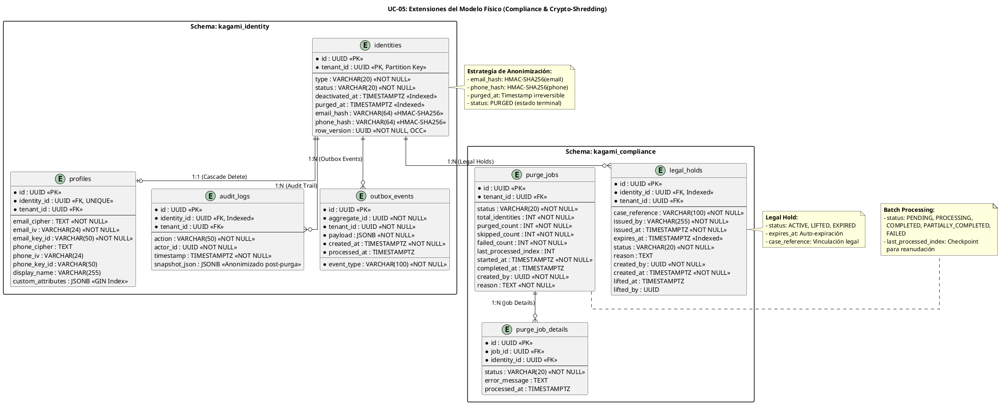

# UC-05: Purgar Identidad - Modelo de Datos Físico Específico (Compliance & Crypto-Shredding)

| Metadatos del Documento | |
| :--- | :--- |
| **Proyecto:** | SHUGO - Identity & Access Platform |
| **Caso de Uso:** | UC-05 - Purgar Identidad (Hard Delete / GDPR Right to Erasure) |
| **Documento:** | 10_UC_Specific_Data_Model.md |
| **Metodología:** | Physical Data Modeling + Crypto-Shredding + GDPR Compliance + Legal Hold Management + Batch Processing |
| **Base de Datos:** | PostgreSQL 15+ (Primary + Read Replicas) |
| **Autor:** | Gastón Ruiz |
| **Versión Actual:** | 1.0.0 |
| **Fecha:** | 03/09/2026 |

---

## Historial de Versiones

| Versión | Fecha | Autor | Descripción de Cambios | Impacto |
| :--- | :--- | :--- | :--- | :--- |
| **1.0.0** | 03/09/2026 | Gastón Ruiz | **Creación inicial.** Extensión del modelo de datos físico para soportar operaciones de purga irreversible. Introduce tablas específicas para Legal Hold (`legal_holds`), Batch Processing (`purge_jobs`), estrategia de anonimización criptográfica a nivel de columna (HMAC-SHA256), índices optimizados para consultas de elegibilidad de purga, y políticas de retención de backups con crypto-shredding de claves. | Documento de referencia para DBAs y desarrolladores backend. Define cómo se implementa el cumplimiento de GDPR Art. 17, NIST SP 800-88, y Legal Hold a nivel físico, garantizando que los datos PII sean irrecuperables tras la purga mientras se preserva la evidencia forense. |

---

## 1. Introducción y Propósito

Este documento define las extensiones y consideraciones físicas específicas en PostgreSQL para soportar el **UC-05 (Purgar Identidad)**.

A diferencia de los UCs previos que gestionaban el ciclo de vida activo, el UC-05 introduce desafíos físicos únicos orientados a **cumplimiento normativo y anonimización criptográfica**:

1. **Tablas de Compliance:** Estructuras específicas para gestionar Legal Hold (`legal_holds`) y Batch Processing (`purge_jobs`).
2. **Estrategia de Anonimización a Nivel de Columna:** Los campos PII (`email`, `phone`) se reemplazan con hashes HMAC-SHA256 irreversibles, manteniendo la integridad referencial.
3. **Preservación de Evidencia Forense:** Los audit logs se anonimizan pero no se eliminan, preservando la estructura para investigaciones futuras.
4. **Índices para Elegibilidad de Purga:** Optimizados para consultas frecuentes como "identidades desactivadas con Grace Period expirado y sin Legal Hold".
5. **Seguridad a Nivel de Base de Datos:** Row-Level Security (RLS) para prevenir acceso no autorizado a datos pre-purga, y encriptación de backups con políticas de retención estrictas.
6. **Crypto-Shredding de Claves:** Estrategia para destruir claves maestras de tenant, haciendo todos los hashes irrecuperables.

---

## 2. Diagrama de Modelo de Datos Físico (ERD Extendido)



---

## 3. Scripts DDL: Tablas de Compliance y Batch Processing

### 3.1. Tabla `legal_holds` (Gestión de Retención Legal)

```sql
SET search_path TO kagami_compliance;

-- Tabla principal de Legal Hold
CREATE TABLE IF NOT EXISTS legal_holds (
    id UUID PRIMARY KEY DEFAULT gen_random_uuid(),
    identity_id UUID NOT NULL,
    tenant_id UUID NOT NULL,
    case_reference VARCHAR(100) NOT NULL,
    issued_by VARCHAR(255) NOT NULL,
    issued_at TIMESTAMPTZ NOT NULL DEFAULT NOW(),
    expires_at TIMESTAMPTZ,
    status VARCHAR(20) NOT NULL DEFAULT 'ACTIVE' 
        CHECK (status IN ('ACTIVE', 'LIFTED', 'EXPIRED')),
    reason TEXT,
    created_by UUID NOT NULL,
    created_at TIMESTAMPTZ NOT NULL DEFAULT NOW(),
    lifted_at TIMESTAMPTZ,
    lifted_by UUID,
    
    -- Restricciones de integridad
    CONSTRAINT chk_lifted_at CHECK (
        (status = 'LIFTED' AND lifted_at IS NOT NULL) OR
        (status != 'LIFTED' AND lifted_at IS NULL)
    ),
    CONSTRAINT chk_lifted_by CHECK (
        (status = 'LIFTED' AND lifted_by IS NOT NULL) OR
        (status != 'LIFTED' AND lifted_by IS NULL)
    )
);

-- Índices optimizados para consultas de elegibilidad de purga
CREATE INDEX IF NOT EXISTS idx_legal_holds_identity_active 
    ON legal_holds(identity_id, status) 
    WHERE status = 'ACTIVE';

CREATE INDEX IF NOT EXISTS idx_legal_holds_tenant_status 
    ON legal_holds(tenant_id, status);

CREATE INDEX IF NOT EXISTS idx_legal_holds_expires_at 
    ON legal_holds(expires_at) 
    WHERE status = 'ACTIVE' AND expires_at IS NOT NULL;

-- Trigger para auto-expirar Legal Holds
CREATE OR REPLACE FUNCTION auto_expire_legal_holds()
RETURNS TRIGGER AS $$
BEGIN
    IF NEW.expires_at IS NOT NULL AND NEW.expires_at <= NOW() AND NEW.status = 'ACTIVE' THEN
        NEW.status = 'EXPIRED';
    END IF;
    RETURN NEW;
END;
$$ LANGUAGE plpgsql;

CREATE TRIGGER trg_auto_expire_legal_hold
    BEFORE INSERT OR UPDATE ON legal_holds
    FOR EACH ROW
    EXECUTE FUNCTION auto_expire_legal_holds();

-- Comentarios de documentación
COMMENT ON TABLE legal_holds IS 'Gestión de retenciones legales que bloquean la purga de identidades (GDPR Art. 17.3.b)';
COMMENT ON COLUMN legal_holds.status IS 'ACTIVE: Bloquea purgas. LIFTED: Levantado manualmente. EXPIRED: Expiró automáticamente.';
```

### 3.2. Tabla `purge_jobs` (Procesamiento Batch)

```sql
-- Tabla principal de jobs de purga masiva
CREATE TABLE IF NOT EXISTS purge_jobs (
    id UUID PRIMARY KEY DEFAULT gen_random_uuid(),
    tenant_id UUID NOT NULL,
    status VARCHAR(20) NOT NULL DEFAULT 'PENDING'
        CHECK (status IN ('PENDING', 'PROCESSING', 'COMPLETED', 'PARTIALLY_COMPLETED', 'FAILED')),
    total_identities INT NOT NULL CHECK (total_identities > 0),
    purged_count INT NOT NULL DEFAULT 0 CHECK (purged_count >= 0),
    skipped_count INT NOT NULL DEFAULT 0 CHECK (skipped_count >= 0),
    failed_count INT NOT NULL DEFAULT 0 CHECK (failed_count >= 0),
    last_processed_index INT DEFAULT 0,
    started_at TIMESTAMPTZ,
    completed_at TIMESTAMPTZ,
    created_by UUID NOT NULL,
    reason TEXT NOT NULL,
    
    -- Restricción de consistencia
    CONSTRAINT chk_counts CHECK (
        purged_count + skipped_count + failed_count <= total_identities
    )
);

-- Tabla de detalles por identidad
CREATE TABLE IF NOT EXISTS purge_job_details (
    id UUID PRIMARY KEY DEFAULT gen_random_uuid(),
    job_id UUID NOT NULL REFERENCES purge_jobs(id) ON DELETE CASCADE,
    identity_id UUID NOT NULL,
    status VARCHAR(20) NOT NULL
        CHECK (status IN ('PENDING', 'PURGED', 'SKIPPED', 'FAILED')),
    error_message TEXT,
    processed_at TIMESTAMPTZ,
    
    -- Índice único para prevenir duplicados
    CONSTRAINT uq_job_identity UNIQUE (job_id, identity_id)
);

-- Índices optimizados
CREATE INDEX IF NOT EXISTS idx_purge_jobs_tenant_status 
    ON purge_jobs(tenant_id, status);

CREATE INDEX IF NOT EXISTS idx_purge_jobs_created_by 
    ON purge_jobs(created_by);

CREATE INDEX IF NOT EXISTS idx_purge_job_details_job_status 
    ON purge_job_details(job_id, status);

CREATE INDEX IF NOT EXISTS idx_purge_job_details_identity 
    ON purge_job_details(identity_id);

-- Comentarios de documentación
COMMENT ON TABLE purge_jobs IS 'Jobs de purga masiva para cumplimiento GDPR a escala';
COMMENT ON COLUMN purge_jobs.last_processed_index IS 'Checkpoint para reanudación tras fallo del worker';
```

### 3.3. Modificaciones a Tablas Existentes (Anonimización)

```sql
SET search_path TO kagami_identity;

-- Agregar columnas de hash a identities (si no existen)
ALTER TABLE identities 
    ADD COLUMN IF NOT EXISTS email_hash VARCHAR(64),
    ADD COLUMN IF NOT EXISTS phone_hash VARCHAR(64),
    ADD COLUMN IF NOT EXISTS purged_at TIMESTAMPTZ;

-- Índices para consultas de elegibilidad de purga
CREATE INDEX IF NOT EXISTS idx_identities_deactivated_grace_period 
    ON identities(tenant_id, deactivated_at) 
    WHERE status = 'DEACTIVATED' AND deactivated_at IS NOT NULL;

CREATE INDEX IF NOT EXISTS idx_identities_purged 
    ON identities(tenant_id, purged_at) 
    WHERE status = 'PURGED';

-- Modificar audit_logs para soportar anonimización
ALTER TABLE audit_logs 
    ADD COLUMN IF NOT EXISTS anonymized BOOLEAN DEFAULT FALSE;

CREATE INDEX IF NOT EXISTS idx_audit_logs_identity_anonymized 
    ON audit_logs(identity_id, anonymized) 
    WHERE anonymized = FALSE;

-- Comentarios de documentación
COMMENT ON COLUMN identities.email_hash IS 'HMAC-SHA256 del email original. Irreversible sin clave maestra.';
COMMENT ON COLUMN identities.phone_hash IS 'HMAC-SHA256 del teléfono original. Irreversible sin clave maestra.';
COMMENT ON COLUMN identities.purged_at IS 'Timestamp de purga irreversible. NULL si no ha sido purgada.';
```

---

## 4. Estrategia de Anonimización a Nivel de Columna

### 4.1. Función de Hash HMAC-SHA256

PostgreSQL no tiene una función nativa de HMAC-SHA256, pero podemos usar la extensión `pgcrypto`:

```sql
-- Habilitar extensión pgcrypto (si no está habilitada)
CREATE EXTENSION IF NOT EXISTS pgcrypto;

-- Función para generar HMAC-SHA256
CREATE OR REPLACE FUNCTION hmac_sha256(key TEXT, data TEXT)
RETURNS TEXT AS $$
BEGIN
    RETURN encode(hmac(data::bytea, key::bytea, 'sha256'), 'hex');
END;
$$ LANGUAGE plpgsql IMMUTABLE;

-- Ejemplo de uso:
-- SELECT hmac_sha256('tenant-master-key', 'juan@khcs.com');
-- Resultado: 'a1b2c3d4e5f6...' (64 caracteres hex)
```

### 4.2. Procedimiento de Anonimización de Identidad

```sql
-- Procedimiento para anonimizar una identidad completa
CREATE OR REPLACE FUNCTION anonymize_identity(
    p_identity_id UUID,
    p_tenant_id UUID,
    p_hmac_key TEXT
)
RETURNS VOID AS $$
DECLARE
    v_email TEXT;
    v_phone TEXT;
    v_email_hash TEXT;
    v_phone_hash TEXT;
BEGIN
    -- 1. Obtener datos PII actuales (antes de anonimizar)
    SELECT p.email_cipher, p.phone_cipher
    INTO v_email, v_phone
    FROM profiles p
    WHERE p.identity_id = p_identity_id AND p.tenant_id = p_tenant_id;
    
    -- 2. Generar hashes HMAC-SHA256
    -- Nota: En producción, los datos están cifrados. Aquí se asume que ya fueron descifrados
    -- por la aplicación antes de llamar a este procedimiento.
    v_email_hash := hmac_sha256(p_hmac_key, v_email);
    v_phone_hash := hmac_sha256(p_hmac_key, v_phone);
    
    -- 3. Actualizar identities con hashes
    UPDATE identities
    SET 
        status = 'PURGED',
        purged_at = NOW(),
        email_hash = v_email_hash,
        phone_hash = v_phone_hash
    WHERE id = p_identity_id AND tenant_id = p_tenant_id;
    
    -- 4. Eliminar custom_attributes sensibles del perfil
    UPDATE profiles
    SET custom_attributes = '{}'::jsonb
    WHERE identity_id = p_identity_id AND tenant_id = p_tenant_id;
    
    -- 5. Anonimizar audit_logs asociados
    UPDATE audit_logs
    SET 
        snapshot_json = anonymize_json(snapshot_json, p_hmac_key),
        anonymized = TRUE
    WHERE identity_id = p_identity_id AND tenant_id = p_tenant_id;
    
END;
$$ LANGUAGE plpgsql;

-- Función auxiliar para anonimizar JSON (simplificada)
CREATE OR REPLACE FUNCTION anonymize_json(json_data JSONB, hmac_key TEXT)
RETURNS JSONB AS $$
BEGIN
    -- Reemplazar valores PII conocidos con hashes
    -- En producción, esto se hace en la aplicación con lógica más compleja
    RETURN json_data;
END;
$$ LANGUAGE plpgsql;
```

### 4.3. Verificación de Anonimización

```sql
-- Query para verificar que no hay texto plano en la DB post-purga
SELECT 
    i.id,
    i.status,
    i.purged_at,
    i.email_hash,
    p.email_cipher,
    p.phone_cipher
FROM identities i
LEFT JOIN profiles p ON p.identity_id = i.id AND p.tenant_id = i.tenant_id
WHERE i.status = 'PURGED'
  AND i.purged_at IS NOT NULL
  AND (i.email_hash IS NULL OR i.phone_hash IS NULL);

-- Si esta query retorna resultados, hay un problema de anonimización
```

---

## 5. Índices Optimizados para Consultas de Elegibilidad de Purga

### 5.1. Identidades Elegibles para Purga

```sql
-- Índice compuesto para consultas frecuentes de elegibilidad
-- "Identidades desactivadas con Grace Period expirado y sin Legal Hold"
CREATE INDEX IF NOT EXISTS idx_identities_eligible_for_purge 
    ON identities(tenant_id, deactivated_at) 
    WHERE status = 'DEACTIVATED' 
      AND deactivated_at IS NOT NULL
      AND purged_at IS NULL;

-- Query optimizada para encontrar identidades elegibles
SELECT i.id, i.deactivated_at
FROM identities i
WHERE i.tenant_id = $1
  AND i.status = 'DEACTIVATED'
  AND i.deactivated_at < NOW() - INTERVAL '30 days'
  AND NOT EXISTS (
      SELECT 1 FROM kagami_compliance.legal_holds lh
      WHERE lh.identity_id = i.id
        AND lh.status = 'ACTIVE'
  )
ORDER BY i.deactivated_at ASC
LIMIT 100;
```

### 5.2. Legal Holds Activos por Identidad

```sql
-- Índice para consulta rápida de Legal Hold activo
CREATE INDEX IF NOT EXISTS idx_legal_holds_active_by_identity 
    ON legal_holds(identity_id, status) 
    WHERE status = 'ACTIVE';

-- Query optimizada para verificar Legal Hold
SELECT id, case_reference, expires_at
FROM legal_holds
WHERE identity_id = $1
  AND status = 'ACTIVE'
  AND (expires_at IS NULL OR expires_at > NOW())
LIMIT 1;
```

### 5.3. Jobs de Purga en Progreso

```sql
-- Índice para monitoreo de jobs activos
CREATE INDEX IF NOT EXISTS idx_purge_jobs_processing 
    ON purge_jobs(tenant_id, started_at) 
    WHERE status IN ('PENDING', 'PROCESSING');

-- Query para encontrar jobs atascados
SELECT id, status, started_at, NOW() - started_at AS duration
FROM purge_jobs
WHERE status = 'PROCESSING'
  AND started_at < NOW() - INTERVAL '2 hours'
ORDER BY started_at ASC;
```

---

## 6. Seguridad a Nivel de Base de Datos

### 6.1. Row-Level Security (RLS) para Prevención de Fugas

```sql
-- Habilitar RLS en todas las tablas críticas
ALTER TABLE identities ENABLE ROW LEVEL SECURITY;
ALTER TABLE profiles ENABLE ROW LEVEL SECURITY;
ALTER TABLE audit_logs ENABLE ROW LEVEL SECURITY;
ALTER TABLE legal_holds ENABLE ROW LEVEL SECURITY;

-- Forzar RLS incluso para el dueño de la tabla
ALTER TABLE identities FORCE ROW LEVEL SECURITY;
ALTER TABLE profiles FORCE ROW LEVEL SECURITY;
ALTER TABLE audit_logs FORCE ROW LEVEL SECURITY;
ALTER TABLE legal_holds FORCE ROW LEVEL SECURITY;

-- Políticas de lectura: Solo puede leer datos de su propio tenant
CREATE POLICY tenant_isolation_read ON identities
    FOR SELECT
    USING (tenant_id = current_setting('app.current_tenant_id')::uuid);

CREATE POLICY tenant_isolation_read ON profiles
    FOR SELECT
    USING (tenant_id = current_setting('app.current_tenant_id')::uuid);

CREATE POLICY tenant_isolation_read ON audit_logs
    FOR SELECT
    USING (tenant_id = current_setting('app.current_tenant_id')::uuid);

CREATE POLICY tenant_isolation_read ON legal_holds
    FOR SELECT
    USING (tenant_id = current_setting('app.current_tenant_id')::uuid);

-- Políticas de escritura: Solo puede modificar datos de su propio tenant
CREATE POLICY tenant_isolation_write ON identities
    FOR ALL
    USING (tenant_id = current_setting('app.current_tenant_id')::uuid)
    WITH CHECK (tenant_id = current_setting('app.current_tenant_id')::uuid);

-- Política especial para purga: Solo el servicio de purga puede modificar status a PURGED
CREATE POLICY purge_service_write ON identities
    FOR UPDATE
    USING (
        tenant_id = current_setting('app.current_tenant_id')::uuid
        AND current_setting('app.service_role') = 'purge_service'
    )
    WITH CHECK (
        tenant_id = current_setting('app.current_tenant_id')::uuid
        AND status = 'PURGED'
    );
```

### 6.2. Roles de Base de Datos para Purga

```sql
-- Crear rol específico para el servicio de purga
CREATE ROLE app_kagami_purge WITH LOGIN PASSWORD '...';

-- Grant permisos específicos para purga
GRANT CONNECT ON DATABASE shugo_kagami TO app_kagami_purge;
GRANT USAGE ON SCHEMA kagami_identity TO app_kagami_purge;
GRANT USAGE ON SCHEMA kagami_compliance TO app_kagami_purge;

-- Solo puede leer identidades y legal_holds
GRANT SELECT ON identities, profiles, audit_logs, legal_holds TO app_kagami_purge;

-- Puede actualizar identities (para purga) y insertar en purge_jobs
GRANT UPDATE ON identities TO app_kagami_purge;
GRANT INSERT, SELECT, UPDATE ON purge_jobs, purge_job_details TO app_kagami_purge;

-- No puede eliminar registros (la purga es anonimización, no DELETE)
REVOKE DELETE ON ALL TABLES IN SCHEMA kagami_identity FROM app_kagami_purge;
REVOKE DELETE ON ALL TABLES IN SCHEMA kagami_compliance FROM app_kagami_purge;
```

### 6.3. Encriptación de Backups

```sql
-- Configurar encriptación de backups con pg_dump
-- En producción, usar pg_basebackup con encriptación SSL/TLS

-- Script de backup con encriptación (ejemplo)
-- pg_dump -h localhost -U postgres shugo_kagami | \
--   gpg --symmetric --cipher-algo AES256 --output backup.sql.gpg

-- Política de retención de backups:
-- - Backups diarios: Retención de 30 días
-- - Backups semanales: Retención de 90 días
-- - Backups mensuales: Retención de 1 año
-- - Después de la retención, los backups se destruyen de forma segura
```

---

## 7. Políticas de Retención y Crypto-Shredding de Claves

### 7.1. Tabla de Configuración de Tenant

```sql
SET search_path TO kagami_identity;

-- Tabla de configuración de tenant (si no existe)
CREATE TABLE IF NOT EXISTS tenant_configs (
    tenant_id UUID PRIMARY KEY,
    retention_days INT NOT NULL DEFAULT 30 
        CHECK (retention_days >= 0),
    hmac_master_key_id VARCHAR(100) NOT NULL,
    key_rotation_enabled BOOLEAN DEFAULT TRUE,
    created_at TIMESTAMPTZ NOT NULL DEFAULT NOW(),
    updated_at TIMESTAMPTZ NOT NULL DEFAULT NOW()
);

-- Comentarios de documentación
COMMENT ON TABLE tenant_configs IS 'Configuración de retención y claves HMAC por tenant';
COMMENT ON COLUMN tenant_configs.retention_days IS 'Días de Grace Period antes de permitir purga';
COMMENT ON COLUMN tenant_configs.hmac_master_key_id IS 'ID de la clave maestra en KMS para HMAC-SHA256';
```

### 7.2. Procedimiento de Crypto-Shredding (Destrucción de Clave)

```sql
-- Procedimiento para destruir la clave maestra de un tenant
-- Esto hace que todos los hashes HMAC sean irrecuperables
CREATE OR REPLACE FUNCTION crypto_shred_tenant(
    p_tenant_id UUID,
    p_reason TEXT
)
RETURNS VOID AS $$
BEGIN
    -- 1. Verificar que el tenant existe
    IF NOT EXISTS (SELECT 1 FROM tenant_configs WHERE tenant_id = p_tenant_id) THEN
        RAISE EXCEPTION 'Tenant not found: %', p_tenant_id;
    END IF;
    
    -- 2. Rotar la clave maestra (generar nueva clave)
    UPDATE tenant_configs
    SET 
        hmac_master_key_id = gen_random_uuid()::text, -- Nueva clave (la anterior se pierde)
        updated_at = NOW()
    WHERE tenant_id = p_tenant_id;
    
    -- 3. Registrar la operación en audit_logs
    INSERT INTO audit_logs (identity_id, tenant_id, action, actor_id, timestamp, snapshot_json)
    VALUES (
        NULL, -- No aplica a una identidad específica
        p_tenant_id,
        'TENANT_CRYPTO_SHRED',
        current_setting('app.current_user_id')::uuid,
        NOW(),
        jsonb_build_object('reason', p_reason, 'action', 'crypto_shred')
    );
    
    -- Nota: En producción, la clave anterior se destruye en el KMS (AWS KMS, Azure Key Vault)
    -- Esto hace que todos los hashes HMAC generados con la clave anterior sean irrecuperables.
    
END;
$$ LANGUAGE plpgsql;
```

### 7.3. Verificación de Integridad Post-Crypto-Shredding

```sql
-- Query para verificar que los hashes son consistentes
-- (todos los hashes de un tenant deben usar la misma clave)
SELECT 
    tenant_id,
    COUNT(DISTINCT hmac_master_key_id) AS key_count
FROM tenant_configs
GROUP BY tenant_id
HAVING COUNT(DISTINCT hmac_master_key_id) > 1;

-- Si esta query retorna resultados, hay un problema de consistencia de claves
```

---

## 8. Monitoreo y Diagnóstico

### 8.1. Consultas para Diagnosticar Problemas de Compliance

```sql
-- Identidades con Legal Hold expirado que no se han auto-expirado
SELECT lh.id, lh.identity_id, lh.expires_at, lh.status
FROM legal_holds lh
WHERE lh.status = 'ACTIVE'
  AND lh.expires_at IS NOT NULL
  AND lh.expires_at <= NOW();

-- Jobs de purga atascados en PROCESSING por más de 2 horas
SELECT pj.id, pj.tenant_id, pj.status, pj.started_at, 
       NOW() - pj.started_at AS duration,
       pj.total_identities, pj.purged_count, pj.failed_count
FROM purge_jobs pj
WHERE pj.status = 'PROCESSING'
  AND pj.started_at < NOW() - INTERVAL '2 hours'
ORDER BY pj.started_at ASC;

-- Identidades purgadas sin hashes (problema de anonimización)
SELECT i.id, i.tenant_id, i.purged_at, i.email_hash, i.phone_hash
FROM identities i
WHERE i.status = 'PURGED'
  AND (i.email_hash IS NULL OR i.phone_hash IS NULL);

-- Audit logs no anonimizados de identidades purgadas
SELECT al.id, al.identity_id, al.anonymized
FROM audit_logs al
INNER JOIN identities i ON i.id = al.identity_id AND i.tenant_id = al.tenant_id
WHERE i.status = 'PURGED'
  AND al.anonymized = FALSE;
```

### 8.2. Métricas de Base de Datos para OpenTelemetry

```csharp
public class ComplianceMetrics
{
    private readonly Meter _meter;
    private readonly Counter<long> _purgeTotal;
    private readonly Counter<long> _purgeBlockedLegalHold;
    private readonly Counter<long> _purgeBlockedGracePeriod;
    private readonly Histogram<double> _cryptoShreddingLatency;

    public ComplianceMetrics(IMeterFactory meterFactory)
    {
        _meter = meterFactory.Create("shugo.compliance");
        _purgeTotal = _meter.CreateCounter<long>("compliance.purge_total");
        _purgeBlockedLegalHold = _meter.CreateCounter<long>("compliance.purge_blocked_legal_hold");
        _purgeBlockedGracePeriod = _meter.CreateCounter<long>("compliance.purge_blocked_grace_period");
        _cryptoShreddingLatency = _meter.CreateHistogram<double>("compliance.crypto_shredding_latency", "ms");
    }

    public void RecordPurge(string tenantId, bool success)
    {
        _purgeTotal.Add(1, 
            new KeyValuePair<string, object?>("tenant_id", tenantId),
            new KeyValuePair<string, object?>("success", success));
    }

    public void RecordBlockedByLegalHold(string tenantId, string caseReference)
    {
        _purgeBlockedLegalHold.Add(1,
            new KeyValuePair<string, object?>("tenant_id", tenantId),
            new KeyValuePair<string, object?>("case_reference", caseReference));
    }

    public void RecordCryptoShreddingLatency(string tenantId, double latencyMs)
    {
        _cryptoShreddingLatency.Record(latencyMs,
            new KeyValuePair<string, object?>("tenant_id", tenantId));
    }
}
```

---

## 9. Trazabilidad

| Documento | Relación |
| :--- | :--- |
| `04_Initial_Domain_Model.md` | Define los Value Objects `PurgeReason`, `AnonymizedData` que se mapean a las columnas físicas definidas aquí. |
| `07_Sequence_Diagram.md` | Muestra las consultas a PostgreSQL y legal_holds que se optimizan con estos índices. |
| `08_Final_Class_Design.md` | El `IdentityRepositoryImpl` y `LegalHoldCheckerImpl` implementan las consultas optimizadas definidas aquí. |
| `09_Modern_Artifacts.md` | Las métricas de compliance y crypto-shredding se monitorean con las configuraciones definidas aquí. |
| `11_UC_Specific_Security_Threats.md` | Las mitigaciones de "Purga prematura" y "Evasión de Legal Hold" se validan mediante las políticas RLS y roles de DB definidos aquí. |
| `12_UC_Specific_Performance_Benchmarks.md` | Los SLAs de latencia de crypto-shredding y throughput batch se validan con los índices y optimizaciones definidos aquí. |
| `SHUGO_Data_Model_Master.md` (Transversal) | Este documento extiende el modelo maestro con tablas específicas de compliance y anonimización. |

---

## 10. Anexos: Glosario de Base de Datos (UC-05)

| Término | Definición en Contexto UC-05 |
| :--- | :--- |
| **HMAC-SHA256** | Función hash criptográfica que combina una clave secreta con los datos. Irreversible sin la clave. Usado para anonimizar PII. |
| **Crypto-Shredding** | Técnica de eliminación de datos mediante la destrucción de la clave de cifrado/hashing, haciendo imposible recuperar los datos originales. |
| **Legal Hold** | Retención legal que bloquea la purga de identidades. Tiene prioridad sobre GDPR Art. 17. |
| **Grace Period** | Período de tiempo entre la desactivación (UC-03) y la elegibilidad para purga (UC-05). Configurable por tenant. |
| **Checkpoint** | Punto de reanudación en un job de purga masiva. Permite reanudar el job desde donde se quedó si falla. |
| **Anonimización** | Proceso de transformar datos personales de forma irreversible, de modo que el titular ya no pueda ser identificado. |
| **Row-Level Security (RLS)** | Mecanismo de PostgreSQL que restringe el acceso a filas de una tabla basado en el usuario o contexto de sesión. |
| **Outbox Pattern** | Patrón que garantiza la publicación de eventos de dominio mediante una tabla local antes de enviarlos a un message broker. |
| **Fail-Safe** | Diseño que asume el estado más seguro (bloquear purgas) cuando un sistema crítico (Legal Hold) está caído. |
| **Irreversibilidad** | Propiedad de la purga que garantiza que los datos anonimizados no pueden ser recuperados por ningún medio técnico. |

---
*Fin del Documento 10_UC_Specific_Data_Model para UC-05*