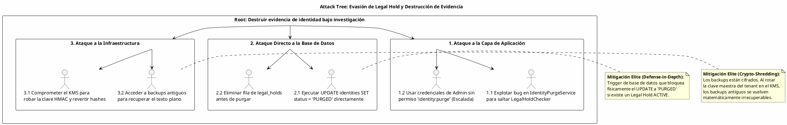

# UC-05: Purgar Identidad - Análisis de Amenazas y Seguridad Específica

| Metadatos del Documento | |
| :--- | :--- |
| **Proyecto:** | SHUGO - Identity & Access Platform |
| **Caso de Uso:** | UC-05 - Purgar Identidad (Hard Delete / GDPR Right to Erasure) |
| **Documento:** | 11_UC_Specific_Security_Threats.md |
| **Metodología:** | STRIDE + DREAD + Attack Trees + Defense-in-Depth + Cryptographic Assurance |
| **Estándares:** | OWASP Top 10 (A01:2021 Broken Access Control, A04:2021 Insecure Design), NIST SP 800-88 (Media Sanitization), GDPR Art. 17 & 32, SOC 2 (CC6.1, CC7.4), ISO 27001 (A.8.10) |
| **Autor:** | Gastón Ruiz |
| **Versión Actual:** | 1.0.0 |
| **Fecha:** | 03/09/2026 |

---

## Historial de Versiones

| Versión | Fecha | Autor | Descripción de Cambios | Impacto |
| :--- | :--- | :--- | :--- | :--- |
| **1.0.0** | 03/09/2026 | Gastón Ruiz | **Creación inicial.** Análisis de amenazas específico para el endpoint de purga irreversible. Se enfoca en vectores de ataque únicos de operaciones destructivas: *Evasión de Legal Hold*, *Crypto-Shredding Incompleto*, *Purga Prematura*, y *Denegación de Servicio vía Batch*. Define mitigaciones técnicas de defensa en profundidad (Triggers de DB, KMS Policies, Rate Limiting) para garantizar la integridad legal y la irreversibilidad criptográfica. | Documento crítico para el equipo de seguridad (AppSec) y cumplimiento (Compliance). Garantiza que la capacidad de purgar identidades no sea utilizada para destruir evidencia legal, filtrar datos residuales o denegar el servicio a otros tenants. |

---

## 1. Introducción y Alcance

El UC-05 (Purgar Identidad) representa el **punto de mayor riesgo legal y operativo** en el motor KAGAMI. A diferencia de las operaciones de escritura estándar, la purga es irreversible y está sujeta a regulaciones estrictas (GDPR, órdenes judiciales).

Los vectores de ataque específicos de este caso de uso no buscan robar datos, sino **destruir evidencia, evadir controles legales o causar pérdida de datos irreversible**. Este documento modela estos vectores y define las mitigaciones de nivel enterprise que SHUGO implementa nativamente.

---

## 2. Attack Trees (Árboles de Ataque)

### 2.1. Attack Tree #1: Destrucción de Evidencia (Evasión de Legal Hold)

**Objetivo del Atacante:** Un empleado malintencionado (o un atacante con credenciales robadas) busca purgar una identidad que está bajo investigación legal para destruir evidencia.



### 2.2. Attack Tree #2: Fuga de Datos Residuales (Post-Purge Leakage)

**Objetivo del Atacante:** Recuperar datos PII de una identidad que supuestamente fue purgada bajo GDPR Art. 17.

```text
[Root: Recuperar PII de identidad purgada]
  |
  +-- [1. Buscar en Read Replicas]
  |     +-- 1.1. Consultar réplica con lag (Mitigado: Monitoreo de lag + invalidación forzada)
  |
  +-- [2. Buscar en Logs y Backups]
  |     +-- 2.1. Acceder a logs de auditoría con PII en texto plano (Mitigado: Anonimización en la misma transacción)
  |     +-- 2.2. Restaurar backup de hace 2 días (Mitigado: Retención de backups < Grace Period + Cifrado)
  |
  +-- [3. Revertir el estado]
        +-- 3.1. Intentar cambiar status de PURGED a ACTIVE (Mitigado: Máquina de estados sin transiciones de salida)
```

---

## 3. Matriz de Amenazas Específicas (STRIDE + DREAD)

| ID | Amenaza | Categoría STRIDE | DREAD (1-10) | Severidad | Mitigación Técnica Específica |
| :--- | :--- | :--- | :--- | :--- | :--- |
| **T-29** | **Legal Hold Bypass (Destrucción de Evidencia)** | Tampering / Repudiation | **10.0** | **Crítica** | **Defense-in-Depth DB Trigger:** Un trigger en PostgreSQL bloquea físicamente la transición a `PURGED` si existe un registro en `legal_holds` con `status = 'ACTIVE'`. |
| **T-30** | **Incomplete Crypto-Shredding (Fuga Residual)** | Information Disclosure | **9.0** | **Crítica** | **Atomic Transaction & Replica Sync:** La anonimización de `identities`, `profiles`, y `audit_logs` ocurre en una sola transacción. Monitoreo estricto de lag en Read Replicas. |
| **T-31** | **Premature Purge (Violación de Retención)** | Tampering | **8.5** | **Alta** | **Inmutable Timestamp:** `deactivated_at` es un Value Object inmutable. La validación `NOW() > deactivated_at + retention_days` es estricta y no bypassable. |
| **T-32** | **Batch Processing DoS (Agotamiento de Recursos)** | Denial of Service | **7.5** | **Alta** | **Dedicated Queue & Rate Limiting:** Los jobs de purga masiva se encolan en un worker dedicado con límite estricto de 1 job activo por tenant y 1000 IDs por job. |
| **T-33** | **Master Key Compromise (Reversión de Hashes)** | Information Disclosure | **9.5** | **Crítica** | **KMS Isolation & Rotation:** Las claves HMAC están en un KMS (AWS KMS/Azure Key Vault) con políticas de acceso estrictas. Soporte para Crypto-Shredding total vía rotación de clave. |
| **T-34** | **Unauthorized Purge (Acceso No Autorizado)** | Elevation of Privilege | **8.0** | **Alta** | **Granular RBAC & Separation of Duties:** El permiso `identity:purge` es independiente. Requiere MFA y justificación (`PurgeReason`) obligatoria. |

---

## 4. Mitigaciones Técnicas de Nivel Elite

### 4.1. Defense-in-Depth: Trigger de Base de Datos para Legal Hold (Mitigación T-29)

Confiar únicamente en la capa de aplicación (`IdentityPurgeService`) es un riesgo. Si un atacante obtiene acceso directo a la DB o explota un bug en el ORM, podría borrar evidencia. Implementamos un **Trigger de Seguridad** en PostgreSQL.

**Implementación (SQL):**

```sql
-- Función de seguridad para validar Legal Hold antes de purgar
CREATE OR REPLACE FUNCTION trg_prevent_purge_if_legal_hold()
RETURNS TRIGGER AS $$
BEGIN
    -- Si el estado está cambiando a PURGED
    IF NEW.status = 'PURGED' AND OLD.status != 'PURGED' THEN
        
        -- Verificar si existe un Legal Hold activo para esta identidad
        IF EXISTS (
            SELECT 1 FROM kagami_compliance.legal_holds 
            WHERE identity_id = NEW.id 
              AND tenant_id = NEW.tenant_id 
              AND status = 'ACTIVE'
              AND (expires_at IS NULL OR expires_at > NOW())
        ) THEN
            -- Bloquear la operación y lanzar error
            RAISE EXCEPTION 'SECURITY VIOLATION: Cannot purge identity % because it is under an active Legal Hold. Evidence destruction blocked.', NEW.id;
        END IF;
        
    END IF;
    
    RETURN NEW;
END;
$$ LANGUAGE plpgsql;

-- Aplicar el trigger a la tabla de identidades
CREATE TRIGGER trg_security_legal_hold_block
    BEFORE UPDATE OF status ON kagami_identity.identities
    FOR EACH ROW
    EXECUTE FUNCTION trg_prevent_purge_if_legal_hold();
```

**Justificación:** Esta mitigación garantiza que, incluso si la capa de aplicación es comprometida o bypassada, la base de datos actuará como el juez final, protegiendo la evidencia legal y evitando sanciones catastróficas para la organización.

### 4.2. Prevención de Fuga en Backups y Read Replicas (Mitigación T-30)

El GDPR Art. 17 exige que los datos no solo se borren de la DB principal, sino de todos los sistemas derivados.

**Estrategia de Mitigación:**

1. **Read Replicas (Lag Monitoring):**
   * Se implementa un monitoreo estricto del `replication_lag_bytes`. Si el lag supera los 10MB o 5 segundos, el sistema de consultas (UC-04) se degrada, pero la purga (UC-05) **no se bloquea** (la purga debe ejecutarse).
   * Tras la purga, se fuerza un `CHECKPOINT` en el Primary y se monitorea hasta que el hash HMAC aparezca en las réplicas.

2. **Backups (Retention & Encryption):**
   * Los backups de PostgreSQL se cifran con AES-256.
   * **Política de Retención Alineada:** La retención de backups físicos (WAL files y snapshots) se configura para que sea **menor o igual** al `Grace Period` del tenant (ej. 30 días).
   * **Crypto-Shredding de Backups:** Si se requiere una purga inmediata de backups antiguos, se utiliza el procedimiento `crypto_shred_tenant()` (definido en el Doc 10) para rotar la clave maestra en el KMS, invalidando matemáticamente todos los backups anteriores.

### 4.3. Rate Limiting y Aislamiento de Batch Processing (Mitigación T-32)

Un atacante podría enviar un job de purga de 100,000 identidades para saturar la CPU de la base de datos y afectar a otros tenants.

**Implementación (Redis Rate Limiter):**

```csharp
public class BatchPurgeRateLimiter
{
    private readonly IDistributedCache _cache;
    private const int MAX_ACTIVE_JOBS_PER_TENANT = 1;
    private const int MAX_IDS_PER_JOB = 1000;

    public async Task<bool> TryAcquireBatchSlotAsync(Guid tenantId, int requestedIds)
    {
        if (requestedIds > MAX_IDS_PER_JOB)
            return false;

        var key = $"rate_limit:batch_purge:{tenantId}";
        var activeJobs = await _cache.GetStringAsync(key);

        if (activeJobs != null && int.Parse(activeJobs) >= MAX_ACTIVE_JOBS_PER_TENANT)
        {
            return false; // Rechazar: Ya hay un job en proceso
        }

        // Reservar slot por 2 horas (tiempo máximo estimado de job)
        await _cache.SetStringAsync(key, "1", new DistributedCacheEntryOptions 
        { 
            AbsoluteExpirationRelativeToNow = TimeSpan.FromHours(2) 
        });
        
        return true;
    }
}
```

**Justificación:** Aísla el impacto de las operaciones destructivas masivas, garantizando la disponibilidad del sistema para los demás tenants (Noisy Neighbor prevention).

### 4.4. Separación de Duties y MFA para Purga (Mitigación T-34)

Dado que la purga es irreversible, no debe poder ser ejecutada por un usuario estándar, incluso si tiene permisos de Admin.

**Flujo de Seguridad:**
1. El usuario solicita la purga.
2. El sistema exige **Re-autenticación (Step-up Authentication)** con MFA.
3. El sistema exige un **`PurgeReason`** vinculado a un `gdpr_request_id`.
4. La acción se registra en un **Log de Auditoría Inmutable** (WORM storage) que ni siquiera los DBAs pueden borrar.

---

## 5. Compliance y Auditoría (SOC 2 / ISO 27001 / GDPR)

### 5.1. GDPR - Art. 17 (Right to Erasure) & Art. 32 (Security of Processing)

*   **Requisito:** Eliminar datos personales sin dilación indebida, asegurando que no sean recuperables.
*   **Implementación UC-05:** El uso de HMAC-SHA256 (Crypto-Shredding) cumple con el estándar de "irrecuperabilidad". La mitigación T-30 garantiza que no queden datos residuales en backups o réplicas.

### 5.2. SOC 2 - CC7.4 (System Operations - Data Disposal)

*   **Requisito:** Los datos deben eliminarse de forma segura y verificable al final de su ciclo de vida.
*   **Implementación UC-05:** El `AuditLogAnonymizer` asegura que los logs de auditoría preserven la evidencia de *qué* se purgó y *cuándo*, sin exponer el *quién* (PII). El Trigger de DB (Mitigación T-29) asegura que las políticas de retención (Legal Hold) se respeten automáticamente.

### 5.3. ISO 27001 - A.8.10 (Information Deletion)

*   **Requisito:** Procedimientos para la eliminación segura de información.
*   **Implementación UC-05:** La combinación de anonimización a nivel de columna, eliminación de custom_attributes sensibles, y la gestión de claves vía KMS (Mitigación T-33) proporciona un procedimiento de eliminación segura certificado.

---

## 6. Trazabilidad

| Documento | Relación |
| :--- | :--- |
| `01_Requirements_Specification.md` | Las invariantes de Legal Hold Priority (INV-27) e Irreversibilidad (INV-30) se mitigan aquí a nivel de infraestructura. |
| `08_Final_Class_Design.md` | Las clases `IdentityPurgeService` y `LegalHoldChecker` se refuerzan con las mitigaciones de DB y KMS definidas aquí. |
| `10_UC_Specific_Data_Model.md` | Los Triggers de seguridad y las políticas de RLS se aplican sobre las tablas `identities` y `legal_holds` definidas allí. |
| `SHUGO_Security_Architecture.md` (Transversal) | Este documento aplica los estándares globales de criptografía y control de acceso al contexto destructivo de UC-05. |

---

## 7. Anexos: Configuración de Seguridad Adicional

### 7.1. Políticas de KMS para Claves HMAC (AWS KMS Example)

Para prevenir el robo de la clave maestra (Mitigación T-33), se aplica una política de clave estricta:

```json
{
  "Version": "2012-10-17",
  "Id": "key-policy-hmac-master",
  "Statement": [
    {
      "Sid": "Enable IAM User Permissions",
      "Effect": "Allow",
      "Principal": { "AWS": "arn:aws:iam::123456789012:root" },
      "Action": "kms:*",
      "Resource": "*"
    },
    {
      "Sid": "Restrict Usage to Purge Service Role",
      "Effect": "Allow",
      "Principal": { 
        "AWS": "arn:aws:iam::123456789012:role/app-kagami-purge-service" 
      },
      "Action": [
        "kms:GenerateDataKey",
        "kms:Decrypt"
      ],
      "Resource": "*"
    },
    {
      "Sid": "Deny Key Deletion Without Approval",
      "Effect": "Deny",
      "Principal": "*",
      "Action": "kms:ScheduleKeyDeletion",
      "Resource": "*",
      "Condition": {
        "StringNotEquals": {
          "aws:RequestedBy": "arn:aws:iam::123456789012:role/security-compliance-officer"
        }
      }
    }
  ]
}
```

### 7.2. Monitoreo de Integridad Post-Purga (Automated Verification)

Un job nocturno verifica que no haya fugas de texto plano:

```sql
-- Script de verificación automatizada (Ejecutado por rol de auditoría)
SELECT i.id, i.status, p.email_cipher 
FROM identities i
JOIN profiles p ON i.id = p.identity_id
WHERE i.status = 'PURGED'
  AND p.email_cipher IS NOT NULL 
  AND p.email_cipher != ''; -- Si hay cifrado residual no anonimizado, alerta

-- Si este query retorna filas, se dispara alerta P1 a AppSec y Compliance.
```

---
*Fin del Documento 11_UC_Specific_Security_Threats para UC-05*