# UC-06: Registro Self-Service - Diagrama de Caso de Uso

| Metadatos del Documento | |
| :--- | :--- |
| **Proyecto:** | SHUGO - Identity & Access Platform |
| **Caso de Uso:** | UC-06 - Registro Self-Service (Self-Service Sign-Up) |
| **Documento:** | 02_Use_Case_Diagram.md |
| **Metodología:** | UML 2.5 + ICONIX + CQRS (Query Side para validaciones) + Security by Design |
| **Autor:** | Gastón Ruiz |
| **Versión Actual:** | 1.0.0 |
| **Fecha:** | 04/09/2026 |

---

## Historial de Versiones

| Versión | Fecha | Autor | Descripción de Cambios | Impacto |
| :--- | :--- | :--- | :--- | :--- |
| **1.0.0** | 04/09/2026 | Gastón Ruiz | **Creación inicial.** Diagrama de Caso de Uso UML para UC-06. Modela el registro público de identidades, introduciendo al actor "Usuario Externo", las validaciones de seguridad obligatorias (Breach Detection, Anti-Disposable Email, Password Policies), el consentimiento GDPR, y la orquestación con sistemas externos (Email, Have I Been Pwned). | Documento base del paquete de diseño Tier 1 del UC-06. Establece las fronteras del sistema, los actores y las integraciones críticas para garantizar un onboarding masivo seguro, compliant y resistente a ataques de abuso. |

---

## 1. Diagrama de Caso de Uso (PlantUML)

A continuación, se presenta el Diagrama de Casos de Uso UML para el UC-06. Este diagrama modela el registro self-service como una **operación de entrada pública altamente validada**, diferenciándola claramente del provisioning administrativo (UC-01).

```plantuml
@startuml UC-06_CasoDeUso
<style>
diagram {
  BackgroundColor #FFFFFF
}
</style>
top to bottom direction
skinparam packageStyle rectangle
skinparam actorStyle awesome
skinparam usecaseBackgroundColor #E3F2FD
skinparam usecaseBorderColor #1565C0
skinparam actorBorderColor #2E7D32
skinparam rectangleBackgroundColor #FFF3E0
skinparam rectangleBorderColor #E65100

title UC-06: Registro Self-Service - Motor KAGAMI (Public Onboarding & Security)

' ============================================
' ACTORES PRIMARIOS
' ============================================
actor "Usuario Externo\n(Self-Service Registrant)" as User

' ============================================
' SISTEMA PRINCIPAL: KAGAMI REGISTRATION BOUNDARY
' ============================================
rectangle "SHUGO - Motor KAGAMI (Registration Boundary)" as KAGAMI {
  usecase "UC-06: Registro\nSelf-Service" as UC06
  usecase "UC-01: Provisionar\n(Admin)" as UC01
  usecase "UC-09: Verificar\nContactos" as UC09
  usecase "UC-11: Autenticar\nCredenciales" as UC11
  usecase "UC-18: Recuperar\nCredenciales" as UC18
}

' ============================================
' MÓDULOS DEPENDIENTES (<<include>>)
' ============================================
rectangle "SHUGO - Motor KAGAMI (Core Validation)" as CoreValidation {
  usecase "Validar Tenant Config\n(Self-Registration)" as UC_ValidarTenant
  usecase "Validar Formato y\nDominio de Email" as UC_ValidarEmail
  usecase "Verificar Unicidad\nde Email" as UC_VerificarUnicidad
  usecase "Validar Políticas\nde Password" as UC_ValidarPassword
  usecase "Registrar Consentimiento\nGDPR" as UC_RegistrarConsentimiento
}

rectangle "SHUGO - Motor KAGAMI (Identity Creation)" as IdentityCreation {
  usecase "Generar Token de\nVerificación" as UC_GenerarToken
  usecase "Crear Identidad\n(Estado PROVISIONED)" as UC_CrearIdentidad
}

rectangle "SHUGO - Infraestructura (Email)" as EmailSystem {
  usecase "Enviar Email de\nVerificación" as UC_EnviarEmail
}

' ============================================
' SISTEMAS EXTERNOS (<<include>>)
' ============================================
rectangle "Have I Been Pwned\n(Breach Detection API)" as HIBP {
  usecase "Consultar Breach\nDetection" as UC_ConsultarBreach
}

' ============================================
' MÓDULOS COMPLEMENTARIOS (<<extend>>)
' ============================================
rectangle "SHUGO - Infraestructura (Security)" as Security {
  usecase "Aplicar Rate Limiting\n(IP-based)" as UC_RateLimiting
}

' ============================================
' RELACIONES DE INICIO (Actores → UC Principal)
' ============================================
User --> UC06 : Envía solicitud de registro\n(email, password, display_name, consent)

' ============================================
' RELACIONES <<include>> (OBLIGATORIAS)
' ============================================
' Validaciones de seguridad y compliance
UC06 ..> UC_ValidarTenant : <<include>>\n(Verificar allow_self_registration)
UC06 ..> UC_ValidarEmail : <<include>>\n(RFC 5322 + Anti-Disposable)
UC06 ..> UC_VerificarUnicidad : <<include>>\n(Query a DB con tenant isolation)
UC06 ..> UC_ValidarPassword : <<include>>\n(Longitud, complejidad, breach list)
UC06 ..> UC_ConsultarBreach : <<include>>\n(API externa Have I Been Pwned)
UC06 ..> UC_RegistrarConsentimiento : <<include>>\n(Guardar timestamp y versión)

' Creación y notificación
UC06 ..> UC_GenerarToken : <<include>>\n(UUID v4 + TTL 24h)
UC06 ..> UC_CrearIdentidad : <<include>>\n(Insert en estado PROVISIONED)
UC06 ..> UC_EnviarEmail : <<include>>\n(SMTP con Magic Link/OTP)

' ============================================
' RELACIONES <<extend>> (CONDICIONALES)
' ============================================
' Prevención de abuso
UC_RateLimiting .up.> UC06 : <<extend>>\n(Si IP > 5 req/hora:\nbloquear con 429)

' ============================================
' RELACIÓN CON OTROS UCs DE KAGAMI
' ============================================
note right of UC09
  **Flujo de Verificación:**
  UC-06 inicia el registro.
  UC-09 completa la verificación
  del email y transiciona a ACTIVE.
end note

UC06 .down.> UC09 : <<dependency>>\n(Inicia flujo de\nverificación)

note left of UC11
  **Sucesor:**
  Una vez verificado (UC-09),
  el usuario puede autenticarse
  vía UC-11.
end note

UC06 .down.> UC11 : <<dependency>>\n(Habilita autenticación\npost-verificación)

note right of UC18
  **Manejo de Email Existente:**
  Si el email ya está en estado
  ACTIVE, se extiende hacia
  UC-18 (Forgot Password).
end note

UC06 .down.> UC18 : <<extend>>\n(Si email existe y\nestá ACTIVE)

@enduml
```

---

## 2. Explicación del Diagrama

### 2.1. Límite del Sistema (System Boundary)

El diagrama identifica **dos límites de sistema claramente diferenciados** dentro del Motor KAGAMI:

1. **Registration Boundary (UC-06):** El punto de entrada público. Está diseñado para ser altamente defensivo, validando cada input antes de permitir que toque el dominio core. Expuesto a internet sin autenticación previa.
2. **Core Validation & Identity Creation:** Módulos internos que encapsulan la lógica de negocio. Aunque se muestran separados para claridad conceptual, en la implementación física residen dentro del mismo Bounded Context de KAGAMI, pero separados por capas de aplicación (Application Services).

**Justificación de los Límites:**
- Separar visualmente las validaciones de seguridad (Breach Detection, Rate Limiting) del core de creación de identidad resalta el principio de **Defense-in-Depth**. El sistema no confía en el input del usuario hasta que pasa por todas las capas de validación.

### 2.2. Actores del Sistema

#### Actor Primario: **Usuario Externo (Self-Service Registrant)**

A diferencia del UC-01 donde el actor es un Administrador autenticado, aquí el actor es un **usuario anónimo o no autenticado** que interactúa con un endpoint público.

*   **Meta:** Crear una nueva cuenta en la plataforma de forma autónoma.
*   **Permisos:** Ninguno (es un endpoint público). Solo requiere aceptar los términos de servicio.
*   **Riesgo Asociado:** Alto. Al ser público, es el principal vector para ataques de abuso, enumeración de emails, y creación de cuentas falsas (Sybil attacks).

#### Sistemas Externos y Secundarios

*   **Have I Been Pwned (HIBP):** API externa crítica para la detección de brechas. Actúa como una fuente de verdad externa sobre la seguridad del email y la contraseña.
*   **Email System (SMTP):** Responsable de entregar el token de verificación. Es un punto crítico de falla; si el email no se envía, la transacción debe revertirse.

### 2.3. Relaciones UML

#### Relaciones `<<include>>`: UC-06 → Validaciones y Creación

*   **Dirección:** La flecha va **DESDE** UC-06 **HACIA** los casos de uso incluidos.
*   **Semántica:** UC-06 **depende obligatoriamente** de estos 9 pasos. No existe un flujo de registro exitoso que no valide el tenant, el email, la password, consulte brechas, registre el consentimiento, genere el token, cree la identidad y envíe el email.
*   **Justificación Arquitectónica:** Estas relaciones materializan el principio de **Security by Design**. Cada `<<include>>` es una capa de defensa obligatoria.

**Detalle de cada <<include>>:**

1. **UC-06 → UC_ValidarTenant:** Verifica que el tenant (identificado por subdominio o header) tenga `allow_self_registration = true`. Si no, retorna 403.
2. **UC-06 → UC_ValidarEmail:** Valida sintaxis RFC 5322 y consulta una lista de dominios desechables (ej. mailinator.com).
3. **UC-06 → UC_VerificarUnicidad:** Consulta la base de datos para asegurar que el email no exista en el tenant.
4. **UC-06 → UC_ValidarPassword:** Valida longitud, complejidad y consulta listas locales de passwords comunes (ej. "123456").
5. **UC-06 → UC_ConsultarBreach:** Llama a la API de Have I Been Pwned para verificar si el email ha sido comprometido.
6. **UC-06 → UC_RegistrarConsentimiento:** Persiste la aceptación de términos con timestamp, IP y versión de los documentos (GDPR Art. 7).
7. **UC-06 → UC_GenerarToken:** Crea un UUID v4 criptográficamente seguro con TTL de 24 horas.
8. **UC-06 → UC_CrearIdentidad:** Inserta la identidad en estado `PROVISIONED` (no puede autenticarse aún).
9. **UC-06 → UC_EnviarEmail:** Dispara el correo con el link de verificación.

#### Relaciones `<<extend>>`: UC_RateLimiting → UC-06

*   **Dirección:** La flecha va **DESDE** UC_RateLimiting **HACIA** UC-06.
*   **Semántica:** El Rate Limiting es un comportamiento **condicional** que se inyecta en el flujo principal. Solo se activa si la IP del solicitante excede el umbral (5 req/hora).
*   **Justificación:** Previene ataques de fuerza bruta y abuso de recursos sin alterar el flujo happy path.

#### Relaciones `<<dependency>>` y `<<extend>>` con otros UCs

*   **UC-06 → UC-09 (Dependency):** UC-06 crea la identidad en estado `PROVISIONED`. UC-09 (Verificar Contactos) es el caso de uso que consumirá el token y transicionará la identidad a `ACTIVE`.
*   **UC-06 → UC-18 (Extend):** Si durante `UC_VerificarUnicidad` se detecta que el email ya existe y está en estado `ACTIVE`, el flujo se extiende hacia UC-18 (Recuperación de Credenciales) para guiar al usuario, en lugar de fallar abruptamente.

---

## 3. Análisis de Coherencia con la Especificación Analítica

Este diagrama es **100% coherente** con el documento `01_Requirements_Specification.md`:

| Elemento del Diagrama | Referencia en Especificación |
| :--- | :--- |
| Actor: Usuario Externo | Sección 2 (Descripción Analítica) - Actor Principal |
| Relación <<include>> con UC_ValidarTenant | Sección 3 (INV-31) - Tenant Self-Registration Config |
| Relación <<include>> con UC_ValidarEmail | Sección 3 (INV-33) - Email Format Validation |
| Relación <<include>> con UC_VerificarUnicidad | Sección 3 (INV-32) - Email Uniqueness por Tenant |
| Relación <<include>> con UC_ValidarPassword | Sección 3 (INV-34) - Password Policy Enforcement |
| Relación <<include>> con UC_ConsultarBreach | Sección 3 (INV-35) - Breach Detection |
| Relación <<include>> con UC_RegistrarConsentimiento | Sección 3 (INV-36) - Terms Acceptance Required |
| Relación <<include>> con UC_CrearIdentidad | Sección 3 (INV-37) - Initial State is PROVISIONED |
| Relación <<extend>> con UC_RateLimiting | Sección 3 (RN-01) - Rate Limiting |
| Relación <<dependency>> con UC-09 | Sección 1.2 (Relación con Otros UCs) - Predecesor |
| Relación <<extend>> con UC-18 | Sección 2.2 (Escenario Alternativo) - Email Ya Registrado |

---

## 4. Consideraciones de Diseño y Arquitectura (Security & Privacy by Design)

### 4.1. Prevención de Enumeración de Emails (Timing Attack Mitigation)

Aunque el diagrama muestra `UC_VerificarUnicidad` como un paso explícito, la implementación debe tener cuidado de **no revelar** si un email existe o no a través de tiempos de respuesta o mensajes de error diferenciados.

*   **Diseño Seguro:** Si el email ya existe, el sistema debe comportarse *como si* hubiera enviado el email de verificación (o de recuperación), manteniendo un tiempo de respuesta constante.
*   **Impacto en el Diagrama:** Esta lógica de "mensaje genérico" se maneja internamente en `UC_VerificarUnicidad` y `UC_EnviarEmail`, sin alterar el flujo visible para el actor malicioso.

### 4.2. GDPR Compliance Nativo (Privacy by Design)

La relación `<<include>>` con `UC_RegistrarConsentimiento` no es un paso burocrático, es una **invariante de dominio**.

*   **Inmutabilidad del Consentimiento:** Una vez registrado, el consentimiento no puede ser modificado sin un nuevo flujo de auditoría.
*   **Minimización de Datos:** El diagrama muestra que solo se solicitan `email`, `password`, y `display_name`. No se pide PII sensible (teléfono, dirección) en esta etapa, cumpliendo con el principio de minimización de GDPR Art. 5.

### 4.3. Estado Inicial Restringido (PROVISIONED)

La relación `<<include>>` con `UC_CrearIdentidad` especifica que la identidad se crea en estado `PROVISIONED`.

*   **Aislamiento de Seguridad:** Una identidad `PROVISIONED` no tiene roles, no puede autenticarse (UC-11 la bloquea), y no puede ser actualizada (UC-02 la bloquea).
*   **Prevención de Account Takeover:** Incluso si un atacante logra saltarse la verificación de email, la cuenta es inútil hasta que se complete el flujo de UC-09.

### 4.4. Integración con Sistemas Externos (Have I Been Pwned)

La dependencia de `HIBP` introduce un punto de falla externo.

*   **Patrón de Resiliencia:** Si la API de HIBP está caída, el sistema debe fallar de forma segura (Fail-Safe). La política por defecto debe ser **bloquear el registro** temporalmente o permitirlo con una bandera de "verificación pendiente", dependiendo de la configuración de riesgo del tenant.

---

## 5. Trazabilidad con Otros Documentos del Paquete

Este diagrama se relaciona con los siguientes documentos del paquete de diseño:

| Documento | Relación |
| :--- | :--- |
| `01_Requirements_Specification.md` | Define los flujos, invariantes (INV-31 a INV-39) y criterios de aceptación que este diagrama visualiza. |
| `03_Activity_Diagram.md` | Mostrará el flujo de trabajo interno, destacando la bifurcación lógica para validaciones de seguridad, creación de identidad, y envío de email. |
| `04_Initial_Domain_Model.md` | Definirá el Register Handler, el Email Verification Token, y las reglas de negocio de validación. |
| `05_State_Machine_Diagram.md` | Mostrará la transición de `PROVISIONED` a `ACTIVE` (iniciada aquí, completada en UC-09). |
| `06_Robustness_Diagram.md` | Mostrará la colaboración entre el Register Handler, los validadores, el Email System y la API de Breach Detection. |
| `07_Sequence_Diagram.md` | Detallará el orden temporal de las llamadas: validación de tenant → validación de email → breach detection → creación → envío de email. |
| `08_Final_Class_Design.md` | Definirá las firmas exactas de los métodos: `RegisterHandler.Execute()`, `PasswordValidator.Validate()`, `BreachDetectionService.Check()`. |
| `UC-01/01_Requirements_Specification.md` | Documento hermano que define el provisioning administrado (alternativa al self-service). |
| `UC-09/01_Requirements_Specification.md` | Documento que define la verificación de contactos (complementa el flujo de verificación de email). |

---

## 6. Notas de Implementación

### 6.1. Generación del Diagrama
- **Herramienta:** PlantUML (Diagrams as Code).
- **Ventaja:** Versionable en Git, reproducible, sin dependencias de software propietario.
- **Renderizado:** VS Code (extensión PlantUML), GitHub, o Pandoc para exportación a PDF.

### 6.2. Estilos Aplicados
- `<style>` block: Para evitar advertencias de `skinparam` deprecados en versiones modernas de PlantUML.
- `top to bottom direction`: Organiza el flujo de arriba hacia abajo (Actores → Sistema Principal → Sistemas Dependientes).
- `skinparam actorStyle awesome`: Íconos modernos para actores.
- `skinparam usecaseBackgroundColor #E3F2FD`: Color azul claro para casos de uso de KAGAMI.
- `skinparam systemBackgroundColor #FFF3E0`: Color naranja claro para sistemas secundarios y externos.

### 6.3. Convenciones de Nomenclatura
- **Actores:** Nombres descriptivos que indican su rol y nivel de confianza (Usuario Externo, Have I Been Pwned).
- **Casos de Uso:** Verbos en infinitivo que describen la meta del actor o la responsabilidad del sistema (ej. "Registro Self-Service", "Validar Políticas de Password").
- **Sistemas:** Nombres que reflejan el Bounded Context o la infraestructura externa (ej. "Motor KAGAMI (Core Validation)", "Have I Been Pwned").
- **Relaciones:** Etiquetas descriptivas que explican el propósito de la relación (ej. "<<include>> (RFC 5322 + Anti-Disposable)").

### 6.4. Diferenciación Visual entre UC-06 y UC-01
Para facilitar la comprensión de los dos flujos de creación de identidades:
- **UC-06 (Self-Service):** Se enfoca en validaciones de seguridad públicas (Breach Detection, Rate Limiting, Consentimiento).
- **UC-01 (Admin Provisioning):** Se enfoca en asignación de roles, configuración inicial y onboarding corporativo.
- Ambos convergen en `UC_CrearIdentidad`, pero con estados y permisos iniciales diferentes.

### 6.5. Patrones de Seguridad Visibles
El diagrama modela explícitamente tres patrones de seguridad críticos:
- **Defense-in-Depth:** Múltiples capas de validación (`<<include>>`) antes de crear la identidad.
- **Fail-Safe:** Si la verificación de email falla, la identidad no debe quedar huérfana (se maneja en el diagrama de actividades).
- **Privacy by Design:** El consentimiento GDPR es un paso obligatorio, no opcional.

---
*Fin del Documento 02_Use_Case_Diagram para UC-06*