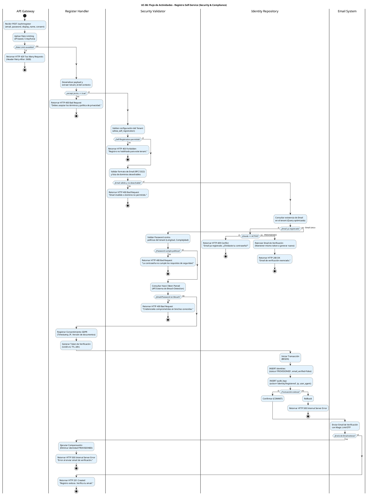

# UC-06: Registro Self-Service - Diagrama de Actividades

| Metadatos del Documento | |
| :--- | :--- |
| **Proyecto:** | SHUGO - Identity & Access Platform |
| **Caso de Uso:** | UC-06 - Registro Self-Service (Self-Service Sign-Up) |
| **Documento:** | 03_Activity_Diagram.md |
| **Metodología:** | UML 2.5 + ICONIX + Security by Design + Transactional Integrity |
| **Autor:** | Gastón Ruiz |
| **Versión Actual:** | 1.0.0 |
| **Fecha:** | 04/09/2026 |

---

## Historial de Versiones

| Versión | Fecha | Autor | Descripción de Cambios | Impacto |
| :--- | :--- | :--- | :--- | :--- |
| **1.0.0** | [04/09/2026] | [Gastón Ruiz] | **Creación inicial.** Modelado del flujo de trabajo interno para el registro público de identidades. Destaca las capas de validación de seguridad (Rate Limiting, Anti-Disposable, Breach Detection), la gestión transaccional de la creación de identidades en estado PROVISIONED, el registro de consentimiento GDPR, y el manejo de excepciones para prevenir Account Takeover y abuso de recursos. | Documento base del paquete de diseño Tier 1 del UC-06. Establece la lógica de negocio, los puntos de decisión críticos y las garantías de seguridad y privacidad para el endpoint público de registro del motor KAGAMI. |

---

## 1. Introducción y Propósito

El **Diagrama de Actividades** para el UC-06 visualiza el flujo de control, decisiones y orquestación necesario para ejecutar un registro self-service seguro en el motor **KAGAMI** de SHUGO.

A diferencia del UC-01 (Provisionamiento por Admin), el UC-06 es un **endpoint público no autenticado**, lo que lo convierte en el principal vector de ataques de abuso, enumeración y Account Takeover. Por lo tanto, el diagrama introduce cinco complejidades arquitectónicas críticas:

1. **Defensa en Profundidad (Defense-in-Depth):** Múltiples capas de validación (Rate Limiting, Formato, Unicidad, Políticas, Breach Detection) antes de tocar la base de datos.
2. **Prevención de Enumeración:** Lógica para manejar emails existentes sin revelar si la cuenta está activa o no a través de tiempos de respuesta o mensajes diferenciados.
3. **Integridad Transaccional con Email:** Garantizar que si el sistema de email falla, la identidad no quede huérfana en estado `PROVISIONED` (Rollback atómico).
4. **Privacy by Design:** El registro explícito e inmutable del consentimiento GDPR como parte de la transacción de creación.
5. **Estado Inicial Restringido:** La identidad se crea en estado `PROVISIONED`, bloqueada para autenticación hasta que se complete el flujo de UC-09 (Verificación).

Utilizamos carriles (swimlanes) para separar las responsabilidades entre el API Gateway, el Register Handler, el Security Validator, el Identity Repository, el Email System y sistemas externos (HIBP).

---

## 2. Diagrama de Actividades (PlantUML)

A continuación, se presenta el diagrama que cubre el Escenario Principal (Happy Path), los escenarios alternativos (Email existente, Tenant restringido) y los flujos de excepción (Abuso, Breach, Fallo de Email).



---

## 3. Explicación Detallada del Flujo

### 3.1. Carriles (Partitions / Swimlanes)

El diagrama está dividido en cinco carriles que representan las capas y responsabilidades de la arquitectura:

1. **`|API Gateway|` (Capa de Entrada y Protección):** Responsable del Rate Limiting basado en IP. Es la primera línea de defensa contra ataques de fuerza bruta y abuso de recursos (Sybil attacks). No conoce la lógica de negocio, solo protege la infraestructura.
2. **`|Register Handler|` (Capa de Aplicación):** Orquesta el caso de uso. Coordina las validaciones, gestiona la transacción, registra el consentimiento y maneja la respuesta HTTP. Es el punto central de decisión.
3. **`|Security Validator|` (Capa de Dominio/Seguridad):** Contiene las reglas de negocio de seguridad: validación de configuración del tenant, detección de emails desechables, políticas de contraseñas y consulta a servicios externos de inteligencia de amenazas (Have I Been Pwned).
4. **`|Identity Repository|` (Capa de Infraestructura - Persistencia):** Responsable de la integridad de los datos. Ejecuta la transacción atómica que crea la identidad en estado `PROVISIONED` y registra el log de auditoría inicial.
5. **`|Email System|` (Capa de Infraestructura - Notificación):** Responsable de la entrega del token de verificación. Su fallo es crítico y requiere una acción de compensación (rollback) para evitar cuentas huérfanas.

### 3.2. Puntos de Decisión Críticos (Rombos)

1. **Rate Limiting (API Gateway):**
   - **Pregunta:** ¿La IP ha excedido 5 requests en la última hora?
   - **Si falla:** Retorna HTTP 429 inmediatamente.
   - **Justificación:** Previene el agotamiento de recursos y ataques de enumeración masiva antes de que la request toque la lógica de aplicación.

2. **Aceptación de Términos (Register Handler):**
   - **Pregunta:** ¿El flag `accept_terms` es `true`?
   - **Si falla:** Retorna HTTP 400.
   - **Justificación:** Cumplimiento estricto de GDPR Art. 6 & 7. Sin consentimiento explícito, no hay procesamiento de datos.

3. **Configuración del Tenant (Security Validator):**
   - **Pregunta:** ¿El tenant permite `allow_self_registration`?
   - **Si falla:** Retorna HTTP 403.
   - **Justificación:** Permite a los administradores de tenant desactivar el registro público si lo requieren (ej. entornos corporativos cerrados).

4. **Validación de Email y Dominios Desechables (Security Validator):**
   - **Pregunta:** ¿El email cumple RFC 5322 y no está en la blacklist de dominios (ej. mailinator.com)?
   - **Si falla:** Retorna HTTP 400.
   - **Justificación:** Previene la creación de cuentas falsas o temporales que complican la auditoría y el marketing.

5. **Unicidad de Email (Identity Repository):**
   - **Pregunta:** ¿El email ya existe en el tenant?
   - **Si existe y está ACTIVE:** Retorna HTTP 409 (Conflict) sugiriendo recuperación de contraseña.
   - **Si existe y está PROVISIONED:** Reenvía el email de verificación (HTTP 200) para ayudar al usuario que no recibió el primer correo.
   - **Justificación:** Mejora la UX sin comprometer la seguridad. *Nota de Seguridad:* En implementaciones de altísima seguridad, se puede optar por retornar siempre 200 para prevenir enumeración, pero SHUGO prioriza la UX guiada en este flujo.

6. **Breach Detection (Security Validator - HIBP):**
   - **Pregunta:** ¿El email o la contraseña aparecen en bases de datos de filtraciones conocidas?
   - **Si falla:** Retorna HTTP 400.
   - **Justificación:** Previene el uso de credenciales comprometidas desde el día cero, mitigando riesgos de Account Takeover inmediatos.

7. **Integridad Transaccional y Email (Identity Repository & Email System):**
   - **Pregunta:** ¿La transacción de DB fue exitosa Y el email se envió correctamente?
   - **Si el email falla:** Se ejecuta una **Acción de Compensación** (eliminar la identidad `PROVISIONED`) y se retorna HTTP 500.
   - **Justificación:** Garantiza que no queden identidades "zombies" en la base de datos que nunca podrán verificarse ni autenticarse.

---

## 4. Alineación con la Especificación de Requisitos

Este diagrama es la representación visual exacta del documento `01_Requirements_Specification.md`:

| Sección en Requisitos | Representación en el Diagrama |
| :--- | :--- |
| **2.1 Escenario Principal (Pasos 1-15)** | El flujo principal desde "Recibir POST" hasta "Retornar HTTP 201" y envío de email. |
| **2.2 Escenario Alternativo (Email Existente)** | La bifurcación "¿Email ya registrado?" con sub-ramas para ACTIVE (409) y PROVISIONED (200). |
| **2.3 Escenario Alternativo (Tenant Restringido)** | El rombo "¿Self-Registration permitido?" y su rama "no" (HTTP 403). |
| **2.4 Escenario Alternativo (Breach)** | El rombo "¿Email/Password en Breach?" y su rama "sí" (HTTP 400). |
| **2.5 Excepción 2.1 (Rate Limiting)** | El primer rombo en el API Gateway (HTTP 429). |
| **2.5 Excepción 5.1 (Email Desechable)** | El rombo "¿Email válido y no desechable?" (HTTP 400). |
| **2.5 Excepción 7.1 (Password Débil)** | El rombo "¿Password cumple políticas?" (HTTP 400). |
| **2.5 Excepción 10.1 (Fallo de Email)** | El rombo "¿Envío de Email exitoso?" con la acción de compensación (Rollback). |
| **3 INV-31 a INV-39** | Todas las invariantes de dominio (Tenant Config, Unicidad, Formato, Políticas, Estado PROVISIONED) se validan en los carriles correspondientes. |
| **3 RN-01 a RN-05** | Las reglas de negocio (Rate Limiting, Re-envío, Consentimiento, Auditoría) están explícitamente modeladas. |

---

## 5. Consideraciones de Arquitectura y Diseño (Security & Privacy by Design)

### 5.1. Prevención de Timing Attacks (Enumeración)

Aunque el diagrama muestra retornos HTTP diferenciados (409 vs 200) para emails existentes, la implementación en el `Security Validator` debe tener cuidado con los **Timing Attacks**.

*   **Mitigación:** La consulta de unicidad (`SELECT 1 FROM identities WHERE email = ?`) debe ejecutarse en un tiempo constante, independientemente de si el email existe o no.
*   **Justificación:** Si la consulta tarda 2ms cuando no existe y 50ms cuando existe, un atacante puede usar el tiempo de respuesta para construir una base de datos de usuarios registrados en el tenant.

### 5.2. Manejo de Fallos en Sistemas Externos (HIBP & Email)

El diagrama modela dos dependencias externas críticas: **Have I Been Pwned (HIBP)** y el **Email System**.

*   **Patrón Fail-Safe para HIBP:** Si la API de HIBP está caída o timeout, el sistema debe **bloquear el registro** temporalmente (HTTP 503) o permitirlo marcando la identidad para verificación manual, dependiendo de la configuración de riesgo del tenant. *Nunca* se debe asumir que un email es seguro si no se puede verificar.
*   **Patrón de Compensación para Email:** Como se muestra en el diagrama, si el SMTP falla, se ejecuta una acción de compensación. En arquitecturas más complejas, esto se manejaría con el **Patrón Saga** o **Outbox Pattern**, donde la creación de la identidad y el evento "Enviar Email" se guardan en la misma transacción, y un worker asíncrono intenta enviar el email con reintentos exponenciales.

### 5.3. Registro de Consentimiento GDPR (Privacy by Design)

El paso "Registrar Consentimiento GDPR" no es un simple log. Es una **invariante de dominio** que se persiste en la misma transacción que la identidad.

*   **Datos a registrar:** `timestamp` exacto, `ip_address` del usuario, `user_agent`, y la `version` de los documentos legales aceptados.
*   **Justificación:** GDPR Art. 7(1) establece que el responsable del tratamiento debe poder demostrar que el interesado dio su consentimiento. Este registro es la prueba legal inmutable.

### 5.4. Estado PROVISIONED y Aislamiento de Seguridad

La identidad se crea con `status = 'PROVISIONED'` y `email_verified = false`.

*   **Restricciones de Dominio:**
    *   **UC-11 (Autenticar):** Bloqueará el login de identidades `PROVISIONED`.
    *   **UC-02 (Actualizar):** Bloqueará la edición de perfil hasta que se verifique el email.
    *   **UC-05 (Purgar):** Si el token expira (24h), un job en background eliminará estas identidades `PROVISIONED` automáticamente para mantener la higiene de la base de datos.

---

## 6. Trazabilidad con Otros Documentos del Paquete

| Documento | Relación |
| :--- | :--- |
| `01_Requirements_Specification.md` | Este diagrama visualiza los flujos de texto, las invariantes de seguridad y los criterios de aceptación BDD. |
| `02_Use_Case_Diagram.md` | Muestra el límite del sistema y los actores; este diagrama muestra el flujo interno y las decisiones lógicas. |
| `04_Initial_Domain_Model.md` | Las acciones de los carriles "Register Handler", "Security Validator" e "Identity Repository" se implementan aquí como clases y métodos. |
| `05_State_Machine_Diagram.md` | Mostrará la transición de `PROVISIONED` a `ACTIVE` (iniciada aquí, completada en UC-09). |
| `06_Robustness_Diagram.md` | Mostrará la colaboración entre el Register Handler, los validadores, el Email System y la API de Breach Detection. |
| `07_Sequence_Diagram.md` | Detallará el orden temporal exacto de las llamadas: validación de tenant → validación de email → breach detection → creación → envío de email. |
| `08_Final_Class_Design.md` | Definirá las firmas exactas de los métodos: `RegisterHandler.Execute()`, `PasswordValidator.Validate()`, `BreachDetectionService.Check()`. |
| `UC-09/01_Requirements_Specification.md` | Documento que define la verificación de contactos (complementa el flujo de verificación de email iniciado aquí). |

---

## 7. Notas de Implementación

### 7.1. Generación del Diagrama
- **Herramienta:** PlantUML (Diagrams as Code).
- **Ventaja:** Versionable en Git, reproducible, sin dependencias de software propietario.
- **Sintaxis:** Uso de `if/else/endif` para decisiones, carriles para separar responsabilidades, y notas explicativas estratégicas.

### 7.2. Complejidad del Diagrama
Este es uno de los diagramas de actividades más complejos del sistema debido a la cantidad de validaciones de seguridad obligatorias antes de permitir la persistencia. Sin embargo, esta complejidad es necesaria para capturar la riqueza del flujo de registro en un sistema IAM de nivel enterprise que debe resistir ataques de abuso y cumplir con GDPR.

### 7.3. Código de Ejemplo (C# - Manejo de Transacción y Compensación)

```csharp
public class RegisterHandler : IRegisterHandler
{
    private readonly ISecurityValidator _validator;
    private readonly IIdentityRepository _repository;
    private readonly IEmailService _emailService;
    private readonly ILogger<RegisterHandler> _logger;

    public async Task<RegisterResult> Handle(RegisterCommand command, CancellationToken ct)
    {
        // 1. Validaciones de Seguridad (Fail-Fast)
        await _validator.ValidateTenantConfigAsync(command.TenantId);
        _validator.ValidateEmailFormat(command.Email);
        await _validator.CheckUniquenessAsync(command.TenantId, command.Email);
        _validator.ValidatePasswordPolicy(command.Password);
        await _validator.CheckBreachDetectionAsync(command.Email, command.Password);

        // 2. Generación de Token y Consentimiento
        var verificationToken = Guid.NewGuid().ToString();
        var consentRecord = new ConsentRecord(command.IpAddress, command.UserAgent, "v2.1");

        // 3. Transacción Atómica (Identidad + Consentimiento + Auditoría)
        Identity identity = null;
        try
        {
            identity = await _repository.CreateProvisionedIdentityAsync(
                command.TenantId, command.Email, command.Password, 
                command.DisplayName, verificationToken, consentRecord, ct);
        }
        catch (Exception ex)
        {
            _logger.LogError(ex, "Fallo en la transacción de registro para {Email}", command.Email);
            throw new RegistrationException("Error interno al procesar el registro.");
        }

        // 4. Envío de Email con Patrón de Compensación
        try
        {
            await _emailService.SendVerificationEmailAsync(command.Email, verificationToken, ct);
        }
        catch (Exception ex)
        {
            _logger.LogError(ex, "Fallo al enviar email de verificación. Ejecutando compensación para {IdentityId}", identity.Id);
            // Acción de Compensación: Eliminar la identidad huérfana
            await _repository.DeleteIdentityAsync(identity.Id, ct);
            throw new RegistrationException("No se pudo enviar el email de verificación. Por favor intenta nuevamente.");
        }

        return new RegisterResult(identity.Id, "Registro exitoso. Verifica tu email.");
    }
}
```

---
*Fin del Documento 03_Activity_Diagram para UC-06*