# UC-06: Registro Self-Service - Modelo de Dominio Inicial

| Metadatos del Documento | |
| :--- | :--- |
| **Proyecto:** | SHUGO - Identity & Access Platform |
| **Caso de Uso:** | UC-06 - Registro Self-Service (Self-Service Sign-Up) |
| **Documento:** | 04_Initial_Domain_Model.md |
| **Metodología:** | ICONIX (Modelo de Análisis) + DDD (Domain-Driven Design) + Security by Design |
| **Autor:** | Gastón Ruiz |
| **Versión Actual:** | 1.0.0 |
| **Fecha:** | 04/09/2026 |

---

## Historial de Versiones

| Versión | Fecha | Autor | Descripción de Cambios | Impacto |
| :--- | :--- | :--- | :--- | :--- |
| **1.0.0** | 04/09/2026 | Gastón Ruiz | **Creación inicial.** Definición del Modelo de Dominio Conceptual para el registro self-service. Introduce el Aggregate Root `Identity` en estado PROVISIONED, los Value Objects de seguridad (`Email`, `Password`, `VerificationToken`, `ConsentRecord`), los Domain Services especializados (`RegisterHandler`, `SecurityValidator`, `BreachDetectionService`), y los eventos de dominio para notificación asíncrona. | Documento base del paquete de diseño Tier 1 del UC-06. Establece cómo el dominio gestiona la creación segura de identidades públicas con validaciones de seguridad, consentimiento GDPR, y verificación de email pendiente. |

---

## 1. Introducción y Propósito

Este documento presenta el **Modelo de Dominio Inicial** para el Caso de Uso UC-06 (Registro Self-Service).

A diferencia del UC-01 (Provisionamiento por Admin) donde un administrador crea identidades con control total, el UC-06 maneja la creación de identidades por **usuarios externos no autenticados** a través de un endpoint público. Esto introduce complejidades únicas:

1. **Validaciones de Seguridad Estrictas:** El dominio debe validar email, password, breach detection, y rate limiting antes de permitir la persistencia.
2. **Estado Inicial Restringido:** Las identidades se crean en estado `PROVISIONED` con `email_verified = false`, bloqueadas para autenticación.
3. **Consentimiento GDPR Inmutable:** El registro del consentimiento es una invariante de dominio que debe persistirse junto con la identidad.
4. **Token de Verificación Temporal:** Se genera un UUID v4 con TTL de 24 horas para completar el flujo de verificación (UC-09).
5. **Prevención de Account Takeover:** El dominio integra servicios externos (Have I Been Pwned) y listas de emails desechables.

El modelo se centra en:
- **Security by Design:** Las validaciones de seguridad son invariantes de dominio, no solo validaciones de UI.
- **Privacy by Design:** El consentimiento GDPR es un Value Object inmutable que se registra con timestamp, IP y versión de documentos.
- **Estado Inicial Seguro:** La identidad no puede autenticarse ni actualizarse hasta completar la verificación de email.

---

## 2. Diagrama de Modelo de Dominio Conceptual (PlantUML)

A continuación, se presenta el diagrama de clases conceptual, enfocándose en los objetos de dominio, servicios y eventos introducidos para UC-06.

```plantuml
@startuml UC-06_DominioConceptual
<style>
diagram {
  BackgroundColor #FFFFFF
}
</style>
skinparam classAttributeIconSize 0
skinparam classBackgroundColor #FFFFFF
skinparam classBorderColor #1565C0
skinparam classHeaderBackgroundColor #E3F2FD

title UC-06: Modelo de Dominio Conceptual - Registro Self-Service (Security & Compliance)

' ============================================
' AGGREGATE ROOT
' ============================================
class Identity <<Aggregate Root>> {
  - id: IdentityId
  - tenantId: TenantId
  - email: Email
  - passwordHash: PasswordHash
  - displayName: DisplayName
  - status: IdentityStatus
  - emailVerified: boolean
  - verificationToken: VerificationToken?
  - consentRecord: ConsentRecord
  - createdAt: DateTime
  - domainEvents: List<IDomainEvent>
  
  + CreateProvisioned(tenantId, email, passwordHash, displayName, consentRecord): Identity
  - ValidateInitialState(): void
  - AddDomainEvent(event: IDomainEvent): void
}

' ============================================
' VALUE OBJECTS
' ============================================
class Email <<Value Object>> {
  - value: string
  + Email(value: string)
  - ValidateFormat(): void
  - ValidateNotDisposable(): void
}

class PasswordHash <<Value Object>> {
  - hash: string
  - algorithm: string
  - salt: string
  + PasswordHash(password: string)
  - HashWithArgon2id(password: string): void
}

class DisplayName <<Value Object>> {
  - value: string
  + DisplayName(value: string)
  - ValidateLength(): void
}

class VerificationToken <<Value Object>> {
  - token: string
  - expiresAt: DateTime
  + VerificationToken()
  - GenerateUUIDv4(): void
  - SetTTL(hours: int): void
  + IsExpired(): boolean
}

class ConsentRecord <<Value Object>> {
  - acceptedTerms: boolean
  - termsVersion: string
  - privacyPolicyVersion: string
  - timestamp: DateTime
  - ipAddress: string
  - userAgent: string
  + ConsentRecord(acceptedTerms, termsVersion, privacyPolicyVersion, ipAddress, userAgent)
  - ValidateAcceptance(): void
}

class TenantId <<Value Object>> {
  - value: Guid
  + TenantId(value: Guid)
}

class IdentityId <<Value Object>> {
  - value: Guid
  + IdentityId(value: Guid)
}

' ============================================
' DOMAIN SERVICES
' ============================================
class RegisterHandler <<Domain Service>> {
  - securityValidator: ISecurityValidator
  - identityRepository: IIdentityRepository
  - emailService: IEmailService
  - logger: ILogger<RegisterHandler>
  
  + Execute(command: RegisterCommand): Task<RegisterResult>
  - ValidateTenantConfig(tenantId: TenantId): void
  - CreateProvisionedIdentity(...): Task<Identity>
  - SendVerificationEmail(identity: Identity): Task
  - CompensateOnFailure(identityId: IdentityId): Task
}

class SecurityValidator <<Domain Service>> {
  - tenantRepository: ITenantRepository
  - identityRepository: IIdentityRepository
  - breachDetectionService: IBreachDetectionService
  - disposableEmailList: IDisposableEmailList
  
  + ValidateTenantConfig(tenantId: TenantId): void
  + ValidateEmail(email: Email): void
  + ValidateUniqueness(tenantId: TenantId, email: Email): Task
  + ValidatePassword(passwordHash: PasswordHash, tenantId: TenantId): void
  + CheckBreachDetection(email: Email, password: string): Task
}

class BreachDetectionService <<Domain Service>> {
  - hibpClient: IHIBPClient
  - cache: IDistributedCache
  
  + IsEmailCompromised(email: Email): Task<boolean>
  + IsPasswordCompromised(password: string): Task<boolean>
}

' ============================================
' DOMAIN EVENTS
' ============================================
class IdentityRegistered <<Domain Event>> {
  + identityId: IdentityId
  + tenantId: TenantId
  + email: Email
  + status: IdentityStatus
  + registrationMethod: string
  + ipAddress: string
  + userAgent: string
}

class EmailVerificationRequested <<Domain Event>> {
  + identityId: IdentityId
  + email: Email
  + verificationToken: VerificationToken
  + expiresAt: DateTime
}

' ============================================
' INTERFACES
' ============================================
interface IIdentityRepository {
  + SaveAsync(identity: Identity): Task
  + ExistsByEmailAsync(tenantId: TenantId, email: Email): Task<boolean>
  + DeleteAsync(identityId: IdentityId): Task
}

interface IEmailService {
  + SendVerificationEmailAsync(email: Email, token: VerificationToken): Task
}

interface IBreachDetectionService {
  + IsEmailCompromised(email: Email): Task<boolean>
  + IsPasswordCompromised(password: string): Task<boolean>
}

' ============================================
' RELACIONES
' ============================================
Identity *-- Email : "contiene"
Identity *-- PasswordHash : "contiene"
Identity *-- DisplayName : "contiene"
Identity *-- VerificationToken : "genera (0..1)"
Identity *-- ConsentRecord : "registra"
Identity *-- TenantId : "pertenece"
Identity *-- IdentityId : "identifica"

RegisterHandler --> SecurityValidator : "valida"
RegisterHandler --> IIdentityRepository : "persiste"
RegisterHandler --> IEmailService : "notifica"

SecurityValidator --> IBreachDetectionService : "consulta"
SecurityValidator --> IIdentityRepository : "verifica unicidad"

Identity ..> IdentityRegistered : "publica"
Identity ..> EmailVerificationRequested : "publica"

note right of Identity
  **Estado Inicial:**
  - status = PROVISIONED
  - emailVerified = false
  - No puede autenticarse
  - No puede actualizarse
end note

note right of ConsentRecord
  **GDPR Art. 7(1):**
  Registro inmutable de:
  - Timestamp exacto
  - IP del usuario
  - Versión de documentos
  - User Agent
end note

note bottom of SecurityValidator
  **Defense-in-Depth:**
  Múltiples capas de validación
  antes de permitir la persistencia.
end note

@enduml
```



---

## 3. Detalle de Conceptos de Dominio (DDD)

### 3.1. Aggregate Root: `Identity` (Estado PROVISIONED)

El Aggregate Root `Identity` es el mismo que se utiliza en UC-01 (Provisionamiento), pero con un método de fábrica específico para registro self-service que garantiza el estado inicial seguro.

**Código (C#):**

```csharp
public class Identity : AggregateRoot
{
    public IdentityId Id { get; private set; }
    public TenantId TenantId { get; private set; }
    public Email Email { get; private set; }
    public PasswordHash PasswordHash { get; private set; }
    public DisplayName DisplayName { get; private set; }
    public IdentityStatus Status { get; private set; }
    public bool EmailVerified { get; private set; }
    public VerificationToken VerificationToken { get; private set; }
    public ConsentRecord ConsentRecord { get; private set; }
    public DateTime CreatedAt { get; private set; }
    
    private readonly List<IDomainEvent> _domainEvents = new();

    // Constructor privado para EF Core
    private Identity() { }

    /// <summary>
    /// Método de fábrica para crear identidad en estado PROVISIONED (Self-Service).
    /// Garantiza que la identidad no pueda autenticarse hasta verificar el email.
    /// </summary>
    public static Identity CreateProvisioned(
        TenantId tenantId,
        Email email,
        PasswordHash passwordHash,
        DisplayName displayName,
        ConsentRecord consentRecord)
    {
        var identity = new Identity
        {
            Id = new IdentityId(Guid.NewGuid()),
            TenantId = tenantId,
            Email = email,
            PasswordHash = passwordHash,
            DisplayName = displayName,
            Status = IdentityStatus.PROVISIONED,
            EmailVerified = false,
            VerificationToken = new VerificationToken(), // UUID v4 + TTL 24h
            ConsentRecord = consentRecord,
            CreatedAt = DateTime.UtcNow
        };

        identity.ValidateInitialState();
        
        // Generar eventos de dominio
        identity.AddDomainEvent(new IdentityRegistered(
            identity.Id,
            identity.TenantId,
            identity.Email,
            identity.Status,
            "SELF_SERVICE",
            consentRecord.IpAddress,
            consentRecord.UserAgent
        ));

        identity.AddDomainEvent(new EmailVerificationRequested(
            identity.Id,
            identity.Email,
            identity.VerificationToken,
            identity.VerificationToken.ExpiresAt
        ));

        return identity;
    }

    /// <summary>
    /// Valida invariantes del estado inicial PROVISIONED.
    /// </summary>
    private void ValidateInitialState()
    {
        if (this.Status != IdentityStatus.PROVISIONED)
            throw new DomainException("Self-service identity must be created in PROVISIONED status.");

        if (this.EmailVerified)
            throw new DomainException("Self-service identity cannot be created with emailVerified = true.");

        if (this.VerificationToken == null)
            throw new DomainException("Self-service identity must have a verification token.");

        if (this.ConsentRecord == null || !this.ConsentRecord.AcceptedTerms)
            throw new DomainException("Self-service identity requires explicit GDPR consent.");
    }

    public IReadOnlyCollection<IDomainEvent> GetDomainEvents() => _domainEvents.AsReadOnly();
    
    protected void AddDomainEvent(IDomainEvent evt) => _domainEvents.Add(evt);
}
```

### 3.2. Value Objects de Seguridad

#### **Email**

Valida formato RFC 5322 y previene el uso de dominios desechables.

```csharp
public class Email : ValueObject
{
    private static readonly Regex EmailRegex = new Regex(
        @"^[^@\s]+@[^@\s]+\.[^@\s]+$", 
        RegexOptions.Compiled);

    private static readonly HashSet<string> DisposableDomains = new HashSet<string>(StringComparer.OrdinalIgnoreCase)
    {
        "mailinator.com", "guerrillamail.com", "tempmail.com", "throwaway.email"
        // ... lista completa de dominios desechables
    };

    public string Value { get; }

    public Email(string value)
    {
        if (string.IsNullOrWhiteSpace(value))
            throw new ArgumentException("Email cannot be empty.");

        ValidateFormat(value);
        ValidateNotDisposable(value);

        Value = value.ToLowerInvariant().Trim();
    }

    private void ValidateFormat(string value)
    {
        if (!EmailRegex.IsMatch(value))
            throw new DomainException("Invalid email format. Must comply with RFC 5322.");
    }

    private void ValidateNotDisposable(string value)
    {
        var domain = value.Split('@')[1];
        if (DisposableDomains.Contains(domain))
            throw new DomainException($"Email domain '{domain}' is not allowed. Please use a permanent email address.");
    }

    protected override IEnumerable<object> GetEqualityComponents()
    {
        yield return Value;
    }
}
```

#### **PasswordHash**

Utiliza Argon2id para hashing resistente a ataques de GPU.

```csharp
public class PasswordHash : ValueObject
{
    public string Hash { get; }
    public string Algorithm { get; }
    public string Salt { get; }

    public PasswordHash(string plainPassword)
    {
        if (string.IsNullOrWhiteSpace(plainPassword))
            throw new ArgumentException("Password cannot be empty.");

        Salt = GenerateCryptographicSalt();
        Hash = HashWithArgon2id(plainPassword, Salt);
        Algorithm = "Argon2id";
    }

    private string GenerateCryptographicSalt()
    {
        var salt = new byte[16];
        using (var rng = RandomNumberGenerator.Create())
        {
            rng.GetBytes(salt);
        }
        return Convert.ToBase64String(salt);
    }

    private string HashWithArgon2id(string password, string salt)
    {
        // Implementación de Argon2id con parámetros recomendados por OWASP:
        // - Memory: 64 MB
        // - Iterations: 3
        // - Parallelism: 4
        // - Hash length: 32 bytes
        return Argon2.Hash(password, salt, Argon2Type.DataIndependent, 3, 65536, 4, 32);
    }

    protected override IEnumerable<object> GetEqualityComponents()
    {
        yield return Hash;
    }
}
```

#### **VerificationToken**

UUID v4 criptográficamente seguro con TTL de 24 horas.

```csharp
public class VerificationToken : ValueObject
{
    public string Token { get; }
    public DateTime ExpiresAt { get; }

    public VerificationToken(int ttlHours = 24)
    {
        Token = GenerateSecureUUIDv4();
        ExpiresAt = DateTime.UtcNow.AddHours(ttlHours);
    }

    private string GenerateSecureUUIDv4()
    {
        return Guid.NewGuid().ToString("N"); // 32 caracteres hex
    }

    public bool IsExpired()
    {
        return DateTime.UtcNow > ExpiresAt;
    }

    protected override IEnumerable<object> GetEqualityComponents()
    {
        yield return Token;
    }
}
```

#### **ConsentRecord**

Registro inmutable de consentimiento GDPR con metadata completa.

```csharp
public class ConsentRecord : ValueObject
{
    public bool AcceptedTerms { get; }
    public string TermsVersion { get; }
    public string PrivacyPolicyVersion { get; }
    public DateTime Timestamp { get; }
    public string IpAddress { get; }
    public string UserAgent { get; }

    public ConsentRecord(
        bool acceptedTerms,
        string termsVersion,
        string privacyPolicyVersion,
        string ipAddress,
        string userAgent)
    {
        if (!acceptedTerms)
            throw new DomainException("User must explicitly accept terms and privacy policy.");

        if (string.IsNullOrWhiteSpace(termsVersion))
            throw new ArgumentException("Terms version is required.");

        if (string.IsNullOrWhiteSpace(privacyPolicyVersion))
            throw new ArgumentException("Privacy policy version is required.");

        AcceptedTerms = acceptedTerms;
        TermsVersion = termsVersion;
        PrivacyPolicyVersion = privacyPolicyVersion;
        Timestamp = DateTime.UtcNow;
        IpAddress = ipAddress ?? "unknown";
        UserAgent = userAgent ?? "unknown";
    }

    protected override IEnumerable<object> GetEqualityComponents()
    {
        yield return AcceptedTerms;
        yield return TermsVersion;
        yield return PrivacyPolicyVersion;
        yield return Timestamp;
    }
}
```

### 3.3. Domain Services

#### **RegisterHandler**

Orquestador del caso de uso que coordina validaciones, creación y notificación.

```csharp
public class RegisterHandler : IRegisterHandler
{
    private readonly ISecurityValidator _securityValidator;
    private readonly IIdentityRepository _identityRepository;
    private readonly IEmailService _emailService;
    private readonly ILogger<RegisterHandler> _logger;

    public RegisterHandler(
        ISecurityValidator securityValidator,
        IIdentityRepository identityRepository,
        IEmailService emailService,
        ILogger<RegisterHandler> logger)
    {
        _securityValidator = securityValidator;
        _identityRepository = identityRepository;
        _emailService = emailService;
        _logger = logger;
    }

    public async Task<RegisterResult> Execute(RegisterCommand command)
    {
        try
        {
            // 1. Validaciones de seguridad (Fail-Fast)
            await _securityValidator.ValidateTenantConfigAsync(command.TenantId);
            var email = new Email(command.Email);
            await _securityValidator.ValidateUniquenessAsync(command.TenantId, email);
            var passwordHash = new PasswordHash(command.Password);
            await _securityValidator.CheckBreachDetectionAsync(email, command.Password);

            // 2. Crear registro de consentimiento
            var consentRecord = new ConsentRecord(
                command.AcceptTerms,
                command.TermsVersion,
                command.PrivacyPolicyVersion,
                command.IpAddress,
                command.UserAgent
            );

            // 3. Crear identidad en estado PROVISIONED
            var displayName = new DisplayName(command.DisplayName);
            var identity = Identity.CreateProvisioned(
                command.TenantId,
                email,
                passwordHash,
                displayName,
                consentRecord
            );

            // 4. Persistir identidad
            await _identityRepository.SaveAsync(identity);

            // 5. Enviar email de verificación
            await _emailService.SendVerificationEmailAsync(email, identity.VerificationToken);

            // 6. Retornar resultado
            return new RegisterResult(identity.Id, "Registro exitoso. Verifica tu email.");
        }
        catch (EmailServiceException ex)
        {
            // Patrón de compensación: si falla el email, eliminar la identidad
            _logger.LogError(ex, "Fallo al enviar email. Ejecutando compensación para {IdentityId}", identity?.Id);
            if (identity != null)
            {
                await _identityRepository.DeleteAsync(identity.Id);
            }
            throw new RegistrationException("No se pudo enviar el email de verificación. Por favor intenta nuevamente.");
        }
        catch (DomainException ex)
        {
            _logger.LogWarning(ex, "Validación de dominio fallida para email {Email}", command.Email);
            throw;
        }
    }
}
```

#### **SecurityValidator**

Valida todas las reglas de seguridad antes de permitir la creación.

```csharp
public class SecurityValidator : ISecurityValidator
{
    private readonly ITenantRepository _tenantRepository;
    private readonly IIdentityRepository _identityRepository;
    private readonly IBreachDetectionService _breachDetectionService;

    public SecurityValidator(
        ITenantRepository tenantRepository,
        IIdentityRepository identityRepository,
        IBreachDetectionService breachDetectionService)
    {
        _tenantRepository = tenantRepository;
        _identityRepository = identityRepository;
        _breachDetectionService = breachDetectionService;
    }

    public async Task ValidateTenantConfigAsync(TenantId tenantId)
    {
        var tenant = await _tenantRepository.GetByIdAsync(tenantId);
        if (tenant == null)
            throw new DomainException($"Tenant {tenantId} not found.");

        if (!tenant.AllowSelfRegistration)
            throw new DomainException("Self-registration is not enabled for this tenant.");
    }

    public async Task ValidateUniquenessAsync(TenantId tenantId, Email email)
    {
        var exists = await _identityRepository.ExistsByEmailAsync(tenantId, email);
        if (exists)
            throw new DomainException("Email already registered in this tenant.");
    }

    public async Task CheckBreachDetectionAsync(Email email, string password)
    {
        var emailCompromised = await _breachDetectionService.IsEmailCompromised(email);
        if (emailCompromised)
            throw new DomainException("This email has been compromised in known data breaches.");

        var passwordCompromised = await _breachDetectionService.IsPasswordCompromised(password);
        if (passwordCompromised)
            throw new DomainException("This password is too common and has been found in data breaches.");
    }
}
```

### 3.4. Domain Events

#### **IdentityRegistered**

Se genera cuando se crea una identidad self-service exitosamente.

```csharp
public class IdentityRegistered : IDomainEvent
{
    public Guid EventId { get; } = Guid.NewGuid();
    public DateTime Timestamp { get; } = DateTime.UtcNow;
    
    public IdentityId IdentityId { get; }
    public TenantId TenantId { get; }
    public Email Email { get; }
    public IdentityStatus Status { get; }
    public string RegistrationMethod { get; }
    public string IpAddress { get; }
    public string UserAgent { get; }

    public IdentityRegistered(
        IdentityId identityId,
        TenantId tenantId,
        Email email,
        IdentityStatus status,
        string registrationMethod,
        string ipAddress,
        string userAgent)
    {
        IdentityId = identityId;
        TenantId = tenantId;
        Email = email;
        Status = status;
        RegistrationMethod = registrationMethod;
        IpAddress = ipAddress;
        UserAgent = userAgent;
    }
}
```

**Consumidores:**
1. **KAGE (Audit):** Registra el evento en logs de auditoría con IP y user agent.
2. **TORII (Webhooks):** Notifica a sistemas externos sobre el nuevo registro.
3. **Sistema de Email:** Envía el email de verificación al usuario.

#### **EmailVerificationRequested**

Se genera para solicitar el envío del email de verificación.

```csharp
public class EmailVerificationRequested : IDomainEvent
{
    public Guid EventId { get; } = Guid.NewGuid();
    public DateTime Timestamp { get; } = DateTime.UtcNow;
    
    public IdentityId IdentityId { get; }
    public Email Email { get; }
    public VerificationToken VerificationToken { get; }
    public DateTime ExpiresAt { get; }

    public EmailVerificationRequested(
        IdentityId identityId,
        Email email,
        VerificationToken verificationToken,
        DateTime expiresAt)
    {
        IdentityId = identityId;
        Email = email;
        VerificationToken = verificationToken;
        ExpiresAt = expiresAt;
    }
}
```

**Consumidores:**
1. **Email Service:** Envía el email con el token de verificación.
2. **Job de Limpieza:** Programa la eliminación de la identidad si el token expira sin verificación.

---

## 4. Decisiones de Diseño DDD (ADR)

### 4.1. ¿Por qué un método de fábrica estático `CreateProvisioned` en lugar de un constructor?

**Decisión:** Utilizar un método de fábrica estático `Identity.CreateProvisioned()` en lugar de un constructor público.

**Justificación:**
- **Claridad de Intención:** El nombre `CreateProvisioned` deja claro que se está creando una identidad en estado específico para self-service.
- **Validación de Invariantes:** El método puede validar que el estado inicial sea correcto antes de retornar el objeto.
- **Generación de Eventos:** El método de fábrica genera los eventos de dominio necesarios (`IdentityRegistered`, `EmailVerificationRequested`) como parte de la creación.
- **Prevención de Mal Uso:** Un constructor público podría permitir crear identidades en estados inválidos.

### 4.2. ¿Por qué `PasswordHash` en lugar de `Password`?

**Decisión:** El Value Object se llama `PasswordHash` y almacena el hash, no la contraseña en texto plano.

**Justificación:**
- **Seguridad:** La contraseña en texto plano nunca debe persistirse ni transmitirse dentro del dominio.
- **Inmutabilidad:** Una vez hasheada, la contraseña no puede ser recuperada.
- **Claridad:** El nombre `PasswordHash` deja claro que el valor almacenado es un hash, no la contraseña original.

### 4.3. ¿Por qué `ConsentRecord` es un Value Object y no una Entity?

**Decisión:** `ConsentRecord` es un Value Object inmutable.

**Justificación:**
- **Inmutabilidad:** El consentimiento no puede ser modificado una vez registrado. Si el usuario acepta nuevos términos, se crea un nuevo `ConsentRecord`.
- **Identidad por Valor:** Dos consentimientos con los mismos valores (timestamp, IP, versión) son equivalentes.
- **GDPR Compliance:** El consentimiento debe ser un registro histórico inmutable para cumplir con GDPR Art. 7(1).

### 4.4. ¿Por qué generar eventos de dominio en el Aggregate Root?

**Decisión:** Los eventos `IdentityRegistered` y `EmailVerificationRequested` se generan dentro del método `CreateProvisioned`.

**Justificación:**
- **Consistencia:** Los eventos se generan atómicamente con la creación de la identidad.
- **Transaccionalidad:** Si la creación falla, los eventos no se generan.
- **Domain-Driven:** El Aggregate Root es responsable de generar eventos que reflejan cambios de estado importantes.

---

## 5. Trazabilidad

| Documento | Relación |
| :--- | :--- |
| `01_Requirements_Specification.md` | Define las invariantes (INV-31 a INV-39) y reglas de negocio (RN-01 a RN-05) que este modelo implementa. |
| `02_Use_Case_Diagram.md` | Muestra los actores y sistemas; este modelo define los objetos de dominio con los que interactúan. |
| `03_Activity_Diagram.md` | Los carriles de actividad (Register Handler, Security Validator, Identity Repository) se implementan aquí como Domain Services y Aggregate Roots. |
| `05_State_Machine_Diagram.md` | Mostrará la transición de `PROVISIONED` a `ACTIVE` (iniciada aquí, completada en UC-09). |
| `06_Robustness_Diagram.md` | Mostrará la colaboración entre el Register Handler, Security Validator, Email Service y Breach Detection Service. |
| `07_Sequence_Diagram.md` | Detallará el orden temporal de las llamadas: validación de tenant → validación de email → breach detection → creación → envío de email. |
| `08_Final_Class_Design.md` | Definirá las firmas exactas de los métodos: `Identity.CreateProvisioned()`, `SecurityValidator.ValidateUniquenessAsync()`, `BreachDetectionService.IsEmailCompromised()`. |
| `UC-09/01_Requirements_Specification.md` | Documento que define la verificación de contactos (complementa el flujo de verificación de email iniciado aquí). |

---

## 6. Notas para la Implementación

### 6.1. Ubicación en Clean Architecture

- **Dominio (`SHUGO.Domain`):** `Identity`, `Email`, `PasswordHash`, `VerificationToken`, `ConsentRecord`, `RegisterHandler`, `SecurityValidator`, `BreachDetectionService`.
- **Infraestructura (`SHUGO.Infrastructure`):** Implementaciones de `IIdentityRepository`, `IEmailService`, `IBreachDetectionService` (cliente HIBP).
- **Aplicación (`SHUGO.Application`):** `RegisterCommand`, `RegisterResult`, `RegisterHandler` (adaptador de aplicación que delega al Domain Service).

### 6.2. Configuración de Argon2id

Los parámetros de Argon2id deben ser configurables por tenant para balancear seguridad y rendimiento:

```csharp
public class Argon2Config
{
    public int MemorySizeKB { get; set; } = 65536; // 64 MB
    public int Iterations { get; set; } = 3;
    public int Parallelism { get; set; } = 4;
    public int HashLength { get; set; } = 32;
}
```

### 6.3. Testeo Unitario

```csharp
[Test]
public void Identity_CreateProvisioned_WithValidData_CreatesIdentityInProvisionedState()
{
    // Arrange
    var tenantId = new TenantId(Guid.NewGuid());
    var email = new Email("test@example.com");
    var passwordHash = new PasswordHash("SecureP@ssw0rd!");
    var displayName = new DisplayName("Test User");
    var consentRecord = new ConsentRecord(true, "v2.1", "v1.3", "192.168.1.1", "Mozilla/5.0");

    // Act
    var identity = Identity.CreateProvisioned(tenantId, email, passwordHash, displayName, consentRecord);

    // Assert
    identity.Status.Should().Be(IdentityStatus.PROVISIONED);
    identity.EmailVerified.Should().BeFalse();
    identity.VerificationToken.Should().NotBeNull();
    identity.VerificationToken.IsExpired().Should().BeFalse();
    identity.GetDomainEvents().Should().HaveCount(2);
    identity.GetDomainEvents().First().Should().BeOfType<IdentityRegistered>();
}

[Test]
public void Email_WithDisposableDomain_ThrowsDomainException()
{
    // Act
    var act = () => new Email("test@mailinator.com");

    // Assert
    act.Should().Throw<DomainException>()
       .WithMessage("*not allowed*");
}

[Test]
public void ConsentRecord_WithAcceptedTermsFalse_ThrowsDomainException()
{
    // Act
    var act = () => new ConsentRecord(false, "v2.1", "v1.3", "192.168.1.1", "Mozilla/5.0");

    // Assert
    act.Should().Throw<DomainException>()
       .WithMessage("*must explicitly accept*");
}
```

---

## 7. Consideraciones de Seguridad

### 7.1. Prevención de Timing Attacks en Validación de Unicidad

La consulta `ExistsByEmailAsync` debe ejecutarse en tiempo constante para prevenir ataques de enumeración:

```csharp
public async Task<bool> ExistsByEmailAsync(TenantId tenantId, Email email)
{
    // Usar consulta con tiempo constante
    var identity = await _dbContext.Identities
        .Where(i => i.TenantId == tenantId.Value && i.Email.Value == email.Value)
        .Select(i => i.Id)
        .FirstOrDefaultAsync();

    // Siempre retornar false, incluso si hay error
    return identity != null;
}
```

### 7.2. Almacenamiento Seguro de VerificationToken

El token de verificación debe almacenarse hasheado en la base de datos para prevenir robo:

```csharp
public class VerificationToken
{
    public string TokenHash { get; } // SHA256 del token original
    public string OriginalToken { get; } // Solo en memoria, nunca en DB
    
    public VerificationToken(int ttlHours = 24)
    {
        OriginalToken = GenerateSecureUUIDv4();
        TokenHash = SHA256.HashData(Encoding.UTF8.GetBytes(OriginalToken));
        ExpiresAt = DateTime.UtcNow.AddHours(ttlHours);
    }
}
```

### 7.3. Rate Limiting a Nivel de Dominio

Aunque el rate limiting se implementa en el API Gateway, el dominio debe tener su propia protección:

```csharp
public class SecurityValidator
{
    private readonly IDistributedCache _cache;
    
    public async Task ValidateRateLimitAsync(string ipAddress)
    {
        var key = $"rate_limit:register:{ipAddress}";
        var count = await _cache.GetAsync(key);
        
        if (count >= 5)
            throw new DomainException("Too many registration attempts. Please try again in 1 hour.");
        
        await _cache.IncrementAsync(key, TimeSpan.FromHours(1));
    }
}
```

---

## 8. Glosario de Términos Específicos de UC-06

| Término | Definición |
| :--- | :--- |
| **PROVISIONED State** | Estado inicial de una identidad self-service. No permite autenticación ni actualizaciones hasta verificar el email. |
| **Argon2id** | Algoritmo de hashing de contraseñas resistente a ataques de GPU y side-channel. Recomendado por OWASP. |
| **VerificationToken** | UUID v4 criptográficamente seguro con TTL de 24 horas para verificar el email. |
| **ConsentRecord** | Registro inmutable de consentimiento GDPR con timestamp, IP y versión de documentos. |
| **Breach Detection** | Consulta a bases de datos de brechas conocidas (Have I Been Pwned) para detectar emails o contraseñas comprometidas. |
| **Disposable Email** | Email de servicios temporales (ej. mailinator.com) que no son permanentes. Bloqueados para prevenir abuso. |
| **Domain Event** | Evento generado por el Aggregate Root para notificar cambios de estado importantes a otros componentes del sistema. |
| **Fail-Fast** | Patrón de validación que rechaza requests inválidos lo antes posible, antes de ejecutar lógica costosa. |
| **Compensation Pattern** | Patrón que ejecuta acciones de rollback (ej. eliminar identidad) cuando una operación posterior falla (ej. envío de email). |

---
*Fin del Documento 04_Initial_Domain_Model para UC-06*