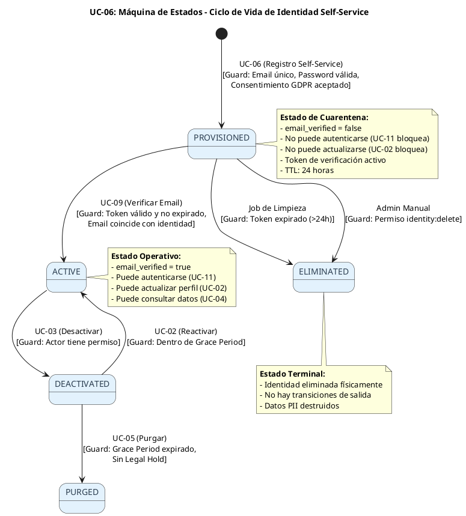
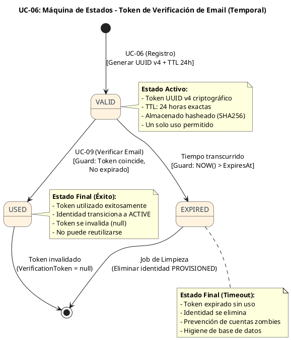
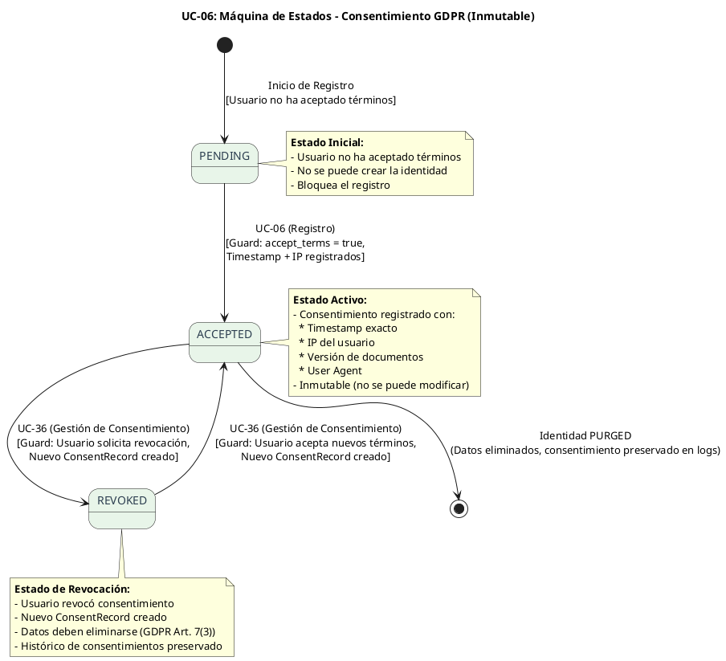

# UC-06: Registro Self-Service - Diagrama de Máquina de Estados

| Metadatos del Documento | |
| :--- | :--- |
| **Proyecto:** | SHUGO - Identity & Access Platform |
| **Caso de Uso:** | UC-06 - Registro Self-Service (Self-Service Sign-Up) |
| **Documento:** | 05_State_Machine_Diagram.md |
| **Metodología:** | UML 2.5 + ICONIX + Domain-Driven Design (State Pattern) + Temporal State Management |
| **Autor:** | Gastón Ruiz |
| **Versión Actual:** | 1.0.0 |
| **Fecha:** | 04/09/2026 |

---

## Historial de Versiones

| Versión | Fecha | Autor | Descripción de Cambios | Impacto |
| :--- | :--- | :--- | :--- | :--- |
| **1.0.0** | 04/09/2026 | Gastón Ruiz | **Creación inicial.** Definición de las máquinas de estados específicas para el registro self-service. Se modelan tres máquinas críticas: (1) Ciclo de Vida de la Identidad Self-Service (PROVISIONED → ACTIVE/ELIMINATED), (2) Máquina Temporal del Token de Verificación (VALID → EXPIRED/USED), y (3) Máquina de Estados del Consentimiento GDPR (PENDING → ACCEPTED/REVOKED). | Documento base del paquete de diseño Tier 1 del UC-06. Establece las reglas de transición, las guardas de seguridad y la lógica temporal que garantiza la seguridad del onboarding público y el cumplimiento de GDPR desde el primer momento. |

---

## 1. Introducción y Propósito

El **Diagrama de Máquina de Estados** para el UC-06 visualiza las restricciones de comportamiento temporal y las reglas de transición que gobiernan el registro self-service de identidades.

A diferencia de los UCs de administración (UC-01 a UC-05) donde un administrador controla el ciclo de vida, el UC-06 introduce complejidades únicas debido a su naturaleza pública y no autenticada:

1. **Estado Inicial Restringido (PROVISIONED):** La identidad se crea en un estado "cuarentena" que bloquea autenticación y actualizaciones hasta verificar el email.
2. **Máquina Temporal de Token:** El token de verificación tiene un TTL estricto (24 horas) que, al expirar, fuerza la eliminación de la identidad para mantener la higiene de la base de datos.
3. **Consentimiento GDPR Inmutable:** El consentimiento no puede ser modificado, solo aceptado o revocado (creando un nuevo registro).
4. **Prevención de Account Takeover:** Las transiciones de estado están protegidas por guardas que validan la propiedad del email y la integridad del token.

Estas máquinas garantizan:
- **Seguridad del Onboarding:** Ninguna identidad puede autenticarse sin verificar el email.
- **Higiene de Datos:** Las identidades no verificadas se eliminan automáticamente tras 24 horas.
- **Cumplimiento GDPR:** El consentimiento es inmutable y auditable.
- **Prevención de Abuso:** Los tokens de verificación son de un solo uso y tienen expiración estricta.

---

## 2. Máquina de Estados #1: Ciclo de Vida de la Identidad Self-Service

### 2.1. Descripción

Esta máquina modela el ciclo de vida de una identidad creada vía registro self-service. A diferencia de las identidades provisionadas por admin (UC-01) que pueden ir directamente a `ACTIVE`, las identidades self-service deben pasar obligatoriamente por el estado `PROVISIONED` y completar la verificación de email (UC-09) para alcanzar `ACTIVE`.

### 2.2. Diagrama de Máquina de Estados (PlantUML)



### 2.3. Descripción de Estados y Transiciones

| Estado | Descripción | Transiciones de Salida | Invariante Clave |
| :--- | :--- | :--- | :--- |
| **PROVISIONED** | Identidad creada pero no verificada. Estado de cuarentena con restricciones estrictas. | → `ACTIVE` (verificación exitosa), → `ELIMINATED` (token expirado o eliminación manual) | `email_verified = false`, no puede autenticarse, token de verificación activo con TTL 24h. |
| **ACTIVE** | Identidad verificada y operativa. Puede autenticarse y gestionar su perfil. | → `DEACTIVATED` (desactivación por admin o usuario) | `email_verified = true`, puede autenticarse (UC-11), puede actualizar perfil (UC-02). |
| **DEACTIVATED** | Identidad desactivada temporalmente. Puede reactivarse dentro del Grace Period. | → `ACTIVE` (reactivación), → `PURGED` (purga tras Grace Period) | No puede autenticarse, datos retenidos para posible reactivación. |
| **PURGED** | Identidad purgada irreversiblemente. Datos PII anonimizados o eliminados. | Ninguna (estado terminal) | Datos PII anonimizados (HMAC-SHA256), logs de auditoría preservados. |
| **ELIMINATED** | Identidad eliminada físicamente de la base de datos. | Ninguna (estado terminal) | No existe en la base de datos, no hay rastro de PII. |

### 2.4. Guardas (Guards) de las Transiciones

#### Transición: `PROVISIONED` → `ACTIVE` (UC-09: Verificar Email)

```csharp
public class Identity : AggregateRoot
{
    public void VerifyEmail(VerificationToken token)
    {
        // Guarda 1: La identidad debe estar en estado PROVISIONED
        if (this.Status != IdentityStatus.PROVISIONED)
            throw new InvalidTransitionException(
                $"Cannot verify email for identity in status {this.Status}. Must be PROVISIONED.");

        // Guarda 2: El token debe ser válido (no nulo)
        if (this.VerificationToken == null)
            throw new DomainException("No verification token found for this identity.");

        // Guarda 3: El token no debe estar expirado
        if (this.VerificationToken.IsExpired())
            throw new TokenExpiredException("Verification token has expired. Identity will be deleted.");

        // Guarda 4: El token proporcionado debe coincidir con el almacenado
        if (!this.VerificationToken.Matches(token))
            throw new InvalidTokenException("Verification token does not match.");

        // Transición de estado
        this.Status = IdentityStatus.ACTIVE;
        this.EmailVerified = true;
        this.VerificationToken = null; // Invalidar token tras uso

        // Generar evento de dominio
        this.AddDomainEvent(new IdentityEmailVerified(this.Id, this.Email));
    }
}
```

#### Transición: `PROVISIONED` → `ELIMINATED` (Job de Limpieza)

```csharp
public class ProvisionedIdentityCleanupJob
{
    private readonly IIdentityRepository _repository;
    private readonly ILogger<ProvisionedIdentityCleanupJob> _logger;

    public async Task ExecuteAsync(CancellationToken ct)
    {
        // Buscar identidades PROVISIONED con token expirado
        var expiredIdentities = await _repository
            .GetExpiredProvisionedIdentitiesAsync(
                expirationThreshold: TimeSpan.FromHours(24), 
                ct);

        foreach (var identity in expiredIdentities)
        {
            try
            {
                // Eliminar físicamente de la base de datos
                await _repository.DeleteAsync(identity.Id, ct);
                
                _logger.LogInformation(
                    "Deleted expired provisioned identity {IdentityId} (email: {Email})",
                    identity.Id, identity.Email.Value);
            }
            catch (Exception ex)
            {
                _logger.LogError(ex, 
                    "Failed to delete expired provisioned identity {IdentityId}", 
                    identity.Id);
            }
        }
    }
}
```

### 2.5. Invariantes de la Máquina de Identidad

1. **Verificación Obligatoria:** Ninguna identidad self-service puede transicionar a `ACTIVE` sin verificar el email mediante un token válido.
2. **Token de Un Solo Uso:** Una vez utilizado el token de verificación, se invalida (`VerificationToken = null`).
3. **TTL Estricto:** El token de verificación expira exactamente 24 horas después de la creación. No hay extensiones automáticas.
4. **Eliminación Automática:** Las identidades `PROVISIONED` con token expirado se eliminan automáticamente para mantener la higiene de la base de datos.
5. **Irreversibilidad de ELIMINATED:** Una vez eliminada, la identidad no puede ser recuperada. No hay transiciones de salida desde `ELIMINATED`.

---

## 3. Máquina de Estados #2: Token de Verificación (Temporal)

### 3.1. Descripción

Esta máquina modela el ciclo de vida temporal del token de verificación de email. Es crítica para la seguridad del proceso de registro, ya que un token comprometido o reutilizado podría permitir Account Takeover.

### 3.2. Diagrama de Máquina de Estados (PlantUML)



### 3.3. Descripción de Estados y Transiciones

| Estado | Descripción | Transiciones de Salida | Invariante Clave |
| :--- | :--- | :--- | :--- |
| **VALID** | Token activo y utilizable. Generado con UUID v4 criptográfico y TTL de 24 horas. | → `USED` (verificación exitosa), → `EXPIRED` (TTL transcurrido) | Almacenado hasheado (SHA256) en DB, nunca en texto plano. Un solo uso permitido. |
| **USED** | Token utilizado exitosamente para verificar el email. | Ninguna (estado final) | Token invalidado (`null`), no puede reutilizarse. Identidad transiciona a `ACTIVE`. |
| **EXPIRED** | Token expirado sin ser utilizado. | → `[*]` (eliminación de identidad) | Identidad `PROVISIONED` se elimina automáticamente. Prevención de cuentas zombies. |

### 3.4. Implementación del Value Object `VerificationToken`

```csharp
public class VerificationToken : ValueObject
{
    public string TokenHash { get; } // SHA256 del token original (almacenado en DB)
    public DateTime ExpiresAt { get; }
    
    private VerificationToken(string tokenHash, DateTime expiresAt)
    {
        TokenHash = tokenHash;
        ExpiresAt = expiresAt;
    }

    /// <summary>
    /// Genera un nuevo token de verificación con TTL de 24 horas.
    /// </summary>
    public static VerificationToken Create(int ttlHours = 24)
    {
        var originalToken = GenerateCryptographicUUIDv4();
        var tokenHash = SHA256.HashData(Encoding.UTF8.GetBytes(originalToken));
        var expiresAt = DateTime.UtcNow.AddHours(ttlHours);

        return new VerificationToken(
            Convert.ToBase64String(tokenHash), 
            expiresAt);
    }

    /// <summary>
    /// Valida si el token proporcionado coincide con el almacenado y no está expirado.
    /// </summary>
    public bool Validate(string providedToken)
    {
        // Guarda 1: Token no debe estar expirado
        if (IsExpired())
            return false;

        // Guarda 2: Token debe coincidir (comparación de hashes)
        var providedHash = SHA256.HashData(Encoding.UTF8.GetBytes(providedToken));
        var providedHashBase64 = Convert.ToBase64String(providedHash);

        return SecureCompare(TokenHash, providedHashBase64);
    }

    public bool IsExpired()
    {
        return DateTime.UtcNow > ExpiresAt;
    }

    /// <summary>
    /// Comparación segura en tiempo constante para prevenir Timing Attacks.
    /// </summary>
    private bool SecureCompare(string a, string b)
    {
        if (a.Length != b.Length)
            return false;

        var result = 0;
        for (int i = 0; i < a.Length; i++)
        {
            result |= a[i] ^ b[i];
        }

        return result == 0;
    }

    private static string GenerateCryptographicUUIDv4()
    {
        return Guid.NewGuid().ToString("N"); // 32 caracteres hex
    }

    protected override IEnumerable<object> GetEqualityComponents()
    {
        yield return TokenHash;
        yield return ExpiresAt;
    }
}
```

### 3.5. Invariantes de la Máquina de Token

1. **Almacenamiento Seguro:** El token nunca se almacena en texto plano en la base de datos. Solo se almacena el hash SHA256.
2. **Comparación en Tiempo Constante:** La validación del token usa `SecureCompare` para prevenir Timing Attacks que podrían revelar el token correcto.
3. **TTL Inmutable:** El TTL de 24 horas se establece en la creación y no puede ser modificado.
4. **Invalidación Post-Uso:** Tras usar el token, se establece en `null` para prevenir reutilización.
5. **Eliminación Automática:** Si el token expira sin uso, la identidad asociada se elimina automáticamente.

---

## 4. Máquina de Estados #3: Consentimiento GDPR (Inmutable)

### 4.1. Descripción

Esta máquina modela el ciclo de vida del consentimiento GDPR. A diferencia de otros estados, el consentimiento es **inmutable**: una vez aceptado, no puede ser modificado, solo revocado (creando un nuevo registro de consentimiento).

### 4.2. Diagrama de Máquina de Estados (PlantUML)



### 4.3. Descripción de Estados y Transiciones

| Estado | Descripción | Transiciones de Salida | Invariante Clave |
| :--- | :--- | :--- | :--- |
| **PENDING** | Usuario no ha aceptado los términos de servicio y política de privacidad. | → `ACCEPTED` (usuario acepta términos) | Bloquea la creación de la identidad. Sin consentimiento no hay procesamiento de datos (GDPR Art. 6). |
| **ACCEPTED** | Usuario aceptó explícitamente los términos. Registro inmutable con metadata completa. | → `REVOKED` (usuario revoca consentimiento), → `[*]` (identidad purgada) | Inmutable: no se puede modificar el registro existente. Metadata completa (timestamp, IP, versión, user agent). |
| **REVOKED** | Usuario revocó el consentimiento. Se crea un nuevo `ConsentRecord` con estado revocado. | → `ACCEPTED` (usuario acepta nuevos términos) | Datos personales deben eliminarse (GDPR Art. 7(3)). Histórico de consentimientos preservado para auditoría. |

### 4.4. Implementación del Value Object `ConsentRecord`

```csharp
public class ConsentRecord : ValueObject
{
    public bool AcceptedTerms { get; }
    public string TermsVersion { get; }
    public string PrivacyPolicyVersion { get; }
    public DateTime Timestamp { get; }
    public string IpAddress { get; }
    public string UserAgent { get; }
    public ConsentStatus Status { get; }

    private ConsentRecord(
        bool acceptedTerms,
        string termsVersion,
        string privacyPolicyVersion,
        string ipAddress,
        string userAgent,
        ConsentStatus status)
    {
        if (string.IsNullOrWhiteSpace(termsVersion))
            throw new ArgumentException("Terms version is required.");

        if (string.IsNullOrWhiteSpace(privacyPolicyVersion))
            throw new ArgumentException("Privacy policy version is required.");

        AcceptedTerms = acceptedTerms;
        TermsVersion = termsVersion;
        PrivacyPolicyVersion = privacyPolicyVersion;
        Timestamp = DateTime.UtcNow; // Timestamp inmutable
        IpAddress = ipAddress ?? "unknown";
        UserAgent = userAgent ?? "unknown";
        Status = status;
    }

    /// <summary>
    /// Crea un nuevo registro de consentimiento aceptado.
    /// </summary>
    public static ConsentRecord Accept(
        string termsVersion,
        string privacyPolicyVersion,
        string ipAddress,
        string userAgent)
    {
        return new ConsentRecord(
            acceptedTerms: true,
            termsVersion: termsVersion,
            privacyPolicyVersion: privacyPolicyVersion,
            ipAddress: ipAddress,
            userAgent: userAgent,
            status: ConsentStatus.ACCEPTED);
    }

    /// <summary>
    /// Crea un nuevo registro de consentimiento revocado.
    /// </summary>
    public static ConsentRecord Revoke(
        string termsVersion,
        string privacyPolicyVersion,
        string ipAddress,
        string userAgent)
    {
        return new ConsentRecord(
            acceptedTerms: false,
            termsVersion: termsVersion,
            privacyPolicyVersion: privacyPolicyVersion,
            ipAddress: ipAddress,
            userAgent: userAgent,
            status: ConsentStatus.REVOKED);
    }

    protected override IEnumerable<object> GetEqualityComponents()
    {
        yield return AcceptedTerms;
        yield return TermsVersion;
        yield return PrivacyPolicyVersion;
        yield return Timestamp;
        yield return Status;
    }
}

public enum ConsentStatus
{
    PENDING,
    ACCEPTED,
    REVOKED
}
```

### 4.5. Invariantes de la Máquina de Consentimiento

1. **Inmutabilidad del Registro:** Una vez creado un `ConsentRecord`, no puede ser modificado. Si el usuario acepta nuevos términos o revoca el consentimiento, se crea un nuevo registro.
2. **Metadata Completa:** Cada registro incluye timestamp exacto, IP del usuario, versión de documentos legales, y user agent.
3. **Histórico Preservado:** Todos los registros de consentimiento (aceptados y revocados) se preservan para auditoría y cumplimiento de GDPR Art. 7(1).
4. **Eliminación de Datos tras Revocación:** Si el usuario revoca el consentimiento, los datos personales deben eliminarse (GDPR Art. 7(3)), pero el registro de consentimiento se preserva.
5. **Versión de Documentos:** El consentimiento está vinculado a versiones específicas de los documentos legales. Si los términos cambian, el usuario debe aceptar la nueva versión.

---

## 5. Implementación en el Dominio (Código C#)

### 5.1. Máquina de Estados de Identidad en el Aggregate Root

```csharp
public class Identity : AggregateRoot
{
    public IdentityId Id { get; private set; }
    public TenantId TenantId { get; private set; }
    public Email Email { get; private set; }
    public PasswordHash PasswordHash { get; private set; }
    public DisplayName DisplayName { get; private set; }
    public IdentityStatus Status { get; private set; }
    public bool EmailVerified { get; private set; }
    public VerificationToken VerificationToken { get; private set; }
    public ConsentRecord ConsentRecord { get; private set; }
    public DateTime CreatedAt { get; private set; }
    
    private readonly List<IDomainEvent> _domainEvents = new();

    // Constructor privado para EF Core
    private Identity() { }

    /// <summary>
    /// Método de fábrica para crear identidad en estado PROVISIONED (Self-Service).
    /// </summary>
    public static Identity CreateProvisioned(
        TenantId tenantId,
        Email email,
        PasswordHash passwordHash,
        DisplayName displayName,
        ConsentRecord consentRecord)
    {
        // Validar que el consentimiento esté aceptado
        if (consentRecord.Status != ConsentStatus.ACCEPTED)
            throw new DomainException("Cannot create identity without accepted consent.");

        var identity = new Identity
        {
            Id = new IdentityId(Guid.NewGuid()),
            TenantId = tenantId,
            Email = email,
            PasswordHash = passwordHash,
            DisplayName = displayName,
            Status = IdentityStatus.PROVISIONED,
            EmailVerified = false,
            VerificationToken = VerificationToken.Create(ttlHours: 24),
            ConsentRecord = consentRecord,
            CreatedAt = DateTime.UtcNow
        };

        // Generar eventos de dominio
        identity.AddDomainEvent(new IdentityRegistered(
            identity.Id,
            identity.TenantId,
            identity.Email,
            identity.Status,
            "SELF_SERVICE",
            consentRecord.IpAddress,
            consentRecord.UserAgent
        ));

        identity.AddDomainEvent(new EmailVerificationRequested(
            identity.Id,
            identity.Email,
            identity.VerificationToken,
            identity.VerificationToken.ExpiresAt
        ));

        return identity;
    }

    /// <summary>
    /// Transición: PROVISIONED → ACTIVE (Verificación de Email)
    /// </summary>
    public void VerifyEmail(string providedToken)
    {
        // Guarda 1: Estado debe ser PROVISIONED
        if (this.Status != IdentityStatus.PROVISIONED)
            throw new InvalidTransitionException(
                $"Cannot verify email for identity in status {this.Status}. Must be PROVISIONED.");

        // Guarda 2: Token debe existir
        if (this.VerificationToken == null)
            throw new DomainException("No verification token found for this identity.");

        // Guarda 3: Token debe ser válido (no expirado y coincide)
        if (!this.VerificationToken.Validate(providedToken))
        {
            if (this.VerificationToken.IsExpired())
                throw new TokenExpiredException("Verification token has expired.");
            
            throw new InvalidTokenException("Verification token does not match.");
        }

        // Transición de estado
        this.Status = IdentityStatus.ACTIVE;
        this.EmailVerified = true;
        this.VerificationToken = null; // Invalidar token

        // Generar evento de dominio
        this.AddDomainEvent(new IdentityEmailVerified(this.Id, this.Email));
    }

    /// <summary>
    /// Transición: PROVISIONED → ELIMINATED (Limpieza automática)
    /// </summary>
    public bool IsExpiredForCleanup()
    {
        if (this.Status != IdentityStatus.PROVISIONED)
            return false;

        if (this.VerificationToken == null)
            return false;

        return this.VerificationToken.IsExpired();
    }

    public IReadOnlyCollection<IDomainEvent> GetDomainEvents() => _domainEvents.AsReadOnly();
    
    protected void AddDomainEvent(IDomainEvent evt) => _domainEvents.Add(evt);
}
```

### 5.2. Job de Limpieza de Identidades Expiradas

```csharp
public class ProvisionedIdentityCleanupJob : BackgroundService
{
    private readonly IServiceProvider _serviceProvider;
    private readonly ILogger<ProvisionedIdentityCleanupJob> _logger;

    public ProvisionedIdentityCleanupJob(
        IServiceProvider serviceProvider,
        ILogger<ProvisionedIdentityCleanupJob> logger)
    {
        _serviceProvider = serviceProvider;
        _logger = logger;
    }

    protected override async Task ExecuteAsync(CancellationToken stoppingToken)
    {
        while (!stoppingToken.IsCancellationRequested)
        {
            try
            {
                using var scope = _serviceProvider.CreateScope();
                var repository = scope.ServiceProvider.GetRequiredService<IIdentityRepository>();

                // Buscar identidades PROVISIONED con token expirado
                var expiredIdentities = await repository
                    .GetExpiredProvisionedIdentitiesAsync(
                        expirationThreshold: TimeSpan.FromHours(24), 
                        stoppingToken);

                foreach (var identity in expiredIdentities)
                {
                    try
                    {
                        // Eliminar físicamente de la base de datos
                        await repository.DeleteAsync(identity.Id, stoppingToken);
                        
                        _logger.LogInformation(
                            "Deleted expired provisioned identity {IdentityId} (email: {Email})",
                            identity.Id, identity.Email.Value);
                    }
                    catch (Exception ex)
                    {
                        _logger.LogError(ex, 
                            "Failed to delete expired provisioned identity {IdentityId}", 
                            identity.Id);
                    }
                }

                // Ejecutar cada hora
                await Task.Delay(TimeSpan.FromHours(1), stoppingToken);
            }
            catch (Exception ex)
            {
                _logger.LogError(ex, "Error in ProvisionedIdentityCleanupJob");
                await Task.Delay(TimeSpan.FromMinutes(5), stoppingToken);
            }
        }
    }
}
```

---

## 6. Trazabilidad con Otros Documentos del Paquete

| Documento | Relación |
| :--- | :--- |
| `01_Requirements_Specification.md` | Las invariantes de estado (INV-37 Initial State is PROVISIONED, INV-38 Email Verification TTL) y reglas de negocio (RN-03 Automatic Cleanup) se definen aquí y se hacen cumplir en estas máquinas. |
| `02_Use_Case_Diagram.md` | Muestra los actores y sistemas; estas máquinas definen cómo el sistema responde a sus acciones de registro a lo largo del tiempo. |
| `03_Activity_Diagram.md` | Los carriles de actividad (Register Handler, Security Validator, Identity Repository) se implementan aquí como máquinas de estados. |
| `04_Initial_Domain_Model.md` | El Aggregate Root `Identity`, los Value Objects `VerificationToken` y `ConsentRecord` son la implementación directa de estas máquinas. |
| `06_Robustness_Diagram.md` | Mostrará cómo los objetos colaboran para ejecutar estas transiciones de estado de forma segura. |
| `07_Sequence_Diagram.md` | Detallará el orden temporal exacto de las llamadas que disparan estas transiciones. |
| `UC-09/01_Requirements_Specification.md` | Documento que define la verificación de contactos (UC-09) que ejecuta la transición PROVISIONED → ACTIVE. |

---

## 7. Notas de Implementación

### 7.1. Testing de Máquinas de Estados

Cada transición y guarda definida en estas máquinas debe tener al menos dos tests unitarios:

```csharp
[Test]
public void Identity_VerifyEmail_WhenValidToken_TransitionsToActive()
{
    // Arrange
    var consentRecord = ConsentRecord.Accept("v2.1", "v1.3", "192.168.1.1", "Mozilla/5.0");
    var identity = Identity.CreateProvisioned(
        new TenantId(Guid.NewGuid()),
        new Email("test@example.com"),
        new PasswordHash("SecureP@ssw0rd!"),
        new DisplayName("Test User"),
        consentRecord);

    // Act
    identity.VerifyEmail(identity.VerificationToken.OriginalToken);

    // Assert
    identity.Status.Should().Be(IdentityStatus.ACTIVE);
    identity.EmailVerified.Should().BeTrue();
    identity.VerificationToken.Should().BeNull();
}

[Test]
public void Identity_VerifyEmail_WhenTokenExpired_ThrowsTokenExpiredException()
{
    // Arrange
    var consentRecord = ConsentRecord.Accept("v2.1", "v1.3", "192.168.1.1", "Mozilla/5.0");
    var identity = Identity.CreateProvisioned(
        new TenantId(Guid.NewGuid()),
        new Email("test@example.com"),
        new PasswordHash("SecureP@ssw0rd!"),
        new DisplayName("Test User"),
        consentRecord);

    // Simular expiración del token (hack para testing)
    var expiredToken = new VerificationToken(
        identity.VerificationToken.TokenHash,
        DateTime.UtcNow.AddHours(-25)); // Expirado hace 25 horas

    // Act
    var act = () => identity.VerifyEmail(expiredToken.OriginalToken);

    // Assert
    act.Should().Throw<TokenExpiredException>();
}

[Test]
public void Identity_CreateProvisioned_WhenConsentNotAccepted_ThrowsDomainException()
{
    // Arrange
    var consentRecord = ConsentRecord.Revoke("v2.1", "v1.3", "192.168.1.1", "Mozilla/5.0");

    // Act
    var act = () => Identity.CreateProvisioned(
        new TenantId(Guid.NewGuid()),
        new Email("test@example.com"),
        new PasswordHash("SecureP@ssw0rd!"),
        new DisplayName("Test User"),
        consentRecord);

    // Assert
    act.Should().Throw<DomainException>()
       .WithMessage("*without accepted consent*");
}
```

### 7.2. Concurrencia y Race Conditions

Dado que múltiples procesos pueden intentar verificar el mismo token simultáneamente (ej. usuario hace clic múltiples veces), se deben considerar las siguientes race conditions:

1. **Double Verification:** Si el usuario hace clic en el link de verificación múltiples veces, la segunda verificación debe fallar silenciosamente (el token ya es `null`).
2. **Cleanup Race:** Si el job de limpieza se ejecuta mientras el usuario está verificando, debe haber un lock optimista (RowVersion) para prevenir eliminación de identidad en proceso de verificación.

---
*Fin del Documento 05_State_Machine_Diagram para UC-06*