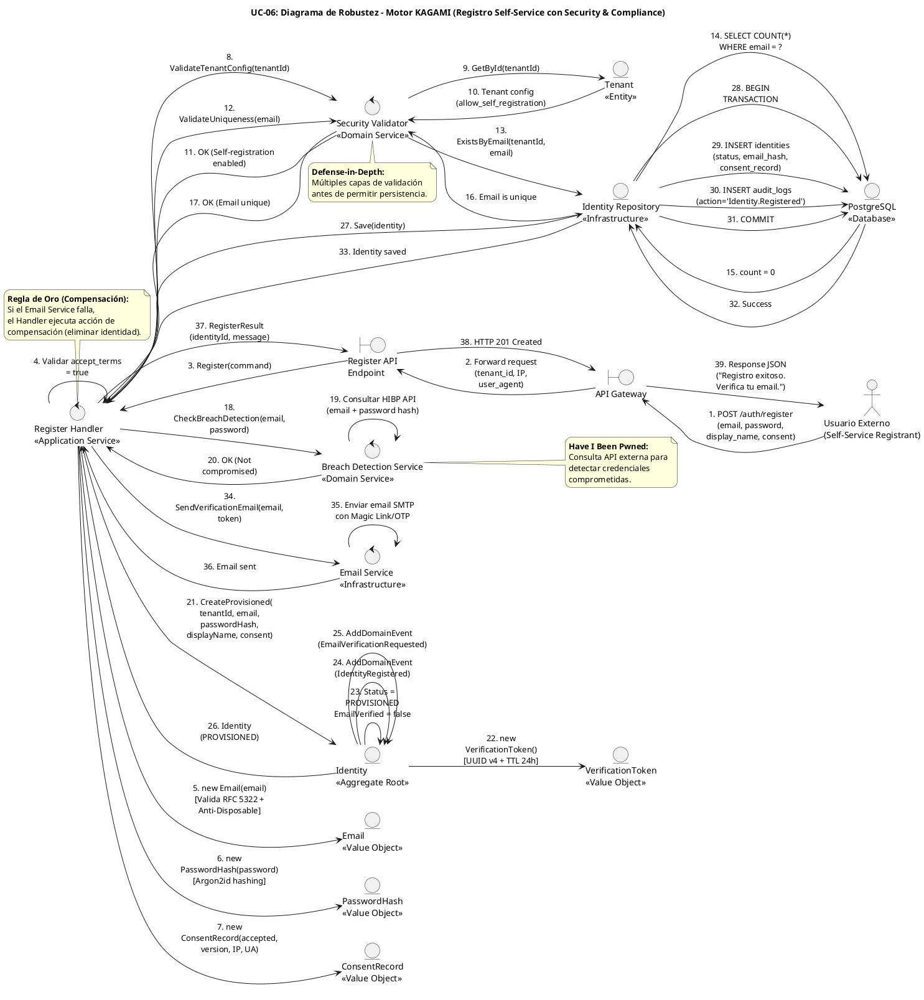

# UC-06: Registro Self-Service - Diagrama de Robustez

| Metadatos del Documento | |
| :--- | :--- |
| **Proyecto:** | SHUGO - Identity & Access Platform |
| **Caso de Uso:** | UC-06 - Registro Self-Service (Self-Service Sign-Up) |
| **Documento:** | 06_Robustness_Diagram.md |
| **Metodología:** | ICONIX (Diagrama de Robustez) + DDD + Security by Design + Transactional Integrity |
| **Autor:** | Gastón Ruiz |
| **Versión Actual:** | 1.0.0 |
| **Fecha:** | 04/09/2026 |

---

## Historial de Versiones

| Versión | Fecha | Autor | Descripción de Cambios | Impacto |
| :--- | :--- | :--- | :--- | :--- |
| **1.0.0** | 04/09/2026 | Gastón Ruiz | **Creación inicial.** Diagrama de Robustez para UC-06, validando la arquitectura del motor KAGAMI para operaciones de registro público. Muestra la colaboración estricta entre Boundaries (API Gateway, Register Endpoint), Controls (RegisterHandler, SecurityValidator, BreachDetectionService, EmailService), y Entities (Identity, Email, PasswordHash, VerificationToken, ConsentRecord, Tenant). Valida el patrón de compensación transaccional, la prevención de Account Takeover, y el cumplimiento GDPR desde el primer momento. | Documento base del paquete de diseño Tier 1 del UC-06. Sirve como puente crítico entre el Modelo de Dominio (04) y el Diagrama de Secuencia (07), asegurando que la arquitectura soporta la seguridad, privacidad y resiliencia antes de codificar. |

---

## 1. Introducción y Propósito

El **Diagrama de Robustez** para el UC-06 valida que el flujo de registro self-service puede ser orquestado respetando las reglas estrictas de acoplamiento de **ICONIX** y los principios de **Domain-Driven Design (DDD)**, **Security by Design** y **Privacy by Design**.

El desafío específico de este caso de uso es quíntuple:

1. **Endpoint Público No Autenticado:** A diferencia de UC-01 (Provisionamiento por Admin), el actor es un usuario externo sin credenciales, lo que exige múltiples capas de validación antes de permitir la persistencia.
2. **Prevención de Account Takeover:** Integración con servicios externos (Have I Been Pwned) y listas de emails desechables para detectar credenciales comprometidas.
3. **Consentimiento GDPR Inmutable:** El registro del consentimiento debe ser atómico con la creación de la identidad, registrando timestamp, IP y versión de documentos.
4. **Estado Inicial Restringido:** La identidad se crea en estado `PROVISIONED`, bloqueada para autenticación hasta verificar el email.
5. **Patrón de Compensación Transaccional:** Si el envío de email falla después de crear la identidad, se debe ejecutar una acción de compensación (eliminar la identidad) para prevenir cuentas "zombies".

---

## 2. Diagrama de Robustez (PlantUML)

A continuación, se presenta el Diagrama de Robustez organizado de izquierda a derecha para mostrar el flujo natural: **Actor → Boundary → Control → Entity**.



---

## 3. Explicación Detallada de los Objetos

### 3.1. Boundary Objects (Objetos de Límite)

| Objeto | Responsabilidad | Mapeo a Clean Architecture |
| :--- | :--- | :--- |
| **`API Gateway`** | Primera línea de defensa. Aplica Rate Limiting (5 req/hora por IP), valida el formato básico de la request, y extrae metadata de seguridad (IP, User Agent). No conoce la lógica de negocio. | Middleware (Kong, AWS API Gateway). |
| **`Register API Endpoint`** | Recibe la request HTTP POST, deserializa el payload a un DTO (`RegisterCommand`), inyecta el `tenant_id` del contexto (subdominio o header), y lo pasa al Handler. | Controller (ASP.NET Core Controller). |

### 3.2. Control Objects (Objetos de Control)

| Objeto | Responsabilidad | Mapeo a Clean Architecture |
| :--- | :--- | :--- |
| **`Register Handler`** | **Application Service.** Orquesta el caso de uso. Coordina las validaciones, construye los Value Objects, delega al Domain Service, gestiona la transacción, y ejecuta la acción de compensación si el email falla. | Command Handler / Application Service. |
| **`Security Validator`** | **Domain Service.** Valida las reglas de negocio de seguridad: configuración del tenant, unicidad de email, y políticas de contraseña. Actúa como la capa de defensa principal contra abuso. | Domain Service. |
| **`Breach Detection Service`** | **Domain Service.** Consulta la API externa de Have I Been Pwned para detectar si el email o la contraseña han sido comprometidos en brechas conocidas. | Domain Service / Port. |
| **`Email Service`** | **Infrastructure Service.** Responsable de enviar el email de verificación con el token. Es un punto crítico de falla que requiere patrón de compensación. | Infrastructure Service. |

### 3.3. Entity Objects (Objetos de Entidad)

| Objeto | Responsabilidad | Mapeo a DDD |
| :--- | :--- | :--- |
| **`Identity`** | **Aggregate Root.** Representa la identidad en estado `PROVISIONED`. Expone el método de fábrica `CreateProvisioned()` que garantiza las invariantes de seguridad. | Aggregate Root. |
| **`Email`** | **Value Object.** Valida formato RFC 5322 y previene el uso de dominios desechables (ej. mailinator.com). | Value Object. |
| **`PasswordHash`** | **Value Object.** Hashea la contraseña con Argon2id (resistente a GPU attacks) usando salt único. Nunca almacena texto plano. | Value Object. |
| **`VerificationToken`** | **Value Object.** Genera UUID v4 criptográfico con TTL de 24 horas. Se almacena hasheado (SHA256) en la DB. | Value Object. |
| **`ConsentRecord`** | **Value Object.** Registro inmutable de consentimiento GDPR con timestamp, IP, User Agent y versión de documentos. | Value Object. |
| **`Tenant`** | **Entity.** Representa la configuración del tenant, incluyendo `allow_self_registration` y políticas de contraseña. | Entity. |
| **`Identity Repository`** | **Infrastructure.** Abstrae la persistencia. Implementa la transacción atómica que crea la identidad y registra el log de auditoría. | Repository Interface (Domain) / Implementation (Infra). |

---

## 4. Reglas de Robustez de ICONIX (Validación del Diagrama)

Verifiquemos que nuestro diagrama cumple estrictamente las reglas de acoplamiento de ICONIX:

### ✅ Regla 1: Actor → Boundary
- **Cumplida:** El `Usuario Externo` interactúa solo con el `API Gateway`.

### ✅ Regla 2: Boundary → Boundary
- **Cumplida:** El `API Gateway` forward la request al `Register API Endpoint`.

### ✅ Regla 3: Boundary → Control
- **Cumplida:** El `Register API Endpoint` envía el `RegisterCommand` al `Register Handler`.

### ✅ Regla 4: Control → Control
- **Cumplida y Crítica:** El `Register Handler` delega al `Security Validator` (validaciones de dominio), al `Breach Detection Service` (consulta externa), y al `Email Service` (notificación).
- **Validación:** Esto mantiene el Application Service delgado y permite que las reglas de seguridad y la integración externa sean reutilizables y testeables.

### ✅ Regla 5: Control → Entity
- **Cumplida:**
  - `Register Handler` crea los Value Objects `Email`, `PasswordHash`, `ConsentRecord`.
  - `Register Handler` invoca el método de fábrica `Identity.CreateProvisioned()`.
  - `Register Handler` llama a `Identity Repository` para persistir.
  - `Security Validator` consulta `Tenant` y `Identity Repository`.
  - `Identity` genera el `VerificationToken` internamente.

### ✅ Regla 6: NO Entity → Control / Boundary
- **Cumplida:** Ninguna entidad (`Identity`, `Email`, `PasswordHash`, `Token`, `Consent`, `Tenant`, `Repo`) envía mensajes de vuelta a los controles o boundaries. Solo retornan datos como respuesta a una invocación.

### ✅ Regla 7: NO Entity → Entity (Directo sin Control)
- **Cumplida:** El `Register Handler` (Control) es el único que orquesta la interacción entre `Identity` y los Value Objects. Las entidades no se crean entre sí directamente desde el diagrama de flujo principal.

---

## 5. Consideraciones de Arquitectura (Security & Privacy by Design)

### 5.1. Patrón de Compensación Transaccional

El diagrama valida visualmente uno de los patrones más críticos para UC-06: **Compensación ante fallo de Email Service**.

**Flujo de Compensación:**
1. `Register Handler` crea la identidad y la persiste en DB (Pasos 21-33).
2. `Register Handler` invoca `Email Service` para enviar el email de verificación (Paso 34).
3. **Si el email falla:** `Email Service` lanza `EmailServiceException` (Paso 36b).
4. `Register Handler` ejecuta acción de compensación: llama a `Repo.Delete(identityId)` (Pasos 37b-40b).
5. `Register Handler` retorna HTTP 500 al usuario (Pasos 41b-43b).

**Justificación:**
- **Prevención de Cuentas Zombies:** Sin compensación, quedarían identidades `PROVISIONED` en la DB que nunca recibirán el email de verificación, acumulándose como datos huérfanos.
- **Consistencia de Estado:** La identidad solo existe si el usuario puede completar el flujo de verificación. Si el email no se envía, la identidad no debe existir.

### 5.2. Defense-in-Depth (Múltiples Capas de Validación)

El diagrama muestra cómo el `Security Validator` actúa como la capa de defensa principal:

1. **Validación de Tenant Config:** Verifica que el tenant permita self-registration.
2. **Validación de Unicidad:** Consulta la DB para asegurar que el email no exista.
3. **Validación de Formato:** El Value Object `Email` valida RFC 5322 y anti-disposable.
4. **Detección de Brechas:** El `Breach Detection Service` consulta HIBP.

**Justificación:**
- **Prevención de Abuso:** Cada capa previene un tipo específico de ataque (spam, account takeover, enumeración).
- **Fail-Fast:** Las validaciones ocurren antes de la persistencia, rechazando requests inválidos lo antes posible.

### 5.3. Consentimiento GDPR Inmutable

El Value Object `ConsentRecord` se crea atómicamente con la identidad:

1. **Datos Registrados:** `acceptedTerms`, `termsVersion`, `privacyPolicyVersion`, `timestamp`, `ipAddress`, `userAgent`.
2. **Inmutabilidad:** Una vez creado, no puede ser modificado. Si el usuario acepta nuevos términos, se crea un nuevo `ConsentRecord`.
3. **Persistencia Atómica:** El consentimiento se guarda en la misma transacción que la identidad.

**Justificación:**
- **GDPR Art. 7(1):** El responsable del tratamiento debe poder demostrar que el interesado dio su consentimiento. Este registro es la prueba legal inmutable.
- **Auditabilidad:** El timestamp, IP y User Agent permiten rastrear exactamente cuándo y desde dónde se aceptaron los términos.

### 5.4. Estado Inicial Restringido (PROVISIONED)

El método de fábrica `Identity.CreateProvisioned()` garantiza:

1. **Status = PROVISIONED:** La identidad no puede autenticarse (UC-11 la bloquea).
2. **EmailVerified = false:** Requiere verificación de email (UC-09).
3. **VerificationToken Generado:** UUID v4 con TTL de 24 horas.
4. **Sin Roles Admin:** No se asignan roles administrativos por defecto.

**Justificación:**
- **Prevención de Account Takeover:** Incluso si un atacante logra crear una cuenta, no puede usarla hasta verificar el email.
- **Aislamiento de Seguridad:** La identidad `PROVISIONED` tiene permisos mínimos hasta completar el flujo de verificación.

---

## 6. Trazabilidad con Otros Documentos del Paquete

| Documento | Relación |
| :--- | :--- |
| `01_Requirements_Specification.md` | Este diagrama valida que los requisitos de compensación transaccional, breach detection, y consentimiento GDPR pueden ser implementados con los objetos definidos. |
| `02_Use_Case_Diagram.md` | Muestra los actores y sistemas; este diagrama muestra cómo colaboran los objetos internos. |
| `03_Activity_Diagram.md` | Los carriles de actividad (Handler, Validator, BreachDetector, EmailService) se mapean directamente a los objetos de Control de este diagrama. |
| `04_Initial_Domain_Model.md` | Los objetos `Identity`, `Email`, `PasswordHash`, `VerificationToken`, `ConsentRecord` y los servicios `SecurityValidator`/`BreachDetectionService` son exactamente las clases definidas en el modelo de dominio. |
| `05_State_Machine_Diagram.md` | Las máquinas de estados (Ciclo de Vida de Identidad, Token de Verificación, Consentimiento) se implementan en los objetos de este diagrama. |
| `07_Sequence_Diagram.md` | Este diagrama define "qué objetos colaboran"; el de secuencia definirá "en qué orden temporal exacto" se envían los mensajes. |
| `08_Final_Class_Design.md` | Definirá las firmas exactas de los métodos mostrados en este diagrama (ej. `Identity.CreateProvisioned()`, `SecurityValidator.ValidateUniqueness()`). |

---

## 7. Notas de Implementación

### 7.1. Inyección de Dependencias

El `Register Handler` debe tener inyectados los servicios de dominio e infraestructura:

```csharp
public class RegisterHandler : IRegisterHandler
{
    private readonly ISecurityValidator _validator;
    private readonly IBreachDetectionService _breachDetector;
    private readonly IIdentityRepository _repository;
    private readonly IEmailService _emailService;
    private readonly ILogger<RegisterHandler> _logger;

    public RegisterHandler(
        ISecurityValidator validator,
        IBreachDetectionService breachDetector,
        IIdentityRepository repository,
        IEmailService emailService,
        ILogger<RegisterHandler> logger)
    {
        _validator = validator;
        _breachDetector = breachDetector;
        _repository = repository;
        _emailService = emailService;
        _logger = logger;
    }
}
```

### 7.2. Flujo de Ejecución Simplificado (Código)

```csharp
public async Task<RegisterResult> Handle(RegisterCommand command, CancellationToken ct)
{
    // 1. Validar consentimiento
    if (!command.AcceptTerms)
        throw new DomainException("Debes aceptar los términos de servicio.");

    // 2. Construir Value Objects
    var email = new Email(command.Email); // Valida RFC 5322 + anti-disposable
    var passwordHash = new PasswordHash(command.Password); // Argon2id
    var consent = new ConsentRecord(
        command.AcceptTerms,
        command.TermsVersion,
        command.PrivacyPolicyVersion,
        command.IpAddress,
        command.UserAgent
    );

    // 3. Validaciones de seguridad
    await _validator.ValidateTenantConfigAsync(command.TenantId);
    await _validator.ValidateUniquenessAsync(command.TenantId, email);
    await _breachDetector.CheckBreachDetectionAsync(email, command.Password);

    // 4. Crear identidad en estado PROVISIONED
    var displayName = new DisplayName(command.DisplayName);
    var identity = Identity.CreateProvisioned(
        command.TenantId,
        email,
        passwordHash,
        displayName,
        consent
    );

    // 5. Persistir identidad
    await _repository.SaveAsync(identity, ct);

    // 6. Enviar email de verificación con patrón de compensación
    try
    {
        await _emailService.SendVerificationEmailAsync(
            email, 
            identity.VerificationToken, 
            ct);
    }
    catch (EmailServiceException ex)
    {
        _logger.LogError(ex, "Fallo al enviar email. Ejecutando compensación para {IdentityId}", identity.Id);
        await _repository.DeleteAsync(identity.Id, ct); // Acción de compensación
        throw new RegistrationException("No se pudo enviar el email de verificación. Por favor intenta nuevamente.");
    }

    return new RegisterResult(identity.Id, "Registro exitoso. Verifica tu email.");
}
```

### 7.3. Manejo de Excepciones

| Excepción | Cuándo Ocurre | Acción |
| :--- | :--- | :--- |
| `DomainException` | Validación de consentimiento, formato de email, o políticas de contraseña. | Retorna HTTP 400 Bad Request. |
| `TenantNotConfiguredException` | Tenant no permite self-registration. | Retorna HTTP 403 Forbidden. |
| `EmailAlreadyExistsException` | Email ya registrado en el tenant. | Retorna HTTP 409 Conflict (si ACTIVE) o reenvía email (si PROVISIONED). |
| `BreachDetectedException` | Email o contraseña en lista de brechas. | Retorna HTTP 400 Bad Request. |
| `EmailServiceException` | Fallo al enviar email de verificación. | Ejecuta compensación (elimina identidad) y retorna HTTP 500. |

---

## 8. Consideraciones de Seguridad Adicionales

### 8.1. Prevención de Timing Attacks

La consulta de unicidad de email debe ejecutarse en tiempo constante:

```csharp
public async Task<bool> ExistsByEmailAsync(TenantId tenantId, Email email)
{
    // Consulta con tiempo constante (no revela si existe o no)
    var identity = await _dbContext.Identities
        .Where(i => i.TenantId == tenantId.Value && i.Email.Value == email.Value)
        .Select(i => i.Id)
        .FirstOrDefaultAsync();

    return identity != null;
}
```

### 8.2. Almacenamiento Seguro de VerificationToken

El token se almacena hasheado en la DB:

```csharp
public class VerificationToken
{
    public string TokenHash { get; } // SHA256 del token original
    public DateTime ExpiresAt { get; }
    
    public VerificationToken(int ttlHours = 24)
    {
        var originalToken = Guid.NewGuid().ToString("N");
        TokenHash = SHA256.HashData(Encoding.UTF8.GetBytes(originalToken));
        ExpiresAt = DateTime.UtcNow.AddHours(ttlHours);
    }
}
```

### 8.3. Rate Limiting a Nivel de Dominio

Además del API Gateway, el dominio tiene su propia protección:

```csharp
public class SecurityValidator
{
    private readonly IDistributedCache _cache;
    
    public async Task ValidateRateLimitAsync(string ipAddress)
    {
        var key = $"rate_limit:register:{ipAddress}";
        var count = await _cache.GetAsync(key);
        
        if (count >= 5)
            throw new DomainException("Demasiados intentos. Intenta en 1 hora.");
        
        await _cache.IncrementAsync(key, TimeSpan.FromHours(1));
    }
}
```

---
*Fin del Documento 06_Robustness_Diagram para UC-06*