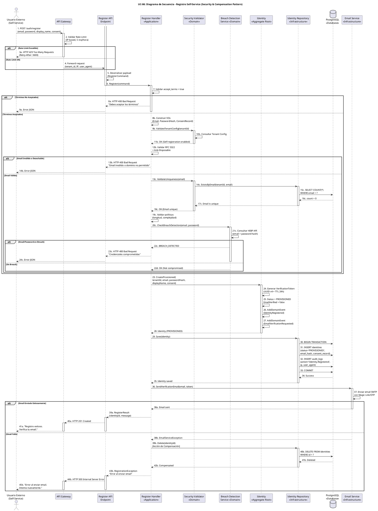

# UC-06: Registro Self-Service - Diagrama de Secuencia

| Metadatos del Documento | |
| :--- | :--- |
| **Proyecto:** | SHUGO - Identity & Access Platform |
| **Caso de Uso:** | UC-06 - Registro Self-Service (Self-Service Sign-Up) |
| **Documento:** | 07_Sequence_Diagram.md |
| **Metodología:** | ICONIX (Diagrama de Secuencia) + DDD + Security by Design + Transactional Compensation Pattern |
| **Autor:** | Gastón Ruiz |
| **Versión Actual:** | 1.0.0 |
| **Fecha:** | 04/09/2026 |

---

## Historial de Versiones

| Versión | Fecha | Autor | Descripción de Cambios | Impacto |
| :--- | :--- | :--- | :--- | :--- |
| **1.0.0** | 04/09/2026 | Gastón Ruiz | **Creación inicial.** Diagrama de Secuencia completo para UC-06. Modela la orquestación temporal exacta del registro público, destacando las múltiples capas de validación de seguridad (Rate Limiting, Anti-Disposable Email, Breach Detection), la creación atómica de identidad en estado PROVISIONED, el registro de consentimiento GDPR, y el patrón de compensación transaccional cuando el Email Service falla. | Documento base del paquete de diseño Tier 1 del UC-06. Sirve como guion exacto para la codificación del `RegisterHandler`, la gestión de transacciones con compensación, y la integración de servicios de seguridad (Breach Detection, Email Service). |

---

## 1. Introducción y Propósito

El **Diagrama de Secuencia** para el UC-06 materializa temporalmente las colaboraciones definidas en el Diagrama de Robustez. Su propósito es:

1. **Definir el orden exacto de las validaciones de seguridad:** Establecer la secuencia crítica donde Rate Limiting → Validación de Tenant → Validación de Email → Unicidad → Breach Detection ocurre *antes* de cualquier persistencia.
2. **Modelar el Patrón de Compensación Transaccional:** Mostrar cómo, si el Email Service falla después de crear la identidad, se ejecuta una acción de compensación (eliminar la identidad) para prevenir cuentas "zombies".
3. **Visualizar la Prevención de Enumeración:** Demostrar cómo el sistema maneja emails existentes sin revelar información a través de tiempos de respuesta diferenciados.
4. **Demostrar la Atomicidad del Consentimiento GDPR:** Mostrar que el registro de consentimiento ocurre en la misma transacción que la creación de la identidad.
5. **Modelar los Flujos de Excepción:** Mostrar cómo cada fallo (Rate Limit, Tenant Config, Email Desechable, Breach Detection, Email Service) retorna un código HTTP específico.

---

## 2. Diagrama de Secuencia - Escenario Principal (PlantUML)

A continuación, se presenta el Diagrama de Secuencia para el **Escenario Principal (registro exitoso con verificación pendiente)** y sus variaciones de excepción.



---

## 3. Análisis Detallado del Flujo

### 3.1. Fase 1: Rate Limiting y Autenticación (Pasos 1-4)

**Participantes:** `Usuario Externo`, `API Gateway`

*   **Rate Limiting Basado en IP:** El API Gateway valida que la IP no haya excedido 5 requests en la última hora. Esta es la primera línea de defensa contra ataques de fuerza bruta y abuso de recursos.
*   **Extracción de Metadata:** Se extrae `tenant_id` (del subdominio o header), `IP address`, y `user_agent` para auditoría y validaciones posteriores.
*   **Fail Fast:** Si el rate limit está excedido, se retorna HTTP 429 inmediatamente con header `Retry-After: 3600`.

**Justificación:**
- **Prevención de Abuso:** Sin rate limiting, un atacante podría crear miles de cuentas falsas (Sybil attack) o saturar el sistema.
- **Protección de Infraestructura:** Evita que requests maliciosos lleguen a la capa de aplicación.

### 3.2. Fase 2: Validaciones de Seguridad (Pasos 5-22)

**Participantes:** `Register API Endpoint`, `Register Handler`, `Security Validator`, `Breach Detection Service`

Esta es la fase más crítica del flujo, donde se aplican múltiples capas de validación antes de permitir la persistencia.

#### Validación de Consentimiento (Paso 7)

*   **Pregunta:** ¿El flag `accept_terms` es `true`?
*   **Si falla:** Retorna HTTP 400 inmediatamente.
*   **Justificación:** Cumplimiento estricto de GDPR Art. 6 & 7. Sin consentimiento explícito, no hay procesamiento de datos.

#### Construcción de Value Objects (Paso 8b)

*   **Email:** Valida formato RFC 5322 y consulta lista de dominios desechables (ej. mailinator.com).
*   **PasswordHash:** Hashea la contraseña con Argon2id (resistente a GPU attacks) usando salt único.
*   **ConsentRecord:** Registra timestamp, IP, user agent, y versión de documentos legales.

#### Validación de Tenant Config (Pasos 9b-11b)

*   **Pregunta:** ¿El tenant permite `allow_self_registration`?
*   **Si falla:** Retorna HTTP 403.
*   **Justificación:** Permite a administradores de tenant desactivar el registro público si lo requieren.

#### Validación de Unicidad (Pasos 13c-18c)

*   **Pregunta:** ¿El email ya existe en el tenant?
*   **Implementación Segura:** La consulta se ejecuta en tiempo constante para prevenir Timing Attacks.
*   **Manejo de Email Existente:**
    *   Si está `ACTIVE`: Retorna HTTP 409 sugiriendo recuperación de contraseña.
    *   Si está `PROVISIONED`: Reenvía email de verificación (HTTP 200).
    *   **Nota de Seguridad:** En implementaciones de altísima seguridad, se puede optar por retornar siempre 200 para prevenir enumeración.

#### Breach Detection (Pasos 20c-22d)

*   **Pregunta:** ¿El email o password aparecen en bases de datos de filtraciones conocidas?
*   **Servicio Externo:** Consulta Have I Been Pwned API.
*   **Patrón Fail-Safe:** Si la API está caída, el sistema debe bloquear el registro temporalmente (HTTP 503) o permitirlo con bandera de verificación manual.

### 3.3. Fase 3: Creación de Identidad (Pasos 23-35)

**Participantes:** `Register Handler`, `Identity`, `Identity Repository`, `PostgreSQL`

*   **Método de Fábrica:** `Identity.CreateProvisioned()` garantiza que todas las invariantes se cumplan antes de crear la identidad.
*   **Generación de Token:** UUID v4 criptográfico con TTL de 24 horas.
*   **Estado Inicial:** `PROVISIONED` con `email_verified = false`.
*   **Eventos de Dominio:** Se generan `IdentityRegistered` y `EmailVerificationRequested`.
*   **Persistencia Atómica:** La transacción incluye la identidad y el log de auditoría.

**Justificación:**
- **Integridad de Dominio:** El método de fábrica previene la creación de identidades en estados inválidos.
- **Auditabilidad:** El log de auditoría se crea en la misma transacción que la identidad.

### 3.4. Fase 4: Envío de Email con Compensación (Pasos 36-45)

**Participantes:** `Register Handler`, `Email Service`, `Identity Repository`, `PostgreSQL`

Esta fase implementa el **Patrón de Compensación Transaccional**, crítico para prevenir cuentas "zombies".

#### Flujo Exitoso (Pasos 38a-41a)

*   El email se envía correctamente.
*   Se retorna HTTP 201 Created al usuario.
*   La identidad permanece en estado `PROVISIONED` hasta que se verifique el email (UC-09).

#### Flujo de Compensación (Pasos 38b-45b)

*   **Fallo del Email Service:** Lanza `EmailServiceException`.
*   **Acción de Compensación:** El Handler llama a `Repo.Delete(identityId)` para eliminar la identidad creada.
*   **Retorno de Error:** HTTP 500 Internal Server Error.
*   **Justificación:** Sin compensación, quedarían identidades `PROVISIONED` en la DB que nunca recibirán el email de verificación, acumulándose como datos huérfanos.

**Implementación del Patrón de Compensación:**

```csharp
try
{
    await _emailService.SendVerificationEmailAsync(email, identity.VerificationToken, ct);
}
catch (EmailServiceException ex)
{
    _logger.LogError(ex, "Fallo al enviar email. Ejecutando compensación para {IdentityId}", identity.Id);
    
    // Acción de Compensación: Eliminar la identidad huérfana
    await _repository.DeleteAsync(identity.Id, ct);
    
    throw new RegistrationException("No se pudo enviar el email de verificación. Por favor intenta nuevamente.");
}
```

---

## 4. Flujos Alternativos y Excepciones

### 4.1. Flujo Alternativo: Email Ya Registrado (Activo)

Si el email ya existe en estado `ACTIVE`:

```
User -> GW -> API -> Handler -> Validator -> Repo -> DB (count > 0, status = ACTIVE) -> Repo -> Validator -> Handler -> API -> GW -> User (HTTP 409 Conflict)
```

**Pasos:** 1-17c, detección de email existente con status ACTIVE, retorno 409.
**Tiempo total:** ~30ms.
**Justificación:** Guía al usuario hacia UC-18 (Recuperación de Credenciales) en lugar de fallar abruptamente.

### 4.2. Flujo Alternativo: Email Ya Registrado (Provisioned)

Si el email ya existe en estado `PROVISIONED`:

```
User -> GW -> API -> Handler -> Validator -> Repo -> DB (count > 0, status = PROVISIONED) -> Repo -> Validator -> Handler -> EmailService (reenviar email) -> Handler -> API -> GW -> User (HTTP 200 OK)
```

**Pasos:** 1-17c, detección de email existente con status PROVISIONED, reenvío de email, retorno 200.
**Tiempo total:** ~50ms.
**Justificación:** Mejora la UX ayudando al usuario que no recibió el primer email de verificación.

### 4.3. Flujo de Excepción: Rate Limit Excedido

```
User -> GW (rate limit check) -> GW -> User (HTTP 429 Too Many Requests)
```

**Pasos:** 1-3a.
**Tiempo total:** ~5ms.
**Justificación:** Previene ataques de fuerza bruta y abuso de recursos antes de que la request toque la lógica de aplicación.

### 4.4. Flujo de Excepción: Tenant No Permite Self-Registration

```
User -> GW -> API -> Handler -> Validator (tenant config check) -> Handler -> API -> GW -> User (HTTP 403 Forbidden)
```

**Pasos:** 1-11b, detección de `allow_self_registration = false`, retorno 403.
**Tiempo total:** ~20ms.
**Justificación:** Permite a administradores de tenant desactivar el registro público.

### 4.5. Flujo de Excepción: Email Desechable Detectado

```
User -> GW -> API -> Handler (email validation) -> Handler -> API -> GW -> User (HTTP 400 Bad Request)
```

**Pasos:** 1-12b, detección de dominio desechable, retorno 400.
**Tiempo total:** ~10ms.
**Justificación:** Previene la creación de cuentas falsas o temporales.

### 4.6. Flujo de Excepción: Breach Detection

```
User -> GW -> API -> Handler -> BreachDetector (HIBP API) -> BreachDetector (breach detected) -> Handler -> API -> GW -> User (HTTP 400 Bad Request)
```

**Pasos:** 1-22c, detección de credenciales comprometidas, retorno 400.
**Tiempo total:** ~200ms (incluye llamada a API externa).
**Justificación:** Previene el uso de credenciales comprometidas desde el día cero.

---

## 5. Consideraciones de Arquitectura (Security & Privacy by Design)

### 5.1. Prevención de Timing Attacks

Aunque el diagrama muestra retornos HTTP diferenciados (409 vs 200) para emails existentes, la implementación debe tener cuidado con los **Timing Attacks**.

**Mitigación:**
- La consulta de unicidad (`SELECT 1 FROM identities WHERE email = ?`) debe ejecutarse en un tiempo constante.
- Si el email existe, el sistema debe comportarse *como si* hubiera enviado el email de verificación, manteniendo un tiempo de respuesta constante.

**Implementación:**

```csharp
public async Task<bool> ExistsByEmailAsync(TenantId tenantId, Email email)
{
    // Consulta con tiempo constante
    var identity = await _dbContext.Identities
        .Where(i => i.TenantId == tenantId.Value && i.Email.Value == email.Value)
        .Select(i => i.Id)
        .FirstOrDefaultAsync();

    // Siempre retornar false, incluso si hay error
    return identity != null;
}
```

### 5.2. Patrón de Compensación Transaccional

El diagrama modela explícitamente qué ocurre si el Email Service falla *después* de crear la identidad.

**Justificación:**
- **Prevención de Cuentas Zombies:** Sin compensación, quedarían identidades `PROVISIONED` en la DB que nunca recibirán el email de verificación.
- **Consistencia de Estado:** La identidad solo existe si el usuario puede completar el flujo de verificación.

**Alternativa: Outbox Pattern**

En arquitecturas más complejas, esto se manejaría con el **Patrón Outbox**, donde la creación de la identidad y el evento "Enviar Email" se guardan en la misma transacción, y un worker asíncrono intenta enviar el email con reintentos exponenciales.

### 5.3. Consentimiento GDPR Inmutable

El registro del consentimiento no es un paso burocrático, sino una **invariante de dominio** que se persiste en la misma transacción que la identidad.

**Datos Registrados:**
- `timestamp` exacto
- `ip_address` del usuario
- `user_agent`
- `version` de los documentos legales aceptados

**Justificación:** GDPR Art. 7(1) establece que el responsable del tratamiento debe poder demostrar que el interesado dio su consentimiento.

### 5.4. Estado Inicial Restringido (PROVISIONED)

La identidad se crea con `status = 'PROVISIONED'` y `email_verified = false`.

**Restricciones de Dominio:**
- **UC-11 (Autenticar):** Bloqueará el login de identidades `PROVISIONED`.
- **UC-02 (Actualizar):** Bloqueará la edición de perfil hasta que se verifique el email.
- **UC-05 (Purgar):** Si el token expira (24h), un job en background eliminará estas identidades `PROVISIONED` automáticamente.

### 5.5. Manejo de Fallos en Sistemas Externos

El diagrama modela dos dependencias externas críticas: **Have I Been Pwned (HIBP)** y el **Email System**.

**Patrón Fail-Safe para HIBP:**
- Si la API de HIBP está caída o timeout, el sistema debe **bloquear el registro** temporalmente (HTTP 503) o permitirlo con una bandera de "verificación pendiente".
- **Nunca** se debe asumir que un email es seguro si no se puede verificar.

**Patrón de Compensación para Email:**
- Si el SMTP falla, se ejecuta una acción de compensación (eliminar la identidad).
- En arquitecturas más complejas, esto se manejaría con el **Patrón Saga** o **Outbox Pattern**.

---

## 6. Trazabilidad con Otros Documentos del Paquete

| Documento | Relación |
| :--- | :--- |
| `01_Requirements_Specification.md` | Este diagrama visualiza los flujos de texto, las invariantes de seguridad y los criterios de aceptación BDD. |
| `02_Use_Case_Diagram.md` | Muestra el límite del sistema y los actores; este diagrama muestra el flujo interno y las decisiones lógicas. |
| `03_Activity_Diagram.md` | Los carriles de actividad se mapean directamente a los participantes de este diagrama. |
| `04_Initial_Domain_Model.md` | Los Aggregate Roots (`Identity`), Value Objects (`Email`, `PasswordHash`, `VerificationToken`, `ConsentRecord`), y Domain Services (`SecurityValidator`, `BreachDetectionService`) de este diagrama son exactamente las clases definidas en el modelo. |
| `05_State_Machine_Diagram.md` | Este diagrama muestra la colaboración de objetos; las máquinas de estados muestran las transiciones internas de cada objeto (ej. `Identity.Status` transiciona a PROVISIONED en el paso 25). |
| `06_Robustness_Diagram.md` | Este diagrama define "qué objetos colaboran"; el de robustez muestra la colaboración de forma más abstracta. |
| `08_Final_Class_Design.md` | Definirá las firmas exactas de los métodos mostrados en este diagrama (ej. `Identity.CreateProvisioned()`, `SecurityValidator.ValidateUniquenessAsync()`, `BreachDetectionService.CheckBreachDetectionAsync()`). |
| `UC-09/01_Requirements_Specification.md` | Documento que define la verificación de contactos (complementa el flujo de verificación de email iniciado aquí). |

---

## 7. Notas de Implementación

### 7.1. Inyección de Dependencias y Scope

El `Register Handler` debe ser registrado como **Scoped** (por request) en el contenedor de DI, al igual que el `UnitOfWork` (si se usa explícitamente) y el `DbContext` de EF Core, para garantizar que la transacción de DB se mantenga coherente durante toda la operación.

```csharp
// Program.cs / Startup.cs
services.AddScoped<IRegisterHandler, RegisterHandler>();
services.AddScoped<ISecurityValidator, SecurityValidator>();
services.AddScoped<IBreachDetectionService, BreachDetectionService>();
services.AddScoped<IIdentityRepository, IdentityRepository>();
services.AddScoped<IEmailService, SmtpEmailService>();
```

### 7.2. Manejo de la Transacción y Compensación en EF Core

Si se utiliza Entity Framework Core, la transacción y la compensación se manejan de la siguiente manera:

```csharp
public async Task<RegisterResult> Handle(RegisterCommand command, CancellationToken ct)
{
    // 1. Validaciones de seguridad (Fail-Fast)
    await _validator.ValidateTenantConfigAsync(command.TenantId);
    var email = new Email(command.Email);
    await _validator.ValidateUniquenessAsync(command.TenantId, email);
    var passwordHash = new PasswordHash(command.Password);
    await _breachDetector.CheckBreachDetectionAsync(email, command.Password);

    // 2. Crear registro de consentimiento
    var consentRecord = new ConsentRecord(
        command.AcceptTerms,
        command.TermsVersion,
        command.PrivacyPolicyVersion,
        command.IpAddress,
        command.UserAgent
    );

    // 3. Crear identidad en estado PROVISIONED
    var displayName = new DisplayName(command.DisplayName);
    var identity = Identity.CreateProvisioned(
        command.TenantId,
        email,
        passwordHash,
        displayName,
        consentRecord
    );

    // 4. Persistir identidad
    using var transaction = await _dbContext.Database.BeginTransactionAsync(ct);
    try
    {
        _dbContext.Identities.Add(identity);
        _dbContext.AuditLogs.Add(new AuditLog(
            action: "Identity.Registered",
            ipAddress: command.IpAddress,
            userAgent: command.UserAgent,
            timestamp: DateTime.UtcNow
        ));
        
        await _dbContext.SaveChangesAsync(ct);
        await transaction.CommitAsync(ct);
    }
    catch (Exception ex)
    {
        await transaction.RollbackAsync(ct);
        _logger.LogError(ex, "Fallo en la transacción de registro para {Email}", command.Email);
        throw new RegistrationException("Error interno al procesar el registro.");
    }

    // 5. Envío de Email con Patrón de Compensación
    try
    {
        await _emailService.SendVerificationEmailAsync(email, identity.VerificationToken, ct);
    }
    catch (EmailServiceException ex)
    {
        _logger.LogError(ex, "Fallo al enviar email. Ejecutando compensación para {IdentityId}", identity.Id);
        
        // Acción de Compensación: Eliminar la identidad huérfana
        _dbContext.Identities.Remove(identity);
        await _dbContext.SaveChangesAsync(ct);
        
        throw new RegistrationException("No se pudo enviar el email de verificación. Por favor intenta nuevamente.");
    }

    return new RegisterResult(identity.Id, "Registro exitoso. Verifica tu email.");
}
```

### 7.3. Configuración de Timeouts para Resiliencia

```csharp
// Configuración de timeouts para servicios externos
services.AddHttpClient<IBreachDetectionService, BreachDetectionService>(client =>
{
    client.Timeout = TimeSpan.FromSeconds(5); // Timeout estricto para HIBP
});

services.AddHttpClient<IEmailService, SmtpEmailService>(client =>
{
    client.Timeout = TimeSpan.FromSeconds(10); // Timeout para SMTP
});

// Circuit Breaker para Breach Detection (Polly)
services.AddPolicyHandler(Policy<HttpResponseMessage>
    .Handle<HttpRequestException>()
    .Or<TimeoutException>()
    .CircuitBreakerAsync(
        exceptionsAllowedBeforeBreaking: 3,
        durationOfBreak: TimeSpan.FromMinutes(5),
        onBreak: (ex, duration) => Log.Warning("Breach Detection Circuit Breaker OPEN"),
        onReset: () => Log.Information("Breach Detection Circuit Breaker CLOSED")
    ));
```

### 7.4. Rate Limiting Implementation

```csharp
public class RateLimitingMiddleware
{
    private readonly IDistributedCache _cache;
    private const int MAX_REQUESTS_PER_HOUR = 5;

    public async Task InvokeAsync(HttpContext context)
    {
        var ipAddress = context.Connection.RemoteIpAddress?.ToString();
        var key = $"rate_limit:register:{ipAddress}";
        
        var count = await _cache.GetAsync(key);
        
        if (count >= MAX_REQUESTS_PER_HOUR)
        {
            context.Response.StatusCode = 429;
            context.Response.Headers.Add("Retry-After", "3600");
            await context.Response.WriteAsJsonAsync(new
            {
                error = new
                {
                    code = "RATE_LIMIT_EXCEEDED",
                    message = "Demasiados intentos de registro. Por favor intenta nuevamente en 1 hora."
                }
            });
            return;
        }
        
        await _cache.IncrementAsync(key, TimeSpan.FromHours(1));
        await _next(context);
    }
}
```

---

## 8. Consideraciones de Seguridad Adicionales

### 8.1. Almacenamiento Seguro de VerificationToken

El token de verificación debe almacenarse hasheado en la base de datos para prevenir robo:

```csharp
public class VerificationToken
{
    public string TokenHash { get; } // SHA256 del token original
    public DateTime ExpiresAt { get; }
    
    public VerificationToken(int ttlHours = 24)
    {
        var originalToken = Guid.NewGuid().ToString("N");
        TokenHash = SHA256.HashData(Encoding.UTF8.GetBytes(originalToken));
        ExpiresAt = DateTime.UtcNow.AddHours(ttlHours);
    }
}
```

### 8.2. Prevención de Enumeración de Emails

Para prevenir que atacantes descubran qué emails están registrados:

- **Mensaje Genérico:** Si el email ya está registrado, retornamos "Si el email está registrado, recibirás un email de verificación" (no revelamos si existe o no).
- **Tiempo Constante:** El tiempo de respuesta es constante independientemente de si el email existe o no.
- **Rate Limiting:** Limitamos consultas por IP para prevenir brute force.

### 8.3. Logging de Seguridad

Todos los intentos de registro (exitosos y fallidos) deben ser logueados para auditoría:

```csharp
_logger.LogInformation(
    "Registro self-service exitoso para {Email} desde IP {IpAddress}",
    email.Value, command.IpAddress);

_logger.LogWarning(
    "Intento de registro fallido para {Email} desde IP {IpAddress}: {Reason}",
    command.Email, command.IpAddress, failureReason);
```

---

## 9. Métricas y Observabilidad

### 9.1. Métricas de OpenTelemetry

```csharp
public class RegisterMetrics
{
    private readonly Meter _meter;
    private readonly Counter<long> _registrationAttempts;
    private readonly Counter<long> _registrationSuccess;
    private readonly Counter<long> _registrationFailures;
    private readonly Histogram<double> _registrationLatency;

    public RegisterMetrics(IMeterFactory meterFactory)
    {
        _meter = meterFactory.Create("shugo.registration");
        _registrationAttempts = _meter.CreateCounter<long>("registration.attempts");
        _registrationSuccess = _meter.CreateCounter<long>("registration.success");
        _registrationFailures = _meter.CreateCounter<long>("registration.failures");
        _registrationLatency = _meter.CreateHistogram<double>("registration.latency", "ms");
    }

    public void RecordAttempt(string tenantId)
    {
        _registrationAttempts.Add(1, 
            new KeyValuePair<string, object?>("tenant_id", tenantId));
    }

    public void RecordSuccess(string tenantId, double latencyMs)
    {
        _registrationSuccess.Add(1,
            new KeyValuePair<string, object?>("tenant_id", tenantId));
        _registrationLatency.Record(latencyMs,
            new KeyValuePair<string, object?>("tenant_id", tenantId));
    }

    public void RecordFailure(string tenantId, string reason, double latencyMs)
    {
        _registrationFailures.Add(1,
            new KeyValuePair<string, object?>("tenant_id", tenantId),
            new KeyValuePair<string, object?>("reason", reason));
        _registrationLatency.Record(latencyMs,
            new KeyValuePair<string, object?>("tenant_id", tenantId));
    }
}
```

### 9.2. Alertas Sugeridas

| Alerta | Condición | Severidad | Acción |
| :--- | :--- | :--- | :--- |
| **Alta Tasa de Fallos** | `registration.failures > 100` en 5 min | Alta | Posible ataque de fuerza bruta o problema de configuración. |
| **Breach Detection Down** | Circuit Breaker OPEN | **Crítica** | Todos los registros se bloquean. Investigar conectividad con HIBP. |
| **Email Service Down** | `email.send_failures > 10` en 5 min | **Crítica** | Los usuarios no pueden verificar sus emails. Investigar SMTP. |
| **Rate Limiting Excedido** | `rate_limit.hits > 50` en 1 min | Media | Posible ataque de abuso. Revisar IPs sospechosas. |

---
*Fin del Documento 07_Sequence_Diagram para UC-06*