# UC-06: Registro Self-Service - Diagrama de Clases de Diseño Final

| Metadatos del Documento | |
| :--- | :--- |
| **Proyecto:** | SHUGO - Identity & Access Platform |
| **Caso de Uso:** | UC-06 - Registro Self-Service (Self-Service Sign-Up) |
| **Documento:** | 08_Final_Class_Design.md |
| **Metodología:** | ICONIX (Modelo de Diseño) + DDD + Clean Architecture + Compensation Pattern |
| **Autor:** | Gastón Ruiz |
| **Versión Actual:** | 1.0.0 |
| **Fecha:** | 04/09/2026 |

---

## Historial de Versiones

| Versión | Fecha | Autor | Descripción de Cambios | Impacto |
| :--- | :--- | :--- | :--- | :--- |
| **1.0.0** | 04/09/2026 | Gastón Ruiz | **Creación inicial.** Definición del Modelo de Diseño (Clases de Implementación) para UC-06. Se detallan las firmas exactas del Application Service (`RegisterHandler`), Domain Services (`SecurityValidator`, `BreachDetectionService`), Aggregate Root (`Identity` con Factory Method), Value Objects (`Email`, `PasswordHash`, `VerificationToken`, `ConsentRecord`), e interfaces de infraestructura. Se incluye el patrón de Compensación Transaccional para fallos en el envío de email. | Documento base del paquete de diseño Tier 1 del UC-06. Sirve como plano exacto para la codificación del endpoint de registro, garantizando que la seguridad (Argon2id, Anti-Disposable), el cumplimiento GDPR y la resiliencia (Compensación) se implementen correctamente. |

---

## 1. Introducción y Propósito

Este documento presenta el **Modelo de Diseño** (Diagrama de Clases de Implementación) para el Caso de Uso UC-06 (Registro Self-Service).

A diferencia del Modelo de Dominio Inicial (documento 04), que era conceptual, este documento define las **clases concretas con firmas de métodos específicas**, visibilidad, manejo de `CancellationToken`, y patrones de resiliencia, listas para implementar en C# / .NET 8. El diseño debe garantizar:

1. **Factory Method Seguro:** `Identity.CreateProvisioned()` como única vía para crear identidades self-service, encapsulando invariantes.
2. **Patrón de Compensación:** Lógica explícita en el `RegisterHandler` para eliminar la identidad si el `EmailService` falla tras el commit de la base de datos.
3. **Inmutabilidad y Seguridad:** Value Objects que encapsulan hashing (Argon2id), validación RFC 5322, y comparación en tiempo constante.
4. **Consentimiento GDPR:** Registro atómico e inmutable de la aceptación de términos.

---

## 2. Diagrama de Clases de Diseño (PlantUML)

A continuación, se presenta el diagrama de clases organizado por capas arquitectónicas.

```plantuml
@startuml UC-06_ClasesDiseno
<style>
diagram {
  BackgroundColor #FFFFFF
}
</style>
skinparam classAttributeIconSize 0
skinparam classBackgroundColor #FFFFFF
skinparam classBorderColor #34495E
skinparam classHeaderBackgroundColor #E3F2FD

title UC-06: Diagrama de Clases de Diseño Final - Motor KAGAMI (Registro Self-Service & Compensación)

' ============================================
' CAPA DE APLICACIÓN (Application Layer)
' ============================================
package "Aplicación (Application Layer)" {

    class RegisterHandler <<Application Service>> {
        - validator: ISecurityValidator
        - breachDetector: IBreachDetectionService
        - repository: IIdentityRepository
        - emailService: IEmailService
        - logger: ILogger<RegisterHandler>

        + Handle(command: RegisterCommand, ct: CancellationToken): Task<RegisterResult>
    }

    class RegisterCommand <<DTO>> {
        + TenantId: Guid
        + Email: string
        + Password: string
        + DisplayName: string
        + AcceptTerms: bool
        + TermsVersion: string
        + PrivacyPolicyVersion: string
        + IpAddress: string
        + UserAgent: string
    }

    class RegisterResult <<DTO>> {
        + IdentityId: Guid
        + Message: string
    }
}

' ============================================
' CAPA DE DOMINIO (Domain Layer)
' ============================================
package "Dominio (Domain Layer)" {

    ' Aggregate Root
    class Identity <<Aggregate Root>> {
        - id: IdentityId
        - tenantId: TenantId
        - email: Email
        - passwordHash: PasswordHash
        - displayName: DisplayName
        - status: IdentityStatus
        - emailVerified: bool
        - verificationToken: VerificationToken
        - consentRecord: ConsentRecord
        - createdAt: DateTime
        - domainEvents: List<IDomainEvent>

        + {static} CreateProvisioned(tenantId, email, passwordHash, displayName, consentRecord): Identity
        - ValidateInitialState(): void
        + GetDomainEvents(): IReadOnlyList<IDomainEvent>
    }

    ' Domain Services
    class SecurityValidator <<Domain Service>> {
        - tenantRepo: ITenantRepository
        - identityRepo: IIdentityRepository
        - cache: IDistributedCache
        
        + ValidateTenantConfigAsync(tenantId: TenantId, ct: CancellationToken): Task
        + ValidateUniquenessAsync(tenantId: TenantId, email: Email, ct: CancellationToken): Task
        + ValidateRateLimitAsync(ipAddress: string, ct: CancellationToken): Task
    }

    class BreachDetectionService <<Domain Service>> {
        - hibpClient: IHibpApiClient
        - cache: IDistributedCache
        
        + IsEmailCompromisedAsync(email: Email, ct: CancellationToken): Task<bool>
        + IsPasswordCompromisedAsync(password: string, ct: CancellationToken): Task<bool>
    }

    ' Value Objects
    class Email <<Value Object>> {
        - value: string
        + Email(value: string)
        - ValidateFormat(): void
        - ValidateNotDisposable(): void
    }

    class PasswordHash <<Value Object>> {
        - hash: string
        - salt: string
        - algorithm: string
        + PasswordHash(plainPassword: string)
        - HashWithArgon2id(password: string, salt: string): string
    }

    class VerificationToken <<Value Object>> {
        - tokenHash: string
        - expiresAt: DateTime
        + {static} Create(ttlHours: int): VerificationToken
        + Validate(providedToken: string): bool
        + IsExpired(): bool
        - SecureCompare(a: string, b: string): bool
    }

    class ConsentRecord <<Value Object>> {
        - accepted: bool
        - termsVersion: string
        - privacyPolicyVersion: string
        - timestamp: DateTime
        - ipAddress: string
        - userAgent: string
        + {static} Accept(termsVersion, privacyVersion, ip, ua): ConsentRecord
    }

    ' Interfaces
    interface IIdentityRepository {
        + SaveAsync(identity: Identity, ct: CancellationToken): Task
        + ExistsByEmailAsync(tenantId: TenantId, email: Email, ct: CancellationToken): Task<bool>
        + DeleteAsync(identityId: IdentityId, ct: CancellationToken): Task
    }

    interface IEmailService {
        + SendVerificationEmailAsync(email: Email, token: VerificationToken, ct: CancellationToken): Task
    }
}

' ============================================
' CAPA DE INFRAESTRUCTURA (Infrastructure Layer)
' ============================================
package "Infraestructura (Infrastructure Layer)" {

    class IdentityRepositoryImpl <<Infrastructure>> {
        - dbContext: AppDbContext
        + SaveAsync(identity: Identity, ct: CancellationToken): Task
        + ExistsByEmailAsync(tenantId: TenantId, email: Email, ct: CancellationToken): Task<bool>
        + DeleteAsync(identityId: IdentityId, ct: CancellationToken): Task
    }

    class SmtpEmailService <<Infrastructure>> {
        - smtpClient: ISmtpClient
        + SendVerificationEmailAsync(email: Email, token: VerificationToken, ct: CancellationToken): Task
    }

    class HibpApiClient <<Infrastructure>> {
        - httpClient: HttpClient
        + CheckEmailAsync(emailHash: string): Task<bool>
        + CheckPasswordAsync(passwordHash: string): Task<bool>
    }
}

' ============================================
' RELACIONES
' ============================================
IdentityRepositoryImpl ..|> IIdentityRepository
SmtpEmailService ..|> IEmailService
HibpApiClient ..|> IHibpApiClient

RegisterHandler --> ISecurityValidator
RegisterHandler --> IBreachDetectionService
RegisterHandler --> IIdentityRepository
RegisterHandler --> IEmailService

Identity *-- Email
Identity *-- PasswordHash
Identity *-- VerificationToken
Identity *-- ConsentRecord

@enduml
```



---

## 3. Detalle de Clases por Capa

### 3.1. Capa de Aplicación (Application Layer)

#### **RegisterHandler**

**Responsabilidad:** Orquestar el caso de uso UC-06. Coordina las validaciones de seguridad, la construcción de Value Objects, la persistencia de la identidad y la ejecución del **Patrón de Compensación** si el servicio de email falla.

**Firmas de Métodos:**

```csharp
public class RegisterHandler : IRegisterHandler
{
    private readonly ISecurityValidator _validator;
    private readonly IBreachDetectionService _breachDetector;
    private readonly IIdentityRepository _repository;
    private readonly IEmailService _emailService;
    private readonly ILogger<RegisterHandler> _logger;

    public RegisterHandler(
        ISecurityValidator validator,
        IBreachDetectionService breachDetector,
        IIdentityRepository repository,
        IEmailService emailService,
        ILogger<RegisterHandler> logger)
    {
        _validator = validator;
        _breachDetector = breachDetector;
        _repository = repository;
        _emailService = emailService;
        _logger = logger;
    }

    /// <summary>
    /// Ejecuta el registro self-service con validaciones de seguridad y patrón de compensación.
    /// </summary>
    public async Task<RegisterResult> Handle(RegisterCommand command, CancellationToken ct)
    {
        // 1. Validaciones de Seguridad (Fail-Fast)
        await _validator.ValidateRateLimitAsync(command.IpAddress, ct);
        await _validator.ValidateTenantConfigAsync(command.TenantId, ct);
        
        // Construcción de Value Objects (Lanza DomainException si es inválido)
        var email = new Email(command.Email);
        var passwordHash = new PasswordHash(command.Password);
        var consent = ConsentRecord.Accept(
            command.TermsVersion, 
            command.PrivacyPolicyVersion, 
            command.IpAddress, 
            command.UserAgent
        );

        await _validator.ValidateUniquenessAsync(command.TenantId, email, ct);
        await _breachDetector.CheckBreachDetectionAsync(email, command.Password, ct);

        // 2. Crear Identidad en estado PROVISIONED
        var displayName = new DisplayName(command.DisplayName);
        var identity = Identity.CreateProvisioned(
            command.TenantId, email, passwordHash, displayName, consent
        );

        // 3. Persistencia Atómica (Identidad + Auditoría)
        await _repository.SaveAsync(identity, ct);

        // 4. Envío de Email con Patrón de Compensación
        try
        {
            await _emailService.SendVerificationEmailAsync(email, identity.VerificationToken, ct);
        }
        catch (Exception ex)
        {
            _logger.LogError(ex, "Fallo al enviar email de verificación. Ejecutando compensación para {IdentityId}", identity.Id);
            
            // ACCIÓN DE COMPENSACIÓN: Eliminar la identidad huérfana
            await _repository.DeleteAsync(identity.Id, ct);
            
            throw new RegistrationException("No se pudo completar el registro. Por favor intenta nuevamente.", ex);
        }

        return new RegisterResult(identity.Id, "Registro exitoso. Verifica tu email.");
    }
}
```

### 3.2. Capa de Dominio (Domain Layer)

#### **Identity (Aggregate Root)**

**Responsabilidad:** Garantizar las invariantes del estado inicial `PROVISIONED`. Utiliza un Factory Method estático para prevenir la creación de identidades en estados inválidos.

```csharp
public class Identity : AggregateRoot
{
    public IdentityId Id { get; private set; }
    public TenantId TenantId { get; private set; }
    public Email Email { get; private set; }
    public PasswordHash PasswordHash { get; private set; }
    public DisplayName DisplayName { get; private set; }
    public IdentityStatus Status { get; private set; }
    public bool EmailVerified { get; private set; }
    public VerificationToken VerificationToken { get; private set; }
    public ConsentRecord ConsentRecord { get; private set; }
    public DateTime CreatedAt { get; private set; }
    
    private readonly List<IDomainEvent> _domainEvents = new();

    // Constructor privado para EF Core / Deserialización
    private Identity() { }

    /// <summary>
    /// Factory Method: Crea una identidad self-service en estado PROVISIONED.
    /// </summary>
    public static Identity CreateProvisioned(
        TenantId tenantId,
        Email email,
        PasswordHash passwordHash,
        DisplayName displayName,
        ConsentRecord consentRecord)
    {
        if (consentRecord.Status != ConsentStatus.ACCEPTED)
            throw new DomainException("No se puede crear la identidad sin consentimiento GDPR aceptado.");

        var identity = new Identity
        {
            Id = new IdentityId(Guid.NewGuid()),
            TenantId = tenantId,
            Email = email,
            PasswordHash = passwordHash,
            DisplayName = displayName,
            Status = IdentityStatus.PROVISIONED,
            EmailVerified = false,
            VerificationToken = VerificationToken.Create(ttlHours: 24),
            ConsentRecord = consentRecord,
            CreatedAt = DateTime.UtcNow
        };

        identity.ValidateInitialState();
        identity.AddDomainEvent(new IdentityRegisteredEvent(identity.Id, identity.TenantId, identity.Email.Value));
        identity.AddDomainEvent(new EmailVerificationRequestedEvent(identity.Id, identity.VerificationToken));

        return identity;
    }

    private void ValidateInitialState()
    {
        if (this.Status != IdentityStatus.PROVISIONED)
            throw new DomainException("La identidad self-service debe crearse en estado PROVISIONED.");
        if (this.EmailVerified)
            throw new DomainException("La identidad self-service no puede crearse con el email verificado.");
        if (this.VerificationToken == null)
            throw new DomainException("La identidad self-service requiere un token de verificación.");
    }

    public IReadOnlyCollection<IDomainEvent> GetDomainEvents() => _domainEvents.AsReadOnly();
    protected void AddDomainEvent(IDomainEvent evt) => _domainEvents.Add(evt);
}
```

#### **VerificationToken (Value Object)**

**Responsabilidad:** Generar y validar tokens de un solo uso con expiración estricta, utilizando hashing y comparación en tiempo constante para prevenir Timing Attacks.

```csharp
public class VerificationToken : ValueObject
{
    public string TokenHash { get; private set; }
    public DateTime ExpiresAt { get; private set; }

    private VerificationToken(string tokenHash, DateTime expiresAt)
    {
        TokenHash = tokenHash;
        ExpiresAt = expiresAt;
    }

    public static VerificationToken Create(int ttlHours = 24)
    {
        var originalToken = Guid.NewGuid().ToString("N");
        var tokenHash = SHA256.HashData(Encoding.UTF8.GetBytes(originalToken));
        var expiresAt = DateTime.UtcNow.AddHours(ttlHours);

        return new VerificationToken(Convert.ToBase64String(tokenHash), expiresAt);
    }

    /// <summary>
    /// Valida el token proporcionado contra el hash almacenado en tiempo constante.
    /// </summary>
    public bool Validate(string providedToken)
    {
        if (IsExpired()) return false;

        var providedHash = SHA256.HashData(Encoding.UTF8.GetBytes(providedToken));
        var providedHashBase64 = Convert.ToBase64String(providedHash);

        return SecureCompare(TokenHash, providedHashBase64);
    }

    public bool IsExpired() => DateTime.UtcNow > ExpiresAt;

    /// <summary>
    /// Comparación segura en tiempo constante para prevenir Timing Attacks.
    /// </summary>
    private static bool SecureCompare(string a, string b)
    {
        if (a.Length != b.Length) return false;
        var result = 0;
        for (int i = 0; i < a.Length; i++) result |= a[i] ^ b[i];
        return result == 0;
    }

    protected override IEnumerable<object> GetEqualityComponents()
    {
        yield return TokenHash;
        yield return ExpiresAt;
    }
}
```

### 3.3. Capa de Infraestructura (Infrastructure Layer)

#### **IdentityRepositoryImpl**

**Responsabilidad:** Persistir el Aggregate y manejar la lógica de OCC. Implementa la acción de compensación (Delete) de forma segura.

```csharp
public class IdentityRepositoryImpl : IIdentityRepository
{
    private readonly AppDbContext _dbContext;

    public IdentityRepositoryImpl(AppDbContext dbContext)
    {
        _dbContext = dbContext ?? throw new ArgumentNullException(nameof(dbContext));
    }

    public async Task SaveAsync(Identity identity, CancellationToken ct)
    {
        _dbContext.Identities.Add(identity);
        await _dbContext.SaveChangesAsync(ct); // EF Core maneja el OCC (row_version)
    }

    public async Task<bool> ExistsByEmailAsync(TenantId tenantId, Email email, CancellationToken ct)
    {
        // Consulta optimizada que no retorna datos sensibles
        return await _dbContext.Identities
            .AsNoTracking()
            .AnyAsync(i => i.TenantId == tenantId.Value && i.Email.Value == email.Value, ct);
    }

    public async Task DeleteAsync(IdentityId identityId, CancellationToken ct)
    {
        var identity = await _dbContext.Identities.FindAsync(new object[] { identityId.Value }, ct);
        if (identity != null)
        {
            _dbContext.Identities.Remove(identity);
            await _dbContext.SaveChangesAsync(ct);
        }
    }
}
```

---

## 4. Patrones de Diseño Aplicados

### 4.1. Factory Method (Método de Fábrica)
**Dónde se aplica:** `Identity.CreateProvisioned()`.
**Beneficio:** Encapsula la lógica de creación compleja (generación de token, validación de consentimiento, asignación de estado inicial). Previene que desarrolladores creen instancias de `Identity` en estados inválidos usando constructores públicos.

### 4.2. Compensation Pattern (Patrón de Compensación)
**Dónde se aplica:** `RegisterHandler.Handle()` (Bloque `try-catch` alrededor de `_emailService`).
**Beneficio:** Garantiza la higiene de la base de datos. Si el sistema de email falla después de persistir la identidad, se ejecuta una acción compensatoria (`_repository.DeleteAsync`) para evitar la acumulación de cuentas "zombies" `PROVISIONED` que nunca podrán verificarse.

### 4.3. Value Object Inmutability & Security
**Dónde se aplica:** `Email`, `PasswordHash`, `VerificationToken`, `ConsentRecord`.
**Beneficio:** 
- **Email:** Valida RFC 5322 y bloquea dominios desechables en el constructor.
- **PasswordHash:** Hashea con Argon2id inmediatamente, nunca almacena texto plano.
- **VerificationToken:** Almacena solo el hash SHA256 y usa `SecureCompare` para prevenir Timing Attacks.
- **ConsentRecord:** Registra metadata inmutable (IP, UserAgent, Timestamp) para cumplimiento GDPR Art. 7(1).

### 4.4. Fail-Fast Validation
**Dónde se aplica:** `SecurityValidator` y `BreachDetectionService`.
**Beneficio:** Rechaza requests inválidos o maliciosos lo antes posible, antes de consumir recursos de base de datos o servicios externos.

---

## 5. Consideraciones de Concurrencia y Transaccionalidad

### 5.1. Atomicidad de la Creación
La persistencia de la `Identity` y los `DomainEvents` (para auditoría) ocurre en una sola transacción de base de datos gestionada por EF Core (`SaveChangesAsync`).

### 5.2. Manejo de la Compensación
La compensación (`DeleteAsync`) ocurre *después* de que la transacción de creación fue exitosa. Esto significa que hay una ventana de milisegundos donde la identidad existe en la DB. 
*   **Mitigación:** Dado que la identidad está en estado `PROVISIONED` y no puede autenticarse, el riesgo de seguridad es nulo. El job de limpieza en background (UC-05/UC-06) eventualmente eliminaría cualquier residuo si la compensación también fallara.

### 5.3. Optimistic Concurrency Control (OCC)
Aunque el registro es una operación de creación, si se implementan reintentos a nivel de infraestructura, la columna `RowVersion` en la tabla `identities` prevendrá actualizaciones perdidas.

---

## 6. Manejo de Errores y Mapeo a HTTP

El `RegisterHandler` captura excepciones de dominio e infraestructura y las traduce a respuestas HTTP específicas (generalmente manejado por un Middleware global de excepciones):

| Excepción de Dominio/Infra | Código HTTP | Código de Error | Descripción |
| :--- | :--- | :--- | :--- |
| `DomainException` (Consentimiento) | 400 Bad Request | `CONSENT_REQUIRED` | El usuario no aceptó los términos. |
| `DomainException` (Email/Password) | 400 Bad Request | `INVALID_FORMAT` | Formato de email inválido o dominio desechable. |
| `TenantNotConfiguredException` | 403 Forbidden | `SELF_REGISTRATION_DISABLED` | El tenant no permite registro público. |
| `EmailAlreadyExistsException` | 409 Conflict | `EMAIL_ALREADY_EXISTS` | El email ya está registrado (se sugiere UC-18). |
| `BreachDetectedException` | 400 Bad Request | `CREDENTIALS_COMPROMISED` | Email o password detectado en brechas de HIBP. |
| `RateLimitExceededException` | 429 Too Many Requests | `RATE_LIMIT_EXCEEDED` | Demasiados intentos desde la misma IP. |
| `RegistrationException` (Compensación) | 500 Internal Server Error | `REGISTRATION_FAILED` | Fallo en el envío de email. La identidad fue eliminada (compensada). |

---

## 7. Trazabilidad con Otros Documentos del Paquete

| Documento | Relación |
| :--- | :--- |
| `01_Requirements_Specification.md` | Define las invariantes (INV-31 a INV-39) y reglas de negocio que este diseño implementa. |
| `02_Use_Case_Diagram.md` | Muestra los actores y sistemas externos; este diseño define las clases internas. |
| `03_Activity_Diagram.md` | Los carriles de actividad se mapean directamente a las clases de este diseño (Handler, Validator, BreachDetector, Repository). |
| `04_Initial_Domain_Model.md` | Este diseño toma las clases conceptuales y les agrega firmas de métodos específicas, visibilidad, y manejo de `CancellationToken`. |
| `05_State_Machine_Diagram.md` | Las máquinas de estados (PROVISIONED → ACTIVE) se implementan en las entidades de este diseño. |
| `06_Robustness_Diagram.md` | Este diseño define las firmas exactas de los métodos mostrados en el diagrama de robustez. |
| `07_Sequence_Diagram.md` | Este diseño define las firmas exactas de los métodos mostrados en el diagrama de secuencia, incluyendo el flujo de compensación. |
| `09_Modern_Artifacts.md` | Definirá los contratos OpenAPI, las métricas OpenTelemetry, y los patrones de resiliencia que se implementan en estas clases. |

---

## 8. Notas de Implementación

### 8.1. Inyección de Dependencias

```csharp
// Capa de Aplicación
services.AddScoped<IRegisterHandler, RegisterHandler>();

// Capa de Dominio (Servicios)
services.AddScoped<ISecurityValidator, SecurityValidator>();
services.AddScoped<IBreachDetectionService, BreachDetectionService>();

// Capa de Infraestructura (Repositorios y Servicios Externos)
services.AddScoped<IIdentityRepository, IdentityRepositoryImpl>();
services.AddScoped<IEmailService, SmtpEmailService>();
services.AddHttpClient<IHibpApiClient, HibpApiClient>(client =>
{
    client.BaseAddress = new Uri("https://api.haveibeenpwned.com/");
    client.Timeout = TimeSpan.FromSeconds(5); // Timeout estricto
});

// Configuración de DbContext para EF Core
services.AddDbContext<AppDbContext>(options =>
    options.UseNpgsql(configuration.GetConnectionString("DefaultConnection")));
```

### 8.2. Testeo Unitario

```csharp
[Test]
public async Task RegisterHandler_WhenEmailServiceFails_CompensatesByDeletingIdentity()
{
    // Arrange
    var mockRepo = new Mock<IIdentityRepository>();
    var mockEmailService = new Mock<IEmailService>();
    mockEmailService.Setup(e => e.SendVerificationEmailAsync(It.IsAny<Email>(), It.IsAny<VerificationToken>(), It.IsAny<CancellationToken>()))
                    .ThrowsAsync(new EmailServiceException("SMTP Down"));
    
    var handler = new RegisterHandler(
        Mock.Of<ISecurityValidator>(),
        Mock.Of<IBreachDetectionService>(),
        mockRepo.Object,
        mockEmailService.Object,
        Mock.Of<ILogger<RegisterHandler>>());

    var command = new RegisterCommand { /* ... datos válidos ... */ };

    // Act & Assert
    var act = () => handler.Handle(command, CancellationToken.None);
    await act.Should().ThrowAsync<RegistrationException>();

    // Verificar que se llamó al método de compensación (Delete)
    mockRepo.Verify(r => r.DeleteAsync(It.IsAny<IdentityId>(), It.IsAny<CancellationToken>()), Times.Once);
}

[Test]
public void VerificationToken_Validate_WithCorrectToken_ReturnsTrue()
{
    // Arrange
    var token = VerificationToken.Create(24);
    // Nota: En un escenario real, el token original se envía por email y el usuario lo proporciona.
    // Para testing, necesitamos acceder al token original o mockear el hash.
    // (Se omite por brevedad, pero se prueba SecureCompare)
}
```

---
*Fin del Documento 08_Final_Class_Design para UC-06*