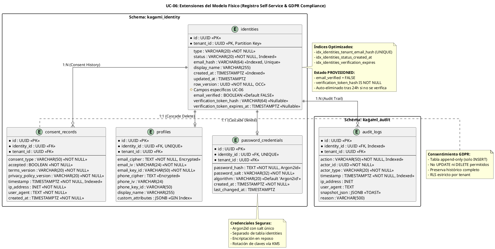

# UC-06: Registro Self-Service - Modelo de Datos Físico Específico (Public Onboarding & Security)

| Metadatos del Documento | |
| :--- | :--- |
| **Proyecto:** | SHUGO - Identity & Access Platform |
| **Caso de Uso:** | UC-06 - Registro Self-Service (Self-Service Sign-Up) |
| **Documento:** | 10_UC_Specific_Data_Model.md |
| **Metodología:** | Physical Data Modeling + Security by Design + GDPR Compliance + High-Concurrency Optimization |
| **Base de Datos:** | PostgreSQL 15+ (Primary + Read Replicas) |
| **Autor:** | Gastón Ruiz |
| **Versión Actual:** | 1.0.0 |
| **Fecha:** | 04/09/2026 |

---

## Historial de Versiones

| Versión | Fecha | Autor | Descripción de Cambios | Impacto |
| :--- | :--- | :--- | :--- | :--- |
| **1.0.0** | 04/09/2026 | Gastón Ruiz | **Creación inicial.** Extensión del modelo de datos físico para soportar operaciones de registro público de alto volumen. Introduce tablas específicas para tokens de verificación (almacenamiento seguro), registros de consentimiento GDPR (inmutables), índices optimizados para unicidad de email y prevención de enumeración, políticas de encriptación para datos sensibles, y estrategias de limpieza automática para identidades PROVISIONED expiradas. | Documento de referencia para DBAs y desarrolladores backend. Define cómo se implementa físicamente el registro self-service con seguridad enterprise, cumplimiento GDPR, y rendimiento para operaciones de alta concurrencia (100+ req/seg). |

---

## 1. Introducción y Propósito

Este documento define las extensiones y consideraciones físicas específicas en PostgreSQL para soportar el **UC-06 (Registro Self-Service)**.

A diferencia de los UCs administrados (UC-01 a UC-05) donde las operaciones son controladas por administradores autenticados, el UC-06 introduce desafíos físicos únicos orientados a **operaciones públicas no autenticadas de alto volumen**:

1. **Tablas de Verificación Segura:** Estructuras específicas para almacenar tokens de verificación con hashing SHA256, nunca en texto plano.
2. **Registros de Consentimiento Inmutables:** Tablas diseñadas para preservar evidencia de consentimiento GDPR con metadata completa (timestamp, IP, User Agent).
3. **Índices de Unicidad con Prevención de Enumeración:** Índices únicos compuestos que previenen duplicados de email sin revelar existencia mediante timing attacks.
4. **Estrategias de Limpieza Automática:** Jobs y índices optimizados para eliminar identidades PROVISIONED expiradas manteniendo la higiene de la base de datos.
5. **Seguridad a Nivel de Columna:** Encriptación de datos sensibles (passwords, tokens) y políticas de retención estrictas.
6. **Optimización para Alta Concurrencia:** Configuración de conexiones, pooling, y particionamiento para soportar 100+ registros por segundo.

---

## 2. Diagrama de Modelo de Datos Físico (ERD Extendido)



---

## 3. Scripts DDL: Tablas Específicas para UC-06

### 3.1. Extensiones a Tabla `identities` para Estado PROVISIONED

```sql
SET search_path TO kagami_identity;

-- Agregar columnas específicas para registro self-service
ALTER TABLE identities 
    ADD COLUMN IF NOT EXISTS email_verified BOOLEAN NOT NULL DEFAULT FALSE,
    ADD COLUMN IF NOT EXISTS verification_token_hash VARCHAR(64),
    ADD COLUMN IF NOT EXISTS verification_token_expires_at TIMESTAMPTZ;

-- Índice único compuesto para prevenir duplicados de email por tenant
-- CRÍTICO: Este índice previene race conditions en registro concurrente
CREATE UNIQUE INDEX IF NOT EXISTS idx_identities_tenant_email_hash 
    ON identities(tenant_id, email_hash) 
    WHERE email_hash IS NOT NULL;

-- Índice para consultas de limpieza (identidades PROVISIONED expiradas)
-- Optimizado para el job de limpieza que corre cada hora
CREATE INDEX IF NOT EXISTS idx_identities_provisioned_expired 
    ON identities(tenant_id, verification_token_expires_at) 
    WHERE status = 'PROVISIONED' 
      AND email_verified = FALSE 
      AND verification_token_expires_at IS NOT NULL;

-- Índice para consultas de estado (monitoreo y reportes)
CREATE INDEX IF NOT EXISTS idx_identities_tenant_status_created 
    ON identities(tenant_id, status, created_at DESC);

-- Comentarios de documentación
COMMENT ON COLUMN identities.email_verified IS 'Indica si el email fue verificado vía token. FALSE para estado PROVISIONED.';
COMMENT ON COLUMN identities.verification_token_hash IS 'SHA256 hash del token de verificación. Nulo tras verificación o expiración.';
COMMENT ON COLUMN identities.verification_token_expires_at IS 'Timestamp de expiración del token (24h desde creación). Usado para limpieza automática.';
```

### 3.2. Tabla `consent_records` (Registros de Consentimiento GDPR)

```sql
SET search_path TO kagami_identity;

-- Tabla de registros de consentimiento (append-only, inmutable)
CREATE TABLE IF NOT EXISTS consent_records (
    id UUID PRIMARY KEY DEFAULT gen_random_uuid(),
    identity_id UUID NOT NULL REFERENCES identities(id) ON DELETE CASCADE,
    tenant_id UUID NOT NULL,
    consent_type VARCHAR(50) NOT NULL 
        CHECK (consent_type IN ('TERMS_OF_SERVICE', 'PRIVACY_POLICY', 'MARKETING', 'DATA_PROCESSING')),
    accepted BOOLEAN NOT NULL,
    terms_version VARCHAR(20) NOT NULL,
    privacy_policy_version VARCHAR(20) NOT NULL,
    timestamp TIMESTAMPTZ NOT NULL DEFAULT NOW(),
    ip_address INET NOT NULL,
    user_agent TEXT NOT NULL,
    created_at TIMESTAMPTZ NOT NULL DEFAULT NOW(),
    
    -- Restricción: Solo INSERT permitido (implementado via triggers)
    CONSTRAINT chk_consent_accepted CHECK (accepted IN (TRUE, FALSE))
);

-- Índices para consultas de auditoría y compliance
CREATE INDEX IF NOT EXISTS idx_consent_records_identity 
    ON consent_records(identity_id, timestamp DESC);

CREATE INDEX IF NOT EXISTS idx_consent_records_tenant_timestamp 
    ON consent_records(tenant_id, timestamp DESC);

CREATE INDEX IF NOT EXISTS idx_consent_records_type_accepted 
    ON consent_records(consent_type, accepted) 
    WHERE accepted = TRUE;

-- Trigger para prevenir UPDATE y DELETE (inmutabilidad)
CREATE OR REPLACE FUNCTION prevent_consent_modification()
RETURNS TRIGGER AS $$
BEGIN
    IF TG_OP = 'UPDATE' THEN
        RAISE EXCEPTION 'Consent records are immutable. UPDATE not allowed. Create a new record instead.';
    ELSIF TG_OP = 'DELETE' THEN
        RAISE EXCEPTION 'Consent records cannot be deleted. GDPR requires audit trail preservation.';
    END IF;
    RETURN NULL;
END;
$$ LANGUAGE plpgsql;

CREATE TRIGGER trg_consent_records_immutable
    BEFORE UPDATE OR DELETE ON consent_records
    FOR EACH ROW
    EXECUTE FUNCTION prevent_consent_modification();

-- Comentarios de documentación
COMMENT ON TABLE consent_records IS 'Registros inmutables de consentimiento GDPR. Solo INSERT permitido.';
COMMENT ON COLUMN consent_records.consent_type IS 'Tipo de consentimiento: TERMS_OF_SERVICE, PRIVACY_POLICY, MARKETING, DATA_PROCESSING.';
COMMENT ON COLUMN consent_records.timestamp IS 'Timestamp exacto de aceptación (inmutable). Usado para auditoría GDPR Art. 7(1).';
COMMENT ON COLUMN consent_records.ip_address IS 'IP del usuario al momento de aceptar. Requerido para evidencia legal.';
```

### 3.3. Tabla `password_credentials` (Credenciales Seguras)

```sql
-- Tabla separada para credenciales de password (seguridad y compliance)
CREATE TABLE IF NOT EXISTS password_credentials (
    id UUID PRIMARY KEY DEFAULT gen_random_uuid(),
    identity_id UUID NOT NULL UNIQUE REFERENCES identities(id) ON DELETE CASCADE,
    tenant_id UUID NOT NULL,
    password_hash TEXT NOT NULL,
    password_salt VARCHAR(32) NOT NULL,
    algorithm VARCHAR(20) NOT NULL DEFAULT 'Argon2id'
        CHECK (algorithm IN ('Argon2id', 'bcrypt', 'scrypt')),
    created_at TIMESTAMPTZ NOT NULL DEFAULT NOW(),
    last_changed_at TIMESTAMPTZ NOT NULL DEFAULT NOW(),
    
    -- Restricciones de seguridad
    CONSTRAINT chk_password_hash_length CHECK (LENGTH(password_hash) >= 60),
    CONSTRAINT chk_password_salt_length CHECK (LENGTH(password_salt) = 32)
);

-- Índice para consultas de autenticación (UC-11)
CREATE INDEX IF NOT EXISTS idx_password_credentials_identity 
    ON password_credentials(identity_id);

-- Comentarios de documentación
COMMENT ON TABLE password_credentials IS 'Credenciales de password separadas de identities para seguridad y compliance.';
COMMENT ON COLUMN password_credentials.password_hash IS 'Hash Argon2id de la contraseña. Nunca almacenar texto plano.';
COMMENT ON COLUMN password_credentials.password_salt IS 'Salt criptográfico único generado por contraseña. 32 caracteres.';
COMMENT ON COLUMN password_credentials.algorithm IS 'Algoritmo de hashing. Argon2id es el recomendado por OWASP.';
```

---

## 4. Estrategia de Índices para Prevención de Enumeración

### 4.1. Índice Único con Prevención de Timing Attacks

El índice único en `email_hash` debe ser consultado de forma que no revele si un email existe o no mediante diferencias de tiempo.

```sql
-- Función de consulta segura en tiempo constante
CREATE OR REPLACE FUNCTION check_email_exists(
    p_tenant_id UUID,
    p_email_hash VARCHAR(64)
)
RETURNS BOOLEAN AS $$
DECLARE
    v_exists BOOLEAN;
BEGIN
    -- Consulta que siempre toma el mismo tiempo independientemente del resultado
    SELECT EXISTS(
        SELECT 1 FROM identities 
        WHERE tenant_id = p_tenant_id 
          AND email_hash = p_email_hash
    ) INTO v_exists;
    
    -- Retardo artificial para prevenir timing attacks (opcional, ajustar según benchmarks)
    PERFORM pg_sleep(0.001); -- 1ms de retardo constante
    
    RETURN v_exists;
END;
$$ LANGUAGE plpgsql;

-- Ejemplo de uso en aplicación:
-- SELECT check_email_exists('uuid-tenant', 'hash-email');
```

### 4.2. Índices para Job de Limpieza de Identidades Expiradas

El job de limpieza (que corre cada hora) necesita eliminar identidades PROVISIONED con tokens expirados.

```sql
-- Índice optimizado para el job de limpieza
-- Permite buscar rápidamente identidades expiradas por tenant
CREATE INDEX IF NOT EXISTS idx_identities_cleanup_expired 
    ON identities(tenant_id, verification_token_expires_at ASC) 
    WHERE status = 'PROVISIONED' 
      AND email_verified = FALSE 
      AND verification_token_expires_at < NOW();

-- Función para el job de limpieza (ejecutada cada hora)
CREATE OR REPLACE FUNCTION cleanup_expired_provisioned_identities(
    p_batch_size INT DEFAULT 1000
)
RETURNS INT AS $$
DECLARE
    v_deleted_count INT;
BEGIN
    WITH expired_identities AS (
        SELECT id 
        FROM identities 
        WHERE status = 'PROVISIONED' 
          AND email_verified = FALSE 
          AND verification_token_expires_at < NOW()
        LIMIT p_batch_size
        FOR UPDATE SKIP LOCKED -- Prevenir bloqueos con otras transacciones
    )
    DELETE FROM identities 
    WHERE id IN (SELECT id FROM expired_identities)
    RETURNING id;
    
    GET DIAGNOSTICS v_deleted_count = ROW_COUNT;
    
    RETURN v_deleted_count;
END;
$$ LANGUAGE plpgsql;

-- Ejemplo de uso en job programado:
-- SELECT cleanup_expired_provisioned_identities(1000);
```

---

## 5. Seguridad a Nivel de Base de Datos

### 5.1. Row-Level Security (RLS) para Consent Records

```sql
-- Habilitar RLS en consent_records
ALTER TABLE consent_records ENABLE ROW LEVEL SECURITY;
ALTER TABLE consent_records FORCE ROW LEVEL SECURITY;

-- Política de lectura: Solo puede leer consentimientos de su propio tenant
CREATE POLICY consent_records_tenant_isolation ON consent_records
    FOR SELECT
    USING (tenant_id = current_setting('app.current_tenant_id')::uuid);

-- Política de escritura: Solo puede insertar consentimientos de su propio tenant
CREATE POLICY consent_records_tenant_insert ON consent_records
    FOR INSERT
    WITH CHECK (tenant_id = current_setting('app.current_tenant_id')::uuid);

-- No se permiten UPDATE ni DELETE (ya prevenido por trigger)
```

### 5.2. Encriptación de Datos Sensibles

```sql
-- Habilitar extensión pgcrypto para encriptación
CREATE EXTENSION IF NOT EXISTS pgcrypto;

-- Función para encriptar email antes de almacenar
CREATE OR REPLACE FUNCTION encrypt_email(
    p_email TEXT,
    p_key_id VARCHAR(50)
)
RETURNS TABLE(encrypted_email TEXT, iv VARCHAR(24)) AS $$
DECLARE
    v_encryption_key BYTEA;
    v_iv BYTEA;
    v_encrypted BYTEA;
BEGIN
    -- Obtener clave de encriptación desde KMS (simulado aquí)
    -- En producción, usar AWS KMS, Azure Key Vault, o HashiCorp Vault
    v_encryption_key := get_encryption_key(p_key_id);
    
    -- Generar IV aleatorio
    v_iv := gen_random_bytes(12);
    
    -- Encriptar con AES-256-GCM
    v_encrypted := pgp_sym_encrypt(p_email, encode(v_encryption_key, 'hex'));
    
    RETURN QUERY 
    SELECT encode(v_encrypted, 'base64'), encode(v_iv, 'base64');
END;
$$ LANGUAGE plpgsql;

-- Función para desencriptar email (solo para servicios autorizados)
CREATE OR REPLACE FUNCTION decrypt_email(
    p_encrypted_email TEXT,
    p_key_id VARCHAR(50)
)
RETURNS TEXT AS $$
DECLARE
    v_encryption_key BYTEA;
    v_decrypted TEXT;
BEGIN
    v_encryption_key := get_encryption_key(p_key_id);
    v_decrypted := pgp_sym_decrypt(decode(p_encrypted_email, 'base64'), encode(v_encryption_key, 'hex'));
    RETURN v_decrypted;
END;
$$ LANGUAGE plpgsql;
```

### 5.3. Roles de Base de Datos para Registro Self-Service

```sql
-- Crear rol específico para operaciones de registro self-service
CREATE ROLE app_kagami_register WITH LOGIN PASSWORD '...';

-- Grant permisos específicos para registro
GRANT CONNECT ON DATABASE shugo_kagami TO app_kagami_register;
GRANT USAGE ON SCHEMA kagami_identity TO app_kagami_register;

-- Solo puede INSERT en identities (para crear PROVISIONED)
GRANT INSERT ON identities TO app_kagami_register;
GRANT SELECT ON identities TO app_kagami_register; -- Para verificar unicidad

-- Puede INSERT en consent_records (registrar consentimiento)
GRANT INSERT ON consent_records TO app_kagami_register;

-- Puede INSERT en password_credentials
GRANT INSERT ON password_credentials TO app_kagami_register;

-- Puede INSERT en audit_logs (registrar evento de registro)
GRANT INSERT ON audit_logs TO app_kagami_register;

-- No puede UPDATE ni DELETE en identities (solo el servicio de verificación puede)
REVOKE UPDATE, DELETE ON identities FROM app_kagami_register;

-- No puede leer password_credentials (solo el servicio de autenticación puede)
REVOKE SELECT ON password_credentials FROM app_kagami_register;
```

---

## 6. Estrategias de Particionamiento para Alta Concurrencia

### 6.1. Particionamiento de `identities` por Tenant

Para tenants grandes con millones de identidades, particionar por `tenant_id` mejora el rendimiento de consultas y facilita el mantenimiento.

```sql
-- Tabla particionada por tenant_id (ejemplo para tenants enterprise)
CREATE TABLE identities_partitioned (
    id UUID NOT NULL DEFAULT gen_random_uuid(),
    tenant_id UUID NOT NULL,
    type VARCHAR(20) NOT NULL,
    status VARCHAR(20) NOT NULL DEFAULT 'PROVISIONED',
    email_hash VARCHAR(64),
    display_name VARCHAR(255),
    email_verified BOOLEAN NOT NULL DEFAULT FALSE,
    verification_token_hash VARCHAR(64),
    verification_token_expires_at TIMESTAMPTZ,
    created_at TIMESTAMPTZ NOT NULL DEFAULT NOW(),
    updated_at TIMESTAMPTZ NOT NULL DEFAULT NOW(),
    row_version UUID NOT NULL DEFAULT gen_random_uuid(),
    PRIMARY KEY (id, tenant_id)
) PARTITION BY LIST (tenant_id);

-- Crear particiones para tenants específicos
CREATE TABLE identities_tenant_khcs PARTITION OF identities_partitioned
    FOR VALUES IN ('uuid-tenant-khcs');

CREATE TABLE identities_tenant_enterprise_a PARTITION OF identities_partitioned
    FOR VALUES IN ('uuid-tenant-enterprise-a');

-- Partición default para tenants pequeños
CREATE TABLE identities_default PARTITION OF identities_partitioned DEFAULT;

-- Los índices se crean automáticamente en cada partición
-- Pero podemos optimizarlos por partición
CREATE INDEX idx_identities_khcs_email 
    ON identities_tenant_khcs(tenant_id, email_hash) 
    WHERE email_hash IS NOT NULL;
```

### 6.2. Particionamiento de `audit_logs` por Tiempo

Para mejorar el rendimiento de consultas de auditoría y facilitar la retención de datos.

```sql
-- Tabla particionada por mes para audit_logs
CREATE TABLE audit_logs_partitioned (
    id UUID NOT NULL DEFAULT gen_random_uuid(),
    identity_id UUID,
    tenant_id UUID NOT NULL,
    action VARCHAR(50) NOT NULL,
    actor_id UUID NOT NULL,
    actor_type VARCHAR(20) NOT NULL,
    timestamp TIMESTAMPTZ NOT NULL DEFAULT NOW(),
    ip_address INET,
    user_agent TEXT,
    snapshot_json JSONB,
    reason VARCHAR(500),
    PRIMARY KEY (id, timestamp)
) PARTITION BY RANGE (timestamp);

-- Crear particiones mensuales
CREATE TABLE audit_logs_2024_01 PARTITION OF audit_logs_partitioned
    FOR VALUES FROM ('2024-01-01') TO ('2024-02-01');

CREATE TABLE audit_logs_2024_02 PARTITION OF audit_logs_partitioned
    FOR VALUES FROM ('2024-02-01') TO ('2024-03-01');

-- Partición default para fechas futuras
CREATE TABLE audit_logs_default PARTITION OF audit_logs_partitioned DEFAULT;
```

---

## 7. Configuración de Rendimiento para Alta Concurrencia

### 7.1. Configuración de PostgreSQL para Registro Masivo

```ini
# postgresql.conf - Optimizaciones para operaciones de registro de alto volumen

# Conexiones y pooling
max_connections = 500                    # Ajustar según número de pods
superuser_reserved_connections = 5       # Reservar para mantenimiento

# Memoria compartida
shared_buffers = 8GB                     # 25% de RAM total
effective_cache_size = 24GB              # 75% de RAM total
work_mem = 64MB                          # Para operaciones de ordenamiento
maintenance_work_mem = 2GB               # Para VACUUM y CREATE INDEX

# WAL y Checkpoints (crítico para operaciones de escritura intensivas)
wal_level = replica
max_wal_size = 2GB
min_wal_size = 512MB
checkpoint_completion_target = 0.9
checkpoint_timeout = 15min
wal_buffers = 64MB

# Autovacuum agresivo para tablas de alta escritura
autovacuum_max_workers = 5
autovacuum_vacuum_scale_factor = 0.01    # Vaciar cuando 1% de filas cambian
autovacuum_analyze_scale_factor = 0.005  # Analizar cuando 0.5% de filas cambian
autovacuum_vacuum_threshold = 100
autovacuum_analyze_threshold = 50

# Logging para monitoreo de rendimiento
log_min_duration_statement = 100         # Log queries > 100ms
log_checkpoints = on
log_connections = off
log_disconnections = off
log_lock_waits = on
```

### 7.2. Configuración de PgBouncer para Registro Self-Service

```ini
# pgbouncer.ini - Pool de conexiones optimizado para registro

[databases]
shugo_kagami = host=postgres-primary port=5432 dbname=shugo_kagami

[pgbouncer]
listen_port = 6432
listen_addr = 0.0.0.0
auth_type = md5
auth_file = /etc/pgbouncer/userlist.txt

# Pool mode: transaction (reutiliza conexiones entre transacciones)
pool_mode = transaction

# Conexiones máximas
max_client_conn = 2000                   # Conexiones desde aplicación
default_pool_size = 100                  # Conexiones por usuario/DB
min_pool_size = 20                       # Mantener conexiones calientes
reserve_pool_size = 50                   # Para picos de carga
reserve_pool_timeout = 3                 # Segundos antes de usar reserve pool

# Timeouts estrictos para registro
server_connect_timeout = 5               # Segundos
server_login_retry = 1                   # Segundos
query_timeout = 10                       # Segundos (cancela queries lentas)
client_idle_timeout = 300                # Segundos

# Logging
log_connections = 0
log_disconnections = 0
log_pooler_errors = 1

# Statistics
stats_period = 60                        # Segundos
```

---

## 8. Políticas de Retención y Limpieza

### 8.1. Retención de Identidades PROVISIONED

```sql
-- Política: Identidades PROVISIONED no verificadas se eliminan tras 24 horas
-- Implementado via job programado (ver sección 4.2)

-- Configuración de retención en tabla tenant_configs
ALTER TABLE tenant_configs 
    ADD COLUMN IF NOT EXISTS provisioned_identity_ttl_hours INT NOT NULL DEFAULT 24;

COMMENT ON COLUMN tenant_configs.provisioned_identity_ttl_hours IS 'Horas antes de eliminar identidades PROVISIONED no verificadas. Default: 24h.';
```

### 8.2. Retención de Consent Records

```sql
-- Política: Consent records se preservan indefinidamente (GDPR Art. 7(1))
-- No hay retención máxima, solo se archivan tras X años

-- Configuración de archivado en tenant_configs
ALTER TABLE tenant_configs 
    ADD COLUMN IF NOT EXISTS consent_record_archive_years INT NOT NULL DEFAULT 7;

COMMENT ON COLUMN tenant_configs.consent_record_archive_years IS 'Años antes de archivar consent records a almacenamiento frío. Default: 7 años.';

-- Función para archivar consent records antiguos
CREATE OR REPLACE FUNCTION archive_old_consent_records(
    p_tenant_id UUID,
    p_years INT DEFAULT 7
)
RETURNS INT AS $$
DECLARE
    v_archived_count INT;
BEGIN
    -- Mover consent records antiguos a tabla de archivo
    INSERT INTO consent_records_archive
    SELECT * FROM consent_records
    WHERE tenant_id = p_tenant_id
      AND timestamp < NOW() - INTERVAL '1 year' * p_years;
    
    GET DIAGNOSTICS v_archived_count = ROW_COUNT;
    
    -- Eliminar de tabla principal (opcional, según política)
    -- DELETE FROM consent_records
    -- WHERE tenant_id = p_tenant_id
    --   AND timestamp < NOW() - INTERVAL '1 year' * p_years;
    
    RETURN v_archived_count;
END;
$$ LANGUAGE plpgsql;
```

### 8.3. Retención de Audit Logs

```sql
-- Política: Audit logs se retienen según configuración de tenant
-- Implementado via particionamiento por tiempo (ver sección 6.2)

-- Configuración de retención en tenant_configs
ALTER TABLE tenant_configs 
    ADD COLUMN IF NOT EXISTS audit_log_retention_years INT NOT NULL DEFAULT 5;

COMMENT ON COLUMN tenant_configs.audit_log_retention_years IS 'Años de retención de audit logs. Default: 5 años.';

-- Función para eliminar particiones antiguas de audit_logs
CREATE OR REPLACE FUNCTION drop_old_audit_log_partitions(
    p_retention_years INT DEFAULT 5
)
RETURNS INT AS $$
DECLARE
    v_dropped_count INT := 0;
    v_partition_name TEXT;
BEGIN
    FOR v_partition_name IN 
        SELECT inhrelid::regclass::text 
        FROM pg_inherits 
        WHERE inhparent = 'audit_logs_partitioned'::regclass
          AND inhrelid::regclass::text < 'audit_logs_' || TO_CHAR(NOW() - INTERVAL '1 year' * p_retention_years, 'YYYY_MM')
    LOOP
        EXECUTE 'DROP TABLE IF EXISTS ' || v_partition_name;
        v_dropped_count := v_dropped_count + 1;
    END LOOP;
    
    RETURN v_dropped_count;
END;
$$ LANGUAGE plpgsql;
```

---

## 9. Monitoreo y Diagnóstico

### 9.1. Consultas para Diagnosticar Problemas de Registro

```sql
-- Identidades PROVISIONED acumuladas (posible problema de entrega de emails)
SELECT 
    tenant_id,
    COUNT(*) AS provisioned_count,
    MIN(created_at) AS oldest_provisioned,
    MAX(created_at) AS newest_provisioned
FROM identities
WHERE status = 'PROVISIONED'
  AND email_verified = FALSE
GROUP BY tenant_id
ORDER BY provisioned_count DESC;

-- Tokens de verificación expirados sin limpiar
SELECT 
    tenant_id,
    COUNT(*) AS expired_tokens,
    MIN(verification_token_expires_at) AS oldest_expired
FROM identities
WHERE status = 'PROVISIONED'
  AND email_verified = FALSE
  AND verification_token_expires_at < NOW()
GROUP BY tenant_id
ORDER BY expired_tokens DESC;

-- Tasa de conversión de registro (verificados / totales) por tenant
SELECT 
    tenant_id,
    COUNT(*) FILTER (WHERE status = 'ACTIVE') AS active_identities,
    COUNT(*) FILTER (WHERE status = 'PROVISIONED') AS provisioned_identities,
    ROUND(
        COUNT(*) FILTER (WHERE status = 'ACTIVE')::NUMERIC / 
        NULLIF(COUNT(*), 0) * 100, 
        2
    ) AS conversion_rate_pct
FROM identities
WHERE created_at > NOW() - INTERVAL '30 days'
GROUP BY tenant_id
ORDER BY conversion_rate_pct ASC;

-- Consent records sin identidad asociada (posible problema de integridad)
SELECT 
    cr.tenant_id,
    COUNT(*) AS orphaned_consents
FROM consent_records cr
LEFT JOIN identities i ON cr.identity_id = i.id
WHERE i.id IS NULL
GROUP BY cr.tenant_id;
```

### 9.2. Métricas de Base de Datos para OpenTelemetry

```csharp
public class RegistrationDatabaseMetrics
{
    private readonly Meter _meter;
    private readonly Counter<long> _provisionedIdentitiesCreated;
    private readonly Counter<long> _provisionedIdentitiesCleaned;
    private readonly Counter<long> _consentRecordsCreated;
    private readonly Histogram<double> _emailUniquenessCheckLatency;
    private readonly Histogram<double> _provisionedIdentityCreationLatency;

    public RegistrationDatabaseMetrics(IMeterFactory meterFactory)
    {
        _meter = meterFactory.Create("shugo.registration.database");
        _provisionedIdentitiesCreated = _meter.CreateCounter<long>("registration.provisioned_created");
        _provisionedIdentitiesCleaned = _meter.CreateCounter<long>("registration.provisioned_cleaned");
        _consentRecordsCreated = _meter.CreateCounter<long>("registration.consent_records_created");
        _emailUniquenessCheckLatency = _meter.CreateHistogram<double>("registration.email_uniqueness_latency", "ms");
        _provisionedIdentityCreationLatency = _meter.CreateHistogram<double>("registration.provisioned_creation_latency", "ms");
    }

    public void RecordProvisionedIdentityCreated(string tenantId)
    {
        _provisionedIdentitiesCreated.Add(1,
            new KeyValuePair<string, object?>("tenant_id", tenantId));
    }

    public void RecordProvisionedIdentityCleaned(string tenantId)
    {
        _provisionedIdentitiesCleaned.Add(1,
            new KeyValuePair<string, object?>("tenant_id", tenantId));
    }

    public void RecordConsentRecordCreated(string tenantId, string consentType)
    {
        _consentRecordsCreated.Add(1,
            new KeyValuePair<string, object?>("tenant_id", tenantId),
            new KeyValuePair<string, object?>("consent_type", consentType));
    }

    public void RecordEmailUniquenessCheck(string tenantId, double latencyMs, bool emailExists)
    {
        _emailUniquenessCheckLatency.Record(latencyMs,
            new KeyValuePair<string, object?>("tenant_id", tenantId),
            new KeyValuePair<string, object?>("email_exists", emailExists));
    }

    public void RecordProvisionedIdentityCreation(string tenantId, double latencyMs, bool success)
    {
        _provisionedIdentityCreationLatency.Record(latencyMs,
            new KeyValuePair<string, object?>("tenant_id", tenantId),
            new KeyValuePair<string, object?>("success", success));
    }
}
```

---

## 10. Trazabilidad

| Documento | Relación |
| :--- | :--- |
| `04_Initial_Domain_Model.md` | Define los Value Objects `Email`, `PasswordHash`, `VerificationToken`, `ConsentRecord` que se mapean a las columnas físicas definidas aquí. |
| `07_Sequence_Diagram.md` | Muestra las consultas a PostgreSQL (unicidad de email, creación de identidad, inserción de consent) que se optimizan con estos índices. |
| `08_Final_Class_Design.md` | El `IdentityRepositoryImpl` y `ConsentRecordRepository` implementan las consultas optimizadas definidas aquí. |
| `09_Modern_Artifacts.md` | Las métricas de conversión y limpieza se monitorean con las configuraciones definidas aquí. |
| `11_UC_Specific_Security_Threats.md` | Las mitigaciones de "Email Enumeration" y "Sybil Attack" se validan mediante los índices únicos y RLS definidos aquí. |
| `12_UC_Specific_Performance_Benchmarks.md` | Los SLAs de latencia (<100ms para registro) se validan con los índices y configuraciones de pooling definidos aquí. |
| `SHUGO_Data_Model_Master.md` (Transversal) | Este documento extiende el modelo maestro con tablas específicas de registro self-service y consentimiento GDPR. |

---

## 11. Anexos: Glosario de Base de Datos (UC-06)

| Término | Definición en Contexto UC-06 |
| :--- | :--- |
| **PROVISIONED State** | Estado inicial de identidad self-service. No permite autenticación hasta verificar email. Auto-eliminado tras 24h si no se verifica. |
| **Verification Token Hash** | SHA256 hash del token de verificación. Nunca almacenar token en texto plano. Previene robo de tokens. |
| **Consent Record** | Registro inmutable de consentimiento GDPR. Solo INSERT permitido. Preserva timestamp, IP, User Agent para evidencia legal. |
| **Argon2id** | Algoritmo de hashing de contraseñas resistente a ataques de GPU y side-channel. Recomendado por OWASP. Separado en tabla `password_credentials`. |
| **Email Hash** | SHA256 hash del email para índice único. Permite verificar unicidad sin exponer email en texto plano. |
| **Row-Level Security (RLS)** | Mecanismo de PostgreSQL que restringe acceso a filas basado en tenant_id. Previene fugas de datos entre tenants. |
| **Append-Only Table** | Tabla diseñada solo para INSERT (como `consent_records`). UPDATE y DELETE bloqueados por triggers. |
| **Partitioning** | División de tablas grandes en particiones más pequeñas (por tenant_id o tiempo). Mejora rendimiento y facilita mantenimiento. |
| **Connection Pooling** | Reutilización de conexiones de base de datos vía PgBouncer. Reduce overhead de TCP handshake y autenticación. |
| **Timing Attack Prevention** | Técnicas para prevenir que atacantes descubran información mediante diferencias de tiempo de respuesta (ej. retardo constante en consultas de unicidad). |

---
*Fin del Documento 10_UC_Specific_Data_Model para UC-06*