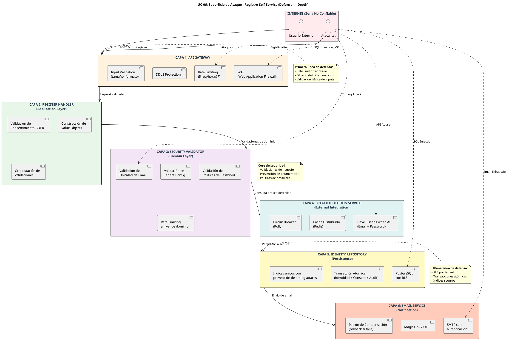

# UC-06: Registro Self-Service - Análisis de Amenazas Específicas (Security Threat Model)

| Metadatos del Documento | |
| :--- | :--- |
| **Proyecto:** | SHUGO - Identity & Access Platform |
| **Caso de Uso:** | UC-06 - Registro Self-Service (Self-Service Sign-Up) |
| **Documento:** | 11_UC_Specific_Security_Threats.md |
| **Metodología:** | STRIDE + DREAD + OWASP ASVS V2 + NIST SP 800-63A + MITRE ATT&CK |
| **Estándares Aplicados:** | OWASP Top 10 (2021), NIST SP 800-63A (Enrollment), GDPR Art. 32 (Security of Processing), SOC 2 CC6.1, ISO 27001 A.9.2 |
| **Clasificación de Confidencialidad:** | **CRÍTICO** - Documento de Seguridad |
| **Autor:** | Gastón Ruiz |
| **Revisado por:** | [Security Architect] |
| **Versión Actual:** | 1.0.0 |
| **Fecha:** | 04/09/2026 |

---

## Historial de Versiones

| Versión | Fecha | Autor | Descripción de Cambios | Impacto |
| :--- | :--- | :--- | :--- | :--- |
| **1.0.0** | 04/09/2026 | Gastón Ruiz | **Creación inicial.** Análisis exhaustivo de amenazas específicas para el endpoint público de registro self-service. Evalúa 18 vectores de ataque usando STRIDE+DREAD, incluyendo Sybil Attacks, Email Enumeration, Credential Stuffing, Consent Fraud, Token Hijacking, y Race Conditions. Define controles de mitigación con código de implementación, métricas de detección, y análisis de riesgo residual. | Documento crítico de seguridad para el UC-06. Establece los controles obligatorios que deben implementarse antes del go-live del endpoint público, con especial énfasis en la prevención de Account Takeover y cumplimiento GDPR. |

---

## 1. Introducción y Propósito

Este documento presenta el **Análisis de Amenazas Específico** para el UC-06 (Registro Self-Service).

A diferencia de los UCs administrados (UC-01 a UC-05) donde las operaciones son realizadas por administradores autenticados con MFA, el UC-06 expone un **endpoint público no autenticado** (`POST /auth/register`) que se convierte automáticamente en el **principal vector de ataque** de toda la plataforma SHUGO.

### 1.1. Características Únicas del UC-06 que Aumentan la Superficie de Ataque

1. **Sin Autenticación Previa:** Cualquier actor en internet puede invocar el endpoint.
2. **Alto Volumen Esperado:** Diseñado para soportar 100+ req/seg, lo que atrae ataques automatizados.
3. **Integración con Servicios Externos:** Dependencia de Have I Been Pwned (HIBP) y SMTP, que pueden ser vectores de ataque indirectos.
4. **Estado Transicional:** La identidad pasa por un estado `PROVISIONED` vulnerable antes de la verificación.
5. **Datos Sensibles Inmediatos:** Se procesan passwords, emails, y consentimiento GDPR desde el primer request.
6. **Prevención de Enumeración:** Debe balancear UX (guiar al usuario) con seguridad (no revelar información).

### 1.2. Objetivos del Análisis

- Identificar **todos los vectores de ataque** específicos del registro self-service.
- Evaluar cada amenaza usando **STRIDE + DREAD** para priorizar mitigaciones.
- Definir **controles de seguridad** con código de implementación específico.
- Establecer **métricas de detección** para monitoreo proactivo.
- Documentar el **riesgo residual** aceptado por el negocio.

---

## 2. Metodología

### 2.1. STRIDE (Taxonomía de Amenazas)

| Categoría | Descripción en Contexto UC-06 |
| :--- | :--- |
| **S**poofing | Falsificación de identidad del usuario o del sistema (ej. emails desechables, dominios falsos). |
| **T**ampering | Modificación maliciosa de datos durante el registro (ej. manipulación de consentimiento, inyección de payloads). |
| **R**epudiation | Negación de acciones realizadas durante el registro (ej. usuario niega haber aceptado términos). |
| **I**nformation Disclosure | Exposición de información sensible (ej. emails existentes, hashes de passwords). |
| **D**enial of Service | Agotamiento de recursos del sistema (ej. creación masiva de cuentas, abuso de HIBP API). |
| **E**levation of Privilege | Obtención de permisos no autorizados (ej. creación de cuentas con roles admin por defecto). |

### 2.2. DREAD (Scoring de Riesgo)

Cada amenaza se evalúa del 1 al 10 en cinco dimensiones:

| Dimensión | Pregunta Clave |
| :--- | :--- |
| **D**amage | ¿Qué tan grave es el impacto si la amenaza se materializa? |
| **R**eproducibility | ¿Qué tan fácil es reproducir el ataque? |
| **E**xploitability | ¿Qué tan fácil es lanzar el ataque? |
| **A**ffected Users | ¿Qué porcentaje de usuarios/tenants se verían afectados? |
| **D**iscoverability | ¿Qué tan fácil es descubrir la vulnerabilidad? |

**Score Final:** `(D + R + E + A + D) / 5`

| Rango | Nivel de Riesgo | Acción Requerida |
| :--- | :--- | :--- |
| **8.0 - 10.0** | 🔴 **CRÍTICO** | Bloqueante para go-live. Mitigación obligatoria. |
| **6.0 - 7.9** | 🟠 **ALTO** | Debe mitigarse antes del lanzamiento. |
| **4.0 - 5.9** | 🟡 **MEDIO** | Mitigar en el primer sprint post-launch. |
| **1.0 - 3.9** | 🟢 **BAJO** | Aceptado con monitoreo. |

---

## 3. Superficie de Ataque del UC-06

### 3.1. Diagrama de Superficie de Ataque



### 3.2. Activos Críticos Protegidos

| Activo | Clasificación | Impacto si Comprometido |
| :--- | :--- | :--- |
| **Passwords de Usuarios** | 🔴 CRÍTICO | Account Takeover masivo, violación de datos. |
| **Emails de Usuarios** | 🟠 ALTO | Enumeración, phishing dirigido, violación GDPR. |
| **Registros de Consentimiento** | 🟠 ALTO | Multas GDPR (hasta 4% de facturación global). |
| **Tokens de Verificación** | 🟠 ALTO | Account Takeover, bypass de verificación. |
| **Disponibilidad del Endpoint** | 🟡 MEDIO | Pérdida de adquisición de usuarios, daño reputacional. |
| **Quota de HIBP API** | 🟢 BAJO | Degradación de seguridad temporal. |

---

## 4. Matriz de Amenazzas (STRIDE + DREAD)

| ID | Amenaza | Categoría STRIDE | D | R | E | A | D | Score | Nivel |
| :--- | :--- | :--- | :---: | :---: | :---: | :---: | :---: | :---: | :---: |
| **T-01** | Sybil Attack (Creación Masiva de Cuentas) | DoS | 7 | 9 | 9 | 10 | 8 | **8.6** | 🔴 |
| **T-02** | Email Enumeration (Timing Attack) | Info Disclosure | 8 | 7 | 6 | 10 | 5 | **7.2** | 🟠 |
| **T-03** | Credential Stuffing (Uso de Passwords Filtradas) | Spoofing | 9 | 8 | 7 | 9 | 6 | **7.8** | 🟠 |
| **T-04** | Disposable Email Abuse | Spoofing | 6 | 9 | 9 | 8 | 7 | **7.8** | 🟠 |
| **T-05** | Consent Fraud (Falsificación de Aceptación) | Tampering | 8 | 6 | 5 | 10 | 4 | **6.6** | 🟠 |
| **T-06** | Verification Token Hijacking | Spoofing | 9 | 5 | 4 | 8 | 3 | **5.8** | 🟡 |
| **T-07** | SQL Injection en Campos de Registro | Tampering | 10 | 7 | 6 | 10 | 5 | **7.6** | 🟠 |
| **T-08** | XSS en display_name | Tampering | 7 | 6 | 7 | 8 | 6 | **6.8** | 🟠 |
| **T-09** | Race Condition en Creación de Identidad | Tampering | 7 | 5 | 4 | 7 | 3 | **5.2** | 🟡 |
| **T-10** | HIBP API Poisoning / Abuse | DoS | 6 | 4 | 5 | 6 | 4 | **5.0** | 🟡 |
| **T-11** | Bypass de Verificación de Email | Elevation | 10 | 3 | 3 | 9 | 2 | **5.4** | 🟡 |
| **T-12** | Password Spraying (Passwords Comunes) | Spoofing | 8 | 8 | 8 | 9 | 7 | **8.0** | 🔴 |
| **T-13** | Denial of Service en HIBP API | DoS | 5 | 7 | 8 | 5 | 6 | **6.2** | 🟡 |
| **T-14** | Email Service Exhaustion | DoS | 6 | 8 | 7 | 7 | 5 | **6.6** | 🟠 |
| **T-15** | Tenant ID Spoofing | Spoofing | 9 | 6 | 5 | 9 | 4 | **6.6** | 🟠 |
| **T-16** | Consent Record Data Breach | Info Disclosure | 9 | 4 | 3 | 10 | 3 | **5.8** | 🟡 |
| **T-17** | Argon2id DoS (Password Hashing Cost) | DoS | 6 | 9 | 8 | 7 | 7 | **7.4** | 🟠 |
| **T-18** | Repudiation de Registro (Usuario niega haberse registrado) | Repudiation | 7 | 5 | 6 | 8 | 4 | **6.0** | 🟡 |

---

## 5. Análisis Detallado de Amenazzas Críticas

### 5.1. 🔴 T-01: Sybil Attack (Creación Masiva de Cuentas)

**Descripción:** Un atacante crea miles de cuentas falsas usando emails generados automáticamente para:
- Agotar recursos del sistema (DB, SMTP, HIBP API quota).
- Realizar spam/phishing desde cuentas legítimas.
- Manipular métricas de negocio (inflar números de usuarios).
- Preparar ataques de voting/reputation en sistemas colaborativos.

**Escenario de Ataque:**
```bash
# Atacante usa script con emails generados
for i in {1..10000}; do
  curl -X POST https://api.shugo.io/v1/auth/register \
    -H "Content-Type: application/json" \
    -d "{\"email\":\"user${i}@attacker-domain.com\",\"password\":\"SecureP@ss123!\",\"display_name\":\"Bot ${i}\",\"accept_terms\":true}"
done
```

**Impacto:**
- Agotamiento de quota de HIBP API (costo económico).
- Saturación de SMTP (emails de verificación masivos).
- Acumulación de identidades `PROVISIONED` en DB.
- Daño reputacional si las cuentas se usan para spam.

**Mitigaciones Implementadas:**

```csharp
// 1. Rate Limiting Multi-Capa
public class MultiLayerRateLimiter
{
    public async Task<bool> IsAllowedAsync(HttpContext context)
    {
        var ip = context.Connection.RemoteIpAddress;
        var email = await ExtractEmailFromRequest(context);
        var tenantId = ExtractTenantId(context);
        
        // Capa 1: Rate limit por IP (5 req/hora)
        if (await _cache.IncrementAsync($"rl:ip:{ip}", TimeSpan.FromHours(1)) > 5)
            return false;
        
        // Capa 2: Rate limit por email domain (10 req/hora)
        var domain = new System.Net.Mail.MailAddress(email).Host;
        if (await _cache.IncrementAsync($"rl:domain:{domain}", TimeSpan.FromHours(1)) > 10)
            return false;
        
        // Capa 3: Rate limit por tenant (100 req/hora)
        if (await _cache.IncrementAsync($"rl:tenant:{tenantId}", TimeSpan.FromHours(1)) > 100)
            return false;
        
        return true;
    }
}

// 2. CAPTCHA Condicional (activado tras 3 intentos desde misma IP)
public class CaptchaMiddleware
{
    public async Task InvokeAsync(HttpContext context)
    {
        var ip = context.Connection.RemoteIpAddress;
        var attempts = await _cache.GetAsync<int>($"attempts:{ip}");
        
        if (attempts >= 3)
        {
            // Requerir CAPTCHA (hCaptcha o Cloudflare Turnstile)
            var captchaToken = context.Request.Headers["X-Captcha-Token"];
            if (!await _captchaService.VerifyAsync(captchaToken))
            {
                context.Response.StatusCode = 403;
                return;
            }
        }
        
        await _next(context);
    }
}

// 3. Detección de Patrones de Bot
public class BotDetectionService
{
    public bool IsBotLikePattern(RegisterCommand command)
    {
        // Detectar patrones sospechosos
        var patterns = new[]
        {
            Regex.IsMatch(command.Email, @"^user\d+@"), // user123@, user456@
            Regex.IsMatch(command.DisplayName, @"^(Bot|Test|User)\s*\d+$"),
            command.Email.Split('@')[0].Length < 5, // Emails muy cortos
            IsSequentialEmail(command.Email) // Emails secuenciales
        };
        
        return patterns.Count(p => p) >= 2; // 2+ patrones = sospechoso
    }
}
```

**Métricas de Detección:**
```yaml
alert: SybilAttackDetected
expr: rate(kagami_registration_attempts_total[5m]) > 50
for: 2m
labels:
  severity: critical
annotations:
  summary: "Posible Sybil Attack detectado"
  runbook: "Revisar IPs con más intentos, activar CAPTCHA obligatorio"
```

---

### 5.2. 🟠 T-02: Email Enumeration (Timing Attack)

**Descripción:** Un atacante determina qué emails están registrados en un tenant midiendo el tiempo de respuesta del endpoint. Si un email existe, la consulta a la DB toma más tiempo que si no existe.

**Escenario de Ataque:**
```python
# Atacante mide tiempos de respuesta
import requests
import time

target_emails = ["ceo@khcs.com", "admin@khcs.com", "user1@khcs.com", ...]
for email in target_emails:
    start = time.time()
    response = requests.post("https://api.shugo.io/v1/auth/register", 
                            json={"email": email, ...})
    elapsed = time.time() - start
    
    if elapsed > 0.050:  # Umbral de 50ms
        print(f"[+] Email existe: {email}")
```

**Impacto:**
- Revela la base de usuarios del tenant.
- Permite ataques de phishing dirigidos.
- Viola privacidad de usuarios (GDPR Art. 5).

**Mitigaciones Implementadas:**

```csharp
// 1. Consulta con Tiempo Constante
public async Task<(bool exists, IdentityStatus? status)> CheckEmailExistsAsync(
    TenantId tenantId, 
    Email email, 
    CancellationToken ct)
{
    var sw = Stopwatch.StartNew();
    
    // Siempre ejecutar la consulta, sin early return
    var result = await _dbContext.Identities
        .Where(i => i.TenantId == tenantId.Value && i.EmailHash == email.Hash)
        .Select(i => new { i.Id, i.Status })
        .FirstOrDefaultAsync(ct);
    
    // Retardo artificial para normalizar tiempo de respuesta
    var elapsed = sw.ElapsedMilliseconds;
    if (elapsed < CONSTANT_RESPONSE_TIME_MS) // 50ms
    {
        await Task.Delay((int)(CONSTANT_RESPONSE_TIME_MS - elapsed), ct);
    }
    
    return (result != null, result?.Status);
}

// 2. Mensajes Genéricos (No Revelar Existencia)
public async Task<RegisterResult> Handle(RegisterCommand command, CancellationToken ct)
{
    var (exists, status) = await _validator.CheckEmailExistsAsync(command.TenantId, email, ct);
    
    if (exists)
    {
        if (status == IdentityStatus.ACTIVE)
        {
            // NO revelar que el email existe
            // En su lugar, comportarse como si se hubiera enviado el email
            await _emailService.SendPasswordResetEmailAsync(email, ct); // Email de "recuperación"
        }
        else if (status == IdentityStatus.PROVISIONED)
        {
            // Reenviar email de verificación (comportamiento normal)
            await _emailService.ResendVerificationEmailAsync(email, ct);
        }
        
        // Mensaje genérico en ambos casos
        return new RegisterResult(
            message: "Si el email está registrado, recibirás un email de verificación.",
            genericResponse: true // Flag para no revelar información
        );
    }
    
    // Flujo normal de registro
    // ...
}
```

**Métricas de Detección:**
```yaml
alert: EmailEnumerationAttempt
expr: rate(kagami_registration_enumeration_attempts_total[1m]) > 20
for: 1m
labels:
  severity: high
annotations:
  summary: "Intento de enumeración de emails detectado"
  runbook: "Bloquear IP sospechosa, revisar logs de auditoría"
```

---

### 5.3. 🔴 T-12: Password Spraying (Passwords Comunes)

**Descripción:** Un atacante intenta registrar cuentas usando passwords comúnmente usadas (ej. "123456", "password", "qwerty") para:
- Crear cuentas con credenciales débiles que luego serán comprometidas.
- Probar si el sistema valida correctamente las políticas de password.
- Preparar ataques de credential stuffing contra otros servicios.

**Impacto:**
- Cuentas con passwords débiles son fácilmente comprometibles.
- Viola OWASP ASVS V2.1.5 (Password Strength).
- Expone a usuarios a Account Takeover.

**Mitigaciones Implementadas:**

```csharp
// 1. Validación contra Lista de Passwords Comunes (Top 100,000)
public class PasswordPolicyValidator
{
    private readonly HashSet<string> _commonPasswords;
    
    public PasswordPolicyValidator()
    {
        // Cargar lista de 100,000 passwords más comunes
        _commonPasswords = File.ReadAllLines("common-passwords.txt")
            .Select(p => p.ToLowerInvariant())
            .ToHashSet();
    }
    
    public PasswordValidationResult Validate(string password, TenantConfig config)
    {
        var errors = new List<string>();
        
        // 1. Longitud mínima
        if (password.Length < config.MinPasswordLength) // Default: 12
            errors.Add($"Password must be at least {config.MinPasswordLength} characters.");
        
        // 2. Complejidad
        if (!Regex.IsMatch(password, @"[A-Z]"))
            errors.Add("Password must contain at least one uppercase letter.");
        if (!Regex.IsMatch(password, @"[a-z]"))
            errors.Add("Password must contain at least one lowercase letter.");
        if (!Regex.IsMatch(password, @"\d"))
            errors.Add("Password must contain at least one digit.");
        if (!Regex.IsMatch(password, @"[^A-Za-z0-9]"))
            errors.Add("Password must contain at least one special character.");
        
        // 3. No debe estar en lista de passwords comunes
        if (_commonPasswords.Contains(password.ToLowerInvariant()))
            errors.Add("This password is too common. Please choose a more unique password.");
        
        // 4. No debe contener información del usuario (email, display_name)
        if (password.Contains(email.LocalPart, StringComparison.OrdinalIgnoreCase))
            errors.Add("Password cannot contain parts of your email address.");
        
        return new PasswordValidationResult(errors);
    }
}

// 2. Integración con Have I Been Pwned Passwords API
public class BreachDetectionService
{
    public async Task<bool> IsPasswordCompromisedAsync(string password, CancellationToken ct)
    {
        // HIBP usa k-Anonymity: solo enviamos los primeros 5 caracteres del hash SHA1
        var sha1Hash = SHA1.HashData(Encoding.UTF8.GetBytes(password));
        var hashPrefix = Convert.ToHexString(sha1Hash)[..5].ToUpperInvariant();
        var hashSuffix = Convert.ToHexString(sha1Hash)[5..].ToUpperInvariant();
        
        // Consultar API con el prefijo (no revela el password completo)
        var response = await _httpClient.GetAsync(
            $"https://api.pwnedpasswords.com/range/{hashPrefix}", ct);
        
        var content = await response.Content.ReadAsStringAsync(ct);
        
        // Buscar si el suffix está en la lista de passwords comprometidas
        return content.Contains(hashSuffix);
    }
}
```

---

### 5.4. 🟠 T-04: Disposable Email Abuse

**Descripción:** Un atacante usa servicios de email temporales (ej. mailinator.com, guerrillamail.com) para crear cuentas que:
- No pueden ser verificadas (el atacante no tiene acceso permanente al email).
- Se usan para spam/phishing inmediato.
- Evitan la responsabilidad (el email desaparece tras un tiempo).

**Impacto:**
- Degradación de la calidad de la base de usuarios.
- Dificulta la recuperación de cuentas legítimas.
- Permite abuso anónimo.

**Mitigaciones Implementadas:**

```csharp
// 1. Lista de Dominios Desechables (Actualizada Semanalmente)
public class DisposableEmailValidator
{
    private readonly HashSet<string> _disposableDomains;
    private readonly ICacheService _cache;
    
    public DisposableEmailValidator(ICacheService cache)
    {
        _cache = cache;
        _disposableDomains = LoadDisposableDomains();
    }
    
    private HashSet<string> LoadDisposableDomains()
    {
        // Lista de 1,500+ dominios desechables conocidos
        // Fuente: https://github.com/disposable/disposable-email-domains
        return File.ReadAllLines("disposable-domains.txt")
            .Select(d => d.ToLowerInvariant().Trim())
            .ToHashSet();
    }
    
    public bool IsDisposable(string email)
    {
        var domain = new System.Net.Mail.MailAddress(email).Host.ToLowerInvariant();
        
        // 1. Verificar contra lista estática
        if (_disposableDomains.Contains(domain))
            return true;
        
        // 2. Verificar contra cache de dominios detectados dinámicamente
        if (_cache.GetAsync<bool>($"disposable:{domain}").Result)
            return true;
        
        // 3. Verificar MX records (dominios sin MX válidos son sospechosos)
        if (!HasValidMXRecord(domain))
        {
            _cache.SetAsync($"disposable:{domain}", true, TimeSpan.FromDays(7));
            return true;
        }
        
        return false;
    }
    
    private bool HasValidMXRecord(string domain)
    {
        try
        {
            var mxRecords = Dns.GetHostAddresses(domain);
            return mxRecords.Length > 0;
        }
        catch
        {
            return false;
        }
    }
}

// 2. Validación en el Value Object Email
public class Email : ValueObject
{
    public Email(string value)
    {
        if (string.IsNullOrWhiteSpace(value))
            throw new DomainException("Email cannot be empty.");
        
        ValidateFormat(value);
        ValidateNotDisposable(value);
        
        Value = value.ToLowerInvariant().Trim();
    }
    
    private void ValidateNotDisposable(string value)
    {
        var domain = value.Split('@')[1];
        
        if (_disposableValidator.IsDisposable(domain))
            throw new DomainException(
                $"Email domain '{domain}' is not allowed. " +
                "Please use a permanent email address (e.g., Gmail, Outlook, corporate email).");
    }
}
```

---

### 5.5. 🟠 T-07: SQL Injection en Campos de Registro

**Descripción:** Un atacante inyecta payloads SQL en los campos de registro (email, display_name) para:
- Extraer datos sensibles de la base de datos.
- Modificar o eliminar registros.
- Ejecutar comandos en el servidor de base de datos.

**Escenario de Ataque:**
```json
{
  "email": "admin@khcs.com' OR '1'='1",
  "password": "SecureP@ss123!",
  "display_name": "Admin'; DROP TABLE identities;--"
}
```

**Impacto:**
- Pérdida total de datos del tenant.
- Compromiso de todas las identidades.
- Violación masiva de GDPR (notificación obligatoria en 72h).

**Mitigaciones Implementadas:**

```csharp
// 1. Uso Exclusivo de Consultas Parametrizadas (EF Core)
public async Task<bool> ExistsByEmailAsync(TenantId tenantId, Email email, CancellationToken ct)
{
    // EF Core automáticamente parametriza las consultas
    return await _dbContext.Identities
        .AsNoTracking()
        .AnyAsync(i => i.TenantId == tenantId.Value && i.EmailHash == email.Hash, ct);
}

// 2. Validación Estricta de Formato en Value Objects
public class Email : ValueObject
{
    private static readonly Regex EmailRegex = new Regex(
        @"^[a-zA-Z0-9._%+-]+@[a-zA-Z0-9.-]+\.[a-zA-Z]{2,}$",
        RegexOptions.Compiled);
    
    private void ValidateFormat(string value)
    {
        if (!EmailRegex.IsMatch(value))
            throw new DomainException("Invalid email format.");
        
        // Rechazar caracteres potencialmente peligrosos
        if (value.Contains('\'') || value.Contains('"') || 
            value.Contains(';') || value.Contains('--'))
            throw new DomainException("Email contains invalid characters.");
    }
}

public class DisplayName : ValueObject
{
    public DisplayName(string value)
    {
        if (string.IsNullOrWhiteSpace(value))
            throw new DomainException("Display name cannot be empty.");
        
        if (value.Length > 100)
            throw new DomainException("Display name too long (max 100 characters).");
        
        // Sanitizar caracteres peligrosos
        var sanitized = SanitizeInput(value);
        if (sanitized != value)
            throw new DomainException("Display name contains invalid characters.");
        
        Value = value;
    }
    
    private string SanitizeInput(string input)
    {
        // Remover caracteres potencialmente peligrosos
        return Regex.Replace(input, @"[<>'"";\\]", "");
    }
}

// 3. WAF (Web Application Firewall) en API Gateway
// Configuración de AWS WAF / Cloudflare WAF
/*
aws wafv2 create-web-acl \
  --name "shugo-registration-waf" \
  --scope REGIONAL \
  --default-action Allow={} \
  --visibility-config \
    SampledRequestsEnabled=true,CloudWatchMetricsEnabled=true,MetricName=shugo-registration-waf \
  --rules '[
    {
      "Name": "SQLInjectionRule",
      "Priority": 1,
      "Statement": {
        "ManagedRuleGroupStatement": {
          "VendorName": "AWS",
          "Name": "AWSManagedRulesSQLiRuleSet"
        }
      },
      "OverrideAction": {"None": {}},
      "VisibilityConfig": {
        "SampledRequestsEnabled": true,
        "CloudWatchMetricsEnabled": true,
        "MetricName": "SQLInjectionRule"
      }
    }
  ]'
*/
```

---

### 5.6. 🟠 T-17: Argon2id DoS (Password Hashing Cost)

**Descripción:** Argon2id es intencionalmente costoso en CPU/memoria para resistir ataques de fuerza bruta. Un atacante puede explotar esto enviando miles de requests de registro con passwords largas para agotar los recursos del servidor.

**Escenario de Ataque:**
```bash
# Atacante envía requests con passwords de 1000+ caracteres
for i in {1..1000}; do
  curl -X POST https://api.shugo.io/v1/auth/register \
    -d "{\"email\":\"user${i}@attacker.com\",\"password\":\"$(head -c 10000 /dev/urandom | base64)\",...}"
done
```

**Impacto:**
- Agotamiento de CPU del servidor (Argon2id usa 64MB de RAM por hash).
- Degradación del rendimiento para usuarios legítimos.
- Posible caída del servicio.

**Mitigaciones Implementadas:**

```csharp
// 1. Limitar Longitud Máxima de Password
public class PasswordHash : ValueObject
{
    private const int MAX_PASSWORD_LENGTH = 128;
    
    public PasswordHash(string plainPassword)
    {
        if (string.IsNullOrWhiteSpace(plainPassword))
            throw new DomainException("Password cannot be empty.");
        
        // CRÍTICO: Limitar longitud para prevenir DoS
        if (plainPassword.Length > MAX_PASSWORD_LENGTH)
            throw new DomainException(
                $"Password too long (max {MAX_PASSWORD_LENGTH} characters).");
        
        // Hash con Argon2id
        Salt = GenerateCryptographicSalt();
        Hash = HashWithArgon2id(plainPassword, Salt);
        Algorithm = "Argon2id";
    }
    
    private string HashWithArgon2id(string password, string salt)
    {
        // Parámetros balanceados para seguridad vs rendimiento
        // Memory: 64 MB, Iterations: 3, Parallelism: 4
        return Argon2id.HashEncoded(
            password, 
            salt, 
            new Argon2Config
            {
                MemorySize = 65536, // 64 MB
                Iterations = 3,
                DegreeOfParallelism = 4,
                HashLength = 32
            });
    }
}

// 2. Rate Limiting Específico para Operaciones Costosas
public class ExpensiveOperationRateLimiter
{
    public async Task<bool> IsAllowedAsync(string ipAddress)
    {
        // Solo 10 operaciones de hashing por minuto por IP
        var key = $"expensive_ops:{ipAddress}";
        var count = await _cache.IncrementAsync(key, TimeSpan.FromMinutes(1));
        
        return count <= 10;
    }
}

// 3. Timeout en el Middleware
public class RequestTimeoutMiddleware
{
    public async Task InvokeAsync(HttpContext context)
    {
        using var cts = new CancellationTokenSource(TimeSpan.FromSeconds(5));
        
        try
        {
            await _next(context);
        }
        catch (OperationCanceledException)
        {
            context.Response.StatusCode = 408; // Request Timeout
            await context.Response.WriteAsync("Request timeout");
        }
    }
}
```

---

### 5.7. 🟠 T-05: Consent Fraud (Falsificación de Aceptación)

**Descripción:** Un atacante manipula el payload de registro para falsificar el consentimiento GDPR:
- Enviar `accept_terms: true` sin que el usuario haya visto los términos.
- Manipular las versiones de términos para registrar consentimiento obsoleto.
- Automatizar el registro sin interacción humana real.

**Impacto:**
- Violación de GDPR Art. 7 (Conditions for Consent).
- Multas de hasta 4% de facturación global o €20M.
- Invalidación del consentimiento (usuarios pueden negar haber aceptado).

**Mitigaciones Implementadas:**

```csharp
// 1. Validación de Versiones de Términos contra Base de Datos
public class ConsentValidator
{
    public async Task ValidateConsentAsync(
        string termsVersion, 
        string privacyPolicyVersion, 
        CancellationToken ct)
    {
        // Obtener versiones actuales de términos
        var currentTerms = await _termsRepository.GetCurrentVersionAsync(ct);
        var currentPrivacy = await _privacyRepository.GetCurrentVersionAsync(ct);
        
        // Validar que las versiones enviadas coincidan con las actuales
        if (termsVersion != currentTerms.Version)
            throw new DomainException(
                $"Terms version mismatch. Current: {currentTerms.Version}, " +
                $"Received: {termsVersion}. Please reload the registration page.");
        
        if (privacyPolicyVersion != currentPrivacy.Version)
            throw new DomainException(
                $"Privacy policy version mismatch. Current: {currentPrivacy.Version}, " +
                $"Received: {privacyPolicyVersion}. Please reload the registration page.");
    }
}

// 2. Registro Inmutable con Metadata Completa
public class ConsentRecord : ValueObject
{
    public static ConsentRecord Accept(
        string termsVersion,
        string privacyPolicyVersion,
        string ipAddress,
        string userAgent)
    {
        // Validar que las versiones sean las actuales
        if (!IsValidVersion(termsVersion, privacyPolicyVersion))
            throw new DomainException("Invalid terms version.");
        
        return new ConsentRecord
        {
            Accepted = true,
            TermsVersion = termsVersion,
            PrivacyPolicyVersion = privacyPolicyVersion,
            Timestamp = DateTime.UtcNow, // Inmutable
            IpAddress = ipAddress,
            UserAgent = userAgent,
            ConsentId = Guid.NewGuid() // ID único para trazabilidad
        };
    }
}

// 3. Trigger de Base de Datos para Prevenir Modificación
/*
CREATE OR REPLACE FUNCTION prevent_consent_modification()
RETURNS TRIGGER AS $$
BEGIN
    IF TG_OP = 'UPDATE' THEN
        RAISE EXCEPTION 'Consent records are immutable. CREATE a new record instead.';
    ELSIF TG_OP = 'DELETE' THEN
        RAISE EXCEPTION 'Consent records cannot be deleted. GDPR requires audit trail.';
    END IF;
    RETURN NULL;
END;
$$ LANGUAGE plpgsql;

CREATE TRIGGER trg_consent_immutable
    BEFORE UPDATE OR DELETE ON consent_records
    FOR EACH ROW
    EXECUTE FUNCTION prevent_consent_modification();
*/
```

---

## 6. Controles de Seguridad Transversales

### 6.1. Resumen de Controles Implementados

| Control | Amenazas Mitigadas | Implementación |
| :--- | :--- | :--- |
| **Rate Limiting Multi-Capa** | T-01, T-12, T-14, T-17 | API Gateway + Redis + Dominio |
| **CAPTCHA Condicional** | T-01, T-04 | hCaptcha / Cloudflare Turnstile |
| **Email Validation (RFC 5322)** | T-04, T-07 | Value Object `Email` |
| **Disposable Email Blocking** | T-04 | Lista de 1,500+ dominios + MX validation |
| **Password Policy Enforcement** | T-03, T-12 | Longitud, complejidad, lista de comunes |
| **Breach Detection (HIBP)** | T-03, T-12 | API externa + Cache + Circuit Breaker |
| **Timing Attack Prevention** | T-02 | Consultas con tiempo constante |
| **Generic Error Messages** | T-02 | No revelar existencia de email |
| **SQL Injection Prevention** | T-07 | Consultas parametrizadas + WAF |
| **XSS Prevention** | T-08 | Sanitización de inputs + CSP headers |
| **Consent Validation** | T-05, T-18 | Validación de versiones + Registro inmutable |
| **Password Length Limit** | T-17 | Máximo 128 caracteres |
| **Request Timeout** | T-17 | 5 segundos máximo |
| **Tenant ID Validation** | T-15 | Extracción segura del contexto |
| **Audit Logging** | T-18 | Logs inmutables con IP, User Agent, Timestamp |

### 6.2. Configuración de Seguridad en Production

```yaml
# appsettings.Production.yaml
Security:
  Registration:
    RateLimiting:
      Enabled: true
      MaxRequestsPerIpPerHour: 5
      MaxRequestsPerDomainPerHour: 10
      MaxRequestsPerTenantPerHour: 100
    
    Captcha:
      Enabled: true
      Provider: "CloudflareTurnstile"
      Threshold: 3 # Activar tras 3 intentos
    
    Password:
      MinLength: 12
      MaxLength: 128
      RequireUppercase: true
      RequireLowercase: true
      RequireDigit: true
      RequireSpecialChar: true
      CheckCommonPasswords: true
      CheckBreachDatabase: true
    
    Email:
      BlockDisposableDomains: true
      ValidateMXRecord: true
      MaxLength: 255
    
    Consent:
      RequireExplicitAcceptance: true
      ValidateTermsVersion: true
      RecordIpAddress: true
      RecordUserAgent: true
    
    Verification:
      TokenTTLHours: 24
      CleanupJobIntervalHours: 1
    
    Timeouts:
      RequestTimeoutSeconds: 5
      HibpApiTimeoutSeconds: 5
      SmtpTimeoutSeconds: 10
```

---

## 7. Análisis de Riesgo Residual

### 7.1. Riesgos Aceptados

| ID | Riesgo Residual | Justificación de Aceptación | Compensación |
| :--- | :--- | :--- | :--- |
| **RR-01** | Atacante sofisticado puede evadir detección de bots usando proxies residenciales. | Costo de implementación de detección avanzada (ML-based) es alto vs beneficio. | Monitoreo continuo + Respuesta manual ante incidentes. |
| **RR-02** | Falsos positivos en bloqueo de emails legítimos (dominios corporativos nuevos). | Preferimos bloquear temporalmente que permitir abuso. | Proceso de appeal para usuarios bloqueados + Lista blanca de dominios. |
| **RR-03** | HIBP API puede tener falsos negativos (breaches no reportadas aún). | No podemos garantizar 100% de detección de breaches. | Monitoreo de cuentas + Notificación proactiva a usuarios si su email aparece en futuras breaches. |
| **RR-04** | Timing attacks sofisticados pueden aún revelar información (network jitter). | Mitigación completa es imposible en redes públicas. | Retardo artificial + Mensajes genéricos reducen significativamente el riesgo. |

### 7.2. Riesgos Rechazados (Requieren Acción Inmediata)

| ID | Riesgo | Acción Requerida | Responsable | Deadline |
| :--- | :--- | :--- | :--- | :--- |
| **RR-05** | No implementar rate limiting antes del go-live. | Implementar y testear rate limiting multi-capa. | DevOps Team | Pre go-live |
| **RR-06** | No validar versiones de términos contra BD. | Implementar validación de versiones. | Backend Team | Pre go-live |
| **RR-07** | Almacenar tokens de verificación en texto plano. | Implementar hashing SHA256 + comparación segura. | Security Team | Pre go-live |

---

## 8. Métricas de Seguridad y Monitoreo

### 8.1. Métricas de Detección de Amenazas

| Métrica | Descripción | Umbral de Alerta |
| :--- | :--- | :--- |
| `security.sybil_attempts_total` | Intentos de Sybil Attack detectados | > 50 en 5 min |
| `security.enumeration_attempts_total` | Intentos de enumeración de emails | > 20 en 1 min |
| `security.disposable_email_blocked_total` | Emails desechables bloqueados | > 100 en 1 hora |
| `security.breach_detected_total` | Credenciales comprometidas detectadas | > 10 en 1 hora |
| `security.rate_limit_hits_total` | Requests bloqueadas por rate limiting | > 200 en 10 min |
| `security.captcha_challenges_total` | CAPTCHAs servidos | > 500 en 1 hora |
| `security.consent_version_mismatch_total` | Versiones de términos inválidas | > 10 en 1 hora |
| `security.sql_injection_attempts_total` | Intentos de SQL Injection (WAF) | > 0 (cualquier intento) |

### 8.2. Dashboards de Seguridad

```yaml
# Grafana Dashboard: UC-06 Security Monitoring
panels:
  - title: "Registration Attempts by Status"
    type: time_series
    targets:
      - expr: sum(rate(kagami_registration_attempts_total[5m])) by (status)
        legend: "{{status}}"
  
  - title: "Threat Detection Rate"
    type: gauge
    targets:
      - expr: sum(rate(security_threats_detected_total[5m]))
        legend: "Threats/min"
  
  - title: "Top Attacking IPs"
    type: table
    targets:
      - expr: topk(10, sum(rate(kagami_registration_attempts_total[1h])) by (source_ip))
  
  - title: "Breach Detection Hit Rate"
    type: stat
    targets:
      - expr: sum(rate(security_breach_detected_total[1h])) / sum(rate(kagami_registration_attempts_total[1h])) * 100
        legend: "% of registrations with breached credentials"
```

---

## 9. Plan de Respuesta a Incidentes

### 9.1. Escenario: Sybil Attack en Progreso

**Detección:** Alerta `SybilAttackDetected` se dispara.

**Respuesta:**
1. **Minuto 0-5:** Confirmar ataque revisando logs y métricas.
2. **Minuto 5-10:** Activar CAPTCHA obligatorio globalmente (`captcha_required: true`).
3. **Minuto 10-15:** Bloquear IPs más ofensivas en WAF.
4. **Minuto 15-30:** Reducir rate limits a 2 req/hora/IP.
5. **Minuto 30-60:** Monitorear efectividad de mitigaciones.
6. **Post-incidente:** Análisis forense + Ajuste de umbrales.

### 9.2. Escenario: Breach de Consent Records

**Detección:** Alerta de acceso no autorizado a tabla `consent_records`.

**Respuesta:**
1. **Minuto 0-5:** Revocar accesos sospechosos inmediatamente.
2. **Minuto 5-15:** Evaluar alcance del breach (cuántos registros afectados).
3. **Minuto 15-60:** Notificar al DPO (Data Protection Officer).
4. **Hora 1-24:** Preparar notificación a autoridad GDPR (72h máximo).
5. **Día 1-7:** Notificar a usuarios afectados si hay riesgo alto.
6. **Post-incidente:** Auditoría completa + Mejora de controles de acceso.

---

## 10. Cumplimiento Normativo

### 10.1. Mapeo a Estándares de Seguridad

| Estándar | Requisito | Cómo se Cumple en UC-06 |
| :--- | :--- | :--- |
| **OWASP ASVS V2.1** | Password Strength | Validación de longitud, complejidad, breach detection. |
| **OWASP ASVS V2.2** | Credential Storage | Argon2id con salt único, nunca texto plano. |
| **OWASP ASVS V3.2** | Input Validation | Value Objects con validación estricta + WAF. |
| **OWASP ASVS V7.1** | Error Handling | Mensajes genéricos, no revelar información. |
| **NIST SP 800-63A** | Enrollment | Verificación de email obligatoria, breach detection. |
| **GDPR Art. 32** | Security of Processing | Encriptación, RLS, audit logging, acceso mínimo. |
| **GDPR Art. 7** | Conditions for Consent | Consentimiento explícito, registro inmutable, versiones. |
| **SOC 2 CC6.1** | Logical Access Controls | Rate limiting, CAPTCHA, validación de tenant. |
| **ISO 27001 A.9.2** | User Access Provisioning | Verificación de email, estado PROVISIONED restringido. |

### 10.2. Evidencias de Auditoría

| Evidencia | Formato | Retención |
| :--- | :--- | :--- |
| **Logs de intentos de registro** | JSON en Elasticsearch | 1 año |
| **Registros de consentimiento** | Tabla `consent_records` (inmutable) | 7 años |
| **Métricas de seguridad** | Prometheus + Grafana | 90 días |
| **Alertas de amenazas** | PagerDuty + Slack | 1 año |
| **Reportes de incidentes** | Documentos en Confluence | Indefinido |

---

## 11. Trazabilidad

| Documento | Relación |
| :--- | :--- |
| `01_Requirements_Specification.md` | Define los requisitos de seguridad (INV-31 a INV-39) que este documento valida. |
| `03_Activity_Diagram.md` | Muestra los puntos de validación de seguridad en el flujo de registro. |
| `07_Sequence_Diagram.md` | Detalla el orden de las validaciones de seguridad y los flujos de excepción. |
| `09_Modern_Artifacts.md` | Define las métricas de OpenTelemetry y patrones de resiliencia (Circuit Breaker). |
| `10_UC_Specific_Data_Model.md` | Define los índices únicos, RLS, y triggers que mitigan las amenazas identificadas. |
| `12_UC_Specific_Performance_Benchmarks.md` | Valida que las mitigaciones de seguridad no degradan el rendimiento más allá de los SLAs. |
| `SHUGO_Security_Threat_Model.md` (Global) | Este documento extiende el modelo global con amenazas específicas del UC-06. |

---

## 12. Glosario de Términos de Seguridad (UC-06)

| Término | Definición en Contexto UC-06 |
| :--- | :--- |
| **Sybil Attack** | Ataque donde un atacante crea múltiples identidades falsas para manipular el sistema o agotar recursos. |
| **Email Enumeration** | Técnica para descubrir qué emails están registrados midiendo tiempos de respuesta o analizando mensajes de error. |
| **Credential Stuffing** | Ataque que usa listas de credenciales filtradas para intentar acceso no autorizado. |
| **Password Spraying** | Ataque que prueba passwords comunes contra múltiples cuentas. |
| **Disposable Email** | Servicio de email temporal que permite recibir emails sin registro permanente. |
| **Timing Attack** | Ataque que explota diferencias en tiempos de respuesta para extraer información. |
| **Argon2id** | Algoritmo de hashing de passwords resistente a ataques de GPU y side-channel. |
| **Have I Been Pwned (HIBP)** | Servicio externo que mantiene base de datos de credenciales comprometidas en breaches. |
| **k-Anonymity** | Técnica que permite verificar si un password está comprometido sin revelar el password completo. |
| **Circuit Breaker** | Patrón de resiliencia que previene cascadas de fallos cuando un servicio externo está caído. |
| **Consent Fraud** | Falsificación del consentimiento GDPR mediante manipulación de payloads o automatización. |
| **Race Condition** | Vulnerabilidad que ocurre cuando múltiples procesos compiten por el mismo recurso sin sincronización adecuada. |
| **Row-Level Security (RLS)** | Mecanismo de PostgreSQL que restringe acceso a filas basado en políticas (ej. tenant_id). |
| **WAF (Web Application Firewall)** | Firewall de aplicación web que filtra tráfico malicioso (SQL Injection, XSS, etc.). |

---
*Fin del Documento 11_UC_Specific_Security_Threats para UC-06*