# UC-07: Invitación de Usuarios - Diagrama de Caso de Uso

| Metadatos del Documento | |
| :--- | :--- |
| **Proyecto:** | SHUGO - Identity & Access Platform |
| **Caso de Uso:** | UC-07 - Invitación de Usuarios (Admin-Initiated Invitation) |
| **Documento:** | 02_Use_Case_Diagram.md |
| **Metodología:** | UML 2.5 + ICONIX + Domain-Driven Design + Event-Driven Architecture |
| **Autor:** | Gastón Ruiz |
| **Versión Actual:** | 1.0.0 |
| **Fecha:** | 04/09/2026 |

---

## Historial de Versiones

| Versión | Fecha | Autor | Descripción de Cambios | Impacto |
| :--- | :--- | :--- | :--- | :--- |
| **1.0.0** | 04/09/2026 | Gastón Ruiz | **Creación inicial.** Diagrama de Caso de Uso UML para UC-07. Modela la invitación de usuarios por administradores como un flujo controlado de onboarding, introduciendo el actor "Usuario Invitado", los sistemas de gestión de tokens seguros, la integración con UC-06 (Registro Self-Service) para completar el onboarding, y las relaciones con MURA (asignación de roles) y TORII (notificaciones). | Documento base del paquete de diseño Tier 1 del UC-07. Establece las fronteras del sistema, los actores y las integraciones críticas para garantizar un proceso de invitación seguro, trazable y compliant con GDPR. |

---

## 1. Diagrama de Caso de Uso (PlantUML)

A continuación, se presenta el Diagrama de Casos de Uso UML para el UC-07. Este diagrama modela la invitación de usuarios como una **operación administrativa controlada** que complementa el registro público (UC-06) y el provisioning completo (UC-01).

```plantuml
@startuml UC-07_CasoDeUso
<style>
diagram {
  BackgroundColor #FFFFFF
}
</style>
top to bottom direction
skinparam packageStyle rectangle
skinparam actorStyle awesome
skinparam usecaseBackgroundColor #E3F2FD
skinparam usecaseBorderColor #1565C0
skinparam actorBorderColor #2E7D32
skinparam rectangleBackgroundColor #FFF3E0
skinparam rectangleBorderColor #E65100

title UC-07: Invitación de Usuarios - Motor KAGAMI (Admin-Initiated Onboarding)

' ============================================
' ACTORES PRIMARIOS
' ============================================
actor "Administrador\nde Tenant" as Admin
actor "Sistema de RRHH\n(HRIS Automatizado)" as HRIS

' ============================================
' ACTOR SECUNDARIO
' ============================================
actor "Usuario Invitado\n(Recipient)" as InvitedUser

' ============================================
' SISTEMA PRINCIPAL: KAGAMI ENGINE
' ============================================
rectangle "SHUGO - Motor KAGAMI (Identity Lifecycle)" as KAGAMI {
  usecase "UC-07: Invitar\nUsuario" as UC07
  usecase "UC-07b: Reenviar\nInvitación" as UC07b
  usecase "UC-07c: Cancelar\nInvitación" as UC07c
  usecase "UC-01: Provisionar\nNueva Identidad" as UC01
  usecase "UC-06: Registro\nSelf-Service" as UC06
  usecase "UC-20: Asignar Rol\na Identidad" as UC20
}

' ============================================
' MÓDULOS DEPENDIENTES (<<include>>)
' ============================================
rectangle "SHUGO - Motor KAGI (Autenticación)" as KAGI {
  usecase "Validar JWT y\nPermisos (RBAC)" as UC_ValidarPermisos
}

rectangle "SHUGO - Motor KAGAMI (Core)" as KAGAMI_Core {
  usecase "Validar Configuración\nde Tenant" as UC_ValidarTenant
  usecase "Validar Unicidad\nde Email" as UC_ValidarEmail
  usecase "Validar Límite de\nInvitaciones" as UC_ValidarLimite
  usecase "Generar Token de\nInvitación" as UC_GenerarToken
  usecase "Crear Registro de\nInvitación" as UC_CrearInvitacion
  usecase "Publicar Evento\n(Outbox Pattern)" as UC_PublicarEvento
}

rectangle "SHUGO - Infraestructura (Email)" as EmailSystem {
  usecase "Enviar Email de\nInvitación" as UC_EnviarEmail
}

' ============================================
' MÓDULOS COMPLEMENTARIOS (<<extend>>)
' ============================================
rectangle "SHUGO - Motor MURA (RBAC)" as MURA {
  usecase "Asignar Roles\nIniciales" as UC_AsignarRoles
}

rectangle "SHUGO - Motor TORII (Webhooks)" as TORII {
  usecase "Notificar a Sistemas\nExternos" as UC_NotificarWebhooks
}

rectangle "SHUGO - Motor KAGE (Auditoría)" as KAGE {
  usecase "Registrar Evento\nde Auditoría" as UC_RegistrarAuditoria
}

' ============================================
' RELACIONES DE INICIO (Actores → UC Principal)
' ============================================
Admin --> UC07 : Crea invitación\n(email, roles, message)
HRIS --> UC07 : Invitación automatizada\n(vía API/SCIM)
Admin --> UC07b : Reenvía invitación\nexpirada/pendiente
Admin --> UC07c : Cancela invitación\npendiente

' Usuario invitado interactúa con el link de aceptación
InvitedUser --> UC06 : Acepta invitación\n(completa registro)

' ============================================
' RELACIONES <<include>> (OBLIGATORIAS)
' ============================================
' La invitación DEBE validar permisos del administrador
UC07 ..> UC_ValidarPermisos : <<include>>\n(Validar permiso\nuser:invite)

' La invitación DEBE validar que el tenant permita invitaciones
UC07 ..> UC_ValidarTenant : <<include>>\n(Validar\nallow_invitations)

' La invitación DEBE validar que el email no esté registrado
UC07 ..> UC_ValidarEmail : <<include>>\n(Verificar unicidad\nen tenant)

' La invitación DEBE validar que el admin no exceda el límite
UC07 ..> UC_ValidarLimite : <<include>>\n(Validar <100\ninvitaciones pendientes)

' La invitación DEBE generar un token seguro
UC07 ..> UC_GenerarToken : <<include>>\n(UUID v4 + TTL 7 días)

' La invitación DEBE crear el registro en estado PENDING
UC07 ..> UC_CrearInvitacion : <<include>>\n(Insert en DB con\nestado PENDING)

' La invitación DEBE enviar el email al usuario
UC07 ..> UC_EnviarEmail : <<include>>\n(Email con link\nseguro de aceptación)

' La invitación DEBE publicar evento para sistemas downstream
UC07 ..> UC_PublicarEvento : <<include>>\n(Outbox:\nInvitation.Created)

' ============================================
' RELACIONES <<extend>> (CONDICIONALES / EFECTOS SECUNDARIOS)
' ============================================
' Si se especifican roles, se asignan tras la aceptación
UC_AsignarRoles .up.> UC06 : <<extend>>\n(Si hay roles en\nla invitación)

' Si hay webhooks configurados, se notifican
UC_NotificarWebhooks .left.> UC07 : <<extend>>\n(Si éxito: Webhook\n"invitation.created")

' Todo evento se registra en auditoría
UC_RegistrarAuditoria .right.> UC07 : <<extend>>\n(Siempre: Log de\ncreación de invitación)

' ============================================
' RELACIÓN CON OTROS UCs DE KAGAMI
' ============================================
note right of UC06
  **Integración con Registro:**
  Al aceptar la invitación,
  el usuario completa su
  registro vía UC-06 con
  el email pre-poblado.
end note

UC07 .down.> UC06 : <<dependency>>\n(Usuario acepta\nvía UC-06)

note left of UC20
  **Asignación de Roles:**
  Tras la aceptación, los
  roles especificados en la
  invitación se asignan
  automáticamente.
end note

UC07 .down.> UC20 : <<dependency>>\n(Aplica roles\npost-aceptación)

note right of UC01
  **Alternativa:**
  UC-01 crea la identidad
  completa. UC-07 invita
  al usuario a crearla.
end note

UC07 .down.> UC01 : <<alternative>>\n(Provisioning\ncompleto)

@enduml
```

---

## 2. Explicación del Diagrama

### 2.1. Límite del Sistema (System Boundary)

El diagrama identifica **tres límites de sistema claramente diferenciados**:

1. **Motor KAGAMI - Identity Lifecycle (UC-07, UC-07b, UC-07c):** El sistema principal que gestiona el ciclo de vida de las invitaciones. Incluye la creación, reenvío y cancelación de invitaciones, manteniendo el estado y la trazabilidad completa.

2. **Motor KAGI (Autenticación y Autorización):** Sistema que valida que el administrador tenga el permiso `user:invite` antes de permitir la creación de invitaciones.

3. **Motor MURA (RBAC):** Sistema que gestiona la asignación de roles iniciales especificados en la invitación, aplicándolos automáticamente tras la aceptación del usuario.

4. **Motor TORII (Webhooks):** Sistema que notifica a sistemas externos (ej. HRIS, SIEM) sobre la creación de invitaciones para mantener la sincronización.

5. **Motor KAGE (Auditoría):** Sistema que registra cada acción sobre invitaciones (crear, reenviar, cancelar, aceptar, rechazar, expirar) para cumplimiento y trazabilidad.

**Justificación de los Límites:**
- La separación entre **UC-07 (Invitar)**, **UC-07b (Reenviar)** y **UC-07c (Cancelar)** refleja tres operaciones distintas sobre el mismo objeto de dominio (Invitation), cada una con sus propias validaciones y efectos secundarios.
- El **Usuario Invitado** se modela como actor secundario porque no interactúa directamente con el endpoint de creación de invitaciones, sino que recibe el email y completa el registro vía UC-06.

### 2.2. Actores del Sistema

#### Actores Primarios: **Administrador** y **Sistema de RRHH**

El UC-07 tiene dos tipos de actores primarios que inician el flujo de invitación:

*   **Administrador de Tenant (humano):** Ejecuta la invitación manualmente, generalmente en dos escenarios:
    *   **Onboarding de nuevo empleado:** El manager o HR invita a un nuevo miembro del equipo.
    *   **Colaboración externa:** Se invita a un consultor o partner temporal.
    *   **Meta:** Invitar usuarios específicos sin necesidad de crear su identidad completa.
    *   **Permisos:** `user:invite` (permiso granular separado de `user:create`).
    *   **Frecuencia:** Media (depende del crecimiento del equipo).

*   **Sistema de RRHH (HRIS Automatizado):** Representa sistemas como Workday, BambooHR, o SAP SuccessFactors que automatizan el onboarding:
    *   **Evento de contratación:** Cuando se registra un nuevo empleado en el HRIS, se dispara automáticamente una invitación.
    *   **Transferencia interna:** Cuando un empleado cambia de departamento, se invita al nuevo tenant.
    *   **Meta:** Automatizar el onboarding sin intervención manual.
    *   **Permisos:** `user:invite` (service account con scopes específicos).
    *   **Frecuencia:** Variable (picos durante temporadas de contratación).

**Nota de Diseño Elite:** Modelar dos actores distintos demuestra que el sistema soporta tanto invitaciones manuales (con validación humana) como automatizadas (basadas en eventos de HRIS), cubriendo todos los escenarios de onboarding corporativo.

#### Actor Secundario: **Usuario Invitado**

*   **Usuario Invitado (humano):** Recibe la invitación por email y decide si aceptarla o rechazarla.
    *   **Meta:** Unirse al tenant completando su registro.
    *   **Interacción:** Hace clic en el link seguro del email, es redirigido a UC-06 (Registro Self-Service) con el email pre-poblado.
    *   **Frecuencia:** Una vez por invitación recibida.

#### Actores Secundarios (Sistemas Dependientes)

*   **UC_ValidarPermisos (KAGI):** Sistema de autenticación que valida que el actor tenga el permiso `user:invite`. Es una dependencia **obligatoria** (<<include>>) porque la invitación es una operación administrativa que requiere autorización explícita.

*   **UC_ValidarTenant (KAGAMI Core):** Valida que el tenant tenga habilitada la funcionalidad de invitaciones (`allow_invitations = true`). Es una dependencia **obligatoria** porque algunos tenants pueden desactivar esta funcionalidad por políticas de seguridad.

*   **UC_ValidarEmail (KAGAMI Core):** Valida que el email no esté ya registrado en el tenant. Es una dependencia **obligatoria** porque no se pueden crear invitaciones para usuarios existentes.

*   **UC_ValidarLimite (KAGAMI Core):** Valida que el administrador no haya excedido el límite de invitaciones pendientes (ej. 100). Es una dependencia **obligatoria** para prevenir abuso y acumulación de invitaciones huérfanas.

*   **UC_GenerarToken (KAGAMI Core):** Genera un token UUID v4 criptográfico con TTL de 7 días. Es una dependencia **obligatoria** porque cada invitación requiere un token seguro de un solo uso.

*   **UC_CrearInvitacion (KAGAMI Core):** Crea el registro de invitación en estado `PENDING` con todos los metadatos (token, email, roles, expires_at, invited_by). Es una dependencia **obligatoria**.

*   **UC_EnviarEmail (Email System):** Envía el email de invitación al usuario con el link seguro. Es una dependencia **obligatoria** porque sin el email, el usuario no puede aceptar la invitación.

*   **UC_PublicarEvento (KAGAMI Core):** Publica el evento `Invitation.Created` en el Outbox para notificar a sistemas downstream. Es una dependencia **obligatoria** para garantizar consistencia eventual.

*   **UC_AsignarRoles (MURA):** Asigna los roles especificados en la invitación al usuario tras la aceptación. Es una dependencia **condicional** (<<extend>>) que solo se activa si la invitación incluye roles.

*   **UC_NotificarWebhooks (TORII):** Notifica a sistemas externos sobre la creación de la invitación. Es una dependencia **condicional** (<<extend>>) que solo se activa si hay webhooks configurados.

*   **UC_RegistrarAuditoria (KAGE):** Registra el evento de creación de invitación en los logs de auditoría. Es una dependencia **condicional** (<<extend>>) que siempre se activa para trazabilidad.

### 2.3. Relaciones UML

#### Relaciones `<<include>>`: UC-07 → UC_ValidarPermisos, UC_ValidarTenant, UC_ValidarEmail, UC_ValidarLimite, UC_GenerarToken, UC_CrearInvitacion, UC_EnviarEmail, UC_PublicarEvento

*   **Dirección:** La flecha va **DESDE** UC-07 **HACIA** los casos de uso incluidos.
*   **Semántica:** UC-07 **depende obligatoriamente** de estos ocho casos de uso. No existe un flujo de invitación exitoso que no valide permisos, configuración de tenant, unicidad de email, límite de invitaciones, genere un token, cree el registro, envíe el email y publique el evento.
*   **Justificación Arquitectónica:** Estas relaciones materializan el principio de **Defense in Depth** (múltiples capas de validación) y el cumplimiento de **GDPR Art. 6 & 7** (consentimiento explícito y trazabilidad).

**Detalle de cada <<include>>:**

1. **UC-07 → UC_ValidarPermisos (Validar Permisos):**
   - **Cuándo ocurre:** Al inicio de cada invitación.
   - **Qué hace:** Verifica que el usuario tenga el permiso `user:invite`.
   - **Si falla:** Retorna HTTP 403 inmediatamente.
   - **Justificación:** La invitación es una operación administrativa que requiere autorización explícita.

2. **UC-07 → UC_ValidarTenant (Validar Configuración de Tenant):**
   - **Cuándo ocurre:** Después de validar permisos.
   - **Qué hace:** Verifica que `tenant_config.allow_invitations = true`.
   - **Si falla:** Retorna HTTP 403 "Invitations are disabled for this tenant".
   - **Justificación:** Permite a administradores de tenant desactivar invitaciones por políticas de seguridad.

3. **UC-07 → UC_ValidarEmail (Validar Unicidad de Email):**
   - **Cuándo ocurre:** Después de validar configuración de tenant.
   - **Qué hace:** Consulta la base de datos para verificar que el email no esté registrado.
   - **Si falla:** Retorna HTTP 409 "Email already registered" (o mensaje genérico para prevenir enumeración).
   - **Justificación:** No se pueden crear invitaciones para usuarios existentes.

4. **UC-07 → UC_ValidarLimite (Validar Límite de Invitaciones):**
   - **Cuándo ocurre:** Después de validar unicidad de email.
   - **Qué hace:** Cuenta las invitaciones pendientes del administrador y verifica que no exceda 100.
   - **Si falla:** Retorna HTTP 429 "Invitation limit reached".
   - **Justificación:** Previene abuso y acumulación de invitaciones huérfanas.

5. **UC-07 → UC_GenerarToken (Generar Token de Invitación):**
   - **Cuándo ocurre:** Después de validar límite.
   - **Qué hace:** Genera UUID v4 criptográfico con TTL de 7 días.
   - **Si falla:** Retorna HTTP 500 (error de generación de token).
   - **Justificación:** Cada invitación requiere un token seguro de un solo uso.

6. **UC-07 → UC_CrearInvitacion (Crear Registro de Invitación):**
   - **Cuándo ocurre:** Después de generar token.
   - **Qué hace:** Inserta el registro en estado `PENDING` con todos los metadatos.
   - **Si falla:** Retorna HTTP 500 (error de base de datos).
   - **Justificación:** Persiste la invitación con trazabilidad completa.

7. **UC-07 → UC_EnviarEmail (Enviar Email de Invitación):**
   - **Cuándo ocurre:** Después de crear registro.
   - **Qué hace:** Envía email al usuario con link seguro de aceptación.
   - **Si falla:** Ejecuta patrón de compensación (elimina la invitación creada) y retorna HTTP 500.
   - **Justificación:** Sin el email, la invitación es inútil.

8. **UC-07 → UC_PublicarEvento (Publicar Evento):**
   - **Cuándo ocurre:** Después de enviar email.
   - **Qué hace:** Publica `Invitation.Created` en el Outbox.
   - **Si falla:** El evento permanece en el Outbox y se reintentará (Outbox Pattern).
   - **Justificación:** Garantiza consistencia eventual con sistemas downstream.

#### Relaciones `<<extend>>`: UC_AsignarRoles → UC-06, UC_NotificarWebhooks → UC-07, UC_RegistrarAuditoria → UC-07

*   **Dirección:** La flecha va **DESDE** los casos de uso extend **HACIA** UC-06 o UC-07 (casos de uso base).
*   **Semántica:** UC_AsignarRoles, UC_NotificarWebhooks y UC_RegistrarAuditoria son comportamientos **condicionales** que se "inyectan" en el flujo bajo ciertas condiciones.
*   **Justificación:**
    - La asignación de roles solo ocurre si la invitación especifica roles.
    - La notificación por webhooks solo ocurre si hay webhooks configurados.
    - El registro de auditoría siempre ocurre para trazabilidad.

**Detalle de cada <<extend>>:**

1. **UC_AsignarRoles → UC-06 (Asignar Roles Iniciales):**
   - **Cuándo ocurre:** Después de que el usuario acepta la invitación y completa el registro (UC-06).
   - **Qué hace:** MURA asigna los roles especificados en la invitación al nuevo usuario.
   - **Si no aplica:** Si la invitación no especifica roles, no se asignan.
   - **Justificación:** Permite al administrador pre-configurar permisos antes de que el usuario se una.

2. **UC_NotificarWebhooks → UC-07 (Notificar a Sistemas Externos):**
   - **Cuándo ocurre:** Después de que la invitación se crea exitosamente.
   - **Qué hace:** TORII envía webhook a sistemas externos (ej. HRIS, SIEM).
   - **Si no aplica:** Si no hay webhooks configurados, no se notifica.
   - **Justificación:** Mantiene sincronizados los sistemas externos con el estado de invitaciones.

3. **UC_RegistrarAuditoria → UC-07 (Registrar Evento de Auditoría):**
   - **Cuándo ocurre:** Después de que la invitación se crea exitosamente.
   - **Qué hace:** KAGE registra el evento en logs de auditoría con metadata completa.
   - **Si no aplica:** Siempre se registra (no es opcional).
   - **Justificación:** Garantiza trazabilidad completa para cumplimiento y forense.

#### Relaciones `<<dependency>>` y `<<alternative>>`: UC-07 → UC-06, UC-07 → UC-20, UC-07 → UC-01

*   **Dirección:** La flecha va **DESDE** UC-07 **HACIA** UC-06, UC-20 y UC-01.
*   **Semántica:** UC-07 **depende** de UC-06 (el usuario acepta vía registro), UC-20 (asignación de roles post-aceptación), y es **alternativa** a UC-01 (provisioning completo).
*   **Justificación:**
    - UC-06 (Registro Self-Service) es el flujo que el usuario invitado completa al aceptar la invitación.
    - UC-20 (Asignar Rol a Identidad) aplica los roles especificados en la invitación tras la aceptación.
    - UC-01 (Provisionar) es una alternativa donde el admin crea la identidad completa, en lugar de invitar al usuario a crearla.

---

## 3. Análisis de Coherencia con la Especificación Analítica

Este diagrama es **100% coherente** con el documento `01_Requirements_Specification.md`:

| Elemento del Diagrama | Referencia en Especificación |
| :--- | :--- |
| Actores: Admin, HRIS, Usuario Invitado | Sección 2 (Descripción Analítica) - Actores Principales y Secundarios |
| Relación <<include>> con UC_ValidarPermisos | Sección 2 (Precondiciones) - Permiso `user:invite` |
| Relación <<include>> con UC_ValidarTenant | Sección 2 (Precondiciones) - Tenant permite invitaciones |
| Relación <<include>> con UC_ValidarEmail | Sección 2 (Precondiciones) - Email no registrado |
| Relación <<include>> con UC_ValidarLimite | Sección 3 (INV-42) - Límite de Invitaciones Pendientes |
| Relación <<include>> con UC_GenerarToken | Sección 3 (INV-43) - Token de Invitación Seguro |
| Relación <<include>> con UC_CrearInvitacion | Sección 3 (INV-44) - Estado Inicial PENDING |
| Relación <<include>> con UC_EnviarEmail | Sección 2.1 (Escenario Principal, Paso 8) - Envío de email |
| Relación <<include>> con UC_PublicarEvento | Sección 5 (Eventos de Dominio) - Invitation.Created |
| Relación <<extend>> con UC_AsignarRoles | Sección 3 (INV-46) - Roles Iniciales Opcionales |
| Relación <<extend>> con UC_NotificarWebhooks | Sección 5 (Eventos de Dominio) - Consumidores de TORII |
| Relación <<extend>> con UC_RegistrarAuditoria | Sección 3 (RN-06) - Auditoría de Invitaciones |
| Relación <<dependency>> con UC-06 | Sección 1.2 (Relación con Otros UCs) - Integración con Registro |
| Relación <<dependency>> con UC-20 | Sección 1.2 (Relación con Otros UCs) - Asignación de Roles |
| Relación <<alternative>> con UC-01 | Sección 1.2 (Relación con Otros UCs) - Alternativa a Provisioning |

---

## 4. Consideraciones de Diseño y Arquitectura (DDD + Security by Design)

### 4.1. Flujo de Onboarding Controlado vs. Registro Público

El diagrama modela UC-07 como un **flujo de onboarding controlado** que complementa el registro público (UC-06):

- **UC-06 (Registro Self-Service):** Cualquier usuario puede registrarse públicamente. Requiere verificación de email y cumplimiento de políticas.
- **UC-07 (Invitación de Usuarios):** Solo usuarios específicos invitados por administradores pueden unirse. El email está pre-validado y los roles pueden pre-asignarse.
- **UC-01 (Provisionar):** El administrador crea la identidad completa con todos los datos. El usuario no participa en la creación.

**¿Por qué es esto crítico?**
Porque diferentes escenarios de onboarding requieren diferentes niveles de control y experiencia de usuario:
- **Empleados nuevos:** UC-07 (invitación con roles pre-asignados).
- **Usuarios externos:** UC-06 (registro público con verificación).
- **Cuentas de servicio:** UC-01 (provisioning completo por admin).

### 4.2. Seguridad de Tokens de Invitación

La relación <<include>> con UC_GenerarToken refleja el principio de **Token Security by Design**:

*   **UUID v4 Criptográfico:** Generado con `RandomNumberGenerator` para prevenir predicción.
*   **TTL Estricto:** 7 días (configurable por tenant). Tras expirar, la invitación se marca como `EXPIRED`.
*   **Almacenamiento Hasheado:** El token se almacena como SHA256 hash en la base de datos, nunca en texto plano.
*   **Un Solo Uso:** Una vez aceptada la invitación, el token se invalida.

**Justificación:**
- **Prevención de Robo:** Si la base de datos es comprometida, los tokens no pueden ser utilizados.
- **Prevención de Reutilización:** Cada token es válido para una sola aceptación.
- **Prevención de Expiración:** Los tokens no aceptados expiran automáticamente, manteniendo la higiene de la base de datos.

### 4.3. Integración con UC-06 (Registro Self-Service)

La relación <<dependency>> con UC-06 modela la **experiencia de usuario fluida** al aceptar una invitación:

*   **Email Pre-poblado:** El usuario no necesita ingresar su email nuevamente.
*   **Flujo Simplificado:** Solo necesita crear contraseña y aceptar términos.
*   **Roles Pre-asignados:** Los roles especificados en la invitación se aplican automáticamente tras el registro.

**Justificación:**
- **Mejora de UX:** Reduce la fricción en el onboarding.
- **Seguridad:** El email ya fue validado por el administrador, no requiere verificación adicional.
- **Eficiencia:** El usuario puede comenzar a trabajar inmediatamente tras aceptar.

### 4.4. Prevención de Enumeración de Emails

Aunque el diagrama muestra la validación de unicidad de email (UC_ValidarEmail), la implementación debe tener cuidado de **no revelar** si un email está registrado a través de mensajes de error diferenciados.

**Mitigación:**
- **Mensaje Genérico:** Si el email ya está registrado, retornamos "Si el email está registrado, el usuario recibirá una invitación" (no revelamos si existe o no).
- **Tiempo Constante:** El tiempo de respuesta es constante independientemente de si el email existe o no.

**Justificación:**
- **Prevención de Ataques:** Evita que atacantes descubran qué emails están registrados en el tenant.
- **Privacidad:** Protege la información de usuarios existentes.

### 4.5. Job de Limpieza de Invitaciones Expiradas

Aunque no se muestra explícitamente en el diagrama, el sistema incluye un **job en background** que actualiza automáticamente las invitaciones expiradas:

*   **Frecuencia:** Cada hora.
*   **Acción:** Actualiza estado de `PENDING` a `EXPIRED` para invitaciones con `expires_at < NOW()`.
*   **Justificación:** Mantiene la higiene de la base de datos y previene acumulación de invitaciones huérfanas.

---

## 5. Trazabilidad con Otros Documentos del Paquete

Este diagrama se relaciona con los siguientes documentos del paquete de diseño:

| Documento | Relación |
| :--- | :--- |
| `01_Requirements_Specification.md` | Define los flujos, invariantes (INV-40 a INV-47) y criterios de aceptación que este diagrama visualiza. |
| `03_Activity_Diagram.md` | Mostrará el flujo de trabajo interno, destacando la bifurcación lógica para validaciones, creación de invitación, envío de email, y aceptación. |
| `04_Initial_Domain_Model.md` | Definirá el Aggregate Root `Invitation`, los Value Objects `InvitationToken`, `InvitationStatus`, y el Domain Service `InvitationHandler`. |
| `05_State_Machine_Diagram.md` | Mostrará la máquina de estados de la invitación: `PENDING` → `ACCEPTED`/`DECLINED`/`EXPIRED`/`CANCELLED`. |
| `06_Robustness_Diagram.md` | Mostrará la colaboración entre el Invitation Handler, los validadores, el Email System y MURA. |
| `07_Sequence_Diagram.md` | Detallará el orden temporal exacto de las llamadas: validación de permisos → validación de email → generación de token → creación → envío de email → publicación de evento. |
| `08_Final_Class_Design.md` | Definirá las firmas exactas de los métodos: `Invitation.Create()`, `InvitationToken.Generate()`, `InvitationHandler.Execute()`. |
| `10_UC_Specific_Data_Model.md` | Definirá la estructura física de la tabla `invitations`, índices para tokens, y políticas de retención. |
| `11_UC_Specific_Security_Threats.md` | Analizará las amenazas específicas de invitaciones: token hijacking, enumeration attacks, y invitation spam. |
| `12_UC_Specific_Performance_Benchmarks.md` | Definirá los SLAs específicos para latencia de creación de invitación y throughput de invitaciones masivas. |
| `KAGAMI_Engine_Architecture.md` | Documento global que define la arquitectura completa del motor KAGAMI. |
| `UC-06/01_Requirements_Specification.md` | Documento hermano que define el registro self-service (integrado con la aceptación de invitación). |
| `UC-20/01_Requirements_Specification.md` | Documento que define la asignación de roles (aplicada tras la aceptación de invitación). |

---

## 6. Notas de Implementación

### 6.1. Generación del Diagrama
- **Herramienta:** PlantUML (Diagrams as Code).
- **Ventaja:** Versionable en Git, reproducible, sin dependencias de software propietario.
- **Renderizado:** VS Code (extensión PlantUML), GitHub, o Pandoc para exportación a PDF.

### 6.2. Estilos Aplicados
- `<style>` block: Para evitar advertencias de `skinparam` deprecados en versiones modernas de PlantUML.
- `top to bottom direction`: Organiza el flujo de arriba hacia abajo (Actores → Sistema Principal → Sistemas Dependientes).
- `skinparam actorStyle awesome`: Íconos modernos para actores.
- `skinparam usecaseBackgroundColor #E3F2FD`: Color azul claro para casos de uso de KAGAMI.
- `skinparam systemBackgroundColor #FFF3E0`: Color naranja claro para sistemas secundarios (estándar UML).

### 6.3. Convenciones de Nomenclatura
- **Actores:** Nombres descriptivos que indican su rol y nivel de automatización (Admin, HRIS, Usuario Invitado).
- **Casos de Uso:** Verbos en infinitivo que describen la meta del actor o la responsabilidad del sistema (ej. "Invitar Usuario", "Generar Token de Invitación", "Enviar Email de Invitación").
- **Sistemas:** Nombres que reflejan el Bounded Context de DDD (ej. "Motor KAGAMI (Identity Lifecycle)", "Motor MURA (RBAC)").
- **Relaciones:** Etiquetas descriptivas que explican el propósito de la relación (ej. "<<include>> (Validar permiso user:invite)").

### 6.4. Diferenciación Visual entre UC-07 y UC-01/UC-06
Para facilitar la comprensión de los tres flujos de onboarding, se usa una diferenciación visual clara:
- **UC-07 (Invitar):** Color azul claro (#E3F2FD) para el caso de uso de invitación administrativa.
- **UC-06 (Registro Self-Service):** Mismo color azul claro, conectado por relación <<dependency>>.
- **UC-01 (Provisionar):** Mismo color azul claro, conectado por relación <<alternative>>.
- **Relaciones <<dependency>>:** Flechas punteadas que conectan UC-07 con UC-06 y UC-20, mostrando el flujo de aceptación y asignación de roles.
- **Relación <<alternative>>:** Flecha punteada que conecta UC-07 con UC-01, mostrando que son alternativas para el onboarding.

### 6.5. Patrones de Seguridad Visibles
El diagrama modela explícitamente tres patrones de seguridad críticos:
- **Token Security by Design:** UC_GenerarToken garantiza tokens UUID v4 criptográficos con TTL estricto.
- **Prevención de Enumeración:** UC_ValidarEmail no revela si el email está registrado.
- **Auditoría Completa:** UC_RegistrarAuditoria garantiza trazabilidad de cada acción sobre invitaciones.

---
*Fin del Documento 02_Use_Case_Diagram para UC-07*