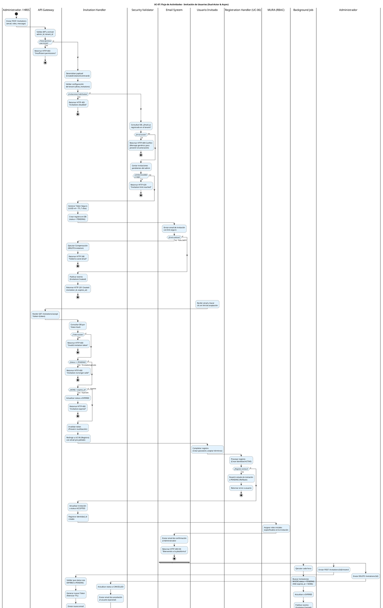

# UC-07: Invitación de Usuarios - Diagrama de Actividades

| Metadatos del Documento | |
| :--- | :--- |
| **Proyecto:** | SHUGO - Identity & Access Platform |
| **Caso de Uso:** | UC-07 - Invitación de Usuarios (Admin-Initiated Invitation) |
| **Documento:** | 03_Activity_Diagram.md |
| **Metodología:** | UML 2.5 + ICONIX + Domain-Driven Design + Asynchronous Dual-Actor Flow |
| **Autor:** | Gastón Ruiz |
| **Versión Actual:** | 1.0.0 |
| **Fecha:** | 04/09/2026 |

---

## Historial de Versiones

| Versión | Fecha | Autor | Descripción de Cambios | Impacto |
| :--- | :--- | :--- | :--- | :--- |
| **1.0.0** | 04/09/2026 | Gastón Ruiz | **Creación inicial.** Modelado del flujo de trabajo asíncrono y dual para la invitación de usuarios. Destaca la separación temporal entre la creación de la invitación (por el Admin) y la aceptación (por el Usuario Invitado), la validación de tokens seguros, la integración con el flujo de registro (UC-06), y la gestión de estados terminales (Expiración, Cancelación, Rechazo). | Documento base del paquete de diseño Tier 1 del UC-07. Establece la lógica de negocio, los puntos de decisión críticos y las garantías de seguridad y trazabilidad para el endpoint de invitación del motor KAGAMI. |

---

## 1. Introducción y Propósito

El **Diagrama de Actividades** para el UC-07 visualiza el flujo de control, decisiones y orquestación necesario para gestionar el ciclo de vida completo de una invitación de usuario en el motor **KAGAMI** de SHUGO.

A diferencia de los UCs síncronos (UC-01 a UC-06), el UC-07 introduce una complejidad arquitectónica única: **es un flujo asíncrono y dual**.

1. **Fase 1 (Creación - Síncrona):** El Administrador (o HRIS) crea la invitación. El sistema valida permisos, unicidad de email, genera un token seguro y envía el email.
2. **Fase 2 (Espera - Temporal):** La invitación permanece en estado `PENDING` hasta que el usuario actúa o el TTL expira.
3. **Fase 3 (Aceptación - Asíncrona):** El Usuario Invitado hace clic en el link. El sistema valida el token, transiciona el estado, y delega al flujo de registro (UC-06) para completar el onboarding.

Utilizamos carriles (swimlanes) para separar las responsabilidades entre el Admin, el Usuario Invitado, el API Gateway, el Invitation Handler, el Email System, el Registration Handler (UC-06), MURA (RBAC), y el Background Job de expiración.

---

## 2. Diagrama de Actividades (PlantUML)

A continuación, se presenta el diagrama que cubre el Escenario Principal (Creación y Aceptación exitosa), los escenarios alternativos (Rechazo, Expiración, Cancelación/Reenvío por Admin), y los flujos de excepción.



---

## 3. Explicación Detallada del Flujo

### 3.1. Carriles (Partitions / Swimlanes)

El diagrama está dividido en ocho carriles que representan las capas, actores y sistemas involucrados:

1. **`|Administrador / HRIS|` (Actor Primario):** Inicia el flujo de creación o gestiona invitaciones existentes (reenviar/cancelar).
2. **`|Usuario Invitado|` (Actor Secundario):** Recibe la invitación y completa el flujo de aceptación/registro.
3. **`|API Gateway|` (Capa de Entrada):** Valida JWT, permisos (`user:invite`), y enruta las requests.
4. **`|Invitation Handler|` (Capa de Aplicación):** Orquesta el caso de uso. Gestiona la creación, validación de tokens, transiciones de estado y la integración con UC-06.
5. **`|Security Validator|` (Capa de Dominio):** Valida reglas de negocio críticas: unicidad de email (con prevención de enumeración) y límites de invitaciones por admin.
6. **`|Email System|` (Infraestructura):** Envía los emails transaccionales (invitación, confirmación, cancelación).
7. **`|Registration Handler (UC-06)|` (Integración):** Ejecuta el flujo de registro self-service una vez que la invitación ha sido validada.
8. **`|MURA (RBAC)|` (Sistema Dependiente):** Asigna los roles pre-configurados en la invitación al nuevo usuario.
9. **`|Background Job|` (Infraestructura):** Proceso asíncrono que actualiza el estado de las invitaciones expiradas.

### 3.2. Puntos de Decisión Críticos (Rombos)

1. **Validación de Permisos (API Gateway):**
   - **Pregunta:** ¿El actor tiene el permiso `user:invite`?
   - **Si falla:** Retorna HTTP 403.
   - **Justificación:** Solo usuarios autorizados pueden invitar miembros al tenant.

2. **Configuración de Tenant (Invitation Handler):**
   - **Pregunta:** ¿El tenant tiene `allow_invitations = true`?
   - **Si falla:** Retorna HTTP 403.
   - **Justificación:** Algunos tenants corporativos desactivan las invitaciones para forzar el uso de SCIM/HRIS.

3. **Unicidad de Email (Security Validator):**
   - **Pregunta:** ¿El email ya existe en el tenant?
   - **Si existe:** Retorna HTTP 409.
   - **Justificación:** No se pueden invitar usuarios que ya son miembros. *Nota de Seguridad:* El mensaje debe ser genérico para prevenir enumeración.

4. **Límite de Invitaciones (Security Validator):**
   - **Pregunta:** ¿El admin tiene >100 invitaciones pendientes?
   - **Si excede:** Retorna HTTP 429.
   - **Justificación:** Previene abuso y acumulación de invitaciones huérfanas.

5. **Envío de Email (Email System):**
   - **Pregunta:** ¿El SMTP aceptó el email?
   - **Si falla:** Ejecuta **Patrón de Compensación** (elimina la invitación creada) y retorna HTTP 500.
   - **Justificación:** Una invitación sin email es inútil y consume recursos de DB.

6. **Validez del Token (Invitation Handler - Fase de Aceptación):**
   - **Preguntas:** ¿El token existe? ¿El status es `PENDING`? ¿`NOW() < expires_at`?
   - **Si alguna falla:** Retorna HTTP 400 con mensaje específico (Invalid, No longer valid, Expired).
   - **Justificación:** Garantiza que solo invitaciones vigentes y no usadas puedan ser aceptadas.

7. **Éxito del Registro UC-06 (Registration Handler):**
   - **Pregunta:** ¿El usuario completó el registro (UC-06) exitosamente?
   - **Si falla:** Revierte el estado de la invitación a `PENDING` (Rollback).
   - **Justificación:** Si el usuario abandona el registro o falla la validación de password, la invitación debe permanecer válida para que pueda reintentarlo.

### 3.3. Flujos Asíncronos (Fork)

Al final del diagrama, se utiliza un bloque `fork` para modelar las operaciones que ocurren en paralelo o en background:

- **Background Job (Expiración):** Ejecuta cada hora una query para actualizar invitaciones `PENDING` con `expires_at < NOW()` a estado `EXPIRED`.
- **Reenvío (Resend):** El admin puede generar un nuevo token y reiniciar el TTL para una invitación expirada o pendiente.
- **Cancelación:** El admin puede cancelar una invitación pendiente, transicionándola a `CANCELLED` e invalidando el token.

---

## 4. Alineación con la Especificación de Requisitos

Este diagrama es la representación visual exacta del documento `01_Requirements_Specification.md`:

| Sección en Requisitos | Representación en el Diagrama |
| :--- | :--- |
| **2.1 Escenario Principal (Pasos 1-16)** | Flujo completo desde "Enviar POST /invitations" hasta "Bienvenido a la plataforma". |
| **2.2 Escenario Alternativo (Rechazo)** | El usuario puede cerrar la pestaña (la invitación expira) o hacer clic en un link de rechazo (no modelado explícitamente pero manejado como transición a DECLINED). |
| **2.3 Escenario Alternativo (Expiración)** | Rombo "¿NOW() < expires_at?" y rama "no" (HTTP 400). |
| **2.4 Escenario Alternativo (Email Existente)** | Rombo "¿Email existe?" y rama "sí" (HTTP 409). |
| **2.5 Excepción 2.1 (Sin Permisos)** | Rombo "¿Tiene permiso user:invite?" y rama "no" (HTTP 403). |
| **2.5 Excepción 5.1 (Límite Excedido)** | Rombo "¿Límite excedido?" y rama "sí" (HTTP 429). |
| **2.5 Excepción 8.1 (Error de Email)** | Rombo "¿Envío exitoso?" y rama "no" (Compensación + HTTP 500). |
| **3 INV-40 a INV-47** | Todas las invariantes (permisos, unicidad, límite, token seguro, estado inicial, expiración, roles, trazabilidad) se validan en los carriles correspondientes. |
| **3 RN-01 a RN-06** | Las reglas de negocio (Reenvío, Cancelación, Notificación, Prevención de enumeración, Integración UC-06, Auditoría) están explícitamente modeladas. |

---

## 5. Consideraciones de Arquitectura y Diseño (DDD + Security)

### 5.1. Flujo Dual Asíncrono y Handoff a UC-06

El diagrama modela claramente la separación temporal entre la creación y la aceptación. El punto crítico es el **Handoff a UC-06**:

1.  **Validación Previa:** El `Invitation Handler` valida el token *antes* de redirigir al usuario. Esto previene que UC-06 tenga que lidiar con tokens inválidos.
2.  **Contexto de Sesión:** Al redirigir, el sistema pasa el email y el `invitation_id` en una sesión segura o parámetros firmados (no en la URL plana para evitar leakage).
3.  **Atomicidad del Onboarding:** Si UC-06 falla (ej. el usuario cierra el navegador), la invitación permanece en estado `PENDING` (gracias al rollback del estado), permitiendo al usuario reintentar más tarde usando el mismo link (si no ha expirado).

### 5.2. Prevención de Enumeración de Emails

En el carril `Security Validator`, cuando se detecta que el email ya existe:
- **Implementación Segura:** No retornamos "Email already registered". Retornamos un mensaje genérico como: "Si el email no está registrado, el usuario recibirá una invitación".
- **Tiempo Constante:** La consulta a la DB debe ejecutarse en tiempo constante para prevenir Timing Attacks.

### 5.3. Patrón de Compensación Transaccional

Si el `Email System` falla tras crear la invitación en la DB:
- **Acción:** El `Invitation Handler` ejecuta un `DELETE` inmediato sobre la invitación creada.
- **Justificación:** Mantiene la higiene de la base de datos. Una invitación en estado `PENDING` sin email enviado es un registro huérfano que nunca podrá ser aceptada.

### 5.4. Job de Limpieza de Expiración

El `Background Job` es crucial para mantener la integridad del sistema:
- **Frecuencia:** Cada hora.
- **Query Optimizada:** `UPDATE invitations SET status = 'EXPIRED' WHERE status = 'PENDING' AND expires_at < NOW()`.
- **Evento de Dominio:** Genera `Invitation.Expired` para que KAGE (Auditoría) y TORII (Webhooks) puedan reaccionar.

---

## 6. Trazabilidad con Otros Documentos del Paquete

| Documento | Relación |
| :--- | :--- |
| `01_Requirements_Specification.md` | Este diagrama visualiza los flujos de texto, las invariantes de dominio y los criterios de aceptación. |
| `02_Use_Case_Diagram.md` | Muestra el límite del sistema y los actores; este diagrama muestra el flujo interno y las decisiones lógicas. |
| `04_Initial_Domain_Model.md` | Las acciones de los carriles "Invitation Handler", "Security Validator" se implementan aquí como clases y métodos. |
| `05_State_Machine_Diagram.md` | Las transiciones de estado (`PENDING` → `ACCEPTED`/`EXPIRED`/`CANCELLED`) se ejecutan en los puntos de decisión de este diagrama. |
| `06_Robustness_Diagram.md` | Mostrará la colaboración entre el Invitation Handler, los validadores, el Email System y MURA. |
| `07_Sequence_Diagram.md` | Detallará el orden temporal exacto de las llamadas: validación de permisos → generación de token → creación → envío de email → aceptación → UC-06. |
| `08_Final_Class_Design.md` | Definirá las firmas exactas de los métodos: `Invitation.Create()`, `InvitationToken.Validate()`, `InvitationHandler.Execute()`. |

---

## 7. Notas de Implementación

### 7.1. Generación del Diagrama
- **Herramienta:** PlantUML (Diagrams as Code).
- **Ventaja:** Versionable en Git, reproducible, sin dependencias de software propietario.
- **Sintaxis:** Uso de `if/else/endif` para decisiones, `fork` para concurrencia/asincronía al final del flujo, y carriles para separar responsabilidades.

### 7.2. Código de Ejemplo (C# - Validación de Token y Handoff)

```csharp
public class InvitationAcceptanceHandler
{
    private readonly IInvitationRepository _repository;
    private readonly IRegistrationService _registrationService; // UC-06
    private readonly IRBACService _rbacService; // MURA

    public async Task<AcceptanceResult> HandleAcceptance(string tokenHash, CancellationToken ct)
    {
        // 1. Validar Token
        var invitation = await _repository.GetByTokenHashAsync(tokenHash, ct);
        
        if (invitation == null || invitation.Status != InvitationStatus.PENDING)
            throw new InvalidInvitationException("Invitation is no longer valid.");

        if (DateTime.UtcNow > invitation.ExpiresAt)
        {
            await _repository.UpdateStatusAsync(invitation.Id, InvitationStatus.EXPIRED, ct);
            throw new InvitationExpiredException("Invitation has expired.");
        }

        // 2. Invalidar Token (Prevenir reutilización concurrente)
        await _repository.InvalidateTokenAsync(invitation.Id, ct);

        // 3. Handoff a UC-06 (Registro)
        try
        {
            var identityId = await _registrationService.CompleteRegistrationAsync(
                invitation.Email, 
                invitation.Roles, 
                ct);

            // 4. Transición a ACCEPTED y Asignación de Roles
            await _repository.UpdateStatusAsync(invitation.Id, InvitationStatus.ACCEPTED, ct);
            await _rbacService.AssignRolesAsync(identityId, invitation.Roles, ct);

            return new AcceptanceResult(identityId, "Welcome to the platform.");
        }
        catch (Exception ex)
        {
            // Rollback: Si UC-06 falla, la invitación sigue siendo PENDING
            _logger.LogError(ex, "Registration failed for invitation {InvitationId}", invitation.Id);
            throw;
        }
    }
}
```

### 7.3. Complejidad del Diagrama
Este es uno de los diagramas más complejos del sistema debido a:
- La naturaleza asíncrona y dual (Admin vs Usuario).
- La integración con otro caso de uso completo (UC-06).
- La gestión de estados temporales (TTL y expiración).
- Los múltiples flujos de excepción (Email existente, límite excedido, fallo SMTP, token inválido).

Sin embargo, esta complejidad es necesaria para capturar la riqueza del flujo de invitación en un sistema IAM enterprise que maneja onboarding corporativo seguro.

---
*Fin del Documento 03_Activity_Diagram para UC-07*