# UC-07: Invitación de Usuarios - Modelo de Dominio Inicial

| Metadatos del Documento | |
| :--- | :--- |
| **Proyecto:** | SHUGO - Identity & Access Platform |
| **Caso de Uso:** | UC-07 - Invitación de Usuarios (Admin-Initiated Invitation) |
| **Documento:** | 04_Initial_Domain_Model.md |
| **Metodología:** | ICONIX (Modelo de Análisis) + DDD (Domain-Driven Design) + Asynchronous Dual-Actor Flow |
| **Autor:** | Gastón Ruiz |
| **Versión Actual:** | 1.0.0 |
| **Fecha:** | 04/09/2026 |

---

## Historial de Versiones

| Versión | Fecha | Autor | Descripción de Cambios | Impacto |
| :--- | :--- | :--- | :--- | :--- |
| **1.0.0** | 04/09/2026 | Gastón Ruiz | **Creación inicial.** Definición del Modelo de Dominio Conceptual para la invitación de usuarios. Introduce el Aggregate Root `Invitation` con máquina de estados completa (`PENDING` → `ACCEPTED`/`DECLINED`/`EXPIRED`/`CANCELLED`), el Value Object `InvitationToken` con hashing SHA256 y TTL configurable, el Domain Service `InvitationHandler` para orquestar el flujo dual asíncrono, y los eventos de dominio para notificación a sistemas downstream. | Documento base del paquete de diseño Tier 1 del UC-07. Establece cómo el dominio gestiona el ciclo de vida completo de las invitaciones, garantizando seguridad criptográfica de tokens, trazabilidad completa, e integración fluida con UC-06 (Registro Self-Service). |

---

## 1. Introducción y Propósito

Este documento presenta el **Modelo de Dominio Inicial** para el Caso de Uso UC-07 (Invitación de Usuarios).

A diferencia de los UCs síncronos (UC-01 a UC-06), el UC-07 introduce complejidades únicas debido a su naturaleza **asíncrona y dual**:

1. **Flujo Temporal Extendido:** La invitación persiste en estado `PENDING` durante días (TTL de 7 días) antes de ser aceptada, rechazada o expirar.
2. **Dos Actores Involucrados:** El Administrador crea la invitación, pero el Usuario Invitado la acepta. El dominio debe manejar esta separación de responsabilidades.
3. **Integración con UC-06:** Al aceptar la invitación, el dominio delega al flujo de registro (UC-06) para completar el onboarding, luego retoma el control para asignar roles y transicionar el estado.
4. **Seguridad Criptográfica de Tokens:** Los tokens de invitación deben ser UUID v4 criptográficos, almacenados como hashes SHA256, con TTL estricto y prevención de reutilización.
5. **Job de Limpieza Automática:** Un proceso en background actualiza invitaciones expiradas, requiriendo que el dominio soporte transiciones automáticas de estado.

El modelo se centra en:
- **Aggregate Root `Invitation`:** Encapsula el ciclo de vida completo con invariantes de estado.
- **Value Objects de Seguridad:** `InvitationToken` (hashing seguro), `InvitationStatus` (máquina de estados), `InvitationRoles` (roles pre-asignados).
- **Domain Services:** `InvitationHandler` (orquestación dual), `InvitationValidator` (validaciones de negocio).
- **Eventos de Dominio:** `Invitation.Created`, `Invitation.Accepted`, `Invitation.Expired` para consistencia eventual.

---

## 2. Diagrama de Modelo de Dominio Conceptual (PlantUML)

A continuación, se presenta el diagrama de clases conceptual, enfocándose en los objetos de dominio, servicios y eventos introducidos para UC-07.

```plantuml
@startuml UC-07_DominioConceptual
<style>
diagram {
  BackgroundColor #FFFFFF
}
</style>
skinparam classAttributeIconSize 0
skinparam classBackgroundColor #FFFFFF
skinparam classBorderColor #1565C0
skinparam classHeaderBackgroundColor #E3F2FD

title UC-07: Modelo de Dominio Conceptual - Invitación de Usuarios (Dual-Actor & Async)

' ============================================
' AGGREGATE ROOT
' ============================================
class Invitation <<Aggregate Root>> {
  - id: InvitationId
  - tenantId: TenantId
  - email: Email
  - token: InvitationToken
  - status: InvitationStatus
  - invitedBy: AdminId
  - roles: InvitationRoles
  - message: string
  - createdAt: DateTime
  - expiresAt: DateTime
  - acceptedAt: DateTime?
  - acceptedByIdentityId: IdentityId?
  - domainEvents: List<IDomainEvent>
  
  + Create(tenantId, email, invitedBy, roles, message, ttlDays): Invitation
  + Accept(identityId: IdentityId): void
  + Decline(): void
  + Expire(): void
  + Cancel(): void
  + Resend(newTtlDays: int): void
  - ValidateTransition(newStatus: InvitationStatus): void
}

' ============================================
' VALUE OBJECTS
' ============================================
class InvitationToken <<Value Object>> {
  - tokenHash: string
  - originalToken: string
  - expiresAt: DateTime
  + InvitationToken(ttlDays: int)
  + Validate(providedToken: string): bool
  + IsExpired(): bool
  - GenerateSecureUUIDv4(): string
  - HashWithSHA256(token: string): string
  - SecureCompare(a: string, b: string): bool
}

class InvitationStatus <<Value Object>> {
  - value: string
  + PENDING: InvitationStatus
  + ACCEPTED: InvitationStatus
  + DECLINED: InvitationStatus
  + EXPIRED: InvitationStatus
  + CANCELLED: InvitationStatus
  + CanTransitionTo(newStatus: InvitationStatus): bool
}

class InvitationRoles <<Value Object>> {
  - roles: List<RoleId>
  + InvitationRoles(roles: List<RoleId>)
  + Roles: IReadOnlyList<RoleId>
}

class Email <<Value Object>> {
  - value: string
  + Email(value: string)
  - ValidateFormat(): void
}

class AdminId <<Value Object>> {
  - value: Guid
  + AdminId(value: Guid)
}

class InvitationId <<Value Object>> {
  - value: Guid
  + InvitationId(value: Guid)
}

class TenantId <<Value Object>> {
  - value: Guid
  + TenantId(value: Guid)
}

class IdentityId <<Value Object>> {
  - value: Guid
  + IdentityId(value: Guid)
}

class RoleId <<Value Object>> {
  - value: Guid
  + RoleId(value: Guid)
}

' ============================================
' DOMAIN SERVICES
' ============================================
class InvitationHandler <<Domain Service>> {
  - invitationRepo: IInvitationRepository
  - emailService: IEmailService
  - registrationService: IRegistrationService
  - rbacService: IRBACService
  
  + CreateInvitation(command: CreateInvitationCommand): Task<InvitationId>
  + AcceptInvitation(token: string): Task<AcceptInvitationResult>
  + ResendInvitation(invitationId: InvitationId): Task
  + CancelInvitation(invitationId: InvitationId): Task
  - ValidateUniqueness(email: Email, tenantId: TenantId): Task
  - ValidateAdminLimit(adminId: AdminId, tenantId: TenantId): Task
  - SendInvitationEmail(invitation: Invitation): Task
}

class InvitationValidator <<Domain Service>> {
  - tenantRepo: ITenantRepository
  - invitationRepo: IInvitationRepository
  
  + ValidateTenantConfig(tenantId: TenantId): Task
  + ValidateEmailUniqueness(email: Email, tenantId: TenantId): Task
  + ValidateAdminInvitationLimit(adminId: AdminId, tenantId: TenantId): Task
}

' ============================================
' DOMAIN EVENTS
' ============================================
class InvitationCreated <<Domain Event>> {
  + invitationId: InvitationId
  + tenantId: TenantId
  + email: Email
  + invitedBy: AdminId
  + roles: InvitationRoles
  + expiresAt: DateTime
}

class InvitationAccepted <<Domain Event>> {
  + invitationId: InvitationId
  + tenantId: TenantId
  + email: Email
  + identityId: IdentityId
  + acceptedAt: DateTime
}

class InvitationExpired <<Domain Event>> {
  + invitationId: InvitationId
  + tenantId: TenantId
  + email: Email
  + expiredAt: DateTime
}

' ============================================
' INTERFACES
' ============================================
interface IInvitationRepository {
  + SaveAsync(invitation: Invitation): Task
  + GetByTokenHashAsync(tokenHash: string): Task<Invitation?>
  + GetByIdAsync(invitationId: InvitationId): Task<Invitation?>
  + GetPendingByAdminAsync(adminId: AdminId, tenantId: TenantId): Task<List<Invitation>>
  + GetExpiredPendingAsync(): Task<List<Invitation>>
}

interface IEmailService {
  + SendInvitationEmailAsync(email: Email, token: InvitationToken, message: string): Task
  + SendAcceptanceConfirmationAsync(adminEmail: Email, invitedEmail: Email): Task
}

interface IRegistrationService {
  + CompleteRegistrationFromInvitationAsync(email: Email, roles: InvitationRoles): Task<IdentityId>
}

interface IRBACService {
  + AssignRolesAsync(identityId: IdentityId, roles: InvitationRoles): Task
}

' ============================================
' RELACIONES
' ============================================
Invitation *-- InvitationToken : "contiene"
Invitation *-- InvitationStatus : "estado actual"
Invitation *-- InvitationRoles : "roles pre-asignados"
Invitation *-- Email : "email invitado"
Invitation *-- AdminId : "invitado por"
Invitation *-- TenantId : "pertenece a"
Invitation *-- IdentityId : "aceptado por (0..1)"

InvitationHandler --> IInvitationRepository : "persiste"
InvitationHandler --> IEmailService : "notifica"
InvitationHandler --> IRegistrationService : "delega registro"
InvitationHandler --> IRBACService : "asigna roles"

InvitationValidator --> ITenantRepository : "valida config"
InvitationValidator --> IInvitationRepository : "valida unicidad"

Invitation ..> InvitationCreated : "publica"
Invitation ..> InvitationAccepted : "publica"
Invitation ..> InvitationExpired : "publica"

note right of Invitation
  **Aggregate Root:**
  - Encapsula ciclo de vida completo
  - Valida transiciones de estado
  - Genera eventos de dominio
  - Previene estados inválidos
end note

note right of InvitationToken
  **Seguridad Criptográfica:**
  - UUID v4 criptográfico
  - Almacenado como SHA256 hash
  - TTL configurable (default 7 días)
  - Comparación en tiempo constante
  - Un solo uso permitido
end note

note bottom of InvitationHandler
  **Orquestación Dual:**
  - Fase 1: Admin crea invitación
  - Fase 2: Usuario acepta (async)
  - Integra con UC-06 para registro
  - Asigna roles post-aceptación
end note

@enduml
```



---

## 3. Detalle de Conceptos de Dominio (DDD)

### 3.1. Aggregate Root: `Invitation`

El Aggregate Root `Invitation` encapsula el ciclo de vida completo de una invitación, desde su creación por el administrador hasta su aceptación, rechazo, expiración o cancelación.

**Código (C#):**

```csharp
public class Invitation : AggregateRoot
{
    public InvitationId Id { get; private set; }
    public TenantId TenantId { get; private set; }
    public Email Email { get; private set; }
    public InvitationToken Token { get; private set; }
    public InvitationStatus Status { get; private set; }
    public AdminId InvitedBy { get; private set; }
    public InvitationRoles Roles { get; private set; }
    public string Message { get; private set; }
    public DateTime CreatedAt { get; private set; }
    public DateTime ExpiresAt { get; private set; }
    public DateTime? AcceptedAt { get; private set; }
    public IdentityId? AcceptedByIdentityId { get; private set; }
    
    private readonly List<IDomainEvent> _domainEvents = new();

    // Constructor privado para EF Core
    private Invitation() { }

    /// <summary>
    /// Método de fábrica para crear una nueva invitación en estado PENDING.
    /// </summary>
    public static Invitation Create(
        TenantId tenantId,
        Email email,
        AdminId invitedBy,
        InvitationRoles roles,
        string message,
        int ttlDays = 7)
    {
        var invitation = new Invitation
        {
            Id = new InvitationId(Guid.NewGuid()),
            TenantId = tenantId,
            Email = email,
            Token = new InvitationToken(ttlDays),
            Status = InvitationStatus.PENDING,
            InvitedBy = invitedBy,
            Roles = roles,
            Message = message,
            CreatedAt = DateTime.UtcNow,
            ExpiresAt = DateTime.UtcNow.AddDays(ttlDays)
        };

        invitation.ValidateInitialState();
        
        // Generar evento de dominio
        invitation.AddDomainEvent(new InvitationCreated(
            invitation.Id,
            invitation.TenantId,
            invitation.Email,
            invitation.InvitedBy,
            invitation.Roles,
            invitation.ExpiresAt
        ));

        return invitation;
    }

    /// <summary>
    /// Transición: PENDING → ACCEPTED
    /// Se ejecuta cuando el usuario invitado completa el registro (UC-06).
    /// </summary>
    public void Accept(IdentityId identityId)
    {
        ValidateTransition(InvitationStatus.ACCEPTED);
        
        if (this.Token.IsExpired())
            throw new InvitationExpiredException("Invitation has expired.");

        this.Status = InvitationStatus.ACCEPTED;
        this.AcceptedAt = DateTime.UtcNow;
        this.AcceptedByIdentityId = identityId;
        this.Token.Invalidate(); // Prevenir reutilización

        this.AddDomainEvent(new InvitationAccepted(
            this.Id,
            this.TenantId,
            this.Email,
            identityId,
            this.AcceptedAt.Value
        ));
    }

    /// <summary>
    /// Transición: PENDING → DECLINED
    /// Se ejecuta cuando el usuario invitado rechaza explícitamente.
    /// </summary>
    public void Decline()
    {
        ValidateTransition(InvitationStatus.DECLINED);
        this.Status = InvitationStatus.DECLINED;
    }

    /// <summary>
    /// Transición: PENDING → EXPIRED
    /// Se ejecuta automáticamente por el job de limpieza cuando expires_at < NOW().
    /// </summary>
    public void Expire()
    {
        ValidateTransition(InvitationStatus.EXPIRED);
        this.Status = InvitationStatus.EXPIRED;

        this.AddDomainEvent(new InvitationExpired(
            this.Id,
            this.TenantId,
            this.Email,
            DateTime.UtcNow
        ));
    }

    /// <summary>
    /// Transición: PENDING → CANCELLED
    /// Se ejecuta cuando el administrador cancela la invitación.
    /// </summary>
    public void Cancel()
    {
        ValidateTransition(InvitationStatus.CANCELLED);
        this.Status = InvitationStatus.CANCELLED;
        this.Token.Invalidate();
    }

    /// <summary>
    /// Reenvío: Genera nuevo token y reinicia TTL.
    /// Permite reenviar invitaciones EXPIRED o PENDING.
    /// </summary>
    public void Resend(int newTtlDays = 7)
    {
        if (this.Status != InvitationStatus.PENDING && 
            this.Status != InvitationStatus.EXPIRED)
            throw new DomainException(
                $"Cannot resend invitation in status {this.Status}. " +
                "Only PENDING or EXPIRED invitations can be resent.");

        this.Token = new InvitationToken(newTtlDays);
        this.ExpiresAt = DateTime.UtcNow.AddDays(newTtlDays);
        this.Status = InvitationStatus.PENDING; // Si estaba EXPIRED, vuelve a PENDING
    }

    /// <summary>
    /// Valida que la transición de estado sea permitida.
    /// </summary>
    private void ValidateTransition(InvitationStatus newStatus)
    {
        if (!this.Status.CanTransitionTo(newStatus))
            throw new InvalidTransitionException(
                $"Cannot transition from {this.Status} to {newStatus}.");
    }

    /// <summary>
    /// Valida invariantes del estado inicial.
    /// </summary>
    private void ValidateInitialState()
    {
        if (this.Status != InvitationStatus.PENDING)
            throw new DomainException("New invitation must be in PENDING status.");

        if (this.Token == null)
            throw new DomainException("Invitation must have a secure token.");

        if (this.ExpiresAt <= DateTime.UtcNow)
            throw new DomainException("Invitation expiration must be in the future.");
    }

    public IReadOnlyCollection<IDomainEvent> GetDomainEvents() => _domainEvents.AsReadOnly();
    
    protected void AddDomainEvent(IDomainEvent evt) => _domainEvents.Add(evt);
}
```

### 3.2. Value Objects de Seguridad

#### **InvitationToken**

Value Object crítico que encapsula la generación, validación y almacenamiento seguro del token de invitación.

```csharp
public class InvitationToken : ValueObject
{
    public string TokenHash { get; private set; }
    public DateTime ExpiresAt { get; private set; }
    private bool _isInvalidated = false;

    private InvitationToken(string tokenHash, DateTime expiresAt)
    {
        TokenHash = tokenHash;
        ExpiresAt = expiresAt;
    }

    /// <summary>
    /// Genera un nuevo token seguro con TTL configurable.
    /// </summary>
    public InvitationToken(int ttlDays = 7)
    {
        var originalToken = GenerateSecureUUIDv4();
        TokenHash = HashWithSHA256(originalToken);
        ExpiresAt = DateTime.UtcNow.AddDays(ttlDays);
    }

    /// <summary>
    /// Valida si el token proporcionado coincide y no está expirado.
    /// Usa comparación en tiempo constante para prevenir Timing Attacks.
    /// </summary>
    public bool Validate(string providedToken)
    {
        if (_isInvalidated)
            return false;

        if (IsExpired())
            return false;

        var providedHash = HashWithSHA256(providedToken);
        return SecureCompare(TokenHash, providedHash);
    }

    /// <summary>
    /// Invalida el token tras uso exitoso (previene reutilización).
    /// </summary>
    public void Invalidate()
    {
        _isInvalidated = true;
        TokenHash = null; // Limpiar hash para seguridad
    }

    public bool IsExpired() => DateTime.UtcNow > ExpiresAt;

    /// <summary>
    /// Genera UUID v4 criptográficamente seguro.
    /// </summary>
    private string GenerateSecureUUIDv4()
    {
        return Guid.NewGuid().ToString("N"); // 32 caracteres hex
    }

    /// <summary>
    /// Hashea el token con SHA256 para almacenamiento seguro.
    /// </summary>
    private string HashWithSHA256(string token)
    {
        var hash = SHA256.HashData(Encoding.UTF8.GetBytes(token));
        return Convert.ToBase64String(hash);
    }

    /// <summary>
    /// Comparación segura en tiempo constante para prevenir Timing Attacks.
    /// </summary>
    private bool SecureCompare(string a, string b)
    {
        if (a == null || b == null) return false;
        if (a.Length != b.Length) return false;

        var result = 0;
        for (int i = 0; i < a.Length; i++)
        {
            result |= a[i] ^ b[i];
        }

        return result == 0;
    }

    protected override IEnumerable<object> GetEqualityComponents()
    {
        yield return TokenHash;
        yield return ExpiresAt;
    }
}
```

#### **InvitationStatus**

Value Object que encapsula la máquina de estados de la invitación con validación de transiciones permitidas.

```csharp
public class InvitationStatus : ValueObject
{
    public string Value { get; }

    private InvitationStatus(string value)
    {
        Value = value;
    }

    // Estados válidos
    public static InvitationStatus PENDING => new InvitationStatus("PENDING");
    public static InvitationStatus ACCEPTED => new InvitationStatus("ACCEPTED");
    public static InvitationStatus DECLINED => new InvitationStatus("DECLINED");
    public static InvitationStatus EXPIRED => new InvitationStatus("EXPIRED");
    public static InvitationStatus CANCELLED => new InvitationStatus("CANCELLED");

    /// <summary>
    /// Valida si la transición al nuevo estado es permitida.
    /// </summary>
    public bool CanTransitionTo(InvitationStatus newStatus)
    {
        // Matriz de transiciones permitidas
        var allowedTransitions = new Dictionary<string, HashSet<string>>
        {
            { "PENDING", new HashSet<string> { "ACCEPTED", "DECLINED", "EXPIRED", "CANCELLED" } },
            { "EXPIRED", new HashSet<string> { "PENDING" } }, // Permitir reenvío
            { "ACCEPTED", new HashSet<string>() }, // Estado terminal
            { "DECLINED", new HashSet<string>() }, // Estado terminal
            { "CANCELLED", new HashSet<string>() }  // Estado terminal
        };

        if (allowedTransitions.TryGetValue(this.Value, out var allowed))
        {
            return allowed.Contains(newStatus.Value);
        }

        return false;
    }

    public override string ToString() => Value;

    protected override IEnumerable<object> GetEqualityComponents()
    {
        yield return Value;
    }
}
```

#### **InvitationRoles**

Value Object que encapsula la lista de roles pre-asignados en la invitación.

```csharp
public class InvitationRoles : ValueObject
{
    private readonly List<RoleId> _roles;

    public IReadOnlyList<RoleId> Roles => _roles.AsReadOnly();

    public InvitationRoles(List<RoleId> roles)
    {
        _roles = roles ?? new List<RoleId>();
        
        // Validación: máximo 10 roles por invitación
        if (_roles.Count > 10)
            throw new DomainException("Cannot assign more than 10 roles to an invitation.");
    }

    protected override IEnumerable<object> GetEqualityComponents()
    {
        foreach (var role in _roles)
        {
            yield return role;
        }
    }
}
```

### 3.3. Domain Services

#### **InvitationHandler**

Domain Service que orquesta el flujo dual asíncrono de invitación, integrando la creación (por admin) con la aceptación (por usuario) y delegando al UC-06 para el registro.

```csharp
public class InvitationHandler : IInvitationHandler
{
    private readonly IInvitationRepository _invitationRepo;
    private readonly IEmailService _emailService;
    private readonly IRegistrationService _registrationService;
    private readonly IRBACService _rbacService;
    private readonly InvitationValidator _validator;
    private readonly ILogger<InvitationHandler> _logger;

    public InvitationHandler(
        IInvitationRepository invitationRepo,
        IEmailService emailService,
        IRegistrationService registrationService,
        IRBACService rbacService,
        InvitationValidator validator,
        ILogger<InvitationHandler> logger)
    {
        _invitationRepo = invitationRepo;
        _emailService = emailService;
        _registrationService = registrationService;
        _rbacService = rbacService;
        _validator = validator;
        _logger = logger;
    }

    /// <summary>
    /// Fase 1: Crear invitación (ejecutado por Admin).
    /// </summary>
    public async Task<InvitationId> CreateInvitation(CreateInvitationCommand command)
    {
        // 1. Validaciones de negocio
        await _validator.ValidateTenantConfig(command.TenantId);
        await _validator.ValidateEmailUniqueness(command.Email, command.TenantId);
        await _validator.ValidateAdminInvitationLimit(command.InvitedBy, command.TenantId);

        // 2. Crear Aggregate Root
        var invitation = Invitation.Create(
            command.TenantId,
            command.Email,
            command.InvitedBy,
            command.Roles,
            command.Message,
            command.TtlDays ?? 7
        );

        // 3. Persistir
        await _invitationRepo.SaveAsync(invitation);

        // 4. Enviar email (con patrón de compensación si falla)
        try
        {
            await _emailService.SendInvitationEmailAsync(
                invitation.Email, 
                invitation.Token, 
                invitation.Message);
        }
        catch (Exception ex)
        {
            _logger.LogError(ex, "Failed to send invitation email. Compensating...");
            // Compensación: cancelar la invitación creada
            invitation.Cancel();
            await _invitationRepo.SaveAsync(invitation);
            throw new InvitationEmailFailedException("Failed to send invitation email.", ex);
        }

        return invitation.Id;
    }

    /// <summary>
    /// Fase 2: Aceptar invitación (ejecutado por Usuario Invitado).
    /// Integra con UC-06 para completar el registro.
    /// </summary>
    public async Task<AcceptInvitationResult> AcceptInvitation(string providedToken)
    {
        // 1. Buscar invitación por hash del token
        var tokenHash = HashWithSHA256(providedToken);
        var invitation = await _invitationRepo.GetByTokenHashAsync(tokenHash);

        if (invitation == null)
            throw new InvalidInvitationException("Invalid invitation token.");

        // 2. Validar token (expiración, reutilización)
        if (!invitation.Token.Validate(providedToken))
        {
            if (invitation.Token.IsExpired())
                throw new InvitationExpiredException("Invitation has expired.");
            
            throw new InvalidInvitationException("Invitation token is no longer valid.");
        }

        // 3. Delegar a UC-06 para completar registro
        IdentityId identityId;
        try
        {
            identityId = await _registrationService.CompleteRegistrationFromInvitationAsync(
                invitation.Email,
                invitation.Roles);
        }
        catch (Exception ex)
        {
            _logger.LogError(ex, "Registration failed for invitation {InvitationId}", invitation.Id);
            throw new InvitationAcceptanceFailedException("Failed to complete registration.", ex);
        }

        // 4. Transicionar invitación a ACCEPTED
        invitation.Accept(identityId);
        await _invitationRepo.SaveAsync(invitation);

        // 5. Asignar roles pre-configurados
        await _rbacService.AssignRolesAsync(identityId, invitation.Roles);

        // 6. Enviar confirmación al admin
        await _emailService.SendAcceptanceConfirmationAsync(
            invitation.InvitedBy, // Asumiendo que AdminId tiene email asociado
            invitation.Email);

        return new AcceptInvitationResult(identityId, invitation.Id);
    }

    /// <summary>
    /// Reenviar invitación (genera nuevo token y reinicia TTL).
    /// </summary>
    public async Task ResendInvitation(InvitationId invitationId, int newTtlDays = 7)
    {
        var invitation = await _invitationRepo.GetByIdAsync(invitationId);
        if (invitation == null)
            throw new InvitationNotFoundException($"Invitation {invitationId} not found.");

        invitation.Resend(newTtlDays);
        await _invitationRepo.SaveAsync(invitation);

        await _emailService.SendInvitationEmailAsync(
            invitation.Email,
            invitation.Token,
            invitation.Message);
    }

    /// <summary>
    /// Cancelar invitación pendiente.
    /// </summary>
    public async Task CancelInvitation(InvitationId invitationId)
    {
        var invitation = await _invitationRepo.GetByIdAsync(invitationId);
        if (invitation == null)
            throw new InvitationNotFoundException($"Invitation {invitationId} not found.");

        invitation.Cancel();
        await _invitationRepo.SaveAsync(invitation);
    }

    private string HashWithSHA256(string token)
    {
        var hash = SHA256.HashData(Encoding.UTF8.GetBytes(token));
        return Convert.ToBase64String(hash);
    }
}
```

#### **InvitationValidator**

Domain Service que valida las reglas de negocio transversales antes de permitir la creación de invitaciones.

```csharp
public class InvitationValidator
{
    private readonly ITenantRepository _tenantRepo;
    private readonly IInvitationRepository _invitationRepo;

    public InvitationValidator(
        ITenantRepository tenantRepo,
        IInvitationRepository invitationRepo)
    {
        _tenantRepo = tenantRepo;
        _invitationRepo = invitationRepo;
    }

    /// <summary>
    /// Valida que el tenant tenga habilitada la funcionalidad de invitaciones.
    /// </summary>
    public async Task ValidateTenantConfig(TenantId tenantId)
    {
        var tenant = await _tenantRepo.GetByIdAsync(tenantId);
        if (tenant == null)
            throw new TenantNotFoundException($"Tenant {tenantId} not found.");

        if (!tenant.AllowInvitations)
            throw new InvitationsDisabledException(
                $"Invitations are disabled for tenant {tenantId}.");
    }

    /// <summary>
    /// Valida que el email no esté ya registrado en el tenant.
    /// Previene enumeración con tiempo de respuesta constante.
    /// </summary>
    public async Task ValidateEmailUniqueness(Email email, TenantId tenantId)
    {
        var sw = Stopwatch.StartNew();
        
        var exists = await _invitationRepo.EmailExistsAsync(email, tenantId);
        
        // Retardo artificial para prevenir Timing Attacks
        var elapsed = sw.ElapsedMilliseconds;
        if (elapsed < 50) // 50ms constante
        {
            await Task.Delay((int)(50 - elapsed));
        }

        if (exists)
            throw new EmailAlreadyRegisteredException(
                "This email is already registered in the tenant.");
    }

    /// <summary>
    /// Valida que el administrador no haya excedido el límite de invitaciones pendientes.
    /// </summary>
    public async Task ValidateAdminInvitationLimit(AdminId adminId, TenantId tenantId)
    {
        var pendingCount = await _invitationRepo.GetPendingCountByAdminAsync(adminId, tenantId);
        
        if (pendingCount >= 100)
            throw new InvitationLimitExceededException(
                $"Admin {adminId} has reached the maximum limit of 100 pending invitations.");
    }
}
```

### 3.4. Domain Events

#### **InvitationCreated**

Se genera cuando se crea una nueva invitación.

```csharp
public class InvitationCreated : IDomainEvent
{
    public Guid EventId { get; } = Guid.NewGuid();
    public DateTime Timestamp { get; } = DateTime.UtcNow;
    
    public InvitationId InvitationId { get; }
    public TenantId TenantId { get; }
    public Email Email { get; }
    public AdminId InvitedBy { get; }
    public InvitationRoles Roles { get; }
    public DateTime ExpiresAt { get; }

    public InvitationCreated(
        InvitationId invitationId,
        TenantId tenantId,
        Email email,
        AdminId invitedBy,
        InvitationRoles roles,
        DateTime expiresAt)
    {
        InvitationId = invitationId;
        TenantId = tenantId;
        Email = email;
        InvitedBy = invitedBy;
        Roles = roles;
        ExpiresAt = expiresAt;
    }
}
```

**Consumidores:**
1. **KAGE (Audit):** Registra el evento en logs de auditoría.
2. **TORII (Webhooks):** Notifica a sistemas externos (HRIS, SIEM).
3. **Email Service:** Envía el email de invitación al usuario.

#### **InvitationAccepted**

Se genera cuando el usuario invitado acepta la invitación y completa el registro.

```csharp
public class InvitationAccepted : IDomainEvent
{
    public Guid EventId { get; } = Guid.NewGuid();
    public DateTime Timestamp { get; } = DateTime.UtcNow;
    
    public InvitationId InvitationId { get; }
    public TenantId TenantId { get; }
    public Email Email { get; }
    public IdentityId IdentityId { get; }
    public DateTime AcceptedAt { get; }

    public InvitationAccepted(
        InvitationId invitationId,
        TenantId tenantId,
        Email email,
        IdentityId identityId,
        DateTime acceptedAt)
    {
        InvitationId = invitationId;
        TenantId = tenantId;
        Email = email;
        IdentityId = identityId;
        AcceptedAt = acceptedAt;
    }
}
```

**Consumidores:**
1. **KAGE (Audit):** Registra la aceptación en logs de auditoría.
2. **MURA (RBAC):** Asigna los roles especificados al nuevo usuario.
3. **TORII (Webhooks):** Notifica a sistemas externos que el usuario aceptó.
4. **Email Service:** Envía confirmación al administrador.

#### **InvitationExpired**

Se genera cuando una invitación expira automáticamente (job de limpieza).

```csharp
public class InvitationExpired : IDomainEvent
{
    public Guid EventId { get; } = Guid.NewGuid();
    public DateTime Timestamp { get; } = DateTime.UtcNow;
    
    public InvitationId InvitationId { get; }
    public TenantId TenantId { get; }
    public Email Email { get; }
    public DateTime ExpiredAt { get; }

    public InvitationExpired(
        InvitationId invitationId,
        TenantId tenantId,
        Email email,
        DateTime expiredAt)
    {
        InvitationId = invitationId;
        TenantId = tenantId;
        Email = email;
        ExpiredAt = expiredAt;
    }
}
```

**Consumidores:**
1. **KAGE (Audit):** Registra la expiración en logs de auditoría.
2. **Job de Limpieza:** Actualiza el estado de la invitación a `EXPIRED`.

---

## 4. Decisiones de Diseño DDD (ADR)

### 4.1. ¿Por qué un Aggregate Root `Invitation` en lugar de una entidad simple?

**Decisión:** Modelar `Invitation` como Aggregate Root con máquina de estados completa.

**Justificación:**
- **Ciclo de Vida Complejo:** La invitación tiene 5 estados con transiciones específicas y guardas de seguridad.
- **Invariante de Estado:** Solo el Aggregate puede validar transiciones (`PENDING` → `ACCEPTED`, no `ACCEPTED` → `PENDING`).
- **Generación de Eventos:** El Aggregate genera eventos de dominio en cada transición importante.
- **Consistencia Transaccional:** Todas las mutaciones de la invitación ocurren dentro de los límites del Aggregate.

### 4.2. ¿Por qué almacenar el token como hash SHA256?

**Decisión:** El `InvitationToken` almacena solo el hash SHA256, nunca el token original en texto plano.

**Justificación:**
- **Prevención de Robo:** Si la base de datos es comprometida, los tokens no pueden ser utilizados.
- **Comparación Segura:** Usamos `SecureCompare` (tiempo constante) para prevenir Timing Attacks.
- **Un Solo Uso:** Tras la aceptación, el hash se limpia (`TokenHash = null`) para prevenir reutilización.

### 4.3. ¿Por qué un Domain Service `InvitationHandler` en lugar de lógica en el Aggregate?

**Decisión:** Usar `InvitationHandler` para orquestar el flujo dual asíncrono.

**Justificación:**
- **Integración con Sistemas Externos:** El handler coordina email service, registration service (UC-06), y RBAC service.
- **Validaciones Transversales:** Valida unicidad de email, límites de admin, y configuración de tenant.
- **Patrón de Compensación:** Si el email falla, el handler ejecuta compensación (cancelar invitación).
- **Mantiene el Aggregate Limpio:** El Aggregate `Invitation` se enfoca en invariantes de estado, no en orquestación.

### 4.4. ¿Por qué validar el token antes de delegar a UC-06?

**Decisión:** El `InvitationHandler` valida el token completamente antes de llamar a `CompleteRegistrationFromInvitationAsync`.

**Justificación:**
- **Fail-Fast:** Rechaza tokens inválidos/expirados antes de consumir recursos de UC-06.
- **Seguridad:** Previene que UC-06 tenga que lidiar con tokens malformados.
- **Claridad de Responsabilidades:** UC-06 solo recibe requests legítimas y pre-validadas.

---

## 5. Trazabilidad

| Documento | Relación |
| :--- | :--- |
| `01_Requirements_Specification.md` | Define las invariantes (INV-40 a INV-47) y reglas de negocio (RN-01 a RN-06) que este modelo implementa. |
| `02_Use_Case_Diagram.md` | Muestra los actores y sistemas; este modelo define los objetos de dominio con los que interactúan. |
| `03_Activity_Diagram.md` | Los carriles de actividad (Invitation Handler, Invitation Validator, Email Service) se implementan aquí como Domain Services y Aggregate Roots. |
| `05_State_Machine_Diagram.md` | Las máquinas de estados (`PENDING` → `ACCEPTED`/`DECLINED`/`EXPIRED`/`CANCELLED`) se implementan en el Value Object `InvitationStatus`. |
| `06_Robustness_Diagram.md` | Mostrará la colaboración entre el Invitation Handler, los validadores, el Email Service y MURA. |
| `07_Sequence_Diagram.md` | Detallará el orden temporal de las llamadas: creación → validación → generación de token → envío de email → aceptación → UC-06. |
| `08_Final_Class_Design.md` | Definirá las firmas exactas de los métodos: `Invitation.Create()`, `InvitationToken.Validate()`, `InvitationHandler.AcceptInvitation()`. |
| `UC-06/01_Requirements_Specification.md` | Documento hermano que define el registro self-service (integrado con la aceptación de invitación). |

---

## 6. Notas para la Implementación

### 6.1. Ubicación en Clean Architecture

- **Dominio (`SHUGO.Domain`):** `Invitation`, `InvitationToken`, `InvitationStatus`, `InvitationRoles`, `InvitationHandler`, `InvitationValidator`.
- **Infraestructura (`SHUGO.Infrastructure`):** Implementaciones de `IInvitationRepository`, `IEmailService`, `IRegistrationService`, `IRBACService`.
- **Aplicación (`SHUGO.Application`):** `CreateInvitationCommand`, `AcceptInvitationResult`, adaptadores de Application Service que delegan al Domain Service.

### 6.2. Configuración de TTL por Tenant

El TTL de invitaciones puede ser configurable por tenant:

```csharp
public class TenantConfig
{
    public TenantId TenantId { get; set; }
    public bool AllowInvitations { get; set; } = true;
    public int InvitationTtlDays { get; set; } = 7; // Configurable
    public int MaxPendingInvitationsPerAdmin { get; set; } = 100;
}
```

### 6.3. Testeo Unitario

```csharp
[Test]
public void Invitation_Create_WithValidData_CreatesInPendingStatus()
{
    // Arrange
    var tenantId = new TenantId(Guid.NewGuid());
    var email = new Email("test@khcs.com");
    var adminId = new AdminId(Guid.NewGuid());
    var roles = new InvitationRoles(new List<RoleId> { new RoleId(Guid.NewGuid()) });

    // Act
    var invitation = Invitation.Create(tenantId, email, adminId, roles, "Welcome!", 7);

    // Assert
    invitation.Status.Should().Be(InvitationStatus.PENDING);
    invitation.Token.Should().NotBeNull();
    invitation.ExpiresAt.Should().BeCloseTo(DateTime.UtcNow.AddDays(7), TimeSpan.FromMinutes(1));
    invitation.GetDomainEvents().Should().HaveCount(1);
    invitation.GetDomainEvents().First().Should().BeOfType<InvitationCreated>();
}

[Test]
public void Invitation_Accept_WhenExpired_ThrowsInvitationExpiredException()
{
    // Arrange
    var invitation = Invitation.Create(
        new TenantId(Guid.NewGuid()),
        new Email("test@khcs.com"),
        new AdminId(Guid.NewGuid()),
        new InvitationRoles(new List<RoleId>()),
        "Welcome!",
        ttlDays: -1); // Expirado inmediatamente

    // Act
    var act = () => invitation.Accept(new IdentityId(Guid.NewGuid()));

    // Assert
    act.Should().Throw<InvitationExpiredException>();
}

[Test]
public void InvitationToken_Validate_WithCorrectToken_ReturnsTrue()
{
    // Arrange
    var token = new InvitationToken(7);
    // Nota: En testing real, necesitaríamos acceder al token original o mockear
    // Este test es conceptual para mostrar la intención
}
```

---

## 7. Consideraciones de Seguridad

### 7.1. Prevención de Timing Attacks en Validación de Token

La validación del token usa `SecureCompare` para prevenir que atacantes descubran el token correcto mediante análisis de tiempo de respuesta:

```csharp
private bool SecureCompare(string a, string b)
{
    if (a == null || b == null) return false;
    if (a.Length != b.Length) return false;

    var result = 0;
    for (int i = 0; i < a.Length; i++)
    {
        result |= a[i] ^ b[i];
    }

    return result == 0;
}
```

### 7.2. Almacenamiento Seguro de Tokens

Los tokens se almacenan como hashes SHA256 en la base de datos:

```csharp
// En la tabla de invitaciones:
// - token_hash: VARCHAR(64) (SHA256 hash)
// - expires_at: TIMESTAMPTZ
// - status: VARCHAR(20)

// Nunca almacenar el token original en texto plano
```

### 7.3. Invalidación Post-Uso

Tras la aceptación exitosa, el token se invalida inmediatamente:

```csharp
public void Invalidate()
{
    _isInvalidated = true;
    TokenHash = null; // Limpiar hash para seguridad
}
```

---

## 8. Glosario de Términos Específicos de UC-07

| Término | Definición |
| :--- | :--- |
| **Invitation (Aggregate Root)** | Objeto de dominio que encapsula el ciclo de vida completo de una invitación, desde creación hasta aceptación/expiración. |
| **InvitationToken (Value Object)** | Token criptográfico seguro (UUID v4) almacenado como hash SHA256, con TTL configurable y prevención de reutilización. |
| **InvitationStatus (Value Object)** | Máquina de estados con 5 estados (`PENDING`, `ACCEPTED`, `DECLINED`, `EXPIRED`, `CANCELLED`) y validación de transiciones permitidas. |
| **InvitationRoles (Value Object)** | Lista de roles pre-asignados que se aplicarán al usuario tras aceptar la invitación. |
| **Dual-Actor Flow** | Patrón asíncrono donde el Admin crea la invitación y el Usuario Invitado la acepta, con separación temporal entre ambas acciones. |
| **Handoff to UC-06** | Punto de integración donde el Invitation Handler delega al flujo de registro (UC-06) para completar el onboarding del usuario invitado. |
| **Compensation Pattern** | Patrón que ejecuta acciones de rollback (cancelar invitación) si el envío de email falla tras crear la invitación. |
| **Timing Attack Prevention** | Técnica de comparación en tiempo constante (`SecureCompare`) para prevenir que atacantes descubran tokens mediante análisis de tiempo de respuesta. |
| **Background Expiration Job** | Proceso en background que actualiza automáticamente invitaciones `PENDING` con `expires_at < NOW()` a estado `EXPIRED`. |

---
*Fin del Documento 04_Initial_Domain_Model para UC-07*