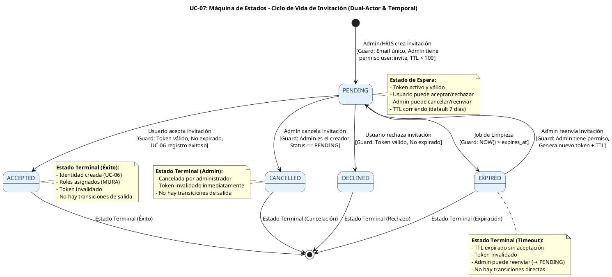
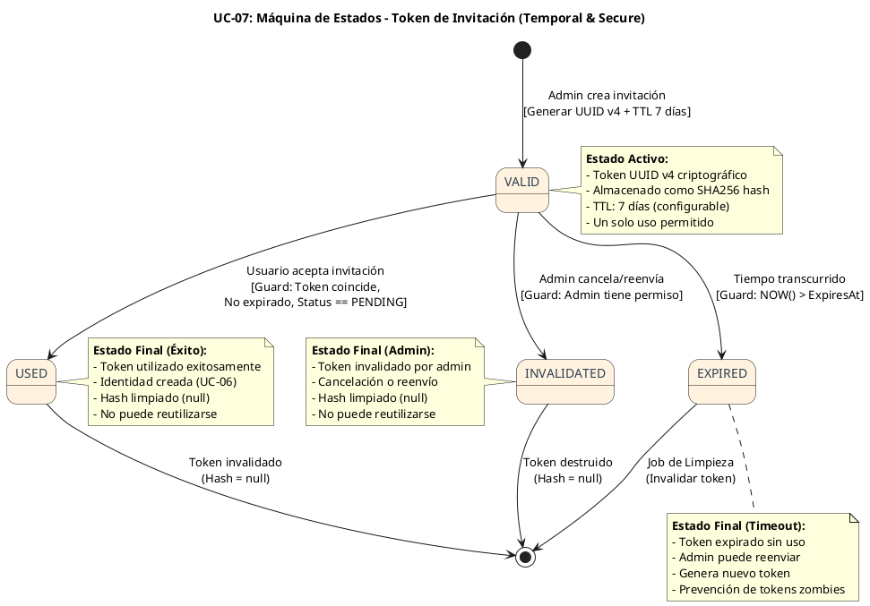
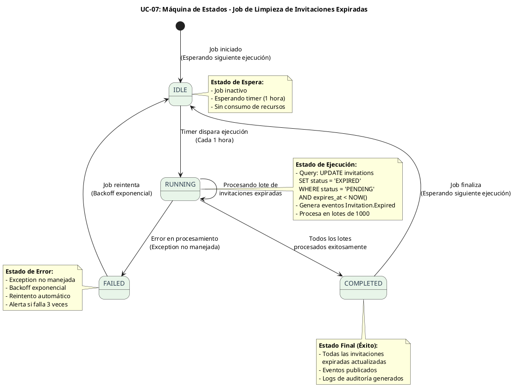

# UC-07: Invitación de Usuarios - Diagrama de Máquina de Estados

| Metadatos del Documento | |
| :--- | :--- |
| **Proyecto:** | SHUGO - Identity & Access Platform |
| **Caso de Uso:** | UC-07 - Invitación de Usuarios (Admin-Initiated Invitation) |
| **Documento:** | 05_State_Machine_Diagram.md |
| **Metodología:** | UML 2.5 + ICONIX + Domain-Driven Design (State Pattern) + Temporal State Management |
| **Autor:** | Gastón Ruiz |
| **Versión Actual:** | 1.0.0 |
| **Fecha:** | 04/09/2026 |

---

## Historial de Versiones

| Versión | Fecha | Autor | Descripción de Cambios | Impacto |
| :--- | :--- | :--- | :--- | :--- |
| **1.0.0** | 04/09/2026 | Gastón Ruiz | **Creación inicial.** Definición de las máquinas de estados específicas para la invitación de usuarios. Se modelan tres máquinas críticas: (1) Ciclo de Vida de la Invitación (PENDING → ACCEPTED/DECLINED/EXPIRED/CANCELLED), (2) Máquina Temporal del Token de Invitación (VALID → USED/EXPIRED/INVALIDATED), y (3) Máquina de Estados del Job de Limpieza (IDLE → RUNNING → COMPLETED). | Documento base del paquete de diseño Tier 1 del UC-07. Establece las reglas de transición, las guardas de seguridad y la lógica temporal que garantiza la seguridad del onboarding controlado y el cumplimiento de políticas de invitación. |

---

## 1. Introducción y Propósito

El **Diagrama de Máquina de Estados** para el UC-07 visualiza las restricciones de comportamiento temporal y las reglas de transición que gobiernan el ciclo de vida de las invitaciones de usuarios.

A diferencia de los UCs síncronos (UC-01 a UC-06), el UC-07 introduce complejidades únicas debido a su naturaleza **asíncrona y dual**:

1. **Estados Temporales Extendidos:** La invitación puede permanecer en estado `PENDING` durante días (TTL de 7 días) antes de transicionar a un estado terminal.
2. **Múltiples Actores Involucrados:** El Administrador crea y gestiona la invitación, pero el Usuario Invitado la acepta o rechaza. El dominio debe manejar esta separación de responsabilidades.
3. **Job de Limpieza Automática:** Un proceso en background actualiza invitaciones expiradas, requiriendo transiciones automáticas de estado sin intervención humana.
4. **Seguridad Criptográfica de Tokens:** Los tokens de invitación tienen su propia máquina de estados independiente, con validación de expiración y prevención de reutilización.

Estas máquinas garantizan:
- **Control de Onboarding:** Solo invitaciones válidas y vigentes pueden ser aceptadas.
- **Prevención de Abuso:** Límites estrictos de reutilización de tokens y expiración automática.
- **Trazabilidad Completa:** Cada transición de estado genera eventos de dominio para auditoría.
- **Higiene de Datos:** Las invitaciones expiradas se limpian automáticamente para mantener la base de datos optimizada.

---

## 2. Máquina de Estados #1: Ciclo de Vida de la Invitación

### 2.1. Descripción

Esta máquina modela el ciclo de vida completo de una invitación, desde su creación por el administrador hasta su aceptación, rechazo, expiración o cancelación. Es la máquina principal del UC-07.

### 2.2. Diagrama de Máquina de Estados (PlantUML)



### 2.3. Descripción de Estados y Transiciones

| Estado | Descripción | Transiciones de Salida | Invariante Clave |
| :--- | :--- | :--- | :--- |
| **PENDING** | Invitación creada y activa. El usuario invitado puede aceptarla o rechazarla. El administrador puede cancelarla o reenviarla. | → `ACCEPTED` (usuario acepta), → `DECLINED` (usuario rechaza), → `EXPIRED` (TTL expira), → `CANCELLED` (admin cancela) | Token válido y no expirado. `expires_at > NOW()`. Máximo 100 invitaciones pendientes por admin. |
| **ACCEPTED** | El usuario aceptó la invitación y completó el registro (UC-06). La identidad fue creada y los roles asignados. | Ninguna (estado terminal) | `accepted_at` registrado. `identity_id` asociado. Token invalidado. |
| **DECLINED** | El usuario rechazó explícitamente la invitación. | Ninguna (estado terminal) | `declined_at` registrado. Token invalidado. |
| **EXPIRED** | El TTL de la invitación expiró sin aceptación. Actualizado automáticamente por el job de limpieza. | → `PENDING` (admin reenvía con nuevo token) | `expires_at < NOW()`. Token invalidado. |
| **CANCELLED** | El administrador canceló la invitación antes de que el usuario la aceptara. | Ninguna (estado terminal) | `cancelled_at` registrado. Token invalidado inmediatamente. |

### 2.4. Guardas (Guards) de las Transiciones

#### Transición: `PENDING` → `ACCEPTED` (Usuario Acepta)

```csharp
public void Accept(IdentityId identityId)
{
    // Guarda 1: Estado debe ser PENDING
    if (this.Status != InvitationStatus.PENDING)
        throw new InvalidTransitionException(
            $"Cannot accept invitation in status {this.Status}. Must be PENDING.");

    // Guarda 2: Token debe ser válido (no nulo)
    if (this.Token == null || !this.Token.IsValid)
        throw new InvalidTokenException("Invitation token is invalid or already used.");

    // Guarda 3: Token no debe estar expirado
    if (this.Token.IsExpired())
        throw new InvitationExpiredException(
            $"Invitation expired at {this.ExpiresAt}. Cannot accept.");

    // Guarda 4: NOW() debe ser menor que expires_at
    if (DateTime.UtcNow > this.ExpiresAt)
        throw new InvitationExpiredException("Invitation has expired.");

    // Transición de estado
    this.Status = InvitationStatus.ACCEPTED;
    this.AcceptedAt = DateTime.UtcNow;
    this.AcceptedByIdentityId = identityId;
    this.Token.Invalidate(); // Prevenir reutilización

    // Generar evento de dominio
    this.AddDomainEvent(new InvitationAccepted(
        this.Id, this.TenantId, this.Email, identityId, this.AcceptedAt.Value));
}
```

#### Transición: `PENDING` → `EXPIRED` (Job de Limpieza)

```csharp
public void Expire()
{
    // Guarda 1: Estado debe ser PENDING
    if (this.Status != InvitationStatus.PENDING)
        throw new InvalidTransitionException(
            $"Cannot expire invitation in status {this.Status}. Must be PENDING.");

    // Guarda 2: NOW() debe ser mayor que expires_at
    if (DateTime.UtcNow <= this.ExpiresAt)
        throw new DomainException(
            $"Cannot expire invitation. Expires at {this.ExpiresAt} is in the future.");

    // Transición de estado
    this.Status = InvitationStatus.EXPIRED;
    this.Token.Invalidate();

    // Generar evento de dominio
    this.AddDomainEvent(new InvitationExpired(
        this.Id, this.TenantId, this.Email, DateTime.UtcNow));
}
```

#### Transición: `EXPIRED` → `PENDING` (Admin Reenvía)

```csharp
public void Resend(int newTtlDays = 7)
{
    // Guarda 1: Estado debe ser EXPIRED o PENDING
    if (this.Status != InvitationStatus.EXPIRED && 
        this.Status != InvitationStatus.PENDING)
        throw new InvalidTransitionException(
            $"Cannot resend invitation in status {this.Status}. " +
            "Only EXPIRED or PENDING invitations can be resent.");

    // Guarda 2: Admin debe tener permiso user:invite
    // (Validado en el Application Service, no en el dominio)

    // Transición de estado
    this.Token = new InvitationToken(newTtlDays); // Generar nuevo token
    this.ExpiresAt = DateTime.UtcNow.AddDays(newTtlDays);
    this.Status = InvitationStatus.PENDING;

    // No generar evento de dominio aquí (se genera en el Handler tras enviar email)
}
```

### 2.5. Invariantes de la Máquina de Invitación

1. **Unicidad de Email por Tenant:** No se pueden crear dos invitaciones `PENDING` con el mismo email en el mismo tenant.
2. **Límite de Invitaciones Pendientes:** Cada administrador puede tener máximo 100 invitaciones `PENDING` simultáneamente.
3. **Token de Un Solo Uso:** Una vez aceptada la invitación, el token se invalida permanentemente.
4. **TTL Estricto:** El TTL de 7 días (configurable) no puede ser extendido sin generar un nuevo token.
5. **Irreversibilidad de Estados Terminales:** `ACCEPTED`, `DECLINED`, y `CANCELLED` no tienen transiciones de salida.
6. **Reenvío Controlado:** Solo invitaciones `EXPIRED` o `PENDING` pueden ser reenviadas, generando un nuevo token.

---

## 3. Máquina de Estados #2: Token de Invitación (Temporal)

### 3.1. Descripción

Esta máquina modela el ciclo de vida temporal del token de invitación. Es crítica para la seguridad del proceso, ya que un token comprometido o reutilizado podría permitir Account Takeover.

### 3.2. Diagrama de Máquina de Estados (PlantUML)



### 3.3. Descripción de Estados y Transiciones

| Estado | Descripción | Transiciones de Salida | Invariante Clave |
| :--- | :--- | :--- | :--- |
| **VALID** | Token activo y utilizable. Generado con UUID v4 criptográfico y almacenado como hash SHA256. | → `USED` (aceptación exitosa), → `EXPIRED` (TTL transcurrido), → `INVALIDATED` (admin cancela/reenvía) | Almacenado hasheado (SHA256) en DB. TTL estricto. Un solo uso permitido. |
| **USED** | Token utilizado exitosamente para aceptar la invitación. | Ninguna (estado final) | Hash limpiado (`TokenHash = null`). No puede reutilizarse. Identidad creada. |
| **EXPIRED** | Token expirado sin ser utilizado. | → `[*]` (invalidación por job de limpieza) | `ExpiresAt < NOW()`. Admin puede reenviar generando nuevo token. |
| **INVALIDATED** | Token invalidado manualmente por el administrador (cancelación o reenvío). | Ninguna (estado final) | Hash limpiado (`TokenHash = null`). No puede reutilizarse. |

### 3.4. Implementación del Value Object `InvitationToken`

```csharp
public class InvitationToken : ValueObject
{
    public string TokenHash { get; private set; }
    public DateTime ExpiresAt { get; private set; }
    public bool IsValid { get; private set; }

    private InvitationToken(string tokenHash, DateTime expiresAt)
    {
        TokenHash = tokenHash;
        ExpiresAt = expiresAt;
        IsValid = true;
    }

    /// <summary>
    /// Genera un nuevo token seguro con TTL configurable.
    /// </summary>
    public InvitationToken(int ttlDays = 7)
    {
        var originalToken = GenerateCryptographicUUIDv4();
        TokenHash = HashWithSHA256(originalToken);
        ExpiresAt = DateTime.UtcNow.AddDays(ttlDays);
        IsValid = true;
    }

    /// <summary>
    /// Valida si el token proporcionado coincide y no está expirado.
    /// Usa comparación en tiempo constante para prevenir Timing Attacks.
    /// </summary>
    public bool Validate(string providedToken)
    {
        // Guarda 1: Token debe ser válido
        if (!IsValid)
            return false;

        // Guarda 2: Token no debe estar expirado
        if (IsExpired())
            return false;

        // Guarda 3: Token debe coincidir (comparación segura)
        var providedHash = HashWithSHA256(providedToken);
        return SecureCompare(TokenHash, providedHash);
    }

    /// <summary>
    /// Invalida el token tras uso exitoso o cancelación.
    /// </summary>
    public void Invalidate()
    {
        IsValid = false;
        TokenHash = null; // Limpiar hash para seguridad
    }

    public bool IsExpired() => DateTime.UtcNow > ExpiresAt;

    /// <summary>
    /// Genera UUID v4 criptográficamente seguro.
    /// </summary>
    private string GenerateCryptographicUUIDv4()
    {
        return Guid.NewGuid().ToString("N"); // 32 caracteres hex
    }

    /// <summary>
    /// Hashea el token con SHA256 para almacenamiento seguro.
    /// </summary>
    private string HashWithSHA256(string token)
    {
        var hash = SHA256.HashData(Encoding.UTF8.GetBytes(token));
        return Convert.ToBase64String(hash);
    }

    /// <summary>
    /// Comparación segura en tiempo constante para prevenir Timing Attacks.
    /// </summary>
    private bool SecureCompare(string a, string b)
    {
        if (a == null || b == null) return false;
        if (a.Length != b.Length) return false;

        var result = 0;
        for (int i = 0; i < a.Length; i++)
        {
            result |= a[i] ^ b[i];
        }

        return result == 0;
    }

    protected override IEnumerable<object> GetEqualityComponents()
    {
        yield return TokenHash;
        yield return ExpiresAt;
        yield return IsValid;
    }
}
```

### 3.5. Invariantes de la Máquina de Token

1. **Almacenamiento Seguro:** El token nunca se almacena en texto plano en la base de datos. Solo se almacena el hash SHA256.
2. **Comparación en Tiempo Constante:** La validación del token usa `SecureCompare` para prevenir Timing Attacks que podrían revelar el token correcto.
3. **TTL Inmutable:** El TTL de 7 días se establece en la creación y no puede ser modificado sin generar un nuevo token.
4. **Invalidación Post-Uso:** Tras usar el token, se establece `TokenHash = null` para prevenir reutilización.
5. **Un Solo Uso:** Cada token es válido para una sola aceptación. Tras `USED` o `INVALIDATED`, no puede reutilizarse.

---

## 4. Máquina de Estados #3: Job de Limpieza de Invitaciones Expiradas

### 4.1. Descripción

Esta máquina modela el ciclo de vida del job en background que actualiza automáticamente las invitaciones expiradas. Es crítica para mantener la higiene de la base de datos y prevenir acumulación de invitaciones huérfanas.

### 4.2. Diagrama de Máquina de Estados (PlantUML)



### 4.3. Descripción de Estados y Transiciones

| Estado | Descripción | Transiciones de Salida | Invariante Clave |
| :--- | :--- | :--- | :--- |
| **IDLE** | Job inactivo, esperando la siguiente ejecución programada. | → `RUNNING` (timer dispara ejecución) | Sin consumo de recursos. Timer configurado (default: 1 hora). |
| **RUNNING** | Job ejecutando la query de actualización de invitaciones expiradas. | → `RUNNING` (procesando siguiente lote), → `COMPLETED` (todos los lotes procesados), → `FAILED` (error no manejado) | Procesa en lotes de 1000 invitaciones. Genera eventos `Invitation.Expired`. |
| **COMPLETED** | Job completó exitosamente la actualización de todas las invitaciones expiradas. | → `IDLE` (job finaliza, espera siguiente ejecución) | Todas las invitaciones `PENDING` con `expires_at < NOW()` actualizadas a `EXPIRED`. |
| **FAILED** | Job falló debido a una excepción no manejada. | → `IDLE` (job reintenta con backoff exponencial) | Backoff exponencial (1min, 2min, 4min, 8min). Alerta tras 3 fallos consecutivos. |

### 4.4. Implementación del Job de Limpieza

```csharp
public class InvitationCleanupJob : BackgroundService
{
    private readonly IServiceProvider _serviceProvider;
    private readonly ILogger<InvitationCleanupJob> _logger;
    private readonly TimeSpan _interval = TimeSpan.FromHours(1);
    private const int BATCH_SIZE = 1000;
    private int _consecutiveFailures = 0;

    public InvitationCleanupJob(
        IServiceProvider serviceProvider,
        ILogger<InvitationCleanupJob> logger)
    {
        _serviceProvider = serviceProvider;
        _logger = logger;
    }

    protected override async Task ExecuteAsync(CancellationToken stoppingToken)
    {
        while (!stoppingToken.IsCancellationRequested)
        {
            try
            {
                // Esperar intervalo
                await Task.Delay(_interval, stoppingToken);

                using var scope = _serviceProvider.CreateScope();
                var repository = scope.ServiceProvider.GetRequiredService<IInvitationRepository>();
                var unitOfWork = scope.ServiceProvider.GetRequiredService<IUnitOfWork>();

                _logger.LogInformation("Starting invitation cleanup job");

                int totalExpired = 0;
                bool hasMore = true;

                while (hasMore)
                {
                    // Query optimizada con FOR UPDATE SKIP LOCKED
                    var expiredInvitations = await repository
                        .GetExpiredPendingAsync(BATCH_SIZE, stoppingToken);

                    if (expiredInvitations.Count == 0)
                    {
                        hasMore = false;
                        break;
                    }

                    foreach (var invitation in expiredInvitations)
                    {
                        invitation.Expire(); // Transición PENDING → EXPIRED
                        totalExpired++;
                    }

                    await unitOfWork.SaveChangesAsync(stoppingToken);

                    _logger.LogInformation(
                        "Expired {Count} invitations in current batch", 
                        expiredInvitations.Count);
                }

                _logger.LogInformation(
                    "Invitation cleanup job completed. Total expired: {Total}", 
                    totalExpired);

                _consecutiveFailures = 0; // Resetear contador de fallos
            }
            catch (Exception ex)
            {
                _consecutiveFailures++;
                _logger.LogError(ex, 
                    "Invitation cleanup job failed. Consecutive failures: {Failures}", 
                    _consecutiveFailures);

                if (_consecutiveFailures >= 3)
                {
                    _logger.LogCritical(
                        "Invitation cleanup job failed 3 consecutive times. " +
                        "Sending alert to operations team.");
                    // Enviar alerta a operaciones
                }

                // Backoff exponencial
                var backoff = TimeSpan.FromMinutes(Math.Pow(2, _consecutiveFailures));
                await Task.Delay(backoff, stoppingToken);
            }
        }
    }
}
```

### 4.5. Invariantes del Job de Limpieza

1. **Frecuencia de Ejecución:** El job se ejecuta cada hora para mantener la higiene de la base de datos.
2. **Procesamiento en Lotes:** Las invitaciones se procesan en lotes de 1000 para prevenir bloqueos prolongados de la base de datos.
3. **FOR UPDATE SKIP LOCKED:** La query usa `FOR UPDATE SKIP LOCKED` para prevenir conflictos con otras transacciones que estén actualizando invitaciones.
4. **Backoff Exponencial:** Si el job falla, se reintenta con backoff exponencial (1min, 2min, 4min, 8min).
5. **Alerta tras Fallos Consecutivos:** Si el job falla 3 veces consecutivas, se envía una alerta al equipo de operaciones.
6. **Generación de Eventos:** Cada invitación expirada genera un evento `Invitation.Expired` para auditoría y notificación.

---

## 5. Implementación en el Dominio (Código C#)

### 5.1. Máquina de Estados de Invitación en el Aggregate Root

```csharp
public class Invitation : AggregateRoot
{
    public InvitationId Id { get; private set; }
    public TenantId TenantId { get; private set; }
    public Email Email { get; private set; }
    public InvitationToken Token { get; private set; }
    public InvitationStatus Status { get; private set; }
    public AdminId InvitedBy { get; private set; }
    public InvitationRoles Roles { get; private set; }
    public string Message { get; private set; }
    public DateTime CreatedAt { get; private set; }
    public DateTime ExpiresAt { get; private set; }
    public DateTime? AcceptedAt { get; private set; }
    public IdentityId? AcceptedByIdentityId { get; private set; }
    
    private readonly List<IDomainEvent> _domainEvents = new();

    // Constructor privado para EF Core
    private Invitation() { }

    /// <summary>
    /// Método de fábrica para crear una nueva invitación en estado PENDING.
    /// </summary>
    public static Invitation Create(
        TenantId tenantId,
        Email email,
        AdminId invitedBy,
        InvitationRoles roles,
        string message,
        int ttlDays = 7)
    {
        var invitation = new Invitation
        {
            Id = new InvitationId(Guid.NewGuid()),
            TenantId = tenantId,
            Email = email,
            Token = new InvitationToken(ttlDays),
            Status = InvitationStatus.PENDING,
            InvitedBy = invitedBy,
            Roles = roles,
            Message = message,
            CreatedAt = DateTime.UtcNow,
            ExpiresAt = DateTime.UtcNow.AddDays(ttlDays)
        };

        invitation.ValidateInitialState();
        
        // Generar evento de dominio
        invitation.AddDomainEvent(new InvitationCreated(
            invitation.Id,
            invitation.TenantId,
            invitation.Email,
            invitation.InvitedBy,
            invitation.Roles,
            invitation.ExpiresAt
        ));

        return invitation;
    }

    /// <summary>
    /// Transición: PENDING → ACCEPTED
    /// Se ejecuta cuando el usuario invitado completa el registro (UC-06).
    /// </summary>
    public void Accept(IdentityId identityId)
    {
        // Guarda 1: Estado debe ser PENDING
        if (this.Status != InvitationStatus.PENDING)
            throw new InvalidTransitionException(
                $"Cannot accept invitation in status {this.Status}. Must be PENDING.");

        // Guarda 2: Token debe ser válido
        if (this.Token == null || !this.Token.IsValid)
            throw new InvalidTokenException("Invitation token is invalid or already used.");

        // Guarda 3: Token no debe estar expirado
        if (this.Token.IsExpired())
            throw new InvitationExpiredException(
                $"Invitation expired at {this.ExpiresAt}. Cannot accept.");

        // Transición de estado
        this.Status = InvitationStatus.ACCEPTED;
        this.AcceptedAt = DateTime.UtcNow;
        this.AcceptedByIdentityId = identityId;
        this.Token.Invalidate(); // Prevenir reutilización

        this.AddDomainEvent(new InvitationAccepted(
            this.Id, this.TenantId, this.Email, identityId, this.AcceptedAt.Value));
    }

    /// <summary>
    /// Transición: PENDING → DECLINED
    /// Se ejecuta cuando el usuario invitado rechaza explícitamente.
    /// </summary>
    public void Decline()
    {
        if (this.Status != InvitationStatus.PENDING)
            throw new InvalidTransitionException(
                $"Cannot decline invitation in status {this.Status}. Must be PENDING.");

        this.Status = InvitationStatus.DECLINED;
        this.Token.Invalidate();
    }

    /// <summary>
    /// Transición: PENDING → EXPIRED
    /// Se ejecuta automáticamente por el job de limpieza cuando expires_at < NOW().
    /// </summary>
    public void Expire()
    {
        if (this.Status != InvitationStatus.PENDING)
            throw new InvalidTransitionException(
                $"Cannot expire invitation in status {this.Status}. Must be PENDING.");

        if (DateTime.UtcNow <= this.ExpiresAt)
            throw new DomainException(
                $"Cannot expire invitation. Expires at {this.ExpiresAt} is in the future.");

        this.Status = InvitationStatus.EXPIRED;
        this.Token.Invalidate();

        this.AddDomainEvent(new InvitationExpired(
            this.Id, this.TenantId, this.Email, DateTime.UtcNow));
    }

    /// <summary>
    /// Transición: PENDING → CANCELLED
    /// Se ejecuta cuando el administrador cancela la invitación.
    /// </summary>
    public void Cancel()
    {
        if (this.Status != InvitationStatus.PENDING)
            throw new InvalidTransitionException(
                $"Cannot cancel invitation in status {this.Status}. Must be PENDING.");

        this.Status = InvitationStatus.CANCELLED;
        this.Token.Invalidate();
    }

    /// <summary>
    /// Reenvío: Genera nuevo token y reinicia TTL.
    /// Permite reenviar invitaciones EXPIRED o PENDING.
    /// </summary>
    public void Resend(int newTtlDays = 7)
    {
        if (this.Status != InvitationStatus.PENDING && 
            this.Status != InvitationStatus.EXPIRED)
            throw new InvalidTransitionException(
                $"Cannot resend invitation in status {this.Status}. " +
                "Only PENDING or EXPIRED invitations can be resent.");

        this.Token = new InvitationToken(newTtlDays);
        this.ExpiresAt = DateTime.UtcNow.AddDays(newTtlDays);
        this.Status = InvitationStatus.PENDING; // Si estaba EXPIRED, vuelve a PENDING
    }

    /// <summary>
    /// Valida invariantes del estado inicial.
    /// </summary>
    private void ValidateInitialState()
    {
        if (this.Status != InvitationStatus.PENDING)
            throw new DomainException("New invitation must be in PENDING status.");

        if (this.Token == null)
            throw new DomainException("Invitation must have a secure token.");

        if (this.ExpiresAt <= DateTime.UtcNow)
            throw new DomainException("Invitation expiration must be in the future.");
    }

    public IReadOnlyCollection<IDomainEvent> GetDomainEvents() => _domainEvents.AsReadOnly();
    
    protected void AddDomainEvent(IDomainEvent evt) => _domainEvents.Add(evt);
}
```

### 5.2. Value Object `InvitationStatus` con Matriz de Transiciones

```csharp
public class InvitationStatus : ValueObject
{
    public string Value { get; }

    private InvitationStatus(string value)
    {
        Value = value;
    }

    // Estados válidos
    public static InvitationStatus PENDING => new InvitationStatus("PENDING");
    public static InvitationStatus ACCEPTED => new InvitationStatus("ACCEPTED");
    public static InvitationStatus DECLINED => new InvitationStatus("DECLINED");
    public static InvitationStatus EXPIRED => new InvitationStatus("EXPIRED");
    public static InvitationStatus CANCELLED => new InvitationStatus("CANCELLED");

    /// <summary>
    /// Valida si la transición al nuevo estado es permitida.
    /// </summary>
    public bool CanTransitionTo(InvitationStatus newStatus)
    {
        // Matriz de transiciones permitidas
        var allowedTransitions = new Dictionary<string, HashSet<string>>
        {
            { "PENDING", new HashSet<string> { "ACCEPTED", "DECLINED", "EXPIRED", "CANCELLED" } },
            { "EXPIRED", new HashSet<string> { "PENDING" } }, // Permitir reenvío
            { "ACCEPTED", new HashSet<string>() }, // Estado terminal
            { "DECLINED", new HashSet<string>() }, // Estado terminal
            { "CANCELLED", new HashSet<string>() }  // Estado terminal
        };

        if (allowedTransitions.TryGetValue(this.Value, out var allowed))
        {
            return allowed.Contains(newStatus.Value);
        }

        return false;
    }

    public override string ToString() => Value;

    protected override IEnumerable<object> GetEqualityComponents()
    {
        yield return Value;
    }
}
```

---

## 6. Trazabilidad con Otros Documentos del Paquete

| Documento | Relación |
| :--- | :--- |
| `01_Requirements_Specification.md` | Las invariantes de estado (INV-40 a INV-47) y reglas de negocio (RN-01 a RN-06) se definen aquí y se hacen cumplir en estas máquinas. |
| `02_Use_Case_Diagram.md` | Muestra los actores y sistemas; estas máquinas definen cómo el sistema responde a sus acciones de invitación a lo largo del tiempo. |
| `03_Activity_Diagram.md` | Los carriles de actividad (Invitation Handler, Background Job) se implementan aquí como máquinas de estados. |
| `04_Initial_Domain_Model.md` | El Aggregate Root `Invitation`, el Value Object `InvitationToken`, y el Domain Service `InvitationHandler` son la implementación directa de estas máquinas. |
| `06_Robustness_Diagram.md` | Mostrará cómo los objetos colaboran para ejecutar estas transiciones de estado de forma segura. |
| `07_Sequence_Diagram.md` | Detallará el orden temporal exacto de las llamadas que disparan estas transiciones. |
| `10_UC_Specific_Data_Model.md` | Define las columnas físicas (`status`, `token_hash`, `expires_at`) que persisten estos estados en PostgreSQL. |

---

## 7. Notas de Implementación

### 7.1. Testing de Máquinas de Estados

Cada transición y guarda definida en estas máquinas debe tener al menos dos tests unitarios:

```csharp
[Test]
public void Invitation_Accept_WhenValidToken_TransitionsToAccepted()
{
    // Arrange
    var invitation = Invitation.Create(
        new TenantId(Guid.NewGuid()),
        new Email("test@khcs.com"),
        new AdminId(Guid.NewGuid()),
        new InvitationRoles(new List<RoleId>()),
        "Welcome!",
        ttlDays: 7);

    // Act
    invitation.Accept(new IdentityId(Guid.NewGuid()));

    // Assert
    invitation.Status.Should().Be(InvitationStatus.ACCEPTED);
    invitation.AcceptedAt.Should().NotBeNull();
    invitation.Token.IsValid.Should().BeFalse();
    invitation.GetDomainEvents().Should().ContainSingle(e => e is InvitationAccepted);
}

[Test]
public void Invitation_Accept_WhenExpired_ThrowsInvitationExpiredException()
{
    // Arrange
    var invitation = Invitation.Create(
        new TenantId(Guid.NewGuid()),
        new Email("test@khcs.com"),
        new AdminId(Guid.NewGuid()),
        new InvitationRoles(new List<RoleId>()),
        "Welcome!",
        ttlDays: -1); // Expirado inmediatamente

    // Act
    var act = () => invitation.Accept(new IdentityId(Guid.NewGuid()));

    // Assert
    act.Should().Throw<InvitationExpiredException>();
}

[Test]
public void Invitation_Resend_WhenExpired_TransitionsToPending()
{
    // Arrange
    var invitation = Invitation.Create(
        new TenantId(Guid.NewGuid()),
        new Email("test@khcs.com"),
        new AdminId(Guid.NewGuid()),
        new InvitationRoles(new List<RoleId>()),
        "Welcome!",
        ttlDays: -1); // Expirado

    invitation.Expire(); // Transición a EXPIRED

    // Act
    invitation.Resend(7);

    // Assert
    invitation.Status.Should().Be(InvitationStatus.PENDING);
    invitation.ExpiresAt.Should().BeCloseTo(DateTime.UtcNow.AddDays(7), TimeSpan.FromMinutes(1));
}
```

### 7.2. Concurrencia y Race Conditions

Dado que múltiples procesos pueden intentar aceptar la misma invitación simultáneamente (ej. usuario hace clic múltiples veces), se deben considerar las siguientes race conditions:

1. **Double Acceptance:** Si el usuario hace clic en el link de aceptación múltiples veces, la segunda aceptación debe fallar silenciosamente (el token ya es `null`).
2. **Cleanup Race:** Si el job de limpieza se ejecuta mientras el usuario está aceptando, debe haber un lock optimista (RowVersion) para prevenir actualización de invitación en proceso de aceptación.

---
*Fin del Documento 05_State_Machine_Diagram para UC-07*