# UC-07: Invitación de Usuarios - Diagrama de Robustez

| Metadatos del Documento | |
| :--- | :--- |
| **Proyecto:** | SHUGO - Identity & Access Platform |
| **Caso de Uso:** | UC-07 - Invitación de Usuarios (Admin-Initiated Invitation) |
| **Documento:** | 06_Robustness_Diagram.md |
| **Metodología:** | ICONIX (Diagrama de Robustez) + DDD + Dual-Actor Async Flow + Token Security |
| **Autor:** | Gastón Ruiz |
| **Versión Actual:** | 1.0.0 |
| **Fecha:** | 04/09/2026 |

---

## Historial de Versiones

| Versión | Fecha | Autor | Descripción de Cambios | Impacto |
| :--- | :--- | :--- | :--- | :--- |
| **1.0.0** | 04/09/2026 | Gastón Ruiz | **Creación inicial.** Diagrama de Robustez para UC-07, validando la arquitectura del motor KAGAMI para operaciones de invitación dual-actor asíncronas. Muestra la colaboración estricta entre Boundaries (API Gateway, Invitation Endpoint), Controls (Invitation Handler, Invitation Validator, Email Service, Registration Service), y Entities (Invitation, InvitationToken, InvitationStatus, Admin, Email). Valida el patrón de compensación transaccional, la seguridad criptográfica de tokens, y la integración con UC-06 para completar el onboarding. | Documento base del paquete de diseño Tier 1 del UC-07. Sirve como puente crítico entre el Modelo de Dominio (04) y el Diagrama de Secuencia (07), asegurando que la arquitectura soporta la seguridad, trazabilidad y resiliencia antes de codificar. |

---

## 1. Introducción y Propósito

El **Diagrama de Robustez** para el UC-07 valida que el flujo de invitación de usuarios puede ser orquestado respetando las reglas estrictas de acoplamiento de **ICONIX** y los principios de **Domain-Driven Design (DDD)**, **Dual-Actor Async Flow** y **Token Security by Design**.

A diferencia de los UCs síncronos (UC-01 a UC-06), el UC-07 introduce complejidades arquitectónicas únicas:

1. **Flujo Dual Asíncrono:** La invitación es creada por el Administrador pero aceptada por el Usuario Invitado, con separación temporal entre ambas acciones.
2. **Seguridad Criptográfica de Tokens:** Los tokens de invitación deben ser UUID v4, almacenados como hashes SHA256, con TTL estricto y prevención de reutilización.
3. **Integración con UC-06:** Al aceptar la invitación, el sistema delega al flujo de registro (UC-06) para completar el onboarding, luego retoma el control para asignar roles.
4. **Patrón de Compensación:** Si el envío de email falla tras crear la invitación, se debe ejecutar rollback para prevenir invitaciones huérfanas.
5. **Job de Limpieza Automática:** Un proceso en background actualiza invitaciones expiradas, requiriendo que el dominio soporte transiciones automáticas de estado.

---

## 2. Diagrama de Robustez (PlantUML)

A continuación, se presenta el Diagrama de Robustez organizado de izquierda a derecha para mostrar el flujo natural: **Actor → Boundary → Control → Entity**.

```plantuml
@startuml UC-07_Robustez
<style>
diagram {
  BackgroundColor #FEFEFE
}
</style>
left to right direction
skinparam roundcorner 20
skinparam maxMessageSize 150

title UC-07: Diagrama de Robustez - Motor KAGAMI (Invitación Dual-Actor & Token Security)

' ============================================
' ACTORES
' ============================================
actor "Administrador\n(Humano/HRIS)" as Admin
actor "Usuario Invitado\n(Recipient)" as InvitedUser

' ============================================
' BOUNDARY OBJECTS (UI / API)
' ============================================
boundary "API Gateway" as GW
boundary "Invitation API\nEndpoint" as API

' ============================================
' CONTROL OBJECTS (Aplicación / Dominio)
' ============================================
control "Invitation Handler\n<<Application Service>>" as Handler
control "Invitation Validator\n<<Domain Service>>" as Validator
control "Email Service\n<<Infrastructure>>" as EmailService
control "Registration Service\n<<UC-06 Integration>>" as RegService
control "RBAC Service\n<<MURA Integration>>" as RBACService

' ============================================
' ENTITY OBJECTS (Dominio / Persistencia)
' ============================================
entity "Invitation\n<<Aggregate Root>>" as Invitation
entity "InvitationToken\n<<Value Object>>" as Token
entity "InvitationStatus\n<<Value Object>>" as Status
entity "Email\n<<Value Object>>" as Email
entity "Admin\n<<Entity>>" as AdminEntity
entity "Invitation Repository\n<<Infrastructure>>" as Repo
entity "PostgreSQL\n<<Database>>" as DB
entity "Outbox / Kafka\n<<Event Stream>>" as Kafka

' ============================================
' NOTAS EXPLICATIVAS
' ============================================
note top of Handler
  **Regla de Oro (Dual-Actor):**
  El Handler orquesta dos flujos:
  1. Creación (Admin)
  2. Aceptación (Usuario Invitado)
  Con integración a UC-06.
end note

note bottom of Token
  **Seguridad Criptográfica:**
  - UUID v4 criptográfico
  - Almacenado como SHA256 hash
  - TTL configurable (7 días)
  - Comparación en tiempo constante
end note

note right of Validator
  **Validaciones Críticas:**
  - Unicidad de email
  - Límite de invitaciones
  - Configuración de tenant
  - Prevención de enumeración
end note

' ============================================
' FASE 1: CREACIÓN DE INVITACIÓN (Admin)
' ============================================

' Actor -> Boundary
Admin --> GW : 1. POST /invitations\n(email, roles, message, JWT)
GW --> API : 2. Forward\n(admin_id, tenant_id, payload)

' Boundary -> Control
API --> Handler : 3. CreateInvitation(command)

' Control -> Control (Validaciones)
Handler --> Validator : 4. ValidateTenantConfig(tenantId)
Validator --> Validator : 5. Verificar allow_invitations
Validator --> Handler : 6. OK

Handler --> Validator : 7. ValidateEmailUniqueness(email)
Validator --> Repo : 8. EmailExistsAsync(email, tenantId)
Repo --> DB : 9. SELECT COUNT(*)
DB --> Repo : 10. count = 0
Repo --> Validator : 11. Email unique
Validator --> Handler : 12. OK

Handler --> Validator : 13. ValidateAdminLimit(adminId)
Validator --> Repo : 14. CountPendingByAdmin(adminId)
Repo --> DB : 15. SELECT COUNT(*)
DB --> Repo : 16. count < 100
Repo --> Validator : 17. Under limit
Validator --> Handler : 18. OK

' Control -> Entity (Construcción de Aggregate)
Handler --> Email : 19. new Email(email)\n[Valida RFC 5322]
Handler --> Token : 20. new InvitationToken(ttlDays=7)\n[UUID v4 + SHA256]
Handler --> Status : 21. InvitationStatus.PENDING

Handler --> Invitation : 22. Invitation.Create(\ntenantId, email, adminId,\nroles, message, token)
Invitation --> Invitation : 23. Status = PENDING\nExpiresAt = NOW() + 7d
Invitation --> Invitation : 24. AddDomainEvent\n(InvitationCreated)
Invitation --> Handler : 25. Invitation (PENDING)

' Control -> Entity (Persistencia)
Handler --> Repo : 26. SaveAsync(invitation)
Repo --> DB : 27. BEGIN TRANSACTION
Repo --> DB : 28. INSERT invitations\n(status, token_hash, expires_at)
Repo --> DB : 29. INSERT audit_logs\n(action='Invitation.Created')
Repo --> DB : 30. COMMIT
DB --> Repo : 31. Success
Repo --> Handler : 32. Invitation saved

' Control -> Control (Envío de Email con Compensación)
Handler --> EmailService : 33. SendInvitationEmail(email, token)
EmailService --> EmailService : 34. Enviar email SMTP\ncon link seguro

' Flujo Principal: Email enviado exitosamente
EmailService --> Handler : 35a. Email sent
Handler --> Kafka : 36a. Publish Invitation.Created
Handler --> API : 37a. InvitationCreatedResult\n(invitationId, expiresAt)
API --> GW : 38a. HTTP 201 Created
GW --> Admin : 39a. Response JSON

' Flujo Excepción: Email falla (Compensación)
EmailService --> Handler : 35b. EmailServiceException
Handler --> Repo : 36b. DeleteAsync(invitationId)\n[Compensación]
Repo --> DB : 37b. DELETE FROM invitations
DB --> Repo : 38b. Deleted
Repo --> Handler : 39b. Compensated
Handler --> API : 40b. RegistrationException\n"Failed to send email"
API --> GW : 41b. HTTP 500 Internal Server Error
GW --> Admin : 42b. Error JSON

' ============================================
' FASE 2: ACEPTACIÓN DE INVITACIÓN (Usuario Invitado)
' ============================================

InvitedUser --> GW : 43. GET /invitations/accept\n?token={token}
GW --> API : 44. Forward token

API --> Handler : 45. AcceptInvitation(token)

' Control -> Entity (Validación de Token)
Handler --> Token : 46. Validate(providedToken)\n[SHA256 + SecureCompare]
Token --> Token : 47. Verificar no expirado\n(NOW() < expiresAt)
Token --> Token : 48. Comparación en tiempo\nconstante
Token --> Handler : 49. Token valid

Handler --> Invitation : 50. GetById(tokenHash)
Invitation --> Repo : 51. GetByTokenHashAsync(tokenHash)
Repo --> DB : 52. SELECT * WHERE token_hash = ?
DB --> Repo : 53. Invitation (PENDING)
Repo --> Invitation : 54. Invitation loaded
Invitation --> Handler : 55. Invitation (PENDING)

Handler --> Handler : 56. Verificar Status == PENDING\ny NOW() < expiresAt

' Control -> Control (Integración con UC-06)
Handler --> RegService : 57. CompleteRegistrationFromInvitation\n(email, roles)
RegService --> RegService : 58. Ejecutar flujo UC-06\n(Crear password, aceptar términos)
RegService --> Handler : 59. IdentityId created

' Control -> Entity (Transición de Estado)
Handler --> Invitation : 60. Accept(identityId)
Invitation --> Invitation : 61. Status = ACCEPTED\nAcceptedAt = NOW()
Invitation --> Invitation : 62. Token.Invalidate()\n[Hash = null]
Invitation --> Invitation : 63. AddDomainEvent\n(InvitationAccepted)
Invitation --> Handler : 64. Invitation (ACCEPTED)

Handler --> Repo : 65. SaveAsync(invitation)
Repo --> DB : 66. UPDATE invitations\nSET status='ACCEPTED'
DB --> Repo : 67. Updated
Repo --> Handler : 68. Saved

' Control -> Control (Asignación de Roles)
Handler --> RBACService : 69. AssignRolesAsync(identityId, roles)
RBACService --> RBACService : 70. Asignar roles\npre-configurados
RBACService --> Handler : 71. Roles assigned

Handler --> EmailService : 72. SendAcceptanceConfirmation\n(adminEmail, invitedEmail)
EmailService --> EmailService : 73. Enviar confirmación\nal administrador

Handler --> API : 74. AcceptInvitationResult\n(identityId, message)
API --> GW : 75. HTTP 200 OK
GW --> InvitedUser : 76. "Bienvenido a la plataforma"

@enduml
```



---

## 3. Explicación Detallada de los Objetos

### 3.1. Boundary Objects (Objetos de Límite)

| Objeto | Responsabilidad | Mapeo a Clean Architecture |
| :--- | :--- | :--- |
| **`API Gateway`** | Valida el JWT del administrador, extrae `admin_id`, `tenant_id`, y verifica el permiso `user:invite`. Para la aceptación, extrae el token de la query string. | Middleware (Kong, AWS API Gateway). |
| **`Invitation API Endpoint`** | Recibe las requests HTTP (`POST /invitations`, `GET /invitations/accept`), deserializa payloads, y los pasa al Handler. | Controller (ASP.NET Core Controller). |

### 3.2. Control Objects (Objetos de Control)

| Objeto | Responsabilidad | Mapeo a Clean Architecture |
| :--- | :--- | :--- |
| **`Invitation Handler`** | **Application Service.** Orquesta el caso de uso dual. Coordina la creación (por admin) y aceptación (por usuario), gestiona la transacción, ejecuta compensación si el email falla, e integra con UC-06 y MURA. | Command Handler / Application Service. |
| **`Invitation Validator`** | **Domain Service.** Valida reglas de negocio transversales: configuración de tenant, unicidad de email (con prevención de enumeración), y límite de invitaciones por admin. | Domain Service. |
| **`Email Service`** | **Infrastructure Service.** Envía emails transaccionales (invitación, confirmación). Es un punto crítico de falla que requiere patrón de compensación. | Infrastructure Service. |
| **`Registration Service`** | **UC-06 Integration.** Delega al flujo de registro self-service para completar el onboarding del usuario invitado. | Application Service (UC-06). |
| **`RBAC Service`** | **MURA Integration.** Asigna los roles pre-configurados en la invitación al nuevo usuario tras la aceptación. | Application Service (MURA). |

### 3.3. Entity Objects (Objetos de Entidad)

| Objeto | Responsabilidad | Mapeo a DDD |
| :--- | :--- | :--- |
| **`Invitation`** | **Aggregate Root.** Encapsula el ciclo de vida completo de la invitación con máquina de estados (`PENDING` → `ACCEPTED`/`DECLINED`/`EXPIRED`/`CANCELLED`). Valida transiciones y genera eventos de dominio. | Aggregate Root. |
| **`InvitationToken`** | **Value Object.** Token criptográfico seguro (UUID v4) almacenado como hash SHA256, con TTL configurable y prevención de reutilización. | Value Object. |
| **`InvitationStatus`** | **Value Object.** Máquina de estados con 5 estados y validación de transiciones permitidas. | Value Object. |
| **`Email`** | **Value Object.** Valida formato RFC 5322 y previene el uso de dominios desechables. | Value Object. |
| **`Admin`** | **Entity.** Representa al administrador que crea la invitación, con permisos y límites asociados. | Entity. |
| **`Invitation Repository`** | **Infrastructure.** Abstrae la persistencia. Implementa la transacción atómica que crea la invitación y registra el log de auditoría. | Repository Interface (Domain) / Implementation (Infra). |

---

## 4. Reglas de Robustez de ICONIX (Validación del Diagrama)

Verifiquemos que nuestro diagrama cumple estrictamente las reglas de acoplamiento de ICONIX:

### ✅ Regla 1: Actor → Boundary
- **Cumplida:** Los `Actores` (Admin, InvitedUser) interactúan solo con el `API Gateway`.

### ✅ Regla 2: Boundary → Boundary
- **Cumplida:** El `API Gateway` forward la request al `Invitation API Endpoint`.

### ✅ Regla 3: Boundary → Control
- **Cumplida:** El `Invitation API Endpoint` envía el command/token al `Invitation Handler`.

### ✅ Regla 4: Control → Control
- **Cumplida y Crítica:** El `Invitation Handler` delega al `Invitation Validator` (validaciones de dominio), `Email Service` (notificación), `Registration Service` (UC-06), y `RBAC Service` (asignación de roles).
- **Validación:** Esto mantiene el Application Service delgado y permite que las reglas de negocio y las integraciones sean reutilizables y testeables.

### ✅ Regla 5: Control → Entity
- **Cumplida:**
  - `Invitation Handler` crea los Value Objects `Email`, `InvitationToken`, `InvitationStatus`.
  - `Invitation Handler` invoca el método de fábrica `Invitation.Create()`.
  - `Invitation Handler` llama a `Invitation Repository` para persistir.
  - `Invitation Validator` consulta `Invitation Repository` para validaciones.
  - `Invitation` genera el `InvitationToken` internamente.

### ✅ Regla 6: NO Entity → Control / Boundary
- **Cumplida:** Ninguna entidad (`Invitation`, `Token`, `Status`, `Email`, `Admin`, `Repo`) envía mensajes de vuelta a los controles o boundaries. Solo retornan datos como respuesta a una invocación.

### ✅ Regla 7: NO Entity → Entity (Directo sin Control)
- **Cumplida:** El `Invitation Handler` (Control) es el único que orquesta la interacción entre `Invitation` y los Value Objects. Las entidades no se crean entre sí directamente desde el diagrama de flujo principal.

---

## 5. Consideraciones de Arquitectura (Dual-Actor Async + Token Security)

### 5.1. Patrón de Compensación Transaccional

El diagrama valida visualmente uno de los patrones más críticos para UC-07: **Compensación ante fallo de Email Service**.

**Flujo de Compensación (Fase 1):**
1. `Invitation Handler` crea la invitación y la persiste en DB (Pasos 22-32).
2. `Invitation Handler` invoca `Email Service` para enviar el email de invitación (Paso 33).
3. **Si el email falla:** `Email Service` lanza `EmailServiceException` (Paso 35b).
4. `Invitation Handler` ejecuta acción de compensación: llama a `Repo.DeleteAsync(invitationId)` (Pasos 36b-39b).
5. `Invitation Handler` retorna HTTP 500 al administrador (Pasos 40b-42b).

**Justificación:**
- **Prevención de Invitaciones Huérfanas:** Sin compensación, quedarían invitaciones `PENDING` en la DB que nunca recibirán el email, acumulándose como datos huérfanos.
- **Consistencia de Estado:** La invitación solo existe si el usuario puede recibirla. Si el email no se envía, la invitación no debe existir.

### 5.2. Seguridad Criptográfica de Tokens

El diagrama muestra cómo el `InvitationToken` se genera y valida con seguridad criptográfica:

1. **Generación (Paso 20):** UUID v4 criptográfico con `RandomNumberGenerator`.
2. **Almacenamiento (Paso 28):** Solo el hash SHA256 se persiste en DB, nunca el token original.
3. **Validación (Pasos 46-48):** Comparación en tiempo constante (`SecureCompare`) para prevenir Timing Attacks.
4. **Invalidación (Paso 62):** Tras la aceptación, el hash se limpia (`TokenHash = null`) para prevenir reutilización.

**Justificación:**
- **Prevención de Robo:** Si la DB es comprometida, los tokens no pueden ser utilizados.
- **Prevención de Timing Attacks:** La comparación en tiempo constante previene que atacantes descubran el token correcto midiendo tiempos de respuesta.
- **Un Solo Uso:** Cada token es válido para una sola aceptación.

### 5.3. Integración con UC-06 (Registro Self-Service)

El diagrama modela claramente el **Handoff a UC-06** (Pasos 57-59):

1. **Validación Previa:** El `Invitation Handler` valida el token *antes* de delegar a UC-06.
2. **Contexto de Sesión:** El email y roles se pasan de forma segura (no en URL plana).
3. **Atomicidad del Onboarding:** Si UC-06 falla, la invitación permanece en estado `PENDING` (rollback del estado), permitiendo reintentos.

**Justificación:**
- **Fail-Fast:** Rechaza tokens inválidos antes de consumir recursos de UC-06.
- **Mejora de UX:** El usuario invitado solo necesita crear contraseña y aceptar términos.
- **Seguridad:** El email ya fue validado por el administrador, no requiere verificación adicional.

### 5.4. Prevención de Enumeración de Emails

En el carril `Invitation Validator` (Pasos 7-12), cuando se detecta que el email ya existe:

- **Implementación Segura:** No retornamos "Email already registered". Retornamos un mensaje genérico como: "Si el email no está registrado, el usuario recibirá una invitación".
- **Tiempo Constante:** La consulta a la DB debe ejecutarse en tiempo constante para prevenir Timing Attacks.

**Justificación:**
- **Prevención de Ataques:** Evita que atacantes descubran qué emails están registrados en el tenant.
- **Privacidad:** Protege la información de usuarios existentes.

---

## 6. Trazabilidad con Otros Documentos del Paquete

| Documento | Relación |
| :--- | :--- |
| `01_Requirements_Specification.md` | Este diagrama valida que los requisitos de compensación transaccional, seguridad de tokens, y integración con UC-06 pueden ser implementados con los objetos definidos. |
| `02_Use_Case_Diagram.md` | Muestra los actores y sistemas; este diagrama muestra cómo colaboran los objetos internos. |
| `03_Activity_Diagram.md` | Los carriles de actividad (Handler, Validator, Email Service, RegService, RBACService) se mapean directamente a los objetos de Control de este diagrama. |
| `04_Initial_Domain_Model.md` | Los objetos `Invitation`, `InvitationToken`, `InvitationStatus`, `Email` y los servicios `InvitationHandler`/`InvitationValidator` son exactamente las clases definidas en el modelo de dominio. |
| `05_State_Machine_Diagram.md` | Las máquinas de estados (`PENDING` → `ACCEPTED`/`EXPIRED`/`CANCELLED`) se ejecutan cuando el `Invitation Handler` invoca `Invitation.Accept()`. |
| `07_Sequence_Diagram.md` | Este diagrama define "qué objetos colaboran"; el de secuencia definirá "en qué orden temporal exacto" se envían los mensajes. |
| `08_Final_Class_Design.md` | Definirá las firmas exactas de los métodos mostrados en este diagrama (ej. `Invitation.Create()`, `InvitationToken.Validate()`, `InvitationHandler.AcceptInvitation()`). |

---

## 7. Notas de Implementación

### 7.1. Inyección de Dependencias

El `Invitation Handler` debe tener inyectados los servicios de dominio e infraestructura:

```csharp
public class InvitationHandler : IInvitationHandler
{
    private readonly IInvitationRepository _repository;
    private readonly IInvitationValidator _validator;
    private readonly IEmailService _emailService;
    private readonly IRegistrationService _registrationService;
    private readonly IRBACService _rbacService;
    private readonly ILogger<InvitationHandler> _logger;

    public InvitationHandler(
        IInvitationRepository repository,
        IInvitationValidator validator,
        IEmailService emailService,
        IRegistrationService registrationService,
        IRBACService rbacService,
        ILogger<InvitationHandler> logger)
    {
        _repository = repository;
        _validator = validator;
        _emailService = emailService;
        _registrationService = registrationService;
        _rbacService = rbacService;
        _logger = logger;
    }
}
```

### 7.2. Flujo de Ejecución Simplificado (Código)

```csharp
// FASE 1: Creación de Invitación (Admin)
public async Task<InvitationId> CreateInvitation(CreateInvitationCommand command, CancellationToken ct)
{
    // 1. Validaciones de negocio
    await _validator.ValidateTenantConfig(command.TenantId, ct);
    await _validator.ValidateEmailUniqueness(command.Email, command.TenantId, ct);
    await _validator.ValidateAdminInvitationLimit(command.AdminId, command.TenantId, ct);

    // 2. Crear Aggregate Root
    var invitation = Invitation.Create(
        command.TenantId,
        new Email(command.Email),
        command.AdminId,
        new InvitationRoles(command.Roles),
        command.Message,
        command.TtlDays ?? 7
    );

    // 3. Persistir
    await _repository.SaveAsync(invitation, ct);

    // 4. Enviar email con patrón de compensación
    try
    {
        await _emailService.SendInvitationEmailAsync(
            invitation.Email,
            invitation.Token,
            invitation.Message,
            ct);
    }
    catch (Exception ex)
    {
        _logger.LogError(ex, "Failed to send invitation email. Compensating...");
        invitation.Cancel();
        await _repository.SaveAsync(invitation, ct);
        throw new InvitationEmailFailedException("Failed to send invitation email.", ex);
    }

    return invitation.Id;
}

// FASE 2: Aceptación de Invitación (Usuario Invitado)
public async Task<AcceptInvitationResult> AcceptInvitation(string providedToken, CancellationToken ct)
{
    // 1. Buscar invitación por hash del token
    var tokenHash = HashWithSHA256(providedToken);
    var invitation = await _repository.GetByTokenHashAsync(tokenHash, ct);

    if (invitation == null)
        throw new InvalidInvitationException("Invalid invitation token.");

    // 2. Validar token (expiración, reutilización)
    if (!invitation.Token.Validate(providedToken))
    {
        if (invitation.Token.IsExpired())
            throw new InvitationExpiredException("Invitation has expired.");
        
        throw new InvalidInvitationException("Invitation token is no longer valid.");
    }

    // 3. Delegar a UC-06 para completar registro
    IdentityId identityId;
    try
    {
        identityId = await _registrationService.CompleteRegistrationFromInvitationAsync(
            invitation.Email,
            invitation.Roles,
            ct);
    }
    catch (Exception ex)
    {
        _logger.LogError(ex, "Registration failed for invitation {InvitationId}", invitation.Id);
        throw new InvitationAcceptanceFailedException("Failed to complete registration.", ex);
    }

    // 4. Transicionar invitación a ACCEPTED
    invitation.Accept(identityId);
    await _repository.SaveAsync(invitation, ct);

    // 5. Asignar roles pre-configurados
    await _rbacService.AssignRolesAsync(identityId, invitation.Roles, ct);

    // 6. Enviar confirmación al admin
    await _emailService.SendAcceptanceConfirmationAsync(
        invitation.InvitedBy,
        invitation.Email,
        ct);

    return new AcceptInvitationResult(identityId, invitation.Id);
}
```

---
*Fin del Documento 06_Robustness_Diagram para UC-07*