# UC-07: Invitación de Usuarios - Diagrama de Secuencia

| Metadatos del Documento | |
| :--- | :--- |
| **Proyecto:** | SHUGO - Identity & Access Platform |
| **Caso de Uso:** | UC-07 - Invitación de Usuarios (Admin-Initiated Invitation) |
| **Documento:** | 07_Sequence_Diagram.md |
| **Metodología:** | ICONIX (Diagrama de Secuencia) + DDD + Dual-Actor Async Flow + Token Security |
| **Autor:** | Gastón Ruiz |
| **Versión Actual:** | 1.0.0 |
| **Fecha:** | 04/09/2026 |

---

## Historial de Versiones

| Versión | Fecha | Autor | Descripción de Cambios | Impacto |
| :--- | :--- | :--- | :--- | :--- |
| **1.0.0** | 04/09/2026 | Gastón Ruiz | **Creación inicial.** Diagrama de Secuencia completo para UC-07. Modela la orquestación temporal exacta del flujo dual asíncrono de invitación, destacando la creación por administrador, la aceptación por usuario invitado, la validación criptográfica de tokens (SHA256 + SecureCompare), la integración con UC-06 para completar el registro, la asignación de roles post-aceptación, y el patrón de compensación transaccional si el email falla. | Documento base del paquete de diseño Tier 1 del UC-07. Sirve como guion exacto para la codificación del `InvitationHandler`, la gestión de tokens seguros, y la integración con UC-06 y MURA. |

---

## 1. Introducción y Propósito

El **Diagrama de Secuencia** para el UC-07 materializa temporalmente las colaboraciones definidas en el Diagrama de Robustez. Su propósito es:

1. **Definir el orden exacto de las operaciones en el flujo dual:** Establecer la secuencia crítica donde la Fase 1 (Creación por Admin) y Fase 2 (Aceptación por Usuario) ocurren en momentos diferentes, con validaciones independientes.
2. **Modelar la Seguridad Criptográfica de Tokens:** Mostrar cómo el token se genera como UUID v4, se almacena como hash SHA256, y se valida con comparación en tiempo constante (`SecureCompare`).
3. **Visualizar la Integración con UC-06:** Detallar cómo el `InvitationHandler` delega al flujo de registro (UC-06) tras validar el token, y luego retoma el control para asignar roles.
4. **Demostrar el Patrón de Compensación:** Mostrar cómo, si el envío de email falla tras crear la invitación, se ejecuta rollback para prevenir invitaciones huérfanas.
5. **Modelar los Flujos de Excepción:** Mostrar cómo cada fallo (token inválido, expirado, email falla, registro falla) retorna un código HTTP específico.

---

## 2. Diagrama de Secuencia - Escenario Principal (PlantUML)

A continuación, se presenta el Diagrama de Secuencia para el **Escenario Principal (creación exitosa + aceptación exitosa)** y sus variaciones de excepción.

```plantuml
@startuml UC-07_Secuencia
<style>
diagram {
  BackgroundColor #FEFEFE
}
sequence {
  ArrowThickness 2
  ArrowColor #2C3E50
  ParticipantPadding 20
  BoxPadding 10
}
</style>

title UC-07: Diagrama de Secuencia - Invitación Dual-Actor con Token Security & Compensación

' ============================================
' PARTICIPANTES (Lifelines)
' ============================================
actor "Administrador\n(Admin/HRIS)" as Admin
participant "API Gateway" as GW
participant "Invitation API\nEndpoint" as API
participant "Invitation Handler\n<<Application>>" as Handler
participant "Invitation Validator\n<<Domain>>" as Validator
participant "Email\n<<Value Object>>" as Email
participant "InvitationToken\n<<Value Object>>" as Token
participant "Invitation\n<<Aggregate Root>>" as Invitation
participant "Invitation Repository\n<<Infra>>" as Repo
database "PostgreSQL\n<<Database>>" as DB
participant "Email Service\n<<Infra>>" as EmailService
participant "Outbox / Kafka\n<<Event Stream>>" as Kafka

actor "Usuario Invitado\n(Recipient)" as InvitedUser
participant "Registration Service\n<<UC-06>>" as RegService
participant "RBAC Service\n<<MURA>>" as RBACService

' ============================================
' FASE 1: CREACIÓN DE INVITACIÓN (Admin)
' ============================================
Admin -> GW : 1. POST /invitations\n(email, roles, message, JWT)
activate GW

GW -> GW : 2. Validar JWT y extraer\nadmin_id, tenant_id
GW -> GW : 3. Verificar permiso\nuser:invite

alt Permiso insuficiente
  GW --> Admin : 4a. HTTP 403\n"Insufficient permissions"
  deactivate GW
else Permiso OK
  GW -> API : 5. Forward request\n(admin_id, tenant_id, payload)
  deactivate GW
end

' ============================================
' FASE 1B: VALIDACIONES DE NEGOCIO
' ============================================
activate API
API -> API : 6. Deserializar payload\n(CreateInvitationCommand)
API -> Handler : 7. CreateInvitation(command)
deactivate API

activate Handler

' Validación de Tenant Config
Handler -> Validator : 8. ValidateTenantConfig(tenantId)
activate Validator
Validator -> Validator : 9. Verificar\nallow_invitations = true
Validator --> Handler : 10. OK (Invitations enabled)
deactivate Validator

' Validación de Unicidad de Email (con prevención de enumeración)
Handler -> Validator : 11. ValidateEmailUniqueness(email)
activate Validator
Validator -> Repo : 12. EmailExistsAsync(email, tenantId)
activate Repo
Repo -> DB : 13. SELECT COUNT(*)\nWHERE email_hash = ?\nAND tenant_id = ?
DB --> Repo : 14. count = 0
Repo --> Validator : 15. Email unique
deactivate Repo

Validator -> Validator : 16. Retardo artificial\n(50ms constante)\n[Prevenir Timing Attack]
Validator --> Handler : 17. OK (Email unique)
deactivate Validator

' Validación de Límite de Invitaciones
Handler -> Validator : 18. ValidateAdminLimit(adminId)
activate Validator
Validator -> Repo : 19. CountPendingByAdmin(adminId)
activate Repo
Repo -> DB : 20. SELECT COUNT(*)\nWHERE invited_by = ?\nAND status = 'PENDING'
DB --> Repo : 21. count < 100
Repo --> Validator : 22. Under limit
deactivate Repo
Validator --> Handler : 23. OK (Under limit)
deactivate Validator

' ============================================
' FASE 1C: CONSTRUCCIÓN DE AGGREGATE
' ============================================
Handler -> Email : 24. new Email(email)\n[Valida RFC 5322]
activate Email
Email --> Handler : 25. Email VO
deactivate Email

Handler -> Token : 26. new InvitationToken(ttlDays=7)\n[UUID v4 + SHA256]
activate Token
Token -> Token : 27. Generate UUID v4\n(RandomNumberGenerator)
Token -> Token : 28. HashWithSHA256(token)
Token -> Token : 29. Set ExpiresAt =\nNOW() + 7 days
Token --> Handler : 30. Token VO (hash only)
deactivate Token

Handler -> Invitation : 31. Invitation.Create(\ntenantId, email, adminId,\nroles, message, token)
activate Invitation
Invitation -> Invitation : 32. Status = PENDING
Invitation -> Invitation : 33. ExpiresAt = NOW() + 7d
Invitation -> Invitation : 34. AddDomainEvent\n(InvitationCreated)
Invitation --> Handler : 35. Invitation (PENDING)
deactivate Invitation

' ============================================
' FASE 1D: PERSISTENCIA ATÓMICA
' ============================================
Handler -> Repo : 36. SaveAsync(invitation)
activate Repo
Repo -> DB : 37. BEGIN TRANSACTION
Repo -> DB : 38. INSERT invitations\n(status, token_hash,\nexpires_at, roles)
DB --> Repo : 39. 1 row inserted
Repo -> DB : 40. INSERT audit_logs\n(action='Invitation.Created')
DB --> Repo : 41. 1 row inserted
Repo -> DB : 42. COMMIT
DB --> Repo : 43. Success
Repo --> Handler : 44. Invitation saved
deactivate Repo

' ============================================
' FASE 1E: ENVÍO DE EMAIL CON COMPENSACIÓN
' ============================================
Handler -> EmailService : 45. SendInvitationEmail\n(email, token, message)
activate EmailService
EmailService -> EmailService : 46. Construir email HTML\ncon link seguro
EmailService -> EmailService : 47. Enviar vía SMTP\n(autenticado)

alt Email enviado exitosamente
  EmailService --> Handler : 48a. Email sent
  deactivate EmailService
  
  Handler -> Kafka : 49a. Publish\nInvitation.Created
  activate Kafka
  Kafka --> Handler : 50a. Event published
  deactivate Kafka
  
  Handler --> API : 51a. InvitationCreatedResult\n(invitationId, expiresAt)
  activate API
  API --> GW : 52a. HTTP 201 Created
  activate GW
  GW --> Admin : 53a. Response JSON\n{"invitation_id": "...",\n"expires_at": "..."}
  deactivate GW
  deactivate API
  deactivate Handler
  
else Email falla (SMTP down, timeout)
  EmailService --> Handler : 48b. EmailServiceException\n"SMTP connection failed"
  deactivate EmailService
  
  ' Patrón de Compensación
  Handler -> Repo : 49b. CancelAsync(invitationId)\n[Compensación]
  activate Repo
  Repo -> DB : 50b. UPDATE invitations\nSET status='CANCELLED'\nWHERE id = ?
  DB --> Repo : 51b. 1 row updated
  Repo --> Handler : 52b. Cancelled
  deactivate Repo
  
  Handler -> Kafka : 53b. Publish\nInvitation.Cancelled\n(reason: email_failed)
  activate Kafka
  Kafka --> Handler : 54b. Event published
  deactivate Kafka
  
  Handler --> API : 55b. InvitationEmailFailedException\n"Failed to send invitation email"
  activate API
  API --> GW : 56b. HTTP 500 Internal Server Error
  activate GW
  GW --> Admin : 57b. Error JSON\n{"error": "email_failed"}
  deactivate GW
  deactivate API
  deactivate Handler
end

' ============================================
' FASE 2: ACEPTACIÓN DE INVITACIÓN (Usuario Invitado)
' ============================================
InvitedUser -> GW : 58. GET /invitations/accept\n?token={original_token}
activate GW

GW -> API : 59. Forward token\n(from query string)
deactivate GW

activate API
API -> Handler : 60. AcceptInvitation(token)
deactivate API

activate Handler

' Validación Criptográfica del Token
Handler -> Token : 61. Validate(providedToken)\n[SHA256 + SecureCompare]
activate Token
Token -> Token : 62. HashWithSHA256\n(providedToken)
Token -> Token : 63. SecureCompare\n(storedHash, providedHash)\n[Tiempo constante]
Token -> Token : 64. Verificar\nNOW() < ExpiresAt
Token --> Handler : 65. Token valid (true)
deactivate Token

' Búsqueda de Invitación por Hash
Handler -> Repo : 66. GetByTokenHashAsync(tokenHash)
activate Repo
Repo -> DB : 67. SELECT *\nFROM invitations\nWHERE token_hash = ?\nAND status = 'PENDING'
DB --> Repo : 68. Invitation (PENDING)
Repo --> Handler : 69. Invitation loaded
deactivate Repo

Handler -> Handler : 70. Verificar\nStatus == PENDING\ny NOW() < ExpiresAt

' Invalidar Token (Prevenir reutilización)
Handler -> Token : 71. Invalidate()\n[Hash = null]
activate Token
Token -> Token : 72. Clear TokenHash\n[Security]
Token --> Handler : 73. Token invalidated
deactivate Token

' ============================================
' FASE 2B: INTEGRACIÓN CON UC-06 (Registro)
' ============================================
Handler -> RegService : 74. CompleteRegistrationFromInvitation\n(email, roles)
activate RegService
RegService -> RegService : 75. Ejecutar flujo UC-06\n(Crear password,\naceptar términos)
RegService -> RegService : 76. Crear identidad\nen estado ACTIVE
RegService --> Handler : 77. IdentityId created\n(user-uuid-456)
deactivate RegService

' ============================================
' FASE 2C: TRANSICIÓN DE ESTADO Y ASIGNACIÓN DE ROLES
' ============================================
Handler -> Invitation : 78. Accept(identityId)
activate Invitation
Invitation -> Invitation : 79. Status = ACCEPTED
Invitation -> Invitation : 80. AcceptedAt = NOW()
Invitation -> Invitation : 81. AcceptedByIdentityId\n= identityId
Invitation -> Invitation : 82. AddDomainEvent\n(InvitationAccepted)
Invitation --> Handler : 83. Invitation (ACCEPTED)
deactivate Invitation

Handler -> Repo : 84. SaveAsync(invitation)
activate Repo
Repo -> DB : 85. UPDATE invitations\nSET status='ACCEPTED',\naccepted_at=?,\nidentity_id=?
DB --> Repo : 86. 1 row updated
Repo --> Handler : 87. Saved
deactivate Repo

' Asignación de Roles Pre-configurados
Handler -> RBACService : 88. AssignRolesAsync\n(identityId, roles)
activate RBACService
RBACService -> RBACService : 89. Asignar roles\n(user, developer)
RBACService --> Handler : 90. Roles assigned
deactivate RBACService

' Envío de Confirmación al Admin
Handler -> EmailService : 91. SendAcceptanceConfirmation\n(adminEmail, invitedEmail)
activate EmailService
EmailService -> EmailService : 92. Enviar confirmación\nal administrador
EmailService --> Handler : 93. Confirmation sent
deactivate EmailService

Handler -> Kafka : 94. Publish\nInvitation.Accepted
activate Kafka
Kafka --> Handler : 95. Event published
deactivate Kafka

Handler --> API : 96. AcceptInvitationResult\n(identityId, message)
activate API
API --> GW : 97. HTTP 200 OK
activate GW
GW --> InvitedUser : 98. "Bienvenido a la plataforma"\n{"identity_id": "..."}
deactivate GW
deactivate API
deactivate Handler

@enduml
```



---

## 3. Análisis Detallado del Flujo

### 3.1. Fase 1: Creación de Invitación (Pasos 1-57)

**Participantes:** `Administrador`, `API Gateway`, `Invitation API Endpoint`, `Invitation Handler`, `Invitation Validator`, `Email`, `InvitationToken`, `Invitation`, `Invitation Repository`, `PostgreSQL`, `Email Service`, `Outbox/Kafka`

#### Validaciones de Negocio (Pasos 8-23)

*   **Validación de Tenant Config:** El `Invitation Validator` verifica que el tenant tenga `allow_invitations = true`. Si no, retorna HTTP 403.
*   **Validación de Unicidad de Email:** Consulta la base de datos para verificar que el email no esté registrado. **Crítico:** Incluye un retardo artificial de 50ms para prevenir Timing Attacks que podrían revelar si un email existe o no.
*   **Validación de Límite:** Cuenta las invitaciones pendientes del administrador y verifica que no exceda 100.

**Justificación:**
- **Prevención de Enumeración:** El retardo artificial normaliza el tiempo de respuesta, previniendo que atacantes descubran emails registrados midiendo diferencias de tiempo.
- **Control de Abuso:** El límite de 100 invitaciones pendientes previene acumulación de invitaciones huérfanas.

#### Construcción de Aggregate (Pasos 24-35)

*   **Email VO:** Valida formato RFC 5322 y previene dominios desechables.
*   **InvitationToken VO:** Genera UUID v4 criptográfico, lo hashea con SHA256, y establece TTL de 7 días. **Nunca** almacena el token original en texto plano.
*   **Invitation Aggregate:** Crea la invitación en estado `PENDING` con todos los metadatos y genera el evento de dominio `InvitationCreated`.

**Justificación:**
- **Seguridad Criptográfica:** El token se almacena solo como hash SHA256. Si la DB es comprometida, los tokens no pueden ser utilizados.
- **Inmutabilidad:** Los Value Objects (`Email`, `InvitationToken`) encapsulan validaciones y garantizan integridad.

#### Persistencia Atómica (Pasos 36-44)

*   **Transacción:** La inserción de la invitación y el log de auditoría ocurren en una sola transacción atómica.
*   **Commit:** Solo si ambas operaciones son exitosas, se confirma la transacción.

**Justificación:**
- **Integridad de Datos:** Garantiza que no existan invitaciones sin log de auditoría, o viceversa.
- **Trazabilidad:** Cada invitación tiene un registro forense inmutable.

#### Envío de Email con Compensación (Pasos 45-57)

*   **Envío Exitoso:** Si el email se envía correctamente, se publica el evento `Invitation.Created` en Kafka y se retorna HTTP 201 al administrador.
*   **Fallo de Email:** Si el SMTP falla, se ejecuta el **Patrón de Compensación**: se actualiza la invitación a estado `CANCELLED`, se publica el evento `Invitation.Cancelled`, y se retorna HTTP 500.

**Justificación:**
- **Prevención de Invitaciones Huérfanas:** Sin compensación, quedarían invitaciones `PENDING` en la DB que nunca recibirán el email, acumulándose como datos huérfanos.
- **Consistencia de Estado:** La invitación solo existe si el usuario puede recibirla.

### 3.2. Fase 2: Aceptación de Invitación (Pasos 58-98)

**Participantes:** `Usuario Invitado`, `API Gateway`, `Invitation API Endpoint`, `Invitation Handler`, `InvitationToken`, `Invitation Repository`, `PostgreSQL`, `Registration Service (UC-06)`, `Invitation`, `RBAC Service (MURA)`, `Email Service`, `Outbox/Kafka`

#### Validación Criptográfica del Token (Pasos 61-65)

*   **Hashing:** El token proporcionado se hashea con SHA256.
*   **SecureCompare:** Se compara el hash almacenado con el hash proporcionado usando comparación en tiempo constante.
*   **Verificación de Expiración:** Se verifica que `NOW() < ExpiresAt`.

**Justificación:**
- **Prevención de Timing Attacks:** `SecureCompare` previene que atacantes descubran el token correcto midiendo tiempos de respuesta.
- **Un Solo Uso:** Tras la validación, el token se invalida inmediatamente.

#### Búsqueda de Invitación (Pasos 66-69)

*   **Query Optimizada:** Busca la invitación por `token_hash` y `status = 'PENDING'`.
*   **Índice:** Requiere un índice único en `token_hash` para rendimiento óptimo.

**Justificación:**
- **Rendimiento:** La búsqueda por hash es O(1) con índice único.
- **Seguridad:** Solo se buscan invitaciones `PENDING`, previniendo reutilización de tokens de invitaciones ya aceptadas.

#### Invalidación de Token (Pasos 71-73)

*   **Limpieza de Hash:** Se establece `TokenHash = null` para prevenir reutilización.
*   **Seguridad:** Incluso si la DB es comprometida post-aceptación, el token no puede ser reutilizado.

**Justificación:**
- **Prevención de Reutilización:** Cada token es válido para una sola aceptación.
- **Defense-in-Depth:** Múltiples capas de seguridad (hash, invalidación, verificación de estado).

#### Integración con UC-06 (Pasos 74-77)

*   **Delegación:** El `Invitation Handler` delega al `Registration Service` (UC-06) para completar el registro.
*   **Contexto Seguro:** El email y roles se pasan de forma segura (no en URL plana).
*   **Atomicidad:** Si UC-06 falla, la invitación permanece en estado `PENDING` (rollback del estado), permitiendo reintentos.

**Justificación:**
- **Fail-Fast:** Rechaza tokens inválidos antes de consumir recursos de UC-06.
- **Mejora de UX:** El usuario invitado solo necesita crear contraseña y aceptar términos.
- **Seguridad:** El email ya fue validado por el administrador, no requiere verificación adicional.

#### Transición de Estado y Asignación de Roles (Pasos 78-95)

*   **Accept():** Transiciona la invitación a estado `ACCEPTED`, registra `accepted_at` y `identity_id`.
*   **Asignación de Roles:** El `RBAC Service` asigna los roles pre-configurados en la invitación al nuevo usuario.
*   **Confirmación:** Se envía email de confirmación al administrador y se publica el evento `Invitation.Accepted`.

**Justificación:**
- **Automatización:** Los roles se asignan automáticamente, mejorando la eficiencia del onboarding.
- **Trazabilidad:** Cada aceptación genera eventos de dominio para auditoría y notificación.

---

## 4. Flujos Alternativos y Excepciones

### 4.1. Flujo Alternativo: Token Inválido o Malformado

Si el token proporcionado no coincide con ningún hash en la DB:

```
InvitedUser -> GW -> API -> Handler -> Token (Validate) -> Repo (GetByTokenHash) -> DB (null) -> Repo -> Handler (null) -> Handler -> API -> GW -> InvitedUser (HTTP 400 "Invalid invitation token")
```

**Pasos:** 58-69, detección de null, retorno 400.
**Tiempo total:** ~30ms.
**Justificación:** Prevención de ataques de fuerza bruta contra tokens.

### 4.2. Flujo Alternativo: Token Expirado

Si el token es válido pero la invitación expiró:

```
InvitedUser -> GW -> API -> Handler -> Token (Validate) -> Token (IsExpired = true) -> Handler -> API -> GW -> InvitedUser (HTTP 400 "Invitation expired")
```

**Pasos:** 58-64, detección de expiración, retorno 400.
**Tiempo total:** ~20ms.
**Justificación:** Los tokens tienen TTL estricto de 7 días para mantener higiene de seguridad.

### 4.3. Flujo Alternativo: Invitación Ya Aceptada

Si el token es válido pero la invitación ya fue aceptada (status != PENDING):

```
InvitedUser -> GW -> API -> Handler -> Token (Validate) -> Repo (GetByTokenHash) -> DB (Invitation with status=ACCEPTED) -> Repo -> Handler -> Handler (Status check fails) -> Handler -> API -> GW -> InvitedUser (HTTP 400 "Invitation no longer valid")
```

**Pasos:** 58-70, verificación de status, retorno 400.
**Tiempo total:** ~40ms.
**Justificación:** Prevención de reutilización de tokens de invitaciones ya completadas.

### 4.4. Flujo Alternativo: Fallo en Registro UC-06

Si el usuario abandona el flujo de UC-06 o falla la validación de password:

```
InvitedUser -> GW -> API -> Handler -> Token (Validate) -> Repo -> Handler -> RegService (CompleteRegistration) -> RegService (Exception) -> RegService -> Handler (Exception) -> Handler -> API -> GW -> InvitedUser (HTTP 400 "Failed to complete registration")
```

**Pasos:** 58-77, excepción en UC-06, retorno 400.
**Tiempo total:** ~200ms (depende de UC-06).
**Justificación:** La invitación permanece en estado `PENDING`, permitiendo al usuario reintentar más tarde.

### 4.5. Flujo de Excepción: Email Service Caído (Fase 1)

Si el SMTP está caído durante la creación de la invitación:

```
Admin -> GW -> API -> Handler -> Validator (validations) -> Handler -> Email -> Token -> Invitation -> Repo -> DB (INSERT) -> Repo -> Handler -> EmailService (SendEmail) -> EmailService (Exception) -> EmailService -> Handler -> Repo (CancelAsync) -> DB (UPDATE) -> Repo -> Handler -> Kafka (Publish Cancelled) -> Handler -> API -> GW -> Admin (HTTP 500)
```

**Pasos:** 1-48b, 49b-57b.
**Tiempo total:** ~150ms.
**Justificación:** Patrón de compensación previene invitaciones huérfanas. La invitación se marca como `CANCELLED` y se notifica vía evento.

### 4.6. Flujo de Excepción: Rate Limit Excedido

Si el administrador tiene más de 100 invitaciones pendientes:

```
Admin -> GW -> API -> Handler -> Validator (ValidateAdminLimit) -> Repo -> DB (COUNT > 100) -> Repo -> Validator -> Handler -> API -> GW -> Admin (HTTP 429 "Invitation limit reached")
```

**Pasos:** 1-23, detección de límite, retorno 429.
**Tiempo total:** ~60ms.
**Justificación:** Previene abuso y acumulación de invitaciones huérfanas.

---

## 5. Consideraciones de Arquitectura (Dual-Actor Async + Token Security)

### 5.1. Separación Temporal de Fases

El diagrama modela explícitamente la separación temporal entre:
- **Fase 1 (Creación):** Ejecutada por el administrador en tiempo real.
- **Fase 2 (Aceptación):** Ejecutada por el usuario invitado en un momento diferente (puede ser horas o días después).

**Justificación:**
- **Asincronía Natural:** Las invitaciones son inherentemente asíncronas.
- **Estado Persistente:** La invitación permanece en estado `PENDING` hasta que el usuario actúe o el TTL expire.
- **Validaciones Independientes:** Cada fase tiene sus propias validaciones (permisos en Fase 1, token en Fase 2).

### 5.2. Seguridad Criptográfica de Tokens

El diagrama muestra cómo el `InvitationToken` se maneja con seguridad criptográfica en cada paso:

1. **Generación (Paso 27):** UUID v4 criptográfico con `RandomNumberGenerator`.
2. **Almacenamiento (Paso 28):** Solo el hash SHA256 se persiste en DB, nunca el token original.
3. **Validación (Pasos 62-63):** Comparación en tiempo constante (`SecureCompare`) para prevenir Timing Attacks.
4. **Invalidación (Paso 72):** Tras la aceptación, el hash se limpia (`TokenHash = null`) para prevenir reutilización.

**Justificación:**
- **Prevención de Robo:** Si la DB es comprometida, los tokens no pueden ser utilizados.
- **Prevención de Timing Attacks:** La comparación en tiempo constante previene que atacantes descubran el token correcto midiendo tiempos de respuesta.
- **Un Solo Uso:** Cada token es válido para una sola aceptación.

### 5.3. Integración con UC-06 (Handoff Seguro)

El diagrama modela el **Handoff a UC-06** (Pasos 74-77):

1. **Validación Previa:** El `Invitation Handler` valida el token *antes* de delegar a UC-06.
2. **Contexto de Sesión:** El email y roles se pasan de forma segura (no en URL plana).
3. **Atomicidad del Onboarding:** Si UC-06 falla, la invitación permanece en estado `PENDING` (rollback del estado), permitiendo reintentos.

**Justificación:**
- **Fail-Fast:** Rechaza tokens inválidos antes de consumir recursos de UC-06.
- **Mejora de UX:** El usuario invitado solo necesita crear contraseña y aceptar términos.
- **Seguridad:** El email ya fue validado por el administrador, no requiere verificación adicional.

### 5.4. Patrón de Compensación Transaccional

El diagrama modela explícitamente el **Patrón de Compensación** (Pasos 48b-57b):

1. **Fallo de Email:** Si el SMTP falla tras crear la invitación en DB.
2. **Acción de Compensación:** Se actualiza la invitación a estado `CANCELLED`.
3. **Publicación de Evento:** Se publica `Invitation.Cancelled` con razón `email_failed`.
4. **Retorno de Error:** HTTP 500 al administrador.

**Justificación:**
- **Prevención de Invitaciones Huérfanas:** Sin compensación, quedarían invitaciones `PENDING` en la DB que nunca recibirán el email.
- **Consistencia de Estado:** La invitación solo existe si el usuario puede recibirla.
- **Trazabilidad:** El evento `Invitation.Cancelled` permite auditoría y monitoreo.

### 5.5. Prevención de Enumeración de Emails

En la validación de unicidad de email (Pasos 11-17):

- **Retardo Artificial:** El `Invitation Validator` agrega un retardo de 50ms para normalizar el tiempo de respuesta.
- **Mensaje Genérico:** Si el email ya está registrado, retornamos "Si el email no está registrado, el usuario recibirá una invitación".

**Justificación:**
- **Prevención de Timing Attacks:** El retardo artificial previene que atacantes descubran emails registrados midiendo diferencias de tiempo.
- **Privacidad:** Protege la información de usuarios existentes.

---

## 6. Trazabilidad con Otros Documentos del Paquete

| Documento | Relación |
| :--- | :--- |
| `01_Requirements_Specification.md` | Este diagrama visualiza los flujos de texto, las invariantes de dominio (INV-40 a INV-47) y los criterios de aceptación. |
| `02_Use_Case_Diagram.md` | Muestra el límite del sistema y los actores; este diagrama muestra el flujo interno. |
| `03_Activity_Diagram.md` | Los carriles de actividad se mapean directamente a los participantes de este diagrama. |
| `04_Initial_Domain_Model.md` | Los Aggregate Roots (`Invitation`), Value Objects (`InvitationToken`, `Email`), y Domain Services (`InvitationHandler`, `InvitationValidator`) de este diagrama son exactamente las clases definidas en el modelo. |
| `05_State_Machine_Diagram.md` | Este diagrama muestra la colaboración de objetos; las máquinas de estados muestran las transiciones internas de cada objeto (ej. `Invitation.Status` transiciona a ACCEPTED en el paso 79). |
| `06_Robustness_Diagram.md` | Este diagrama define "qué objetos colaboran"; el de robustez muestra la colaboración de forma más abstracta. |
| `08_Final_Class_Design.md` | Definirá las firmas exactas de los métodos mostrados en este diagrama (ej. `Invitation.Create()`, `InvitationToken.Validate()`, `InvitationHandler.AcceptInvitation()`). |
| `UC-06/01_Requirements_Specification.md` | Documento hermano que define el registro self-service (integrado con la aceptación de invitación). |

---

## 7. Notas de Implementación

### 7.1. Inyección de Dependencias y Scope

El `Invitation Handler` debe ser registrado como **Scoped** (por request) en el contenedor de DI, al igual que el `UnitOfWork` (si se usa explícitamente) y el `DbContext` de EF Core, para garantizar que la transacción de DB se mantenga coherente durante toda la operación.

```csharp
// Program.cs / Startup.cs
services.AddScoped<IInvitationHandler, InvitationHandler>();
services.AddScoped<IInvitationValidator, InvitationValidator>();
services.AddScoped<IInvitationRepository, InvitationRepository>();
services.AddScoped<IEmailService, SmtpEmailService>();
services.AddScoped<IRegistrationService, RegistrationService>(); // UC-06
services.AddScoped<IRBACService, RBACService>(); // MURA
```

### 7.2. Manejo de la Transacción y Compensación en EF Core

Si se utiliza Entity Framework Core, la transacción y la compensación se manejan de la siguiente manera:

```csharp
public async Task<InvitationId> CreateInvitation(CreateInvitationCommand command, CancellationToken ct)
{
    // 1. Validaciones de negocio
    await _validator.ValidateTenantConfig(command.TenantId, ct);
    await _validator.ValidateEmailUniqueness(command.Email, command.TenantId, ct);
    await _validator.ValidateAdminInvitationLimit(command.AdminId, command.TenantId, ct);

    // 2. Crear Aggregate Root
    var invitation = Invitation.Create(
        command.TenantId,
        new Email(command.Email),
        command.AdminId,
        new InvitationRoles(command.Roles),
        command.Message,
        command.TtlDays ?? 7
    );

    // 3. Persistir
    using var transaction = await _dbContext.Database.BeginTransactionAsync(ct);
    try
    {
        _dbContext.Invitations.Add(invitation);
        _dbContext.AuditLogs.Add(new AuditLog(
            action: "Invitation.Created",
            actorId: command.AdminId.Value,
            timestamp: DateTime.UtcNow
        ));
        
        await _dbContext.SaveChangesAsync(ct);
        await transaction.CommitAsync(ct);
    }
    catch (Exception ex)
    {
        await transaction.RollbackAsync(ct);
        _logger.LogError(ex, "Failed to create invitation for {Email}", command.Email);
        throw new InvitationCreationFailedException("Failed to create invitation.", ex);
    }

    // 4. Enviar email con patrón de compensación
    try
    {
        await _emailService.SendInvitationEmailAsync(
            invitation.Email,
            invitation.Token,
            invitation.Message,
            ct);
    }
    catch (Exception ex)
    {
        _logger.LogError(ex, "Failed to send invitation email. Compensating...");
        
        // Compensación: Cancelar la invitación
        invitation.Cancel();
        await _dbContext.SaveChangesAsync(ct);
        
        throw new InvitationEmailFailedException("Failed to send invitation email.", ex);
    }

    return invitation.Id;
}
```

### 7.3. Implementación de SecureCompare

La comparación segura en tiempo constante es crítica para prevenir Timing Attacks:

```csharp
public class InvitationToken : ValueObject
{
    public bool Validate(string providedToken)
    {
        if (!IsValid || IsExpired())
            return false;

        var providedHash = HashWithSHA256(providedToken);
        return SecureCompare(TokenHash, providedHash);
    }

    /// <summary>
    /// Comparación segura en tiempo constante para prevenir Timing Attacks.
    /// </summary>
    private static bool SecureCompare(string a, string b)
    {
        if (a == null || b == null) return false;
        if (a.Length != b.Length) return false;

        var result = 0;
        for (int i = 0; i < a.Length; i++)
        {
            result |= a[i] ^ b[i];
        }

        return result == 0;
    }
}
```

### 7.4. Configuración de Timeouts para Resiliencia

```csharp
// Configuración de timeouts para servicios externos
services.AddHttpClient<IEmailService, SmtpEmailService>(client =>
{
    client.Timeout = TimeSpan.FromSeconds(10); // Timeout estricto para SMTP
});

// Circuit Breaker para Email Service (Polly)
services.AddPolicyHandler(Policy<HttpResponseMessage>
    .Handle<HttpRequestException>()
    .Or<TimeoutException>()
    .CircuitBreakerAsync(
        exceptionsAllowedBeforeBreaking: 3,
        durationOfBreak: TimeSpan.FromMinutes(5),
        onBreak: (ex, duration) => Log.Warning("Email Service Circuit Breaker OPEN"),
        onReset: () => Log.Information("Email Service Circuit Breaker CLOSED")
    ));
```

---

## 8. Consideraciones de Seguridad Adicionales

### 8.1. Prevención de Timing Attacks en Validación de Email

La consulta de unicidad de email debe ejecutarse en tiempo constante:

```csharp
public async Task<bool> EmailExistsAsync(Email email, TenantId tenantId, CancellationToken ct)
{
    var sw = Stopwatch.StartNew();
    
    var exists = await _dbContext.Invitations
        .AsNoTracking()
        .AnyAsync(i => i.TenantId == tenantId.Value && i.EmailHash == email.Hash, ct);
    
    // Retardo artificial para normalizar tiempo de respuesta
    var elapsed = sw.ElapsedMilliseconds;
    if (elapsed < 50) // 50ms constante
    {
        await Task.Delay((int)(50 - elapsed), ct);
    }
    
    return exists;
}
```

### 8.2. Almacenamiento Seguro de Tokens

Los tokens se almacenan como hashes SHA256 en la base de datos:

```csharp
// En la tabla de invitaciones:
// - token_hash: VARCHAR(64) (SHA256 hash)
// - expires_at: TIMESTAMPTZ
// - status: VARCHAR(20)

// Nunca almacenar el token original en texto plano
```

### 8.3. Logging de Seguridad

Todos los intentos de aceptación (exitosos y fallidos) deben ser logueados para auditoría:

```csharp
_logger.LogInformation(
    "Invitation accepted for {Email} by identity {IdentityId}",
    invitation.Email.Value, identityId.Value);

_logger.LogWarning(
    "Failed invitation acceptance attempt with token {TokenHash} from IP {IpAddress}",
    tokenHash, ipAddress);
```

---
*Fin del Documento 07_Sequence_Diagram para UC-07*