# UC-07: Invitación de Usuarios - Diagrama de Clases de Diseño Final

| Metadatos del Documento | |
| :--- | :--- |
| **Proyecto:** | SHUGO - Identity & Access Platform |
| **Caso de Uso:** | UC-07 - Invitación de Usuarios (Admin-Initiated Invitation) |
| **Documento:** | 08_Final_Class_Design.md |
| **Metodología:** | ICONIX (Modelo de Diseño) + DDD + Clean Architecture + Dual-Actor Async Flow |
| **Autor:** | Gastón Ruiz |
| **Versión Actual:** | 1.0.0 |
| **Fecha:** | 05/09/2026 |

---

## Historial de Versiones

| Versión | Fecha | Autor | Descripción de Cambios | Impacto |
| :--- | :--- | :--- | :--- | :--- |
| **1.0.0** | 05/09/2026 | Gastón Ruiz | **Creación inicial.** Definición del Modelo de Diseño (Clases de Implementación) para UC-07. Se detallan las firmas exactas del Application Service (`InvitationHandler`), Domain Services (`InvitationValidator`), Aggregate Root (`Invitation` con máquina de estados), Value Objects (`InvitationToken`, `InvitationStatus`), y las interfaces de integración con UC-06 y MURA. Se incluyen patrones de diseño (Compensación, Factory Method, Token Security) y consideraciones de concurrencia. | Documento base del paquete de diseño Tier 1 del UC-07. Sirve como plano exacto para la codificación del endpoint de invitación, garantizando que la seguridad criptográfica, el flujo dual asíncrono y la integración con otros motores se implementen correctamente. |

---

## 1. Introducción y Propósito

Este documento presenta el **Modelo de Diseño** (Diagrama de Clases de Implementación) para el Caso de Uso UC-07 (Invitación de Usuarios).

A diferencia del Modelo de Dominio Inicial (documento 04), que era conceptual, este documento define las **clases concretas con firmas de métodos específicas**, visibilidad, manejo de `CancellationToken`, y patrones de resiliencia, listas para implementar en C# / .NET 8. El diseño debe garantizar:

1. **Orquestación Dual Asíncrona:** Separación clara entre la lógica de creación (Admin) y aceptación (Usuario Invitado).
2. **Seguridad Criptográfica:** El `InvitationToken` nunca expone el token original, solo su hash SHA256, y utiliza comparación en tiempo constante.
3. **Patrón de Compensación:** Lógica explícita en el `InvitationHandler` para revertir la invitación si el envío de email falla.
4. **Integración Segura:** Interfaces claras para delegar la creación de identidad a UC-06 y la asignación de roles a MURA.

---

## 2. Diagrama de Clases de Diseño (PlantUML)

A continuación, se presenta el diagrama de clases organizado por capas arquitectónicas.

```plantuml
@startuml UC-07_ClasesDiseno
<style>
diagram {
  BackgroundColor #FFFFFF
}
</style>
skinparam classAttributeIconSize 0
skinparam classBackgroundColor #FFFFFF
skinparam classBorderColor #34495E
skinparam classHeaderBackgroundColor #E3F2FD

title UC-07: Diagrama de Clases de Diseño Final - Motor KAGAMI (Invitación Dual-Actor)

' ============================================
' CAPA DE APLICACIÓN (Application Layer)
' ============================================
package "Aplicación (Application Layer)" {

    class InvitationHandler <<Application Service>> {
        - validator: IInvitationValidator
        - repository: IInvitationRepository
        - emailService: IEmailService
        - registrationService: IRegistrationService
        - rbacService: IRBACService
        - logger: ILogger<InvitationHandler>

        + CreateInvitation(command: CreateInvitationCommand, ct: CancellationToken): Task<InvitationId>
        + AcceptInvitation(token: string, ct: CancellationToken): Task<AcceptInvitationResult>
        + ResendInvitation(invitationId: InvitationId, ct: CancellationToken): Task
        + CancelInvitation(invitationId: InvitationId, ct: CancellationToken): Task
    }

    class CreateInvitationCommand <<DTO>> {
        + TenantId: Guid
        + Email: string
        + AdminId: Guid
        + Roles: List<Guid>
        + Message: string
        + TtlDays: int?
    }

    class AcceptInvitationResult <<DTO>> {
        + IdentityId: Guid
        + InvitationId: Guid
        + Message: string
    }
}

' ============================================
' CAPA DE DOMINIO (Domain Layer)
' ============================================
package "Dominio (Domain Layer)" {

    ' Aggregate Root
    class Invitation <<Aggregate Root>> {
        - id: InvitationId
        - tenantId: TenantId
        - email: Email
        - token: InvitationToken
        - status: InvitationStatus
        - invitedBy: AdminId
        - roles: InvitationRoles
        - expiresAt: DateTime
        - acceptedAt: DateTime?
        - domainEvents: List<IDomainEvent>

        + {static} Create(tenantId, email, invitedBy, roles, message, ttlDays): Invitation
        + Accept(identityId: IdentityId): void
        + Decline(): void
        + Expire(): void
        + Cancel(): void
        + Resend(newTtlDays: int): void
        - ValidateTransition(newStatus: InvitationStatus): void
    }

    ' Domain Services
    class InvitationValidator <<Domain Service>> {
        - tenantRepo: ITenantRepository
        - invitationRepo: IInvitationRepository
        
        + ValidateTenantConfigAsync(tenantId: TenantId, ct: CancellationToken): Task
        + ValidateEmailUniquenessAsync(email: Email, tenantId: TenantId, ct: CancellationToken): Task
        + ValidateAdminLimitAsync(adminId: AdminId, tenantId: TenantId, ct: CancellationToken): Task
    }

    ' Value Objects
    class InvitationToken <<Value Object>> {
        - tokenHash: string
        - expiresAt: DateTime
        - isValid: bool
        + {static} Create(ttlDays: int): InvitationToken
        + Validate(providedToken: string): bool
        + IsExpired(): bool
        + Invalidate(): void
        - SecureCompare(a: string, b: string): bool
    }

    class InvitationStatus <<Value Object>> {
        - value: string
        + PENDING: InvitationStatus
        + ACCEPTED: InvitationStatus
        + DECLINED: InvitationStatus
        + EXPIRED: InvitationStatus
        + CANCELLED: InvitationStatus
        + CanTransitionTo(newStatus: InvitationStatus): bool
    }

    class InvitationRoles <<Value Object>> {
        - roles: List<RoleId>
        + InvitationRoles(roles: List<RoleId>)
        + Roles: IReadOnlyList<RoleId>
    }

    class Email <<Value Object>> {
        - value: string
        + Email(value: string)
    }

    ' Interfaces
    interface IInvitationRepository {
        + SaveAsync(invitation: Invitation, ct: CancellationToken): Task
        + GetByTokenHashAsync(tokenHash: string, ct: CancellationToken): Task<Invitation?>
        + GetByIdAsync(invitationId: InvitationId, ct: CancellationToken): Task<Invitation?>
        + EmailExistsAsync(email: Email, tenantId: TenantId, ct: CancellationToken): Task<bool>
    }

    interface IEmailService {
        + SendInvitationEmailAsync(email: Email, token: InvitationToken, message: string, ct: CancellationToken): Task
        + SendAcceptanceConfirmationAsync(adminEmail: Email, invitedEmail: Email, ct: CancellationToken): Task
    }

    interface IRegistrationService {
        + CompleteRegistrationFromInvitationAsync(email: Email, roles: InvitationRoles, ct: CancellationToken): Task<IdentityId>
    }

    interface IRBACService {
        + AssignRolesAsync(identityId: IdentityId, roles: InvitationRoles, ct: CancellationToken): Task
    }
}

' ============================================
' CAPA DE INFRAESTRUCTURA (Infrastructure Layer)
' ============================================
package "Infraestructura (Infrastructure Layer)" {

    class InvitationRepositoryImpl <<Infrastructure>> {
        - dbContext: AppDbContext
        + SaveAsync(invitation: Invitation, ct: CancellationToken): Task
        + GetByTokenHashAsync(tokenHash: string, ct: CancellationToken): Task<Invitation?>
    }

    class SmtpEmailService <<Infrastructure>> {
        - smtpClient: ISmtpClient
        + SendInvitationEmailAsync(email: Email, token: InvitationToken, message: string, ct: CancellationToken): Task
    }
}

' ============================================
' RELACIONES
' ============================================
InvitationRepositoryImpl ..|> IInvitationRepository
SmtpEmailService ..|> IEmailService

InvitationHandler --> IInvitationValidator
InvitationHandler --> IInvitationRepository
InvitationHandler --> IEmailService
InvitationHandler --> IRegistrationService
InvitationHandler --> IRBACService

Invitation *-- InvitationToken
Invitation *-- InvitationStatus
Invitation *-- InvitationRoles
Invitation *-- Email

@enduml
```



---

## 3. Detalle de Clases por Capa

### 3.1. Capa de Aplicación (Application Layer)

#### **InvitationHandler**

**Responsabilidad:** Orquestar el caso de uso UC-07. Coordina la creación (por admin), la aceptación (por usuario), la integración con UC-06 para el registro, y la asignación de roles. Implementa el patrón de compensación si el email falla.

**Firmas de Métodos:**

```csharp
public class InvitationHandler : IInvitationHandler
{
    private readonly IInvitationValidator _validator;
    private readonly IInvitationRepository _repository;
    private readonly IEmailService _emailService;
    private readonly IRegistrationService _registrationService;
    private readonly IRBACService _rbacService;
    private readonly ILogger<InvitationHandler> _logger;

    public InvitationHandler(
        IInvitationValidator validator,
        IInvitationRepository repository,
        IEmailService emailService,
        IRegistrationService registrationService,
        IRBACService rbacService,
        ILogger<InvitationHandler> logger)
    {
        _validator = validator;
        _repository = repository;
        _emailService = emailService;
        _registrationService = registrationService;
        _rbacService = rbacService;
        _logger = logger;
    }

    /// <summary>
    /// Fase 1: Crear invitación (ejecutado por Admin).
    /// </summary>
    public async Task<InvitationId> CreateInvitation(CreateInvitationCommand command, CancellationToken ct)
    {
        // 1. Validaciones de negocio (Fail-Fast)
        await _validator.ValidateTenantConfig(command.TenantId, ct);
        await _validator.ValidateEmailUniquenessAsync(new Email(command.Email), command.TenantId, ct);
        await _validator.ValidateAdminLimitAsync(new AdminId(command.AdminId), command.TenantId, ct);

        // 2. Crear Aggregate Root
        var invitation = Invitation.Create(
            command.TenantId,
            new Email(command.Email),
            new AdminId(command.AdminId),
            new InvitationRoles(command.Roles),
            command.Message,
            command.TtlDays ?? 7
        );

        // 3. Persistir
        await _repository.SaveAsync(invitation, ct);

        // 4. Enviar email con patrón de compensación
        try
        {
            await _emailService.SendInvitationEmailAsync(
                invitation.Email,
                invitation.Token,
                invitation.Message,
                ct);
        }
        catch (Exception ex)
        {
            _logger.LogError(ex, "Fallo al enviar email de invitación. Ejecutando compensación para {InvitationId}", invitation.Id);
            
            // COMPENSACIÓN: Cancelar la invitación creada
            invitation.Cancel();
            await _repository.SaveAsync(invitation, ct);
            
            throw new InvitationEmailFailedException("No se pudo enviar el email de invitación.", ex);
        }

        return invitation.Id;
    }

    /// <summary>
    /// Fase 2: Aceptar invitación (ejecutado por Usuario Invitado).
    /// </summary>
    public async Task<AcceptInvitationResult> AcceptInvitation(string providedToken, CancellationToken ct)
    {
        // 1. Buscar invitación por hash del token
        var tokenHash = HashWithSHA256(providedToken);
        var invitation = await _repository.GetByTokenHashAsync(tokenHash, ct);

        if (invitation == null)
            throw new InvalidInvitationException("Token de invitación inválido.");

        // 2. Validar token (expiración, reutilización)
        if (!invitation.Token.Validate(providedToken))
        {
            if (invitation.Token.IsExpired())
                throw new InvitationExpiredException("La invitación ha expirado.");
            
            throw new InvalidInvitationException("El token de invitación ya no es válido.");
        }

        // 3. Delegar a UC-06 para completar registro
        IdentityId identityId;
        try
        {
            identityId = await _registrationService.CompleteRegistrationFromInvitationAsync(
                invitation.Email,
                invitation.Roles,
                ct);
        }
        catch (Exception ex)
        {
            _logger.LogError(ex, "Fallo en el registro UC-06 para la invitación {InvitationId}", invitation.Id);
            throw new InvitationAcceptanceFailedException("No se pudo completar el registro.", ex);
        }

        // 4. Transicionar invitación a ACCEPTED
        invitation.Accept(identityId);
        await _repository.SaveAsync(invitation, ct);

        // 5. Asignar roles pre-configurados
        await _rbacService.AssignRolesAsync(identityId, invitation.Roles, ct);

        // 6. Enviar confirmación al admin
        await _emailService.SendAcceptanceConfirmationAsync(
            invitation.InvitedBy, // Asumiendo que AdminId tiene email asociado o se resuelve
            invitation.Email,
            ct);

        return new AcceptInvitationResult(identityId, invitation.Id, "Bienvenido a la plataforma.");
    }

    private string HashWithSHA256(string token)
    {
        var hash = SHA256.HashData(Encoding.UTF8.GetBytes(token));
        return Convert.ToBase64String(hash);
    }
}
```

### 3.2. Capa de Dominio (Domain Layer)

#### **Invitation (Aggregate Root)**

**Responsabilidad:** Encapsular el ciclo de vida completo de la invitación, validando transiciones de estado y generando eventos de dominio.

```csharp
public class Invitation : AggregateRoot
{
    public InvitationId Id { get; private set; }
    public TenantId TenantId { get; private set; }
    public Email Email { get; private set; }
    public InvitationToken Token { get; private set; }
    public InvitationStatus Status { get; private set; }
    public AdminId InvitedBy { get; private set; }
    public InvitationRoles Roles { get; private set; }
    public DateTime ExpiresAt { get; private set; }
    public DateTime? AcceptedAt { get; private set; }
    public IdentityId? AcceptedByIdentityId { get; private set; }
    
    private readonly List<IDomainEvent> _domainEvents = new();

    private Invitation() { } // EF Core

    public static Invitation Create(
        TenantId tenantId,
        Email email,
        AdminId invitedBy,
        InvitationRoles roles,
        string message,
        int ttlDays = 7)
    {
        var invitation = new Invitation
        {
            Id = new InvitationId(Guid.NewGuid()),
            TenantId = tenantId,
            Email = email,
            Token = InvitationToken.Create(ttlDays),
            Status = InvitationStatus.PENDING,
            InvitedBy = invitedBy,
            Roles = roles,
            ExpiresAt = DateTime.UtcNow.AddDays(ttlDays)
        };

        invitation.AddDomainEvent(new InvitationCreatedEvent(invitation.Id, invitation.TenantId, invitation.Email));
        return invitation;
    }

    public void Accept(IdentityId identityId)
    {
        ValidateTransition(InvitationStatus.ACCEPTED);
        
        if (Token.IsExpired())
            throw new InvitationExpiredException("La invitación ha expirado.");

        Status = InvitationStatus.ACCEPTED;
        AcceptedAt = DateTime.UtcNow;
        AcceptedByIdentityId = identityId;
        Token.Invalidate();

        AddDomainEvent(new InvitationAcceptedEvent(Id, TenantId, identityId));
    }

    public void Cancel()
    {
        ValidateTransition(InvitationStatus.CANCELLED);
        Status = InvitationStatus.CANCELLED;
        Token.Invalidate();
    }

    public void Resend(int newTtlDays = 7)
    {
        if (Status != InvitationStatus.PENDING && Status != InvitationStatus.EXPIRED)
            throw new DomainException($"No se puede reenviar una invitación en estado {Status}.");

        Token = InvitationToken.Create(newTtlDays);
        ExpiresAt = DateTime.UtcNow.AddDays(newTtlDays);
        Status = InvitationStatus.PENDING;
    }

    private void ValidateTransition(InvitationStatus newStatus)
    {
        if (!Status.CanTransitionTo(newStatus))
            throw new InvalidTransitionException($"Transición inválida de {Status} a {newStatus}.");
    }
}
```

#### **InvitationToken (Value Object)**

**Responsabilidad:** Generar, validar y almacenar de forma segura el token de invitación.

```csharp
public class InvitationToken : ValueObject
{
    public string TokenHash { get; private set; }
    public DateTime ExpiresAt { get; private set; }
    public bool IsValid { get; private set; }

    private InvitationToken(string hash, DateTime expiresAt)
    {
        TokenHash = hash;
        ExpiresAt = expiresAt;
        IsValid = true;
    }

    public static InvitationToken Create(int ttlDays = 7)
    {
        var originalToken = Guid.NewGuid().ToString("N");
        var hash = SHA256.HashData(Encoding.UTF8.GetBytes(originalToken));
        return new InvitationToken(Convert.ToBase64String(hash), DateTime.UtcNow.AddDays(ttlDays));
    }

    public bool Validate(string providedToken)
    {
        if (!IsValid || IsExpired()) return false;

        var providedHash = Convert.ToBase64String(SHA256.HashData(Encoding.UTF8.GetBytes(providedToken)));
        return SecureCompare(TokenHash, providedHash);
    }

    public void Invalidate()
    {
        IsValid = false;
        TokenHash = null;
    }

    public bool IsExpired() => DateTime.UtcNow > ExpiresAt;

    private bool SecureCompare(string a, string b)
    {
        if (a == null || b == null) return false;
        if (a.Length != b.Length) return false;
        var result = 0;
        for (int i = 0; i < a.Length; i++) result |= a[i] ^ b[i];
        return result == 0;
    }
}
```

---

## 4. Patrones de Diseño Aplicados

### 4.1. Factory Method (Método de Fábrica)
**Dónde se aplica:** `Invitation.Create()`.
**Beneficio:** Encapsula la lógica de creación compleja (generación de token, asignación de estado inicial, cálculo de expiración). Previene que desarrolladores creen instancias de `Invitation` en estados inválidos.

### 4.2. Compensation Pattern (Patrón de Compensación)
**Dónde se aplica:** `InvitationHandler.CreateInvitation()` (Bloque `try-catch` alrededor de `_emailService`).
**Beneficio:** Garantiza la higiene de la base de datos. Si el sistema de email falla después de persistir la invitación, se ejecuta `invitation.Cancel()` para evitar la acumulación de invitaciones huérfanas que nunca podrán ser aceptadas.

### 4.3. Value Object Inmutability & Security
**Dónde se aplica:** `InvitationToken`, `InvitationStatus`.
**Beneficio:** 
- **InvitationToken:** Almacena solo el hash SHA256 y usa `SecureCompare` para prevenir Timing Attacks.
- **InvitationStatus:** Encapsula la matriz de transiciones permitidas, previniendo transiciones ilegales (ej. `ACCEPTED` → `PENDING`).

### 4.4. Fail-Fast Validation
**Dónde se aplica:** `InvitationValidator`.
**Beneficio:** Rechaza requests inválidos (email duplicado, límite excedido) lo antes posible, antes de consumir recursos de base de datos o servicios externos.

---

## 5. Consideraciones de Concurrencia y Transaccionalidad

### 5.1. Atomicidad de la Creación
La persistencia de la `Invitation` y los `DomainEvents` ocurre en una sola transacción de base de datos gestionada por EF Core (`SaveChangesAsync`).

### 5.2. Manejo de la Compensación
La compensación (`Cancel()`) ocurre *después* de que la transacción de creación fue exitosa. Esto significa que hay una ventana de milisegundos donde la invitación existe en la DB como `PENDING` y luego pasa a `CANCELLED`.
*   **Mitigación:** Dado que la invitación está en estado `CANCELLED`, no puede ser aceptada por el usuario, por lo que el riesgo de seguridad es nulo.

### 5.3. Optimistic Concurrency Control (OCC)
Aunque el registro es una operación de creación, si se implementan reintentos a nivel de infraestructura, la columna `RowVersion` en la tabla `invitations` prevendrá actualizaciones perdidas.

---

## 6. Manejo de Errores y Mapeo a HTTP

El `InvitationHandler` captura excepciones de dominio e infraestructura y las traduce a respuestas HTTP específicas:

| Excepción de Dominio/Infra | Código HTTP | Código de Error | Descripción |
| :--- | :--- | :--- | :--- |
| `InvalidInvitationException` | 400 Bad Request | `INVALID_TOKEN` | Token malformado o no encontrado. |
| `InvitationExpiredException` | 400 Bad Request | `INVITATION_EXPIRED` | El TTL de la invitación ha transcurrido. |
| `EmailAlreadyRegisteredException` | 202 Accepted* | `N/A` | **Seguridad:** Para prevenir enumeración, si el email ya existe, retornamos 202 Accepted (falso positivo). |
| `InvitationLimitExceededException` | 429 Too Many Requests | `LIMIT_EXCEEDED` | El admin tiene 100 invitaciones pendientes. |
| `InvitationsDisabledException` | 403 Forbidden | `FEATURE_DISABLED` | El tenant no permite invitaciones. |
| `InvitationEmailFailedException` | 500 Internal Server Error | `EMAIL_FAILED` | Fallo en el envío de email. La invitación fue compensada (cancelada). |
| `InvitationAcceptanceFailedException` | 500 Internal Server Error | `REGISTRATION_FAILED` | Fallo en la integración con UC-06. La invitación permanece `PENDING`. |

*\*Nota de Seguridad: En algunos contextos de alta seguridad, se prefiere retornar 202 Accepted incluso si el email ya existe, para no revelar la base de usuarios del tenant.*

---

## 7. Trazabilidad con Otros Documentos del Paquete

| Documento | Relación |
| :--- | :--- |
| `01_Requirements_Specification.md` | Define las invariantes (INV-40 a INV-47) y reglas de negocio que este diseño implementa. |
| `02_Use_Case_Diagram.md` | Muestra los actores y sistemas externos; este diseño define las clases internas. |
| `03_Activity_Diagram.md` | Los carriles de actividad se mapean directamente a las clases de este diseño (Handler, Validator, Repository). |
| `04_Initial_Domain_Model.md` | Este diseño toma las clases conceptuales y les agrega firmas de métodos específicas, visibilidad, y manejo de `CancellationToken`. |
| `05_State_Machine_Diagram.md` | Las máquinas de estados (`PENDING` → `ACCEPTED`/`EXPIRED`/`CANCELLED`) se implementan en las entidades de este diseño. |
| `06_Robustness_Diagram.md` | Este diseño define las firmas exactas de los métodos mostrados en el diagrama de robustez. |
| `07_Sequence_Diagram.md` | Este diseño define las firmas exactas de los métodos mostrados en el diagrama de secuencia, incluyendo el flujo de compensación. |
| `09_Modern_Artifacts.md` | Definirá los contratos OpenAPI, las métricas OpenTelemetry, y los patrones de resiliencia que se implementan en estas clases. |

---

## 8. Notas de Implementación

### 8.1. Inyección de Dependencias

```csharp
// Capa de Aplicación
services.AddScoped<IInvitationHandler, InvitationHandler>();

// Capa de Dominio (Servicios)
services.AddScoped<IInvitationValidator, InvitationValidator>();

// Capa de Infraestructura (Repositorios y Servicios Externos)
services.AddScoped<IInvitationRepository, InvitationRepositoryImpl>();
services.AddScoped<IEmailService, SmtpEmailService>();
services.AddScoped<IRegistrationService, RegistrationServiceAdapter>(); // Adaptador a UC-06
services.AddScoped<IRBACService, RBACServiceAdapter>(); // Adaptador a MURA
```

### 8.2. Testeo Unitario

```csharp
[Test]
public async Task InvitationHandler_WhenEmailServiceFails_CompensatesByCancellingInvitation()
{
    // Arrange
    var mockRepo = new Mock<IInvitationRepository>();
    var mockEmailService = new Mock<IEmailService>();
    mockEmailService.Setup(e => e.SendInvitationEmailAsync(It.IsAny<Email>(), It.IsAny<InvitationToken>(), It.IsAny<string>(), It.IsAny<CancellationToken>()))
                    .ThrowsAsync(new SmtpException("SMTP Down"));
    
    var handler = new InvitationHandler(
        Mock.Of<IInvitationValidator>(),
        mockRepo.Object,
        mockEmailService.Object,
        Mock.Of<IRegistrationService>(),
        Mock.Of<IRBACService>(),
        Mock.Of<ILogger<InvitationHandler>>());

    var command = new CreateInvitationCommand { /* ... datos válidos ... */ };

    // Act & Assert
    var act = () => handler.CreateInvitation(command, CancellationToken.None);
    await act.Should().ThrowAsync<InvitationEmailFailedException>();

    // Verificar que se llamó al método SaveAsync para persistir la cancelación (compensación)
    mockRepo.Verify(r => r.SaveAsync(It.Is<Invitation>(i => i.Status == InvitationStatus.CANCELLED), It.IsAny<CancellationToken>()), Times.Once);
}

[Test]
public void InvitationToken_Validate_WithCorrectToken_ReturnsTrue()
{
    // Arrange
    var token = InvitationToken.Create(7);
    // Nota: En un escenario real, el token original se envía por email y el usuario lo proporciona.
    // Para testing, necesitamos acceder al token original o mockear el hash.
}
```

---
*Fin del Documento 08_Final_Class_Design para UC-07*