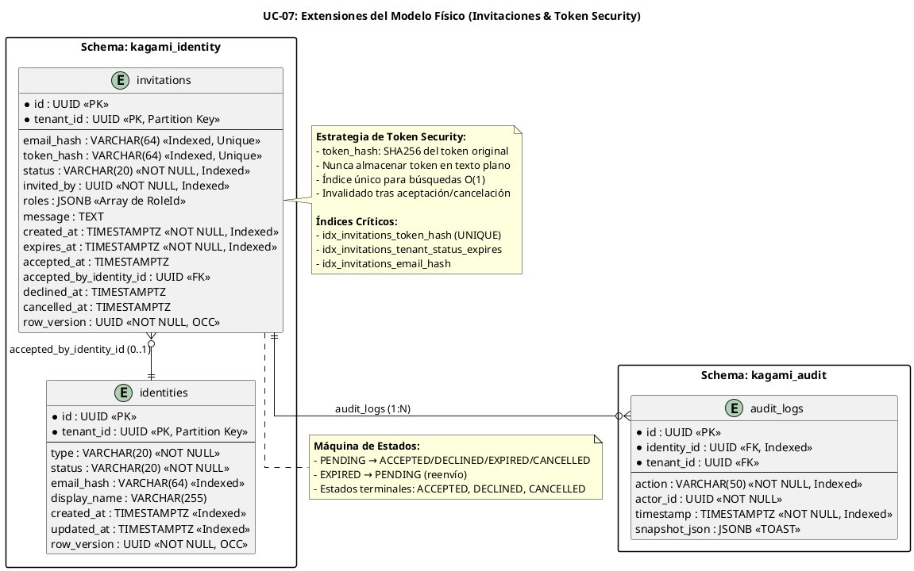

# UC-07: Invitación de Usuarios - Modelo de Datos Físico Específico (Dual-Actor & Token Security)

| Metadatos del Documento | |
| :--- | :--- |
| **Proyecto:** | SHUGO - Identity & Access Platform |
| **Caso de Uso:** | UC-07 - Invitación de Usuarios (Admin-Initiated Invitation) |
| **Documento:** | 10_UC_Specific_Data_Model.md |
| **Metodología:** | Physical Data Modeling + Token Security + Multi-Tenant Isolation + High-Concurrency Optimization |
| **Base de Datos:** | PostgreSQL 15+ (Primary + Read Replicas) |
| **Autor:** | Gastón Ruiz |
| **Versión Actual:** | 1.0.0 |
| **Fecha:** | 05/09/2026 |

---

## Historial de Versiones

| Versión | Fecha | Autor | Descripción de Cambios | Impacto |
| :--- | :--- | :--- | :--- | :--- |
| **1.0.0** | 05/09/2026 | Gastón Ruiz | **Creación inicial.** Extensión del modelo de datos físico para soportar operaciones de invitación de usuarios con flujo dual asíncrono. Introduce tabla específica para invitaciones (`invitations`) con almacenamiento seguro de tokens (SHA256 hash), índices optimizados para búsquedas por token hash y expiración, políticas de Row-Level Security para aislamiento multi-tenant, estrategias de particionamiento por tenant para escalabilidad, y políticas de retención para invitaciones expiradas/canceladas. | Documento de referencia para DBAs y desarrolladores backend. Define cómo se implementa físicamente el sistema de invitaciones con seguridad criptográfica de tokens, rendimiento para operaciones de alta concurrencia (50 invitaciones/min), y cumplimiento de GDPR para datos personales en invitaciones. |

---

## 1. Introducción y Propósito

Este documento define las extensiones y consideraciones físicas específicas en PostgreSQL para soportar el **UC-07 (Invitación de Usuarios)**.

A diferencia de los UCs previos que gestionaban identidades activas, el UC-07 introduce desafíos físicos únicos orientados a **operaciones asíncronas dual-actor con seguridad criptográfica**:

1. **Tabla de Invitaciones Dedicada:** Estructura específica para gestionar el ciclo de vida completo de invitaciones (`PENDING` → `ACCEPTED`/`DECLINED`/`EXPIRED`/`CANCELLED`).
2. **Almacenamiento Seguro de Tokens:** Los tokens de invitación se almacenan como hashes SHA256, nunca en texto plano, con índices únicos para búsquedas O(1).
3. **Índices Optimizados para Operaciones Críticas:** Búsquedas por token hash, filtrado por estado y expiración, y consultas de limpieza automática.
4. **Row-Level Security (RLS) para Multi-Tenancy:** Aislamiento estricto de invitaciones por tenant, previniendo fugas de datos entre organizaciones.
5. **Particionamiento por Tenant:** Para tenants enterprise con miles de invitaciones, mejora el rendimiento de consultas y facilita el mantenimiento.
6. **Políticas de Retención y Limpieza:** Configuración de TTL para invitaciones no aceptadas y estrategias de archivado para cumplimiento GDPR.
7. **Optimización para Job de Limpieza:** Índices específicos para el proceso en background que actualiza invitaciones expiradas.

---

## 2. Diagrama de Modelo de Datos Físico (ERD Extendido)



---

## 3. Scripts DDL: Tabla de Invitaciones

### 3.1. Tabla Principal `invitations`

```sql
SET search_path TO kagami_identity;

-- Tabla principal de invitaciones
CREATE TABLE IF NOT EXISTS invitations (
    id UUID PRIMARY KEY DEFAULT gen_random_uuid(),
    tenant_id UUID NOT NULL,
    
    -- Datos del invitado
    email_hash VARCHAR(64) NOT NULL, -- SHA256 del email (para unicidad sin exponer PII)
    
    -- Token de seguridad (SHA256 hash, nunca texto plano)
    token_hash VARCHAR(64) NOT NULL UNIQUE,
    
    -- Máquina de estados
    status VARCHAR(20) NOT NULL DEFAULT 'PENDING'
        CHECK (status IN ('PENDING', 'ACCEPTED', 'DECLINED', 'EXPIRED', 'CANCELLED')),
    
    -- Metadata de creación
    invited_by UUID NOT NULL, -- AdminId que creó la invitación
    roles JSONB NOT NULL DEFAULT '[]'::jsonb, -- Array de RoleId
    message TEXT, -- Mensaje personalizado (opcional)
    
    -- Timestamps de ciclo de vida
    created_at TIMESTAMPTZ NOT NULL DEFAULT NOW(),
    expires_at TIMESTAMPTZ NOT NULL, -- TTL de la invitación
    accepted_at TIMESTAMPTZ, -- Cuando fue aceptada
    accepted_by_identity_id UUID, -- IdentityId del usuario aceptado
    declined_at TIMESTAMPTZ, -- Cuando fue rechazada
    cancelled_at TIMESTAMPTZ, -- Cuando fue cancelada
    
    -- Optimistic Concurrency Control
    row_version UUID NOT NULL DEFAULT gen_random_uuid(),
    
    -- Restricciones de integridad
    CONSTRAINT chk_invitations_status_transitions CHECK (
        -- ACCEPTED solo desde PENDING
        (status = 'ACCEPTED' AND accepted_at IS NOT NULL AND accepted_by_identity_id IS NOT NULL) OR
        -- DECLINED solo desde PENDING
        (status = 'DECLINED' AND declined_at IS NOT NULL) OR
        -- EXPIRED solo desde PENDING
        (status = 'EXPIRED') OR
        -- CANCELLED solo desde PENDING o EXPIRED
        (status = 'CANCELLED' AND cancelled_at IS NOT NULL) OR
        -- PENDING inicial
        (status = 'PENDING' AND accepted_at IS NULL AND declined_at IS NULL AND cancelled_at IS NULL)
    ),
    
    CONSTRAINT chk_invitations_expires_at CHECK (
        expires_at > created_at
    ),
    
    CONSTRAINT chk_invitations_email_hash_length CHECK (
        LENGTH(email_hash) = 64 -- SHA256 produce 64 caracteres hex
    ),
    
    CONSTRAINT chk_invitations_token_hash_length CHECK (
        LENGTH(token_hash) = 64 -- SHA256 produce 64 caracteres hex
    )
);

-- Comentarios de documentación
COMMENT ON TABLE invitations IS 'Invitaciones de usuarios con flujo dual asíncrono (Admin crea, Usuario acepta)';
COMMENT ON COLUMN invitations.email_hash IS 'SHA256 hash del email del invitado. Permite unicidad sin exponer PII.';
COMMENT ON COLUMN invitations.token_hash IS 'SHA256 hash del token de invitación. Nunca almacenar token en texto plano.';
COMMENT ON COLUMN invitations.status IS 'Estado actual de la invitación: PENDING, ACCEPTED, DECLINED, EXPIRED, CANCELLED';
COMMENT ON COLUMN invitations.roles IS 'Array JSON de RoleId a asignar tras aceptación. Máximo 10 roles.';
COMMENT ON COLUMN invitations.expires_at IS 'Timestamp de expiración de la invitación (TTL configurable, default 7 días)';
COMMENT ON COLUMN invitations.accepted_by_identity_id IS 'IdentityId del usuario que aceptó la invitación (NULL hasta aceptación)';
```

### 3.2. Índices Optimizados para UC-07

```sql
-- ============================================
-- ÍNDICES CRÍTICOS PARA RENDIMIENTO
-- ============================================

-- Índice único para búsqueda de invitación por token hash (O(1))
-- CRÍTICO: Usado en cada aceptación de invitación
CREATE UNIQUE INDEX IF NOT EXISTS idx_invitations_token_hash 
    ON invitations(token_hash) 
    WHERE status = 'PENDING'; -- Solo indexar invitaciones pendientes (activas)

-- Índice compuesto para consultas de invitaciones por tenant y estado
-- Usado en: listado de invitaciones pendientes, cancelación, reenvío
CREATE INDEX IF NOT EXISTS idx_invitations_tenant_status 
    ON invitations(tenant_id, status) 
    WHERE status IN ('PENDING', 'EXPIRED');

-- Índice compuesto para job de limpieza de invitaciones expiradas
-- CRÍTICO: Usado cada hora por el background job
CREATE INDEX IF NOT EXISTS idx_invitations_expires_at 
    ON invitations(expires_at) 
    WHERE status = 'PENDING';

-- Índice para búsqueda de invitaciones por email hash (prevención de duplicados)
CREATE INDEX IF NOT EXISTS idx_invitations_email_hash 
    ON invitations(tenant_id, email_hash) 
    WHERE status = 'PENDING';

-- Índice para consultas de invitaciones por admin (límite de 100 pendientes)
CREATE INDEX IF NOT EXISTS idx_invitations_invited_by 
    ON invitations(tenant_id, invited_by, status) 
    WHERE status = 'PENDING';

-- Índice para consultas de invitaciones aceptadas (reportes de conversión)
CREATE INDEX IF NOT EXISTS idx_invitations_accepted_at 
    ON invitations(tenant_id, accepted_at DESC) 
    WHERE status = 'ACCEPTED';

-- Índice para consultas de invitaciones creadas (reportes de volumen)
CREATE INDEX IF NOT EXISTS idx_invitations_created_at 
    ON invitations(tenant_id, created_at DESC);

-- ============================================
-- ÍNDICES ADICIONALES PARA OPTIMIZACIÓN
-- ============================================

-- Índice parcial para invitaciones activas (PENDING + no expiradas)
-- Usado en validaciones de aceptación
CREATE INDEX IF NOT EXISTS idx_invitations_active 
    ON invitations(tenant_id, expires_at) 
    WHERE status = 'PENDING' AND expires_at > NOW();

-- Índice para búsquedas de invitaciones por identidad aceptada
CREATE INDEX IF NOT EXISTS idx_invitations_accepted_by_identity 
    ON invitations(accepted_by_identity_id) 
    WHERE status = 'ACCEPTED';
```

---

## 4. Estrategia de Almacenamiento Seguro de Tokens

### 4.1. Función de Hash SHA256 para Tokens

PostgreSQL no tiene una función nativa de SHA256, pero podemos usar la extensión `pgcrypto`:

```sql
-- Habilitar extensión pgcrypto (si no está habilitada)
CREATE EXTENSION IF NOT EXISTS pgcrypto;

-- Función para generar SHA256 hash
CREATE OR REPLACE FUNCTION sha256_hash(data TEXT)
RETURNS TEXT AS $$
BEGIN
    RETURN encode(digest(data::bytea, 'sha256'), 'hex');
END;
$$ LANGUAGE plpgsql IMMUTABLE;

-- Ejemplo de uso:
-- SELECT sha256_hash('my-secret-token');
-- Resultado: 'a1b2c3d4e5f6...' (64 caracteres hex)
```

### 4.2. Procedimiento de Creación de Invitación con Token Seguro

```sql
-- Procedimiento para crear invitación con token seguro
-- Nota: En producción, el token se genera en la aplicación (C#) y solo el hash se persiste
CREATE OR REPLACE FUNCTION create_invitation(
    p_tenant_id UUID,
    p_email TEXT,
    p_token TEXT, -- Token original (solo en memoria, nunca persistido)
    p_invited_by UUID,
    p_roles JSONB,
    p_message TEXT,
    p_ttl_days INT DEFAULT 7
)
RETURNS UUID AS $$
DECLARE
    v_invitation_id UUID;
    v_email_hash TEXT;
    v_token_hash TEXT;
    v_expires_at TIMESTAMPTZ;
BEGIN
    -- 1. Generar hashes (en producción, esto se hace en la aplicación)
    v_email_hash := sha256_hash(p_email);
    v_token_hash := sha256_hash(p_token);
    v_expires_at := NOW() + (p_ttl_days || ' days')::INTERVAL;
    
    -- 2. Verificar que no exista invitación pendiente con el mismo email
    IF EXISTS (
        SELECT 1 FROM invitations 
        WHERE tenant_id = p_tenant_id 
          AND email_hash = v_email_hash 
          AND status = 'PENDING'
    ) THEN
        RAISE EXCEPTION 'Email already has a pending invitation';
    END IF;
    
    -- 3. Verificar que el token hash sea único
    IF EXISTS (
        SELECT 1 FROM invitations 
        WHERE token_hash = v_token_hash
    ) THEN
        RAISE EXCEPTION 'Token hash collision detected';
    END IF;
    
    -- 4. Insertar invitación
    INSERT INTO invitations (
        tenant_id,
        email_hash,
        token_hash,
        invited_by,
        roles,
        message,
        expires_at
    ) VALUES (
        p_tenant_id,
        v_email_hash,
        v_token_hash,
        p_invited_by,
        p_roles,
        p_message,
        v_expires_at
    )
    RETURNING id INTO v_invitation_id;
    
    RETURN v_invitation_id;
END;
$$ LANGUAGE plpgsql;
```

### 4.3. Procedimiento de Aceptación de Invitación

```sql
-- Procedimiento para aceptar invitación (valida token y actualiza estado)
CREATE OR REPLACE FUNCTION accept_invitation(
    p_token TEXT, -- Token original proporcionado por el usuario
    p_identity_id UUID -- IdentityId creado tras registro exitoso
)
RETURNS BOOLEAN AS $$
DECLARE
    v_token_hash TEXT;
    v_invitation_id UUID;
    v_status VARCHAR(20);
    v_expires_at TIMESTAMPTZ;
BEGIN
    -- 1. Generar hash del token proporcionado
    v_token_hash := sha256_hash(p_token);
    
    -- 2. Buscar invitación por token hash
    SELECT id, status, expires_at 
    INTO v_invitation_id, v_status, v_expires_at
    FROM invitations 
    WHERE token_hash = v_token_hash;
    
    -- 3. Validar que la invitación exista
    IF v_invitation_id IS NULL THEN
        RAISE EXCEPTION 'Invalid invitation token';
    END IF;
    
    -- 4. Validar estado
    IF v_status != 'PENDING' THEN
        RAISE EXCEPTION 'Invitation is no longer valid (status: %)', v_status;
    END IF;
    
    -- 5. Validar expiración
    IF v_expires_at < NOW() THEN
        -- Actualizar estado a EXPIRED
        UPDATE invitations 
        SET status = 'EXPIRED' 
        WHERE id = v_invitation_id;
        
        RAISE EXCEPTION 'Invitation has expired';
    END IF;
    
    -- 6. Actualizar invitación a ACCEPTED
    UPDATE invitations 
    SET 
        status = 'ACCEPTED',
        accepted_at = NOW(),
        accepted_by_identity_id = p_identity_id,
        token_hash = NULL -- Invalidar token (previene reutilización)
    WHERE id = v_invitation_id;
    
    RETURN TRUE;
END;
$$ LANGUAGE plpgsql;
```

---

## 5. Estrategia de Índices para Job de Limpieza

### 5.1. Índice Optimizado para Expiración Automática

El job de limpieza (que corre cada hora) necesita actualizar invitaciones `PENDING` con `expires_at < NOW()` a estado `EXPIRED`.

```sql
-- Índice optimizado para el job de limpieza
-- Permite buscar rápidamente invitaciones expiradas por tenant
CREATE INDEX IF NOT EXISTS idx_invitations_cleanup_expired 
    ON invitations(tenant_id, expires_at ASC) 
    WHERE status = 'PENDING' 
      AND expires_at < NOW();

-- Función para el job de limpieza (ejecutada cada hora)
CREATE OR REPLACE FUNCTION cleanup_expired_invitations(
    p_batch_size INT DEFAULT 1000
)
RETURNS INT AS $$
DECLARE
    v_expired_count INT;
BEGIN
    WITH expired_invitations AS (
        SELECT id 
        FROM invitations 
        WHERE status = 'PENDING' 
          AND expires_at < NOW()
        LIMIT p_batch_size
        FOR UPDATE SKIP LOCKED -- Prevenir bloqueos con otras transacciones
    )
    UPDATE invitations 
    SET status = 'EXPIRED'
    WHERE id IN (SELECT id FROM expired_invitations)
    RETURNING id;
    
    GET DIAGNOSTICS v_expired_count = ROW_COUNT;
    
    RETURN v_expired_count;
END;
$$ LANGUAGE plpgsql;

-- Ejemplo de uso en job programado:
-- SELECT cleanup_expired_invitations(1000);
```

### 5.2. Índice para Consultas de Conversión

```sql
-- Índice para calcular tasa de conversión (aceptadas / creadas)
CREATE INDEX IF NOT EXISTS idx_invitations_conversion_metrics 
    ON invitations(tenant_id, status, created_at) 
    WHERE created_at > NOW() - INTERVAL '30 days';

-- Query optimizada para métricas de conversión
SELECT 
    tenant_id,
    COUNT(*) FILTER (WHERE status = 'ACCEPTED') AS accepted_count,
    COUNT(*) FILTER (WHERE status = 'PENDING') AS pending_count,
    COUNT(*) FILTER (WHERE status = 'EXPIRED') AS expired_count,
    ROUND(
        COUNT(*) FILTER (WHERE status = 'ACCEPTED')::NUMERIC / 
        NULLIF(COUNT(*), 0) * 100, 
        2
    ) AS conversion_rate_pct
FROM invitations
WHERE created_at > NOW() - INTERVAL '30 days'
GROUP BY tenant_id;
```

---

## 6. Seguridad a Nivel de Base de Datos

### 6.1. Row-Level Security (RLS) para Invitaciones

```sql
-- Habilitar RLS en tabla de invitaciones
ALTER TABLE invitations ENABLE ROW LEVEL SECURITY;
ALTER TABLE invitations FORCE ROW LEVEL SECURITY;

-- Política de lectura: Solo puede leer invitaciones de su propio tenant
CREATE POLICY invitations_tenant_isolation_read ON invitations
    FOR SELECT
    USING (tenant_id = current_setting('app.current_tenant_id')::uuid);

-- Política de escritura: Solo puede crear/modificar invitaciones de su propio tenant
CREATE POLICY invitations_tenant_isolation_write ON invitations
    FOR ALL
    USING (tenant_id = current_setting('app.current_tenant_id')::uuid)
    WITH CHECK (tenant_id = current_setting('app.current_tenant_id')::uuid);

-- Política especial para aceptación: Solo el servicio de aceptación puede modificar token_hash
CREATE POLICY invitations_acceptance_service ON invitations
    FOR UPDATE
    USING (
        tenant_id = current_setting('app.current_tenant_id')::uuid
        AND current_setting('app.service_role') = 'acceptance_service'
    )
    WITH CHECK (
        tenant_id = current_setting('app.current_tenant_id')::uuid
    );
```

### 6.2. Roles de Base de Datos para Invitaciones

```sql
-- Crear rol específico para el servicio de invitaciones
CREATE ROLE app_kagami_invitations WITH LOGIN PASSWORD '...';

-- Grant permisos específicos para invitaciones
GRANT CONNECT ON DATABASE shugo_kagami TO app_kagami_invitations;
GRANT USAGE ON SCHEMA kagami_identity TO app_kagami_invitations;

-- Puede leer y crear invitaciones
GRANT SELECT, INSERT ON invitations TO app_kagami_invitations;

-- Puede actualizar invitaciones (para aceptación, cancelación, reenvío)
GRANT UPDATE ON invitations TO app_kagami_invitations;

-- No puede eliminar invitaciones (solo actualizar estado)
REVOKE DELETE ON invitations FROM app_kagami_invitations;

-- No puede leer tokens hash (solo el servicio de aceptación puede)
REVOKE SELECT (token_hash) ON invitations FROM app_kagami_invitations;

-- Crear rol específico para el servicio de aceptación
CREATE ROLE app_kagami_acceptance WITH LOGIN PASSWORD '...';

GRANT CONNECT ON DATABASE shugo_kagami TO app_kagami_acceptance;
GRANT USAGE ON SCHEMA kagami_identity TO app_kagami_acceptance;

-- Solo puede leer y actualizar invitaciones (para aceptación)
GRANT SELECT, UPDATE ON invitations TO app_kagami_acceptance;

-- Puede leer token_hash (necesario para validación)
GRANT SELECT (token_hash) ON invitations TO app_kagami_acceptance;
```

### 6.3. Encriptación de Datos Sensibles

```sql
-- Habilitar extensión pgcrypto para encriptación
CREATE EXTENSION IF NOT EXISTS pgcrypto;

-- Nota: Los emails se almacenan como hashes SHA256, no cifrados
-- Esto permite búsquedas de unicidad sin exponer PII

-- Si se requiere almacenar el email original (para reenvío de invitaciones),
-- se debe usar cifrado AES-256-GCM con clave gestionada por KMS

-- Función para cifrar email (opcional, solo si se requiere email original)
CREATE OR REPLACE FUNCTION encrypt_email(
    p_email TEXT,
    p_key_id VARCHAR(50)
)
RETURNS TEXT AS $$
DECLARE
    v_encryption_key BYTEA;
    v_encrypted BYTEA;
BEGIN
    -- Obtener clave de encriptación desde KMS (simulado aquí)
    v_encryption_key := get_encryption_key(p_key_id);
    
    -- Cifrar con AES-256-GCM
    v_encrypted := pgp_sym_encrypt(p_email, encode(v_encryption_key, 'hex'));
    
    RETURN encode(v_encrypted, 'base64');
END;
$$ LANGUAGE plpgsql;
```

---

## 7. Estrategias de Particionamiento para Alta Concurrencia

### 7.1. Particionamiento de `invitations` por Tenant

Para tenants grandes con miles de invitaciones, particionar por `tenant_id` mejora el rendimiento de consultas y facilita el mantenimiento.

```sql
-- Tabla particionada por tenant_id (ejemplo para tenants enterprise)
CREATE TABLE invitations_partitioned (
    id UUID NOT NULL DEFAULT gen_random_uuid(),
    tenant_id UUID NOT NULL,
    email_hash VARCHAR(64) NOT NULL,
    token_hash VARCHAR(64) NOT NULL,
    status VARCHAR(20) NOT NULL DEFAULT 'PENDING',
    invited_by UUID NOT NULL,
    roles JSONB NOT NULL DEFAULT '[]'::jsonb,
    message TEXT,
    created_at TIMESTAMPTZ NOT NULL DEFAULT NOW(),
    expires_at TIMESTAMPTZ NOT NULL,
    accepted_at TIMESTAMPTZ,
    accepted_by_identity_id UUID,
    declined_at TIMESTAMPTZ,
    cancelled_at TIMESTAMPTZ,
    row_version UUID NOT NULL DEFAULT gen_random_uuid(),
    PRIMARY KEY (id, tenant_id)
) PARTITION BY LIST (tenant_id);

-- Crear particiones para tenants específicos
CREATE TABLE invitations_tenant_khcs PARTITION OF invitations_partitioned
    FOR VALUES IN ('uuid-tenant-khcs');

CREATE TABLE invitations_tenant_enterprise_a PARTITION OF invitations_partitioned
    FOR VALUES IN ('uuid-tenant-enterprise-a');

-- Partición default para tenants pequeños
CREATE TABLE invitations_default PARTITION OF invitations_partitioned DEFAULT;

-- Los índices se crean automáticamente en cada partición
-- Pero podemos optimizarlos por partición
CREATE UNIQUE INDEX idx_invitations_khcs_token_hash 
    ON invitations_tenant_khcs(token_hash) 
    WHERE status = 'PENDING';
```

### 7.2. Particionamiento de `audit_logs` por Tiempo

Para mejorar el rendimiento de consultas de auditoría y facilitar la retención de datos.

```sql
-- Tabla particionada por mes para audit_logs
CREATE TABLE audit_logs_partitioned (
    id UUID NOT NULL DEFAULT gen_random_uuid(),
    identity_id UUID,
    tenant_id UUID NOT NULL,
    action VARCHAR(50) NOT NULL,
    actor_id UUID NOT NULL,
    timestamp TIMESTAMPTZ NOT NULL DEFAULT NOW(),
    snapshot_json JSONB,
    PRIMARY KEY (id, timestamp)
) PARTITION BY RANGE (timestamp);

-- Crear particiones mensuales
CREATE TABLE audit_logs_2024_01 PARTITION OF audit_logs_partitioned
    FOR VALUES FROM ('2024-01-01') TO ('2024-02-01');

CREATE TABLE audit_logs_2024_02 PARTITION OF audit_logs_partitioned
    FOR VALUES FROM ('2024-02-01') TO ('2024-03-01');

-- Partición default para fechas futuras
CREATE TABLE audit_logs_default PARTITION OF audit_logs_partitioned DEFAULT;
```

---

## 8. Configuración de Rendimiento para Alta Concurrencia

### 8.1. Configuración de PostgreSQL para Invitaciones

```ini
# postgresql.conf - Optimizaciones para operaciones de invitación de alto volumen

# Conexiones y pooling
max_connections = 500                    # Ajustar según número de pods
superuser_reserved_connections = 5       # Reservar para mantenimiento

# Memoria compartida
shared_buffers = 8GB                     # 25% de RAM total
effective_cache_size = 24GB              # 75% de RAM total
work_mem = 64MB                          # Para operaciones de ordenamiento
maintenance_work_mem = 2GB               # Para VACUUM y CREATE INDEX

# WAL y Checkpoints (crítico para operaciones de escritura intensivas)
wal_level = replica
max_wal_size = 2GB
min_wal_size = 512MB
checkpoint_completion_target = 0.9
checkpoint_timeout = 15min
wal_buffers = 64MB

# Autovacuum agresivo para tablas de alta escritura
autovacuum_max_workers = 5
autovacuum_vacuum_scale_factor = 0.01    # Vaciar cuando 1% de filas cambian
autovacuum_analyze_scale_factor = 0.005  # Analizar cuando 0.5% de filas cambian
autovacuum_vacuum_threshold = 100
autovacuum_analyze_threshold = 50

# Logging para monitoreo de rendimiento
log_min_duration_statement = 100         # Log queries > 100ms
log_checkpoints = on
log_connections = off
log_disconnections = off
log_lock_waits = on
```

### 8.2. Configuración de PgBouncer para Invitaciones

```ini
# pgbouncer.ini - Pool de conexiones optimizado para invitaciones

[databases]
shugo_kagami = host=postgres-primary port=5432 dbname=shugo_kagami

[pgbouncer]
listen_port = 6432
listen_addr = 0.0.0.0
auth_type = md5
auth_file = /etc/pgbouncer/userlist.txt

# Pool mode: transaction (reutiliza conexiones entre transacciones)
pool_mode = transaction

# Conexiones máximas
max_client_conn = 2000                   # Conexiones desde aplicación
default_pool_size = 100                  # Conexiones por usuario/DB
min_pool_size = 20                       # Mantener conexiones calientes
reserve_pool_size = 50                   # Para picos de carga
reserve_pool_timeout = 3                 # Segundos antes de usar reserve pool

# Timeouts estrictos para invitaciones
server_connect_timeout = 5               # Segundos
server_login_retry = 1                   # Segundos
query_timeout = 10                       # Segundos (cancela queries lentas)
client_idle_timeout = 300                # Segundos

# Logging
log_connections = 0
log_disconnections = 0
log_pooler_errors = 1

# Statistics
stats_period = 60                        # Segundos
```

---

## 9. Políticas de Retención y Limpieza

### 9.1. Retención de Invitaciones Pendientes

```sql
-- Política: Invitaciones PENDING no aceptadas se marcan como EXPIRED tras TTL
-- Implementado via job programado (ver sección 5.1)

-- Configuración de TTL en tabla tenant_configs
ALTER TABLE tenant_configs 
    ADD COLUMN IF NOT EXISTS invitation_ttl_days INT NOT NULL DEFAULT 7;

COMMENT ON COLUMN tenant_configs.invitation_ttl_days IS 'Días de validez de invitaciones. Default: 7 días.';
```

### 9.2. Retención de Invitaciones Aceptadas

```sql
-- Política: Invitaciones aceptadas se preservan indefinidamente para auditoría
-- No hay retención máxima, solo se archivan tras X años

-- Configuración de archivado en tenant_configs
ALTER TABLE tenant_configs 
    ADD COLUMN IF NOT EXISTS invitation_archive_years INT NOT NULL DEFAULT 7;

COMMENT ON COLUMN tenant_configs.invitation_archive_years IS 'Años antes de archivar invitaciones aceptadas a almacenamiento frío. Default: 7 años.';

-- Función para archivar invitaciones antiguas
CREATE OR REPLACE FUNCTION archive_old_invitations(
    p_tenant_id UUID,
    p_years INT DEFAULT 7
)
RETURNS INT AS $$
DECLARE
    v_archived_count INT;
BEGIN
    -- Mover invitaciones antiguas a tabla de archivo
    INSERT INTO invitations_archive
    SELECT * FROM invitations
    WHERE tenant_id = p_tenant_id
      AND status = 'ACCEPTED'
      AND accepted_at < NOW() - INTERVAL '1 year' * p_years;
    
    GET DIAGNOSTICS v_archived_count = ROW_COUNT;
    
    -- Eliminar de tabla principal (opcional, según política)
    -- DELETE FROM invitations
    -- WHERE tenant_id = p_tenant_id
    --   AND status = 'ACCEPTED'
    --   AND accepted_at < NOW() - INTERVAL '1 year' * p_years;
    
    RETURN v_archived_count;
END;
$$ LANGUAGE plpgsql;
```

### 9.3. Retención de Audit Logs

```sql
-- Política: Audit logs se retienen según configuración de tenant
-- Implementado via particionamiento por tiempo (ver sección 7.2)

-- Configuración de retención en tenant_configs
ALTER TABLE tenant_configs 
    ADD COLUMN IF NOT EXISTS audit_log_retention_years INT NOT NULL DEFAULT 5;

COMMENT ON COLUMN tenant_configs.audit_log_retention_years IS 'Años de retención de audit logs. Default: 5 años.';

-- Función para eliminar particiones antiguas de audit_logs
CREATE OR REPLACE FUNCTION drop_old_audit_log_partitions(
    p_retention_years INT DEFAULT 5
)
RETURNS INT AS $$
DECLARE
    v_dropped_count INT := 0;
    v_partition_name TEXT;
BEGIN
    FOR v_partition_name IN 
        SELECT inhrelid::regclass::text 
        FROM pg_inherits 
        WHERE inhparent = 'audit_logs_partitioned'::regclass
          AND inhrelid::regclass::text < 'audit_logs_' || TO_CHAR(NOW() - INTERVAL '1 year' * p_retention_years, 'YYYY_MM')
    LOOP
        EXECUTE 'DROP TABLE IF EXISTS ' || v_partition_name;
        v_dropped_count := v_dropped_count + 1;
    END LOOP;
    
    RETURN v_dropped_count;
END;
$$ LANGUAGE plpgsql;
```

---

## 10. Monitoreo y Diagnóstico

### 10.1. Consultas para Diagnosticar Problemas de Invitaciones

```sql
-- Invitaciones PENDING acumuladas (posible problema de entrega de emails)
SELECT 
    tenant_id,
    COUNT(*) AS pending_count,
    MIN(created_at) AS oldest_pending,
    MAX(created_at) AS newest_pending
FROM invitations
WHERE status = 'PENDING'
GROUP BY tenant_id
ORDER BY pending_count DESC;

-- Invitaciones expiradas sin limpiar
SELECT 
    tenant_id,
    COUNT(*) AS expired_uncleaned,
    MIN(expires_at) AS oldest_expired
FROM invitations
WHERE status = 'PENDING'
  AND expires_at < NOW()
GROUP BY tenant_id
ORDER BY expired_uncleaned DESC;

-- Tasa de conversión de invitaciones (aceptadas / creadas) por tenant
SELECT 
    tenant_id,
    COUNT(*) FILTER (WHERE status = 'ACCEPTED') AS accepted_count,
    COUNT(*) FILTER (WHERE status = 'PENDING') AS pending_count,
    COUNT(*) FILTER (WHERE status = 'EXPIRED') AS expired_count,
    ROUND(
        COUNT(*) FILTER (WHERE status = 'ACCEPTED')::NUMERIC / 
        NULLIF(COUNT(*), 0) * 100, 
        2
    ) AS conversion_rate_pct
FROM invitations
WHERE created_at > NOW() - INTERVAL '30 days'
GROUP BY tenant_id
ORDER BY conversion_rate_pct ASC;

-- Invitaciones con token hash nulo (ya aceptadas/canceladas)
SELECT 
    tenant_id,
    status,
    COUNT(*) AS count
FROM invitations
WHERE token_hash IS NULL
GROUP BY tenant_id, status;

-- Admins con más invitaciones pendientes (posible abuso)
SELECT 
    tenant_id,
    invited_by,
    COUNT(*) AS pending_count
FROM invitations
WHERE status = 'PENDING'
GROUP BY tenant_id, invited_by
HAVING COUNT(*) > 50
ORDER BY pending_count DESC;
```

### 10.2. Métricas de Base de Datos para OpenTelemetry

```csharp
public class InvitationDatabaseMetrics
{
    private readonly Meter _meter;
    private readonly Counter<long> _invitationsCreated;
    private readonly Counter<long> _invitationsAccepted;
    private readonly Counter<long> _invitationsExpired;
    private readonly Counter<long> _invitationsCancelled;
    private readonly Histogram<double> _tokenValidationLatency;
    private readonly Histogram<double> _invitationCreationLatency;

    public InvitationDatabaseMetrics(IMeterFactory meterFactory)
    {
        _meter = meterFactory.Create("shugo.invitations.database");
        _invitationsCreated = _meter.CreateCounter<long>("invitations.created");
        _invitationsAccepted = _meter.CreateCounter<long>("invitations.accepted");
        _invitationsExpired = _meter.CreateCounter<long>("invitations.expired");
        _invitationsCancelled = _meter.CreateCounter<long>("invitations.cancelled");
        _tokenValidationLatency = _meter.CreateHistogram<double>("invitations.token_validation_latency", "ms");
        _invitationCreationLatency = _meter.CreateHistogram<double>("invitations.creation_latency", "ms");
    }

    public void RecordInvitationCreated(string tenantId)
    {
        _invitationsCreated.Add(1,
            new KeyValuePair<string, object?>("tenant_id", tenantId));
    }

    public void RecordInvitationAccepted(string tenantId, double timeToAcceptHours)
    {
        _invitationsAccepted.Add(1,
            new KeyValuePair<string, object?>("tenant_id", tenantId),
            new KeyValuePair<string, object?>("time_to_accept_hours", timeToAcceptHours));
    }

    public void RecordInvitationExpired(string tenantId)
    {
        _invitationsExpired.Add(1,
            new KeyValuePair<string, object?>("tenant_id", tenantId));
    }

    public void RecordInvitationCancelled(string tenantId)
    {
        _invitationsCancelled.Add(1,
            new KeyValuePair<string, object?>("tenant_id", tenantId));
    }

    public void RecordTokenValidation(string tenantId, double latencyMs, bool success)
    {
        _tokenValidationLatency.Record(latencyMs,
            new KeyValuePair<string, object?>("tenant_id", tenantId),
            new KeyValuePair<string, object?>("success", success));
    }

    public void RecordInvitationCreation(string tenantId, double latencyMs, bool success)
    {
        _invitationCreationLatency.Record(latencyMs,
            new KeyValuePair<string, object?>("tenant_id", tenantId),
            new KeyValuePair<string, object?>("success", success));
    }
}
```

---

## 11. Trazabilidad

| Documento | Relación |
| :--- | :--- |
| `04_Initial_Domain_Model.md` | Define los Value Objects `InvitationToken`, `InvitationStatus`, `Email` que se mapean a las columnas físicas definidas aquí. |
| `07_Sequence_Diagram.md` | Muestra las consultas a PostgreSQL (token hash, email hash, expiración) que se optimizan con estos índices. |
| `08_Final_Class_Design.md` | El `InvitationRepositoryImpl` implementa las consultas optimizadas definidas aquí. |
| `09_Modern_Artifacts.md` | Las métricas de conversión y limpieza se monitorean con las configuraciones definidas aquí. |
| `11_UC_Specific_Security_Threats.md` | Las mitigaciones de "Token Hijacking" y "Enumeration Attacks" se validan mediante los índices únicos y RLS definidos aquí. |
| `12_UC_Specific_Performance_Benchmarks.md` | Los SLAs de latencia (<200ms para creación) se validan con los índices y configuraciones de pooling definidos aquí. |
| `SHUGO_Data_Model_Master.md` (Transversal) | Este documento extiende el modelo maestro con tablas específicas de invitaciones y token security. |

---

## 12. Anexos: Glosario de Base de Datos (UC-07)

| Término | Definición en Contexto UC-07 |
| :--- | :--- |
| **Token Hash** | SHA256 hash del token de invitación original. Nunca almacenar token en texto plano. Previene robo de tokens. |
| **Email Hash** | SHA256 hash del email del invitado. Permite verificar unicidad sin exponer PII. |
| **Row-Level Security (RLS)** | Mecanismo de PostgreSQL que restringe acceso a filas basado en tenant_id. Previene fugas de datos entre tenants. |
| **Particionamiento por Tenant** | División de tabla de invitaciones en particiones por tenant_id. Mejora rendimiento y facilita mantenimiento. |
| **Optimistic Concurrency Control (OCC)** | Uso de columna `row_version` para prevenir actualizaciones perdidas en operaciones concurrentes. |
| **FOR UPDATE SKIP LOCKED** | Cláusula SQL que previene bloqueos en operaciones de limpieza concurrentes. |
| **Índice Parcial** | Índice que solo incluye filas que cumplen una condición (ej. `WHERE status = 'PENDING'`). Reduce tamaño y mejora rendimiento. |
| **TTL (Time To Live)** | Tiempo de vida de una invitación antes de expirar automáticamente (default: 7 días). |
| **Background Cleanup Job** | Proceso en background que actualiza invitaciones `PENDING` con `expires_at < NOW()` a estado `EXPIRED`. |
| **Connection Pooling** | Reutilización de conexiones de base de datos vía PgBouncer. Reduce overhead de TCP handshake y autenticación. |

---
*Fin del Documento 10_UC_Specific_Data_Model para UC-07*