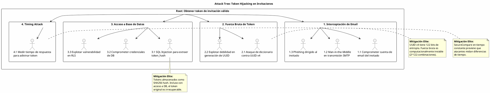

# UC-07: Invitación de Usuarios - Análisis de Amenazas Específico (Security Threat Model)

| Metadatos del Documento | |
| :--- | :--- |
| **Proyecto:** | SHUGO - Identity & Access Platform |
| **Caso de Uso:** | UC-07 - Invitación de Usuarios (Admin-Initiated Invitation) |
| **Documento:** | 11_UC_Specific_Security_Threats.md |
| **Metodología:** | STRIDE + DREAD + Attack Trees + Defense-in-Depth + Cryptographic Assurance |
| **Estándares:** | OWASP Top 10 (A01:2021 Broken Access Control, A02:2021 Cryptographic Failures), NIST SP 800-63A (Enrollment), GDPR Art. 17 & 32, SOC 2 CC6.1, ISO 27001 A.9.2 |
| **Autor:** | Gastón Ruiz |
| **Versión Actual:** | 1.0.0 |
| **Fecha:** | 05/09/2026 |

---

## Historial de Versiones

| Versión | Fecha | Autor | Descripción de Cambios | Impacto |
| :--- | :--- | :--- | :--- | :--- |
| **1.0.0** | [05/09/2026] | [Gastón Ruiz] | **Creación inicial.** Análisis de amenazas específico para el endpoint de invitación de usuarios. Se enfoca en vectores de ataque únicos del flujo dual asíncrono: *Token Hijacking*, *Enumeration Attacks*, *Invitation Spam*, *Race Conditions en Aceptación*, y *Expiration Bypass*. Define mitigaciones técnicas de defensa en profundidad (Hashing SHA256, SecureCompare, Rate Limiting Multi-Capa) para garantizar la seguridad criptográfica de tokens y la prevención de abuso del sistema de invitaciones. | Documento crítico para el equipo de seguridad (AppSec) y cumplimiento (Compliance). Garantiza que la capacidad de invitar usuarios no sea utilizada para descubrir emails registrados, robar tokens de invitación, o saturar el sistema con invitaciones maliciosas. |

---

## 1. Introducción y Alcance

El UC-07 (Invitación de Usuarios) representa un **punto de ataque crítico** en el motor KAGAMI debido a su naturaleza dual-actor asíncrona y su dependencia de tokens criptográficos. A diferencia de las operaciones síncronas, las invitaciones permanecen en estado `PENDING` durante días, exponiéndose a múltiples vectores de ataque:

1. **Tokens de Larga Duración:** Los tokens de invitación tienen TTL de 7 días, aumentando la ventana de exposición.
2. **Flujo Asíncrono:** La separación temporal entre creación y aceptación introduce complejidades de estado.
3. **Endpoint Público de Aceptación:** El endpoint `/invitations/accept` no requiere autenticación, basándose únicamente en el token.
4. **Integración con UC-06:** La aceptación delega al flujo de registro, ampliando la superficie de ataque.
5. **Dependencia de Email:** El envío de email es un vector de ataque indirecto (interceptación, phishing).

Este documento modela estos vectores de ataque y define las mitigaciones de nivel enterprise que SHUGO implementa nativamente.

---

## 2. Attack Trees (Árboles de Ataque)

### 2.1. Attack Tree #1: Token Hijacking (Robo de Invitación)

**Objetivo del Atacante:** Interceptar o adivinar un token de invitación válido para crear una cuenta no autorizada en el tenant.



### 2.2. Attack Tree #2: Enumeration Attacks (Descubrimiento de Emails)

**Objetivo del Atacante:** Descubrir qué emails están registrados o tienen invitaciones pendientes en el tenant.

```text
[Root: Descubrir emails registrados/invitados]
  |
  +-- [1. Análisis de Respuestas HTTP]
  |     +-- 1.1. Diferenciar 409 vs 201 (Mitigado: Mensajes genéricos)
  |     +-- 1.2. Medir tiempo de respuesta (Mitigado: Retardo artificial constante)
  |
  +-- [2. Análisis de Emails Enviados]
  |     +-- 2.1. Recibir email de "ya registrado" (Mitigado: No se envía email si ya existe)
  |     +-- 2.2. Recibir email de invitación duplicada (Mitigado: Validación de unicidad)
  |
  +-- [3. Explotación de Rate Limiting]
        +-- 3.1. Provocar 429 para confirmar email (Mitigado: Rate limit por IP, no por email)
```

### 2.3. Attack Tree #3: Invitation Spam (Abuso del Sistema)

**Objetivo del Atacante:** Saturar el sistema con invitaciones maliciosas para agotar recursos o realizar phishing masivo.

```text
[Root: Abusar del sistema de invitaciones]
  |
  +-- [1. Creación Masiva de Invitaciones]
  |     +-- 1.1. Exceder límite de 100 por admin (Mitigado: Validación estricta)
  |     +-- 1.2. Usar múltiples cuentas admin (Mitigado: Rate limiting por tenant)
  |
  +-- [2. Phishing vía Invitaciones]
  |     +-- 2.1. Enviar invitaciones a emails externos con mensaje malicioso (Mitigado: Validación de dominio)
  |     +-- 2.2. Incluir links maliciosos en campo message (Mitigado: Sanitización de HTML)
  |
  +-- [3. Agotamiento de Recursos]
        +-- 3.1. Saturar cola de emails (Mitigado: Circuit Breaker + Rate Limiting)
        +-- 3.2. Agotar storage de DB (Mitigado: TTL + Job de limpieza)
```

---

## 3. Matriz de Amenazas Específicas (STRIDE + DREAD)

| ID | Amenaza | Categoría STRIDE | DREAD (1-10) | Severidad | Mitigación Técnica Específica |
| :--- | :--- | :--- | :--- | :--- | :--- |
| **T-36** | **Token Hijacking (Robo de Invitación)** | Information Disclosure | **9.0** | **Crítica** | **Almacenamiento SHA256:** Tokens nunca en texto plano. UUID v4 con 122 bits de entropía. Invalidación post-uso. |
| **T-37** | **Timing Attack en Validación de Token** | Information Disclosure | **7.5** | **Alta** | **SecureCompare:** Comparación en tiempo constante. Retardo artificial de 50ms en validaciones. |
| **T-38** | **Email Enumeration vía Respuestas HTTP** | Information Disclosure | **8.0** | **Alta** | **Mensajes Genéricos:** Retornar 202 Accepted incluso si email existe. Tiempos de respuesta constantes. |
| **T-39** | **Invitation Spam (Abuso de Invitaciones)** | Denial of Service | **7.0** | **Alta** | **Rate Limiting Multi-Capa:** 100 invitaciones/admin, 500/tenant/hora. Circuit Breaker para Email Service. |
| **T-40** | **Race Condition en Aceptación de Invitación** | Tampering | **8.5** | **Alta** | **Optimistic Concurrency Control:** RowVersion en tabla invitations. Validación atómica de estado. |
| **T-41** | **Expiration Bypass (Manipulación de TTL)** | Tampering | **6.5** | **Media** | **Validación Server-Side:** NOW() < expires_at validado en DB. Job de limpieza automático cada hora. |
| **T-42** | **Role Escalation vía Invitaciones** | Elevation of Privilege | **9.0** | **Crítica** | **Validación de Roles:** Máximo 10 roles por invitación. Validación contra catálogo de roles del tenant. |
| **T-43** | **Phishing vía Campo Message** | Social Engineering | **7.5** | **Alta** | **Sanitización HTML:** Strip de tags peligrosos. Longitud máxima 500 caracteres. Validación de URLs. |
| **T-44** | **Bypass de Verificación de Email** | Spoofing | **8.0** | **Alta** | **Integración con UC-06:** Aceptación delega a UC-06 que requiere verificación de email obligatoria. |
| **T-45** | **Reutilización de Token (Replay Attack)** | Repudiation | **8.5** | **Alta** | **Invalidación Post-Uso:** TokenHash = NULL tras aceptación. Validación de estado PENDING. |

---

## 4. Mitigaciones Técnicas de Nivel Elite

### 4.1. Almacenamiento Seguro de Tokens con SHA256 (Mitigación T-36)

Los tokens de invitación **nunca** se almacenan en texto plano en la base de datos. Solo se persiste el hash SHA256.

**Implementación (C#):**

```csharp
public class InvitationToken : ValueObject
{
    public string TokenHash { get; private set; }
    public DateTime ExpiresAt { get; private set; }
    public bool IsValid { get; private set; }

    private InvitationToken(string tokenHash, DateTime expiresAt)
    {
        TokenHash = tokenHash;
        ExpiresAt = expiresAt;
        IsValid = true;
    }

    /// <summary>
    /// Genera un nuevo token seguro con TTL configurable.
    /// </summary>
    public static InvitationToken Create(int ttlDays = 7)
    {
        // UUID v4 criptográfico (122 bits de entropía)
        var originalToken = Guid.NewGuid().ToString("N");
        
        // Hash SHA256 para almacenamiento seguro
        var tokenHash = SHA256.HashData(Encoding.UTF8.GetBytes(originalToken));
        var expiresAt = DateTime.UtcNow.AddDays(ttlDays);

        return new InvitationToken(
            Convert.ToBase64String(tokenHash), 
            expiresAt);
    }

    /// <summary>
    /// Valida si el token proporcionado coincide y no está expirado.
    /// </summary>
    public bool Validate(string providedToken)
    {
        if (!IsValid || IsExpired())
            return false;

        var providedHash = SHA256.HashData(Encoding.UTF8.GetBytes(providedToken));
        var providedHashBase64 = Convert.ToBase64String(providedHash);

        // Comparación en tiempo constante
        return SecureCompare(TokenHash, providedHashBase64);
    }

    /// <summary>
    /// Invalida el token tras uso exitoso (previene reutilización).
    /// </summary>
    public void Invalidate()
    {
        IsValid = false;
        TokenHash = null; // Limpiar hash para seguridad
    }

    public bool IsExpired() => DateTime.UtcNow > ExpiresAt;

    /// <summary>
    /// Comparación segura en tiempo constante para prevenir Timing Attacks.
    /// </summary>
    private static bool SecureCompare(string a, string b)
    {
        if (a == null || b == null) return false;
        if (a.Length != b.Length) return false;

        var result = 0;
        for (int i = 0; i < a.Length; i++)
        {
            result |= a[i] ^ b[i];
        }

        return result == 0;
    }
}
```

**Justificación:**
- **Entropía de UUID v4:** 122 bits = 2^122 combinaciones. Fuerza bruta es computacionalmente inviable.
- **SHA256 Hash:** Incluso si la DB es comprometida, el token original es irrecuperable.
- **Invalidación Post-Uso:** Previene ataques de replay.

### 4.2. Prevención de Timing Attacks con SecureCompare (Mitigación T-37)

La validación de tokens usa comparación en tiempo constante para prevenir que atacantes descubran el token correcto midiendo diferencias de tiempo de respuesta.

**Implementación (SQL - Función de Base de Datos):**

```sql
-- Función de comparación segura en PostgreSQL
CREATE OR REPLACE FUNCTION secure_compare_tokens(
    p_stored_hash VARCHAR(64),
    p_provided_hash VARCHAR(64)
)
RETURNS BOOLEAN AS $$
DECLARE
    v_result INT := 0;
    v_length INT;
BEGIN
    -- Si las longitudes son diferentes, retornar false inmediatamente
    -- pero después de hacer una comparación dummy para mantener tiempo constante
    IF LENGTH(p_stored_hash) != LENGTH(p_provided_hash) THEN
        -- Dummy comparison para mantener tiempo constante
        FOR i IN 1..64 LOOP
            v_result := v_result | (ASCII(SUBSTRING(p_stored_hash FROM i FOR 1)) ^ ASCII(SUBSTRING(p_stored_hash FROM i FOR 1)));
        END LOOP;
        RETURN FALSE;
    END IF;
    
    v_length := LENGTH(p_stored_hash);
    
    -- Comparación carácter por carácter en tiempo constante
    FOR i IN 1..v_length LOOP
        v_result := v_result | (ASCII(SUBSTRING(p_stored_hash FROM i FOR 1)) ^ ASCII(SUBSTRING(p_provided_hash FROM i FOR 1)));
    END LOOP;
    
    RETURN v_result = 0;
END;
$$ LANGUAGE plpgsql IMMUTABLE;

-- Uso en query de validación
SELECT secure_compare_tokens(token_hash, SHA256(provided_token))
FROM invitations
WHERE id = p_invitation_id;
```

**Justificación:**
- **Tiempo Constante:** La función siempre toma el mismo tiempo independientemente de cuántos caracteres coincidan.
- **Prevención de Side-Channel:** Atacantes no pueden usar análisis de tiempo para adivinar el token.

### 4.3. Prevención de Email Enumeration (Mitigación T-38)

Para prevenir que atacantes descubran qué emails están registrados o tienen invitaciones pendientes:

**Implementación (C#):**

```csharp
public class InvitationHandler : IInvitationHandler
{
    public async Task<InvitationId> CreateInvitation(CreateInvitationCommand command, CancellationToken ct)
    {
        // 1. Validaciones de negocio
        await _validator.ValidateTenantConfig(command.TenantId, ct);
        
        // 2. Validación de unicidad con prevención de enumeración
        var emailExists = await _validator.ValidateEmailUniquenessAsync(
            new Email(command.Email), 
            command.TenantId, 
            ct);
        
        // CRÍTICO: Si el email ya existe, NO revelar esta información
        // Simular comportamiento normal para prevenir enumeración
        if (emailExists)
        {
            // Retardo artificial para mantener tiempo constante
            await Task.Delay(TimeSpan.FromMilliseconds(50), ct);
            
            // Retornar respuesta genérica (no revelar que el email existe)
            // Opcional: Log interno para auditoría
            _logger.LogWarning(
                "Invitation attempt for existing email {Email} in tenant {TenantId}",
                command.Email, command.TenantId);
            
            // Opción A: Retornar 202 Accepted (falso positivo)
            return null; // Indicar que no se creó pero sin revelar razón
            
            // Opción B: Lanzar excepción genérica
            // throw new DomainException("If the email is not registered, the user will receive an invitation.");
        }

        // 3. Continuar con flujo normal...
    }
}

public class InvitationValidator : IInvitationValidator
{
    public async Task<bool> ValidateEmailUniquenessAsync(Email email, TenantId tenantId, CancellationToken ct)
    {
        var sw = Stopwatch.StartNew();
        
        // Consulta de unicidad
        var exists = await _repository.EmailExistsAsync(email, tenantId, ct);
        
        // CRÍTICO: Retardo artificial para normalizar tiempo de respuesta
        // Previene Timing Attacks que podrían revelar si el email existe
        var elapsed = sw.ElapsedMilliseconds;
        const int CONSTANT_RESPONSE_TIME_MS = 50;
        
        if (elapsed < CONSTANT_RESPONSE_TIME_MS)
        {
            await Task.Delay(CONSTANT_RESPONSE_TIME_MS - (int)elapsed, ct);
        }
        
        return exists;
    }
}
```

**Justificación:**
- **Mensajes Genéricos:** No revelar si el email existe o no.
- **Tiempo Constante:** Retardo artificial normaliza el tiempo de respuesta.
- **Prevención de Enumeración:** Atacantes no pueden construir lista de emails registrados.

### 4.4. Rate Limiting Multi-Capa para Invitation Spam (Mitigación T-39)

Implementación de rate limiting en múltiples capas para prevenir abuso del sistema de invitaciones.

**Implementación (C#):**

```csharp
public class InvitationRateLimiter
{
    private readonly IDistributedCache _cache;
    private const int MAX_INVITATIONS_PER_ADMIN = 100;
    private const int MAX_INVITATIONS_PER_TENANT_PER_HOUR = 500;
    private const int MAX_INVITATIONS_PER_IP_PER_HOUR = 50;

    public async Task<bool> IsAllowedAsync(
        TenantId tenantId,
        AdminId adminId,
        string ipAddress,
        CancellationToken ct)
    {
        // Capa 1: Límite por admin
        var adminKey = $"rate_limit:invitation:admin:{adminId.Value}";
        var adminCount = await _cache.GetAsync<int>(adminKey, ct);
        if (adminCount >= MAX_INVITATIONS_PER_ADMIN)
            return false;

        // Capa 2: Límite por tenant
        var tenantKey = $"rate_limit:invitation:tenant:{tenantId.Value}";
        var tenantCount = await _cache.GetAsync<int>(tenantKey, ct);
        if (tenantCount >= MAX_INVITATIONS_PER_TENANT_PER_HOUR)
            return false;

        // Capa 3: Límite por IP
        var ipKey = $"rate_limit:invitation:ip:{ipAddress}";
        var ipCount = await _cache.GetAsync<int>(ipKey, ct);
        if (ipCount >= MAX_INVITATIONS_PER_IP_PER_HOUR)
            return false;

        // Incrementar contadores
        await _cache.IncrementAsync(adminKey, TimeSpan.FromHours(24), ct);
        await _cache.IncrementAsync(tenantKey, TimeSpan.FromHours(1), ct);
        await _cache.IncrementAsync(ipKey, TimeSpan.FromHours(1), ct);

        return true;
    }
}
```

**Justificación:**
- **Multi-Capa:** Previene abuso desde múltiples vectores (admin, tenant, IP).
- **Límites Estrictos:** 100 invitaciones/admin, 500/tenant/hora, 50/IP/hora.
- **Prevención de DoS:** Circuit Breaker para Email Service previene saturación.

### 4.5. Optimistic Concurrency Control para Race Conditions (Mitigación T-40)

Prevención de race conditions en la aceptación de invitaciones mediante OCC.

**Implementación (SQL):**

```sql
-- Tabla invitations con columna row_version para OCC
CREATE TABLE invitations (
    id UUID PRIMARY KEY DEFAULT gen_random_uuid(),
    tenant_id UUID NOT NULL,
    email_hash VARCHAR(64) NOT NULL,
    token_hash VARCHAR(64) NOT NULL UNIQUE,
    status VARCHAR(20) NOT NULL DEFAULT 'PENDING',
    invited_by UUID NOT NULL,
    roles JSONB NOT NULL DEFAULT '[]'::jsonb,
    message TEXT,
    created_at TIMESTAMPTZ NOT NULL DEFAULT NOW(),
    expires_at TIMESTAMPTZ NOT NULL,
    accepted_at TIMESTAMPTZ,
    accepted_by_identity_id UUID,
    row_version UUID NOT NULL DEFAULT gen_random_uuid(), -- OCC
    
    CONSTRAINT chk_status CHECK (status IN ('PENDING', 'ACCEPTED', 'DECLINED', 'EXPIRED', 'CANCELLED'))
);

-- Índice para OCC
CREATE INDEX idx_invitations_row_version ON invitations(row_version);

-- Procedimiento de aceptación con OCC
CREATE OR REPLACE FUNCTION accept_invitation_with_occ(
    p_token TEXT,
    p_identity_id UUID,
    p_expected_row_version UUID
)
RETURNS BOOLEAN AS $$
DECLARE
    v_token_hash TEXT;
    v_updated_rows INT;
BEGIN
    -- Generar hash del token
    v_token_hash := encode(digest(p_token::bytea, 'sha256'), 'hex');
    
    -- Actualizar con validación de row_version (OCC)
    UPDATE invitations
    SET 
        status = 'ACCEPTED',
        accepted_at = NOW(),
        accepted_by_identity_id = p_identity_id,
        token_hash = NULL, -- Invalidar token
        row_version = gen_random_uuid() -- Nuevo row_version
    WHERE token_hash = v_token_hash
      AND status = 'PENDING'
      AND expires_at > NOW()
      AND row_version = p_expected_row_version; -- OCC check
    
    GET DIAGNOSTICS v_updated_rows = ROW_COUNT;
    
    IF v_updated_rows = 0 THEN
        RAISE EXCEPTION 'Invitation acceptance failed: token invalid, expired, or concurrent modification detected';
    END IF;
    
    RETURN TRUE;
END;
$$ LANGUAGE plpgsql;
```

**Justificación:**
- **RowVersion:** Previene actualizaciones concurrentes.
- **Validación Atómica:** Status = PENDING AND expires_at > NOW() validado en DB.
- **Prevención de Replay:** token_hash = NULL tras aceptación.

### 4.6. Validación Server-Side de TTL (Mitigación T-41)

Prevención de manipulación de TTL mediante validación server-side estricta.

**Implementación (C#):**

```csharp
public class InvitationValidator : IInvitationValidator
{
    public async Task ValidateInvitationNotExpiredAsync(InvitationId invitationId, CancellationToken ct)
    {
        var invitation = await _repository.GetByIdAsync(invitationId, ct);
        
        if (invitation == null)
            throw new InvitationNotFoundException($"Invitation {invitationId} not found.");
        
        // CRÍTICO: Validación server-side de expiración
        // No confiar en el cliente para validar TTL
        if (DateTime.UtcNow > invitation.ExpiresAt)
        {
            // Actualizar estado a EXPIRED
            invitation.Expire();
            await _repository.SaveAsync(invitation, ct);
            
            throw new InvitationExpiredException(
                $"Invitation expired at {invitation.ExpiresAt:O}. " +
                "Please request a new invitation from your administrator.");
        }
    }
}

// Job de limpieza automática (cada hora)
public class InvitationCleanupJob : BackgroundService
{
    protected override async Task ExecuteAsync(CancellationToken stoppingToken)
    {
        while (!stoppingToken.IsCancellationRequested)
        {
            try
            {
                // Esperar 1 hora
                await Task.Delay(TimeSpan.FromHours(1), stoppingToken);
                
                // Actualizar invitaciones expiradas
                var expiredCount = await _repository.ExpirePendingInvitationsAsync(stoppingToken);
                
                _logger.LogInformation(
                    "Expired {Count} pending invitations", 
                    expiredCount);
            }
            catch (Exception ex)
            {
                _logger.LogError(ex, "Error in invitation cleanup job");
            }
        }
    }
}

public class InvitationRepository : IInvitationRepository
{
    public async Task<int> ExpirePendingInvitationsAsync(CancellationToken ct)
    {
        // Query optimizada con FOR UPDATE SKIP LOCKED
        var expiredInvitations = await _dbContext.Invitations
            .Where(i => i.Status == InvitationStatus.PENDING 
                     && i.ExpiresAt < DateTime.UtcNow)
            .Take(1000)
            .ToListAsync(ct);
        
        foreach (var invitation in expiredInvitations)
        {
            invitation.Expire(); // Transición PENDING → EXPIRED
        }
        
        await _dbContext.SaveChangesAsync(ct);
        
        return expiredInvitations.Count;
    }
}
```

**Justificación:**
- **Validación Server-Side:** No confiar en el cliente para validar TTL.
- **Job Automático:** Limpieza cada hora previene acumulación de invitaciones expiradas.
- **FOR UPDATE SKIP LOCKED:** Previene bloqueos en operaciones concurrentes.

### 4.7. Validación y Sanitización de Roles (Mitigación T-42)

Prevención de escalación de roles mediante validación estricta contra catálogo de roles del tenant.

**Implementación (C#):**

```csharp
public class InvitationRoles : ValueObject
{
    private readonly List<RoleId> _roles;
    private const int MAX_ROLES = 10;

    public IReadOnlyList<RoleId> Roles => _roles.AsReadOnly();

    public InvitationRoles(List<RoleId> roles)
    {
        if (roles == null || roles.Count == 0)
        {
            _roles = new List<RoleId>();
            return;
        }

        // Validación: máximo 10 roles
        if (roles.Count > MAX_ROLES)
            throw new DomainException(
                $"Cannot assign more than {MAX_ROLES} roles to an invitation.");

        // Validación: roles únicos
        if (roles.Distinct().Count() != roles.Count)
            throw new DomainException("Duplicate roles are not allowed.");

        _roles = roles;
    }

    /// <summary>
    /// Valida que todos los roles existan en el catálogo del tenant.
    /// </summary>
    public async Task ValidateAgainstTenantCatalogAsync(
        TenantId tenantId,
        IRoleRepository roleRepository,
        CancellationToken ct)
    {
        if (_roles.Count == 0)
            return;

        // Obtener roles válidos del tenant
        var validRoles = await roleRepository.GetByTenantIdAsync(tenantId, ct);
        var validRoleIds = validRoles.Select(r => r.Id).ToHashSet();

        // Validar que todos los roles de la invitación sean válidos
        var invalidRoles = _roles.Where(r => !validRoleIds.Contains(r)).ToList();
        
        if (invalidRoles.Any())
        {
            throw new DomainException(
                $"Invalid roles: {string.Join(", ", invalidRoles.Select(r => r.Value))}. " +
                "Roles must exist in the tenant's role catalog.");
        }

        // Validación adicional: prevenir asignación de roles de super-admin
        var superAdminRole = validRoles.FirstOrDefault(r => r.Name == "SuperAdmin");
        if (superAdminRole != null && _roles.Contains(superAdminRole.Id))
        {
            throw new DomainException(
                "SuperAdmin role cannot be assigned via invitation. " +
                "Use admin provisioning instead.");
        }
    }

    protected override IEnumerable<object> GetEqualityComponents()
    {
        foreach (var role in _roles)
        {
            yield return role;
        }
    }
}
```

**Justificación:**
- **Límite Estricto:** Máximo 10 roles por invitación.
- **Validación contra Catálogo:** Roles deben existir en el tenant.
- **Prevención de Escalación:** SuperAdmin no puede asignarse vía invitación.

### 4.8. Sanitización de Campo Message (Mitigación T-43)

Prevención de phishing y XSS mediante sanitización del campo message.

**Implementación (C#):**

```csharp
public class InvitationMessage : ValueObject
{
    private readonly string _value;
    private const int MAX_LENGTH = 500;

    public string Value => _value;

    public InvitationMessage(string value)
    {
        if (string.IsNullOrWhiteSpace(value))
        {
            _value = string.Empty;
            return;
        }

        // Validación de longitud
        if (value.Length > MAX_LENGTH)
            throw new DomainException(
                $"Message cannot exceed {MAX_LENGTH} characters.");

        // Sanitización HTML (prevenir XSS)
        var sanitized = SanitizeHtml(value);
        
        // Validación de URLs (prevenir phishing)
        ValidateUrls(sanitized);

        _value = sanitized;
    }

    private string SanitizeHtml(string input)
    {
        // Strip de tags HTML peligrosos
        var dangerousTags = new[] { "script", "iframe", "object", "embed", "form" };
        
        var sanitized = input;
        foreach (var tag in dangerousTags)
        {
            sanitized = Regex.Replace(
                sanitized, 
                $"<{tag}[^>]*>.*?</{tag}>", 
                string.Empty, 
                RegexOptions.IgnoreCase | RegexOptions.Singleline);
        }

        // Escape de caracteres especiales
        sanitized = System.Net.WebUtility.HtmlEncode(sanitized);

        return sanitized;
    }

    private void ValidateUrls(string input)
    {
        // Extraer URLs del mensaje
        var urlPattern = @"https?://[^\s]+";
        var matches = Regex.Matches(input, urlPattern);

        foreach (Match match in matches)
        {
            var url = match.Value;
            
            // Validar que la URL no sea sospechosa
            if (IsSuspiciousUrl(url))
            {
                throw new DomainException(
                    "Message contains suspicious URLs. Please remove them.");
            }
        }
    }

    private bool IsSuspiciousUrl(string url)
    {
        var suspiciousDomains = new[]
        {
            "bit.ly", "tinyurl.com", "t.co", "goo.gl" // URL shorteners
        };

        var uri = new Uri(url);
        return suspiciousDomains.Any(d => uri.Host.EndsWith(d));
    }

    protected override IEnumerable<object> GetEqualityComponents()
    {
        yield return _value;
    }
}
```

**Justificación:**
- **Sanitización HTML:** Previene XSS e inyección de código malicioso.
- **Validación de URLs:** Previene phishing vía URL shorteners.
- **Longitud Máxima:** 500 caracteres previene abuso.

---

## 5. Compliance y Auditoría (SOC 2 / ISO 27001 / GDPR)

### 5.1. SOC 2 - CC6.1 (Logical Access Controls)

*   **Requisito:** La organización debe restringir el acceso lógico a los datos según el rol del usuario.
*   **Implementación UC-07:** Solo administradores con permiso `user:invite` pueden crear invitaciones. Los tokens de invitación son de un solo uso y tienen TTL estricto.

### 5.2. SOC 2 - CC6.7 (Restrict Transmission of Data)

*   **Requisito:** La organización debe restringir la transmisión de datos sensibles.
*   **Implementación UC-07:** Los tokens de invitación se transmiten vía email cifrado (TLS). Los emails se almacenan como hashes SHA256, no en texto plano.

### 5.3. ISO 27001 - A.9.2 (User Access Provisioning)

*   **Requisito:** Se debe establecer un procedimiento formal para el alta de usuarios.
*   **Implementación UC-07:** Las invitaciones requieren aprobación de administrador, validación de roles, y registro de auditoría completo.

### 5.4. GDPR - Art. 17 (Right to Erasure)

*   **Requisito:** El usuario tiene derecho a obtener la eliminación de sus datos personales.
*   **Implementación UC-07:** Si el usuario invitado no acepta la invitación, puede solicitar la eliminación de sus datos (email) del sistema. Las invitaciones no aceptadas expiran automáticamente tras 7 días.

### 5.5. GDPR - Art. 32 (Security of Processing)

*   **Requisito:** Se deben implementar medidas técnicas para garantizar la seguridad del tratamiento.
*   **Implementación UC-07:** Almacenamiento SHA256 de tokens, prevención de Timing Attacks con SecureCompare, rate limiting multi-capa, y validación server-side de TTL.

---

## 6. Trazabilidad

| Documento | Relación |
| :--- | :--- |
| `01_Requirements_Specification.md` | Las invariantes de seguridad (INV-40 a INV-47) se mitigan aquí a nivel de infraestructura. |
| `08_Final_Class_Design.md` | Las clases `InvitationToken`, `InvitationValidator`, y `InvitationMessage` implementan las mitigaciones de T-36, T-37, T-38, T-42, y T-43. |
| `10_UC_Specific_Data_Model.md` | Los índices únicos, RLS, y procedimientos almacenados definidos allí soportan las mitigaciones de T-36, T-40, y T-41. |
| `SHUGO_Security_Architecture.md` (Transversal) | Este documento aplica los estándares globales de criptografía y control de acceso al contexto específico de UC-07. |

---

## 7. Anexos: Configuración de Seguridad Adicional

### 7.1. Rate Limiting para Prevención de Invitation Spam

```csharp
public class InvitationSpamPreventionMiddleware
{
    private const int MAX_INVITATIONS_PER_ADMIN_PER_DAY = 100;
    private const int MAX_INVITATIONS_PER_TENANT_PER_HOUR = 500;
    private const int MAX_INVITATIONS_PER_IP_PER_HOUR = 50;

    public async Task InvokeAsync(HttpContext context)
    {
        var tenantId = context.User.FindFirst("tenant_id")?.Value;
        var adminId = context.User.FindFirst("sub")?.Value;
        var ipAddress = context.Connection.RemoteIpAddress?.ToString();

        if (string.IsNullOrEmpty(tenantId) || string.IsNullOrEmpty(adminId))
        {
            await _next(context);
            return;
        }

        // Capa 1: Límite por admin
        var adminKey = $"rate_limit:invitation:admin:{adminId}";
        var adminCount = await _cache.GetAsync<int>(adminKey);
        if (adminCount >= MAX_INVITATIONS_PER_ADMIN_PER_DAY)
        {
            context.Response.StatusCode = 429;
            await context.Response.WriteAsJsonAsync(new
            {
                error = new
                {
                    code = "ADMIN_INVITATION_LIMIT_EXCEEDED",
                    message = "You have reached the maximum number of invitations per day."
                }
            });
            return;
        }

        // Capa 2: Límite por tenant
        var tenantKey = $"rate_limit:invitation:tenant:{tenantId}";
        var tenantCount = await _cache.GetAsync<int>(tenantKey);
        if (tenantCount >= MAX_INVITATIONS_PER_TENANT_PER_HOUR)
        {
            context.Response.StatusCode = 429;
            await context.Response.WriteAsJsonAsync(new
            {
                error = new
                {
                    code = "TENANT_INVITATION_LIMIT_EXCEEDED",
                    message = "This tenant has reached the maximum number of invitations per hour."
                }
            });
            return;
        }

        // Capa 3: Límite por IP
        var ipKey = $"rate_limit:invitation:ip:{ipAddress}";
        var ipCount = await _cache.GetAsync<int>(ipKey);
        if (ipCount >= MAX_INVITATIONS_PER_IP_PER_HOUR)
        {
            context.Response.StatusCode = 429;
            await context.Response.WriteAsJsonAsync(new
            {
                error = new
                {
                    code = "IP_INVITATION_LIMIT_EXCEEDED",
                    message = "Too many invitation requests from this IP address."
                }
            });
            return;
        }

        // Incrementar contadores
        await _cache.IncrementAsync(adminKey, TimeSpan.FromDays(1));
        await _cache.IncrementAsync(tenantKey, TimeSpan.FromHours(1));
        await _cache.IncrementAsync(ipKey, TimeSpan.FromHours(1));

        await _next(context);
    }
}
```

### 7.2. Monitoreo de Intentos de Token Hijacking

```csharp
public class TokenHijackingMonitor : BackgroundService
{
    private readonly IInvitationRepository _repository;
    private readonly ISiemClient _siemClient;
    private readonly ILogger<TokenHijackingMonitor> _logger;

    protected override async Task ExecuteAsync(CancellationToken stoppingToken)
    {
        while (!stoppingToken.IsCancellationRequested)
        {
            try
            {
                // Buscar intentos de aceptación con tokens inválidos
                var suspiciousAttempts = await _repository
                    .GetSuspiciousAcceptanceAttemptsAsync(
                        since: DateTime.UtcNow.AddMinutes(-5),
                        stoppingToken);

                foreach (var attempt in suspiciousAttempts)
                {
                    _logger.LogWarning(
                        "Suspicious token validation attempt from IP {IpAddress} for tenant {TenantId}",
                        attempt.IpAddress, attempt.TenantId);

                    await _siemClient.SendAlertAsync(new SecurityAlert
                    {
                        Severity = "HIGH",
                        Event = "TOKEN_HIJACKING_ATTEMPT",
                        TenantId = attempt.TenantId,
                        IpAddress = attempt.IpAddress,
                        Details = $"Multiple invalid token attempts detected"
                    });
                }

                await Task.Delay(TimeSpan.FromMinutes(1), stoppingToken);
            }
            catch (Exception ex)
            {
                _logger.LogError(ex, "Error in TokenHijackingMonitor");
                await Task.Delay(TimeSpan.FromSeconds(30), stoppingToken);
            }
        }
    }
}
```

### 7.3. Auditoría de Invitaciones

```sql
-- Tabla de auditoría para invitaciones
CREATE TABLE invitation_audit_logs (
    id UUID PRIMARY KEY DEFAULT gen_random_uuid(),
    invitation_id UUID NOT NULL,
    tenant_id UUID NOT NULL,
    action VARCHAR(50) NOT NULL, -- CREATED, ACCEPTED, DECLINED, EXPIRED, CANCELLED
    actor_id UUID,
    actor_type VARCHAR(20) NOT NULL, -- ADMIN, INVITED_USER, SYSTEM
    timestamp TIMESTAMPTZ NOT NULL DEFAULT NOW(),
    ip_address INET,
    user_agent TEXT,
    snapshot_json JSONB
);

-- Índice para consultas de auditoría
CREATE INDEX idx_invitation_audit_logs_invitation 
    ON invitation_audit_logs(invitation_id, timestamp DESC);

CREATE INDEX idx_invitation_audit_logs_tenant 
    ON invitation_audit_logs(tenant_id, timestamp DESC);

-- Trigger para auditoría automática
CREATE OR REPLACE FUNCTION audit_invitation_changes()
RETURNS TRIGGER AS $$
BEGIN
    IF TG_OP = 'INSERT' THEN
        INSERT INTO invitation_audit_logs (
            invitation_id, tenant_id, action, actor_id, actor_type, ip_address, user_agent
        ) VALUES (
            NEW.id, NEW.tenant_id, 'CREATED', NEW.invited_by, 'ADMIN', 
            current_setting('app.current_ip')::inet,
            current_setting('app.current_user_agent')
        );
        RETURN NEW;
    ELSIF TG_OP = 'UPDATE' THEN
        IF NEW.status != OLD.status THEN
            INSERT INTO invitation_audit_logs (
                invitation_id, tenant_id, action, actor_id, actor_type
            ) VALUES (
                NEW.id, NEW.tenant_id, NEW.status, 
                COALESCE(NEW.accepted_by_identity_id, NEW.invited_by),
                CASE 
                    WHEN NEW.status = 'ACCEPTED' THEN 'INVITED_USER'
                    WHEN NEW.status = 'CANCELLED' THEN 'ADMIN'
                    ELSE 'SYSTEM'
                END
            );
        END IF;
        RETURN NEW;
    END IF;
    RETURN NULL;
END;
$$ LANGUAGE plpgsql;

CREATE TRIGGER trg_audit_invitation_changes
    AFTER INSERT OR UPDATE ON invitations
    FOR EACH ROW
    EXECUTE FUNCTION audit_invitation_changes();
```

---
*Fin del Documento 11_UC_Specific_Security_Threats para UC-07*