# UC-08: Self-Service Profile - Diagrama de Caso de Uso

| Metadatos del Documento | |
| :--- | :--- |
| **Proyecto:** | SHUGO - Identity & Access Platform |
| **Caso de Uso:** | UC-08 - Self-Service Profile (User-Initiated Profile Management) |
| **Documento:** | 02_Use_Case_Diagram.md |
| **Metodología:** | UML 2.5 + ICONIX + Domain-Driven Design + GDPR Compliance (Art. 16) |
| **Autor:** | Gastón Ruiz |
| **Versión Actual:** | 1.0.0 |
| **Fecha:** | 05/09/2026 |

---

## Historial de Versiones

| Versión | Fecha | Autor | Descripción de Cambios | Impacto |
| :--- | :--- | :--- | :--- | :--- |
| **1.0.0** | 05/09/2026 | Gastón Ruiz | **Creación inicial.** Diagrama de Caso de Uso UML para UC-08. Modela la gestión self-service del perfil de usuario, introduciendo al actor "Usuario Autenticado", las validaciones de ownership y campos permitidos, la integración con sistemas de almacenamiento de avatares (S3/Azure Blob), y las relaciones con UC-09 (Verificación de Email) para cambios de contacto. | Documento base del paquete de diseño Tier 1 del UC-08. Establece las fronteras del sistema, los actores y las integraciones críticas para garantizar la autonomía del usuario, el cumplimiento GDPR Art. 16, y la seguridad mediante ownership validation. |

---

## 1. Diagrama de Caso de Uso (PlantUML)

A continuación, se presenta el Diagrama de Casos de Uso UML para el UC-08. Este diagrama modela la gestión self-service del perfil como una **operación autenticada con campos limitados**, diferenciándola claramente de la actualización administrativa (UC-02).

```plantuml
@startuml UC-08_CasoDeUso
<style>
diagram {
  BackgroundColor #FFFFFF
}
</style>
top to bottom direction
skinparam packageStyle rectangle
skinparam actorStyle awesome
skinparam usecaseBackgroundColor #E3F2FD
skinparam usecaseBorderColor #1565C0
skinparam actorBorderColor #2E7D32
skinparam rectangleBackgroundColor #FFF3E0
skinparam rectangleBorderColor #E65100

title UC-08: Self-Service Profile - Motor KAGAMI (User Autonomy & GDPR Art. 16)

' ============================================
' ACTORES PRIMARIOS
' ============================================
actor "Usuario Autenticado\n(Self-Service User)" as User

' ============================================
' SISTEMA PRINCIPAL: KAGAMI PROFILE BOUNDARY
' ============================================
rectangle "SHUGO - Motor KAGAMI (Profile Management)" as KAGAMI {
  usecase "UC-08: Gestionar\nPerfil Propio" as UC08
  usecase "UC-02: Actualizar\nIdentidad (Admin)" as UC02
  usecase "UC-04: Consultar\nPerfil" as UC04
  usecase "UC-09: Verificar\nContactos" as UC09
  usecase "UC-11: Autenticar\nCredenciales" as UC11
}

' ============================================
' MÓDULOS DEPENDIENTES (<<include>>)
' ============================================
rectangle "SHUGO - Motor KAGI (Autenticación)" as KAGI {
  usecase "Validar JWT y\nOwnership" as UC_ValidarJWT
}

rectangle "SHUGO - Motor KAGAMI (Core Validation)" as CoreValidation {
  usecase "Validar Campos\nPermitidos" as UC_ValidarCampos
  usecase "Validar Avatar\n(Tamaño, Tipo, Dim)" as UC_ValidarAvatar
  usecase "Detectar Cambios\n(No-Op Prevention)" as UC_DetectarCambios
  usecase "Rate Limiting\n(10 updates/hour)" as UC_RateLimiting
}

rectangle "SHUGO - Motor KAGAMI (Profile Update)" as ProfileUpdate {
  usecase "Actualizar Perfil\nen PostgreSQL" as UC_ActualizarPerfil
  usecase "Generar Log de\nAuditoría" as UC_GenerarAuditLog
}

rectangle "SHUGO - Infraestructura (Avatar Storage)" as AvatarStorage {
  usecase "Subir Avatar a\nS3/Azure Blob" as UC_SubirAvatar
  usecase "Generar Thumbnail\n(200x200px)" as UC_GenerarThumbnail
}

' ============================================
' MÓDULOS COMPLEMENTARIOS (<<extend>>)
' ============================================
rectangle "SHUGO - Motor KAGAMI (Email Verification)" as EmailVerification {
  usecase "Iniciar Verificación\nde Email (UC-09)" as UC_IniciarVerificacion
}

rectangle "SHUGO - Motor TORII (Webhooks)" as TORII {
  usecase "Notificar Cambio\nde Perfil" as UC_NotificarWebhook
}

' ============================================
' RELACIONES DE INICIO (Actores → UC Principal)
' ============================================
User --> UC08 : Envía PATCH /profile\n(display_name, avatar, preferences)

' ============================================
' RELACIONES <<include>> (OBLIGATORIAS)
' ============================================
' Validación de autenticación y ownership
UC08 ..> UC_ValidarJWT : <<include>>\n(Validar JWT + claim sub\ncoincide con identity_id)

' Validación de campos permitidos
UC08 ..> UC_ValidarCampos : <<include>>\n(Solo: display_name, avatar,\npreferences, language, timezone)

' Validación de avatar (si se proporciona)
UC08 ..> UC_ValidarAvatar : <<include>>\n(<5MB, PNG/JPG/WebP,\n<1024x1024px)

' Detección de cambios reales
UC08 ..> UC_DetectarCambios : <<include>>\n(Comparar valores actuales\nvs nuevos)

' Rate limiting específico
UC08 ..> UC_RateLimiting : <<include>>\n(Máx 10 updates/hour\npor usuario)

' Actualización de perfil
UC08 ..> UC_ActualizarPerfil : <<include>>\n(UPDATE profiles SET...)

' Generación de log de auditoría
UC08 ..> UC_GenerarAuditLog : <<include>>\n(Registrar campo anterior,\nnuevo, timestamp, IP)

' Subida de avatar (si aplica)
UC08 ..> UC_SubirAvatar : <<include>>\n(Upload a S3/Azure Blob)

UC_SubirAvatar ..> UC_GenerarThumbnail : <<include>>\n(Generar versión 200x200px)

' ============================================
' RELACIONES <<extend>> (CONDICIONALES)
' ============================================
' Si el usuario cambia email, se extiende a UC-09
UC_IniciarVerificacion .up.> UC08 : <<extend>>\n(Si email cambia:\ndisparar UC-09)

' Notificación a sistemas externos
UC_NotificarWebhook .left.> UC08 : <<extend>>\n(Si éxito: Webhook\n"profile.updated")

' ============================================
' RELACIÓN CON OTROS UCs DE KAGAMI
' ============================================
note right of UC02
  **Alternativa Admin:**
  UC-02 permite actualizar
  todos los campos (incluyendo
  status, roles, email).
  UC-08 solo campos limitados.
end note

UC08 .down.> UC02 : <<alternative>>\n(Admin update\nvs Self-service)

note left of UC09
  **Cambio de Email:**
  Si el usuario cambia su
  email, se dispara UC-09
  para verificación.
end note

UC08 .down.> UC09 : <<extend>>\n(Si email cambia:\nverificación requerida)

note right of UC11
  **Predecesor Obligatorio:**
  El usuario debe estar
  autenticado (UC-11) para
  gestionar su perfil.
end note

UC08 .down.> UC11 : <<dependency>>\n(Requiere autenticación\nprevia)

note left of UC04
  **Consulta Previa:**
  El usuario consulta su
  perfil (UC-04) antes de
  actualizarlo.
end note

UC08 .down.> UC04 : <<dependency>>\n(Consulta perfil\nantes de actualizar)

@enduml
```

---

## 2. Explicación del Diagrama

### 2.1. Límite del Sistema (System Boundary)

El diagrama identifica **tres límites de sistema claramente diferenciados**:

1. **Motor KAGAMI - Profile Management (UC-08):** El sistema principal que gestiona la actualización del perfil propio del usuario. Incluye validaciones de ownership, campos permitidos, y generación de logs de auditoría.

2. **Motor KAGI (Autenticación y Ownership):** Sistema que valida el JWT y verifica que el `sub` claim coincida con el `identity_id` del perfil a actualizar. Es la primera línea de defensa contra accesos no autorizados.

3. **Infraestructura de Avatar Storage (S3/Azure Blob):** Sistema externo que almacena los avatares de los usuarios con generación automática de thumbnails.

**Justificación de los Límites:**
- La separación entre **UC-08 (Self-Service)** y **UC-02 (Admin Update)** refleja dos casos de uso distintos con diferentes niveles de permisos y campos accesibles.
- El **Avatar Storage** se modela como sistema separado porque tiene lógica de negocio propia (validación de tamaño, tipo, dimensiones, generación de thumbnails).

### 2.2. Actores del Sistema

#### Actor Primario: **Usuario Autenticado (Self-Service User)**

A diferencia del UC-02 donde el actor es un Administrador con permisos elevados, aquí el actor es un **usuario autenticado que gestiona su propio perfil**.

*   **Meta:** Actualizar su propia información personal (display_name, avatar, preferencias, idioma, zona horaria).
*   **Permisos:** Solo puede actualizar campos específicos. NO puede cambiar `status`, `roles`, `email` (directamente).
*   **Restricciones:** Rate limiting de 10 actualizaciones por hora.
*   **Frecuencia:** Baja/Media (usuarios actualizan perfil ocasionalmente).

**Nota de Diseño Elite:** Modelar al usuario como actor primario con campos limitados demuestra que el sistema prioriza la **autonomía del usuario** (GDPR Art. 16) mientras mantiene **controles de seguridad estrictos** (ownership validation, campos permitidos).

#### Actores Secundarios (Sistemas Dependientes)

*   **UC_ValidarJWT (KAGI):** Sistema de autenticación que valida el JWT y verifica ownership. Es una dependencia **obligatoria** (<<include>>) porque solo el propio usuario puede actualizar su perfil.

*   **UC_ValidarCampos (KAGAMI Core):** Valida que los campos a actualizar estén en la lista de campos permitidos para self-service. Es una dependencia **obligatoria** para prevenir escalación de privilegios.

*   **UC_ValidarAvatar (KAGAMI Core):** Valida tamaño (<5MB), tipo (PNG/JPG/WebP), y dimensiones (<1024x1024px) del avatar. Es una dependencia **condicional** (solo si se proporciona avatar).

*   **UC_DetectarCambios (KAGAMI Core):** Compara valores actuales vs nuevos para detectar si hay cambios reales. Es una dependencia **obligatoria** para prevenir logs de auditoría innecesarios (No-Op).

*   **UC_RateLimiting (KAGAMI Core):** Valida que el usuario no haya excedido el límite de 10 actualizaciones por hora. Es una dependencia **obligatoria** para prevenir abuso.

*   **UC_ActualizarPerfil (KAGAMI Core):** Ejecuta el UPDATE en la base de datos. Es una dependencia **obligatoria**.

*   **UC_GenerarAuditLog (KAGAMI Core):** Genera log de auditoría con campo anterior, nuevo valor, timestamp, IP, user agent. Es una dependencia **obligatoria** para trazabilidad.

*   **UC_SubirAvatar (Avatar Storage):** Sube el avatar a S3/Azure Blob. Es una dependencia **condicional** (solo si se proporciona avatar).

*   **UC_GenerarThumbnail (Avatar Storage):** Genera thumbnail de 200x200px. Es una dependencia **obligatoria** si se sube avatar.

*   **UC_IniciarVerificacion (Email Verification):** Inicia el flujo de UC-09 si el usuario cambia su email. Es una dependencia **condicional** (<<extend>>).

*   **UC_NotificarWebhook (TORII):** Notifica a sistemas externos sobre el cambio de perfil. Es una dependencia **condicional** (<<extend>>).

### 2.3. Relaciones UML

#### Relaciones `<<include>>`: UC-08 → UC_ValidarJWT, UC_ValidarCampos, UC_ValidarAvatar, UC_DetectarCambios, UC_RateLimiting, UC_ActualizarPerfil, UC_GenerarAuditLog, UC_SubirAvatar

*   **Dirección:** La flecha va **DESDE** UC-08 **HACIA** los casos de uso incluidos.
*   **Semántica:** UC-08 **depende obligatoriamente** de estos casos de uso. No existe un flujo de actualización exitoso que no valide JWT, campos, avatar (si aplica), detecte cambios, valide rate limiting, actualice el perfil, y genere log de auditoría.
*   **Justificación Arquitectónica:** Estas relaciones materializan el principio de **Defense in Depth** (múltiples capas de validación) y el cumplimiento de **GDPR Art. 16** (derecho de rectificación con auditabilidad).

**Detalle de cada <<include>>:**

1. **UC-08 → UC_ValidarJWT (Validar JWT y Ownership):**
   - **Cuándo ocurre:** Al inicio de cada actualización.
   - **Qué hace:** Verifica que el JWT sea válido y que el `sub` claim coincida con el `identity_id` del perfil.
   - **Si falla:** Retorna HTTP 401 (JWT inválido) o HTTP 403 (ownership mismatch).
   - **Justificación:** Previene que usuarios actualicen perfiles de otros usuarios (escalación horizontal).

2. **UC-08 → UC_ValidarCampos (Validar Campos Permitidos):**
   - **Cuándo ocurre:** Después de validar JWT.
   - **Qué hace:** Verifica que los campos a actualizar estén en la lista: `display_name`, `avatar`, `preferences`, `language`, `timezone`.
   - **Si falla:** Retorna HTTP 400 "Field 'X' is not allowed for self-service updates."
   - **Justificación:** Previene escalación de privilegios (ej. usuario intentando cambiar `status` o `roles`).

3. **UC-08 → UC_ValidarAvatar (Validar Avatar):**
   - **Cuándo ocurre:** Si se proporciona avatar en la request.
   - **Qué hace:** Valida tamaño (<5MB), tipo (PNG/JPG/WebP), dimensiones (<1024x1024px).
   - **Si falla:** Retorna HTTP 400 "Avatar size/type/dimensions invalid."
   - **Justificación:** Previene upload de malware, imágenes maliciosas, o excesivamente grandes.

4. **UC-08 → UC_DetectarCambios (Detectar Cambios - No-Op Prevention):**
   - **Cuándo ocurre:** Después de validar campos.
   - **Qué hace:** Compara valores actuales con nuevos valores para detectar cambios reales.
   - **Si no hay cambios:** Retorna HTTP 200 "No changes detected" sin actualizar DB ni generar log.
   - **Justificación:** Optimiza recursos y evita ruido en logs de auditoría.

5. **UC-08 → UC_RateLimiting (Rate Limiting):**
   - **Cuándo ocurre:** Antes de actualizar el perfil.
   - **Qué hace:** Verifica que el usuario no haya excedido 10 actualizaciones por hora.
   - **Si falla:** Retorna HTTP 429 "Profile update limit reached."
   - **Justificación:** Previene spam de actualizaciones y abuso del sistema.

6. **UC-08 → UC_ActualizarPerfil (Actualizar Perfil):**
   - **Cuándo ocurre:** Después de todas las validaciones.
   - **Qué hace:** Ejecuta UPDATE en la tabla `profiles` con los nuevos valores.
   - **Si falla:** Retorna HTTP 500 "Failed to update profile."
   - **Justificación:** Persiste los cambios del usuario.

7. **UC-08 → UC_GenerarAuditLog (Generar Log de Auditoría):**
   - **Cuándo ocurre:** Después de actualizar el perfil.
   - **Qué hace:** Genera log con campo anterior, nuevo valor, timestamp, IP, user agent.
   - **Justificación:** Cumple con requisitos de trazabilidad y forense.

8. **UC-08 → UC_SubirAvatar (Subir Avatar):**
   - **Cuándo ocurre:** Si se proporciona avatar válido.
   - **Qué hace:** Sube el avatar a S3/Azure Blob y genera thumbnail.
   - **Justificación:** Almacena el avatar de forma segura y optimizada.

#### Relaciones `<<extend>>`: UC_IniciarVerificacion → UC-08, UC_NotificarWebhook → UC-08

*   **Dirección:** La flecha va **DESDE** los casos de uso extend **HACIA** UC-08 (caso de uso base).
*   **Semántica:** UC_IniciarVerificacion y UC_NotificarWebhook son comportamientos **condicionales** que se "inyectan" en el flujo bajo ciertas condiciones.
*   **Justificación:**
    - La verificación de email solo ocurre si el usuario cambia su email.
    - La notificación por webhooks solo ocurre si la actualización es exitosa.

**Detalle de cada <<extend>>:**

1. **UC_IniciarVerificacion → UC-08 (Iniciar Verificación de Email):**
   - **Cuándo ocurre:** Si el usuario intenta cambiar su email.
   - **Qué hace:** Dispara el flujo de UC-09 (Verificación de Contactos) para el nuevo email.
   - **Si no aplica:** Si no hay cambio de email, no se dispara.
   - **Justificación:** Mantiene la integridad de los datos de contacto requiriendo verificación.

2. **UC_NotificarWebhook → UC-08 (Notificar Cambio de Perfil):**
   - **Cuándo ocurre:** Después de que la actualización es exitosa.
   - **Qué hace:** TORII envía webhook a sistemas externos (ej. CRM para actualizar datos de contacto).
   - **Si no aplica:** Si no hay webhooks configurados, no se notifica.
   - **Justificación:** Mantiene sincronizados los sistemas externos con el perfil del usuario.

#### Relaciones `<<dependency>>` y `<<alternative>>`: UC-08 → UC-02, UC-08 → UC-09, UC-08 → UC-11, UC-08 → UC-04

*   **Dirección:** La flecha va **DESDE** UC-08 **HACIA** UC-02, UC-09, UC-11, y UC-04.
*   **Semántica:** UC-08 **depende** de UC-11 (autenticación previa), UC-04 (consulta previa), **extiende** a UC-09 (cambio de email), y es **alternativa** a UC-02 (admin update).
*   **Justificación:**
    - UC-11 (Autenticar) debe ejecutarse antes de UC-08 (Self-Service Profile). El usuario debe estar autenticado.
    - UC-04 (Consultar Perfil) es el flujo previo donde el usuario consulta su perfil antes de actualizarlo.
    - UC-09 (Verificar Contactos) se dispara si el usuario cambia su email.
    - UC-02 (Actualizar Identidad) es la alternativa administrativa donde un admin puede actualizar todos los campos.

---

## 3. Análisis de Coherencia con la Especificación Analítica

Este diagrama es **100% coherente** con el documento `01_Requirements_Specification.md`:

| Elemento del Diagrama | Referencia en Especificación |
| :--- | :--- |
| Actor: Usuario Autenticado | Sección 2 (Descripción Analítica) - Actor Principal |
| Relación <<include>> con UC_ValidarJWT | Sección 2 (Precondiciones) - JWT válido + ownership |
| Relación <<include>> con UC_ValidarCampos | Sección 3 (INV-50) - Campos Permitidos Limitados |
| Relación <<include>> con UC_ValidarAvatar | Sección 3 (INV-51) - Validación de Avatar |
| Relación <<include>> con UC_DetectarCambios | Sección 3 (INV-54) - Prevención de No-Op |
| Relación <<include>> con UC_RateLimiting | Sección 3 (RN-01) - Rate Limiting |
| Relación <<include>> con UC_ActualizarPerfil | Sección 2.1 (Escenario Principal, Paso 8) - Actualización |
| Relación <<include>> con UC_GenerarAuditLog | Sección 3 (INV-53) - Auditoría Obligatoria |
| Relación <<include>> con UC_SubirAvatar | Sección 3 (RN-02) - Avatar Storage |
| Relación <<extend>> con UC_IniciarVerificacion | Sección 3 (INV-52) - Email Requiere Verificación |
| Relación <<extend>> con UC_NotificarWebhook | Sección 5 (Eventos de Dominio) - Consumidores de TORII |
| Relación <<alternative>> con UC-02 | Sección 1.2 (Relación con Otros UCs) - Alternativa |
| Relación <<dependency>> con UC-11 | Sección 1.2 (Relación con Otros UCs) - Predecesor |
| Relación <<dependency>> con UC-04 | Sección 1.2 (Relación con Otros UCs) - Consumidor |

---

## 4. Consideraciones de Diseño y Arquitectura (DDD + GDPR Compliance)

### 4.1. Autonomía del Usuario vs. Control Administrativo

El diagrama modela UC-08 como una **operación de autonomía del usuario** que complementa la actualización administrativa (UC-02):

- **UC-08 (Self-Service):** El usuario actualiza campos limitados (display_name, avatar, preferences, language, timezone). Requiere autenticación y ownership validation.
- **UC-02 (Admin Update):** El administrador actualiza todos los campos (incluyendo status, roles, email). Requiere permisos administrativos.
- **UC-01 (Provisionar):** El administrador crea la identidad completa con todos los datos.

**¿Por qué es esto crítico?**
Porque diferentes escenarios requieren diferentes niveles de control:
- **Usuario actualiza su nombre:** UC-08 (self-service).
- **Admin desactiva usuario:** UC-02 (admin update).
- **Admin crea nuevo usuario:** UC-01 (provisioning).

### 4.2. Ownership Validation (Prevención de Escalación Horizontal)

La relación <<include>> con UC_ValidarJWT refleja el principio de **Ownership Validation**:

*   **JWT Validation:** El sistema valida que el JWT sea válido y no haya expirado.
*   **Ownership Check:** El `sub` claim del JWT debe coincidir con el `identity_id` del perfil a actualizar.
*   **Prevención de Ataques:** Si un usuario intenta actualizar el perfil de otro usuario (ej. PATCH /profile/other-user-id), el sistema retorna HTTP 403.

**Justificación:**
- **Seguridad por Diseño:** Previene escalación horizontal donde usuarios acceden a recursos de otros usuarios.
- **GDPR Compliance:** Solo el propio usuario puede rectificar sus datos personales (Art. 16).

### 4.3. Campos Limitados (Prevención de Escalación de Privilegios)

La relación <<include>> con UC_ValidarCampos modela la **restricción de campos permitidos**:

*   **Lista Blanca:** Solo se pueden actualizar: `display_name`, `avatar`, `preferences`, `language`, `timezone`.
*   **Lista Negra:** NO se pueden actualizar: `email` (requiere UC-09), `status`, `roles`, `password`.
*   **Validación Estricta:** Si el usuario intenta actualizar un campo no permitido, se retorna HTTP 400.

**Justificación:**
- **Prevención de Escalación:** Un usuario no puede asignarse roles admin o cambiar su status a ACTIVE si está desactivado.
- **Integridad de Datos:** Campos críticos como `status` y `roles` solo pueden ser modificados por administradores.

### 4.4. Validación de Avatar (Seguridad de Upload)

La relación <<include>> con UC_ValidarAvatar modela las **restricciones de seguridad para upload de archivos**:

*   **Tamaño Máximo:** 5MB para prevenir abuso de storage.
*   **Tipos Permitidos:** PNG, JPG, WebP para prevenir upload de malware.
*   **Dimensiones Máximas:** 1024x1024px para prevenir imágenes excesivamente grandes.
*   **Generación de Thumbnail:** 200x200px para optimizar carga en listas y perfiles.

**Justificación:**
- **Seguridad:** Previene upload de archivos maliciosos (ej. PHP shells, JavaScript).
- **Rendimiento:** Thumbnails optimizan la carga de páginas con múltiples avatares.
- **Costos:** Límite de tamaño controla costos de storage en S3/Azure Blob.

### 4.5. Integración con UC-09 (Verificación de Email)

La relación <<extend>> con UC_IniciarVerificacion modela el **flujo de cambio de email**:

*   **Detección de Cambio:** Si el usuario intenta cambiar su email, se detecta la diferencia.
*   **Disparo de UC-09:** Se inicia el flujo de verificación de contactos.
*   **Actualización Condicional:** El email se actualiza solo tras verificación exitosa.

**Justificación:**
- **Integridad de Contactos:** Previene que usuarios pierdan acceso a sus cuentas por typos en email.
- **Seguridad:** Requiere verificación del nuevo email antes de actualizarlo.

### 4.6. Prevención de No-Op (Optimización de Recursos)

La relación <<include>> con UC_DetectarCambios modela la **detección de actualizaciones sin cambios reales**:

*   **Comparación de Valores:** Se comparan valores actuales con nuevos valores.
*   **Detección de No-Op:** Si no hay cambios, no se actualiza la DB ni se genera log.
*   **Respuesta Optimizada:** Se retorna HTTP 200 "No changes detected".

**Justificación:**
- **Optimización de Recursos:** Previene writes innecesarios en la base de datos.
- **Reducción de Ruido:** Evita logs de auditoría innecesarios que complican el análisis forense.

---

## 5. Trazabilidad con Otros Documentos del Paquete

Este diagrama se relaciona con los siguientes documentos del paquete de diseño:

| Documento | Relación |
| :--- | :--- |
| `01_Requirements_Specification.md` | Define los flujos, invariantes (INV-48 a INV-54) y criterios de aceptación que este diagrama visualiza. |
| `03_Activity_Diagram.md` | Mostrará el flujo de trabajo interno, destacando la bifurcación lógica para validaciones, actualización de perfil, y generación de log de auditoría. |
| `04_Initial_Domain_Model.md` | Definirá el Profile Handler, el Avatar Validator, el Email Verification Service (UC-09), y las reglas de negocio. |
| `05_State_Machine_Diagram.md` | Mostrará la máquina de estados del perfil (aunque es simple, puede incluir estados de verificación de email). |
| `06_Robustness_Diagram.md` | Mostrará la colaboración entre el Profile Handler, los validadores, el Avatar Storage, y el Email Verification Service. |
| `07_Sequence_Diagram.md` | Detallará el orden temporal exacto de las llamadas: validación de JWT → validación de campos → validación de avatar → detección de cambios → actualización → log de auditoría. |
| `08_Final_Class_Design.md` | Definirá las firmas exactas de los métodos: `ProfileHandler.Update()`, `AvatarValidator.Validate()`, `AuditLogger.LogProfileUpdate()`. |
| `09_Modern_Artifacts.md` | Definirá los contratos OpenAPI completos, métricas de OpenTelemetry, y patrones de resiliencia. |
| `10_UC_Specific_Data_Model.md` | Definirá la estructura física de la tabla `profiles`, índices para ownership validation, y políticas de retención de logs de auditoría. |
| `11_UC_Specific_Security_Threats.md` | Analizará las amenazas específicas de self-service profile: escalación horizontal, upload de malware, abuso de rate limiting. |
| `12_UC_Specific_Performance_Benchmarks.md` | Definirá los SLAs específicos para latencia de actualización de perfil y throughput de uploads de avatar. |
| `UC-02/01_Requirements_Specification.md` | Documento hermano que define la actualización por admin (alternativa al self-service). |
| `UC-09/01_Requirements_Specification.md` | Documento que define la verificación de contactos (integrado con cambio de email). |
| `UC-11/01_Requirements_Specification.md` | Documento que define la autenticación (predecesor obligatorio). |

---

## 6. Notas de Implementación

### 6.1. Generación del Diagrama
- **Herramienta:** PlantUML (Diagrams as Code).
- **Ventaja:** Versionable en Git, reproducible, sin dependencias de software propietario.
- **Renderizado:** VS Code (extensión PlantUML), GitHub, o Pandoc para exportación a PDF.

### 6.2. Estilos Aplicados
- `<style>` block: Para evitar advertencias de `skinparam` deprecados en versiones modernas de PlantUML.
- `top to bottom direction`: Organiza el flujo de arriba hacia abajo (Actores → Sistema Principal → Sistemas Dependientes).
- `skinparam actorStyle awesome`: Íconos modernos para actores.
- `skinparam usecaseBackgroundColor #E3F2FD`: Color azul claro para casos de uso de KAGAMI.
- `skinparam systemBackgroundColor #FFF3E0`: Color naranja claro para sistemas secundarios (estándar UML).

### 6.3. Convenciones de Nomenclatura
- **Actores:** Nombres descriptivos que indican su rol y nivel de autenticación (Usuario Autenticado).
- **Casos de Uso:** Verbos en infinitivo que describen la meta del actor o la responsabilidad del sistema (ej. "Gestionar Perfil Propio", "Validar Campos Permitidos", "Subir Avatar a S3/Azure Blob").
- **Sistemas:** Nombres que reflejan el Bounded Context de DDD (ej. "Motor KAGAMI (Profile Management)", "Motor KAGI (Autenticación)").
- **Relaciones:** Etiquetas descriptivas que explican el propósito de la relación (ej. "<<include>> (Validar JWT + claim sub coincide con identity_id)").

### 6.4. Diferenciación Visual entre UC-08 y UC-02
Para facilitar la comprensión de los dos flujos de actualización de perfil, se usa una diferenciación visual clara:
- **UC-08 (Self-Service):** Color azul claro (#E3F2FD) para el caso de uso de autonomía del usuario.
- **UC-02 (Admin Update):** Mismo color azul claro, conectado por relación <<alternative>>.
- **Relación <<alternative>>:** Flecha punteada que conecta UC-08 con UC-02, mostrando que son alternativas para actualizar perfiles.

### 6.5. Patrones de Seguridad y Compliance Visibles
El diagrama modela explícitamente tres patrones críticos:
- **Ownership Validation:** UC_ValidarJWT garantiza que solo el propio usuario pueda actualizar su perfil.
- **Campos Limitados:** UC_ValidarCampos previene escalación de privilegios restringiendo campos actualizables.
- **GDPR Art. 16 Compliance:** UC_GenerarAuditLog garantiza trazabilidad completa de cambios para cumplimiento normativo.

---
*Fin del Documento 02_Use_Case_Diagram para UC-08*