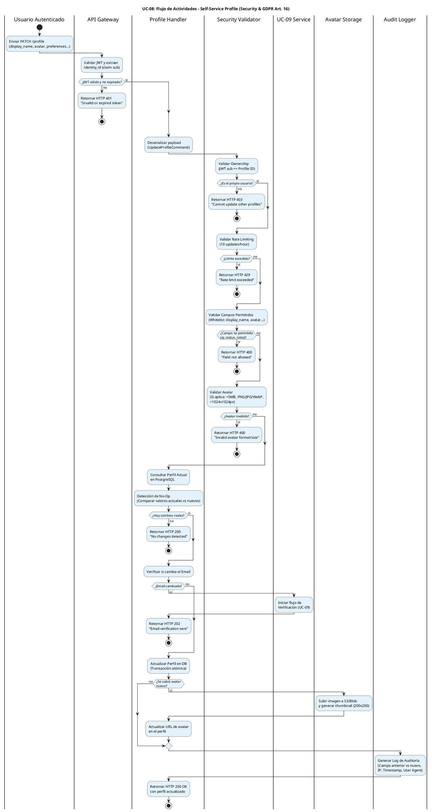

# UC-08: Self-Service Profile - Diagrama de Actividades

| Metadatos del Documento | |
| :--- | :--- |
| **Proyecto:** | SHUGO - Identity & Access Platform |
| **Caso de Uso:** | UC-08 - Self-Service Profile (User-Initiated Profile Management) |
| **Documento:** | 03_Activity_Diagram.md |
| **Metodología:** | UML 2.5 + ICONIX + Security by Design + GDPR Compliance (Art. 16) |
| **Autor:** | Gastón Ruiz |
| **Versión Actual:** | 1.0.0 |
| **Fecha:** | 05/09/2026 |

---

## Historial de Versiones

| Versión | Fecha | Autor | Descripción de Cambios | Impacto |
| :--- | :--- | :--- | :--- | :--- |
| **1.0.0** | 05/09/2026 | Gastón Ruiz | **Creación inicial.** Modelado del flujo de trabajo interno para la gestión self-service del perfil. Destaca las validaciones de seguridad (Ownership, Rate Limiting, Whitelist de campos), la validación de avatares, la detección de No-Op para optimización, la integración condicional con UC-09 para cambios de email, y la generación granular de logs de auditoría. | Documento base del paquete de diseño Tier 1 del UC-08. Establece la lógica de negocio, los puntos de decisión críticos y las garantías de seguridad y privacidad para el endpoint de actualización de perfil propio. |

---

## 1. Introducción y Propósito

El **Diagrama de Actividades** para el UC-08 visualiza el flujo de control, decisiones y orquestación necesario para que un usuario autenticado gestione su propio perfil en el motor **KAGAMI** de SHUGO.

A diferencia de la actualización administrativa (UC-02), este flujo introduce complejidades específicas de seguridad y experiencia de usuario:

1. **Ownership Validation Estricta:** El sistema debe garantizar que el usuario solo modifique su propio perfil (prevención de escalación horizontal).
2. **Whitelist de Campos:** Solo se permiten actualizaciones en campos específicos (`display_name`, `avatar`, `preferences`, etc.), bloqueando intentos de modificar `status` o `roles`.
3. **Validación de Archivos (Avatar):** Requiere procesamiento de imagen para validar tamaño, tipo y dimensiones antes de almacenar.
4. **Optimización No-Op:** Si el usuario envía los mismos datos, el sistema detecta la ausencia de cambios para evitar writes innecesarios y ruido en auditoría.
5. **Integración Condicional (UC-09):** Si el cambio involucra el email, el flujo se desvía al proceso de verificación de contactos.

Utilizamos carriles (swimlanes) para separar las responsabilidades entre el Usuario, API Gateway, Profile Handler, Security Validator, Avatar Storage, Audit Logger, y el servicio de UC-09.

---

## 2. Diagrama de Actividades (PlantUML)

A continuación, se presenta el diagrama que cubre el Escenario Principal (actualización exitosa), el manejo de avatares, la detección de No-Op, y los flujos de excepción (seguridad y validación).



---

## 3. Explicación Detallada del Flujo

### 3.1. Carriles (Partitions / Swimlanes)

El diagrama está dividido en siete carriles que representan las capas y responsabilidades de la arquitectura:

1. **`|Usuario Autenticado|` (Actor):** Inicia la solicitud PATCH con los datos a actualizar.
2. **`|API Gateway|` (Capa de Entrada):** Valida la autenticación (JWT) y extrae el identificador del usuario (`sub` claim). Es la primera barrera de seguridad.
3. **`|Profile Handler|` (Capa de Aplicación):** Orquesta el caso de uso. Coordina las validaciones, la lógica de No-Op, la actualización en DB, y la integración con servicios externos.
4. **`|Security Validator|` (Capa de Dominio/Seguridad):** Contiene las reglas de negocio críticas: Ownership validation, Rate limiting, Whitelist de campos, y validación de archivos.
5. **`|Avatar Storage|` (Infraestructura):** Responsable de subir el archivo a S3/Azure Blob y generar el thumbnail.
6. **`|Audit Logger|` (Infraestructura/Compliance):** Genera el registro inmutable de los cambios para cumplimiento GDPR y forense.
7. **`|UC-09 Service|` (Integración):** Maneja el flujo condicional de verificación de email si el usuario intenta cambiar su contacto.

### 3.2. Puntos de Decisión Críticos (Rombos)

1. **Validación de JWT (API Gateway):**
   - **Pregunta:** ¿El token es válido y no ha expirado?
   - **Si falla:** Retorna HTTP 401.
   - **Justificación:** Solo usuarios autenticados pueden gestionar su perfil.

2. **Ownership Validation (Security Validator):**
   - **Pregunta:** ¿El `sub` claim del JWT coincide con el `identity_id` del perfil a actualizar?
   - **Si falla:** Retorna HTTP 403.
   - **Justificación:** Previene **escalación horizontal** (Insecure Direct Object Reference - IDOR). Un usuario no puede modificar el perfil de otro.

3. **Rate Limiting (Security Validator):**
   - **Pregunta:** ¿El usuario ha excedido 10 actualizaciones en la última hora?
   - **Si falla:** Retorna HTTP 429.
   - **Justificación:** Previene spam de actualizaciones y abuso de recursos de DB/Auditoría.

4. **Validación de Campos (Security Validator):**
   - **Pregunta:** ¿Los campos a actualizar están en la whitelist (`display_name`, `avatar`, `preferences`, `language`, `timezone`)?
   - **Si falla:** Retorna HTTP 400.
   - **Justificación:** Previene **escalación de privilegios**. Un usuario no puede asignarse roles o cambiar su status a ACTIVE.

5. **Validación de Avatar (Security Validator):**
   - **Pregunta:** ¿El archivo cumple tamaño (<5MB), tipo (PNG/JPG/WebP) y dimensiones (<1024x1024px)?
   - **Si falla:** Retorna HTTP 400.
   - **Justificación:** Previene upload de malware, imágenes maliciosas o excesivamente grandes.

6. **Detección de No-Op (Profile Handler):**
   - **Pregunta:** ¿Los nuevos valores son diferentes a los actuales en la DB?
   - **Si no hay cambios:** Retorna HTTP 200 "No changes detected" y **detiene el flujo**.
   - **Justificación:** Optimización de recursos. Evita writes innecesarios en DB y ruido en logs de auditoría.

7. **Cambio de Email (Profile Handler):**
   - **Pregunta:** ¿El usuario está intentando cambiar su email?
   - **Si es sí:** Desvía el flujo a UC-09 (Verificación) y retorna HTTP 202.
   - **Justificación:** Mantiene la integridad de los datos de contacto. El email no se actualiza directamente, requiere verificación.

---

## 4. Alineación con la Especificación de Requisitos

Este diagrama es la representación visual exacta del documento `01_Requirements_Specification.md`:

| Sección en Requisitos | Representación en el Diagrama |
| :--- | :--- |
| **2.1 Escenario Principal (Pasos 1-10)** | Flujo completo desde "Enviar PATCH" hasta "Retornar HTTP 200 OK". |
| **2.2 Escenario Alternativo (Cambio de Email)** | Ramificación "¿Email cambiado?" → "sí" → UC-09 Service. |
| **2.3 Escenario Alternativo (Avatar Inválido)** | Rombo "¿Avatar inválido?" y rama "sí" (HTTP 400). |
| **2.4 Excepción 2.1 (JWT Inválido)** | Primer rombo en API Gateway (HTTP 401). |
| **2.4 Excepción 3.1 (Mismatch identity_id)** | Rombo "¿Es el propio usuario?" y rama "no" (HTTP 403). |
| **2.4 Excepción 4.1 (Campo No Permitido)** | Rombo "¿Campo no permitido?" y rama "sí" (HTTP 400). |
| **3 INV-48 a INV-54** | Todas las invariantes (Autenticación, Ownership, Campos Limitados, Avatar, Email Verificación, Auditoría, No-Op) se validan en los carriles correspondientes. |
| **3 RN-01 a RN-05** | Las reglas de negocio (Rate Limiting, Avatar Storage, GDPR Art. 16, Preferencias, Language/Timezone) están explícitamente modeladas. |

---

## 5. Consideraciones de Arquitectura y Diseño (Security & GDPR)

### 5.1. Prevención de IDOR (Insecure Direct Object Reference)

El carril `Security Validator` implementa la validación de ownership **antes** de cualquier lógica de negocio.

*   **Implementación:** `if (command.IdentityId != command.JwtIdentityId) throw new ForbiddenException();`
*   **Justificación:** Es la vulnerabilidad más común en APIs de perfiles. El diagrama asegura que esta validación ocurra inmediatamente después de la autenticación.

### 5.2. Optimización No-Op (No Operation)

El paso "Detección de No-Op" es crítico para el rendimiento y la calidad de los logs.

*   **Lógica:** `if (currentProfile.Equals(newProfile)) return NoOpResult;`
*   **Impacto:**
    *   **DB:** Reduce writes innecesarios.
    *   **Auditoría:** Evita logs como "User updated profile: display_name='John' -> display_name='John'".
    *   **UX:** Respuesta rápida para el usuario.

### 5.3. Integración Segura con UC-09

Si el usuario cambia su email, el flujo **no actualiza el email directamente**.

*   **Flujo:** Se invoca `UC-09 Service` para iniciar la verificación.
*   **Respuesta:** HTTP 202 Accepted (no 200 OK), indicando que la acción está en proceso pero requiere confirmación.
*   **Justificación:** Previene que usuarios pierdan acceso a sus cuentas por typos o que atacantes cambien emails para tomar control.

### 5.4. Auditoría Granular (GDPR Art. 16)

El carril `Audit Logger` se ejecuta **después** de la actualización exitosa.

*   **Datos Registrados:**
    *   Campo modificado (ej. `display_name`).
    *   Valor anterior (ej. "John Doe").
    *   Valor nuevo (ej. "John Smith").
    *   Metadata: IP, User Agent, Timestamp.
*   **Justificación:** Cumple con el Derecho de Rectificación (GDPR Art. 16) proporcionando trazabilidad completa de quién cambió qué y cuándo.

---

## 6. Trazabilidad con Otros Documentos del Paquete

| Documento | Relación |
| :--- | :--- |
| `01_Requirements_Specification.md` | Este diagrama visualiza los flujos de texto, las invariantes de seguridad y los criterios de aceptación. |
| `02_Use_Case_Diagram.md` | Muestra el límite del sistema y los actores; este diagrama muestra el flujo interno y las decisiones lógicas. |
| `04_Initial_Domain_Model.md` | Las acciones de los carriles "Profile Handler", "Security Validator" se implementan aquí como clases y métodos. |
| `05_State_Machine_Diagram.md` | Aunque el perfil no tiene una máquina de estados compleja, este diagrama muestra la transición condicional hacia el estado de "Email Pending Verification" (UC-09). |
| `06_Robustness_Diagram.md` | Mostrará la colaboración entre el Profile Handler, los validadores, el Avatar Storage, y el Audit Logger. |
| `07_Sequence_Diagram.md` | Detallará el orden temporal exacto de las llamadas: validación de ownership → validación de campos → No-Op → actualización → log. |
| `08_Final_Class_Design.md` | Definirá las firmas exactas de los métodos: `ProfileHandler.Update()`, `AvatarValidator.Validate()`, `AuditLogger.LogProfileUpdate()`. |
| `UC-09/01_Requirements_Specification.md` | Documento que define la verificación de contactos (integrado con cambio de email). |

---

## 7. Notas de Implementación

### 7.1. Generación del Diagrama
- **Herramienta:** PlantUML (Diagrams as Code).
- **Ventaja:** Versionable en Git, reproducible, sin dependencias de software propietario.
- **Sintaxis:** Uso de `if/else/endif` para decisiones, carriles para separar responsabilidades, y notas explicativas estratégicas.

### 7.2. Código de Ejemplo (C# - Lógica de No-Op y Auditoría)

```csharp
public class ProfileHandler : IProfileHandler
{
    public async Task<ProfileUpdateResult> UpdateProfile(
        UpdateProfileCommand command, 
        CancellationToken ct)
    {
        // 1. Validaciones de seguridad (Ownership, Rate Limit, Campos)
        await _securityValidator.ValidateAsync(command, ct);

        // 2. Obtener perfil actual
        var currentProfile = await _repository.GetByIdAsync(command.IdentityId, ct);

        // 3. Detección de No-Op
        var changes = currentProfile.CalculateChanges(command);
        if (!changes.Any())
        {
            return new ProfileUpdateResult(message: "No changes detected", hasChanges: false);
        }

        // 4. Actualizar perfil
        currentProfile.ApplyChanges(changes);
        await _repository.SaveAsync(currentProfile, ct);

        // 5. Generar log de auditoría
        await _auditLogger.LogProfileUpdateAsync(
            command.IdentityId, 
            changes, 
            command.IpAddress, 
            command.UserAgent, 
            ct);

        return new ProfileUpdateResult(message: "Profile updated successfully", hasChanges: true);
    }
}
```

### 7.3. Complejidad del Diagrama
Este diagrama es moderadamente complejo debido a la cantidad de validaciones de seguridad previas a la actualización. Sin embargo, esta complejidad es necesaria para capturar la riqueza del flujo self-service en un sistema IAM enterprise que debe balancear **autonomía del usuario** con **seguridad estricta**.

---
*Fin del Documento 03_Activity_Diagram para UC-08*