# UC-08: Self-Service Profile - Modelo de Dominio Inicial

| Metadatos del Documento | |
| :--- | :--- |
| **Proyecto:** | SHUGO - Identity & Access Platform |
| **Caso de Uso:** | UC-08 - Self-Service Profile (User-Initiated Profile Management) |
| **Documento:** | 04_Initial_Domain_Model.md |
| **Metodología:** | ICONIX (Modelo de Análisis) + DDD (Domain-Driven Design) + Security by Design + GDPR Compliance (Art. 16) |
| **Autor:** | Gastón Ruiz |
| **Versión Actual:** | 1.0.0 |
| **Fecha:** | 05/09/2026 |

---

## Historial de Versiones

| Versión | Fecha | Autor | Descripción de Cambios | Impacto |
| :--- | :--- | :--- | :--- | :--- |
| **1.0.0** | 05/09/2026 | Gastón Ruiz | **Creación inicial.** Definición del Modelo de Dominio Conceptual para la gestión self-service del perfil. Introduce el Aggregate Root `Profile` separado de `Identity` para permitir actualizaciones independientes, los Value Objects de seguridad (`DisplayName`, `Avatar`, `Preferences`, `Language`, `Timezone`, `FieldChange`), los Domain Services especializados (`ProfileHandler`, `AvatarValidator`, `SecurityValidator`, `AuditLogger`), y los eventos de dominio para notificación asíncrona. | Documento base del paquete de diseño Tier 1 del UC-08. Establece cómo el dominio gestiona la autonomía del usuario (GDPR Art. 16) con validaciones de ownership, campos limitados, y auditoría granular, manteniendo la integridad de datos sensibles (email, status, roles) bajo control administrativo. |

---

## 1. Introducción y Propósito

Este documento presenta el **Modelo de Dominio Inicial** para el Caso de Uso UC-08 (Self-Service Profile).

A diferencia de los UCs de administración (UC-01 a UC-05) donde un administrador controla el ciclo de vida de la identidad, el UC-08 introduce complejidades únicas debido a su naturaleza de **autonomía del usuario con restricciones de seguridad**:

1. **Aggregate Root Separado:** `Profile` es un Aggregate Root independiente de `Identity`, permitiendo actualizaciones frecuentes sin bloquear la identidad completa y facilitando caching.
2. **Ownership Validation Estricto:** Solo el propio usuario puede actualizar su perfil (validación de JWT `sub` claim contra `identity_id`).
3. **Campos Limitados (Whitelist):** El usuario solo puede modificar campos específicos (`display_name`, `avatar`, `preferences`, `language`, `timezone`), NO campos críticos como `email`, `status`, o `roles`.
4. **Validación de Avatar Completa:** El `Avatar` Value Object encapsula validaciones de tamaño (<5MB), tipo (PNG/JPG/WebP), y dimensiones (<1024x1024px).
5. **Prevención de No-Op:** El método `CalculateChanges()` detecta si hay cambios reales antes de persistir, optimizando recursos y evitando ruido en auditoría.
6. **Integración Condicional con UC-09:** Si el usuario intenta cambiar su email, se dispara el flujo de verificación de contactos.
7. **Auditoría Granular:** Cada cambio se registra con valor anterior, nuevo valor, timestamp, IP, y user agent para cumplimiento GDPR Art. 16.

El modelo se centra en:
- **Autonomía del Usuario:** Permitir que los usuarios gestionen su propia información personal (GDPR Art. 16 - Derecho de Rectificación).
- **Seguridad por Diseño:** Restringir campos modificables y validar ownership para prevenir escalación de privilegios.
- **Auditabilidad Completa:** Registrar cada cambio con trazabilidad forense.
- **Optimización de Recursos:** Detectar No-Op para evitar writes innecesarios.

---

## 2. Diagrama de Modelo de Dominio Conceptual (PlantUML)

A continuación, se presenta el diagrama de clases conceptual, enfocándose en los objetos de dominio, servicios y eventos introducidos para UC-08.

```plantuml
@startuml UC-08_DominioConceptual
<style>
diagram {
  BackgroundColor #FFFFFF
}
</style>
skinparam classAttributeIconSize 0
skinparam classBackgroundColor #FFFFFF
skinparam classBorderColor #1565C0
skinparam classHeaderBackgroundColor #E3F2FD

title UC-08: Modelo de Dominio Conceptual - Self-Service Profile (User Autonomy & GDPR Art. 16)

' ============================================
' AGGREGATE ROOT
' ============================================
class Profile <<Aggregate Root>> {
  - id: ProfileId
  - identityId: IdentityId
  - tenantId: TenantId
  - displayName: DisplayName
  - avatar: Avatar
  - preferences: Preferences
  - language: Language
  - timezone: Timezone
  - updatedAt: DateTime
  - rowVersion: RowVersion
  - domainEvents: List<IDomainEvent>
  
  + Update(command: UpdateProfileCommand, jwtIdentityId: IdentityId): List<FieldChange>
  + CalculateChanges(command: UpdateProfileCommand): List<FieldChange>
  + ApplyChanges(changes: List<FieldChange>): void
  - ValidateOwnership(jwtIdentityId: IdentityId): void
  - AddDomainEvent(event: IDomainEvent): void
}

' ============================================
' VALUE OBJECTS
' ============================================
class DisplayName <<Value Object>> {
  - value: string
  + DisplayName(value: string)
  - ValidateLength(): void
  - ValidateCharacters(): void
}

class Avatar <<Value Object>> {
  - url: string
  - thumbnailUrl: string
  - mimeType: string
  - sizeBytes: long
  - width: int
  - height: int
  + Avatar(url, thumbnailUrl, mimeType, sizeBytes, width, height)
  - ValidateSize(): void
  - ValidateMimeType(): void
  - ValidateDimensions(): void
}

class Preferences <<Value Object>> {
  - data: JsonDocument
  + Preferences(data: JsonDocument)
  - ValidateSchema(): void
}

class Language <<Value Object>> {
  - code: string
  + Language(code: string)
  - ValidateISO639_1(): void
}

class Timezone <<Value Object>> {
  - ianaName: string
  + Timezone(ianaName: string)
  - ValidateIANA(): void
}

class FieldChange <<Value Object>> {
  - field: string
  - oldValue: string
  - newValue: string
  + FieldChange(field, oldValue, newValue)
}

class ProfileId <<Value Object>> {
  - value: Guid
  + ProfileId(value: Guid)
}

class IdentityId <<Value Object>> {
  - value: Guid
  + IdentityId(value: Guid)
}

class TenantId <<Value Object>> {
  - value: Guid
  + TenantId(value: Guid)
}

class RowVersion <<Value Object>> {
  - value: Guid
  + RowVersion(value: Guid)
}

' ============================================
' DOMAIN SERVICES
' ============================================
class ProfileHandler <<Domain Service>> {
  - profileRepo: IProfileRepository
  - securityValidator: ISecurityValidator
  - avatarValidator: IAvatarValidator
  - auditLogger: IAuditLogger
  - emailVerificationService: IEmailVerificationService
  
  + UpdateProfile(command: UpdateProfileCommand, jwtIdentityId: IdentityId): Task<ProfileUpdateResult>
  - ValidateOwnership(profile: Profile, jwtIdentityId: IdentityId): void
  - ValidateRateLimit(identityId: IdentityId): Task
  - ValidateAllowedFields(command: UpdateProfileCommand): void
  - DetectNoOp(profile: Profile, command: UpdateProfileCommand): List<FieldChange>
  - HandleEmailChange(profile: Profile, newEmail: string): Task
}

class SecurityValidator <<Domain Service>> {
  - profileRepo: IProfileRepository
  - cache: IDistributedCache
  
  + ValidateOwnershipAsync(profileId: ProfileId, jwtIdentityId: IdentityId): Task
  + ValidateRateLimitAsync(identityId: IdentityId): Task
  + ValidateAllowedFields(fields: List<string>): void
}

class AvatarValidator <<Domain Service>> {
  + ValidateAsync(avatarStream: Stream, mimeType: string): Task<Avatar>
  - ValidateSize(stream: Stream): void
  - ValidateMimeType(mimeType: string): void
  - ValidateDimensions(stream: Stream): Task
}

class AuditLogger <<Domain Service>> {
  - auditRepo: IAuditRepository
  
  + LogProfileUpdateAsync(identityId: IdentityId, changes: List<FieldChange>, ipAddress: string, userAgent: string): Task
}

' ============================================
' DOMAIN EVENTS
' ============================================
class ProfileUpdated <<Domain Event>> {
  + profileId: ProfileId
  + identityId: IdentityId
  + tenantId: TenantId
  + changes: List<FieldChange>
  + ipAddress: string
  + userAgent: string
  + timestamp: DateTime
}

class AvatarUploaded <<Domain Event>> {
  + profileId: ProfileId
  + identityId: IdentityId
  + avatarUrl: string
  + thumbnailUrl: string
  + mimeType: string
  + sizeBytes: long
}

' ============================================
' INTERFACES
' ============================================
interface IProfileRepository {
  + GetByIdAsync(profileId: ProfileId, ct: CancellationToken): Task<Profile?>
  + GetByIdentityIdAsync(identityId: IdentityId, ct: CancellationToken): Task<Profile?>
  + SaveAsync(profile: Profile, ct: CancellationToken): Task
}

interface IAvatarStorage {
  + UploadAsync(avatarStream: Stream, mimeType: string, ct: CancellationToken): Task<AvatarUrls>
  + DeleteAsync(url: string, ct: CancellationToken): Task
}

interface IEmailVerificationService {
  + InitiateVerificationAsync(identityId: IdentityId, newEmail: string, ct: CancellationToken): Task
}

' ============================================
' RELACIONES
' ============================================
Profile *-- DisplayName : "contiene"
Profile *-- Avatar : "contiene (0..1)"
Profile *-- Preferences : "contiene"
Profile *-- Language : "contiene"
Profile *-- Timezone : "contiene"
Profile *-- IdentityId : "pertenece a"
Profile *-- TenantId : "pertenece a"

ProfileHandler --> IProfileRepository : "persiste"
ProfileHandler --> ISecurityValidator : "valida"
ProfileHandler --> IAvatarValidator : "valida avatar"
ProfileHandler --> IAuditLogger : "registra auditoría"
ProfileHandler --> IEmailVerificationService : "integra UC-09"

Profile ..> ProfileUpdated : "publica"
Profile ..> AvatarUploaded : "publica"

note right of Profile
  **Aggregate Root Separado:**
  - Independiente de Identity
  - Permite actualizaciones frecuentes
  - Facilita caching
  - Ownership validation estricto
end note

note right of Avatar
  **Validaciones de Seguridad:**
  - Tamaño <5MB
  - Tipo: PNG/JPG/WebP
  - Dimensiones <1024x1024px
  - URLs inmutables tras upload
end note

note bottom of ProfileHandler
  **Orquestación de Autonomía:**
  - Valida ownership (JWT sub == identity_id)
  - Valida campos permitidos (whitelist)
  - Detecta No-Op (optimización)
  - Integra con UC-09 si cambia email
  - Genera auditoría granular
end note

@enduml
```



---

## 3. Detalle de Conceptos de Dominio (DDD)

### 3.1. Aggregate Root: `Profile`

El Aggregate Root `Profile` encapsula la información personal del usuario que puede ser gestionada por el propio usuario. Está separado de `Identity` para permitir actualizaciones frecuentes sin afectar el ciclo de vida de autenticación/autorización.

**Código (C#):**

```csharp
public class Profile : AggregateRoot
{
    public ProfileId Id { get; private set; }
    public IdentityId IdentityId { get; private set; }
    public TenantId TenantId { get; private set; }
    public DisplayName DisplayName { get; private set; }
    public Avatar? Avatar { get; private set; }
    public Preferences Preferences { get; private set; }
    public Language Language { get; private set; }
    public Timezone Timezone { get; private set; }
    public DateTime UpdatedAt { get; private set; }
    public RowVersion RowVersion { get; private set; }
    
    private readonly List<IDomainEvent> _domainEvents = new();

    // Constructor privado para EF Core
    private Profile() { }

    /// <summary>
    /// Actualiza el perfil con validación de ownership y detección de No-Op.
    /// Retorna lista de cambios realizados (vacía si No-Op).
    /// </summary>
    public List<FieldChange> Update(UpdateProfileCommand command, IdentityId jwtIdentityId)
    {
        // 1. Validar ownership (seguridad crítica)
        ValidateOwnership(jwtIdentityId);

        // 2. Calcular cambios (detección de No-Op)
        var changes = CalculateChanges(command);

        // 3. Si no hay cambios, retornar lista vacía (No-Op)
        if (!changes.Any())
        {
            return changes;
        }

        // 4. Aplicar cambios
        ApplyChanges(changes);

        // 5. Actualizar timestamp
        UpdatedAt = DateTime.UtcNow;

        // 6. Generar evento de dominio
        AddDomainEvent(new ProfileUpdated(
            Id,
            IdentityId,
            TenantId,
            changes,
            command.IpAddress,
            command.UserAgent,
            UpdatedAt
        ));

        return changes;
    }

    /// <summary>
    /// Calcula los cambios entre el estado actual y el comando.
    /// Usado para detección de No-Op.
    /// </summary>
    public List<FieldChange> CalculateChanges(UpdateProfileCommand command)
    {
        var changes = new List<FieldChange>();

        if (command.DisplayName != null && command.DisplayName != DisplayName.Value)
        {
            changes.Add(new FieldChange("display_name", DisplayName.Value, command.DisplayName));
        }

        if (command.Avatar != null && !Avatar.Equals(command.Avatar))
        {
            changes.Add(new FieldChange("avatar", Avatar?.Url ?? "null", command.Avatar.Url));
        }

        if (command.Preferences != null && !Preferences.Data.Equals(command.Preferences.Data))
        {
            changes.Add(new FieldChange("preferences", Preferences.Data.RootElement.GetRawText(), command.Preferences.Data.RootElement.GetRawText()));
        }

        if (command.Language != null && command.Language.Code != Language.Code)
        {
            changes.Add(new FieldChange("language", Language.Code, command.Language.Code));
        }

        if (command.Timezone != null && command.Timezone.IanaName != Timezone.IanaName)
        {
            changes.Add(new FieldChange("timezone", Timezone.IanaName, command.Timezone.IanaName));
        }

        return changes;
    }

    /// <summary>
    /// Aplica los cambios calculados al perfil.
    /// </summary>
    public void ApplyChanges(List<FieldChange> changes)
    {
        foreach (var change in changes)
        {
            switch (change.Field)
            {
                case "display_name":
                    DisplayName = new DisplayName(change.NewValue);
                    break;
                case "avatar":
                    // El avatar se actualiza vía comando separado (upload)
                    break;
                case "preferences":
                    Preferences = new Preferences(JsonDocument.Parse(change.NewValue));
                    break;
                case "language":
                    Language = new Language(change.NewValue);
                    break;
                case "timezone":
                    Timezone = new Timezone(change.NewValue);
                    break;
            }
        }
    }

    /// <summary>
    /// Valida que el usuario solo pueda actualizar su propio perfil.
    /// Previene escalación horizontal (IDOR).
    /// </summary>
    private void ValidateOwnership(IdentityId jwtIdentityId)
    {
        if (this.IdentityId != jwtIdentityId)
        {
            throw new ForbiddenException(
                $"User {jwtIdentityId} cannot update profile {Id} " +
                $"owned by {IdentityId}.");
        }
    }

    public IReadOnlyCollection<IDomainEvent> GetDomainEvents() => _domainEvents.AsReadOnly();
    
    protected void AddDomainEvent(IDomainEvent evt) => _domainEvents.Add(evt);
}
```

### 3.2. Value Objects de Seguridad y Dominio

#### **DisplayName**

Value Object que encapsula el nombre para mostrar del usuario con validaciones de longitud y caracteres permitidos.

```csharp
public class DisplayName : ValueObject
{
    private const int MIN_LENGTH = 2;
    private const int MAX_LENGTH = 100;
    private static readonly Regex AllowedCharacters = new Regex(
        @"^[a-zA-Z0-9\s\-_\.@]+$", 
        RegexOptions.Compiled);

    public string Value { get; }

    public DisplayName(string value)
    {
        if (string.IsNullOrWhiteSpace(value))
            throw new DomainException("Display name cannot be empty.");

        ValidateLength(value);
        ValidateCharacters(value);

        Value = value.Trim();
    }

    private void ValidateLength(string value)
    {
        if (value.Length < MIN_LENGTH)
            throw new DomainException(
                $"Display name must be at least {MIN_LENGTH} characters.");

        if (value.Length > MAX_LENGTH)
            throw new DomainException(
                $"Display name cannot exceed {MAX_LENGTH} characters.");
    }

    private void ValidateCharacters(string value)
    {
        if (!AllowedCharacters.IsMatch(value))
            throw new DomainException(
                "Display name contains invalid characters. " +
                "Only alphanumeric, spaces, hyphens, underscores, dots, and @ are allowed.");
    }

    protected override IEnumerable<object> GetEqualityComponents()
    {
        yield return Value;
    }
}
```

#### **Avatar**

Value Object que encapsula la información del avatar del usuario con validaciones de seguridad estrictas.

```csharp
public class Avatar : ValueObject
{
    private const long MAX_SIZE_BYTES = 5 * 1024 * 1024; // 5MB
    private const int MAX_WIDTH = 1024;
    private const int MAX_HEIGHT = 1024;
    private static readonly HashSet<string> ALLOWED_MIME_TYPES = new(StringComparer.OrdinalIgnoreCase)
    {
        "image/png",
        "image/jpeg",
        "image/webp"
    };

    public string Url { get; }
    public string ThumbnailUrl { get; }
    public string MimeType { get; }
    public long SizeBytes { get; }
    public int Width { get; }
    public int Height { get; }

    public Avatar(string url, string thumbnailUrl, string mimeType, long sizeBytes, int width, int height)
    {
        if (string.IsNullOrWhiteSpace(url))
            throw new DomainException("Avatar URL cannot be empty.");

        ValidateMimeType(mimeType);
        ValidateSize(sizeBytes);
        ValidateDimensions(width, height);

        Url = url;
        ThumbnailUrl = thumbnailUrl;
        MimeType = mimeType;
        SizeBytes = sizeBytes;
        Width = width;
        Height = height;
    }

    private void ValidateMimeType(string mimeType)
    {
        if (!ALLOWED_MIME_TYPES.Contains(mimeType))
            throw new DomainException(
                $"Invalid avatar type '{mimeType}'. " +
                $"Allowed types: {string.Join(", ", ALLOWED_MIME_TYPES)}");
    }

    private void ValidateSize(long sizeBytes)
    {
        if (sizeBytes > MAX_SIZE_BYTES)
            throw new DomainException(
                $"Avatar size {sizeBytes} bytes exceeds maximum allowed ({MAX_SIZE_BYTES / 1024 / 1024}MB).");
    }

    private void ValidateDimensions(int width, int height)
    {
        if (width > MAX_WIDTH || height > MAX_HEIGHT)
            throw new DomainException(
                $"Avatar dimensions {width}x{height}px exceed maximum allowed ({MAX_WIDTH}x{MAX_HEIGHT}px).");
    }

    protected override IEnumerable<object> GetEqualityComponents()
    {
        yield return Url;
        yield return ThumbnailUrl;
        yield return MimeType;
        yield return SizeBytes;
        yield return Width;
        yield return Height;
    }
}
```

#### **Preferences**

Value Object que encapsula las preferencias del usuario como JSON validado contra un schema.

```csharp
public class Preferences : ValueObject
{
    private static readonly JsonDocumentOptions Options = new()
    {
        AllowTrailingCommas = false,
        CommentHandling = JsonCommentHandling.Skip,
        MaxDepth = 10
    };

    public JsonDocument Data { get; }

    public Preferences(JsonDocument data)
    {
        Data = data ?? throw new DomainException("Preferences cannot be null.");
        ValidateSchema(data);
    }

    private void ValidateSchema(JsonDocument data)
    {
        // Validar que el JSON tenga la estructura esperada
        var root = data.RootElement;
        
        if (root.ValueKind != JsonValueKind.Object)
            throw new DomainException("Preferences must be a JSON object.");

        // Validar campos conocidos (si existen)
        if (root.TryGetProperty("notifications", out var notifications))
        {
            if (notifications.ValueKind != JsonValueKind.Object)
                throw new DomainException("'notifications' must be an object.");
        }

        if (root.TryGetProperty("theme", out var theme))
        {
            var themeValue = theme.GetString();
            if (themeValue != null && !new[] { "light", "dark", "system" }.Contains(themeValue))
                throw new DomainException("'theme' must be 'light', 'dark', or 'system'.");
        }
    }

    protected override IEnumerable<object> GetEqualityComponents()
    {
        yield return Data.RootElement.GetRawText();
    }
}
```

#### **Language**

Value Object que encapsula el código de idioma con validación ISO 639-1.

```csharp
public class Language : ValueObject
{
    private static readonly HashSet<string> VALID_CODES = new(StringComparer.OrdinalIgnoreCase)
    {
        "en", "es", "fr", "de", "it", "pt", "ru", "zh", "ja", "ko",
        "ar", "hi", "bn", "pa", "te", "mr", "ta", "ur", "fa", "tr"
        // ... lista completa de códigos ISO 639-1
    };

    public string Code { get; }

    public Language(string code)
    {
        if (string.IsNullOrWhiteSpace(code))
            throw new DomainException("Language code cannot be empty.");

        ValidateISO639_1(code);

        Code = code.ToLowerInvariant().Trim();
    }

    private void ValidateISO639_1(string code)
    {
        if (code.Length != 2)
            throw new DomainException(
                $"Invalid language code '{code}'. Must be ISO 639-1 (2 characters, e.g., 'en', 'es').");

        if (!VALID_CODES.Contains(code.ToLowerInvariant()))
            throw new DomainException(
                $"Unsupported language code '{code}'. Please use a valid ISO 639-1 code.");
    }

    protected override IEnumerable<object> GetEqualityComponents()
    {
        yield return Code;
    }
}
```

#### **Timezone**

Value Object que encapsula el nombre de zona horaria con validación IANA.

```csharp
public class Timezone : ValueObject
{
    private static readonly HashSet<string> VALID_IANA_NAMES = new(StringComparer.OrdinalIgnoreCase)
    {
        "UTC",
        "America/New_York",
        "America/Chicago",
        "America/Denver",
        "America/Los_Angeles",
        "America/Argentina/Buenos_Aires",
        "Europe/London",
        "Europe/Paris",
        "Europe/Berlin",
        "Europe/Madrid",
        "Asia/Tokyo",
        "Asia/Shanghai",
        "Asia/Kolkata",
        "Australia/Sydney",
        "Pacific/Auckland"
        // ... lista completa de zonas IANA
    };

    public string IanaName { get; }

    public Timezone(string ianaName)
    {
        if (string.IsNullOrWhiteSpace(ianaName))
            throw new DomainException("Timezone cannot be empty.");

        ValidateIANA(ianaName);

        IanaName = ianaName.Trim();
    }

    private void ValidateIANA(string ianaName)
    {
        if (!VALID_IANA_NAMES.Contains(ianaName))
            throw new DomainException(
                $"Invalid timezone '{ianaName}'. Must be a valid IANA timezone name (e.g., 'America/New_York', 'Europe/London').");
    }

    protected override IEnumerable<object> GetEqualityComponents()
    {
        yield return IanaName;
    }
}
```

#### **FieldChange**

Value Object que encapsula un cambio individual en el perfil para auditoría granular.

```csharp
public class FieldChange : ValueObject
{
    public string Field { get; }
    public string OldValue { get; }
    public string NewValue { get; }
    public DateTime Timestamp { get; }

    public FieldChange(string field, string oldValue, string newValue)
    {
        if (string.IsNullOrWhiteSpace(field))
            throw new DomainException("Field name cannot be empty.");

        Field = field;
        OldValue = oldValue ?? "null";
        NewValue = newValue ?? "null";
        Timestamp = DateTime.UtcNow;
    }

    protected override IEnumerable<object> GetEqualityComponents()
    {
        yield return Field;
        yield return OldValue;
        yield return NewValue;
    }
}
```

### 3.3. Domain Services

#### **ProfileHandler**

Domain Service que orquesta la actualización del perfil, validando ownership, campos permitidos, rate limiting, y generando auditoría.

```csharp
public class ProfileHandler : IProfileHandler
{
    private readonly IProfileRepository _profileRepo;
    private readonly ISecurityValidator _securityValidator;
    private readonly IAvatarValidator _avatarValidator;
    private readonly IAuditLogger _auditLogger;
    private readonly IEmailVerificationService _emailVerificationService;
    private readonly ILogger<ProfileHandler> _logger;

    public ProfileHandler(
        IProfileRepository profileRepo,
        ISecurityValidator securityValidator,
        IAvatarValidator avatarValidator,
        IAuditLogger auditLogger,
        IEmailVerificationService emailVerificationService,
        ILogger<ProfileHandler> logger)
    {
        _profileRepo = profileRepo;
        _securityValidator = securityValidator;
        _avatarValidator = avatarValidator;
        _auditLogger = auditLogger;
        _emailVerificationService = emailVerificationService;
        _logger = logger;
    }

    /// <summary>
    /// Actualiza el perfil con validaciones de seguridad y auditoría.
    /// </summary>
    public async Task<ProfileUpdateResult> UpdateProfile(
        UpdateProfileCommand command, 
        IdentityId jwtIdentityId,
        CancellationToken ct)
    {
        // 1. Validar ownership (JWT sub == profile identity_id)
        await _securityValidator.ValidateOwnershipAsync(command.ProfileId, jwtIdentityId, ct);

        // 2. Validar rate limiting (10 updates/hour)
        await _securityValidator.ValidateRateLimitAsync(jwtIdentityId, ct);

        // 3. Validar campos permitidos (whitelist)
        _securityValidator.ValidateAllowedFields(command.GetFieldNames());

        // 4. Cargar perfil actual
        var profile = await _profileRepo.GetByIdAsync(command.ProfileId, ct);
        if (profile == null)
            throw new ProfileNotFoundException($"Profile {command.ProfileId} not found.");

        // 5. Detectar No-Op (si no hay cambios, retornar temprano)
        var changes = profile.CalculateChanges(command);
        if (!changes.Any())
        {
            _logger.LogInformation("No changes detected for profile {ProfileId}", command.ProfileId);
            return new ProfileUpdateResult(message: "No changes detected", hasChanges: false);
        }

        // 6. Validar y procesar avatar (si se proporciona)
        if (command.AvatarStream != null)
        {
            var avatar = await _avatarValidator.ValidateAsync(
                command.AvatarStream, 
                command.AvatarMimeType, 
                ct);
            
            // Upload a S3/Azure Blob (infraestructura)
            var avatarUrls = await _avatarStorage.UploadAsync(
                command.AvatarStream, 
                command.AvatarMimeType, 
                ct);
            
            command.Avatar = new Avatar(
                avatarUrls.Url,
                avatarUrls.ThumbnailUrl,
                command.AvatarMimeType,
                command.AvatarStream.Length,
                avatar.Width,
                avatar.Height);
        }

        // 7. Aplicar cambios
        profile.ApplyChanges(changes);

        // 8. Persistir
        await _profileRepo.SaveAsync(profile, ct);

        // 9. Generar log de auditoría
        await _auditLogger.LogProfileUpdateAsync(
            profile.IdentityId,
            changes,
            command.IpAddress,
            command.UserAgent,
            ct);

        // 10. Manejar cambio de email (si aplica)
        if (command.Email != null && command.Email != profile.Email)
        {
            await HandleEmailChange(profile, command.Email, ct);
        }

        return new ProfileUpdateResult(
            message: "Profile updated successfully",
            hasChanges: true,
            changes: changes);
    }

    /// <summary>
    /// Maneja el cambio de email disparando el flujo de UC-09.
    /// </summary>
    private async Task HandleEmailChange(Profile profile, string newEmail, CancellationToken ct)
    {
        _logger.LogInformation(
            "Email change requested for identity {IdentityId} from {OldEmail} to {NewEmail}",
            profile.IdentityId, profile.Email, newEmail);

        // Disparar flujo de verificación de UC-09
        await _emailVerificationService.InitiateVerificationAsync(
            profile.IdentityId,
            newEmail,
            ct);

        // Nota: El email NO se actualiza directamente.
        // Se actualiza solo tras verificación exitosa en UC-09.
    }
}
```

#### **SecurityValidator**

Domain Service que valida ownership, rate limiting, y campos permitidos.

```csharp
public class SecurityValidator : ISecurityValidator
{
    private readonly IProfileRepository _profileRepo;
    private readonly IDistributedCache _cache;
    private const int MAX_UPDATES_PER_HOUR = 10;
    private static readonly HashSet<string> ALLOWED_FIELDS = new()
    {
        "display_name",
        "avatar",
        "preferences",
        "language",
        "timezone"
    };

    public SecurityValidator(IProfileRepository profileRepo, IDistributedCache cache)
    {
        _profileRepo = profileRepo;
        _cache = cache;
    }

    /// <summary>
    /// Valida que el usuario solo pueda actualizar su propio perfil.
    /// Previene IDOR (Insecure Direct Object Reference).
    /// </summary>
    public async Task ValidateOwnershipAsync(ProfileId profileId, IdentityId jwtIdentityId, CancellationToken ct)
    {
        var profile = await _profileRepo.GetByIdAsync(profileId, ct);
        
        if (profile == null)
            throw new ProfileNotFoundException($"Profile {profileId} not found.");

        if (profile.IdentityId != jwtIdentityId)
            throw new ForbiddenException(
                $"User {jwtIdentityId} cannot update profile {profileId} " +
                $"owned by {profile.IdentityId}.");
    }

    /// <summary>
    /// Valida que el usuario no haya excedido el límite de actualizaciones por hora.
    /// </summary>
    public async Task ValidateRateLimitAsync(IdentityId identityId, CancellationToken ct)
    {
        var key = $"rate_limit:profile:{identityId.Value}";
        var count = await _cache.GetAsync<int>(key, ct);

        if (count >= MAX_UPDATES_PER_HOUR)
            throw new RateLimitExceededException(
                $"Profile update limit reached ({MAX_UPDATES_PER_HOUR} updates/hour). " +
                "Please try again in 1 hour.");

        await _cache.IncrementAsync(key, TimeSpan.FromHours(1), ct);
    }

    /// <summary>
    /// Valida que los campos a actualizar estén en la whitelist.
    /// Previene escalación de privilegios.
    /// </summary>
    public void ValidateAllowedFields(List<string> fields)
    {
        var invalidFields = fields.Where(f => !ALLOWED_FIELDS.Contains(f)).ToList();
        
        if (invalidFields.Any())
            throw new DomainException(
                $"Fields not allowed for self-service updates: {string.Join(", ", invalidFields)}. " +
                $"Allowed fields: {string.Join(", ", ALLOWED_FIELDS)}");
    }
}
```

#### **AvatarValidator**

Domain Service que valida tamaño, tipo, y dimensiones del avatar.

```csharp
public class AvatarValidator : IAvatarValidator
{
    private const long MAX_SIZE_BYTES = 5 * 1024 * 1024; // 5MB
    private const int MAX_WIDTH = 1024;
    private const int MAX_HEIGHT = 1024;
    private static readonly HashSet<string> ALLOWED_MIME_TYPES = new(StringComparer.OrdinalIgnoreCase)
    {
        "image/png",
        "image/jpeg",
        "image/webp"
    };

    public async Task<Avatar> ValidateAsync(Stream avatarStream, string mimeType, CancellationToken ct)
    {
        ValidateSize(avatarStream);
        ValidateMimeType(mimeType);
        var dimensions = await ValidateDimensionsAsync(avatarStream, ct);

        return new Avatar(
            url: null, // Se asigna tras upload
            thumbnailUrl: null,
            mimeType: mimeType,
            sizeBytes: avatarStream.Length,
            width: dimensions.Width,
            height: dimensions.Height);
    }

    private void ValidateSize(Stream stream)
    {
        if (stream.Length > MAX_SIZE_BYTES)
            throw new DomainException(
                $"Avatar size {stream.Length} bytes exceeds maximum allowed ({MAX_SIZE_BYTES / 1024 / 1024}MB).");
    }

    private void ValidateMimeType(string mimeType)
    {
        if (!ALLOWED_MIME_TYPES.Contains(mimeType))
            throw new DomainException(
                $"Invalid avatar type '{mimeType}'. " +
                $"Allowed types: {string.Join(", ", ALLOWED_MIME_TYPES)}");
    }

    private async Task<(int Width, int Height)> ValidateDimensionsAsync(Stream stream, CancellationToken ct)
    {
        // Reset stream position
        stream.Position = 0;

        using var image = await Image.LoadAsync(stream, ct);
        
        if (image.Width > MAX_WIDTH || image.Height > MAX_HEIGHT)
            throw new DomainException(
                $"Avatar dimensions {image.Width}x{image.Height}px exceed maximum allowed ({MAX_WIDTH}x{MAX_HEIGHT}px).");

        return (image.Width, image.Height);
    }
}
```

#### **AuditLogger**

Domain Service que genera logs de auditoría granulares para cumplimiento GDPR Art. 16.

```csharp
public class AuditLogger : IAuditLogger
{
    private readonly IAuditRepository _auditRepo;

    public AuditLogger(IAuditRepository auditRepo)
    {
        _auditRepo = auditRepo;
    }

    /// <summary>
    /// Genera log de auditoría con cambios granulares.
    /// </summary>
    public async Task LogProfileUpdateAsync(
        IdentityId identityId,
        List<FieldChange> changes,
        string ipAddress,
        string userAgent,
        CancellationToken ct)
    {
        var auditLog = new AuditLog
        {
            IdentityId = identityId,
            Action = "Profile.Updated",
            Timestamp = DateTime.UtcNow,
            IpAddress = ipAddress,
            UserAgent = userAgent,
            SnapshotJson = JsonSerializer.Serialize(changes, new JsonSerializerOptions
            {
                WriteIndented = true
            })
        };

        await _auditRepo.SaveAsync(auditLog, ct);
    }
}
```

### 3.4. Domain Events

#### **ProfileUpdated**

Se genera cuando el perfil se actualiza exitosamente.

```csharp
public class ProfileUpdated : IDomainEvent
{
    public Guid EventId { get; } = Guid.NewGuid();
    public DateTime Timestamp { get; } = DateTime.UtcNow;
    
    public ProfileId ProfileId { get; }
    public IdentityId IdentityId { get; }
    public TenantId TenantId { get; }
    public List<FieldChange> Changes { get; }
    public string IpAddress { get; }
    public string UserAgent { get; }

    public ProfileUpdated(
        ProfileId profileId,
        IdentityId identityId,
        TenantId tenantId,
        List<FieldChange> changes,
        string ipAddress,
        string userAgent,
        DateTime timestamp)
    {
        ProfileId = profileId;
        IdentityId = identityId;
        TenantId = tenantId;
        Changes = changes;
        IpAddress = ipAddress;
        UserAgent = userAgent;
        Timestamp = timestamp;
    }
}
```

**Consumidores:**
1. **KAGE (Audit):** Registra el evento en logs de auditoría inmutables.
2. **TORII (Webhooks):** Notifica a sistemas externos (ej. CRM para actualizar datos de contacto).
3. **Sistema de Preferencias:** Actualiza las preferencias del usuario en caché.

#### **AvatarUploaded**

Se genera cuando se sube un nuevo avatar.

```csharp
public class AvatarUploaded : IDomainEvent
{
    public Guid EventId { get; } = Guid.NewGuid();
    public DateTime Timestamp { get; } = DateTime.UtcNow;
    
    public ProfileId ProfileId { get; }
    public IdentityId IdentityId { get; }
    public string AvatarUrl { get; }
    public string ThumbnailUrl { get; }
    public string MimeType { get; }
    public long SizeBytes { get; }

    public AvatarUploaded(
        ProfileId profileId,
        IdentityId identityId,
        string avatarUrl,
        string thumbnailUrl,
        string mimeType,
        long sizeBytes)
    {
        ProfileId = profileId;
        IdentityId = identityId;
        AvatarUrl = avatarUrl;
        ThumbnailUrl = thumbnailUrl;
        MimeType = mimeType;
        SizeBytes = sizeBytes;
    }
}
```

**Consumidores:**
1. **CDN:** Invalida caché del avatar anterior.
2. **Sistema de Notificaciones:** Envía notificación push si el usuario tiene habilitadas las notificaciones de cambios de perfil.
3. **Moderación de Contenido:** Analiza el avatar para detectar contenido inapropiado.

---

## 4. Decisiones de Diseño DDD (ADR)

### 4.1. ¿Por qué `Profile` es Aggregate Root separado de `Identity`?

**Decisión:** `Profile` es Aggregate Root independiente con referencia a `IdentityId`.

**Justificación:**
- **Actualizaciones Frecuentes:** Los usuarios actualizan su perfil más frecuentemente que su identidad (autenticación/autorización). Separarlos permite actualizaciones sin bloquear la identidad completa.
- **Caching Optimizado:** El perfil se consulta frecuentemente (UC-04). Separarlo permite caching independiente con TTL más corto.
- **Separación de Responsabilidades:** `Identity` maneja autenticación/autorización (email, password, status, roles). `Profile` maneja datos personales (display_name, avatar, preferences).
- **Consistencia Eventual:** Aceptamos consistencia eventual entre Identity y Profile. Si el perfil se actualiza pero la identidad no se sincroniza inmediatamente, no hay impacto en seguridad.

### 4.2. ¿Por qué `CalculateChanges()` retorna `List<FieldChange>` en lugar de booleano?

**Decisión:** `CalculateChanges()` retorna lista detallada de cambios en lugar de simple booleano.

**Justificación:**
- **Auditoría Granular:** Cada campo modificado se registra con valor anterior y nuevo, proporcionando trazabilidad completa para GDPR Art. 16.
- **Detección de No-Op Precisa:** Si la lista está vacía, no hay cambios reales. Si tiene elementos, hay cambios específicos.
- **Optimización de Resources:** Solo se persisten y auditan los campos que realmente cambiaron.

### 4.3. ¿Por qué el email NO se actualiza directamente en Profile?

**Decisión:** Si el usuario intenta cambiar su email, se dispara UC-09 (Verificación de Contactos) en lugar de actualizar directamente.

**Justificación:**
- **Integridad de Contactos:** Previene que usuarios pierdan acceso a sus cuentas por typos en email.
- **Seguridad:** Requiere verificación del nuevo email antes de actualizarlo, previniendo que atacantes cambien emails para tomar control de cuentas.
- **Separación de Responsabilidades:** El email está en `Identity`, no en `Profile`. Profile solo referencia IdentityId.

### 4.4. ¿Por qué `Preferences` usa JSONB en lugar de estructura tipada?

**Decisión:** `Preferences` almacena datos como JSON validado contra schema en lugar de estructura tipada rígida.

**Justificación:**
- **Flexibilidad:** Diferentes tenants pueden tener diferentes preferencias. JSON permite evolución sin cambios de schema.
- **Validación de Schema:** El Value Object valida la estructura JSON contra reglas de negocio (ej. theme debe ser "light", "dark", o "system").
- **Rendimiento:** JSONB en PostgreSQL permite indexación y consultas eficientes.

### 4.5. ¿Por qué `Avatar` es Value Object inmutable?

**Decisión:** `Avatar` es Value Object inmutable con URLs que no cambian tras creación.

**Justificación:**
- **Inmutabilidad de URLs:** Una vez subido el avatar a S3/Azure Blob, las URLs no cambian. Si el usuario sube nuevo avatar, se crea nuevo Value Object.
- **Validación en Constructor:** Todas las validaciones (tamaño, tipo, dimensiones) ocurren en el constructor, garantizando integridad.
- **Comparación por Valor:** Dos avatares con mismas URLs y metadata son equivalentes, facilitando detección de No-Op.

---

## 5. Trazabilidad

| Documento | Relación |
| :--- | :--- |
| `01_Requirements_Specification.md` | Define las invariantes (INV-48 a INV-54) y reglas de negocio (RN-01 a RN-05) que este modelo implementa. |
| `02_Use_Case_Diagram.md` | Muestra los actores y sistemas; este modelo define los objetos de dominio con los que interactúan. |
| `03_Activity_Diagram.md` | Los carriles de actividad (Profile Handler, Security Validator, Avatar Validator, Audit Logger) se implementan aquí como Domain Services y Aggregate Roots. |
| `05_State_Machine_Diagram.md` | Aunque el perfil no tiene máquina de estados compleja, este modelo muestra la transición condicional hacia "Email Pending Verification" (UC-09). |
| `06_Robustness_Diagram.md` | Mostrará la colaboración entre el Profile Handler, los validadores, el Avatar Storage, y el Audit Logger. |
| `07_Sequence_Diagram.md` | Detallará el orden temporal de las llamadas: validación de ownership → validación de campos → detección de No-Op → actualización → log de auditoría. |
| `08_Final_Class_Design.md` | Definirá las firmas exactas de los métodos: `Profile.Update()`, `AvatarValidator.Validate()`, `AuditLogger.LogProfileUpdate()`. |
| `UC-09/01_Requirements_Specification.md` | Documento que define la verificación de contactos (integrado con cambio de email). |

---

## 6. Notas para la Implementación

### 6.1. Ubicación en Clean Architecture

- **Dominio (`SHUGO.Domain`):** `Profile`, `DisplayName`, `Avatar`, `Preferences`, `Language`, `Timezone`, `FieldChange`, `ProfileHandler`, `SecurityValidator`, `AvatarValidator`, `AuditLogger`.
- **Infraestructura (`SHUGO.Infrastructure`):** Implementaciones de `IProfileRepository`, `IAvatarStorage` (S3/Azure Blob), `IAuditRepository`.
- **Aplicación (`SHUGO.Application`):** `UpdateProfileCommand`, `ProfileUpdateResult`, adaptadores de Application Service que delegan al Domain Service.

### 6.2. Configuración de JSON para Preferences

```csharp
// Configuración de serialización JSON para Preferences
var jsonOptions = new JsonSerializerOptions
{
    PropertyNamingPolicy = JsonNamingPolicy.CamelCase,
    WriteIndented = false,
    MaxDepth = 10,
    AllowTrailingCommas = false,
    ReadCommentHandling = JsonCommentHandling.Skip
};

// Uso en Profile
var preferencesJson = JsonSerializer.Serialize(command.Preferences, jsonOptions);
var preferences = new Preferences(JsonDocument.Parse(preferencesJson, jsonOptions));
```

### 6.3. Testeo Unitario

```csharp
[Test]
public void Profile_Update_WithValidChanges_ReturnsChanges()
{
    // Arrange
    var profile = Profile.Create(
        new ProfileId(Guid.NewGuid()),
        new IdentityId(Guid.NewGuid()),
        new TenantId(Guid.NewGuid()),
        new DisplayName("Old Name"),
        new Preferences(JsonDocument.Parse("{}")),
        new Language("en"),
        new Timezone("UTC"));

    var command = new UpdateProfileCommand
    {
        ProfileId = profile.Id,
        DisplayName = "New Name",
        Language = "es"
    };

    // Act
    var changes = profile.Update(command, profile.IdentityId);

    // Assert
    changes.Should().HaveCount(2);
    changes.Should().ContainSingle(c => c.Field == "display_name" && c.NewValue == "New Name");
    changes.Should().ContainSingle(c => c.Field == "language" && c.NewValue == "es");
}

[Test]
public void Profile_Update_WithNoChanges_ReturnsEmptyList()
{
    // Arrange
    var profile = Profile.Create(
        new ProfileId(Guid.NewGuid()),
        new IdentityId(Guid.NewGuid()),
        new TenantId(Guid.NewGuid()),
        new DisplayName("Same Name"),
        new Preferences(JsonDocument.Parse("{}")),
        new Language("en"),
        new Timezone("UTC"));

    var command = new UpdateProfileCommand
    {
        ProfileId = profile.Id,
        DisplayName = "Same Name" // Mismo valor
    };

    // Act
    var changes = profile.Update(command, profile.IdentityId);

    // Assert
    changes.Should().BeEmpty();
}

[Test]
public void Profile_Update_WithDifferentIdentityId_ThrowsForbiddenException()
{
    // Arrange
    var profile = Profile.Create(
        new ProfileId(Guid.NewGuid()),
        new IdentityId(Guid.NewGuid()),
        new TenantId(Guid.NewGuid()),
        new DisplayName("Test"),
        new Preferences(JsonDocument.Parse("{}")),
        new Language("en"),
        new Timezone("UTC"));

    var command = new UpdateProfileCommand
    {
        ProfileId = profile.Id,
        DisplayName = "New Name"
    };

    var differentIdentityId = new IdentityId(Guid.NewGuid());

    // Act
    var act = () => profile.Update(command, differentIdentityId);

    // Assert
    act.Should().Throw<ForbiddenException>()
       .WithMessage("*cannot update profile*");
}

[Test]
public void DisplayName_WithInvalidCharacters_ThrowsDomainException()
{
    // Act
    var act = () => new DisplayName("Invalid <script> Name");

    // Assert
    act.Should().Throw<DomainException>()
       .WithMessage("*invalid characters*");
}

[Test]
public void Avatar_WithExceededSize_ThrowsDomainException()
{
    // Act
    var act = () => new Avatar(
        "https://s3.amazonaws.com/test.png",
        "https://s3.amazonaws.com/test_thumb.png",
        "image/png",
        6 * 1024 * 1024, // 6MB (exceeds 5MB limit)
        800,
        800);

    // Assert
    act.Should().Throw<DomainException>()
       .WithMessage("*exceeds maximum allowed*");
}
```

---

## 7. Consideraciones de Seguridad

### 7.1. Prevención de IDOR (Insecure Direct Object Reference)

La validación de ownership en `Profile.Update()` previene que usuarios actualicen perfiles de otros usuarios:

```csharp
private void ValidateOwnership(IdentityId jwtIdentityId)
{
    if (this.IdentityId != jwtIdentityId)
    {
        throw new ForbiddenException(
            $"User {jwtIdentityId} cannot update profile {Id} " +
            $"owned by {IdentityId}.");
    }
}
```

**Justificación:** Es la vulnerabilidad más común en APIs de perfiles. El modelo de dominio garantiza que esta validación ocurra en el Aggregate Root, no solo en la capa de aplicación.

### 7.2. Prevención de Escalación de Privilegios

La whitelist de campos permitidos en `SecurityValidator.ValidateAllowedFields()` previene que usuarios modifiquen campos críticos:

```csharp
private static readonly HashSet<string> ALLOWED_FIELDS = new()
{
    "display_name",
    "avatar",
    "preferences",
    "language",
    "timezone"
};
```

**Justificación:** Campos como `email`, `status`, `roles` solo pueden ser modificados por administradores (UC-02).

### 7.3. Validación de Avatar contra Ataques

El `AvatarValidator` valida tamaño, tipo, y dimensiones para prevenir upload de malware o imágenes maliciosas:

```csharp
private void ValidateMimeType(string mimeType)
{
    if (!ALLOWED_MIME_TYPES.Contains(mimeType))
        throw new DomainException(
            $"Invalid avatar type '{mimeType}'. " +
            $"Allowed types: {string.Join(", ", ALLOWED_MIME_TYPES)}");
}
```

**Justificación:** Previene upload de archivos ejecutables (PHP shells, JavaScript) disfrazados como imágenes.

---

## 8. Glosario de Términos Específicos de UC-08

| Término | Definición |
| :--- | :--- |
| **Profile (Aggregate Root)** | Objeto de dominio que encapsula la información personal del usuario gestionable por el propio usuario. Separado de Identity para permitir actualizaciones frecuentes. |
| **Ownership Validation** | Validación de que el `sub` claim del JWT coincide con el `identity_id` del perfil, previniendo IDOR. |
| **No-Op Detection** | Detección de actualizaciones sin cambios reales mediante `CalculateChanges()`, optimizando recursos y evitando ruido en auditoría. |
| **FieldChange (Value Object)** | Registro inmutable de un cambio individual en el perfil con valor anterior, nuevo valor, y timestamp. Usado para auditoría granular. |
| **Avatar (Value Object)** | Objeto inmutable que encapsula URLs, metadata, y validaciones de seguridad del avatar del usuario. |
| **Preferences (Value Object)** | Objeto que almacena preferencias del usuario como JSON validado contra schema, permitiendo flexibilidad con validación. |
| **Language (Value Object)** | Código de idioma ISO 639-1 (ej. "en", "es") con validación estricta. |
| **Timezone (Value Object)** | Nombre de zona horaria IANA (ej. "America/New_York") con validación estricta. |
| **Whitelist de Campos** | Lista de campos permitidos para self-service (`display_name`, `avatar`, `preferences`, `language`, `timezone`). Previene escalación de privilegios. |
| **GDPR Art. 16** | Derecho de Rectificación: el usuario tiene derecho a corregir datos personales inexactos. Este UC cumple con ese derecho mediante auditoría granular. |
| **IDOR** | Insecure Direct Object Reference. Vulnerabilidad donde usuarios acceden a recursos de otros usuarios manipulando identificadores. Prevenida mediante ownership validation. |

---
*Fin del Documento 04_Initial_Domain_Model para UC-08*