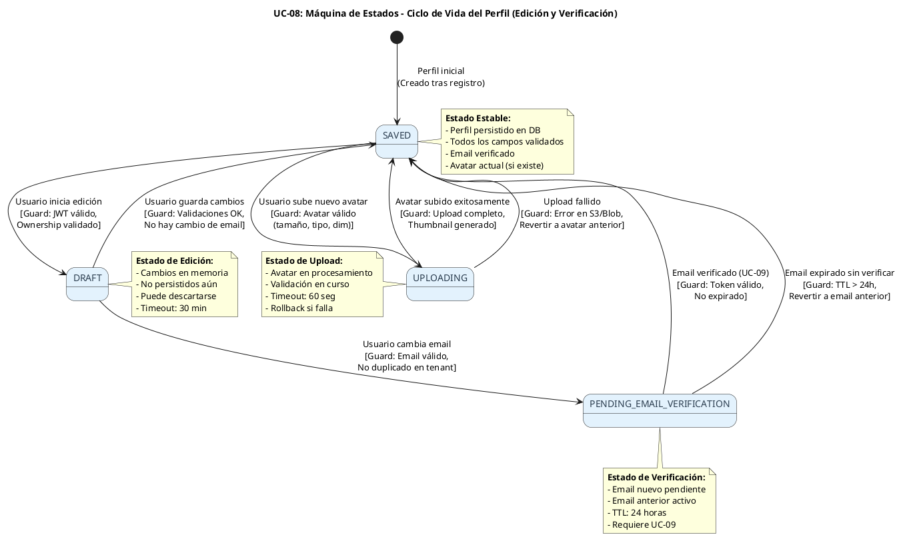
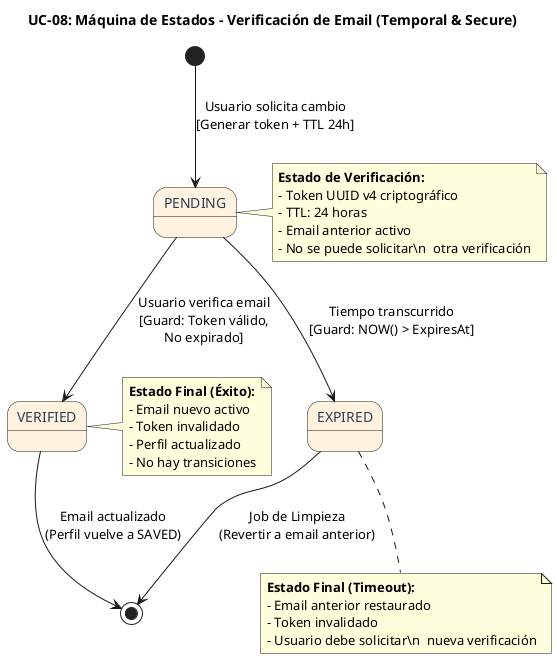
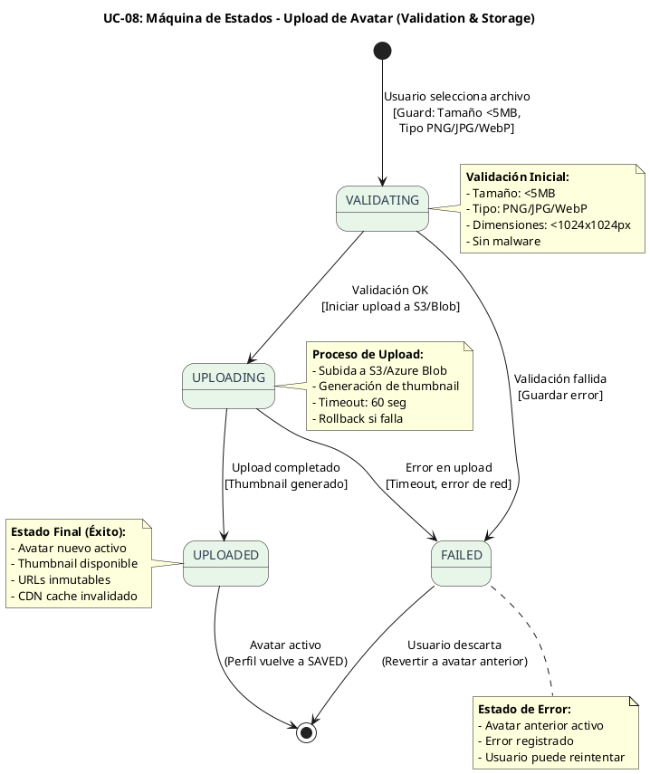

# UC-08: Self-Service Profile - Diagrama de Máquina de Estados

| Metadatos del Documento | |
| :--- | :--- |
| **Proyecto:** | SHUGO - Identity & Access Platform |
| **Caso de Uso:** | UC-08 - Self-Service Profile (User-Initiated Profile Management) |
| **Documento:** | 05_State_Machine_Diagram.md |
| **Metodología:** | UML 2.5 + ICONIX + Domain-Driven Design (State Pattern) + Temporal State Management |
| **Autor:** | Gastón Ruiz |
| **Versión Actual:** | 1.0.0 |
| **Fecha:** | 08/09/2026 |

---

## Historial de Versiones

| Versión | Fecha | Autor | Descripción de Cambios | Impacto |
| :--- | :--- | :--- | :--- | :--- |
| **1.0.0** | 08/09/2026 | Gastón Ruiz | **Creación inicial.** Definición de las máquinas de estados específicas para la gestión self-service del perfil. Se modelan tres máquinas críticas: (1) Ciclo de Vida del Perfil (DRAFT → SAVED → PENDING_EMAIL_VERIFICATION → VERIFIED), (2) Máquina Temporal de Verificación de Email (PENDING → VERIFIED/EXPIRED), y (3) Máquina de Estados del Upload de Avatar (UPLOADING → UPLOADED/FAILED). | Documento base del paquete de diseño Tier 1 del UC-08. Establece las reglas de transición, las guardas de seguridad y la lógica temporal que garantiza la integridad de los datos del perfil durante actualizaciones concurrentes y cambios de email. |

---

## 1. Introducción y Propósito

El **Diagrama de Máquina de Estados** para el UC-08 visualiza las restricciones de comportamiento temporal y las reglas de transición que gobiernan la gestión self-service del perfil de usuario.

A diferencia de los UCs de ciclo de vida de identidad (UC-01 a UC-05) donde las identidades pasan por estados complejos (PROVISIONED → ACTIVE → DEACTIVATED → PURGED), el UC-08 introduce complejidades únicas debido a su naturaleza de **actualización frecuente con validaciones asíncronas**:

1. **Estados de Edición del Perfil:** El perfil puede estar en estado `DRAFT` (edición en curso) o `SAVED` (persistido).
2. **Verificación Asíncrona de Email:** Cuando el usuario cambia su email, el perfil entra en estado `PENDING_EMAIL_VERIFICATION` hasta que se complete la verificación (UC-09).
3. **Upload de Avatar con Estados Transitorios:** El avatar pasa por estados `UPLOADING`, `UPLOADED`, y potencialmente `FAILED` durante el proceso de subida.
4. **Prevención de Race Conditions:** Múltiples usuarios (o el mismo usuario en múltiples dispositivos) pueden intentar actualizar el perfil simultáneamente, requiriendo control de concurrencia.

Estas máquinas garantizan:
- **Integridad de Datos:** El perfil no puede quedar en estado inconsistente durante actualizaciones concurrentes.
- **Verificación de Email:** Los cambios de email requieren verificación explícita antes de aplicarse.
- **Upload Seguro de Avatares:** Los avatares se validan completamente antes de marcarse como `UPLOADED`.
- **Prevención de Pérdida de Datos:** El estado `DRAFT` permite recuperar ediciones no guardadas.

---

## 2. Máquina de Estados #1: Ciclo de Vida del Perfil

### 2.1. Descripción

Esta máquina modela el ciclo de vida del perfil durante operaciones de actualización. Aunque el perfil en sí no tiene una máquina de estados compleja como las identidades, introduce estados transitorios para manejar ediciones concurrentes y cambios de email.

### 2.2. Diagrama de Máquina de Estados (PlantUML)



### 2.3. Descripción de Estados y Transiciones

| Estado | Descripción | Transiciones de Salida | Invariante Clave |
| :--- | :--- | :--- | :--- |
| **SAVED** | Perfil persistido en base de datos con todos los campos validados. Estado estable. | → `DRAFT` (usuario inicia edición), → `UPLOADING` (usuario sube avatar) | Email verificado, avatar válido (si existe), todos los campos cumplen validaciones. |
| **DRAFT** | Perfil en edición. Los cambios están en memoria pero no persistidos. | → `SAVED` (usuario guarda sin cambio de email), → `PENDING_EMAIL_VERIFICATION` (usuario cambia email) | Timeout de 30 minutos. Puede descartarse sin afectar el perfil guardado. |
| **PENDING_EMAIL_VERIFICATION** | El usuario solicitó cambiar su email. El email anterior permanece activo hasta verificación. | → `SAVED` (email verificado vía UC-09), → `SAVED` (email expirado, revertir) | TTL de 24 horas. Email anterior activo. No se puede cambiar email nuevamente hasta completar verificación. |
| **UPLOADING** | El usuario está subiendo un nuevo avatar. El avatar anterior permanece activo hasta completar el upload. | → `SAVED` (upload exitoso), → `SAVED` (upload fallido, revertir) | Timeout de 60 segundos. Avatar anterior activo. Rollback automático si falla. |

### 2.4. Guardas (Guards) de las Transiciones

#### Transición: `SAVED` → `DRAFT` (Usuario Inicia Edición)

```csharp
public class Profile : AggregateRoot
{
    public ProfileState State { get; private set; }
    public DateTime? DraftStartedAt { get; private set; }
    
    public void StartEditing(IdentityId jwtIdentityId)
    {
        // Guarda 1: Validar ownership
        ValidateOwnership(jwtIdentityId);
        
        // Guarda 2: Solo se puede editar desde estado SAVED
        if (this.State != ProfileState.SAVED)
            throw new InvalidTransitionException(
                $"Cannot start editing from state {this.State}. Must be SAVED.");
        
        // Guarda 3: No hay otra edición en curso
        if (this.DraftStartedAt.HasValue && 
            DateTime.UtcNow - this.DraftStartedAt.Value < TimeSpan.FromMinutes(30))
            throw new DraftAlreadyInProgressException(
                "Another editing session is in progress. Please save or discard changes first.");
        
        // Transición de estado
        this.State = ProfileState.DRAFT;
        this.DraftStartedAt = DateTime.UtcNow;
    }
}
```

#### Transición: `DRAFT` → `PENDING_EMAIL_VERIFICATION` (Usuario Cambia Email)

```csharp
public class Profile : AggregateRoot
{
    public string? PendingNewEmail { get; private set; }
    public DateTime? EmailVerificationExpiresAt { get; private set; }
    
    public void RequestEmailChange(string newEmail, IdentityId jwtIdentityId)
    {
        // Guarda 1: Estado debe ser DRAFT
        if (this.State != ProfileState.DRAFT)
            throw new InvalidTransitionException(
                $"Cannot request email change from state {this.State}. Must be DRAFT.");
        
        // Guarda 2: Validar ownership
        ValidateOwnership(jwtIdentityId);
        
        // Guarda 3: Validar que no haya verificación pendiente
        if (this.PendingNewEmail != null)
            throw new EmailVerificationPendingException(
                "Email verification is already pending. Please complete or cancel it first.");
        
        // Guarda 4: Validar que el email sea diferente al actual
        if (newEmail == this.Email)
            throw new DomainException("New email must be different from current email.");
        
        // Guarda 5: Validar formato de email
        var emailVo = new Email(newEmail);
        
        // Transición de estado
        this.State = ProfileState.PENDING_EMAIL_VERIFICATION;
        this.PendingNewEmail = newEmail;
        this.EmailVerificationExpiresAt = DateTime.UtcNow.AddHours(24);
        
        // Generar evento para disparar UC-09
        this.AddDomainEvent(new EmailVerificationRequested(
            this.IdentityId,
            newEmail,
            this.EmailVerificationExpiresAt.Value));
    }
}
```

#### Transición: `PENDING_EMAIL_VERIFICATION` → `SAVED` (Email Verificado)

```csharp
public class Profile : AggregateRoot
{
    public void CompleteEmailVerification(IdentityId jwtIdentityId)
    {
        // Guarda 1: Validar ownership
        ValidateOwnership(jwtIdentityId);
        
        // Guarda 2: Estado debe ser PENDING_EMAIL_VERIFICATION
        if (this.State != ProfileState.PENDING_EMAIL_VERIFICATION)
            throw new InvalidTransitionException(
                $"Cannot complete email verification from state {this.State}.");
        
        // Guarda 3: Verificación no debe haber expirado
        if (this.EmailVerificationExpiresAt < DateTime.UtcNow)
        {
            // Revertir a email anterior
            this.PendingNewEmail = null;
            this.EmailVerificationExpiresAt = null;
            this.State = ProfileState.SAVED;
            
            throw new EmailVerificationExpiredException(
                "Email verification expired. Previous email restored.");
        }
        
        // Guarda 4: Aplicar nuevo email
        this.Email = this.PendingNewEmail!;
        this.PendingNewEmail = null;
        this.EmailVerificationExpiresAt = null;
        this.State = ProfileState.SAVED;
        this.UpdatedAt = DateTime.UtcNow;
        
        // Generar evento
        this.AddDomainEvent(new EmailVerified(
            this.IdentityId,
            this.Email));
    }
}
```

### 2.5. Invariantes de la Máquina de Perfil

1. **Ownership Estricto:** Solo el propietario del perfil puede iniciar ediciones o cambios de email.
2. **Una Edición a la Vez:** No se pueden tener múltiples sesiones de edición simultáneas (timeout de 30 min).
3. **Verificación de Email Obligatoria:** Los cambios de email requieren verificación explícita vía UC-09.
4. **TTL de Verificación:** Las verificaciones de email expiran en 24 horas.
5. **Rollback Automático:** Si la verificación expira, se revierte al email anterior.
6. **Upload Atómico:** Los avatares se validan completamente antes de marcarse como `UPLOADED`.

---

## 3. Máquina de Estados #2: Verificación de Email (Temporal)

### 3.1. Descripción

Esta máquina modela el ciclo de vida temporal de la verificación de email cuando el usuario solicita un cambio. Es crítica para mantener la integridad de los datos de contacto.

### 3.2. Diagrama de Máquina de Estados (PlantUML)



### 3.3. Descripción de Estados y Transiciones

| Estado | Descripción | Transiciones de Salida | Invariante Clave |
| :--- | :--- | :--- | :--- |
| **PENDING** | Verificación de email en curso. Token generado y enviado al nuevo email. | → `VERIFIED` (usuario verifica), → `EXPIRED` (TTL transcurrido) | Token válido y no expirado. Email anterior activo. No se puede solicitar otra verificación. |
| **VERIFIED** | Email verificado exitosamente. | Ninguna (estado final) | Email nuevo activo. Token invalidado. Perfil actualizado. |
| **EXPIRED** | Verificación expirada sin acción del usuario. | → `[*]` (revertir a email anterior) | Email anterior restaurado. Token invalidado. |

### 3.4. Implementación del Value Object `EmailVerification`

```csharp
public class EmailVerification : ValueObject
{
    public string TokenHash { get; private set; }
    public string NewEmail { get; private set; }
    public string PreviousEmail { get; private set; }
    public DateTime ExpiresAt { get; private set; }
    public bool IsCompleted { get; private set; }

    private EmailVerification(string tokenHash, string newEmail, string previousEmail, DateTime expiresAt)
    {
        TokenHash = tokenHash;
        NewEmail = newEmail;
        PreviousEmail = previousEmail;
        ExpiresAt = expiresAt;
        IsCompleted = false;
    }

    /// <summary>
    /// Genera una nueva verificación de email con TTL de 24 horas.
    /// </summary>
    public static EmailVerification Create(string newEmail, string previousEmail)
    {
        var token = Guid.NewGuid().ToString("N");
        var tokenHash = SHA256.HashData(Encoding.UTF8.GetBytes(token));
        var expiresAt = DateTime.UtcNow.AddHours(24);

        return new EmailVerification(
            Convert.ToBase64String(tokenHash),
            newEmail,
            previousEmail,
            expiresAt);
    }

    /// <summary>
    /// Valida si el token proporcionado coincide y no está expirado.
    /// </summary>
    public bool Validate(string providedToken)
    {
        if (IsCompleted || IsExpired)
            return false;

        var providedHash = SHA256.HashData(Encoding.UTF8.GetBytes(providedToken));
        var providedHashBase64 = Convert.ToBase64String(providedHash);

        return SecureCompare(TokenHash, providedHashBase64);
    }

    /// <summary>
    /// Marca la verificación como completada.
    /// </summary>
    public void Complete()
    {
        IsCompleted = true;
        TokenHash = null; // Invalidar token
    }

    public bool IsExpired => DateTime.UtcNow > ExpiresAt;

    /// <summary>
    /// Comparación segura en tiempo constante.
    /// </summary>
    private static bool SecureCompare(string a, string b)
    {
        if (a == null || b == null) return false;
        if (a.Length != b.Length) return false;

        var result = 0;
        for (int i = 0; i < a.Length; i++)
        {
            result |= a[i] ^ b[i];
        }

        return result == 0;
    }

    protected override IEnumerable<object> GetEqualityComponents()
    {
        yield return TokenHash;
        yield return NewEmail;
        yield return PreviousEmail;
        yield return ExpiresAt;
    }
}
```

### 3.5. Invariantes de la Máquina de Verificación de Email

1. **Token de Un Solo Uso:** Cada token es válido para una sola verificación.
2. **TTL Estricto:** 24 horas desde la creación. No extendible.
3. **Email Anterior Activo:** Hasta que se complete la verificación, el email anterior permanece activo.
4. **Una Verificación a la Vez:** No se pueden tener múltiples verificaciones pendientes simultáneamente.
5. **Invalidación Post-Verificación:** Tras verificar, el token se invalida inmediatamente.

---

## 4. Máquina de Estados #3: Upload de Avatar

### 4.1. Descripción

Esta máquina modela el ciclo de vida del upload de avatar, desde la selección del archivo hasta su almacenamiento en S3/Azure Blob con generación de thumbnail.

### 4.2. Diagrama de Máquina de Estados (PlantUML)



### 4.3. Descripción de Estados y Transiciones

| Estado | Descripción | Transiciones de Salida | Invariante Clave |
| :--- | :--- | :--- | :--- |
| **VALIDATING** | El archivo seleccionado está siendo validado (tamaño, tipo, dimensiones). | → `UPLOADING` (validación OK), → `FAILED` (validación fallida) | Avatar anterior activo. Timeout de 10 segundos para validación. |
| **UPLOADING** | El archivo validado se está subiendo a S3/Azure Blob y generando thumbnail. | → `UPLOADED` (upload exitoso), → `FAILED` (error en upload) | Avatar anterior activo. Timeout de 60 segundos para upload. |
| **FAILED** | El upload falló por validación o error de infraestructura. | → `[*]` (usuario descarta, revertir a avatar anterior) | Avatar anterior activo. Error registrado para debugging. |
| **UPLOADED** | El avatar se subió exitosamente y el thumbnail está disponible. | Ninguna (estado final) | Avatar nuevo activo. URLs inmutables. CDN cache invalidado. |

### 4.4. Implementación del Domain Service `AvatarUploadHandler`

```csharp
public class AvatarUploadHandler : IAvatarUploadHandler
{
    private readonly IAvatarStorage _storage;
    private readonly IAvatarValidator _validator;
    private readonly ICDNService _cdnService;
    private readonly ILogger<AvatarUploadHandler> _logger;

    public AvatarUploadHandler(
        IAvatarStorage storage,
        IAvatarValidator validator,
        ICDNService cdnService,
        ILogger<AvatarUploadHandler> logger)
    {
        _storage = storage;
        _validator = validator;
        _cdnService = cdnService;
        _logger = logger;
    }

    /// <summary>
    /// Maneja el upload de avatar con validación y rollback automático.
    /// </summary>
    public async Task<Avatar> UploadAsync(
        Stream avatarStream,
        string mimeType,
        ProfileId profileId,
        CancellationToken ct)
    {
        // Estado: VALIDATING
        Avatar validatedAvatar;
        try
        {
            validatedAvatar = await _validator.ValidateAsync(
                avatarStream,
                mimeType,
                ct);
        }
        catch (Exception ex)
        {
            _logger.LogError(ex, "Avatar validation failed for profile {ProfileId}", profileId);
            throw new AvatarValidationFailedException("Avatar validation failed.", ex);
        }

        // Estado: UPLOADING
        AvatarUrls urls;
        try
        {
            // Reset stream position
            avatarStream.Position = 0;

            urls = await _storage.UploadAsync(
                avatarStream,
                mimeType,
                profileId,
                ct);
        }
        catch (Exception ex)
        {
            _logger.LogError(ex, "Avatar upload failed for profile {ProfileId}", profileId);
            throw new AvatarUploadFailedException("Avatar upload failed.", ex);
        }

        // Estado: UPLOADED
        var avatar = new Avatar(
            urls.Url,
            urls.ThumbnailUrl,
            mimeType,
            validatedAvatar.SizeBytes,
            validatedAvatar.Width,
            validatedAvatar.Height);

        // Invalidar caché CDN del avatar anterior
        await _cdnService.InvalidateCacheAsync(profileId, ct);

        return avatar;
    }
}
```

### 4.5. Invariantes de la Máquina de Upload de Avatar

1. **Validación Completa Antes de Upload:** El archivo debe pasar todas las validaciones antes de iniciar el upload.
2. **Rollback Automático:** Si el upload falla, el avatar anterior permanece activo.
3. **Timeouts Estrictos:** 10 segundos para validación, 60 segundos para upload.
4. **URLs Inmutables:** Una vez subido, las URLs del avatar no cambian.
5. **Invalidación de CDN:** Tras upload exitoso, se invalida la caché CDN del avatar anterior.

---

## 5. Implementación en el Dominio (Código C#)

### 5.1. Enumeración de Estados del Perfil

```csharp
public enum ProfileState
{
    SAVED,
    DRAFT,
    PENDING_EMAIL_VERIFICATION,
    UPLOADING
}
```

### 5.2. Aggregate Root `Profile` con Máquina de Estados

```csharp
public class Profile : AggregateRoot
{
    public ProfileId Id { get; private set; }
    public IdentityId IdentityId { get; private set; }
    public TenantId TenantId { get; private set; }
    public string Email { get; private set; }
    public DisplayName DisplayName { get; private set; }
    public Avatar? Avatar { get; private set; }
    public Preferences Preferences { get; private set; }
    public Language Language { get; private set; }
    public Timezone Timezone { get; private set; }
    public ProfileState State { get; private set; }
    public DateTime UpdatedAt { get; private set; }
    public DateTime? DraftStartedAt { get; private set; }
    public string? PendingNewEmail { get; private set; }
    public DateTime? EmailVerificationExpiresAt { get; private set; }
    public RowVersion RowVersion { get; private set; }

    private readonly List<IDomainEvent> _domainEvents = new();

    private Profile() { } // EF Core

    public static Profile Create(
        ProfileId id,
        IdentityId identityId,
        TenantId tenantId,
        string email,
        DisplayName displayName,
        Preferences preferences,
        Language language,
        Timezone timezone)
    {
        return new Profile
        {
            Id = id,
            IdentityId = identityId,
            TenantId = tenantId,
            Email = email,
            DisplayName = displayName,
            Preferences = preferences,
            Language = language,
            Timezone = timezone,
            State = ProfileState.SAVED,
            UpdatedAt = DateTime.UtcNow,
            RowVersion = new RowVersion(Guid.NewGuid())
        };
    }

    public void StartEditing(IdentityId jwtIdentityId)
    {
        ValidateOwnership(jwtIdentityId);

        if (this.State != ProfileState.SAVED)
            throw new InvalidTransitionException(
                $"Cannot start editing from state {this.State}. Must be SAVED.");

        if (this.DraftStartedAt.HasValue &&
            DateTime.UtcNow - this.DraftStartedAt.Value < TimeSpan.FromMinutes(30))
            throw new DraftAlreadyInProgressException(
                "Another editing session is in progress.");

        this.State = ProfileState.DRAFT;
        this.DraftStartedAt = DateTime.UtcNow;
    }

    public void RequestEmailChange(string newEmail, IdentityId jwtIdentityId)
    {
        if (this.State != ProfileState.DRAFT)
            throw new InvalidTransitionException(
                $"Cannot request email change from state {this.State}. Must be DRAFT.");

        ValidateOwnership(jwtIdentityId);

        if (this.PendingNewEmail != null)
            throw new EmailVerificationPendingException(
                "Email verification is already pending.");

        if (newEmail == this.Email)
            throw new DomainException("New email must be different from current email.");

        var emailVo = new Email(newEmail);

        this.State = ProfileState.PENDING_EMAIL_VERIFICATION;
        this.PendingNewEmail = newEmail;
        this.EmailVerificationExpiresAt = DateTime.UtcNow.AddHours(24);

        this.AddDomainEvent(new EmailVerificationRequested(
            this.IdentityId,
            newEmail,
            this.EmailVerificationExpiresAt.Value));
    }

    public void CompleteEmailVerification(IdentityId jwtIdentityId)
    {
        ValidateOwnership(jwtIdentityId);

        if (this.State != ProfileState.PENDING_EMAIL_VERIFICATION)
            throw new InvalidTransitionException(
                $"Cannot complete email verification from state {this.State}.");

        if (this.EmailVerificationExpiresAt < DateTime.UtcNow)
        {
            this.PendingNewEmail = null;
            this.EmailVerificationExpiresAt = null;
            this.State = ProfileState.SAVED;

            throw new EmailVerificationExpiredException(
                "Email verification expired. Previous email restored.");
        }

        this.Email = this.PendingNewEmail!;
        this.PendingNewEmail = null;
        this.EmailVerificationExpiresAt = null;
        this.State = ProfileState.SAVED;
        this.UpdatedAt = DateTime.UtcNow;

        this.AddDomainEvent(new EmailVerified(this.IdentityId, this.Email));
    }

    public void SaveChanges(UpdateProfileCommand command, IdentityId jwtIdentityId)
    {
        if (this.State != ProfileState.DRAFT)
            throw new InvalidTransitionException(
                $"Cannot save changes from state {this.State}. Must be DRAFT.");

        ValidateOwnership(jwtIdentityId);

        var changes = CalculateChanges(command);

        if (!changes.Any())
        {
            this.State = ProfileState.SAVED;
            this.DraftStartedAt = null;
            return;
        }

        ApplyChanges(changes);
        this.State = ProfileState.SAVED;
        this.DraftStartedAt = null;
        this.UpdatedAt = DateTime.UtcNow;

        this.AddDomainEvent(new ProfileUpdated(
            this.Id,
            this.IdentityId,
            this.TenantId,
            changes,
            command.IpAddress,
            command.UserAgent,
            this.UpdatedAt));
    }

    public void DiscardChanges(IdentityId jwtIdentityId)
    {
        ValidateOwnership(jwtIdentityId);

        if (this.State != ProfileState.DRAFT)
            throw new InvalidTransitionException(
                $"Cannot discard changes from state {this.State}. Must be DRAFT.");

        this.State = ProfileState.SAVED;
        this.DraftStartedAt = null;
    }

    private void ValidateOwnership(IdentityId jwtIdentityId)
    {
        if (this.IdentityId != jwtIdentityId)
            throw new ForbiddenException(
                $"User {jwtIdentityId} cannot modify profile {this.Id} " +
                $"owned by {this.IdentityId}.");
    }

    private List<FieldChange> CalculateChanges(UpdateProfileCommand command)
    {
        var changes = new List<FieldChange>();

        if (command.DisplayName != null && command.DisplayName != this.DisplayName.Value)
        {
            changes.Add(new FieldChange("display_name", this.DisplayName.Value, command.DisplayName));
        }

        if (command.Preferences != null && !this.Preferences.Data.Equals(command.Preferences.Data))
        {
            changes.Add(new FieldChange("preferences",
                this.Preferences.Data.RootElement.GetRawText(),
                command.Preferences.Data.RootElement.GetRawText()));
        }

        if (command.Language != null && command.Language.Code != this.Language.Code)
        {
            changes.Add(new FieldChange("language", this.Language.Code, command.Language.Code));
        }

        if (command.Timezone != null && command.Timezone.IanaName != this.Timezone.IanaName)
        {
            changes.Add(new FieldChange("timezone", this.Timezone.IanaName, command.Timezone.IanaName));
        }

        return changes;
    }

    private void ApplyChanges(List<FieldChange> changes)
    {
        foreach (var change in changes)
        {
            switch (change.Field)
            {
                case "display_name":
                    this.DisplayName = new DisplayName(change.NewValue);
                    break;
                case "preferences":
                    this.Preferences = new Preferences(JsonDocument.Parse(change.NewValue));
                    break;
                case "language":
                    this.Language = new Language(change.NewValue);
                    break;
                case "timezone":
                    this.Timezone = new Timezone(change.NewValue);
                    break;
            }
        }
    }

    public IReadOnlyCollection<IDomainEvent> GetDomainEvents() => _domainEvents.AsReadOnly();

    protected void AddDomainEvent(IDomainEvent evt) => _domainEvents.Add(evt);
}
```

---

## 6. Trazabilidad con Otros Documentos del Paquete

| Documento | Relación |
| :--- | :--- |
| `01_Requirements_Specification.md` | Las invariantes de estado (INV-48 a INV-54) y reglas de negocio (RN-01 a RN-05) se definen aquí y se hacen cumplir en estas máquinas. |
| `02_Use_Case_Diagram.md` | Muestra los actores y sistemas; estas máquinas definen cómo el sistema responde a sus acciones de edición de perfil a lo largo del tiempo. |
| `03_Activity_Diagram.md` | Los carriles de actividad (Profile Handler, Email Verification, Avatar Upload) se implementan aquí como máquinas de estados. |
| `04_Initial_Domain_Model.md` | El Aggregate Root `Profile`, el Value Object `EmailVerification`, y el Domain Service `AvatarUploadHandler` son la implementación directa de estas máquinas. |
| `06_Robustness_Diagram.md` | Mostrará cómo los objetos colaboran para ejecutar estas transiciones de estado de forma segura. |
| `07_Sequence_Diagram.md` | Detallará el orden temporal exacto de las llamadas que disparan estas transiciones. |
| `09_Modern_Artifacts.md` | Las métricas de conversión y limpieza se monitorean con las configuraciones definidas aquí. |
| `10_UC_Specific_Data_Model.md` | Define las columnas físicas (`state`, `pending_new_email`, `email_verification_expires_at`) que persisten estos estados en PostgreSQL. |

---

## 7. Notas de Implementación

### 7.1. Testing de Máquinas de Estados

Cada transición y guarda definida en estas máquinas debe tener al menos dos tests unitarios:

```csharp
[Test]
public void Profile_StartEditing_WhenSaved_TransitionsToDraft()
{
    // Arrange
    var profile = Profile.Create(
        new ProfileId(Guid.NewGuid()),
        new IdentityId(Guid.NewGuid()),
        new TenantId(Guid.NewGuid()),
        "user@khcs.com",
        new DisplayName("Test User"),
        new Preferences(JsonDocument.Parse("{}")),
        new Language("en"),
        new Timezone("UTC"));

    // Act
    profile.StartEditing(profile.IdentityId);

    // Assert
    profile.State.Should().Be(ProfileState.DRAFT);
    profile.DraftStartedAt.Should().NotBeNull();
}

[Test]
public void Profile_RequestEmailChange_WhenDraft_TransitionsToPendingVerification()
{
    // Arrange
    var profile = Profile.Create(
        new ProfileId(Guid.NewGuid()),
        new IdentityId(Guid.NewGuid()),
        new TenantId(Guid.NewGuid()),
        "old@khcs.com",
        new DisplayName("Test User"),
        new Preferences(JsonDocument.Parse("{}")),
        new Language("en"),
        new Timezone("UTC"));

    profile.StartEditing(profile.IdentityId);

    // Act
    profile.RequestEmailChange("new@khcs.com", profile.IdentityId);

    // Assert
    profile.State.Should().Be(ProfileState.PENDING_EMAIL_VERIFICATION);
    profile.PendingNewEmail.Should().Be("new@khcs.com");
    profile.EmailVerificationExpiresAt.Should().BeCloseTo(
        DateTime.UtcNow.AddHours(24), TimeSpan.FromMinutes(1));
}

[Test]
public void Profile_CompleteEmailVerification_WhenExpired_RestoresPreviousEmail()
{
    // Arrange
    var profile = Profile.Create(
        new ProfileId(Guid.NewGuid()),
        new IdentityId(Guid.NewGuid()),
        new TenantId(Guid.NewGuid()),
        "old@khcs.com",
        new DisplayName("Test User"),
        new Preferences(JsonDocument.Parse("{}")),
        new Language("en"),
        new Timezone("UTC"));

    profile.StartEditing(profile.IdentityId);
    profile.RequestEmailChange("new@khcs.com", profile.IdentityId);

    // Simular expiración
    profile.GetType()
        .GetProperty(nameof(Profile.EmailVerificationExpiresAt))!
        .SetValue(profile, DateTime.UtcNow.AddHours(-25));

    // Act
    var act = () => profile.CompleteEmailVerification(profile.IdentityId);

    // Assert
    act.Should().Throw<EmailVerificationExpiredException>();
    profile.Email.Should().Be("old@khcs.com");
    profile.State.Should().Be(ProfileState.SAVED);
}

[Test]
public async Task AvatarUploadHandler_WhenValidationFails_ThrowsException()
{
    // Arrange
    var mockValidator = new Mock<IAvatarValidator>();
    mockValidator.Setup(v => v.ValidateAsync(It.IsAny<Stream>(), It.IsAny<string>(), It.IsAny<CancellationToken>()))
                 .ThrowsAsync(new DomainException("Invalid avatar size"));

    var handler = new AvatarUploadHandler(
        Mock.Of<IAvatarStorage>(),
        mockValidator.Object,
        Mock.Of<ICDNService>(),
        Mock.Of<ILogger<AvatarUploadHandler>>());

    var stream = new MemoryStream(new byte[6 * 1024 * 1024]); // 6MB

    // Act
    var act = () => handler.UploadAsync(stream, "image/png", new ProfileId(Guid.NewGuid()), CancellationToken.None);

    // Assert
    await act.Should().ThrowAsync<AvatarValidationFailedException>();
}
```

### 7.2. Concurrencia y Race Conditions

Dado que múltiples dispositivos pueden editar el mismo perfil simultáneamente, se deben considerar las siguientes race conditions:

1. **Edición Concurrente:** Si dos dispositivos inician edición simultáneamente, el segundo recibe error "Another editing session is in progress".
2. **Cambio de Email Concurrente:** Si dos dispositivos solicitan cambio de email simultáneamente, el segundo recibe error "Email verification is already pending".
3. **Upload Concurrente:** Si dos dispositivos suben avatares simultáneamente, el último en completar sobrescribe al primero (último ganador).

**Mitigación:** Uso de `RowVersion` para Optimistic Concurrency Control en la base de datos.

---

## 8. Glosario de Términos Específicos de UC-08

| Término | Definición |
| :--- | :--- |
| **ProfileState** | Enumeración que representa los estados del perfil: SAVED, DRAFT, PENDING_EMAIL_VERIFICATION, UPLOADING. |
| **DRAFT** | Estado transitorio donde el perfil está en edición pero no persistido. Timeout de 30 minutos. |
| **PENDING_EMAIL_VERIFICATION** | Estado transitorio donde el usuario solicitó cambiar su email pero aún no lo verificó. TTL de 24 horas. |
| **UPLOADING** | Estado transitorio donde el avatar se está subiendo a S3/Azure Blob. Timeout de 60 segundos. |
| **EmailVerification** | Value Object que encapsula el token, emails, y expiración de la verificación de email. |
| **AvatarUploadHandler** | Domain Service que orquesta la validación y upload de avatares con rollback automático. |
| **Rollback Automático** | Mecanismo que revierte al estado anterior si una operación falla (ej. upload de avatar, verificación de email). |
| **Optimistic Concurrency Control (OCC)** | Uso de `RowVersion` para prevenir actualizaciones perdidas en operaciones concurrentes. |
| **CDN Cache Invalidation** | Proceso de invalidar la caché CDN del avatar anterior tras upload exitoso. |
| **SecureCompare** | Comparación en tiempo constante para prevenir Timing Attacks en validación de tokens. |

---
*Fin del Documento 05_State_Machine_Diagram para UC-08*