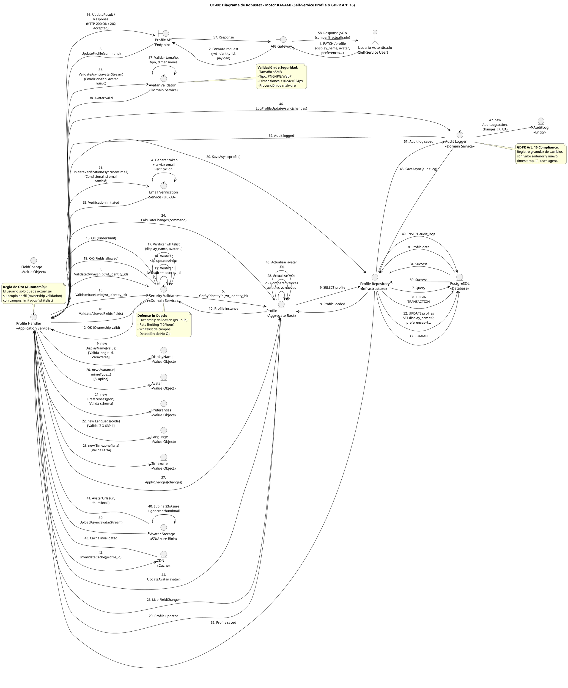

# UC-08: Self-Service Profile - Diagrama de Robustez

| Metadatos del Documento | |
| :--- | :--- |
| **Proyecto:** | SHUGO - Identity & Access Platform |
| **Caso de Uso:** | UC-08 - Self-Service Profile (User-Initiated Profile Management) |
| **Documento:** | 06_Robustness_Diagram.md |
| **Metodología:** | ICONIX (Diagrama de Robustez) + DDD + Security by Design + GDPR Compliance (Art. 16) |
| **Autor:** | Gastón Ruiz |
| **Versión Actual:** | 1.0.0 |
| **Fecha:** | 08/09/2026 |

---

## Historial de Versiones

| Versión | Fecha | Autor | Descripción de Cambios | Impacto |
| :--- | :--- | :--- | :--- | :--- |
| **1.0.0** | 08/09/2026 | Gastón Ruiz | **Creación inicial.** Diagrama de Robustez para UC-08, validando la arquitectura del motor KAGAMI para operaciones de gestión self-service del perfil. Muestra la colaboración estricta entre Boundaries (API Gateway, Profile API Endpoint), Controls (ProfileHandler, SecurityValidator, AvatarValidator, AuditLogger), y Entities (Profile, Avatar, DisplayName, Preferences, Language, Timezone, FieldChange). Valida las reglas de ownership validation, whitelist de campos, detección de No-Op, e integración condicional con UC-09 para cambios de email. | Documento base del paquete de diseño Tier 1 del UC-08. Sirve como puente crítico entre el Modelo de Dominio (04) y el Diagrama de Secuencia (07), asegurando que la arquitectura soporta la autonomía del usuario, la seguridad mediante ownership validation, y el cumplimiento GDPR Art. 16 antes de codificar. |

---

## 1. Introducción y Propósito

El **Diagrama de Robustez** para el UC-08 valida que el flujo de gestión self-service del perfil puede ser orquestado respetando las reglas estrictas de acoplamiento de **ICONIX** y los principios de **Domain-Driven Design (DDD)**, **Security by Design**, y **GDPR Compliance (Art. 16 - Derecho de Rectificación)**.

El desafío específico de este caso de uso es quíntuple:

1. **Ownership Validation Estricto:** Solo el propio usuario puede actualizar su perfil (validación de JWT `sub` claim contra `identity_id`), previniendo escalación horizontal (IDOR).
2. **Whitelist de Campos:** El usuario solo puede modificar campos específicos (`display_name`, `avatar`, `preferences`, `language`, `timezone`), NO campos críticos como `email`, `status`, o `roles`.
3. **Detección de No-Op:** Si el usuario envía los mismos datos, el sistema detecta la ausencia de cambios para evitar writes innecesarios y ruido en auditoría.
4. **Integración Condicional con UC-09:** Si el cambio involucra el email, el flujo se desvía al proceso de verificación de contactos.
5. **Auditoría Granular:** Cada cambio se registra con valor anterior, nuevo valor, timestamp, IP, y user agent para cumplimiento GDPR y forense.

---

## 2. Diagrama de Robustez (PlantUML)

A continuación, se presenta el Diagrama de Robustez organizado de izquierda a derecha para mostrar el flujo natural: **Actor → Boundary → Control → Entity**.



---

## 3. Explicación Detallada de los Objetos

### 3.1. Boundary Objects (Objetos de Límite)

| Objeto | Responsabilidad | Mapeo a Clean Architecture |
| :--- | :--- | :--- |
| **`API Gateway`** | Valida el JWT, extrae `jwt_identity_id` del claim `sub`, y aplica rate limiting a nivel de gateway. Es la primera línea de defensa contra accesos no autenticados. | Middleware (Kong, AWS API Gateway). |
| **`Profile API Endpoint`** | Recibe la request HTTP `PATCH /profile`, deserializa el payload a un DTO (`UpdateProfileCommand`), y lo pasa al Handler. | Controller (ASP.NET Core Controller). |

### 3.2. Control Objects (Objetos de Control)

| Objeto | Responsabilidad | Mapeo a Clean Architecture |
| :--- | :--- | :--- |
| **`Profile Handler`** | **Application Service.** Orquesta el caso de uso. Coordina las validaciones de seguridad, la construcción de Value Objects, la detección de No-Op, la aplicación de cambios, la persistencia, el upload de avatar, la auditoría, y la integración con UC-09. | Command Handler / Application Service. |
| **`Security Validator`** | **Domain Service.** Valida las reglas de negocio de seguridad: ownership validation (JWT sub == identity_id), rate limiting (10 updates/hour), y whitelist de campos permitidos. | Domain Service. |
| **`Avatar Validator`** | **Domain Service.** Valida tamaño (<5MB), tipo (PNG/JPG/WebP), y dimensiones (<1024x1024px) del avatar. Previene upload de malware o imágenes maliciosas. | Domain Service. |
| **`Audit Logger`** | **Domain Service.** Genera logs de auditoría granulares con campo anterior, nuevo valor, timestamp, IP, y user agent. Cumple con GDPR Art. 16. | Domain Service. |
| **`Email Verification Service`** | **UC-09 Integration.** Inicia el flujo de verificación de email si el usuario intenta cambiar su email. | Application Service (UC-09). |

### 3.3. Entity Objects (Objetos de Entidad)

| Objeto | Responsabilidad | Mapeo a DDD |
| :--- | :--- | :--- |
| **`Profile`** | **Aggregate Root.** Encapsula la información personal del usuario. Separa de `Identity` para permitir actualizaciones frecuentes sin afectar autenticación/autorización. | Aggregate Root. |
| **`DisplayName`** | **Value Object.** Valida longitud (2-100 chars) y caracteres permitidos (alphanumeric, spaces, hyphens, underscores, dots, @). | Value Object. |
| **`Avatar`** | **Value Object.** Encapsula URLs, metadata, y validaciones de seguridad del avatar. Inmutable tras creación. | Value Object. |
| **`Preferences`** | **Value Object.** Almacena preferencias como JSON validado contra schema. Permite flexibilidad con validación. | Value Object. |
| **`Language`** | **Value Object.** Código de idioma ISO 639-1 (ej. "en", "es") con validación estricta. | Value Object. |
| **`Timezone`** | **Value Object.** Nombre de zona horaria IANA (ej. "America/New_York") con validación estricta. | Value Object. |
| **`FieldChange`** | **Value Object.** Registro inmutable de un cambio individual con valor anterior, nuevo valor, y timestamp. Usado para auditoría granular. | Value Object. |
| **`AuditLog`** | **Entity.** Registro de auditoría con acción, cambios, IP, user agent, timestamp. Inmutable tras creación. | Entity. |
| **`Profile Repository`** | **Infrastructure.** Abstrae la persistencia. Implementa la transacción atómica que actualiza el perfil y registra el log de auditoría. | Repository Interface (Domain) / Implementation (Infra). |

---

## 4. Reglas de Robustez de ICONIX (Validación del Diagrama)

Verifiquemos que nuestro diagrama cumple estrictamente las reglas de acoplamiento de ICONIX:

### ✅ Regla 1: Actor → Boundary
- **Cumplida:** El `Usuario Autenticado` interactúa solo con el `API Gateway`.

### ✅ Regla 2: Boundary → Boundary
- **Cumplida:** El `API Gateway` forward la request al `Profile API Endpoint`.

### ✅ Regla 3: Boundary → Control
- **Cumplida:** El `Profile API Endpoint` envía el command al `Profile Handler`.

### ✅ Regla 4: Control → Control
- **Cumplida y Crítica:** El `Profile Handler` delega al `Security Validator` (validaciones de dominio), `Avatar Validator` (validación de archivos), `Audit Logger` (auditoría), y `Email Verification Service` (integración con UC-09).
- **Validación:** Esto mantiene el Application Service delgado y permite que las reglas de seguridad y las integraciones sean reutilizables y testeables.

### ✅ Regla 5: Control → Entity
- **Cumplida:**
  - `Profile Handler` crea los Value Objects `DisplayName`, `Avatar`, `Preferences`, `Language`, `Timezone`.
  - `Profile Handler` invoca `Profile.CalculateChanges()` y `Profile.ApplyChanges()`.
  - `Profile Handler` llama a `Profile Repository` para persistir.
  - `Security Validator` consulta `Profile` para validar ownership.
  - `Audit Logger` crea `AuditLog` y lo persiste vía `Profile Repository`.

### ✅ Regla 6: NO Entity → Control / Boundary
- **Cumplida:** Ninguna entidad (`Profile`, `DisplayName`, `Avatar`, `Preferences`, `Language`, `Timezone`, `FieldChange`, `AuditLog`, `Repo`) envía mensajes de vuelta a los controles o boundaries. Solo retornan datos como respuesta a una invocación.

### ✅ Regla 7: NO Entity → Entity (Directo sin Control)
- **Cumplida:** El `Profile Handler` (Control) es el único que orquesta la interacción entre `Profile` y los Value Objects. Las entidades no se crean entre sí directamente desde el diagrama de flujo principal.

---

## 5. Consideraciones de Arquitectura (Security & GDPR Compliance)

### 5.1. Ownership Validation (Prevención de IDOR)

El diagrama valida visualmente uno de los patrones más críticos para UC-08: **Ownership Validation**.

**Flujo de Validación (Pasos 4-12):**
1. `Profile Handler` invoca `Security Validator.ValidateOwnership(jwt_identity_id)`.
2. `Security Validator` consulta `Profile Repository.GetByIdentityId(jwt_identity_id)`.
3. `Profile Repository` carga el perfil desde la base de datos.
4. `Security Validator` verifica que `JWT sub == profile.identity_id`.
5. Si no coincide, retorna HTTP 403 "Cannot update other profiles".

**Justificación:**
- **Prevención de IDOR:** Es la vulnerabilidad más común en APIs de perfiles. Un usuario no puede modificar el perfil de otro usuario manipulando el `identity_id` en la URL.
- **Seguridad por Diseño:** La validación ocurre en el Domain Service, no solo en la capa de aplicación.

### 5.2. Whitelist de Campos (Prevención de Escalación de Privilegios)

El diagrama muestra cómo el `Security Validator` valida que los campos a actualizar estén en la whitelist:

**Flujo de Validación (Pasos 16-18):**
1. `Profile Handler` invoca `Security Validator.ValidateAllowedFields(fields)`.
2. `Security Validator` verifica que cada campo esté en: `display_name`, `avatar`, `preferences`, `language`, `timezone`.
3. Si algún campo no está permitido (ej. `status`, `roles`, `email`), retorna HTTP 400 "Field not allowed".

**Justificación:**
- **Prevención de Escalación:** Un usuario no puede asignarse roles admin o cambiar su status a ACTIVE si está desactivado.
- **Integridad de Datos:** Campos críticos como `status` y `roles` solo pueden ser modificados por administradores (UC-02).

### 5.3. Detección de No-Op (Optimización de Recursos)

El diagrama modela explícitamente la **detección de actualizaciones sin cambios reales**:

**Flujo de Detección (Pasos 24-26):**
1. `Profile Handler` invoca `Profile.CalculateChanges(command)`.
2. `Profile` compara valores actuales con nuevos valores.
3. Si no hay cambios, retorna lista vacía de `FieldChange`.
4. `Profile Handler` retorna HTTP 200 "No changes detected" sin actualizar DB ni generar log.

**Justificación:**
- **Optimización de Recursos:** Previene writes innecesarios en la base de datos.
- **Reducción de Ruido:** Evita logs de auditoría innecesarios que complican el análisis forense.

### 5.4. Auditoría Granular (GDPR Art. 16 Compliance)

El diagrama muestra cómo el `Audit Logger` genera logs de auditoría granulares:

**Flujo de Auditoría (Pasos 46-52):**
1. `Profile Handler` invoca `Audit Logger.LogProfileUpdateAsync(changes)`.
2. `Audit Logger` crea `AuditLog` con: acción, cambios (campo anterior, nuevo valor), IP, user agent, timestamp.
3. `Audit Logger` persiste el log vía `Profile Repository`.

**Justificación:**
- **GDPR Art. 16:** Cumple con el Derecho de Rectificación proporcionando trazabilidad completa de quién cambió qué y cuándo.
- **Forense:** Permite investigar cambios sospechosos o no autorizados.

### 5.5. Integración Condicional con UC-09 (Verificación de Email)

El diagrama modela la **integración condicional** si el usuario intenta cambiar su email:

**Flujo de Integración (Pasos 53-55):**
1. `Profile Handler` detecta que el email cambió.
2. `Profile Handler` invoca `Email Verification Service.InitiateVerificationAsync(newEmail)`.
3. `Email Verification Service` genera token y envía email de verificación.
4. `Profile Handler` retorna HTTP 202 "Email verification sent".

**Justificación:**
- **Integridad de Contactos:** Previene que usuarios pierdan acceso a sus cuentas por typos en email.
- **Seguridad:** Requiere verificación del nuevo email antes de actualizarlo, previniendo que atacantes cambien emails para tomar control de cuentas.

---

## 6. Trazabilidad con Otros Documentos del Paquete

| Documento | Relación |
| :--- | :--- |
| `01_Requirements_Specification.md` | Este diagrama valida que los requisitos de ownership validation, whitelist de campos, detección de No-Op, y auditoría granular pueden ser implementados con los objetos definidos. |
| `02_Use_Case_Diagram.md` | Muestra los actores y sistemas; este diagrama muestra cómo colaboran los objetos internos. |
| `03_Activity_Diagram.md` | Los carriles de actividad (Profile Handler, Security Validator, Avatar Validator, Audit Logger) se mapean directamente a los objetos de Control de este diagrama. |
| `04_Initial_Domain_Model.md` | Los objetos `Profile`, `DisplayName`, `Avatar`, `Preferences`, `Language`, `Timezone`, `FieldChange` y los servicios `ProfileHandler`/`SecurityValidator`/`AvatarValidator`/`AuditLogger` son exactamente las clases definidas en el modelo de dominio. |
| `05_State_Machine_Diagram.md` | Las máquinas de estados (SAVED → DRAFT → PENDING_EMAIL_VERIFICATION) se implementan en los objetos de este diagrama. |
| `07_Sequence_Diagram.md` | Este diagrama define "qué objetos colaboran"; el de secuencia definirá "en qué orden temporal exacto" se envían los mensajes. |
| `08_Final_Class_Design.md` | Definirá las firmas exactas de los métodos mostrados en este diagrama (ej. `Profile.CalculateChanges()`, `SecurityValidator.ValidateOwnership()`, `AuditLogger.LogProfileUpdate()`). |

---

## 7. Notas de Implementación

### 7.1. Inyección de Dependencias

El `Profile Handler` debe tener inyectados los servicios de dominio e infraestructura:

```csharp
public class ProfileHandler : IProfileHandler
{
    private readonly ISecurityValidator _validator;
    private readonly IAvatarValidator _avatarValidator;
    private readonly IAuditLogger _auditLogger;
    private readonly IEmailVerificationService _emailVerificationService;
    private readonly IProfileRepository _repository;
    private readonly IAvatarStorage _avatarStorage;
    private readonly ICDNService _cdnService;
    private readonly ILogger<ProfileHandler> _logger;

    public ProfileHandler(
        ISecurityValidator validator,
        IAvatarValidator avatarValidator,
        IAuditLogger auditLogger,
        IEmailVerificationService emailVerificationService,
        IProfileRepository repository,
        IAvatarStorage avatarStorage,
        ICDNService cdnService,
        ILogger<ProfileHandler> logger)
    {
        _validator = validator;
        _avatarValidator = avatarValidator;
        _auditLogger = auditLogger;
        _emailVerificationService = emailVerificationService;
        _repository = repository;
        _avatarStorage = avatarStorage;
        _cdnService = cdnService;
        _logger = logger;
    }
}
```

### 7.2. Flujo de Ejecución Simplificado (Código)

```csharp
public async Task<ProfileUpdateResult> UpdateProfile(
    UpdateProfileCommand command, 
    IdentityId jwtIdentityId,
    CancellationToken ct)
{
    // 1. Validaciones de seguridad (Ownership, Rate Limit, Campos)
    await _validator.ValidateOwnershipAsync(command.ProfileId, jwtIdentityId, ct);
    await _validator.ValidateRateLimitAsync(jwtIdentityId, ct);
    _validator.ValidateAllowedFields(command.GetFieldNames());

    // 2. Cargar perfil actual
    var profile = await _repository.GetByIdAsync(command.ProfileId, ct);
    if (profile == null)
        throw new ProfileNotFoundException($"Profile {command.ProfileId} not found.");

    // 3. Detección de No-Op
    var changes = profile.CalculateChanges(command);
    if (!changes.Any())
    {
        _logger.LogInformation("No changes detected for profile {ProfileId}", command.ProfileId);
        return new ProfileUpdateResult(message: "No changes detected", hasChanges: false);
    }

    // 4. Validar y procesar avatar (si se proporciona)
    if (command.AvatarStream != null)
    {
        var avatar = await _avatarValidator.ValidateAsync(
            command.AvatarStream, 
            command.AvatarMimeType, 
            ct);
        
        var avatarUrls = await _avatarStorage.UploadAsync(
            command.AvatarStream, 
            command.AvatarMimeType, 
            ct);
        
        await _cdnService.InvalidateCacheAsync(command.ProfileId, ct);
        
        command.Avatar = new Avatar(
            avatarUrls.Url,
            avatarUrls.ThumbnailUrl,
            command.AvatarMimeType,
            command.AvatarStream.Length,
            avatar.Width,
            avatar.Height);
    }

    // 5. Aplicar cambios
    profile.ApplyChanges(changes);
    await _repository.SaveAsync(profile, ct);

    // 6. Generar log de auditoría
    await _auditLogger.LogProfileUpdateAsync(
        profile.IdentityId,
        changes,
        command.IpAddress,
        command.UserAgent,
        ct);

    // 7. Manejar cambio de email (si aplica)
    if (command.Email != null && command.Email != profile.Email)
    {
        await _emailVerificationService.InitiateVerificationAsync(
            profile.IdentityId,
            command.Email,
            ct);
        
        return new ProfileUpdateResult(
            message: "Email verification sent",
            hasChanges: true,
            emailVerificationPending: true);
    }

    return new ProfileUpdateResult(
        message: "Profile updated successfully",
        hasChanges: true,
        changes: changes);
}
```

---
*Fin del Documento 06_Robustness_Diagram para UC-08*