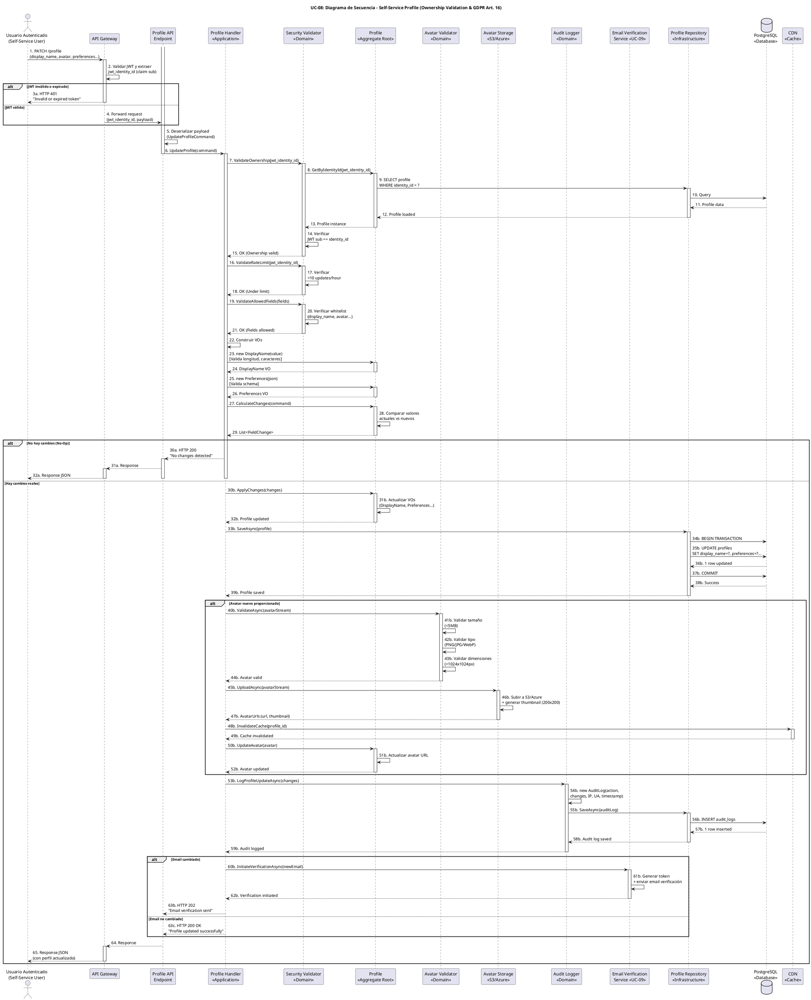

# UC-08: Self-Service Profile - Diagrama de Secuencia

| Metadatos del Documento | |
| :--- | :--- |
| **Proyecto:** | SHUGO - Identity & Access Platform |
| **Caso de Uso:** | UC-08 - Self-Service Profile (User-Initiated Profile Management) |
| **Documento:** | 07_Sequence_Diagram.md |
| **Metodología:** | ICONIX (Diagrama de Secuencia) + DDD + Security by Design + GDPR Compliance (Art. 16) |
| **Autor:** | Gastón Ruiz |
| **Versión Actual:** | 1.0.0 |
| **Fecha:** | 08/09/2026 |

---

## Historial de Versiones

| Versión | Fecha | Autor | Descripción de Cambios | Impacto |
| :--- | :--- | :--- | :--- | :--- |
| **1.0.0** | 08/09/2026 | Gastón Ruiz | **Creación inicial.** Diagrama de Secuencia completo para UC-08. Modela la orquestación temporal exacta de la gestión self-service del perfil, destacando la validación de ownership (JWT sub == identity_id), la detección de No-Op, la aplicación de cambios atómica, el upload de avatar con validación, la generación de log de auditoría granular, y la integración condicional con UC-09 para cambios de email. | Documento base del paquete de diseño Tier 1 del UC-08. Sirve como guion exacto para la codificación del `ProfileHandler`, la gestión de transacciones con auditoría, y la integración con servicios de validación y almacenamiento. |

---

## 1. Introducción y Propósito

El **Diagrama de Secuencia** para el UC-08 materializa temporalmente las colaboraciones definidas en el Diagrama de Robustez. Su propósito es:

1. **Definir el orden exacto de las validaciones de seguridad:** Establecer la secuencia crítica donde Ownership Validation → Rate Limiting → Whitelist de Campos ocurre *antes* de cualquier modificación de datos.
2. **Modelar la Detección de No-Op:** Mostrar cómo el sistema detecta la ausencia de cambios reales para evitar writes innecesarios y ruido en auditoría.
3. **Visualizar la Integración Condicional con UC-09:** Demostrar cómo, si el usuario cambia su email, el flujo se desvía al proceso de verificación de contactos.
4. **Demostrar la Atomicidad de la Actualización:** Mostrar que la actualización del perfil, el upload de avatar (si aplica), y la generación de log de auditoría ocurren en una transacción coherente.
5. **Modelar los Flujos de Excepción:** Mostrar cómo cada fallo (ownership mismatch, rate limit, campo no permitido, avatar inválido) retorna un código HTTP específico.

---

## 2. Diagrama de Secuencia - Escenario Principal (PlantUML)

A continuación, se presenta el Diagrama de Secuencia para el **Escenario Principal (actualización exitosa con avatar)** y sus variaciones de excepción.



---

## 3. Análisis Detallado del Flujo

### 3.1. Fase 1: Autenticación y Validaciones de Seguridad (Pasos 1-4)

**Participantes:** `Usuario Autenticado`, `API Gateway`

*   **Validación de JWT:** El API Gateway valida la firma del JWT localmente usando las claves públicas del JWKS endpoint de SHUGO.
*   **Extracción de Claims:** Extrae `jwt_identity_id` del claim `sub` y lo inyecta en el contexto de la request.
*   **Fail Fast:** Si el JWT es inválido o expirado, se retorna error HTTP 401 inmediatamente.

**Justificación:**
- **Seguridad:** El `jwt_identity_id` se extrae del JWT firmado, no de headers manipulables.
- **Rendimiento:** Validar el JWT localmente (con JWKS cacheado) es mucho más rápido que llamar a un servicio de autenticación.
- **Prevención de IDOR:** Esta es la primera barrera contra accesos no autorizados.

### 3.2. Fase 2: Validaciones de Dominio (Pasos 5-21)

**Participantes:** `Profile API Endpoint`, `Profile Handler`, `Security Validator`, `Profile`, `Profile Repository`, `PostgreSQL`

Esta es la fase más crítica del flujo, donde se aplican múltiples capas de validación antes de permitir cualquier modificación.

#### Validación de Ownership (Pasos 7-15)

*   **Pregunta:** ¿El `sub` claim del JWT coincide con el `identity_id` del perfil?
*   **Implementación:** `Security Validator` consulta `Profile Repository.GetByIdentityId(jwt_identity_id)` y compara `profile.IdentityId == jwtIdentityId`.
*   **Si falla:** Retorna HTTP 403 "Cannot update other profiles".
*   **Justificación:** Previene **escalación horizontal (IDOR)**. Es la vulnerabilidad más común en APIs de perfiles.

#### Validación de Rate Limiting (Pasos 16-18)

*   **Pregunta:** ¿El usuario ha excedido 10 actualizaciones en la última hora?
*   **Implementación:** `Security Validator` consulta Redis con clave `rate_limit:profile:{identity_id}`.
*   **Si falla:** Retorna HTTP 429 "Rate limit exceeded".
*   **Justificación:** Previene spam de actualizaciones y abuso de recursos de DB/Auditoría.

#### Validación de Campos Permitidos (Pasos 19-21)

*   **Pregunta:** ¿Los campos a actualizar están en la whitelist (`display_name`, `avatar`, `preferences`, `language`, `timezone`)?
*   **Implementación:** `Security Validator` verifica cada campo contra `ALLOWED_FIELDS`.
*   **Si falla:** Retorna HTTP 400 "Field not allowed".
*   **Justificación:** Previene **escalación de privilegios**. Un usuario no puede asignarse roles o cambiar su status.

### 3.3. Fase 3: Construcción de Value Objects (Pasos 22-26)

**Participantes:** `Profile Handler`, `Profile`

*   **DisplayName:** Valida longitud (2-100 chars) y caracteres permitidos (alphanumeric, spaces, hyphens, underscores, dots, @).
*   **Preferences:** Valida estructura JSON contra schema esperado (theme: light/dark/system, notifications: object).
*   **Language:** Valida código ISO 639-1 (ej. "en", "es").
*   **Timezone:** Valida nombre IANA (ej. "America/New_York").

**Justificación:**
- **Inmutabilidad:** Los Value Objects encapsulan validaciones y garantizan integridad.
- **Seguridad:** Previene inyección de datos maliciosos o malformados.

### 3.4. Fase 4: Detección de No-Op (Pasos 27-30)

**Participantes:** `Profile Handler`, `Profile`

*   **Pregunta:** ¿Los nuevos valores son diferentes a los actuales en la DB?
*   **Implementación:** `Profile.CalculateChanges(command)` compara valores actuales con nuevos valores y retorna `List<FieldChange>`.
*   **Si no hay cambios:** Retorna HTTP 200 "No changes detected" y **detiene el flujo**.
*   **Justificación:** 
    - **Optimización de Recursos:** Evita writes innecesarios en DB.
    - **Reducción de Ruido:** Evita logs de auditoría innecesarios.
    - **Mejora de UX:** Respuesta rápida para el usuario.

### 3.5. Fase 5: Aplicación de Cambios y Persistencia (Pasos 30b-39b)

**Participantes:** `Profile Handler`, `Profile`, `Profile Repository`, `PostgreSQL`

*   **ApplyChanges:** El `Profile` aplica los cambios calculados a sus Value Objects internos.
*   **SaveAsync:** El `Profile Repository` ejecuta una transacción atómica que actualiza el perfil en PostgreSQL.
*   **Commit:** Solo si la actualización es exitosa, se confirma la transacción.

**Justificación:**
- **Atomicidad:** Garantiza que el perfil se actualice completamente o no se actualice en absoluto.
- **Integridad de Datos:** Previene estados inconsistentes.

### 3.6. Fase 6: Upload de Avatar (Condicional - Pasos 40b-52b)

**Participantes:** `Profile Handler`, `Avatar Validator`, `Avatar Storage`, `CDN`, `Profile`

Esta fase solo se ejecuta si el usuario proporcionó un nuevo avatar.

#### Validación de Avatar (Pasos 40b-44b)

*   **Tamaño:** <5MB para prevenir abuso de storage.
*   **Tipo:** PNG/JPG/WebP para prevenir upload de malware.
*   **Dimensiones:** <1024x1024px para prevenir imágenes excesivamente grandes.

#### Upload y Generación de Thumbnail (Pasos 45b-47b)

*   **Upload:** El archivo se sube a S3/Azure Blob con URL pública.
*   **Thumbnail:** Se genera automáticamente una versión de 200x200px para optimizar carga en listas.

#### Invalidación de CDN (Pasos 48b-49b)

*   **Cache Invalidation:** Se invalida la caché CDN del avatar anterior para que los usuarios vean el nuevo avatar inmediatamente.

**Justificación:**
- **Seguridad:** Previene upload de archivos maliciosos.
- **Rendimiento:** Thumbnails optimizan la carga de páginas con múltiples avatares.
- **UX:** Invalidación de CDN asegura que los usuarios vean cambios inmediatamente.

### 3.7. Fase 7: Auditoría (Pasos 53b-59b)

**Participantes:** `Profile Handler`, `Audit Logger`, `Profile Repository`, `PostgreSQL`

*   **LogProfileUpdateAsync:** El `Audit Logger` genera un log de auditoría con:
    - Campo modificado (ej. `display_name`)
    - Valor anterior (ej. "John Doe")
    - Valor nuevo (ej. "John Smith")
    - Metadata: IP, User Agent, Timestamp
*   **Persistencia:** El log se guarda en la tabla `audit_logs`.

**Justificación:**
- **GDPR Art. 16:** Cumple con el Derecho de Rectificación proporcionando trazabilidad completa.
- **Forense:** Permite investigar cambios sospechosos o no autorizados.

### 3.8. Fase 8: Integración con UC-09 (Condicional - Pasos 60b-63b)

**Participantes:** `Profile Handler`, `Email Verification Service (UC-09)`

Esta fase solo se ejecuta si el usuario intentó cambiar su email.

*   **InitiateVerificationAsync:** El `Email Verification Service` genera un token de verificación y envía un email al nuevo email.
*   **Respuesta:** HTTP 202 "Email verification sent" (no 200 OK), indicando que la acción está en proceso pero requiere confirmación.

**Justificación:**
- **Integridad de Contactos:** Previene que usuarios pierdan acceso a sus cuentas por typos en email.
- **Seguridad:** Requiere verificación del nuevo email antes de actualizarlo, previniendo que atacantes cambien emails para tomar control de cuentas.

---

## 4. Flujos Alternativos y Excepciones

### 4.1. Flujo Alternativo: JWT Inválido o Expirado

Si el JWT es inválido o expiró:

```
User -> GW (JWT validation) -> GW -> User (HTTP 401 "Invalid or expired token")
```

**Pasos:** 1-3a.
**Tiempo total:** ~10ms.
**Justificación:** Solo usuarios autenticados pueden gestionar su perfil.

### 4.2. Flujo Alternativo: Ownership Mismatch (IDOR Attempt)

Si el usuario intenta actualizar el perfil de otro usuario:

```
User -> GW -> API -> Handler -> Validator (ValidateOwnership) -> Profile (GetByIdentityId) -> Repo -> DB (Profile data) -> Repo -> Profile -> Profile -> Validator -> Validator (JWT sub != identity_id) -> Validator -> Handler -> Handler -> API -> GW -> User (HTTP 403 "Cannot update other profiles")
```

**Pasos:** 1-15, detección de mismatch, retorno 403.
**Tiempo total:** ~30ms.
**Justificación:** Previene escalación horizontal (IDOR).

### 4.3. Flujo Alternativo: Rate Limit Excedido

Si el usuario excedió 10 actualizaciones en la última hora:

```
User -> GW -> API -> Handler -> Validator (ValidateRateLimit) -> Validator (count >= 10) -> Validator -> Handler -> Handler -> API -> GW -> User (HTTP 429 "Rate limit exceeded")
```

**Pasos:** 1-18, detección de límite, retorno 429.
**Tiempo total:** ~20ms.
**Justificación:** Previene spam de actualizaciones y abuso de recursos.

### 4.4. Flujo Alternativo: Campo No Permitido

Si el usuario intenta actualizar un campo no permitido (ej. `status`, `roles`):

```
User -> GW -> API -> Handler -> Validator (ValidateAllowedFields) -> Validator (field not in whitelist) -> Validator -> Handler -> Handler -> API -> GW -> User (HTTP 400 "Field not allowed")
```

**Pasos:** 1-21, detección de campo no permitido, retorno 400.
**Tiempo total:** ~25ms.
**Justificación:** Previene escalación de privilegios.

### 4.5. Flujo Alternativo: Avatar Inválido

Si el avatar no cumple las validaciones (tamaño, tipo, dimensiones):

```
User -> GW -> API -> Handler -> Validator (validations) -> Handler -> Profile (CalculateChanges) -> Profile (changes detected) -> Profile -> Handler -> Handler -> AvatarVal (ValidateAsync) -> AvatarVal (validation failed) -> AvatarVal -> Handler -> Handler -> API -> GW -> User (HTTP 400 "Invalid avatar")
```

**Pasos:** 1-44b, validación de avatar falla, retorno 400.
**Tiempo total:** ~50ms.
**Justificación:** Previene upload de archivos maliciosos o excesivamente grandes.

### 4.6. Flujo Alternativo: No-Op (Sin Cambios)

Si el usuario envía los mismos datos:

```
User -> GW -> API -> Handler -> Validator (validations) -> Handler -> Profile (CalculateChanges) -> Profile (no changes) -> Profile -> Handler -> Handler -> API -> GW -> User (HTTP 200 "No changes detected")
```

**Pasos:** 1-30a, detección de No-Op, retorno 200 sin actualizar DB.
**Tiempo total:** ~40ms.
**Justificación:** Optimización de recursos y reducción de ruido en auditoría.

### 4.7. Flujo Alternativo: Email Cambiado (Integración con UC-09)

Si el usuario intenta cambiar su email:

```
User -> GW -> API -> Handler -> Validator (validations) -> Handler -> Profile (CalculateChanges) -> Profile (changes detected) -> Profile -> Handler -> Handler -> Profile (ApplyChanges) -> Profile -> Handler -> Handler -> Repo (SaveAsync) -> Repo -> DB (UPDATE) -> DB -> Repo -> Repo -> Handler -> Handler -> Auditor (LogProfileUpdateAsync) -> Auditor -> Repo -> Repo -> Handler -> Handler -> EmailVerif (InitiateVerificationAsync) -> EmailVerif -> EmailVerif -> Handler -> Handler -> API -> GW -> User (HTTP 202 "Email verification sent")
```

**Pasos:** 1-63b, detección de cambio de email, integración con UC-09, retorno 202.
**Tiempo total:** ~150ms.
**Justificación:** Mantiene integridad de datos de contacto requiriendo verificación.

### 4.8. Flujo de Excepción: Error de Persistencia

Si la actualización del perfil falla (ej. deadlock, conexión caída):

```
User -> GW -> API -> Handler -> Validator (validations) -> Handler -> Profile (CalculateChanges) -> Profile (changes detected) -> Profile -> Handler -> Handler -> Profile (ApplyChanges) -> Profile -> Handler -> Handler -> Repo (SaveAsync) -> Repo -> DB (BEGIN TRANSACTION) -> DB -> Repo -> Repo -> DB (UPDATE) -> DB -> Repo -> Repo -> DB (COMMIT fails) -> DB -> Repo -> Repo -> Handler -> Handler -> API -> GW -> User (HTTP 500 "Failed to update profile")
```

**Pasos:** 1-38b, COMMIT falla, retorno 500.
**Tiempo total:** ~100ms.
**Justificación:** La transacción se revierte completamente. El perfil no se modifica.

---

## 5. Consideraciones de Arquitectura (Security & GDPR Compliance)

### 5.1. Prevención de IDOR (Insecure Direct Object Reference)

El diagrama modela explícitamente la **validación de ownership** como una de las primeras validaciones (Pasos 7-15):

1. **Extracción de JWT:** El `jwt_identity_id` se extrae del claim `sub` del JWT firmado.
2. **Consulta de Perfil:** El `Security Validator` consulta el perfil por `identity_id`.
3. **Comparación:** Se verifica que `profile.IdentityId == jwtIdentityId`.
4. **Fail Fast:** Si no coincide, se retorna HTTP 403 inmediatamente.

**Justificación:**
- **Seguridad por Diseño:** La validación ocurre en el Domain Service, no solo en la capa de aplicación.
- **Prevención de IDOR:** Es la vulnerabilidad más común en APIs de perfiles. Un usuario no puede modificar el perfil de otro usuario manipulando el `identity_id` en la URL.

### 5.2. Detección de No-Op (Optimización de Recursos)

El diagrama modela explícitamente la **detección de actualizaciones sin cambios reales** (Pasos 27-30):

1. **CalculateChanges:** El `Profile` compara valores actuales con nuevos valores.
2. **Lista de Cambios:** Retorna `List<FieldChange>` con los campos modificados.
3. **Detección de No-Op:** Si la lista está vacía, no hay cambios reales.
4. **Respuesta Optimizada:** Se retorna HTTP 200 "No changes detected" sin actualizar DB ni generar log.

**Justificación:**
- **Optimización de Recursos:** Previene writes innecesarios en la base de datos.
- **Reducción de Ruido:** Evita logs de auditoría innecesarios que complican el análisis forense.
- **Mejora de UX:** Respuesta rápida para el usuario.

### 5.3. Integración Condicional con UC-09 (Verificación de Email)

El diagrama modela la **integración condicional** si el usuario intenta cambiar su email (Pasos 60b-63b):

1. **Detección de Cambio:** El `Profile Handler` detecta que el email cambió.
2. **Invocación de UC-09:** Se invoca `Email Verification Service.InitiateVerificationAsync(newEmail)`.
3. **Generación de Token:** El servicio genera un token de verificación y envía un email.
4. **Respuesta HTTP 202:** Se retorna "Email verification sent" (no 200 OK), indicando que la acción está en proceso.

**Justificación:**
- **Integridad de Contactos:** Previene que usuarios pierdan acceso a sus cuentas por typos en email.
- **Seguridad:** Requiere verificación del nuevo email antes de actualizarlo, previniendo que atacantes cambien emails para tomar control de cuentas.

### 5.4. Auditoría Granular (GDPR Art. 16 Compliance)

El diagrama modela explícitamente la **generación de logs de auditoría granulares** (Pasos 53b-59b):

1. **LogProfileUpdateAsync:** El `Audit Logger` genera un log con campo anterior, nuevo valor, timestamp, IP, user agent.
2. **Persistencia:** El log se guarda en la tabla `audit_logs`.
3. **Trazabilidad Completa:** Cada cambio queda registrado para cumplimiento GDPR y forense.

**Justificación:**
- **GDPR Art. 16:** Cumple con el Derecho de Rectificación proporcionando trazabilidad completa de quién cambió qué y cuándo.
- **Forense:** Permite investigar cambios sospechosos o no autorizados.

### 5.5. Upload de Avatar con Validación Completa

El diagrama modela el **upload de avatar con validaciones de seguridad** (Pasos 40b-52b):

1. **Validación de Tamaño:** <5MB para prevenir abuso de storage.
2. **Validación de Tipo:** PNG/JPG/WebP para prevenir upload de malware.
3. **Validación de Dimensiones:** <1024x1024px para prevenir imágenes excesivamente grandes.
4. **Upload a S3/Azure:** El archivo se sube con URL pública.
5. **Generación de Thumbnail:** Se genera automáticamente una versión de 200x200px.
6. **Invalidación de CDN:** Se invalida la caché CDN del avatar anterior.

**Justificación:**
- **Seguridad:** Previene upload de archivos maliciosos.
- **Rendimiento:** Thumbnails optimizan la carga de páginas con múltiples avatares.
- **UX:** Invalidación de CDN asegura que los usuarios vean cambios inmediatamente.

---

## 6. Trazabilidad con Otros Documentos del Paquete

| Documento | Relación |
| :--- | :--- |
| `01_Requirements_Specification.md` | Este diagrama visualiza los flujos de texto, las invariantes de seguridad y los criterios de aceptación. |
| `02_Use_Case_Diagram.md` | Muestra el límite del sistema y los actores; este diagrama muestra el flujo interno. |
| `03_Activity_Diagram.md` | Los carriles de actividad se mapean directamente a los participantes de este diagrama. |
| `04_Initial_Domain_Model.md` | Los Aggregate Roots (`Profile`), Value Objects (`DisplayName`, `Avatar`, `Preferences`), y Domain Services (`ProfileHandler`, `SecurityValidator`, `AvatarValidator`, `AuditLogger`) de este diagrama son exactamente las clases definidas en el modelo. |
| `05_State_Machine_Diagram.md` | Este diagrama muestra la colaboración de objetos; las máquinas de estados muestran las transiciones internas de cada objeto (ej. `Profile.State` transiciona de SAVED a DRAFT y vuelta a SAVED). |
| `06_Robustness_Diagram.md` | Este diagrama define "qué objetos colaboran"; el de robustez muestra la colaboración de forma más abstracta. |
| `08_Final_Class_Design.md` | Definirá las firmas exactas de los métodos mostrados en este diagrama (ej. `Profile.CalculateChanges()`, `SecurityValidator.ValidateOwnership()`, `AuditLogger.LogProfileUpdate()`). |
| `UC-09/01_Requirements_Specification.md` | Documento que define la verificación de contactos (integrado con cambio de email). |

---

## 7. Notas de Implementación

### 7.1. Inyección de Dependencias y Scope

El `Profile Handler` debe ser registrado como **Scoped** (por request) en el contenedor de DI, al igual que el `UnitOfWork` (si se usa explícitamente) y el `DbContext` de EF Core, para garantizar que la transacción de DB se mantenga coherente durante toda la operación.

```csharp
// Program.cs / Startup.cs
services.AddScoped<IProfileHandler, ProfileHandler>();
services.AddScoped<ISecurityValidator, SecurityValidator>();
services.AddScoped<IAvatarValidator, AvatarValidator>();
services.AddScoped<IAuditLogger, AuditLogger>();
services.AddScoped<IProfileRepository, ProfileRepository>();
services.AddScoped<IAvatarStorage, S3AvatarStorage>();
services.AddScoped<ICDNService, CDNService>();
services.AddScoped<IEmailVerificationService, EmailVerificationService>(); // UC-09
```

### 7.2. Manejo de la Transacción y Auditoría en EF Core

Si se utiliza Entity Framework Core, la transacción y la auditoría se manejan de la siguiente manera:

```csharp
public async Task<ProfileUpdateResult> UpdateProfile(
    UpdateProfileCommand command, 
    IdentityId jwtIdentityId,
    CancellationToken ct)
{
    // 1. Validaciones de seguridad (Ownership, Rate Limit, Campos)
    await _validator.ValidateOwnershipAsync(command.ProfileId, jwtIdentityId, ct);
    await _validator.ValidateRateLimitAsync(jwtIdentityId, ct);
    _validator.ValidateAllowedFields(command.GetFieldNames());

    // 2. Cargar perfil actual
    var profile = await _repository.GetByIdAsync(command.ProfileId, ct);
    if (profile == null)
        throw new ProfileNotFoundException($"Profile {command.ProfileId} not found.");

    // 3. Detección de No-Op
    var changes = profile.CalculateChanges(command);
    if (!changes.Any())
    {
        _logger.LogInformation("No changes detected for profile {ProfileId}", command.ProfileId);
        return new ProfileUpdateResult(message: "No changes detected", hasChanges: false);
    }

    // 4. Validar y procesar avatar (si se proporciona)
    if (command.AvatarStream != null)
    {
        var avatar = await _avatarValidator.ValidateAsync(
            command.AvatarStream, 
            command.AvatarMimeType, 
            ct);
        
        var avatarUrls = await _avatarStorage.UploadAsync(
            command.AvatarStream, 
            command.AvatarMimeType, 
            ct);
        
        await _cdnService.InvalidateCacheAsync(command.ProfileId, ct);
        
        command.Avatar = new Avatar(
            avatarUrls.Url,
            avatarUrls.ThumbnailUrl,
            command.AvatarMimeType,
            command.AvatarStream.Length,
            avatar.Width,
            avatar.Height);
    }

    // 5. Aplicar cambios y persistir
    profile.ApplyChanges(changes);
    
    using var transaction = await _dbContext.Database.BeginTransactionAsync(ct);
    try
    {
        _dbContext.Profiles.Update(profile);
        await _dbContext.SaveChangesAsync(ct);
        await transaction.CommitAsync(ct);
    }
    catch (Exception ex)
    {
        await transaction.RollbackAsync(ct);
        _logger.LogError(ex, "Failed to update profile {ProfileId}", command.ProfileId);
        throw new ProfileUpdateFailedException("Failed to update profile.", ex);
    }

    // 6. Generar log de auditoría
    await _auditLogger.LogProfileUpdateAsync(
        profile.IdentityId,
        changes,
        command.IpAddress,
        command.UserAgent,
        ct);

    // 7. Manejar cambio de email (si aplica)
    if (command.Email != null && command.Email != profile.Email)
    {
        await _emailVerificationService.InitiateVerificationAsync(
            profile.IdentityId,
            command.Email,
            ct);
        
        return new ProfileUpdateResult(
            message: "Email verification sent",
            hasChanges: true,
            emailVerificationPending: true);
    }

    return new ProfileUpdateResult(
        message: "Profile updated successfully",
        hasChanges: true,
        changes: changes);
}
```

### 7.3. Configuración de Timeouts para Resiliencia

```csharp
// Configuración de timeouts para servicios externos
services.AddHttpClient<IAvatarStorage, S3AvatarStorage>(client =>
{
    client.Timeout = TimeSpan.FromSeconds(30); // Timeout para upload de avatar
});

services.AddHttpClient<IEmailVerificationService, EmailVerificationService>(client =>
{
    client.Timeout = TimeSpan.FromSeconds(10); // Timeout para envío de email
});

// Circuit Breaker para Email Service (Polly)
services.AddPolicyHandler(Policy<HttpResponseMessage>
    .Handle<HttpRequestException>()
    .Or<TimeoutException>()
    .CircuitBreakerAsync(
        exceptionsAllowedBeforeBreaking: 3,
        durationOfBreak: TimeSpan.FromMinutes(5),
        onBreak: (ex, duration) => Log.Warning("Email Service Circuit Breaker OPEN"),
        onReset: () => Log.Information("Email Service Circuit Breaker CLOSED")
    ));
```

---

## 8. Consideraciones de Seguridad Adicionales

### 8.1. Prevención de IDOR con Validación en Múltiples Capas

La validación de ownership ocurre en múltiples capas:

```csharp
// Capa 1: API Gateway
// Extrae jwt_identity_id del JWT firmado

// Capa 2: Security Validator
public async Task ValidateOwnershipAsync(ProfileId profileId, IdentityId jwtIdentityId, CancellationToken ct)
{
    var profile = await _profileRepo.GetByIdAsync(profileId, ct);
    
    if (profile == null)
        throw new ProfileNotFoundException($"Profile {profileId} not found.");

    if (profile.IdentityId != jwtIdentityId)
        throw new ForbiddenException(
            $"User {jwtIdentityId} cannot update profile {profileId} " +
            $"owned by {profile.IdentityId}.");
}

// Capa 3: Profile Aggregate Root
private void ValidateOwnership(IdentityId jwtIdentityId)
{
    if (this.IdentityId != jwtIdentityId)
    {
        throw new ForbiddenException(
            $"User {jwtIdentityId} cannot modify profile {this.Id} " +
            $"owned by {this.IdentityId}.");
    }
}
```

**Justificación:** Defense-in-Depth. Incluso si una capa falla, las otras capas previenen el acceso no autorizado.

### 8.2. Logging de Seguridad

Todos los intentos de actualización (exitosos y fallidos) deben ser logueados para auditoría:

```csharp
_logger.LogInformation(
    "Profile updated for identity {IdentityId} with changes: {Changes}",
    profile.IdentityId, 
    string.Join(", ", changes.Select(c => c.Field)));

_logger.LogWarning(
    "Failed profile update attempt for identity {IdentityId} by user {UserId}: {Reason}",
    command.ProfileId, 
    jwtIdentityId, 
    failureReason);
```

### 8.3. Prevención de Timing Attacks en Ownership Validation

La consulta de ownership debe ejecutarse en tiempo constante:

```csharp
public async Task<bool> ValidateOwnershipAsync(ProfileId profileId, IdentityId jwtIdentityId, CancellationToken ct)
{
    var sw = Stopwatch.StartNew();
    
    var profile = await _profileRepo.GetByIdAsync(profileId, ct);
    
    // Retardo artificial para normalizar tiempo de respuesta
    var elapsed = sw.ElapsedMilliseconds;
    const int CONSTANT_RESPONSE_TIME_MS = 50;
    
    if (elapsed < CONSTANT_RESPONSE_TIME_MS)
    {
        await Task.Delay(CONSTANT_RESPONSE_TIME_MS - (int)elapsed, ct);
    }
    
    return profile?.IdentityId == jwtIdentityId;
}
```

**Justificación:** Previene que atacantes descubran qué perfiles existen midiendo diferencias de tiempo de respuesta.

---
*Fin del Documento 07_Sequence_Diagram para UC-08*