# UC-08: Self-Service Profile - Diagrama de Clases de Diseño Final

| Metadatos del Documento | |
| :--- | :--- |
| **Proyecto:** | SHUGO - Identity & Access Platform |
| **Caso de Uso:** | UC-08 - Self-Service Profile (User-Initiated Profile Management) |
| **Documento:** | 08_Final_Class_Design.md |
| **Metodología:** | ICONIX (Modelo de Diseño) + DDD + Clean Architecture + GDPR Compliance (Art. 16) |
| **Autor:** | Gastón Ruiz |
| **Versión Actual:** | 1.0.0 |
| **Fecha:** | 09/09/2026 |

---

## Historial de Versiones

| Versión | Fecha | Autor | Descripción de Cambios | Impacto |
| :--- | :--- | :--- | :--- | :--- |
| **1.0.0** | 09/09/2026 | Gastón Ruiz | **Creación inicial.** Definición del Modelo de Diseño (Clases de Implementación) para UC-08. Se detallan las firmas exactas del Application Service (`ProfileHandler`), Domain Services (`SecurityValidator`, `AvatarValidator`, `AuditLogger`), Aggregate Root (`Profile` con detección de No-Op), y Value Objects (`DisplayName`, `Avatar`, `Preferences`, `FieldChange`). Se incluyen patrones de diseño (Ownership Validation, No-Op Detection, Granular Audit) y consideraciones de concurrencia. | Documento base del paquete de diseño Tier 1 del UC-08. Sirve como plano exacto para la codificación del endpoint de gestión de perfil, garantizando que la autonomía del usuario, la seguridad contra IDOR, y el cumplimiento GDPR se implementen correctamente. |

---

## 1. Introducción y Propósito

Este documento presenta el **Modelo de Diseño** (Diagrama de Clases de Implementación) para el Caso de Uso UC-08 (Self-Service Profile).

A diferencia del Modelo de Dominio Inicial (documento 04), que era conceptual, este documento define las **clases concretas con firmas de métodos específicas**, visibilidad, manejo de `CancellationToken`, y patrones de resiliencia, listas para implementar en C# / .NET 8. El diseño debe garantizar:

1. **Prevención de IDOR (Insecure Direct Object Reference):** Validación estricta de ownership en el Aggregate Root y en el Domain Service.
2. **Detección de No-Op:** Lógica en el Aggregate Root para comparar valores actuales vs. nuevos, evitando writes innecesarios y ruido en auditoría.
3. **Auditoría Granular (GDPR Art. 16):** Uso del Value Object `FieldChange` para rastrear exactamente qué campo cambió, su valor anterior y su nuevo valor.
4. **Seguridad en Upload de Archivos:** El `AvatarValidator` encapsula las reglas de negocio para prevenir upload de malware o imágenes maliciosas.

---

## 2. Diagrama de Clases de Diseño (PlantUML)

A continuación, se presenta el diagrama de clases organizado por capas arquitectónicas.

```plantuml
@startuml UC-08_ClasesDiseno
<style>
diagram {
  BackgroundColor #FFFFFF
}
</style>
skinparam classAttributeIconSize 0
skinparam classBackgroundColor #FFFFFF
skinparam classBorderColor #34495E
skinparam classHeaderBackgroundColor #E3F2FD

title UC-08: Diagrama de Clases de Diseño Final - Motor KAGAMI (Self-Service Profile & GDPR Art. 16)

' ============================================
' CAPA DE APLICACIÓN (Application Layer)
' ============================================
package "Aplicación (Application Layer)" {

    class ProfileHandler <<Application Service>> {
        - securityValidator: ISecurityValidator
        - avatarValidator: IAvatarValidator
        - auditLogger: IAuditLogger
        - emailVerificationService: IEmailVerificationService
        - repository: IProfileRepository
        - avatarStorage: IAvatarStorage
        - cdnService: ICDNService
        - logger: ILogger<ProfileHandler>

        + UpdateProfile(command: UpdateProfileCommand, jwtIdentityId: IdentityId, ct: CancellationToken): Task<ProfileUpdateResult>
    }

    class UpdateProfileCommand <<DTO>> {
        + ProfileId: Guid
        + DisplayName: string
        + AvatarStream: Stream
        + AvatarMimeType: string
        + Preferences: JsonDocument
        + Language: string
        + Timezone: string
        + Email: string
        + IpAddress: string
        + UserAgent: string
    }

    class ProfileUpdateResult <<DTO>> {
        + Message: string
        + HasChanges: bool
        + EmailVerificationPending: bool
        + Changes: List<FieldChange>
    }
}

' ============================================
' CAPA DE DOMINIO (Domain Layer)
' ============================================
package "Dominio (Domain Layer)" {

    ' Aggregate Root
    class Profile <<Aggregate Root>> {
        - id: ProfileId
        - identityId: IdentityId
        - tenantId: TenantId
        - displayName: DisplayName
        - avatar: Avatar
        - preferences: Preferences
        - language: Language
        - timezone: Timezone
        - rowVersion: RowVersion
        - domainEvents: List<IDomainEvent>

        + CalculateChanges(command: UpdateProfileCommand): List<FieldChange>
        + ApplyChanges(changes: List<FieldChange>): void
        - ValidateOwnership(jwtIdentityId: IdentityId): void
        + GetDomainEvents(): IReadOnlyList<IDomainEvent>
    }

    ' Domain Services
    class SecurityValidator <<Domain Service>> {
        - profileRepo: IProfileRepository
        - cache: IDistributedCache
        
        + ValidateOwnershipAsync(profileId: ProfileId, jwtIdentityId: IdentityId, ct: CancellationToken): Task
        + ValidateRateLimitAsync(identityId: IdentityId, ct: CancellationToken): Task
        + ValidateAllowedFields(fields: List<string>): void
    }

    class AvatarValidator <<Domain Service>> {
        + ValidateAsync(avatarStream: Stream, mimeType: string, ct: CancellationToken): Task<AvatarMetadata>
    }

    class AuditLogger <<Domain Service>> {
        - auditRepo: IAuditRepository
        
        + LogProfileUpdateAsync(identityId: IdentityId, changes: List<FieldChange>, ipAddress: string, userAgent: string, ct: CancellationToken): Task
    }

    ' Value Objects
    class DisplayName <<Value Object>> {
        - value: string
        + DisplayName(value: string)
    }

    class Avatar <<Value Object>> {
        - url: string
        - thumbnailUrl: string
        - mimeType: string
        - sizeBytes: long
        + Avatar(url, thumbnailUrl, mimeType, sizeBytes)
    }

    class Preferences <<Value Object>> {
        - data: JsonDocument
        + Preferences(data: JsonDocument)
    }

    class Language <<Value Object>> {
        - code: string
        + Language(code: string)
    }

    class Timezone <<Value Object>> {
        - ianaName: string
        + Timezone(ianaName: string)
    }

    class FieldChange <<Value Object>> {
        - field: string
        - oldValue: string
        - newValue: string
        + FieldChange(field, oldValue, newValue)
    }

    ' Interfaces
    interface IProfileRepository {
        + GetByIdAsync(profileId: ProfileId, ct: CancellationToken): Task<Profile?>
        + SaveAsync(profile: Profile, ct: CancellationToken): Task
    }

    interface IAvatarStorage {
        + UploadAsync(stream: Stream, mimeType: string, ct: CancellationToken): Task<AvatarUrls>
    }

    interface ICDNService {
        + InvalidateCacheAsync(profileId: ProfileId, ct: CancellationToken): Task
    }

    interface IEmailVerificationService {
        + InitiateVerificationAsync(identityId: IdentityId, newEmail: string, ct: CancellationToken): Task
    }
}

' ============================================
' CAPA DE INFRAESTRUCTURA (Infrastructure Layer)
' ============================================
package "Infraestructura (Infrastructure Layer)" {

    class ProfileRepositoryImpl <<Infrastructure>> {
        - dbContext: AppDbContext
        + GetByIdAsync(profileId: ProfileId, ct: CancellationToken): Task<Profile?>
        + SaveAsync(profile: Profile, ct: CancellationToken): Task
    }

    class S3AvatarStorage <<Infrastructure>> {
        - s3Client: IAmazonS3
        + UploadAsync(stream: Stream, mimeType: string, ct: CancellationToken): Task<AvatarUrls>
    }
}

' ============================================
' RELACIONES
' ============================================
ProfileRepositoryImpl ..|> IProfileRepository
S3AvatarStorage ..|> IAvatarStorage

ProfileHandler --> ISecurityValidator
ProfileHandler --> IAvatarValidator
ProfileHandler --> IAuditLogger
ProfileHandler --> IEmailVerificationService
ProfileHandler --> IProfileRepository
ProfileHandler --> IAvatarStorage
ProfileHandler --> ICDNService

Profile *-- DisplayName
Profile *-- Avatar
Profile *-- Preferences
Profile *-- Language
Profile *-- Timezone

@enduml
```



---

## 3. Detalle de Clases por Capa

### 3.1. Capa de Aplicación (Application Layer)

#### **ProfileHandler**

**Responsabilidad:** Orquestar el caso de uso UC-08. Coordina las validaciones de seguridad, la detección de No-Op, la persistencia, el upload de avatar, la auditoría granular, y la integración condicional con UC-09.

**Firmas de Métodos:**

```csharp
public class ProfileHandler : IProfileHandler
{
    // ... Inyección de dependencias ...

    public async Task<ProfileUpdateResult> UpdateProfile(
        UpdateProfileCommand command, 
        IdentityId jwtIdentityId,
        CancellationToken ct)
    {
        // 1. Validaciones de Seguridad (Fail-Fast)
        await _securityValidator.ValidateOwnershipAsync(command.ProfileId, jwtIdentityId, ct);
        await _securityValidator.ValidateRateLimitAsync(jwtIdentityId, ct);
        _securityValidator.ValidateAllowedFields(command.GetFieldNames());

        // 2. Cargar Aggregate Root
        var profile = await _repository.GetByIdAsync(command.ProfileId, ct);
        if (profile == null)
            throw new ProfileNotFoundException($"Profile {command.ProfileId} not found.");

        // 3. Detección de No-Op (Optimización crítica)
        var changes = profile.CalculateChanges(command);
        if (!changes.Any())
        {
            _logger.LogInformation("No changes detected for profile {ProfileId}", command.ProfileId);
            return new ProfileUpdateResult(message: "No changes detected", hasChanges: false);
        }

        // 4. Procesar Avatar (si aplica)
        AvatarUrls? avatarUrls = null;
        if (command.AvatarStream != null)
        {
            await _avatarValidator.ValidateAsync(command.AvatarStream, command.AvatarMimeType, ct);
            avatarUrls = await _avatarStorage.UploadAsync(command.AvatarStream, command.AvatarMimeType, ct);
            await _cdnService.InvalidateCacheAsync(command.ProfileId, ct);
        }

        // 5. Aplicar cambios y persistir
        profile.ApplyChanges(changes, avatarUrls);
        await _repository.SaveAsync(profile, ct);

        // 6. Auditoría Granular (GDPR Art. 16)
        await _auditLogger.LogProfileUpdateAsync(
            profile.IdentityId, changes, command.IpAddress, command.UserAgent, ct);

        // 7. Integración Condicional con UC-09
        bool emailPending = false;
        if (command.Email != null && command.Email != profile.CurrentEmail) // Asumiendo acceso a email vía Identity
        {
            await _emailVerificationService.InitiateVerificationAsync(profile.IdentityId, command.Email, ct);
            emailPending = true;
        }

        return new ProfileUpdateResult(
            message: emailPending ? "Email verification sent" : "Profile updated successfully",
            hasChanges: true,
            emailVerificationPending: emailPending,
            changes: changes);
    }
}
```

### 3.2. Capa de Dominio (Domain Layer)

#### **Profile (Aggregate Root)**

**Responsabilidad:** Encapsular la información personal del usuario. Implementa la lógica de negocio para calcular cambios (No-Op) y aplicar actualizaciones de forma segura.

```csharp
public class Profile : AggregateRoot
{
    public ProfileId Id { get; private set; }
    public IdentityId IdentityId { get; private set; }
    public TenantId TenantId { get; private set; }
    public DisplayName DisplayName { get; private set; }
    public Avatar? Avatar { get; private set; }
    public Preferences Preferences { get; private set; }
    public Language Language { get; private set; }
    public Timezone Timezone { get; private set; }
    public RowVersion RowVersion { get; private set; }
    
    private readonly List<IDomainEvent> _domainEvents = new();

    private Profile() { } // EF Core

    /// <summary>
    /// Calcula los cambios entre el estado actual y el comando.
    /// Clave para la detección de No-Op.
    /// </summary>
    public List<FieldChange> CalculateChanges(UpdateProfileCommand command)
    {
        var changes = new List<FieldChange>();

        if (command.DisplayName != null && command.DisplayName != this.DisplayName.Value)
            changes.Add(new FieldChange("display_name", this.DisplayName.Value, command.DisplayName));

        if (command.Preferences != null && !this.Preferences.Data.Equals(command.Preferences.Data))
            changes.Add(new FieldChange("preferences", this.Preferences.Data.RootElement.GetRawText(), command.Preferences.Data.RootElement.GetRawText()));

        if (command.Language != null && command.Language != this.Language.Code)
            changes.Add(new FieldChange("language", this.Language.Code, command.Language));

        if (command.Timezone != null && command.Timezone != this.Timezone.IanaName)
            changes.Add(new FieldChange("timezone", this.Timezone.IanaName, command.Timezone));

        return changes;
    }

    /// <summary>
    /// Aplica los cambios calculados al Aggregate Root.
    /// </summary>
    public void ApplyChanges(List<FieldChange> changes, AvatarUrls? newAvatarUrls = null)
    {
        foreach (var change in changes)
        {
            switch (change.Field)
            {
                case "display_name":
                    this.DisplayName = new DisplayName(change.NewValue);
                    break;
                case "preferences":
                    this.Preferences = new Preferences(JsonDocument.Parse(change.NewValue));
                    break;
                case "language":
                    this.Language = new Language(change.NewValue);
                    break;
                case "timezone":
                    this.Timezone = new Timezone(change.NewValue);
                    break;
            }
        }

        if (newAvatarUrls != null)
        {
            this.Avatar = new Avatar(newAvatarUrls.Url, newAvatarUrls.ThumbnailUrl, "image/png", 0); // Metadata simplificada para el ejemplo
        }
    }

    /// <summary>
    /// Validación de Ownership a nivel de dominio (Defense-in-Depth contra IDOR).
    /// </summary>
    public void ValidateOwnership(IdentityId jwtIdentityId)
    {
        if (this.IdentityId != jwtIdentityId)
            throw new ForbiddenException($"User {jwtIdentityId} cannot modify profile {this.Id} owned by {this.IdentityId}.");
    }

    public IReadOnlyCollection<IDomainEvent> GetDomainEvents() => _domainEvents.AsReadOnly();
    protected void AddDomainEvent(IDomainEvent evt) => _domainEvents.Add(evt);
}
```

#### **FieldChange (Value Object)**

**Responsabilidad:** Representar un cambio individual en el perfil para fines de auditoría granular.

```csharp
public class FieldChange : ValueObject
{
    public string Field { get; }
    public string OldValue { get; }
    public string NewValue { get; }

    public FieldChange(string field, string oldValue, string newValue)
    {
        Field = field;
        OldValue = oldValue ?? "null";
        NewValue = newValue ?? "null";
    }

    protected override IEnumerable<object> GetEqualityComponents()
    {
        yield return Field;
        yield return OldValue;
        yield return NewValue;
    }
}
```

#### **Avatar (Value Object)**

**Responsabilidad:** Encapsular la metadata del avatar. Es inmutable tras su creación.

```csharp
public class Avatar : ValueObject
{
    public string Url { get; }
    public string ThumbnailUrl { get; }
    public string MimeType { get; }
    public long SizeBytes { get; }

    public Avatar(string url, string thumbnailUrl, string mimeType, long sizeBytes)
    {
        if (string.IsNullOrWhiteSpace(url)) throw new DomainException("Avatar URL cannot be empty.");
        Url = url;
        ThumbnailUrl = thumbnailUrl;
        MimeType = mimeType;
        SizeBytes = sizeBytes;
    }

    protected override IEnumerable<object> GetEqualityComponents()
    {
        yield return Url;
        yield return ThumbnailUrl;
    }
}
```

---

## 4. Patrones de Diseño Aplicados

### 4.1. No-Op Detection (Detección de No Operación)
**Dónde se aplica:** `Profile.CalculateChanges()`.
**Beneficio:** Compara el estado actual del Aggregate Root con el comando entrante. Si no hay diferencias, el `ProfileHandler` retorna temprano. Esto ahorra writes en la base de datos, reduce la carga en el sistema de auditoría, y evita generar "ruido" en los logs de cumplimiento GDPR.

### 4.2. Defense-in-Depth (Ownership Validation)
**Dónde se aplica:** `SecurityValidator.ValidateOwnershipAsync()` (Capa de Dominio) y `Profile.ValidateOwnership()` (Capa de Aggregate Root).
**Beneficio:** Previene la vulnerabilidad IDOR (Insecure Direct Object Reference). Incluso si un atacante manipula el `ProfileId` en la URL, el sistema verificará que el `sub` claim del JWT coincida con el `IdentityId` del perfil en dos capas distintas.

### 4.3. Granular Audit Trail (FieldChange)
**Dónde se aplica:** `FieldChange` Value Object y `AuditLogger`.
**Beneficio:** En lugar de guardar un snapshot completo del perfil en cada actualización, se guardan solo los campos que cambiaron (`OldValue` -> `NewValue`). Esto cumple estrictamente con el GDPR Art. 16 (Derecho de Rectificación) proporcionando una trazabilidad forense exacta.

### 4.4. Fail-Fast Validation
**Dónde se aplica:** `SecurityValidator` y `AvatarValidator`.
**Beneficio:** Rechaza requests inválidos (campos no permitidos, rate limit excedido, avatar malicioso) lo antes posible, antes de cargar el Aggregate Root o iniciar transacciones de base de datos.

---

## 5. Consideraciones de Concurrencia y Transaccionalidad

### 5.1. Optimistic Concurrency Control (OCC)
El Aggregate Root `Profile` posee una propiedad `RowVersion`. Al guardar en EF Core, se utiliza esta columna para detectar si otro proceso (o dispositivo del mismo usuario) modificó el perfil simultáneamente.

```csharp
// En la configuración de la Entidad (ProfileConfiguration.cs)
builder.Property(p => p.RowVersion).IsConcurrencyToken();

// En el Repository:
try {
    await _dbContext.SaveChangesAsync(ct);
} catch (DbUpdateConcurrencyException) {
    throw new ConcurrencyConflictException("Profile was modified by another session.");
}
```

### 5.2. Atomicidad de la Actualización y Auditoría
La actualización del perfil y la inserción del log de auditoría deben ocurrir en la misma transacción de base de datos (o mediante el patrón Outbox si la auditoría es asíncrona) para garantizar que no existan cambios de perfil sin su respectivo rastro forense.

---

## 6. Manejo de Errores y Mapeo a HTTP

El `ProfileHandler` captura excepciones de dominio e infraestructura y las traduce a respuestas HTTP específicas:

| Excepción de Dominio/Infra | Código HTTP | Código de Error | Descripción |
| :--- | :--- | :--- | :--- |
| `UnauthorizedAccessException` | 401 Unauthorized | `INVALID_JWT` | El JWT es inválido o expirado. |
| `ForbiddenException` | 403 Forbidden | `IDOR_ATTEMPT` | El usuario intenta actualizar el perfil de otro usuario (Ownership mismatch). |
| `DomainException` (Campos) | 400 Bad Request | `FIELD_NOT_ALLOWED` | El usuario intenta actualizar un campo fuera de la whitelist (ej. `status`). |
| `DomainException` (Avatar) | 400 Bad Request | `INVALID_AVATAR` | El avatar excede el tamaño, tipo o dimensiones permitidos. |
| `RateLimitExceededException` | 429 Too Many Requests | `RATE_LIMIT_EXCEEDED` | El usuario excedió las 10 actualizaciones por hora. |
| `ConcurrencyConflictException` | 409 Conflict | `CONCURRENCY_CONFLICT` | El perfil fue modificado por otra sesión simultáneamente (OCC failure). |
| `ProfileNotFoundException` | 404 Not Found | `PROFILE_NOT_FOUND` | El ID de perfil no existe en el tenant. |

---

## 7. Trazabilidad con Otros Documentos del Paquete

| Documento | Relación |
| :--- | :--- |
| `01_Requirements_Specification.md` | Define las invariantes (INV-48 a INV-54) y reglas de negocio que este diseño implementa. |
| `02_Use_Case_Diagram.md` | Muestra los actores y sistemas externos; este diseño define las clases internas. |
| `03_Activity_Diagram.md` | Los carriles de actividad se mapean directamente a las clases de este diseño (Handler, Validators, Logger). |
| `04_Initial_Domain_Model.md` | Este diseño toma las clases conceptuales y les agrega firmas de métodos específicas, visibilidad, y manejo de `CancellationToken`. |
| `05_State_Machine_Diagram.md` | Las máquinas de estados (SAVED, DRAFT, PENDING_EMAIL_VERIFICATION) se implementan en las entidades de este diseño. |
| `06_Robustness_Diagram.md` | Este diseño define las firmas exactas de los métodos mostrados en el diagrama de robustez. |
| `07_Sequence_Diagram.md` | Este diseño define las firmas exactas de los métodos mostrados en el diagrama de secuencia. |
| `09_Modern_Artifacts.md` | Definirá los contratos OpenAPI, las métricas OpenTelemetry, y los patrones de resiliencia que se implementan en estas clases. |

---

## 8. Notas de Implementación

### 8.1. Inyección de Dependencias

```csharp
// Capa de Aplicación
services.AddScoped<IProfileHandler, ProfileHandler>();

// Capa de Dominio (Servicios)
services.AddScoped<ISecurityValidator, SecurityValidator>();
services.AddScoped<IAvatarValidator, AvatarValidator>();
services.AddScoped<IAuditLogger, AuditLogger>();

// Capa de Infraestructura (Repositorios y Servicios Externos)
services.AddScoped<IProfileRepository, ProfileRepositoryImpl>();
services.AddScoped<IAvatarStorage, S3AvatarStorage>();
services.AddScoped<ICDNService, CloudFrontCDNService>();
services.AddScoped<IEmailVerificationService, EmailVerificationService>(); // UC-09
```

### 8.2. Testeo Unitario

```csharp
[Test]
public void Profile_CalculateChanges_WithSameValues_ReturnsEmptyList_NoOp()
{
    // Arrange
    var profile = Profile.Create(/* ... datos iniciales ... */);
    var command = new UpdateProfileCommand { 
        DisplayName = profile.DisplayName.Value, // Mismo valor
        Language = profile.Language.Code         // Mismo valor
    };

    // Act
    var changes = profile.CalculateChanges(command);

    // Assert
    changes.Should().BeEmpty();
}

[Test]
public void Profile_ValidateOwnership_WithDifferentIdentityId_ThrowsForbidden()
{
    // Arrange
    var profile = Profile.Create(/* ... */);
    var attackerIdentityId = new IdentityId(Guid.NewGuid());

    // Act
    var act = () => profile.ValidateOwnership(attackerIdentityId);

    // Assert
    act.Should().Throw<ForbiddenException>().WithMessage("*cannot modify profile*");
}

[Test]
public void SecurityValidator_ValidateAllowedFields_WithStatus_ThrowsDomainException()
{
    // Arrange
    var validator = new SecurityValidator(/* ... */);
    var fields = new List<string> { "display_name", "status" }; // 'status' no está permitido

    // Act
    var act = () => validator.ValidateAllowedFields(fields);

    // Assert
    act.Should().Throw<DomainException>().WithMessage("*not allowed*");
}
```

---
*Fin del Documento 08_Final_Class_Design para UC-08*