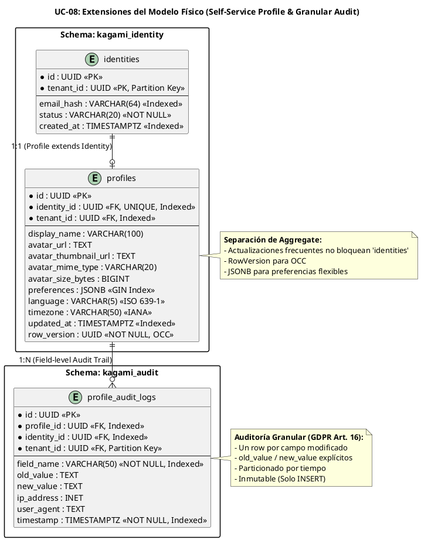

# UC-08: Self-Service Profile - Modelo de Datos Físico Específico (Autonomía, Auditoría Granular & RLS)

| Metadatos del Documento | |
| :--- | :--- |
| **Proyecto:** | SHUGO - Identity & Access Platform |
| **Caso de Uso:** | UC-08 - Self-Service Profile (User-Initiated Profile Management) |
| **Documento:** | 10_UC_Specific_Data_Model.md |
| **Metodología:** | Physical Data Modeling + Defense-in-Depth (RLS) + GDPR Compliance (Granular Audit) + High-Concurrency Optimization |
| **Base de Datos:** | PostgreSQL 15+ (Primary + Read Replicas) |
| **Autor:** | Gastón Ruiz |
| **Versión Actual:** | 1.0.0 |
| **Fecha:** | 09/09/2026 |

---

## Historial de Versiones

| Versión | Fecha | Autor | Descripción de Cambios | Impacto |
| :--- | :--- | :--- | :--- | :--- |
| **1.0.0** | 09/09/2026 | Gastón Ruiz | **Creación inicial.** Extensión del modelo de datos físico para soportar la gestión self-service del perfil. Introduce la tabla `profiles` separada de `identities` para desacoplar actualizaciones frecuentes del ciclo de vida de autenticación. Define la tabla `profile_audit_logs` normalizada a nivel de campo para cumplimiento estricto de GDPR Art. 16. Implementa Row-Level Security (RLS) como segunda línea de defensa contra IDOR, índices GIN para preferencias JSONB, y particionamiento por tiempo para logs de auditoría. | Documento de referencia para DBAs y desarrolladores backend. Define cómo se implementa físicamente la autonomía del usuario con máxima seguridad, rendimiento y trazabilidad forense. |

---

## 1. Introducción y Propósito

Este documento define las extensiones y consideraciones físicas específicas en PostgreSQL para soportar el **UC-08 (Self-Service Profile)**.

A diferencia de los UCs previos, el UC-08 introduce desafíos físicos únicos orientados a **alta frecuencia de escritura, auditoría granular y seguridad a nivel de base de datos**:

1. **Separación de Aggregate Roots:** La tabla `profiles` se separa de `identities` para permitir actualizaciones frecuentes (preferencias, avatar, display_name) sin bloquear ni afectar el rendimiento de las operaciones críticas de autenticación y autorización.
2. **Auditoría Normalizada a Nivel de Campo:** En lugar de guardar snapshots JSON completos, la tabla `profile_audit_logs` registra un row por cada campo modificado (`FieldName`, `OldValue`, `NewValue`). Esto es crítico para responder eficientemente a solicitudes de GDPR Art. 16 (Derecho de Rectificación).
3. **Row-Level Security (RLS) para Prevención de IDOR:** Aunque la capa de aplicación valida el ownership (JWT sub == identity_id), la base de datos implementa RLS como mecanismo de *Defense-in-Depth* para prevenir que un bug en la aplicación permita modificar perfiles ajenos.
4. **Optimistic Concurrency Control (OCC):** Uso de `RowVersion` para prevenir race conditions cuando un usuario actualiza su perfil desde múltiples dispositivos simultáneamente.
5. **Indexación JSONB:** Uso de índices GIN para permitir búsquedas eficientes dentro del campo `preferences` si es necesario (ej. "encontrar todos los usuarios con theme='dark'").

---

## 2. Diagrama de Modelo de Datos Físico (ERD Extendido)



---

## 3. Scripts DDL: Tablas Específicas para UC-08

### 3.1. Tabla `profiles` (Aggregate Root Separado)

```sql
SET search_path TO kagami_identity;

-- Tabla de perfiles separada de identidades
CREATE TABLE IF NOT EXISTS profiles (
    id UUID PRIMARY KEY DEFAULT gen_random_uuid(),
    identity_id UUID NOT NULL UNIQUE, -- Relación 1:1 estricta con identities
    tenant_id UUID NOT NULL,
    
    -- Datos de perfil
    display_name VARCHAR(100),
    
    -- Metadata de Avatar
    avatar_url TEXT,
    avatar_thumbnail_url TEXT,
    avatar_mime_type VARCHAR(20),
    avatar_size_bytes BIGINT CHECK (avatar_size_bytes >= 0),
    
    -- Preferencias y Configuración
    preferences JSONB NOT NULL DEFAULT '{}'::jsonb,
    language VARCHAR(5) NOT NULL DEFAULT 'en', -- ISO 639-1
    timezone VARCHAR(50) NOT NULL DEFAULT 'UTC', -- IANA Timezone
    
    -- Metadata de Sistema
    updated_at TIMESTAMPTZ NOT NULL DEFAULT NOW(),
    row_version UUID NOT NULL DEFAULT gen_random_uuid() -- Para Optimistic Concurrency Control
);

-- Índices optimizados
CREATE UNIQUE INDEX IF NOT EXISTS idx_profiles_identity_id ON profiles(identity_id);
CREATE INDEX IF NOT EXISTS idx_profiles_tenant_id ON profiles(tenant_id);
CREATE INDEX IF NOT EXISTS idx_profiles_updated_at ON profiles(updated_at DESC);

-- Índice GIN para búsquedas dentro de preferencias JSONB
CREATE INDEX IF NOT EXISTS idx_profiles_preferences_gin ON profiles USING GIN (preferences);

-- Restricciones de integridad
ALTER TABLE profiles ADD CONSTRAINT fk_profiles_identity 
    FOREIGN KEY (identity_id) REFERENCES identities(id) ON DELETE CASCADE;

COMMENT ON TABLE profiles IS 'Perfiles de usuario gestionables por el propio usuario (Self-Service). Separado de identities para rendimiento.';
COMMENT ON COLUMN profiles.preferences IS 'Preferencias del usuario en formato JSONB. Indexado con GIN para búsquedas eficientes.';
COMMENT ON COLUMN profiles.row_version IS 'UUID generado en cada UPDATE para Optimistic Concurrency Control (OCC).';
```

### 3.2. Tabla `profile_audit_logs` (Auditoría Granular)

```sql
SET search_path TO kagami_audit;

-- Tabla de auditoría normalizada a nivel de campo
CREATE TABLE IF NOT EXISTS profile_audit_logs (
    id UUID PRIMARY KEY DEFAULT gen_random_uuid(),
    profile_id UUID NOT NULL,
    identity_id UUID NOT NULL,
    tenant_id UUID NOT NULL,
    
    -- Cambio granular
    field_name VARCHAR(50) NOT NULL, -- ej. 'display_name', 'preferences.theme'
    old_value TEXT,
    new_value TEXT,
    
    -- Contexto de seguridad
    ip_address INET,
    user_agent TEXT,
    timestamp TIMESTAMPTZ NOT NULL DEFAULT NOW()
) PARTITION BY RANGE (timestamp); -- Particionado por tiempo para retención eficiente

-- Índices optimizados para consultas de auditoría
CREATE INDEX IF NOT EXISTS idx_pal_profile_id ON profile_audit_logs(profile_id, timestamp DESC);
CREATE INDEX IF NOT EXISTS idx_pal_identity_id ON profile_audit_logs(identity_id, timestamp DESC);
CREATE INDEX IF NOT EXISTS idx_pal_field_name ON profile_audit_logs(field_name);

COMMENT ON TABLE profile_audit_logs IS 'Logs de auditoría granulares para cambios de perfil. Un row por cada campo modificado (GDPR Art. 16).';
COMMENT ON COLUMN profile_audit_logs.field_name IS 'Nombre del campo modificado. Para JSON anidado, usar notación de puntos (ej. preferences.theme).';
```

---

## 4. Seguridad a Nivel de Base de Datos (Defense-in-Depth)

### 4.1. Row-Level Security (RLS) para Prevención de IDOR

Aunque la capa de aplicación (C#) valida que `JWT sub == identity_id`, implementamos RLS para garantizar que, incluso si hay un bug en la aplicación, la base de datos rechazará modificaciones a perfiles ajenos.

```sql
-- Habilitar RLS en la tabla profiles
ALTER TABLE kagami_identity.profiles ENABLE ROW LEVEL SECURITY;
ALTER TABLE kagami_identity.profiles FORCE ROW LEVEL SECURITY;

-- Política de UPDATE: Solo el propietario (identity_id coincide con la variable de sesión app.current_identity_id) puede actualizar
CREATE POLICY rls_profiles_update_owner ON kagami_identity.profiles
    FOR UPDATE
    USING (identity_id = current_setting('app.current_identity_id', true)::uuid)
    WITH CHECK (identity_id = current_setting('app.current_identity_id', true)::uuid);

-- Política de SELECT: Los usuarios pueden ver su propio perfil. (La lectura de perfiles de otros puede manejarse en la app o con otra política)
CREATE POLICY rls_profiles_select_owner ON kagami_identity.profiles
    FOR SELECT
    USING (identity_id = current_setting('app.current_identity_id', true)::uuid);

-- Nota: La variable 'app.current_identity_id' debe ser establecida por el middleware de la aplicación al inicio de cada transacción/consulta.
-- Ejemplo en C#: await _dbContext.Database.ExecuteSqlRawAsync("SET LOCAL app.current_identity_id = {0}", identityId);
```

### 4.2. Prevención de Modificación de Logs de Auditoría

Los logs de auditoría deben ser inmutables. Solo se permiten operaciones `INSERT`.

```sql
ALTER TABLE kagami_audit.profile_audit_logs ENABLE ROW LEVEL SECURITY;
ALTER TABLE kagami_audit.profile_audit_logs FORCE ROW LEVEL SECURITY;

-- Política de INSERT: Cualquier servicio de auditoría autenticado puede insertar
CREATE POLICY rls_pal_insert ON kagami_audit.profile_audit_logs
    FOR INSERT
    WITH CHECK (current_setting('app.service_role', true) = 'audit_service');

-- Política de SELECT: Solo administradores de compliance o el propio usuario pueden leer sus logs
CREATE POLICY rls_pal_select_compliance ON kagami_audit.profile_audit_logs
    FOR SELECT
    USING (current_setting('app.service_role', true) IN ('compliance_admin', 'audit_service'));
```

---

## 5. Estrategias de Optimización y Concurrencia

### 5.1. Optimistic Concurrency Control (OCC)

Para prevenir que un usuario sobrescriba los cambios de otro dispositivo (race condition), utilizamos la columna `row_version`.

**Configuración en EF Core (C#):**

```csharp
public class ProfileConfiguration : IEntityTypeConfiguration<Profile>
{
    public void Configure(EntityTypeBuilder<Profile> builder)
    {
        builder.ToTable("profiles", "kagami_identity");
        
        // Configurar RowVersion como token de concurrencia
        builder.Property(p => p.RowVersion)
            .IsConcurrencyToken()
            .HasDefaultValueSql("gen_random_uuid()");

        // Configurar JSONB para preferencias
        builder.Property(p => p.Preferences)
            .HasColumnType("jsonb")
            .HasDefaultValueSql("'{}'::jsonb");
    }
}
```

**Manejo de Excepciones en el Repositorio:**

```csharp
public async Task SaveAsync(Profile profile, CancellationToken ct)
{
    try
    {
        _dbContext.Profiles.Update(profile);
        await _dbContext.SaveChangesAsync(ct);
    }
    catch (DbUpdateConcurrencyException ex)
    {
        // OCC Falló: Otro dispositivo modificó el perfil simultáneamente
        throw new ConcurrencyConflictException("Profile was modified by another session. Please refresh and try again.", ex);
    }
}
```

### 5.2. Particionamiento de Logs de Auditoría

Dado que `profile_audit_logs` crecerá rápidamente (un row por cada campo modificado en cada actualización), particionamos por mes para facilitar la retención y el mantenimiento.

```sql
-- Crear particiones mensuales (Ejemplo para 2024)
CREATE TABLE profile_audit_logs_2024_01 PARTITION OF profile_audit_logs
    FOR VALUES FROM ('2024-01-01') TO ('2024-02-01');

CREATE TABLE profile_audit_logs_2024_02 PARTITION OF profile_audit_logs
    FOR VALUES FROM ('2024-02-01') TO ('2024-03-01');

-- Partición default para capturar datos fuera de rango (evita errores de inserción)
CREATE TABLE profile_audit_logs_default PARTITION OF profile_audit_logs DEFAULT;
```

---

## 6. Retención y Archivado de Datos

### 6.1. Política de Retención de Logs de Auditoría

Por cumplimiento normativo (SOC 2, ISO 27001), los logs de auditoría deben conservarse por un mínimo de 12 meses en línea y 7 años en almacenamiento frío.

**Función para Archivado Automático (Ejecutada mensualmente):**

```sql
CREATE OR REPLACE FUNCTION archive_old_profile_audit_logs(p_months_to_keep INT DEFAULT 12)
RETURNS INT AS $$
DECLARE
    v_cutoff_date TIMESTAMPTZ;
    v_archived_count INT;
BEGIN
    v_cutoff_date := NOW() - (p_months_to_keep || ' months')::INTERVAL;
    
    -- Mover datos antiguos a tabla de archivo (en tablespace de almacenamiento frío)
    INSERT INTO profile_audit_logs_archive
    SELECT * FROM profile_audit_logs
    WHERE timestamp < v_cutoff_date;
    
    GET DIAGNOSTICS v_archived_count = ROW_COUNT;
    
    -- Eliminar particiones antiguas (si se usa particionamiento nativo, se hace DROP TABLE de la partición)
    -- DROP TABLE profile_audit_logs_2023_01; -- Ejemplo
    
    RETURN v_archived_count;
END;
$$ LANGUAGE plpgsql;
```

---

## 7. Monitoreo y Diagnóstico

### 7.1. Consultas para Diagnosticar Problemas de Perfil

```sql
-- Perfiles sin identidad asociada (huérfanos por error de transacción)
SELECT p.id, p.identity_id, p.tenant_id
FROM kagami_identity.profiles p
LEFT JOIN kagami_identity.identities i ON p.identity_id = i.id
WHERE i.id IS NULL;

-- Usuarios con preferencias JSONB malformadas o vacías
SELECT id, identity_id, preferences
FROM kagami_identity.profiles
WHERE preferences = '{}'::jsonb OR NOT (preferences IS JSON);

-- Top 10 usuarios con más cambios de perfil en las últimas 24h (posible abuso o bot)
SELECT identity_id, COUNT(*) as change_count
FROM kagami_audit.profile_audit_logs
WHERE timestamp > NOW() - INTERVAL '24 hours'
GROUP BY identity_id
ORDER BY change_count DESC
LIMIT 10;
```

### 7.2. Métricas de Base de Datos para OpenTelemetry

```csharp
public class ProfileDatabaseMetrics
{
    private readonly Meter _meter;
    private readonly Counter<long> _profileUpdates;
    private readonly Counter<long> _concurrencyConflicts;
    private readonly Histogram<double> _auditLogInsertLatency;

    public ProfileDatabaseMetrics(IMeterFactory meterFactory)
    {
        _meter = meterFactory.Create("shugo.profile.database");
        _profileUpdates = _meter.CreateCounter<long>("profile.db_updates_total");
        _concurrencyConflicts = _meter.CreateCounter<long>("profile.concurrency_conflicts_total");
        _auditLogInsertLatency = _meter.CreateHistogram<double>("profile.audit_log_insert_latency", "ms");
    }

    public void RecordProfileUpdate(string tenantId, bool success)
    {
        _profileUpdates.Add(1, 
            new KeyValuePair<string, object?>("tenant_id", tenantId),
            new KeyValuePair<string, object?>("success", success));
    }

    public void RecordConcurrencyConflict(string tenantId)
    {
        _concurrencyConflicts.Add(1,
            new KeyValuePair<string, object?>("tenant_id", tenantId));
    }
}
```

---

## 8. Trazabilidad

| Documento | Relación |
| :--- | :--- |
| `04_Initial_Domain_Model.md` | Define los Aggregate Roots (`Profile`) y Value Objects (`Preferences`, `Avatar`) que se mapean a las columnas físicas definidas aquí. |
| `05_State_Machine_Diagram.md` | Las transiciones de estado y la detección de No-Op se reflejan en la estructura de `profile_audit_logs` (solo se inserta si hay cambios). |
| `07_Sequence_Diagram.md` | Muestra las consultas a PostgreSQL (ownership validation, UPDATE profiles, INSERT audit_logs) que se optimizan con estos índices. |
| `08_Final_Class_Design.md` | El `ProfileRepositoryImpl` implementa las consultas y el manejo de OCC definidos aquí. |
| `11_UC_Specific_Security_Threats.md` | Las mitigaciones de "IDOR Prevention" y "Audit Log Tampering" se validan mediante las políticas RLS y de solo inserción definidas aquí. |
| `12_UC_Specific_Performance_Benchmarks.md` | Los SLAs de latencia (<200ms p95) se validan con los índices GIN y la separación de tablas definidos aquí. |
| `SHUGO_Data_Model_Master.md` (Transversal) | Este documento extiende el modelo maestro con la separación de `profiles` y la auditoría granular. |

---

## 9. Anexos: Glosario de Base de Datos (UC-08)

| Término | Definición en Contexto UC-08 |
| :--- | :--- |
| **Profile Aggregate Separation** | Estrategia de separar la tabla `profiles` de `identities` para aislar actualizaciones frecuentes de operaciones críticas de autenticación. |
| **Granular Audit Log** | Registro de auditoría donde cada fila representa un cambio en un solo campo (`field_name`, `old_value`, `new_value`), en lugar de un snapshot completo. |
| **Row-Level Security (RLS)** | Mecanismo de PostgreSQL que restringe el acceso a filas basado en políticas. Usado aquí como Defense-in-Depth contra IDOR. |
| **Optimistic Concurrency Control (OCC)** | Patrón que utiliza una columna `row_version` para detectar y prevenir actualizaciones perdidas en entornos concurrentes. |
| **GIN Index** | Índice de Inversión Generalizada en PostgreSQL, utilizado aquí para indexar el campo JSONB `preferences` y permitir búsquedas eficientes dentro del JSON. |
| **Partitioning by Range** | Estrategia de dividir la tabla `profile_audit_logs` en particiones mensuales basadas en la columna `timestamp` para facilitar la retención y el mantenimiento. |
| **Defense-in-Depth** | Estrategia de seguridad en capas. Aquí, la validación de ownership ocurre en la capa de aplicación (JWT) y se refuerza en la capa de base de datos (RLS). |

---
*Fin del Documento 10_UC_Specific_Data_Model para UC-08*