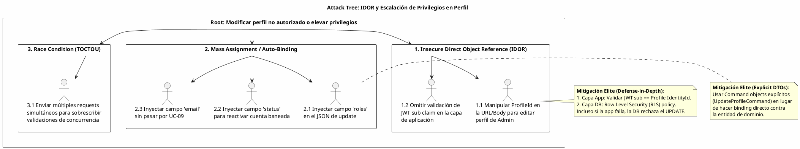

# UC-08: Self-Service Profile - Análisis de Amenazas Específico (Security Threat Model)

| Metadatos del Documento | |
| :--- | :--- |
| **Proyecto:** | SHUGO - Identity & Access Platform |
| **Caso de Uso:** | UC-08 - Self-Service Profile (User-Initiated Profile Management) |
| **Documento:** | 11_UC_Specific_Security_Threats.md |
| **Metodología:** | STRIDE + DREAD + Attack Trees + Defense-in-Depth + Secure File Upload Patterns |
| **Estándares:** | OWASP Top 10 (A01:2021 Broken Access Control, A04:2021 Insecure Design, A05:2021 Security Misconfiguration), NIST SP 800-63A, GDPR Art. 5 & 16, SOC 2 CC6.1, ISO 27001 A.12.6 |
| **Autor:** | Gastón Ruiz |
| **Versión Actual:** | 1.0.0 |
| **Fecha:** | 09/09/2026 |

---

## Historial de Versiones

| Versión | Fecha | Autor | Descripción de Cambios | Impacto |
| :--- | :--- | :--- | :--- | :--- |
| **1.0.0** | 09/09/2026 | Gastón Ruiz | **Creación inicial.** Análisis exhaustivo de amenazas específicas para la gestión self-service del perfil. Evalúa 7 vectores de ataque críticos usando STRIDE+DREAD, incluyendo IDOR (Insecure Direct Object Reference), Mass Assignment, Malicious Avatar Upload (ImageTragick, XSS), JSON DoS, y Audit Log Tampering. Define controles de mitigación de nivel enterprise (RLS, Image Re-encoding, WORM storage) para garantizar la integridad, confidencialidad y no repudio. | Documento crítico de seguridad para el UC-08. Establece los controles obligatorios que deben implementarse antes del go-live del endpoint de perfil, con especial énfasis en la prevención de escalación de privilegios y la protección contra archivos maliciosos. |

---

## 1. Introducción y Alcance

Este documento presenta el **Análisis de Amenazas Específico** para el UC-08 (Self-Service Profile).

A diferencia de los UCs administrados, el UC-08 expone una superficie de ataque única porque permite a **usuarios no privilegiados escribir datos directamente en su propio registro de identidad**. Esto introduce riesgos críticos que no existen en endpoints de solo lectura:

1. **Riesgo de IDOR (Insecure Direct Object Reference):** Si la validación de ownership falla, un usuario podría modificar el perfil de cualquier otro usuario, incluyendo administradores.
2. **Escalación de Privilegios (Mass Assignment):** Un atacante podría intentar inyectar campos restringidos (ej. `roles: ["admin"]`, `status: "ACTIVE"`) en el payload JSON.
3. **Upload de Archivos Maliciosos:** La funcionalidad de avatar es un vector clásico para subir webshells, exploits de procesamiento de imágenes (ImageTragick), o payloads XSS (SVG).
4. **Denegación de Servicio (DoS) a Nivel de Aplicación:** Payloads JSON complejos en `preferences` o imágenes "Billion Laughs" pueden agotar CPU/Memoria.
5. **Repudio y Tampering de Auditoría:** Un usuario (o un admin comprometido) podría intentar borrar o modificar los logs que registran sus cambios maliciosos.

Este documento modela estos vectores y define las mitigaciones de nivel enterprise que SHUGO implementa nativamente.

---

## 2. Attack Trees (Árboles de Ataque)

### 2.1. Attack Tree #1: IDOR y Escalación de Privilegios

**Objetivo del Atacante:** Modificar el perfil de otro usuario o elevar sus propios privilegios inyectando campos restringidos.



### 2.2. Attack Tree #2: Malicious Avatar Upload

**Objetivo del Atacante:** Comprometer el servidor de almacenamiento o a otros usuarios mediante un avatar malicioso.

```text
[Root: Ejecutar código o robar sesiones vía Avatar]
  |
  +-- [1. Webshell Upload]
  |     +-- 1.1. Subir archivo .php/.aspx renombrado como .jpg (Mitigado: Validación de Magic Bytes + Content-Type)
  |     +-- 1.2. Explotar vulnerabilidad en librería de redimensionado (Mitigado: Re-encoding de imagen)
  |
  +-- [2. Stored XSS via SVG]
  |     +-- 2.1. Subir SVG con <script> o <animate> (Mitigado: Bloqueo de MIME type image/svg+xml)
  |
  +-- [3. Denial of Service (Resource Exhaustion)]
  |     +-- 3.1. Subir imagen de 10,000x10,000px (Image Bomb) (Mitigado: Validación de dimensiones antes de procesar)
  |     +-- 3.2. Subir archivo de 100MB (Mitigado: Límite estricto de 5MB en Gateway y App)
  |
  +-- [4. Cookie Theft / Session Hijacking]
        +-- 4.1. Servir avatar desde el mismo dominio para acceder a cookies de sesión (Mitigado: Servir desde dominio/CDN separado)
```

---

## 3. Matriz de Amenazas Específicas (STRIDE + DREAD)

| ID | Amenaza | Categoría STRIDE | D | R | E | A | D | Score | Nivel |
| :--- | :--- | :--- | :---: | :---: | :---: | :---: | :---: | :---: | :---: |
| **T-46** | **IDOR (Acceso a perfil ajeno)** | Spoofing / Info Disclosure | 9 | 8 | 7 | 10 | 6 | **8.0** | 🔴 |
| **T-47** | **Mass Assignment (Escalación de privilegios)** | Elevation of Privilege | 10 | 7 | 6 | 8 | 5 | **7.2** | 🟠 |
| **T-48** | **Malicious Avatar (ImageTragick / XSS)** | Tampering / Code Execution | 10 | 6 | 5 | 9 | 4 | **6.8** | 🟠 |
| **T-49** | **JSON DoS en Preferencias (Billion Laughs)** | Denial of Service | 7 | 8 | 8 | 7 | 7 | **7.4** |  |
| **T-50** | **Email Takeover (Bypass de UC-09)** | Spoofing / Elevation | 10 | 7 | 5 | 9 | 4 | **7.0** | 🟠 |
| **T-51** | **Audit Log Tampering (Repudio)** | Repudiation | 8 | 5 | 4 | 10 | 3 | **6.0** | 🟡 |
| **T-52** | **Race Condition en Actualización Concurrente** | Tampering | 6 | 6 | 5 | 7 | 5 | **5.8** | 🟡 |

---

## 4. Análisis Detallado de Amenazas Críticas y Mitigaciones

### 4.1. 🔴 T-46: IDOR (Insecure Direct Object Reference)

**Descripción:** El endpoint `PATCH /profile` o `PATCH /profile/{id}` podría ser manipulado para que un usuario autenticado modifique los datos de otro usuario (ej. un administrador o un usuario con datos sensibles).

**Escenario de Ataque:**
```http
PATCH /v1/profile/8f4e2d1c-9b7a-4f3e-8d2c-1a9b8c7d6e5f HTTP/1.1
Authorization: Bearer <JWT_de_usuario_normal>
Content-Type: application/json

{ "display_name": "Hacked Admin Name" }
```

**Mitigaciones Implementadas (Defense-in-Depth):**

1.  **Capa de Aplicación (Implicit Ownership):** El endpoint NO acepta un `ProfileId` en la URL. El `ProfileHandler` extrae el `IdentityId` directamente del claim `sub` del JWT firmado.
    ```csharp
    // El comando NO tiene ProfileId. Se deriva del JWT.
    public class UpdateProfileCommand {
        // No ProfileId here!
        public string DisplayName { get; set; }
        // ...
    }
    
    // En el Handler:
    var identityId = new IdentityId(Guid.Parse(user.FindFirst("sub").Value));
    var profile = await _repo.GetByIdentityIdAsync(identityId, ct);
    ```
2.  **Capa de Base de Datos (Row-Level Security - RLS):** Incluso si un desarrollador comete un error y expone un ID, PostgreSQL rechazará la actualización.
    ```sql
    CREATE POLICY rls_profiles_update_owner ON kagami_identity.profiles
        FOR UPDATE
        USING (identity_id = current_setting('app.current_identity_id', true)::uuid)
        WITH CHECK (identity_id = current_setting('app.current_identity_id', true)::uuid);
    ```

### 4.2. 🟠 T-47: Mass Assignment (Escalación de Privilegios)

**Descripción:** Si el controlador de la API hace "auto-binding" del JSON de entrada directamente contra la entidad de dominio o el modelo de base de datos, un atacante podría enviar campos no autorizados.

**Escenario de Ataque:**
```json
{
  "display_name": "Malicious User",
  "roles": ["super_admin"], 
  "status": "ACTIVE",
  "email_verified": true
}
```

**Mitigaciones Implementadas:**

1.  **Patrón Command Explícito (DTOs):** Nunca se hace binding contra la entidad `Profile`. Se usa un `UpdateProfileCommand` que solo expone las propiedades permitidas.
2.  **Whitelist en Domain Service:** El `SecurityValidator` valida explícitamente las keys del JSON entrante contra una lista blanca antes de deserializar.
    ```csharp
    private static readonly HashSet<string> ALLOWED_FIELDS = new() {
        "display_name", "avatar", "preferences", "language", "timezone"
    };
    // Si el JSON contiene "roles", se lanza DomainException inmediatamente.
    ```
3.  **Entidades Inmutables para Campos Críticos:** En el Aggregate Root `Profile`, no existen setters públicos para `Status` o `Roles`. Solo pueden modificarse mediante métodos de dominio específicos (`Deactivate()`, `AssignRole()`) que requieren permisos de admin (UC-02).

### 4.3. 🟠 T-48: Malicious Avatar Upload

**Descripción:** Aprovechar la subida de avatares para ejecutar código remoto (RCE), inyectar XSS persistente, o agotar recursos del servidor.

**Mitigaciones Implementadas (Secure File Upload Pattern):**

1.  **Validación de Magic Bytes:** No confiar en la extensión del archivo ni en el header `Content-Type` (que puede ser falsificado). Leer los primeros bytes del stream.
    ```csharp
    private static readonly Dictionary<string, byte[]> MAGIC_BYTES = new() {
        { "image/png", new byte[] { 0x89, 0x50, 0x4E, 0x47 } },
        { "image/jpeg", new byte[] { 0xFF, 0xD8, 0xFF } },
        { "image/webp", new byte[] { 0x52, 0x49, 0x46, 0x46 } } // RIFF....WEBP
    };
    ```
2.  **Re-encoding de Imagen (Sanitización):** Nunca guardar el archivo original. Cargar la imagen en memoria (usando `ImageSharp` o `SkiaSharp`), redimensionarla y guardarla en un nuevo stream. Esto elimina metadatos maliciosos, perfiles ICC exploitables y payloads ocultos.
    ```csharp
    using var image = Image.Load(originalStream);
    image.Mutate(x => x.Resize(new ResizeOptions { Size = new Size(1024, 1024), Mode = ResizeMode.Max }));
    image.SaveAsPng(sanitizedStream); // Re-encoding elimina malware
    ```
3.  **Bloqueo de SVG:** SVG es XML y puede contener `<script>` o `<animate>` para XSS. **Prohibido estrictamente** en el whitelist de MIME types.
4.  **Dominio de Almacenamiento Separado:** Los avatares se sirven desde un dominio diferente (ej. `cdn-avatars.shugo.io`) que no tiene acceso a las cookies de sesión de la aplicación principal (`domain=.shugo.io`), previniendo robo de sesiones si somehow se cuela un XSS.

### 4.4. 🟠 T-49: JSON DoS en Preferencias (Billion Laughs / Deep Nesting)

**Descripción:** El campo `preferences` acepta JSON. Un atacante podría enviar un JSON malformado para agotar la CPU o la memoria del servidor al deserializarlo.

**Escenario de Ataque (Billion Laughs en XML/JSON entities o Deep Nesting):**
```json
{
  "preferences": {
    "a": { "b": { "c": { "d": { "e": { "f": { "g": { "h": { "i": { "j": "..." } } } } } } } } }
  }
}
```

**Mitigaciones Implementadas:**

1.  **Límites Estrictos en el Parser JSON:** Configurar `JsonDocumentOptions` con `MaxDepth` (ej. 10) y `MaxCommentLength`.
    ```csharp
    var options = new JsonDocumentOptions { 
        MaxDepth = 10, 
        AllowTrailingCommas = false, 
        CommentHandling = JsonCommentHandling.Skip 
    };
    JsonDocument.Parse(jsonString, options); // Lanza InvalidOperationException si depth > 10
    ```
2.  **Validación de Schema (Opcional pero recomendado):** Validar que el JSON solo contenga keys conocidas (`theme`, `notifications`, `language`) y rechazar estructuras arbitrarias.

### 4.5. 🟠 T-50: Email Takeover (Bypass de UC-09)

**Descripción:** Un atacante intenta cambiar el email de la víctima a uno bajo su control directamente en el endpoint de perfil, omitiendo el flujo de verificación (UC-09), para luego usar "Forgot Password" y tomar la cuenta.

**Mitigaciones Implementadas:**

1.  **Campo `email` Ignorado en UpdateProfile:** El `UpdateProfileCommand` **NO** tiene un campo `email`. Si el atacante lo envía en el JSON, será rechazado por la validación de campos permitidos (T-47).
2.  **Endpoint Separado para Cambio de Email:** Si se desea permitir cambio de email desde el perfil, debe haber un endpoint separado `POST /profile/change-email` que **siempre** dispare el flujo de UC-09 (Email Verification) y **nunca** actualice el email en la DB hasta que el token sea verificado.
3.  **Notificación de Alerta:** Si se inicia un flujo de cambio de email, se envía una alerta al email *anterior* ("Se solicitó un cambio de email. Si no fuiste tú, contacta a soporte").

### 4.6. 🟡 T-51: Audit Log Tampering (Repudio)

**Descripción:** Un usuario (o un administrador con acceso a la DB) modifica o borra los logs de auditoría para ocultar que cambió el perfil de alguien más o elevó sus privilegios.

**Mitigaciones Implementadas:**

1.  **Tabla de Solo Inserción (Append-Only):** La tabla `profile_audit_logs` no tiene permisos de `UPDATE` o `DELETE` para ningún rol de aplicación, solo `INSERT`.
    ```sql
    REVOKE UPDATE, DELETE ON kagami_audit.profile_audit_logs FROM app_kagami_profile;
    ```
2.  **Envío a WORM Storage (Write Once Read Many):** Los logs críticos se envían asíncronamente (vía Outbox/Kafka) a un sistema de logs inmutable (ej. AWS CloudWatch Logs con retention policy, o S3 con Object Lock) donde ni siquiera los admins de la DB pueden borrarlos.
3.  **Firma Criptográfica de Logs (Chain of Hashes):** Cada entrada de log incluye el hash de la entrada anterior, creando una cadena de bloques (blockchain-like) que hace evidente cualquier manipulación o inserción fuera de orden.

---

## 5. Compliance y Auditoría (SOC 2 / ISO 27001 / GDPR)

### 5.1. SOC 2 - CC6.1 (Logical Access Controls)
*   **Requisito:** Restringir el acceso a los datos según la autorización.
*   **Implementación UC-08:** La mitigación de **T-46 (IDOR)** mediante RLS y validación de JWT garantiza que un usuario solo pueda acceder y modificar sus propios datos de perfil.

### 5.2. SOC 2 - CC6.8 (Change Management)
*   **Requisito:** Los cambios a los datos deben ser autorizados y registrados.
*   **Implementación UC-08:** La mitigación de **T-51 (Audit Log Tampering)** asegura que todos los cambios de perfil sean inmutables y trazables.

### 5.3. GDPR - Art. 5 (Integrity and Confidentiality)
*   **Requisito:** Proteger los datos personales contra procesamiento no autorizado.
*   **Implementación UC-08:** La mitigación de **T-48 (Malicious Avatar)** y **T-49 (JSON DoS)** protege la infraestructura que almacena PII, asegurando que no sea comprometida por uploads maliciosos.

### 5.4. OWASP ASVS V4.0 - 4.2.1 (File Upload Security)
*   **Requisito:** Validar el tipo de archivo, contenido y tamaño.
*   **Implementación UC-08:** Mitigación completa de **T-48** mediante Magic Bytes, Re-encoding, y límites de tamaño.

---

## 6. Trazabilidad

| Documento | Relación |
| :--- | :--- |
| `01_Requirements_Specification.md` | Las invariantes de seguridad (INV-48 a INV-54) se mitigan aquí a nivel de infraestructura y dominio. |
| `08_Final_Class_Design.md` | Las clases `SecurityValidator`, `AvatarValidator`, y el patrón `UpdateProfileCommand` implementan las mitigaciones de T-46, T-47 y T-48. |
| `10_UC_Specific_Data_Model.md` | Las políticas RLS y la estructura de `profile_audit_logs` soportan las mitigaciones de T-46 y T-51. |
| `SHUGO_Security_Architecture.md` (Transversal) | Este documento aplica los estándares globales de Secure File Upload y Defense-in-Depth al contexto específico de UC-08. |

---

## 7. Anexos: Configuración de Seguridad Adicional

### 7.1. Políticas de ImageMagick (Si se usa en el backend)
Para prevenir vulnerabilidades conocidas como ImageTragick (CVE-2016-3714), se debe restringir el procesamiento de ciertos formatos.

```xml
<!-- /etc/ImageMagick-6/policy.xml -->
<policymap>
  <policy domain="coder" rights="none" pattern="EPHEMERAL" />
  <policy domain="coder" rights="none" pattern="URL" />
  <policy domain="coder" rights="none" pattern="HTTPS" />
  <policy domain="coder" rights="none" pattern="MVG" />
  <policy domain="coder" rights="none" pattern="MSL" />
  <policy domain="coder" rights="none" pattern="TEXT" />
  <policy domain="coder" rights="none" pattern="SHOW" />
  <policy domain="coder" rights="none" pattern="WIN" />
  <policy domain="coder" rights="none" pattern="PLT" />
  <!-- Permitir solo los necesarios -->
  <policy domain="coder" rights="read|write" pattern="PNG" />
  <policy domain="coder" rights="read|write" pattern="JPG" />
  <policy domain="coder" rights="read|write" pattern="WEBP" />
</policymap>
```

### 7.2. Configuración de WAF para Upload de Archivos
Reglas de AWS WAF / Cloudflare para proteger el endpoint de avatar:

1.  **Size Restriction:** Bloquear requests con body > 5MB.
2.  **Content-Type Validation:** Bloquear requests donde `Content-Type` no sea `multipart/form-data`.
3.  **File Extension Block:** Bloquear uploads con extensiones `.php`, `.aspx`, `.jsp`, `.sh`, `.exe`, `.svg`, `.html`.

### 7.3. Monitoreo de Intentos de Mass Assignment
```csharp
public class MassAssignmentMonitor : BackgroundService
{
    // Monitorear logs de aplicación buscando patrones de campos rechazados
    // Si un usuario específico envía "roles" o "status" repetidamente,
    // generar alerta de seguridad (posible intento de escalación).
}
```

---
*Fin del Documento 11_UC_Specific_Security_Threats para UC-08*