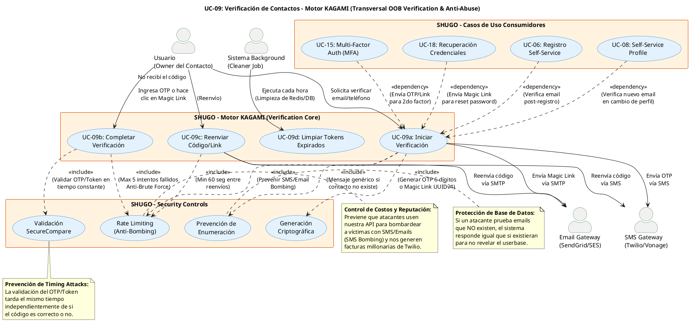

# UC-09: Verificación de Contactos - Diagrama de Caso de Uso

| Metadatos del Documento | |
| :--- | :--- |
| **Proyecto:** | SHUGO - Identity & Access Platform |
| **Caso de Uso:** | UC-09 - Verificación de Contactos (Out-of-Band Verification) |
| **Documento:** | 02_Use_Case_Diagram.md |
| **Metodología:** | UML 2.5 + ICONIX + Domain-Driven Design + Security by Design (Anti-Abuse) |
| **Autor:** | Gastón Ruiz |
| **Versión Actual:** | 1.0.0 |
| **Fecha:** | 09/09/2026 |

---

## Historial de Versiones

| Versión | Fecha | Autor | Descripción de Cambios | Impacto |
| :--- | :--- | :--- | :--- | :--- |
| **1.0.0** | 09/09/2026 | Gastón Ruiz | **Creación inicial.** Diagrama de Caso de Uso UML para UC-09. Modela la verificación de contactos como un servicio de dominio transversal y crítico para la seguridad. Introduce los actores (Usuario, Gateways de Email/SMS), los controles de seguridad obligatorios (Rate Limiting Anti-Bombing, SecureCompare, Prevención de Enumeración), y las relaciones de dependencia con los casos de uso consumidores (UC-06, UC-08, UC-15, UC-18). | Documento base del paquete de diseño Tier 1 del UC-09. Establece las fronteras del sistema, demostrando cómo la verificación Out-of-Band (OOB) actúa como el motor de confianza criptográfica para el onboarding, la recuperación de credenciales y el MFA, protegiendo simultáneamente la infraestructura de costos por abuso (SMS/Email Bombing). |

---

## 1. Diagrama de Caso de Uso (PlantUML)

A continuación, se presenta el Diagrama de Casos de Uso UML para el UC-09. Este diagrama modela la verificación de contactos no como un flujo aislado, sino como un **servicio de dominio transversal** que garantiza la prueba de posesión (Proof of Possession) para otros casos de uso críticos.

---

## 2. Explicación del Diagrama

### 2.1. Límite del Sistema (System Boundary)

El diagrama identifica **tres límites de sistema claramente diferenciados**:

1. **Motor KAGAMI - Verification Core (UC-09):** El sistema principal que gestiona el ciclo de vida de los tokens de verificación (OTP y Magic Links). Incluye la generación, persistencia con TTL, validación y limpieza.
2. **SHUGO - Security Controls:** Un conjunto de controles transversales (Rate Limiting, SecureCompare, Anti-Enumeration) que son invocados obligatoriamente (`<<include>>`) por los casos de uso principales. Representan la capa de "Security by Design".
3. **Gateways Externos (Email/SMS):** Sistemas de terceros (SendGrid, Twilio) que actúan como canales de entrega Out-of-Band (OOB).

**Justificación de los Límites:**
- Separar los **Security Controls** visualmente resalta que la seguridad no es una característica opcional, sino una dependencia obligatoria de cada operación de verificación.
- Los **Gateways Externos** se modelan como actores secundarios porque el sistema depende de su disponibilidad y porque su uso tiene implicaciones financieras directas (costo por SMS/Email enviado).

### 2.2. Actores del Sistema

#### Actores Primarios:

*   **Usuario (Owner del Contacto):** El actor que posee el email o teléfono a verificar. Puede estar autenticado (ej. cambiando su perfil en UC-08, activando MFA en UC-15) o no autenticado (ej. durante el registro en UC-06 o recuperación en UC-18).
    *   **Meta:** Demostrar que posee el canal de comunicación (Prueba de Posesión).
    *   **Frecuencia:** Baja/Media (solo durante eventos críticos de identidad).

*   **Sistema Background (Cleaner Job):** Un actor automatizado que ejecuta tareas de mantenimiento.
    *   **Meta:** Limpiar tokens expirados de Redis/DB para mantener la higiene del sistema y liberar memoria.
    *   **Frecuencia:** Cada hora.

#### Actores Secundarios (Sistemas Externos):

*   **Email Gateway (SendGrid/SES):** Responsable de entregar Magic Links o códigos OTP por correo electrónico.
*   **SMS Gateway (Twilio/Vonage):** Responsable de entregar códigos OTP por SMS. Es el canal más costoso y el más susceptible a ataques de "SMS Bombing".

### 2.3. Casos de Uso Principales

1.  **UC-09a: Iniciar Verificación:** Genera el desafío criptográfico (OTP o Magic Link), lo persiste con un TTL estricto y lo envía por el canal seleccionado.
2.  **UC-09b: Completar Verificación:** Recibe el desafío del usuario, lo valida de forma segura y, si es exitoso, emite el evento de dominio `Contact.Verified`.
3.  **UC-09c: Reenviar Código:** Permite al usuario solicitar un nuevo código si no recibió el anterior, sujeto a límites de tiempo estrictos.
4.  **UC-09d: Limpiar Tokens Expirados:** Proceso en background que elimina tokens que han superado su TTL.

### 2.4. Relaciones UML

#### Relaciones `<<include>>`: UC-09a/09b/09c → Security Controls

*   **Dirección:** La flecha va **DESDE** los casos de uso base **HACIA** los controles de seguridad.
*   **Semántica:** Los casos de uso de verificación **dependen obligatoriamente** de estos controles. No existe un flujo de verificación que no pase por Rate Limiting o SecureCompare.
*   **Justificación Arquitectónica:**
    *   **UC-09a → UC_RateLimit (Anti-Bombing):** Previene que un atacante use nuestra API para acosar a una víctima enviando miles de SMS/Emails, lo que protegería tanto a la víctima como a nuestra billetera (costos de Twilio/SendGrid).
    *   **UC-09a → UC_AntiEnum (Prevención de Enumeración):** Si un atacante ingresa un email que no existe en nuestra base de datos durante un flujo de "Recuperación de Contraseña", el sistema debe responder con un mensaje genérico ("Si el email existe, recibirás un link") para no revelar qué usuarios están registrados.
    *   **UC-09b → UC_SecureCompare (Anti-Timing):** Los OTPs de 6 dígitos tienen una entropía baja (1 en 1,000,000). Si la validación tarda 1ms en fallar en el primer dígito y 6ms en fallar en el sexto, un atacante puede adivinar el código midiendo los tiempos de respuesta. SecureCompare mitiga esto.

#### Relaciones de Asociación: UC-09a/09c → Gateways

*   **Dirección:** La flecha va **DESDE** los casos de uso **HACIA** los gateways.
*   **Semántica:** El sistema envía mensajes a través de estos canales externos.
*   **Justificación:** Representa la dependencia física y financiera de la infraestructura externa.

#### Relaciones `<<dependency>>`: Consumidores → UC-09a

*   **Dirección:** La flecha va **DESDE** los casos de uso consumidores (UC-06, UC-08, UC-15, UC-18) **HACIA** UC-09a.
*   **Semántica:** Estos casos de uso requieren que se inicie una verificación de contactos para completar sus propios flujos.
*   **Justificación:** Visualiza la naturaleza transversal de UC-09. No es un destino final, sino un habilitador de confianza para otros procesos de identidad.

---

## 3. Análisis de Coherencia con la Especificación Analítica

Este diagrama es **100% coherente** con el documento `01_Requirements_Specification.md`:

| Elemento del Diagrama | Referencia en Especificación |
| :--- | :--- |
| Actores: Usuario, Cleaner, EmailGW, SMSGW | Sección 2 (Descripción Analítica) - Actores Principales y Secundarios |
| Relación <<include>> con UC_RateLimit | Sección 3 (INV-58, RN-06) - Rate Limiting de Emisión y Anti-Brute Force |
| Relación <<include>> con UC_CryptoGen | Sección 3 (RN-06) - Generación Criptográfica |
| Relación <<include>> con UC_SecureCompare | Sección 3 (RN-07) - SecureCompare |
| Relación <<include>> con UC_AntiEnum | Sección 3 (RN-08) - Mensajes Genéricos (Anti-Enumeration) |
| Relación <<dependency>> con UC-06, UC-08, UC-15, UC-18 | Sección 1.2 (Relación con Otros UCs) - Consumidores |

---

## 4. Consideraciones de Diseño y Arquitectura (Security & Cost Control)

### 4.1. Naturaleza Transversal (Domain Service vs. Standalone UC)

A diferencia de UC-01 a UC-08, el UC-09 no representa un "destino" en la experiencia de usuario, sino un **mecanismo de seguridad transversal**.

*   **Impacto en el Diseño:** No tiene su propio endpoint de UI dedicado (excepto quizás una pantalla de "Ingresa el código"). Sus endpoints API (`/verify/initiate`, `/verify/complete`) son invocados programáticamente por los controladores de UC-06, UC-08, etc.
*   **Justificación:** Centralizar la lógica de OTPs/Magic Links en un solo Aggregate Root/Domain Service previene la duplicación de código y asegura que las políticas de seguridad (TTL, Rate Limits) se apliquen uniformemente en toda la plataforma.

### 4.2. Control Financiero y de Reputación (Anti-Bombing)

La relación `<<include>>` con **UC_RateLimit** es crítica por dos razones no técnicas:

1.  **Costo:** Un ataque de SMS Bombing puede generar facturas de miles de dólares en horas si no se limita la emisión.
2.  **Reputación (Deliverability):** Si nuestros dominios/IPs son reportados por enviar spam no solicitado (porque un atacante los usó para bombardear a alguien), nuestros emails legítimos (como los de recuperación de contraseña) caerán en la carpeta de Spam de los usuarios reales.

### 4.3. Prevención de Enumeración en Flujos Públicos

La relación `<<include>>` con **UC_AntiEnum** solo aplica estrictamente en flujos donde el usuario **no está autenticado** (ej. UC-18 Recuperación, o la fase inicial de UC-06).

*   **Flujo Autenticado (UC-08, UC-15):** Si el usuario ya está logueado y agrega un teléfono, el sistema *puede* decirle "Este teléfono ya está en uso por otra cuenta" porque la identidad del solicitante ya está verificada.
*   **Flujo No Autenticado (UC-18):** El sistema *debe* decir "Si el email existe, recibirás un link" para no confirmar la existencia de la cuenta a un atacante.

### 4.4. Fallback de Canales

Aunque no se muestra explícitamente como un caso de uso separado para mantener la simplicidad del diagrama, la arquitectura debe soportar **Fallback de Canales**. Si el SMS Gateway reporta un error de entrega (ej. número inválido o sin cobertura), el sistema puede ofrecer automáticamente enviar el OTP por Email, siempre que ambos canales estén registrados para la identidad.

---

## 5. Trazabilidad con Otros Documentos del Paquete

Este diagrama se relaciona con los siguientes documentos del paquete de diseño:

| Documento | Relación |
| :--- | :--- |
| `01_Requirements_Specification.md` | Define los flujos, invariantes (INV-55 a INV-59) y reglas de negocio (RN-06 a RN-09) que este diagrama visualiza. |
| `03_Activity_Diagram.md` | Mostrará el flujo de trabajo interno, destacando la bifurcación lógica para Rate Limiting, generación criptográfica, envío a gateways, y validación SecureCompare. |
| `04_Initial_Domain_Model.md` | Definirá el Aggregate Root `ContactVerification`, los Value Objects `OtpCode`, `MagicLinkToken`, y el Domain Service `VerificationService`. |
| `05_State_Machine_Diagram.md` | Mostrará la máquina de estados del Token/OTP (PENDING → VALIDATED/EXPIRED/BRUTE_FORCED). |
| `06_Robustness_Diagram.md` | Mostrará la colaboración entre el Verification Service, los Rate Limiters (Redis), los Gateways, y los repositorios. |
| `07_Sequence_Diagram.md` | Detallará el orden temporal exacto de las llamadas: Rate Limit Check → Crypto Gen → Persist → Gateway Send → Response. |
| `08_Final_Class_Design.md` | Definirá las firmas exactas de los métodos: `OtpGenerator.Generate()`, `VerificationService.Validate()`, `SecureCompare.Equals()`. |
| `11_UC_Specific_Security_Threats.md` | Analizará las amenazas específicas: OTP Brute-Forcing, SMS Bombing, Timing Attacks, y Token Replay. |
| `12_UC_Specific_Performance_Benchmarks.md` | Definirá los SLAs específicos para latencia de generación (<100ms) y latencia de validación (<50ms). |

---

## 6. Notas de Implementación

### 6.1. Generación del Diagrama
- **Herramienta:** PlantUML (Diagrams as Code).
- **Ventaja:** Versionable en Git, reproducible, sin dependencias de software propietario.
- **Renderizado:** VS Code (extensión PlantUML), GitHub, o Pandoc para exportación a PDF.

### 6.2. Estilos Aplicados
- `<style>` block: Para evitar advertencias de `skinparam` deprecados en versiones modernas de PlantUML.
- `top to bottom direction`: Organiza el flujo de arriba hacia abajo (Actores → Sistema Principal → Sistemas Dependientes).
- `skinparam actorStyle awesome`: Íconos modernos para actores.
- `skinparam usecaseBackgroundColor #E3F2FD`: Color azul claro para casos de uso de KAGAMI.
- `skinparam systemBackgroundColor #FFF3E0`: Color naranja claro para sistemas secundarios y controles de seguridad.

### 6.3. Convenciones de Nomenclatura
- **Actores:** Nombres descriptivos que indican su rol (Usuario, Cleaner Job, Email Gateway).
- **Casos de Uso:** Verbos en infinitivo que describen la acción (ej. "Iniciar Verificación", "Completar Verificación").
- **Controles de Seguridad:** Sustantivos compuestos que describen la mitigación (ej. "Rate Limiting (Anti-Bombing)", "Validación SecureCompare").
- **Relaciones:** Etiquetas descriptivas que explican el propósito de la relación (ej. "<<include>> (Prevenir SMS/Email Bombing)").

### 6.4. Diferenciación Visual de Controles de Seguridad
Para facilitar la comprensión de la arquitectura de seguridad, los **Security Controls** se agrupan en un paquete separado (`SHUGO - Security Controls`) con color de fondo naranja claro. Esto comunica visualmente que estos no son "pasos de negocio" tradicionales, sino **requisitos no funcionales de seguridad** que se inyectan obligatoriamente en el flujo.

### 6.5. Patrones de Seguridad y Operación Visibles
El diagrama modela explícitamente tres patrones críticos:
- **Anti-Abuse Financiero:** UC_RateLimit protege contra SMS/Email Bombing.
- **Criptografía Segura:** UC_CryptoGen y UC_SecureCompare garantizan la integridad de los tokens.
- **Privacidad de la Base de Datos:** UC_AntiEnum previene la enumeración de usuarios.

---
*Fin del Documento 02_Use_Case_Diagram para UC-09*