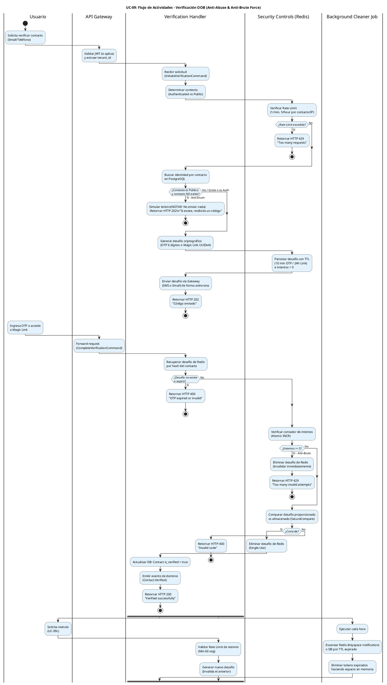

# UC-09: Verificación de Contactos - Diagrama de Actividades

| Metadatos del Documento | |
| :--- | :--- |
| **Proyecto:** | SHUGO - Identity & Access Platform |
| **Caso de Uso:** | UC-09 - Verificación de Contactos (Out-of-Band Verification) |
| **Documento:** | 03_Activity_Diagram.md |
| **Metodología:** | UML 2.5 + ICONIX + Security by Design + Atomic State Management |
| **Autor:** | Gastón Ruiz |
| **Versión Actual:** | 1.0.0 |
| **Fecha:** | 09/09/2026 |

---

## Historial de Versiones

| Versión | Fecha | Autor | Descripción de Cambios | Impacto |
| :--- | :--- | :--- | :--- | :--- |
| **1.0.0** | 09/09/2026 | Gastón Ruiz | **Creación inicial.** Modelado del flujo de trabajo interno para la verificación Out-of-Band (OOB). Destaca la separación crítica entre la fase de *Iniciación* (protección contra SMS/Email Bombing y Enumeración) y la fase de *Completación* (protección contra Fuerza Bruta y Timing Attacks). Incluye el flujo del Job de Limpieza en background. | Documento base del paquete de diseño Tier 1 del UC-09. Establece la lógica de negocio, los puntos de decisión de seguridad y las garantías de atomicidad (vía Redis) para el motor de confianza criptográfica de SHUGO. |

---

## 1. Introducción y Propósito

El **Diagrama de Actividades** para el UC-09 visualiza el flujo de control, decisiones y orquestación necesario para gestionar la verificación de contactos (OTP y Magic Links) en el motor **KAGAMI** de SHUGO.

A diferencia de los UCs transaccionales estándar, el UC-09 es un **flujo de dos fases asíncronas** con requisitos de seguridad extremadamente estrictos:

1. **Fase 1: Iniciación (Emisión):** El sistema debe protegerse contra el abuso financiero y reputacional (SMS/Email Bombing) mediante Rate Limiting, y contra la fuga de información (Enumeración de usuarios) mediante respuestas genéricas.
2. **Fase 2: Completación (Validación):** El sistema debe protegerse contra ataques de fuerza bruta (dada la baja entropía de un OTP de 6 dígitos) mediante contadores atómicos de intentos y contra Timing Attacks mediante `SecureCompare`.
3. **Fase 3: Mantenimiento (Limpieza):** Un proceso en background debe garantizar la higiene de Redis/DB eliminando tokens expirados.

Utilizamos carriles (swimlanes) para separar las responsabilidades entre el Usuario, API Gateway, Verification Handler, Security Controls (Redis), Persistence (DB), y External Gateways (SMS/Email).

---

## 2. Diagrama de Actividades (PlantUML)

A continuación, se presenta el diagrama que cubre los tres flujos principales: Iniciación, Completación y Limpieza en background.



---

## 3. Explicación Detallada del Flujo

### 3.1. Carriles (Partitions / Swimlanes)

El diagrama está dividido en cinco carriles que representan las capas y responsabilidades de la arquitectura:

1. **`|Usuario|` (Actor):** Inicia la solicitud de verificación o ingresa el código/link.
2. **`|API Gateway|` (Capa de Entrada):** Valida la autenticación (si el flujo lo requiere, ej. UC-08) y enruta la request.
3. **`|Verification Handler|` (Capa de Aplicación/Dominio):** Orquesta el caso de uso. Coordina la lógica de negocio, la persistencia en DB y la invocación a gateways externos.
4. **`|Security Controls (Redis)|` (Infraestructura de Seguridad):** Gestiona el Rate Limiting, el almacenamiento temporal de OTPs/Links con TTL automático, y los contadores atómicos de intentos para prevenir fuerza bruta.
5. **`|Background Cleaner Job|` (Infraestructura):** Mantiene la higiene del sistema eliminando residuos de tokens expirados.

### 3.2. Puntos de Decisión Críticos (Rombos)

1. **Rate Limiting (Fase de Iniciación):**
   - **Pregunta:** ¿Se ha excedido el límite de 1 envío por minuto o 5 por hora para este contacto/IP?
   - **Si falla:** Retorna HTTP 429.
   - **Justificación:** Previene el **SMS/Email Bombing**. Sin esto, un atacante podría usar nuestra API para acosar a una víctima y generar facturas masivas de Twilio/SendGrid.

2. **Anti-Enumeration (Fase de Iniciación - Flujos Públicos):**
   - **Pregunta:** ¿El flujo es público (ej. Recuperación de contraseña) y el contacto NO existe en la DB?
   - **Si es así:** Simula el éxito (HTTP 202) pero **no envía nada**.
   - **Justificación:** Previene que un atacante construya una base de datos de usuarios registrados en SHUGO probando emails aleatorios.

3. **Contador de Intentos (Fase de Completación):**
   - **Pregunta:** ¿El contador atómico de intentos fallidos es >= 5?
   - **Si falla:** Elimina el OTP de Redis inmediatamente y retorna HTTP 429.
   - **Justificación:** Un OTP de 6 dígitos tiene 1,000,000 de combinaciones. Sin este límite, un script podría adivinarlo en minutos. La invalidación inmediata tras 5 fallos es una mitigación estándar de NIST SP 800-63A.

4. **Validación Criptográfica (Fase de Completación):**
   - **Pregunta:** ¿El código proporcionado coincide con el almacenado?
   - **Implementación:** Se usa `SecureCompare` (comparación en tiempo constante).
   - **Justificación:** Previene **Timing Attacks**. Si la comparación fallara rápido en el primer dígito incorrecto, un atacante podría adivinar el OTP dígito por dígito midiendo los milisegundos de respuesta.

---

## 4. Alineación con la Especificación de Requisitos

Este diagrama es la representación visual exacta del documento `01_Requirements_Specification.md`:

| Sección en Requisitos | Representación en el Diagrama |
| :--- | :--- |
| **2.1 Escenario Principal (OTP)** | Flujo completo desde "Solicita verificar" hasta "Verified successfully". |
| **2.2 Escenario Alternativo (Magic Link)** | Misma lógica, pero el "desafío criptográfico" es un UUIDv4 y el TTL es 24h. |
| **2.3 Excepción 4.1 (Rate Limit)** | Rombo "¿Rate Limit excedido?" y rama "Sí" (HTTP 429). |
| **2.3 Excepción 9.1 (OTP Expirado)** | Rombo "¿Desafío no existe o expiró?" (Redis TTL manejado automáticamente). |
| **2.3 Excepción 9.2 (Max Intentos)** | Rombo "¿Intentos >= 5?" y rama "Sí" (HTTP 429 + Delete). |
| **3 INV-55 a INV-59** | Todas las invariantes (Exclusividad, TTL, Single-Use, Rate Limit, Anti-Brute) se validan en los carriles correspondientes. |
| **3 RN-08 (Anti-Enumeration)** | Rombo "¿Contexto es Público y contacto NO existe?" simulando éxito. |

---

## 5. Consideraciones de Arquitectura y Seguridad (Elite Level)

### 5.1. Atomicidad en Redis para Prevenir Race Conditions

El incremento del contador de intentos y la validación del OTP deben ser atómicos para prevenir que un atacante envíe múltiples requests en paralelo (Race Condition) y exceda el límite de 5 intentos.

**Implementación recomendada (C# + StackExchange.Redis):**
```csharp
public async Task<VerificationResult> ValidateOtpAsync(string contactHash, string providedOtp, CancellationToken ct)
{
    var key = $"otp:{contactHash}";
    var db = _redis.GetDatabase();

    // 1. Verificar existencia y TTL (Expira automáticamente en Redis)
    var otpDataJson = await db.StringGetAsync(key);
    if (otpDataJson.IsNullOrEmpty) 
        throw new DomainException("OTP expired or not found.");

    var otpData = JsonSerializer.Deserialize<OtpData>(otpDataJson);

    // 2. Incremento atómico de intentos (Previene Race Conditions)
    var newAttempts = await db.StringIncrementAsync(key + ":attempts");

    if (newAttempts > 5)
    {
        await db.KeyDeleteAsync(key); // Invalidar OTP
        await db.KeyDeleteAsync(key + ":attempts");
        throw new RateLimitExceededException("Too many invalid attempts.");
    }

    // 3. SecureCompare (Previene Timing Attacks)
    var providedHash = SHA256.HashData(Encoding.UTF8.GetBytes(providedOtp));
    if (!CryptographicOperations.FixedTimeEquals(
        Encoding.UTF8.GetBytes(otpData.Hash), 
        Encoding.UTF8.GetBytes(providedHash)))
    {
        return VerificationResult.Failed; 
    }

    // 4. Éxito: Invalidar OTP (Single-Use)
    await db.KeyDeleteAsync(key);
    await db.KeyDeleteAsync(key + ":attempts");
    
    return VerificationResult.Success;
}
```

### 5.2. Context-Aware Anti-Enumeration

La lógica del rombo "¿Contexto es Público y contacto NO existe?" es vital. 
- **Si el usuario está autenticado (ej. UC-08 Cambiar Email):** El sistema *puede* decir "Este email ya está en uso por otra cuenta", porque la identidad del solicitante ya está verificada y el riesgo de enumeración es nulo.
- **Si el usuario NO está autenticado (ej. UC-18 Recuperación, UC-06 Registro inicial):** El sistema *debe* mentir y decir "Si el email existe, recibirás un código" para no revelar la base de datos de usuarios (userbase leakage).

### 5.3. Envío Asíncrono a Gateways

En el carril `Verification Handler`, el paso "Enviar desafío vía Gateway" se marca como **asíncrono**. 
- **Justificación:** Las APIs de Twilio o SendGrid pueden tener latencias variables (200ms - 2000ms). Bloquear el thread HTTP esperando la confirmación de entrega degrada el rendimiento del sistema y vulnera el SLO de <100ms para la generación.
- **Patrón:** Se utiliza el patrón *Fire-and-Forget* con manejo de excepciones vía Outbox Pattern o Background Workers para reintentos si el gateway está caído.

---

## 6. Trazabilidad con Otros Documentos del Paquete

| Documento | Relación |
| :--- | :--- |
| `01_Requirements_Specification.md` | Este diagrama visualiza los flujos de texto, las invariantes de seguridad y los criterios de aceptación. |
| `02_Use_Case_Diagram.md` | Muestra el límite del sistema y los actores; este diagrama muestra el flujo interno y las decisiones lógicas. |
| `04_Initial_Domain_Model.md` | Las acciones de los carriles "Verification Handler" y "Security Controls" se implementan aquí como Domain Services y Value Objects. |
| `05_State_Machine_Diagram.md` | Las transiciones de estado del Token/OTP (PENDING → VALIDATED/EXPIRED/BRUTE_FORCED) se ejecutan en los puntos de decisión de este diagrama. |
| `06_Robustness_Diagram.md` | Mostrará la colaboración entre el Verification Handler, Redis, DB, y los Gateways. |
| `07_Sequence_Diagram.md` | Detallará el orden temporal exacto de las llamadas: Rate Limit Check → Crypto Gen → Redis Set → Gateway Send → Response. |
| `08_Final_Class_Design.md` | Definirá las firmas exactas de los métodos: `OtpGenerator.Generate()`, `VerificationService.Validate()`, `SecureCompare.Equals()`. |

---

## 7. Notas de Implementación

### 7.1. Generación del Diagrama
- **Herramienta:** PlantUML (Diagrams as Code).
- **Ventaja:** Versionable en Git, reproducible, sin dependencias de software propietario.
- **Sintaxis:** Uso de `if/else/endif` para decisiones, `fork` para procesos en background, y carriles para separar responsabilidades.

### 7.2. Complejidad del Diagrama
Este diagrama es moderadamente complejo debido a la cantidad de validaciones de seguridad previas a la emisión y validación. Sin embargo, esta complejidad es necesaria para capturar la riqueza del flujo OOB en un sistema IAM enterprise que debe balancear **UX fluida** con **seguridad inquebrantable**.

### 7.3. Manejo de Magic Links vs OTPs
Aunque el diagrama muestra un flujo unificado, la implementación física difiere ligeramente:
- **OTPs:** Se almacenan en Redis (alta velocidad, TTL nativo, sin necesidad de persistencia en DB a menos que se requiera auditoría forense estricta).
- **Magic Links:** Se almacenan en PostgreSQL (o Redis con persistencia) porque el usuario puede hacer clic en el link horas después desde un dispositivo diferente, y requiere un registro forense más robusto del evento de clic (IP, User-Agent del momento del clic).

---
*Fin del Documento 03_Activity_Diagram para UC-09*