# UC-09: Verificación de Contactos - Modelo de Dominio Inicial

| Metadatos del Documento | |
| :--- | :--- |
| **Proyecto:** | SHUGO - Identity & Access Platform |
| **Caso de Uso:** | UC-09 - Verificación de Contactos (Out-of-Band Verification) |
| **Documento:** | 04_Initial_Domain_Model.md |
| **Metodología:** | ICONIX (Modelo de Análisis) + DDD (Domain-Driven Design) + Security by Design + Temporal State Management |
| **Autor:** | Gastón Ruiz |
| **Versión Actual:** | 1.0.0 |
| **Fecha:** | 09/09/2026 |

---

## Historial de Versiones

| Versión | Fecha | Autor | Descripción de Cambios | Impacto |
| :--- | :--- | :--- | :--- | :--- |
| **1.0.0** | 09/09/2026 | Gastón Ruiz | **Creación inicial.** Definición del Modelo de Dominio Conceptual para la verificación de contactos. Introduce el Aggregate Root `VerificationRequest` con máquina de estados completa (PENDING → VALIDATED/EXPIRED/BRUTE_FORCED), los Value Objects de seguridad (`OtpCode`, `MagicLinkToken`, `ContactInfo`, `VerificationChannel`), los Domain Services especializados (`VerificationService`, `OtpGenerator`, `RateLimiter`), y los eventos de dominio para notificación asíncrona. | Documento base del paquete de diseño Tier 1 del UC-09. Establece cómo el dominio gestiona el ciclo de vida completo de las verificaciones Out-of-Band, garantizando seguridad criptográfica, prevención de abuso (Rate Limiting, Anti-Brute Force), y cumplimiento de TTLs estrictos. |

---

## 1. Introducción y Propósito

Este documento presenta el **Modelo de Dominio Inicial** para el Caso de Uso UC-09 (Verificación de Contactos).

A diferencia de los UCs previos, el UC-09 introduce complejidades únicas debido a su naturaleza **transversal y de alta seguridad**:

1. **Servicio de Dominio Transversal:** No es un caso de uso aislado, sino un motor de confianza criptográfica consumido por UC-06, UC-08, UC-15, y UC-18.
2. **Dos Tipos de Desafíos:** OTPs (corta duración, baja entropía) y Magic Links (larga duración, alta entropía) requieren estrategias de almacenamiento y validación distintas.
3. **Prevención de Abuso Financiero:** El Rate Limiting no es solo una optimización, es una protección crítica contra SMS/Email Bombing que puede generar facturas masivas.
4. **Seguridad contra Fuerza Bruta:** Los OTPs de 6 dígitos tienen entropía limitada (1 en 1,000,000), requiriendo contadores atómicos de intentos y invalidación temprana.
5. **Prevención de Timing Attacks:** La validación debe usar `SecureCompare` para evitar que atacantes adivinen códigos midiendo tiempos de respuesta.
6. **Anti-Enumeration:** En flujos públicos, el sistema debe ocultar si un contacto existe en la base de datos.

El modelo se centra en:
- **Aggregate Root `VerificationRequest`:** Encapsula el ciclo de vida completo del desafío de verificación.
- **Value Objects de Seguridad:** `OtpCode` (generación criptográfica), `MagicLinkToken` (UUID v4), `ContactInfo` (hashing de PII), `VerificationChannel` (Email/SMS).
- **Domain Services:** `VerificationService` (orquestación), `OtpGenerator` (generación segura), `RateLimiter` (prevención de abuso).
- **Eventos de Dominio:** `Contact.VerificationInitiated`, `Contact.Verified`, `Contact.VerificationFailed` para consistencia eventual.

---

## 2. Diagrama de Modelo de Dominio Conceptual (PlantUML)

A continuación, se presenta el diagrama de clases conceptual, enfocándose en los objetos de dominio, servicios y eventos introducidos para UC-09.

```plantuml
@startuml UC-09_DominioConceptual
<style>
diagram {
  BackgroundColor #FFFFFF
}
</style>
skinparam classAttributeIconSize 0
skinparam classBackgroundColor #FFFFFF
skinparam classBorderColor #1565C0
skinparam classHeaderBackgroundColor #E3F2FD

title UC-09: Modelo de Dominio Conceptual - Verificación de Contactos (OOB Verification & Anti-Abuse)

' ============================================
' AGGREGATE ROOT
' ============================================
class VerificationRequest <<Aggregate Root>> {
  - id: VerificationRequestId
  - identityId: IdentityId
  - tenantId: TenantId
  - contactInfo: ContactInfo
  - channel: VerificationChannel
  - challenge: VerificationChallenge
  - status: VerificationStatus
  - attempts: int
  - maxAttempts: int
  - createdAt: DateTime
  - expiresAt: DateTime
  - validatedAt: DateTime?
  - domainEvents: List<IDomainEvent>
  
  + Initiate(identityId, tenantId, contactInfo, channel, ttl): VerificationRequest
  + Validate(providedChallenge: string): bool
  + IncrementAttempts(): void
  - ValidateStatus(): void
  - AddDomainEvent(event: IDomainEvent): void
}

' ============================================
' VALUE OBJECTS
' ============================================
class VerificationChallenge <<Value Object>> {
  - type: ChallengeType
  - otpCode: OtpCode
  - magicLinkToken: MagicLinkToken
  + VerificationChallenge(otpCode: OtpCode)
  + VerificationChallenge(magicLinkToken: MagicLinkToken)
  - ValidateType(): void
}

class OtpCode <<Value Object>> {
  - code: string
  + OtpCode(code: string)
  - ValidateFormat(): void
  - ValidateLength(): void
}

class MagicLinkToken <<Value Object>> {
  - token: string
  - tokenHash: string
  + MagicLinkToken(token: string)
  - GenerateUUIDv4(): void
  - HashWithSHA256(): void
}

class ContactInfo <<Value Object>> {
  - type: ContactType
  - value: string
  - hash: string
  + ContactInfo(type: ContactType, value: string)
  - ValidateFormat(): void
  - GenerateHash(): void
}

class VerificationChannel <<Value Object>> {
  - channel: string
  + EMAIL: VerificationChannel
  + SMS: VerificationChannel
  + VerificationChannel(channel: string)
}

class VerificationStatus <<Value Object>> {
  - value: string
  + PENDING: VerificationStatus
  + VALIDATED: VerificationStatus
  + EXPIRED: VerificationStatus
  + BRUTE_FORCED: VerificationStatus
  + VerificationStatus(value: string)
}

class VerificationRequestId <<Value Object>> {
  - value: Guid
  + VerificationRequestId(value: Guid)
}

class IdentityId <<Value Object>> {
  - value: Guid
  + IdentityId(value: Guid)
}

class TenantId <<Value Object>> {
  - value: Guid
  + TenantId(value: Guid)
}

' ============================================
' DOMAIN SERVICES
' ============================================
class VerificationService <<Domain Service>> {
  - verificationRepo: IVerificationRepository
  - otpGenerator: IOtpGenerator
  - rateLimiter: IRateLimiter
  - contactRepo: IContactRepository
  - eventPublisher: IEventPublisher
  
  + InitiateVerification(command: InitiateVerificationCommand): Task<VerificationRequestId>
  + CompleteVerification(command: CompleteVerificationCommand): Task<bool>
  - ValidateRateLimit(contactInfo: ContactInfo): Task
  - GenerateChallenge(channel: VerificationChannel): VerificationChallenge
  - PersistVerificationRequest(request: VerificationRequest): Task
  - SendChallenge(request: VerificationRequest): Task
}

class OtpGenerator <<Domain Service>> {
  + Generate(): OtpCode
  - GenerateSecureRandom(): string
}

class RateLimiter <<Domain Service>> {
  - cache: IDistributedCache
  + IsAllowedAsync(key: string, maxRequests: int, window: TimeSpan): Task<bool>
  + IncrementAsync(key: string, window: TimeSpan): Task
}

' ============================================
' DOMAIN EVENTS
' ============================================
class ContactVerificationInitiated <<Domain Event>> {
  + verificationRequestId: VerificationRequestId
  + identityId: IdentityId
  + tenantId: TenantId
  + contactHash: string
  + channel: VerificationChannel
  + challengeType: ChallengeType
}

class ContactVerified <<Domain Event>> {
  + verificationRequestId: VerificationRequestId
  + identityId: IdentityId
  + tenantId: TenantId
  + contactHash: string
  + validatedAt: DateTime
}

class ContactVerificationFailed <<Domain Event>> {
  + verificationRequestId: VerificationRequestId
  + identityId: IdentityId
  + tenantId: TenantId
  + contactHash: string
  + reason: string
  + attempts: int
}

' ============================================
' INTERFACES
' ============================================
interface IVerificationRepository {
  + SaveAsync(request: VerificationRequest): Task
  + GetByIdAsync(id: VerificationRequestId): Task<VerificationRequest?>
  + GetByContactHashAsync(contactHash: string): Task<VerificationRequest?>
}

interface IContactRepository {
  + GetByHashAsync(contactHash: string, tenantId: TenantId): Task<Contact?>
  + MarkAsVerifiedAsync(contactId: ContactId): Task
}

interface IOtpGenerator {
  + Generate(): OtpCode
}

interface IRateLimiter {
  + IsAllowedAsync(key: string, maxRequests: int, window: TimeSpan): Task<bool>
  + IncrementAsync(key: string, window: TimeSpan): Task
}

' ============================================
' RELACIONES
' ============================================
VerificationRequest *-- VerificationChallenge : "contiene"
VerificationRequest *-- ContactInfo : "verifica"
VerificationRequest *-- VerificationChannel : "usa"
VerificationRequest *-- VerificationStatus : "estado actual"
VerificationRequest *-- IdentityId : "pertenece a"
VerificationRequest *-- TenantId : "pertenece a"

VerificationChallenge *-- OtpCode : "contiene (si OTP)"
VerificationChallenge *-- MagicLinkToken : "contiene (si Magic Link)"

ContactInfo *-- ContactType : "tipo"

VerificationService --> IVerificationRepository : "persiste"
VerificationService --> IOtpGenerator : "genera OTP"
VerificationService --> IRateLimiter : "valida rate limit"
VerificationService --> IContactRepository : "actualiza contacto"
VerificationService --> IEventPublisher : "publica eventos"

VerificationRequest ..> ContactVerificationInitiated : "publica"
VerificationRequest ..> ContactVerified : "publica"
VerificationRequest ..> ContactVerificationFailed : "publica"

note right of VerificationRequest
  **Aggregate Root:**
  - Encapsula ciclo de vida completo
  - Valida transiciones de estado
  - Genera eventos de dominio
  - Previene estados inválidos
end note

note right of OtpCode
  **Seguridad Criptográfica:**
  - Generación con RandomNumberGenerator
  - 6 dígitos (entropía: 1 en 1,000,000)
  - Validación de formato estricta
end note

note right of MagicLinkToken
  **Alta Entropía:**
  - UUID v4 (128 bits)
  - Almacenado como SHA256 hash
  - Comparación con SecureCompare
end note

note bottom of VerificationService
  **Orquestación de Seguridad:**
  - Valida Rate Limiting (Anti-Bombing)
  - Genera desafíos criptográficos
  - Persiste con TTL estricto
  - Envía vía canales externos
  - Previene enumeración
end note

@enduml
```



---

## 3. Detalle de Conceptos de Dominio (DDD)

### 3.1. Aggregate Root: `VerificationRequest`

El Aggregate Root `VerificationRequest` encapsula el ciclo de vida completo de una solicitud de verificación, desde su iniciación hasta su validación, expiración o bloqueo por fuerza bruta.

**Código (C#):**

```csharp
public class VerificationRequest : AggregateRoot
{
    public VerificationRequestId Id { get; private set; }
    public IdentityId IdentityId { get; private set; }
    public TenantId TenantId { get; private set; }
    public ContactInfo ContactInfo { get; private set; }
    public VerificationChannel Channel { get; private set; }
    public VerificationChallenge Challenge { get; private set; }
    public VerificationStatus Status { get; private set; }
    public int Attempts { get; private set; }
    public int MaxAttempts { get; private set; }
    public DateTime CreatedAt { get; private set; }
    public DateTime ExpiresAt { get; private set; }
    public DateTime? ValidatedAt { get; private set; }
    
    private readonly List<IDomainEvent> _domainEvents = new();

    // Constructor privado para EF Core
    private VerificationRequest() { }

    /// <summary>
    /// Método de fábrica para crear una nueva solicitud de verificación.
    /// </summary>
    public static VerificationRequest Initiate(
        IdentityId identityId,
        TenantId tenantId,
        ContactInfo contactInfo,
        VerificationChannel channel,
        TimeSpan ttl)
    {
        var request = new VerificationRequest
        {
            Id = new VerificationRequestId(Guid.NewGuid()),
            IdentityId = identityId,
            TenantId = tenantId,
            ContactInfo = contactInfo,
            Channel = channel,
            Status = VerificationStatus.PENDING,
            Attempts = 0,
            MaxAttempts = channel.IsSms ? 5 : 10, // SMS: 5 intentos, Email: 10 intentos
            CreatedAt = DateTime.UtcNow,
            ExpiresAt = DateTime.UtcNow.Add(ttl)
        };

        // Generar desafío según el canal
        request.Challenge = channel.IsSms 
            ? VerificationChallenge.CreateOtp() 
            : VerificationChallenge.CreateMagicLink();

        request.ValidateInitialState();
        
        // Generar evento de dominio
        request.AddDomainEvent(new ContactVerificationInitiated(
            request.Id,
            request.IdentityId,
            request.TenantId,
            request.ContactInfo.Hash,
            request.Channel,
            request.Challenge.Type
        ));

        return request;
    }

    /// <summary>
    /// Valida el desafío proporcionado.
    /// Retorna true si es válido, false si es incorrecto (pero no expirado).
    /// Lanza excepción si está expirado o bloqueado.
    /// </summary>
    public bool Validate(string providedChallenge)
    {
        // Guarda 1: Validar estado
        ValidateStatus();

        // Guarda 2: Validar expiración
        if (DateTime.UtcNow > this.ExpiresAt)
        {
            this.Status = VerificationStatus.EXPIRED;
            throw new VerificationExpiredException(
                $"Verification request expired at {this.ExpiresAt:O}.");
        }

        // Guarda 3: Validar intentos máximos
        if (this.Attempts >= this.MaxAttempts)
        {
            this.Status = VerificationStatus.BRUTE_FORCED;
            throw new VerificationBruteForcedException(
                $"Maximum attempts ({this.MaxAttempts}) exceeded.");
        }

        // Incrementar intentos
        this.Attempts++;

        // Validar desafío con SecureCompare
        var isValid = this.Challenge.Validate(providedChallenge);

        if (isValid)
        {
            // Transición a VALIDATED
            this.Status = VerificationStatus.VALIDATED;
            this.ValidatedAt = DateTime.UtcNow;

            this.AddDomainEvent(new ContactVerified(
                this.Id,
                this.IdentityId,
                this.TenantId,
                this.ContactInfo.Hash,
                this.ValidatedAt.Value
            ));
        }
        else
        {
            // Generar evento de fallo si es el último intento
            if (this.Attempts >= this.MaxAttempts)
            {
                this.AddDomainEvent(new ContactVerificationFailed(
                    this.Id,
                    this.IdentityId,
                    this.TenantId,
                    this.ContactInfo.Hash,
                    "Maximum attempts exceeded",
                    this.Attempts
                ));
            }
        }

        return isValid;
    }

    /// <summary>
    /// Valida invariantes del estado inicial.
    /// </summary>
    private void ValidateInitialState()
    {
        if (this.Status != VerificationStatus.PENDING)
            throw new DomainException("New verification request must be in PENDING status.");

        if (this.Challenge == null)
            throw new DomainException("Verification request must have a challenge.");

        if (this.ExpiresAt <= DateTime.UtcNow)
            throw new DomainException("Verification request expiration must be in the future.");

        if (this.MaxAttempts <= 0)
            throw new DomainException("Max attempts must be greater than zero.");
    }

    /// <summary>
    /// Valida que el estado permita la validación.
    /// </summary>
    private void ValidateStatus()
    {
        if (this.Status != VerificationStatus.PENDING)
            throw new InvalidVerificationStatusException(
                $"Cannot validate verification request in status {this.Status}. Must be PENDING.");
    }

    public IReadOnlyCollection<IDomainEvent> GetDomainEvents() => _domainEvents.AsReadOnly();
    
    protected void AddDomainEvent(IDomainEvent evt) => _domainEvents.Add(evt);
}
```

### 3.2. Value Objects de Seguridad

#### **VerificationChallenge**

Value Object que encapsula el desafío de verificación (OTP o Magic Link).

```csharp
public class VerificationChallenge : ValueObject
{
    public ChallengeType Type { get; }
    public OtpCode? OtpCode { get; }
    public MagicLinkToken? MagicLinkToken { get; }

    private VerificationChallenge(ChallengeType type, OtpCode? otpCode, MagicLinkToken? magicLinkToken)
    {
        Type = type;
        OtpCode = otpCode;
        MagicLinkToken = magicLinkToken;
    }

    /// <summary>
    /// Crea un desafío OTP (para SMS o Email de código corto).
    /// </summary>
    public static VerificationChallenge CreateOtp()
    {
        var otpCode = OtpCode.Generate();
        return new VerificationChallenge(ChallengeType.OTP, otpCode, null);
    }

    /// <summary>
    /// Crea un desafío Magic Link (para Email con link criptográfico).
    /// </summary>
    public static VerificationChallenge CreateMagicLink()
    {
        var magicLinkToken = MagicLinkToken.Generate();
        return new VerificationChallenge(ChallengeType.MAGIC_LINK, null, magicLinkToken);
    }

    /// <summary>
    /// Valida el desafío proporcionado usando SecureCompare.
    /// </summary>
    public bool Validate(string providedChallenge)
    {
        return Type switch
        {
            ChallengeType.OTP => OtpCode?.Validate(providedChallenge) ?? false,
            ChallengeType.MAGIC_LINK => MagicLinkToken?.Validate(providedChallenge) ?? false,
            _ => false
        };
    }

    /// <summary>
    /// Obtiene el valor del desafío para envío (OTP en texto plano, Magic Link como URL).
    /// </summary>
    public string GetValueForDelivery()
    {
        return Type switch
        {
            ChallengeType.OTP => OtpCode?.Code ?? throw new DomainException("OTP code is null."),
            ChallengeType.MAGIC_LINK => MagicLinkToken?.GetDeliveryUrl() ?? throw new DomainException("Magic link token is null."),
            _ => throw new DomainException($"Unknown challenge type: {Type}")
        };
    }

    protected override IEnumerable<object> GetEqualityComponents()
    {
        yield return Type;
        yield return OtpCode?.Code ?? "";
        yield return MagicLinkToken?.TokenHash ?? "";
    }
}

public enum ChallengeType
{
    OTP,
    MAGIC_LINK
}
```

#### **OtpCode**

Value Object que encapsula un código OTP de 6 dígitos con generación criptográfica segura.

```csharp
public class OtpCode : ValueObject
{
    private const int OTP_LENGTH = 6;
    private static readonly Regex OtpFormatRegex = new Regex(@"^\d{6}$", RegexOptions.Compiled);

    public string Code { get; }

    private OtpCode(string code)
    {
        if (string.IsNullOrWhiteSpace(code))
            throw new DomainException("OTP code cannot be empty.");

        ValidateFormat(code);
        ValidateLength(code);

        Code = code;
    }

    /// <summary>
    /// Genera un OTP criptográficamente seguro de 6 dígitos.
    /// </summary>
    public static OtpCode Generate()
    {
        using var rng = RandomNumberGenerator.Create();
        var bytes = new byte[4];
        rng.GetBytes(bytes);
        
        var otpValue = Math.Abs(BitConverter.ToInt32(bytes)) % 1000000;
        var otpString = otpValue.ToString("D6"); // 6 dígitos con ceros a la izquierda
        
        return new OtpCode(otpString);
    }

    /// <summary>
    /// Valida el OTP proporcionado usando SecureCompare.
    /// </summary>
    public bool Validate(string providedOtp)
    {
        if (string.IsNullOrWhiteSpace(providedOtp))
            return false;

        // SecureCompare para prevenir Timing Attacks
        return CryptographicOperations.FixedTimeEquals(
            Encoding.UTF8.GetBytes(this.Code),
            Encoding.UTF8.GetBytes(providedOtp)
        );
    }

    private void ValidateFormat(string code)
    {
        if (!OtpFormatRegex.IsMatch(code))
            throw new DomainException(
                $"OTP code '{code}' is invalid. Must be exactly 6 digits.");
    }

    private void ValidateLength(string code)
    {
        if (code.Length != OTP_LENGTH)
            throw new DomainException(
                $"OTP code must be exactly {OTP_LENGTH} digits.");
    }

    protected override IEnumerable<object> GetEqualityComponents()
    {
        yield return Code;
    }
}
```

#### **MagicLinkToken**

Value Object que encapsula un token de Magic Link con UUID v4 y almacenamiento seguro como hash SHA256.

```csharp
public class MagicLinkToken : ValueObject
{
    private const string DELIVERY_URL_TEMPLATE = "https://app.shugo.io/verify?token={0}";

    public string Token { get; }
    public string TokenHash { get; }

    private MagicLinkToken(string token, string tokenHash)
    {
        if (string.IsNullOrWhiteSpace(token))
            throw new DomainException("Magic link token cannot be empty.");

        Token = token;
        TokenHash = tokenHash;
    }

    /// <summary>
    /// Genera un Magic Link Token criptográficamente seguro (UUID v4).
    /// </summary>
    public static MagicLinkToken Generate()
    {
        // UUID v4 criptográfico (128 bits de entropía)
        var token = Guid.NewGuid().ToString("N");
        
        // Hash SHA256 para almacenamiento seguro
        var tokenHash = SHA256.HashData(Encoding.UTF8.GetBytes(token));
        var tokenHashBase64 = Convert.ToBase64String(tokenHash);

        return new MagicLinkToken(token, tokenHashBase64);
    }

    /// <summary>
    /// Valida el token proporcionado usando SecureCompare.
    /// </summary>
    public bool Validate(string providedToken)
    {
        if (string.IsNullOrWhiteSpace(providedToken))
            return false;

        // Hash del token proporcionado
        var providedHash = SHA256.HashData(Encoding.UTF8.GetBytes(providedToken));
        var providedHashBase64 = Convert.ToBase64String(providedHash);

        // SecureCompare para prevenir Timing Attacks
        return CryptographicOperations.FixedTimeEquals(
            Encoding.UTF8.GetBytes(this.TokenHash),
            Encoding.UTF8.GetBytes(providedHashBase64)
        );
    }

    /// <summary>
    /// Obtiene la URL de entrega para el Magic Link.
    /// </summary>
    public string GetDeliveryUrl()
    {
        return string.Format(DELIVERY_URL_TEMPLATE, this.Token);
    }

    protected override IEnumerable<object> GetEqualityComponents()
    {
        yield return TokenHash;
    }
}
```

#### **ContactInfo**

Value Object que encapsula la información de contacto (email o teléfono) con hashing de PII para protección de datos.

```csharp
public class ContactInfo : ValueObject
{
    private static readonly Regex EmailRegex = new Regex(
        @"^[^@\s]+@[^@\s]+\.[^@\s]+$", RegexOptions.Compiled);
    
    private static readonly Regex PhoneRegex = new Regex(
        @"^\+?[1-9]\d{1,14}$", RegexOptions.Compiled); // E.164 format

    public ContactType Type { get; }
    public string Value { get; }
    public string Hash { get; }

    private ContactInfo(ContactType type, string value, string hash)
    {
        Type = type;
        Value = value;
        Hash = hash;
    }

    /// <summary>
    /// Crea un ContactInfo para email.
    /// </summary>
    public static ContactInfo CreateEmail(string email)
    {
        if (string.IsNullOrWhiteSpace(email))
            throw new DomainException("Email cannot be empty.");

        if (!EmailRegex.IsMatch(email))
            throw new DomainException($"Invalid email format: {email}");

        var hash = SHA256.HashData(Encoding.UTF8.GetBytes(email.ToLowerInvariant().Trim()));
        var hashBase64 = Convert.ToBase64String(hash);

        return new ContactInfo(ContactType.EMAIL, email.ToLowerInvariant().Trim(), hashBase64);
    }

    /// <summary>
    /// Crea un ContactInfo para teléfono.
    /// </summary>
    public static ContactInfo CreatePhone(string phone)
    {
        if (string.IsNullOrWhiteSpace(phone))
            throw new DomainException("Phone number cannot be empty.");

        if (!PhoneRegex.IsMatch(phone))
            throw new DomainException($"Invalid phone format: {phone}. Must be E.164 format (e.g., +1234567890).");

        var hash = SHA256.HashData(Encoding.UTF8.GetBytes(phone.Trim()));
        var hashBase64 = Convert.ToBase64String(hash);

        return new ContactInfo(ContactType.PHONE, phone.Trim(), hashBase64);
    }

    protected override IEnumerable<object> GetEqualityComponents()
    {
        yield return Type;
        yield return Hash;
    }
}

public enum ContactType
{
    EMAIL,
    PHONE
}
```

#### **VerificationChannel**

Value Object que encapsula el canal de verificación (Email o SMS).

```csharp
public class VerificationChannel : ValueObject
{
    public string Channel { get; }

    private VerificationChannel(string channel)
    {
        if (string.IsNullOrWhiteSpace(channel))
            throw new DomainException("Channel cannot be empty.");

        Channel = channel.ToUpperInvariant();
    }

    public static VerificationChannel EMAIL => new VerificationChannel("EMAIL");
    public static VerificationChannel SMS => new VerificationChannel("SMS");

    public bool IsEmail => Channel == "EMAIL";
    public bool IsSms => Channel == "SMS";

    protected override IEnumerable<object> GetEqualityComponents()
    {
        yield return Channel;
    }
}
```

#### **VerificationStatus**

Value Object que encapsula el estado de la solicitud de verificación.

```csharp
public class VerificationStatus : ValueObject
{
    public string Value { get; }

    private VerificationStatus(string value)
    {
        if (string.IsNullOrWhiteSpace(value))
            throw new DomainException("Status value cannot be empty.");

        Value = value.ToUpperInvariant();
    }

    public static VerificationStatus PENDING => new VerificationStatus("PENDING");
    public static VerificationStatus VALIDATED => new VerificationStatus("VALIDATED");
    public static VerificationStatus EXPIRED => new VerificationStatus("EXPIRED");
    public static VerificationStatus BRUTE_FORCED => new VerificationStatus("BRUTE_FORCED");

    protected override IEnumerable<object> GetEqualityComponents()
    {
        yield return Value;
    }
}
```

### 3.3. Domain Services

#### **VerificationService**

Domain Service que orquesta el flujo completo de verificación, desde la iniciación hasta la validación.

```csharp
public class VerificationService : IVerificationService
{
    private readonly IVerificationRepository _verificationRepo;
    private readonly IOtpGenerator _otpGenerator;
    private readonly IRateLimiter _rateLimiter;
    private readonly IContactRepository _contactRepo;
    private readonly IEventPublisher _eventPublisher;
    private readonly ILogger<VerificationService> _logger;

    public VerificationService(
        IVerificationRepository verificationRepo,
        IOtpGenerator otpGenerator,
        IRateLimiter rateLimiter,
        IContactRepository contactRepo,
        IEventPublisher eventPublisher,
        ILogger<VerificationService> logger)
    {
        _verificationRepo = verificationRepo;
        _otpGenerator = otpGenerator;
        _rateLimiter = rateLimiter;
        _contactRepo = contactRepo;
        _eventPublisher = eventPublisher;
        _logger = logger;
    }

    /// <summary>
    /// Inicia una nueva solicitud de verificación.
    /// </summary>
    public async Task<VerificationRequestId> InitiateVerification(
        InitiateVerificationCommand command,
        CancellationToken ct)
    {
        // 1. Validar Rate Limiting (Anti-Bombing)
        var rateLimitKey = $"verification:{command.ContactInfo.Hash}";
        var isAllowed = await _rateLimiter.IsAllowedAsync(rateLimitKey, 5, TimeSpan.FromHours(1));
        
        if (!isAllowed)
        {
            _logger.LogWarning("Rate limit exceeded for contact {ContactHash}", command.ContactInfo.Hash);
            throw new RateLimitExceededException(
                "Too many verification requests. Please try again later.");
        }

        // 2. Crear Aggregate Root
        var ttl = command.Channel.IsSms ? TimeSpan.FromMinutes(10) : TimeSpan.FromHours(24);
        var verificationRequest = VerificationRequest.Initiate(
            command.IdentityId,
            command.TenantId,
            command.ContactInfo,
            command.Channel,
            ttl
        );

        // 3. Persistir
        await _verificationRepo.SaveAsync(verificationRequest, ct);

        // 4. Incrementar Rate Limit
        await _rateLimiter.IncrementAsync(rateLimitKey, TimeSpan.FromHours(1));

        // 5. Enviar desafío (asíncrono)
        await SendChallengeAsync(verificationRequest, ct);

        // 6. Publicar eventos de dominio
        await _eventPublisher.PublishAsync(verificationRequest.GetDomainEvents(), ct);

        return verificationRequest.Id;
    }

    /// <summary>
    /// Completa la verificación validando el desafío proporcionado.
    /// </summary>
    public async Task<bool> CompleteVerification(
        CompleteVerificationCommand command,
        CancellationToken ct)
    {
        // 1. Buscar solicitud de verificación
        var verificationRequest = await _verificationRepo.GetByIdAsync(command.VerificationRequestId, ct);
        
        if (verificationRequest == null)
            throw new VerificationNotFoundException(
                $"Verification request {command.VerificationRequestId} not found.");

        // 2. Validar desafío (puede lanzar excepciones de expiración o brute force)
        var isValid = verificationRequest.Validate(command.ProvidedChallenge);

        // 3. Persistir cambios
        await _verificationRepo.SaveAsync(verificationRequest, ct);

        // 4. Si es válido, marcar contacto como verificado
        if (isValid)
        {
            await _contactRepo.MarkAsVerifiedAsync(
                verificationRequest.ContactInfo.Hash,
                verificationRequest.TenantId,
                ct);
        }

        // 5. Publicar eventos de dominio
        await _eventPublisher.PublishAsync(verificationRequest.GetDomainEvents(), ct);

        return isValid;
    }

    /// <summary>
    /// Envía el desafío al usuario vía el canal correspondiente.
    /// </summary>
    private async Task SendChallengeAsync(VerificationRequest request, CancellationToken ct)
    {
        var challengeValue = request.Challenge.GetValueForDelivery();

        if (request.Channel.IsEmail)
        {
            await _emailService.SendVerificationEmailAsync(
                request.ContactInfo.Value,
                challengeValue,
                ct);
        }
        else if (request.Channel.IsSms)
        {
            await _smsService.SendVerificationSmsAsync(
                request.ContactInfo.Value,
                challengeValue,
                ct);
        }
    }
}
```

#### **OtpGenerator**

Domain Service que genera OTPs criptográficamente seguros.

```csharp
public class OtpGenerator : IOtpGenerator
{
    /// <summary>
    /// Genera un OTP criptográficamente seguro de 6 dígitos.
    /// </summary>
    public OtpCode Generate()
    {
        return OtpCode.Generate();
    }
}
```

#### **RateLimiter**

Domain Service que implementa Rate Limiting para prevenir abuso (SMS/Email Bombing).

```csharp
public class RateLimiter : IRateLimiter
{
    private readonly IDistributedCache _cache;

    public RateLimiter(IDistributedCache cache)
    {
        _cache = cache;
    }

    /// <summary>
    /// Valida si se permite una nueva solicitud según el Rate Limit.
    /// </summary>
    public async Task<bool> IsAllowedAsync(string key, int maxRequests, TimeSpan window)
    {
        var currentCount = await _cache.GetAsync<int>(key);
        return currentCount < maxRequests;
    }

    /// <summary>
    /// Incrementa el contador de solicitudes.
    /// </summary>
    public async Task IncrementAsync(string key, TimeSpan window)
    {
        var currentCount = await _cache.GetAsync<int>(key);
        await _cache.SetAsync(key, currentCount + 1, window);
    }
}
```

### 3.4. Domain Events

#### **ContactVerificationInitiated**

Se genera cuando se inicia una nueva solicitud de verificación.

```csharp
public class ContactVerificationInitiated : IDomainEvent
{
    public Guid EventId { get; } = Guid.NewGuid();
    public DateTime Timestamp { get; } = DateTime.UtcNow;
    
    public VerificationRequestId VerificationRequestId { get; }
    public IdentityId IdentityId { get; }
    public TenantId TenantId { get; }
    public string ContactHash { get; }
    public VerificationChannel Channel { get; }
    public ChallengeType ChallengeType { get; }

    public ContactVerificationInitiated(
        VerificationRequestId verificationRequestId,
        IdentityId identityId,
        TenantId tenantId,
        string contactHash,
        VerificationChannel channel,
        ChallengeType challengeType)
    {
        VerificationRequestId = verificationRequestId;
        IdentityId = identityId;
        TenantId = tenantId;
        ContactHash = contactHash;
        Channel = channel;
        ChallengeType = challengeType;
    }
}
```

**Consumidores:**
1. **KAGE (Audit):** Registra el evento en logs de auditoría.
2. **TORII (Webhooks):** Notifica a sistemas externos sobre la iniciación de verificación.

#### **ContactVerified**

Se genera cuando se valida exitosamente un desafío de verificación.

```csharp
public class ContactVerified : IDomainEvent
{
    public Guid EventId { get; } = Guid.NewGuid();
    public DateTime Timestamp { get; } = DateTime.UtcNow;
    
    public VerificationRequestId VerificationRequestId { get; }
    public IdentityId IdentityId { get; }
    public TenantId TenantId { get; }
    public string ContactHash { get; }
    public DateTime ValidatedAt { get; }

    public ContactVerified(
        VerificationRequestId verificationRequestId,
        IdentityId identityId,
        TenantId tenantId,
        string contactHash,
        DateTime validatedAt)
    {
        VerificationRequestId = verificationRequestId;
        IdentityId = identityId;
        TenantId = tenantId;
        ContactHash = contactHash;
        ValidatedAt = validatedAt;
    }
}
```

**Consumidores:**
1. **KAGE (Audit):** Registra la verificación exitosa.
2. **UC-06 (Registro):** Transiciona la identidad a `ACTIVE` si todos los contactos requeridos están verificados.
3. **UC-08 (Perfil):** Actualiza el email a `VERIFIED` tras el cambio.
4. **TORII (Webhooks):** Notifica a sistemas downstream que el contacto es confiable.

#### **ContactVerificationFailed**

Se genera cuando falla la validación de un desafío (máximo de intentos excedido).

```csharp
public class ContactVerificationFailed : IDomainEvent
{
    public Guid EventId { get; } = Guid.NewGuid();
    public DateTime Timestamp { get; } = DateTime.UtcNow;
    
    public VerificationRequestId VerificationRequestId { get; }
    public IdentityId IdentityId { get; }
    public TenantId TenantId { get; }
    public string ContactHash { get; }
    public string Reason { get; }
    public int Attempts { get; }

    public ContactVerificationFailed(
        VerificationRequestId verificationRequestId,
        IdentityId identityId,
        TenantId tenantId,
        string contactHash,
        string reason,
        int attempts)
    {
        VerificationRequestId = verificationRequestId;
        IdentityId = identityId;
        TenantId = tenantId;
        ContactHash = contactHash;
        Reason = reason;
        Attempts = attempts;
    }
}
```

**Consumidores:**
1. **KAGE (Audit):** Registra el fallo para análisis de seguridad.
2. **Sistema de Alertas:** Genera alerta si se detectan múltiples fallos (posible ataque de fuerza bruta).

---

## 4. Decisiones de Diseño DDD (ADR)

### 4.1. ¿Por qué `VerificationRequest` es Aggregate Root?

**Decisión:** `VerificationRequest` es Aggregate Root con ciclo de vida completo.

**Justificación:**
- **Encapsulación de Estado:** El ciclo de vida (PENDING → VALIDATED/EXPIRED/BRUTE_FORCED) debe ser gestionado por el Aggregate para prevenir estados inválidos.
- **Consistencia Transaccional:** Todos los cambios (intentos, estado, timestamps) deben persistirse atómicamente.
- **Generación de Eventos:** El Aggregate genera eventos de dominio en cada transición importante.

### 4.2. ¿Por qué almacenar `ContactInfo` como hash SHA256?

**Decisión:** `ContactInfo` almacena el hash SHA256 del email/teléfono, no el valor en texto plano.

**Justificación:**
- **Protección de PII:** Si la base de datos es comprometida, los contactos no pueden ser recuperados.
- **Búsquedas Eficientes:** Las búsquedas por contacto se hacen por hash, manteniendo rendimiento.
- **Prevención de Enumeración:** En flujos públicos, el sistema puede buscar por hash sin revelar si el contacto existe.

### 4.3. ¿Por qué `OtpCode` usa `RandomNumberGenerator` en lugar de `Random`?

**Decisión:** `OtpCode.Generate()` usa `RandomNumberGenerator.Create()` para generación criptográfica segura.

**Justificación:**
- **Seguridad Criptográfica:** `Random` no es criptográficamente seguro y puede ser predecible.
- **Cumplimiento NIST:** NIST SP 800-63A requiere generación criptográfica segura para OTPs.
- **Prevención de Ataques:** Un atacante no puede predecir OTPs futuros observando OTPs anteriores.

### 4.4. ¿Por qué `MagicLinkToken` almacena hash SHA256?

**Decisión:** `MagicLinkToken` almacena el hash SHA256 del token, no el token original.

**Justificación:**
- **Prevención de Robo:** Si la base de datos es comprometida, los tokens no pueden ser utilizados.
- **Comparación Segura:** La validación usa `SecureCompare` para prevenir Timing Attacks.
- **Un Solo Uso:** Tras la validación, el hash se limpia para prevenir reutilización.

### 4.5. ¿Por qué Rate Limiting es un Domain Service?

**Decisión:** `RateLimiter` es Domain Service, no infraestructura.

**Justificación:**
- **Regla de Negocio Crítica:** El Rate Limiting no es solo una optimización, es una protección contra abuso financiero (SMS/Email Bombing).
- **Reutilización:** El mismo Rate Limiter se usa en múltiples casos de uso (UC-06, UC-08, UC-15, UC-18).
- **Testeabilidad:** Al ser Domain Service, puede ser mockeado en tests unitarios.

---

## 5. Trazabilidad

| Documento | Relación |
| :--- | :--- |
| `01_Requirements_Specification.md` | Define las invariantes (INV-55 a INV-59) y reglas de negocio (RN-06 a RN-09) que este modelo implementa. |
| `02_Use_Case_Diagram.md` | Muestra los actores y sistemas; este modelo define los objetos de dominio con los que interactúan. |
| `03_Activity_Diagram.md` | Los carriles de actividad (Verification Service, Otp Generator, Rate Limiter) se implementan aquí como Domain Services y Aggregate Roots. |
| `05_State_Machine_Diagram.md` | Las máquinas de estados (PENDING → VALIDATED/EXPIRED/BRUTE_FORCED) se implementan en el Value Object `VerificationStatus`. |
| `06_Robustness_Diagram.md` | Mostrará la colaboración entre el Verification Service, los validadores, los Gateways, y el Event Publisher. |
| `07_Sequence_Diagram.md` | Detallará el orden temporal de las llamadas: Rate Limit Check → Crypto Gen → Persist → Gateway Send → Response. |
| `08_Final_Class_Design.md` | Definirá las firmas exactas de los métodos: `VerificationRequest.Initiate()`, `OtpCode.Generate()`, `VerificationService.CompleteVerification()`. |
| `UC-06/01_Requirements_Specification.md` | Documento consumidor que define el registro self-service (integra con UC-09 para verificación de email). |
| `UC-08/01_Requirements_Specification.md` | Documento consumidor que define el cambio de perfil (integra con UC-09 para verificación de nuevo email). |

---

## 6. Notas para la Implementación

### 6.1. Ubicación en Clean Architecture

- **Dominio (`SHUGO.Domain`):** `VerificationRequest`, `VerificationChallenge`, `OtpCode`, `MagicLinkToken`, `ContactInfo`, `VerificationChannel`, `VerificationStatus`, `VerificationService`, `OtpGenerator`, `RateLimiter`.
- **Infraestructura (`SHUGO.Infrastructure`):** Implementaciones de `IVerificationRepository`, `IContactRepository`, `IEmailService`, `ISmsService`, `IEventPublisher`.
- **Aplicación (`SHUGO.Application`):** `InitiateVerificationCommand`, `CompleteVerificationCommand`, adaptadores de Application Service que delegan al Domain Service.

### 6.2. Configuración de TTL por Canal

```csharp
public class VerificationConfig
{
    public TimeSpan OtpTtl { get; set; } = TimeSpan.FromMinutes(10);
    public TimeSpan MagicLinkTtl { get; set; } = TimeSpan.FromHours(24);
    public int MaxOtpAttempts { get; set; } = 5;
    public int MaxMagicLinkAttempts { get; set; } = 10;
    public int RateLimitMaxRequests { get; set; } = 5;
    public TimeSpan RateLimitWindow { get; set; } = TimeSpan.FromHours(1);
}
```

### 6.3. Testeo Unitario

```csharp
[Test]
public void VerificationRequest_Initiate_WithValidData_CreatesInPendingStatus()
{
    // Arrange
    var identityId = new IdentityId(Guid.NewGuid());
    var tenantId = new TenantId(Guid.NewGuid());
    var contactInfo = ContactInfo.CreateEmail("test@khcs.com");
    var channel = VerificationChannel.EMAIL;
    var ttl = TimeSpan.FromHours(24);

    // Act
    var request = VerificationRequest.Initiate(identityId, tenantId, contactInfo, channel, ttl);

    // Assert
    request.Status.Should().Be(VerificationStatus.PENDING);
    request.Challenge.Should().NotBeNull();
    request.Challenge.Type.Should().Be(ChallengeType.MAGIC_LINK);
    request.Attempts.Should().Be(0);
    request.ExpiresAt.Should().BeCloseTo(DateTime.UtcNow.Add(ttl), TimeSpan.FromMinutes(1));
    request.GetDomainEvents().Should().HaveCount(1);
    request.GetDomainEvents().First().Should().BeOfType<ContactVerificationInitiated>();
}

[Test]
public void VerificationRequest_Validate_WithCorrectOtp_ReturnsTrue()
{
    // Arrange
    var request = VerificationRequest.Initiate(
        new IdentityId(Guid.NewGuid()),
        new TenantId(Guid.NewGuid()),
        ContactInfo.CreatePhone("+1234567890"),
        VerificationChannel.SMS,
        TimeSpan.FromMinutes(10));

    var otpCode = request.Challenge.OtpCode!.Code;

    // Act
    var isValid = request.Validate(otpCode);

    // Assert
    isValid.Should().BeTrue();
    request.Status.Should().Be(VerificationStatus.VALIDATED);
    request.ValidatedAt.Should().NotBeNull();
}

[Test]
public void VerificationRequest_Validate_WithIncorrectOtp_IncrementsAttempts()
{
    // Arrange
    var request = VerificationRequest.Initiate(
        new IdentityId(Guid.NewGuid()),
        new TenantId(Guid.NewGuid()),
        ContactInfo.CreatePhone("+1234567890"),
        VerificationChannel.SMS,
        TimeSpan.FromMinutes(10));

    // Act
    var isValid = request.Validate("000000"); // OTP incorrecto

    // Assert
    isValid.Should().BeFalse();
    request.Attempts.Should().Be(1);
    request.Status.Should().Be(VerificationStatus.PENDING);
}

[Test]
public void VerificationRequest_Validate_WhenExpired_ThrowsVerificationExpiredException()
{
    // Arrange
    var request = VerificationRequest.Initiate(
        new IdentityId(Guid.NewGuid()),
        new TenantId(Guid.NewGuid()),
        ContactInfo.CreateEmail("test@khcs.com"),
        VerificationChannel.EMAIL,
        TimeSpan.FromMinutes(-1)); // Expirado inmediatamente

    // Act
    var act = () => request.Validate("123456");

    // Assert
    act.Should().Throw<VerificationExpiredException>();
}

[Test]
public void OtpCode_Generate_ReturnsSixDigitCode()
{
    // Act
    var otp = OtpCode.Generate();

    // Assert
    otp.Code.Should().MatchRegex(@"^\d{6}$");
}

[Test]
public void MagicLinkToken_Generate_ReturnsUUIDv4Format()
{
    // Act
    var token = MagicLinkToken.Generate();

    // Assert
    token.Token.Should().HaveLength(32); // UUID v4 sin guiones
    token.TokenHash.Should().NotBeNullOrEmpty();
}
```

---

## 7. Consideraciones de Seguridad

### 7.1. Generación Criptográfica de OTPs

La generación de OTPs usa `RandomNumberGenerator` para garantizar seguridad criptográfica:

```csharp
using var rng = RandomNumberGenerator.Create();
var bytes = new byte[4];
rng.GetBytes(bytes);
var otpValue = Math.Abs(BitConverter.ToInt32(bytes)) % 1000000;
```

**Justificación:** Previene que atacantes predigan OTPs futuros observando OTPs anteriores.

### 7.2. SecureCompare para Validación

La validación de OTPs y Magic Links usa `CryptographicOperations.FixedTimeEquals`:

```csharp
return CryptographicOperations.FixedTimeEquals(
    Encoding.UTF8.GetBytes(this.Code),
    Encoding.UTF8.GetBytes(providedOtp)
);
```

**Justificación:** Previene Timing Attacks donde un atacante podría adivinar el código midiendo tiempos de respuesta.

### 7.3. Hashing de ContactInfo

Los contactos se almacenan como hashes SHA256:

```csharp
var hash = SHA256.HashData(Encoding.UTF8.GetBytes(email.ToLowerInvariant().Trim()));
var hashBase64 = Convert.ToBase64String(hash);
```

**Justificación:** Protege PII en caso de compromiso de la base de datos.

### 7.4. Rate Limiting para Prevención de Abuso

El Rate Limiter previene SMS/Email Bombing:

```csharp
var isAllowed = await _rateLimiter.IsAllowedAsync(rateLimitKey, 5, TimeSpan.FromHours(1));
if (!isAllowed)
    throw new RateLimitExceededException("Too many verification requests.");
```

**Justificación:** Previene facturas masivas de Twilio/SendGrid y protege la reputación de dominio.

---

## 8. Glosario de Términos Específicos de UC-09

| Término | Definición |
| :--- | :--- |
| **VerificationRequest (Aggregate Root)** | Objeto de dominio que encapsula el ciclo de vida completo de una solicitud de verificación Out-of-Band. |
| **VerificationChallenge (Value Object)** | Objeto inmutable que representa el desafío de verificación (OTP o Magic Link). |
| **OtpCode (Value Object)** | Código numérico de 6 dígitos generado criptográficamente para verificación por SMS/Email. |
| **MagicLinkToken (Value Object)** | Token UUID v4 de alta entropía para verificación por Email con link criptográfico. |
| **ContactInfo (Value Object)** | Información de contacto (email/teléfono) almacenada como hash SHA256 para protección de PII. |
| **VerificationChannel (Value Object)** | Canal de verificación (Email o SMS) que determina el tipo de desafío y TTL. |
| **VerificationStatus (Value Object)** | Estado de la solicitud de verificación (PENDING, VALIDATED, EXPIRED, BRUTE_FORCED). |
| **Rate Limiting** | Mecanismo para limitar el número de solicitudes de verificación por contacto/IP, previniendo SMS/Email Bombing. |
| **SecureCompare** | Comparación en tiempo constante que previene Timing Attacks en validación de OTPs/Tokens. |
| **Anti-Enumeration** | Técnica que oculta si un contacto existe en la base de datos durante flujos públicos. |
| **Out-of-Band (OOB) Verification** | Proceso de verificar la posesión de un contacto enviando un desafío a través de un canal alternativo. |
| **SMS/Email Bombing** | Ataque malicioso donde un atacante solicita miles de OTPs para saturar a la víctima o generar costos masivos. |

---
*Fin del Documento 04_Initial_Domain_Model para UC-09*