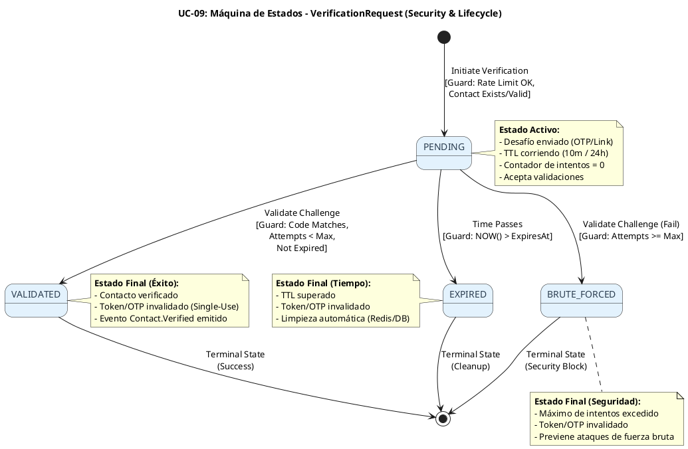

# UC-09: Verificación de Contactos - Diagrama de Máquina de Estados

| Metadatos del Documento | |
| :--- | :--- |
| **Proyecto:** | SHUGO - Identity & Access Platform |
| **Caso de Uso:** | UC-09 - Verificación de Contactos (Out-of-Band Verification) |
| **Documento:** | 05_State_Machine_Diagram.md |
| **Metodología:** | UML 2.5 + ICONIX + Domain-Driven Design (State Pattern) + Temporal State Management + Concurrency Control |
| **Autor:** | Gastón Ruiz |
| **Versión Actual:** | 1.0.0 |
| **Fecha:** | 09/09/2026 |

---

## Historial de Versiones

| Versión | Fecha | Autor | Descripción de Cambios | Impacto |
| :--- | :--- | :--- | :--- | :--- |
| **1.0.0** | 09/09/2026 | Gastón Ruiz | **Creación inicial.** Definición de las máquinas de estados específicas para la verificación de contactos. Se modela el ciclo de vida del `VerificationRequest` (Aggregate Root) y sus transiciones críticas bajo condiciones de seguridad (TTL, Intentos Máximos). Se aborda explícitamente el manejo de **Race Conditions** durante la validación concurrente de OTPs. | Documento base del paquete de diseño Tier 1 del UC-09. Establece las reglas de transición, las guardas de seguridad y la lógica temporal que garantiza la integridad de los procesos de autenticación y recuperación. |

---

## 1. Introducción y Propósito

El **Diagrama de Máquina de Estados** para el UC-09 visualiza las restricciones de comportamiento temporal y las reglas de transición que gobiernan el ciclo de vida de una solicitud de verificación (`VerificationRequest`).

A diferencia de los UCs de gestión de identidad (ciclo de vida largo), el UC-09 maneja **entidades efímeras de alta seguridad** con las siguientes complejidades:

1. **Ciclo de Vida Corto y Estricto:** Las solicitudes nacen, se validan (o fallan) y mueren (expiran) en minutos u horas. No existe un estado "activo" prolongado.
2. **Transiciones por Tiempo (TTL):** La transición a `EXPIRED` ocurre automáticamente por el paso del tiempo (TTL en Redis/DB), no por una acción directa del usuario.
3. **Transiciones por Conteo (Anti-Brute Force):** La transición a `BRUTE_FORCED` ocurre tras N intentos fallidos, invalidando la solicitud antes de su expiración natural.
4. **Concurrencia en la Validación:** Múltiples intentos de validación pueden ocurrir simultáneamente (Race Condition). La máquina de estados debe garantizar que solo una validación exitosa sea posible y que los intentos fallidos se cuenten atómicamente.

Estas máquinas garantizan:
- **Seguridad:** Prevención de fuerza bruta y reutilización de tokens.
- **Integridad:** Manejo atómico de estados bajo carga concurrente.
- **Higiene:** Expiración automática para liberar recursos (Redis/DB).

---

## 2. Máquina de Estados #1: Ciclo de Vida de la Solicitud de Verificación

### 2.1. Descripción

Esta máquina modela el estado del Aggregate Root `VerificationRequest`. Representa la validez global del desafío enviado al usuario.

### 2.2. Diagrama de Máquina de Estados (PlantUML)



### 2.3. Descripción de Estados y Transiciones

| Estado | Descripción | Transiciones de Salida | Invariante Clave |
| :--- | :--- | :--- | :--- |
| **PENDING** | La solicitud ha sido creada y el desafío (OTP/Link) ha sido enviado. Está activa y esperando la respuesta del usuario. | → `VALIDATED` (Éxito), → `BRUTE_FORCED` (Fallo Máximo), → `EXPIRED` (Tiempo) | `Attempts < MaxAttempts` AND `NOW() < ExpiresAt`. |
| **VALIDATED** | El usuario proporcionó el desafío correcto. La verificación es exitosa. | Ninguna (Estado Terminal) | `Attempts <= MaxAttempts` AND `Challenge Matches`. Token eliminado. |
| **BRUTE_FORCED** | El usuario (o atacante) excedió el número máximo de intentos fallidos permitidos. | Ninguna (Estado Terminal) | `Attempts >= MaxAttempts`. Token eliminado preventivamente. |
| **EXPIRED** | El tiempo de vida (TTL) de la solicitud ha transcurrido sin una validación exitosa. | Ninguna (Estado Terminal) | `NOW() >= ExpiresAt`. Token eliminado por TTL. |

### 2.4. Guardas (Guards) de las Transiciones

#### Transición: `PENDING` → `VALIDATED` (Éxito)

```csharp
public bool Validate(string providedChallenge)
{
    // Guarda 1: Estado debe ser PENDING
    if (this.Status != VerificationStatus.PENDING)
        throw new InvalidVerificationStatusException($"Cannot validate. Status is {this.Status}.");

    // Guarda 2: No debe estar expirado
    if (DateTime.UtcNow > this.ExpiresAt)
    {
        this.Status = VerificationStatus.EXPIRED;
        throw new VerificationExpiredException("Verification request has expired.");
    }

    // Guarda 3: No debe estar bloqueado por fuerza bruta
    if (this.Attempts >= this.MaxAttempts)
    {
        this.Status = VerificationStatus.BRUTE_FORCED;
        throw new VerificationBruteForcedException("Max attempts exceeded.");
    }

    // Incremento atómico de intentos (Manejado en Repositorio/Redis)
    this.Attempts++;

    // Guarda 4: El desafío debe coincidir (SecureCompare)
    if (this.Challenge.Validate(providedChallenge))
    {
        this.Status = VerificationStatus.VALIDATED;
        this.ValidatedAt = DateTime.UtcNow;
        // Invalidar desafío (Single-Use)
        this.Challenge.Invalidate(); 
        return true;
    }

    // Si falla, se mantiene en PENDING (a menos que se alcance el max en el siguiente intento)
    return false;
}
```

#### Transición: `PENDING` → `BRUTE_FORCED` (Fallo de Seguridad)

Esta transición ocurre implícitamente cuando se intenta validar y se supera el límite.

```csharp
// Dentro del método Validate, después de incrementar intentos:
if (this.Attempts >= this.MaxAttempts && !isValid)
{
    this.Status = VerificationStatus.BRUTE_FORCED;
    // Invalidar desafío inmediatamente para prevenir más intentos
    this.Challenge.Invalidate();
    throw new VerificationBruteForcedException($"Max attempts ({this.MaxAttempts}) reached.");
}
```

#### Transición: `PENDING` → `EXPIRED` (Timeout)

Esta transición es **temporal** y generalmente manejada por la infraestructura (Redis TTL o Job de Limpieza en DB), pero conceptualmente pertenece a la máquina de estados.

```csharp
// Job de Limpieza (Background Service)
public async Task CleanupExpiredRequestsAsync(CancellationToken ct)
{
    // Buscar requests donde ExpiresAt < NOW() y Status == PENDING
    var expiredRequests = await _repo.GetExpiredPendingRequestsAsync(ct);
    
    foreach (var request in expiredRequests)
    {
        request.Status = VerificationStatus.EXPIRED;
        request.Challenge.Invalidate();
    }
    
    await _repo.SaveAsync(expiredRequests, ct);
}
```

---

## 3. Consideraciones de Concurrencia (Race Conditions)

### 3.1. El Problema: Validación Concurrente

Un atacante (o un usuario con doble clic) podría enviar múltiples requests de validación simultáneamente para el mismo OTP.
*   **Escenario Riesgoso:** Request A y Request B llegan al mismo tiempo. Ambos leen `Attempts = 4`. Ambos validan fallidamente. Ambos incrementan a 5. El límite de 5 se viola efectivamente permitiendo 6 intentos.
*   **Escenario Crítico:** Request A valida correctamente. Request B (milisegundos después) también intenta validar. Si no hay bloqueo, B podría "reutilizar" el OTP si no se invalida atómicamente.

### 3.2. Solución: Atomicidad en Redis / Optimistic Locking en DB

Dado que los OTPs suelen vivir en Redis para alta velocidad y TTL nativo, la máquina de estados se implementa mediante operaciones atómicas de Redis.

**Implementación con Redis (C# + StackExchange.Redis):**

```csharp
public async Task<ValidationResult> ValidateOtpAsync(string contactHash, string providedOtp, CancellationToken ct)
{
    var key = $"otp:{contactHash}";
    var db = _redis.GetDatabase();

    // 1. Operación Atómica: Incrementar intentos y obtener valor actual
    // Esto previene Race Conditions en el conteo
    var newAttempts = await db.StringIncrementAsync(key + ":attempts");

    // 2. Verificar si el OTP existe (TTL maneja la expiración automáticamente)
    var otpHash = await db.StringGetAsync(key);
    if (otpHash.IsNullOrEmpty)
    {
        // Si no existe, revertir el incremento (limpieza)
        await db.KeyDeleteAsync(key + ":attempts");
        return ValidationResult.NotFoundOrExpired;
    }

    // 3. Guarda de Fuerza Bruta
    if (newAttempts > MaxAttempts)
    {
        await db.KeyDeleteAsync(key); // Invalidar OTP
        await db.KeyDeleteAsync(key + ":attempts");
        return ValidationResult.BruteForced;
    }

    // 4. Validación Criptográfica (SecureCompare)
    // Nota: otpHash es el hash almacenado. providedOtp se hashea antes de comparar.
    var providedHash = Hash(providedOtp);
    
    // CryptographicOperations.FixedTimeEquals previene Timing Attacks
    if (!CryptographicOperations.FixedTimeEquals(
        Encoding.UTF8.GetBytes(otpHash), 
        Encoding.UTF8.GetBytes(providedHash)))
    {
        return ValidationResult.InvalidCode; // Intento fallido, pero cuenta como intento
    }

    // 5. Éxito: Invalidar OTP (Single-Use)
    // Al borrar la clave, prevenimos cualquier request concurrente posterior
    await db.KeyDeleteAsync(key);
    await db.KeyDeleteAsync(key + ":attempts");

    return ValidationResult.Success;
}
```

**Justificación:**
*   `StringIncrementAsync` es atómico en Redis. Garantiza que `newAttempts` refleje el estado real sin condiciones de carrera.
*   `KeyDeleteAsync` al finalizar (éxito o fuerza bruta) asegura que el OTP sea de un solo uso real, incluso bajo carga extrema.

---

## 4. Implementación en el Dominio (Código C#)

Aunque la lógica de concurrencia vive en la infraestructura (Redis), el Aggregate Root `VerificationRequest` debe reflejar estos estados para consistencia en eventos y auditoría.

```csharp
public class VerificationRequest : AggregateRoot
{
    // ... Propiedades ...

    public void MarkAsValidated()
    {
        EnsureStatusIs(VerificationStatus.PENDING);
        EnsureNotExpired();
        EnsureNotBruteForced();

        this.Status = VerificationStatus.VALIDATED;
        this.ValidatedAt = DateTime.UtcNow;
        
        // Generar Evento de Dominio
        AddDomainEvent(new ContactVerified(this.IdentityId, this.ContactInfo));
    }

    public void MarkAsBruteForced()
    {
        EnsureStatusIs(VerificationStatus.PENDING);
        
        this.Status = VerificationStatus.BRUTE_FORCED;
        
        // Generar Evento de Seguridad
        AddDomainEvent(new ContactVerificationFailed(
            this.IdentityId, 
            "Max attempts exceeded", 
            this.Attempts));
    }

    public void MarkAsExpired()
    {
        EnsureStatusIs(VerificationStatus.PENDING);
        this.Status = VerificationStatus.EXPIRED;
    }

    // Guards internos
    private void EnsureNotExpired()
    {
        if (DateTime.UtcNow > this.ExpiresAt)
            throw new DomainException("Request is expired.");
    }

    private void EnsureNotBruteForced()
    {
        if (this.Attempts >= this.MaxAttempts)
            throw new DomainException("Request is brute-forced.");
    }
    
    private void EnsureStatusIs(VerificationStatus expected)
    {
        if (this.Status != expected)
            throw new DomainException($"Invalid status transition from {this.Status} to {expected}.");
    }
}
```

---

## 5. Trazabilidad con Otros Documentos del Paquete

| Documento | Relación |
| :--- | :--- |
| `01_Requirements_Specification.md` | Las invariantes (INV-56 TTL, INV-57 Single-Use, INV-59 Anti-Brute Force) definen las guardas de esta máquina. |
| `03_Activity_Diagram.md` | Los rombos de decisión (¿Expirado? ¿Max Intentos?) mapean directamente a las transiciones de estado. |
| `04_Initial_Domain_Model.md` | El Aggregate Root `VerificationRequest` y sus propiedades (`Status`, `Attempts`, `ExpiresAt`) son la implementación física de esta máquina. |
| `07_Sequence_Diagram.md` | Muestra el flujo temporal que dispara estas transiciones (Initiate → Validate → Success/Fail). |
| `10_UC_Specific_Data_Model.md` | Define cómo se persisten estos estados (Redis para TTL/Atomicidad, DB para Auditoría). |

---

## 6. Notas de Implementación

### 6.1. Testing de la Máquina de Estados

Es crucial probar las transiciones y, especialmente, las guardas de seguridad.

```csharp
[Test]
public void VerificationRequest_Validate_WhenMaxAttemptsReached_TransitionsToBruteForced()
{
    // Arrange
    var request = VerificationRequest.Initiate(/* ... */);
    request.SetMaxAttempts(3); // Forzar límite bajo para test

    // Act & Assert
    request.Validate("WrongCode1"); // Attempts = 1
    request.Validate("WrongCode2"); // Attempts = 2
    request.Validate("WrongCode3"); // Attempts = 3 -> Brute Forced
    
    Assert.AreEqual(VerificationStatus.BRUTE_FORCED, request.Status);
    Assert.ThrowsException<VerificationBruteForcedException>(() => request.Validate("CorrectCode"));
}

[Test]
public void VerificationRequest_Validate_WhenExpired_TransitionsToExpired()
{
    // Arrange
    var request = VerificationRequest.Initiate(/* ... */);
    request.SetExpiration(DateTime.UtcNow.AddMinutes(-1)); // Expirado en el pasado

    // Act & Assert
    Assert.ThrowsException<VerificationExpiredException>(() => request.Validate("AnyCode"));
    Assert.AreEqual(VerificationStatus.EXPIRED, request.Status);
}
```

### 6.2. Manejo de "Zombie Requests"

En sistemas distribuidos, puede haber requests en estado `PENDING` en la base de datos que nunca fueron validadas ni expiradas explícitamente (ej. fallo del job de limpieza).
*   **Mitigación:** La guarda `EnsureNotExpired()` en el Aggregate Root actúa como última línea de defensa. Incluso si la DB dice `PENDING`, si `NOW() > ExpiresAt`, el dominio rechaza la operación y fuerza la transición a `EXPIRED`.

---
*Fin del Documento 05_State_Machine_Diagram para UC-09*