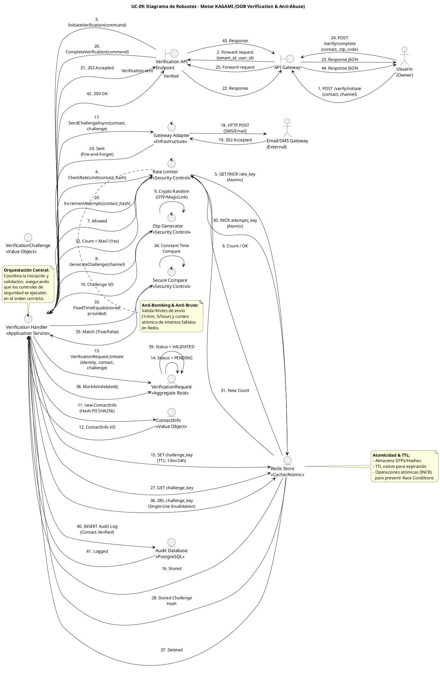

# UC-09: Verificación de Contactos - Diagrama de Robustez

| Metadatos del Documento | |
| :--- | :--- |
| **Proyecto:** | SHUGO - Identity & Access Platform |
| **Caso de Uso:** | UC-09 - Verificación de Contactos (Out-of-Band Verification) |
| **Documento:** | 06_Robustness_Diagram.md |
| **Metodología:** | ICONIX (Diagrama de Robustez) + DDD + Security by Design + Atomic Concurrency Control |
| **Autor:** | Gastón Ruiz |
| **Versión Actual:** | 1.0.0 |
| **Fecha:** | 09/09/2026 |

---

## Historial de Versiones

| Versión | Fecha | Autor | Descripción de Cambios | Impacto |
| :--- | :--- | :--- | :--- | :--- |
| **1.0.0** | 09/09/2026 | Gastón Ruiz | **Creación inicial.** Diagrama de Robustez para UC-09, validando la arquitectura del motor KAGAMI para operaciones de verificación Out-of-Band (OOB). Muestra la colaboración estricta entre Boundaries (API Gateway, Verification Endpoint), Controls (Verification Handler, Rate Limiter, Crypto Generator, Gateway Adapter), y Entities (VerificationRequest, Redis Store, Audit DB). Valida la atomicidad de las operaciones de Redis para prevenir Race Conditions y la integración asíncrona con Gateways externos. | Documento base del paquete de diseño Tier 1 del UC-09. Sirve como puente crítico entre el Modelo de Dominio (04) y el Diagrama de Secuencia (07), asegurando que la arquitectura soporta la seguridad criptográfica, la prevención de abuso (Anti-Bombing) y la integridad transaccional antes de codificar. |

---

## 1. Introducción y Propósito

El **Diagrama de Robustez** para el UC-09 valida que el flujo de verificación de contactos (OTP y Magic Links) puede ser orquestado respetando las reglas estrictas de acoplamiento de **ICONIX** y los principios de **Domain-Driven Design (DDD)**, **Security by Design** y **Atomic Concurrency Control**.

A diferencia de los UCs transaccionales estándar, el UC-09 introduce complejidades arquitectónicas únicas:

1. **Atomicidad en Redis:** La validación de OTPs y el conteo de intentos deben ser atómicos para prevenir Race Conditions (fuerza bruta concurrente).
2. **Prevención de Abuso Financiero (Anti-Bombing):** El Rate Limiter actúa como un Control crítico antes de invocar Gateways costosos (SMS/Email).
3. **Integración Asíncrona con Gateways:** El envío de OTPs/Links no debe bloquear la respuesta HTTP (Fire-and-Forget o Outbox Pattern).
4. **Seguridad Criptográfica:** La generación y validación de desafíos requieren controles específicos (`OtpGenerator`, `SecureCompare`).

---

## 2. Diagrama de Robustez (PlantUML)

A continuación, se presenta el Diagrama de Robustez organizado de izquierda a derecha para mostrar el flujo natural: **Actor → Boundary → Control → Entity**.



---

## 3. Explicación Detallada de los Objetos

### 3.1. Boundary Objects (Objetos de Límite)

| Objeto | Responsabilidad | Mapeo a Clean Architecture |
| :--- | :--- | :--- |
| **`API Gateway`** | Valida el JWT (si aplica), extrae `tenant_id` y `user_id`, y aplica throttling global. Es la primera línea de defensa. | Middleware (Kong, AWS API Gateway). |
| **`Verification API Endpoint`** | Recibe las requests HTTP (`/verify/initiate`, `/verify/complete`), deserializa payloads, y los pasa al Handler. | Controller (ASP.NET Core Controller). |

### 3.2. Control Objects (Objetos de Control)

| Objeto | Responsabilidad | Mapeo a Clean Architecture |
| :--- | :--- | :--- |
| **`Verification Handler`** | **Application Service.** Orquesta el caso de uso. Coordina la iniciación (generación, persistencia, envío) y la validación (recuperación, chequeo atómico, comparación segura). | Command Handler / Application Service. |
| **`Rate Limiter`** | **Security Control.** Gestiona los límites de frecuencia. Para la iniciación, previene SMS/Email Bombing. Para la validación, gestiona el conteo atómico de intentos fallidos (Anti-Brute Force). | Domain Service / Infrastructure Service (Redis). |
| **`Otp Generator`** | **Security Control.** Genera desafíos criptográficamente seguros (OTPs de 6 dígitos o Magic Links UUIDv4) usando `RandomNumberGenerator`. | Domain Service. |
| **`Secure Compare`** | **Security Control.** Realiza la comparación de strings en tiempo constante (`FixedTimeEquals`) para prevenir Timing Attacks durante la validación de OTPs. | Utility / Domain Service. |
| **`Gateway Adapter`** | **Infrastructure Service.** Adapta la llamada al proveedor externo (Twilio, SendGrid) y maneja la comunicación asíncrona (Fire-and-Forget). | Infrastructure Service. |

### 3.3. Entity Objects (Objetos de Entidad)

| Objeto | Responsabilidad | Mapeo a DDD |
| :--- | :--- | :--- |
| **`VerificationRequest`** | **Aggregate Root.** Encapsula el ciclo de vida de la verificación. Asegura que las transiciones de estado (PENDING → VALIDATED/EXPIRED) sean válidas. | Aggregate Root. |
| **`VerificationChallenge`** | **Value Object.** Representa el desafío (OTP o Magic Link). Inmutable y con lógica de validación interna. | Value Object. |
| **`ContactInfo`** | **Value Object.** Contiene el contacto (email/teléfono) y su hash SHA256 para búsquedas seguras y protección de PII. | Value Object. |
| **`Redis Store`** | **Infrastructure Entity.** Almacena los desafíos con TTL nativo y soporta operaciones atómicas (INCR) para concurrencia. | Infrastructure / Cache. |
| **`Audit Database`** | **Infrastructure Entity.** Persistencia duradera para logs de auditoría y estado final de las verificaciones. | Infrastructure / Database. |

---

## 4. Reglas de Robustez de ICONIX (Validación del Diagrama)

Verifiquemos que nuestro diagrama cumple estrictamente las reglas de acoplamiento de ICONIX:

### ✅ Regla 1: Actor → Boundary
- **Cumplida:** El `Usuario` interactúa solo con el `API Gateway`. El `Gateway` (externo) interactúa solo con el `Gateway Adapter`.

### ✅ Regla 2: Boundary → Boundary
- **Cumplida:** El `API Gateway` forward la request al `Verification API Endpoint`.

### ✅ Regla 3: Boundary → Control
- **Cumplida:** El `Verification API Endpoint` envía el command al `Verification Handler`.

### ✅ Regla 4: Control → Control
- **Cumplida y Crítica:** El `Verification Handler` delega a controles específicos:
    - `Rate Limiter` para seguridad y concurrencia.
    - `Otp Generator` para criptografía.
    - `Secure Compare` para validación segura.
    - `Gateway Adapter` para integración externa.
- **Justificación:** Mantiene el Handler delgado y permite que las reglas de seguridad sean reutilizables y testeables unitariamente.

### ✅ Regla 5: Control → Entity
- **Cumplida:**
    - `Verification Handler` crea y manipula el Aggregate Root `VerificationRequest`.
    - `Rate Limiter` interactúa con `Redis Store` para operaciones atómicas.
    - `VerificationRequest` crea Value Objects (`ContactInfo`, `VerificationChallenge`).
    - `VerificationRequest` persiste logs en `Audit Database`.

### ✅ Regla 6: NO Entity → Control / Boundary
- **Cumplida:** Ninguna entidad (`VerificationRequest`, `Redis`, `DB`) invoca lógica en los controles. Solo retornan datos o confirman operaciones.

### ✅ Regla 7: NO Entity → Entity (Directo sin Control)
- **Cumplida:** El `Verification Handler` media todas las interacciones. Por ejemplo, `VerificationRequest` no habla directamente con `Redis`; el Handler (o el Repository mediado por el Handler) lo hace.

---

## 5. Consideraciones de Arquitectura (Security & Atomic Concurrency)

### 5.1. Atomicidad en Redis para Prevenir Race Conditions

El diagrama muestra explícitamente cómo el `Rate Limiter` interactúa con `Redis` usando operaciones atómicas (`INCR`).

**Flujo de Validación (Pasos 30-33):**
1.  `Verification Handler` solicita incrementar intentos.
2.  `Rate Limiter` ejecuta `INCR attempts_key` en Redis.
3.  Redis retorna el *nuevo* valor atómicamente.
4.  `Rate Limiter` verifica si `New Count <= Max Attempts`.

**Justificación:**
-   **Prevención de Fuerza Bruta Concurrente:** Si dos requests llegan simultáneamente, `INCR` garantiza que ambos vean un conteo correcto (ej. 4 y 5), previniendo que se exceda el límite de 5 intentos.
-   **Single-Use Real:** Tras el éxito (Paso 37), se ejecuta `DEL challenge_key`, invalidando el OTP inmediatamente para cualquier request concurrente posterior.

### 5.2. Prevención de Timing Attacks (Secure Compare)

El diagrama incluye el control `Secure Compare` (Pasos 34-36).

**Flujo:**
1.  `Verification Handler` pasa el hash almacenado y el hash proporcionado.
2.  `Secure Compare` ejecuta `FixedTimeEquals`.
3.  Retorna `True/False` sin revelar *dónde* ocurrió la diferencia.

**Justificación:**
-   **Seguridad Criptográfica:** Previene que un atacante adivine el OTP dígito por dígito midiendo los milisegundos de respuesta del servidor.

### 5.3. Integración Asíncrona con Gateways (Fire-and-Forget)

El diagrama muestra que el `Gateway Adapter` envía el mensaje y retorna `202 Accepted` (Pasos 18-21) sin bloquear el flujo principal.

**Justificación:**
-   **Rendimiento (SLO < 100ms):** Las APIs de Twilio/SendGrid pueden tardar 200ms-2000ms. Al hacer el envío asíncrono, el endpoint de iniciación responde en <50ms.
-   **Resiliencia:** Si el Gateway está caído, el sistema puede usar un Outbox Pattern o Retry Policy sin afectar la experiencia del usuario inmediato.

### 5.4. Protección de PII (Hashing de Contactos)

El diagrama muestra que `VerificationRequest` crea `ContactInfo` aplicando un hash SHA256 (Pasos 12-13).

**Justificación:**
-   **Privacidad:** Ni Redis ni la DB de auditoría almacenan el email/teléfono en texto plano, protegiendo la base de datos de usuarios en caso de compromiso.
-   **Búsquedas Eficientes:** Las claves en Redis (`otp:{contact_hash}`) usan el hash, permitiendo búsquedas O(1) rápidas.

---

## 6. Trazabilidad con Otros Documentos del Paquete

| Documento | Relación |
| :--- | :--- |
| `01_Requirements_Specification.md` | Este diagrama valida que los requisitos de Rate Limiting, SecureCompare y Atomicidad pueden ser implementados con los objetos definidos. |
| `02_Use_Case_Diagram.md` | Muestra los actores y sistemas; este diagrama muestra cómo colaboran los objetos internos. |
| `03_Activity_Diagram.md` | Los carriles de actividad (Handler, Rate Limiter, Otp Gen, Gateway) se mapean directamente a los objetos de Control de este diagrama. |
| `04_Initial_Domain_Model.md` | Los objetos `VerificationRequest`, `VerificationChallenge`, `ContactInfo` son exactamente las clases definidas en el modelo de dominio. |
| `05_State_Machine_Diagram.md` | Las transiciones de estado (PENDING → VALIDATED) se ejecutan cuando el `Verification Handler` invoca `Req.MarkAsValidated()`. |
| `07_Sequence_Diagram.md` | Este diagrama define "qué objetos colaboran"; el de secuencia definirá "en qué orden temporal exacto" se envían los mensajes. |
| `08_Final_Class_Design.md` | Definirá las firmas exactas de los métodos mostrados en este diagrama (ej. `RateLimiter.IncrementAttempts()`, `SecureCmp.FixedTimeEquals()`). |

---

## 7. Notas de Implementación

### 7.1. Inyección de Dependencias

El `Verification Handler` debe tener inyectados los servicios de dominio e infraestructura:

```csharp
public class VerificationHandler : IVerificationHandler
{
    private readonly IRateLimiter _rateLimiter;
    private readonly IOtpGenerator _otpGenerator;
    private readonly ISecureCompare _secureCompare;
    private readonly IGatewayAdapter _gatewayAdapter;
    private readonly IVerificationRepository _repository;
    private readonly ILogger<VerificationHandler> _logger;

    public VerificationHandler(
        IRateLimiter rateLimiter,
        IOtpGenerator otpGenerator,
        ISecureCompare secureCompare,
        IGatewayAdapter gatewayAdapter,
        IVerificationRepository repository,
        ILogger<VerificationHandler> logger)
    {
        _rateLimiter = rateLimiter;
        _otpGenerator = otpGenerator;
        _secureCompare = secureCompare;
        _gatewayAdapter = gatewayAdapter;
        _repository = repository;
        _logger = logger;
    }
}
```

### 7.2. Flujo de Ejecución Simplificado (Código)

```csharp
// INICIACIÓN
public async Task<VerificationResult> Initiate(InitiateCommand cmd, CancellationToken ct)
{
    // 1. Rate Limit Check
    if (!await _rateLimiter.IsAllowedAsync($"rate:{cmd.ContactHash}", 5, TimeSpan.FromHours(1)))
        throw new RateLimitExceededException("Too many requests.");

    // 2. Generate Challenge
    var challenge = _otpGenerator.GenerateChallenge(cmd.Channel);

    // 3. Create Aggregate
    var request = VerificationRequest.Initiate(cmd.IdentityId, cmd.TenantId, cmd.ContactInfo, challenge);

    // 4. Persist to Redis (with TTL)
    await _repository.SaveChallengeToRedisAsync(request, ct);

    // 5. Async Send
    _ = Task.Run(() => _gatewayAdapter.SendAsync(cmd.ContactInfo.Value, challenge.GetValueForDelivery()), ct);

    return new VerificationResult { Message = "Verification sent." };
}

// COMPLETACIÓN
public async Task<bool> Complete(CompleteCommand cmd, CancellationToken ct)
{
    // 1. Get Challenge from Redis
    var request = await _repository.GetChallengeFromRedisAsync(cmd.ContactHash, ct);
    if (request == null) throw new VerificationNotFoundException("Expired or not found.");

    // 2. Atomic Increment (Anti-Brute)
    var attempts = await _rateLimiter.IncrementAttemptsAsync($"attempts:{cmd.ContactHash}");
    if (attempts > request.MaxAttempts)
    {
        await _repository.DeleteChallengeAsync(cmd.ContactHash, ct); // Invalidate
        throw new BruteForceDetectedException("Max attempts exceeded.");
    }

    // 3. Secure Compare
    var isValid = _secureCompare.FixedTimeEquals(request.Challenge.Hash, Hash(cmd.ProvidedCode));

    if (isValid)
    {
        // 4. Success: Invalidate & Update State
        await _repository.DeleteChallengeAsync(cmd.ContactHash, ct);
        request.MarkAsValidated();
        await _repository.SaveAuditLogAsync(request, ct);
        return true;
    }

    return false;
}
```

---
*Fin del Documento 06_Robustness_Diagram para UC-09*