# UC-09: Verificación de Contactos - Diagrama de Secuencia

| Metadatos del Documento | |
| :--- | :--- |
| **Proyecto:** | SHUGO - Identity & Access Platform |
| **Caso de Uso:** | UC-09 - Verificación de Contactos (Out-of-Band Verification) |
| **Documento:** | 07_Sequence_Diagram.md |
| **Metodología:** | ICONIX (Diagrama de Secuencia) + DDD + Security by Design + Atomic Concurrency Control |
| **Autor:** | Gastón Ruiz |
| **Versión Actual:** | 1.0.0 |
| **Fecha:** | 10/09/2026 |

---

## Historial de Versiones

| Versión | Fecha | Autor | Descripción de Cambios | Impacto |
| :--- | :--- | :--- | :--- | :--- |
| **1.0.0** | 10/09/2026 | Gastón Ruiz | **Creación inicial.** Diagrama de Secuencia completo para UC-09. Modela la orquestación temporal exacta de la verificación Out-of-Band, destacando la atomicidad de operaciones Redis (INCR para anti-brute force), la generación criptográfica de OTPs/Magic Links, el envío asíncrono a gateways externos, la validación con SecureCompare, y los flujos de excepción (Rate Limit, Expiración, Brute Force). | Documento base del paquete de diseño Tier 1 del UC-09. Sirve como guion exacto para la codificación del `VerificationHandler`, la gestión de concurrencia atómica, y la integración segura con Email/SMS Gateways. |

---

## 1. Introducción y Propósito

El **Diagrama de Secuencia** para el UC-09 materializa temporalmente las colaboraciones definidas en el Diagrama de Robustez. Su propósito es:

1. **Definir el orden exacto de las operaciones en ambas fases:** Establecer la secuencia crítica donde la Fase 1 (Iniciación) protege contra abuso financiero (Rate Limiting) y la Fase 2 (Completación) protege contra fuerza bruta (Atomic INCR + SecureCompare).
2. **Modelar la Atomicidad en Redis:** Mostrar cómo las operaciones `INCR` atómicas previenen Race Conditions cuando múltiples requests de validación llegan simultáneamente.
3. **Visualizar el Envío Asíncrono a Gateways:** Demostrar cómo el envío de OTPs/Links no bloquea la respuesta HTTP, cumpliendo el SLO de <100ms.
4. **Demostrar la Prevención de Timing Attacks:** Mostrar el uso de `SecureCompare` en la validación de OTPs/Tokens.
5. **Modelar los Flujos de Excepción:** Mostrar cómo cada fallo (Rate Limit, Expiración, Brute Force, Invalid Code) retorna un código HTTP específico.

---

## 2. Diagrama de Secuencia - Escenario Principal (PlantUML)

A continuación, se presenta el Diagrama de Secuencia para el **Escenario Principal (iniciación exitosa + validación exitosa)** y sus variaciones de excepción.

```plantuml
@startuml UC-09_Secuencia
<style>
diagram {
  BackgroundColor #FEFEFE
}
sequence {
  ArrowThickness 2
  ArrowColor #2C3E50
  ParticipantPadding 20
  BoxPadding 10
}
</style>

title UC-09: Diagrama de Secuencia - Verificación OOB (Atomic Redis & Anti-Abuse)

' ============================================
' PARTICIPANTES (Lifelines)
' ============================================
actor "Usuario\n(Owner)" as User
participant "API Gateway" as GW
participant "Verification API\nEndpoint" as API
participant "Verification Handler\n<<Application>>" as Handler
participant "Rate Limiter\n<<Redis>>" as RateLimiter
participant "Otp Generator\n<<Crypto>>" as OtpGen
participant "VerificationRequest\n<<Aggregate>>" as Req
participant "Redis Store\n<<Cache/Atomic>>" as Redis
participant "Email/SMS Gateway\n<<External>>" as Gateway
participant "Audit Database\n<<PostgreSQL>>" as DB

' ============================================
' FASE 1: INICIACIÓN DE VERIFICACIÓN (Emisión)
' ============================================
User -> GW : 1. POST /verify/initiate\n(contact, channel)
activate GW

GW -> GW : 2. Validar JWT (si aplica)\ny extraer tenant_id, user_id
GW -> API : 3. Forward request\n(tenant_id, user_id, payload)
deactivate GW

activate API
API -> API : 4. Deserializar payload\n(InitiateVerificationCommand)
API -> Handler : 5. InitiateVerification(command)
deactivate API

activate Handler

' Rate Limiting (Anti-Bombing)
Handler -> RateLimiter : 6. IsAllowedAsync\n(rate_key, 5 req/hour)
activate RateLimiter
RateLimiter -> Redis : 7. GET rate_key
Redis --> RateLimiter : 8. count (or null)
RateLimiter -> RateLimiter : 9. count < 5?
RateLimiter --> Handler : 10. Allowed (true)
deactivate RateLimiter

' Generación Criptográfica
Handler -> OtpGen : 11. GenerateChallenge(channel)
activate OtpGen
OtpGen -> OtpGen : 12. RandomNumberGenerator\n(OTP 6 dígitos o UUIDv4)
OtpGen --> Handler : 13. VerificationChallenge VO
deactivate OtpGen

' Creación de Aggregate Root
Handler -> Req : 14. VerificationRequest.Initiate\n(identityId, contactInfo, challenge, ttl)
activate Req
Req -> Req : 15. Hash contact (SHA256)
Req -> Req : 16. Set ExpiresAt (10m/24h)
Req -> Req : 17. AddDomainEvent\n(ContactVerificationInitiated)
Req --> Handler : 18. VerificationRequest
deactivate Req

' Persistencia en Redis con TTL
Handler -> Redis : 19. SET challenge_key\n(hash, TTL: 10m/24h)
activate Redis
Redis --> Handler : 20. OK (Stored with TTL)
deactivate Redis

' Incrementar Rate Limit
Handler -> RateLimiter : 21. IncrementAsync(rate_key, 1 hour)
activate RateLimiter
RateLimiter -> Redis : 22. INCR rate_key\n(EXPIRE 1 hour)
Redis --> RateLimiter : 23. New count
RateLimiter --> Handler : 24. Incremented
deactivate RateLimiter

' Envío Asíncrono a Gateway (Fire-and-Forget)
Handler -> Gateway : 25. SendAsync(contact, challenge)\n[No Await - Fire-and-Forget]
activate Gateway
Gateway --> Handler : 26. 202 Accepted (Async)
deactivate Gateway

Handler --> API : 27. 202 Accepted\n"Verification sent"
activate API
API --> GW : 28. Response
activate GW
GW --> User : 29. Response JSON\n{"message": "Verification sent",\n"expires_in": 600}
deactivate GW
deactivate API
deactivate Handler

' ============================================
' FASE 2: COMPLETACIÓN DE VERIFICACIÓN (Validación)
' ============================================
User -> GW : 30. POST /verify/complete\n(contact, otp_code)
activate GW

GW -> API : 31. Forward request\n(tenant_id, user_id, payload)
deactivate GW

activate API
API -> API : 32. Deserializar payload\n(CompleteVerificationCommand)
API -> Handler : 33. CompleteVerification(command)
deactivate API

activate Handler

' Recuperación de Challenge desde Redis
Handler -> Redis : 34. GET challenge_key\n(contact_hash)
activate Redis
Redis --> Handler : 35. Stored Challenge Hash\n(or null if expired)
deactivate Redis

alt Challenge no existe o expiró
  Handler --> API : 36a. HTTP 400\n"OTP expired or invalid"
  activate API
  API --> GW : 37a. Response
  activate GW
  GW --> User : 38a. Error JSON
  deactivate GW
  deactivate API
  deactivate Handler
else Challenge existe
  ' Incremento Atómico de Intentos (Anti-Brute Force)
  Handler -> RateLimiter : 39. IncrementAttemptsAsync\n(attempts_key)
  activate RateLimiter
  RateLimiter -> Redis : 40. INCR attempts_key\n(Atomic Operation)
  Redis --> RateLimiter : 41. New count (ej. 3)
  RateLimiter --> Handler : 42. New count
  deactivate RateLimiter

  alt Intentos >= MaxAttempts (5)
    Handler -> Redis : 43a. DEL challenge_key\n(Invalidate OTP)
    Redis --> Handler : 44a. Deleted
    Handler --> API : 45a. HTTP 429\n"Too many invalid attempts"
    activate API
    API --> GW : 46a. Response
    activate GW
    GW --> User : 47a. Error JSON
    deactivate GW
    deactivate API
    deactivate Handler
  else Intentos < MaxAttempts
    ' Validación con SecureCompare (Anti-Timing Attack)
    Handler -> Handler : 48. SecureCompare\n(stored_hash, provided_hash)
    Handler -> Handler : 49. FixedTimeEquals\n(Constant Time Comparison)

    alt Match = True (Éxito)
      Handler -> Redis : 50a. DEL challenge_key\n(Single-Use Invalidation)
      activate Redis
      Redis --> Handler : 51a. Deleted
      deactivate Redis

      Handler -> Redis : 52a. DEL attempts_key\n(Cleanup)
      Redis --> Handler : 53a. Deleted

      Handler -> Req : 54a. MarkAsValidated()
      activate Req
      Req -> Req : 55a. Status = VALIDATED\nValidatedAt = NOW()
      Req -> Req : 56a. AddDomainEvent\n(ContactVerified)
      Req --> Handler : 57a. Validated
      deactivate Req

      Handler -> DB : 58a. INSERT audit_log\n(Contact.Verified)
      activate DB
      DB --> Handler : 59a. Logged
      deactivate DB

      Handler --> API : 60a. HTTP 200 OK\n"Verified successfully"
      activate API
      API --> GW : 61a. Response
      activate GW
      GW --> User : 62a. Response JSON\n{"verified": true,\n"contact": "..."}
      deactivate GW
      deactivate API
      deactivate Handler
    else Match = False (Fallo)
      Handler --> API : 60b. HTTP 400\n"Invalid code"
      activate API
      API --> GW : 61b. Response
      activate GW
      GW --> User : 62b. Error JSON\n{"message": "Invalid code",\n"attempts_remaining": 2}
      deactivate GW
      deactivate API
      deactivate Handler
    end
  end
end

@enduml
```



---

## 3. Análisis Detallado del Flujo

### 3.1. Fase 1: Iniciación de Verificación (Pasos 1-29)

**Participantes:** `Usuario`, `API Gateway`, `Verification API Endpoint`, `Verification Handler`, `Rate Limiter`, `Otp Generator`, `VerificationRequest`, `Redis Store`, `Email/SMS Gateway`

#### Rate Limiting Anti-Bombing (Pasos 6-10)

*   **Pregunta:** ¿El contacto/IP ha excedido 5 solicitudes en la última hora?
*   **Implementación:** `RateLimiter.IsAllowedAsync()` consulta Redis con clave `rate:{contact_hash}`.
*   **Si falla:** Retorna HTTP 429 inmediatamente.
*   **Justificación:** Previene **SMS/Email Bombing**. Sin esto, un atacante podría usar nuestra API para acosar a una víctima y generar facturas masivas de Twilio/SendGrid.

#### Generación Criptográfica (Pasos 11-13)

*   **OTP (SMS/Email código corto):** `RandomNumberGenerator.Create()` genera 6 dígitos con entropía criptográfica segura.
*   **Magic Link (Email link):** `Guid.NewGuid()` genera UUID v4 de 128 bits.
*   **Justificación:** `Math.Random()` no es criptográficamente seguro y puede ser predecible. NIST SP 800-63A requiere generación segura para OTPs.

#### Persistencia en Redis con TTL (Pasos 19-20)

*   **Clave:** `otp:{contact_hash}` o `magic_link:{contact_hash}`.
*   **TTL:** 10 minutos para OTPs, 24 horas para Magic Links.
*   **Valor:** Hash SHA256 del código/token (nunca en texto plano).
*   **Justificación:** Redis maneja la expiración automáticamente, eliminando la necesidad de un job de limpieza para tokens expirados.

#### Envío Asíncrono a Gateway (Pasos 25-26)

*   **Fire-and-Forget:** El envío no bloquea la respuesta HTTP.
*   **Patrón:** `Task.Run()` o Outbox Pattern para reintentos si el gateway está caído.
*   **Justificación:** Las APIs de Twilio/SendGrid pueden tener latencias variables (200ms - 2000ms). Bloquear el thread HTTP viola el SLO de <100ms.

### 3.2. Fase 2: Completación de Verificación (Pasos 30-62)

**Participantes:** `Usuario`, `API Gateway`, `Verification API Endpoint`, `Verification Handler`, `Rate Limiter`, `Redis Store`, `VerificationRequest`, `Audit Database`

#### Recuperación de Challenge (Pasos 34-35)

*   **Clave:** `otp:{contact_hash}`.
*   **Si no existe:** El TTL de Redis ya expiró el token, o fue invalidado tras uso exitoso.
*   **Justificación:** Redis TTL maneja la expiración automáticamente, sin necesidad de consultas SQL.

#### Incremento Atómico de Intentos (Pasos 39-42)

*   **Operación:** `INCR attempts_key` en Redis.
*   **Atomicidad:** Garantiza que múltiples requests concurrentes vean conteos correctos.
*   **Justificación:** Previene **Race Conditions**. Sin atomicidad, dos requests simultáneos podrían leer `attempts = 4`, ambos incrementar a 5, y permitir un 6º intento violando el límite de seguridad.

#### Validación con SecureCompare (Pasos 48-49)

*   **Implementación:** `CryptographicOperations.FixedTimeEquals(stored_hash, provided_hash)`.
*   **Tiempo Constante:** La comparación tarda el mismo tiempo independientemente de cuántos caracteres coincidan.
*   **Justificación:** Previene **Timing Attacks**. Si la comparación fallara rápido en el primer dígito incorrecto, un atacante podría adivinar el OTP dígito por dígito midiendo los milisegundos de respuesta.

#### Invalidación Single-Use (Pasos 50a-53a)

*   **Éxito:** `DEL challenge_key` y `DEL attempts_key` inmediatamente.
*   **Justificación:** Previene **Replay Attacks**. Incluso si un atacante intercepta el OTP válido, no puede reutilizarlo porque la clave ya no existe en Redis.

#### Auditoría Granular (Pasos 58a-59a)

*   **Registro:** `Contact.Verified` con `identity_id`, `contact_hash`, `validated_at`, `ip_address`, `user_agent`.
*   **Justificación:** Cumple con requisitos de auditoría y forense. Permite investigar accesos sospechosos.

---

## 4. Flujos Alternativos y Excepciones

### 4.1. Flujo Alternativo: Rate Limit Excedido (Anti-Bombing)

Si el contacto/IP ha excedido 5 solicitudes en la última hora:

```
User -> GW -> API -> Handler -> RateLimiter (IsAllowedAsync) -> Redis (GET rate_key) -> Redis (count >= 5) -> RateLimiter -> Handler -> Handler -> API -> GW -> User (HTTP 429 "Too many requests")
```

**Pasos:** 1-10, detección de rate limit, retorno 429.
**Tiempo total:** ~20ms.
**Justificación:** Previene SMS/Email Bombing y protege facturas de Twilio/SendGrid.

### 4.2. Flujo Alternativo: Challenge Expirado

Si el TTL de Redis ya expiró el token:

```
User -> GW -> API -> Handler -> Redis (GET challenge_key) -> Redis (null - expired) -> Redis -> Handler -> Handler -> API -> GW -> User (HTTP 400 "OTP expired or invalid")
```

**Pasos:** 30-35, detección de expiración, retorno 400.
**Tiempo total:** ~15ms.
**Justificación:** Redis TTL maneja la expiración automáticamente, sin necesidad de validación manual.

### 4.3. Flujo Alternativo: Máximo de Intentos Alcanzado (Anti-Brute Force)

Si el contador atómico de intentos alcanzó 5:

```
User -> GW -> API -> Handler -> Redis (GET challenge_key) -> Redis (exists) -> Redis -> Handler -> Handler -> RateLimiter (IncrementAttemptsAsync) -> Redis (INCR attempts_key) -> Redis (new_count >= 5) -> RateLimiter -> Handler -> Handler -> Redis (DEL challenge_key) -> Redis -> Handler -> Handler -> API -> GW -> User (HTTP 429 "Too many invalid attempts")
```

**Pasos:** 30-44a, detección de brute force, invalidación de OTP, retorno 429.
**Tiempo total:** ~25ms.
**Justificación:** Un OTP de 6 dígitos tiene 1,000,000 de combinaciones. Sin este límite, un script podría adivinarlo en minutos. La invalidación inmediata tras 5 fallos es una mitigación estándar de NIST SP 800-63A.

### 4.4. Flujo Alternativo: Código Incorrecto

Si el OTP proporcionado no coincide:

```
User -> GW -> API -> Handler -> Redis (GET challenge_key) -> Redis (exists) -> Redis -> Handler -> Handler -> RateLimiter (IncrementAttemptsAsync) -> Redis (INCR attempts_key) -> Redis (new_count < 5) -> RateLimiter -> Handler -> Handler (SecureCompare) -> Handler (Match = False) -> Handler -> API -> GW -> User (HTTP 400 "Invalid code")
```

**Pasos:** 30-62b, validación fallida, retorno 400 con intentos restantes.
**Tiempo total:** ~30ms.
**Justificación:** El contador de intentos se incrementa atómicamente, pero el OTP permanece válido hasta alcanzar el máximo.

### 4.5. Flujo Alternativo: Validación Exitosa (Happy Path)

Si el OTP coincide y es la primera validación exitosa:

```
User -> GW -> API -> Handler -> Redis (GET challenge_key) -> Redis (exists) -> Redis -> Handler -> Handler -> RateLimiter (IncrementAttemptsAsync) -> Redis (INCR attempts_key) -> Redis (new_count < 5) -> RateLimiter -> Handler -> Handler (SecureCompare) -> Handler (Match = True) -> Handler -> Redis (DEL challenge_key) -> Redis -> Handler -> Redis (DEL attempts_key) -> Redis -> Handler -> Req (MarkAsValidated) -> Req -> Handler -> DB (INSERT audit_log) -> DB -> Handler -> API -> GW -> User (HTTP 200 "Verified successfully")
```

**Pasos:** 30-62a, validación exitosa, invalidación de OTP, auditoría, retorno 200.
**Tiempo total:** ~50ms.
**Justificación:** El OTP se invalida inmediatamente tras el éxito, previniendo reutilización.

### 4.6. Flujo de Excepción: Gateway Caído (Envío Asíncrono)

Si el Email/SMS Gateway está caído durante la iniciación:

```
User -> GW -> API -> Handler -> RateLimiter (IsAllowedAsync) -> RateLimiter (Allowed) -> Handler -> OtpGen (GenerateChallenge) -> OtpGen -> Handler -> Req (Initiate) -> Req -> Handler -> Redis (SET challenge_key) -> Redis -> Handler -> RateLimiter (IncrementAsync) -> RateLimiter -> Handler -> Gateway (SendAsync) -> Gateway (Exception/Timeout) -> Gateway -> Handler -> Handler -> API -> GW -> User (HTTP 202 "Verification sent")
```

**Pasos:** 1-29, el envío falla asíncronamente pero la respuesta HTTP es 202.
**Tiempo total:** ~100ms (SLO cumplido).
**Justificación:** El patrón Fire-and-Forget garantiza que el usuario reciba respuesta rápida. El Outbox Pattern o Background Worker reintentará el envío.

---

## 5. Consideraciones de Arquitectura (Security & Atomic Concurrency)

### 5.1. Atomicidad en Redis para Prevenir Race Conditions

El diagrama modela explícitamente la **operación atómica `INCR`** (Pasos 40-41):

1. **Operación Atómica:** `INCR attempts_key` en Redis es atómica por diseño.
2. **Prevención de Race Conditions:** Si dos requests llegan simultáneamente, ambos ven conteos correctos (ej. 4 y 5), no ambos ven 4.
3. **Invalidación Inmediata:** Tras alcanzar el máximo, `DEL challenge_key` invalida el OTP para cualquier request concurrente posterior.

**Justificación:**
- **Seguridad:** Previene que un atacante envíe múltiples requests en paralelo para exceder el límite de 5 intentos.
- **Integridad:** Garantiza que el contador de intentos sea preciso bajo carga concurrente.

### 5.2. Prevención de Timing Attacks con SecureCompare

El diagrama modela la **validación en tiempo constante** (Pasos 48-49):

1. **Hashing:** Tanto el OTP almacenado como el proporcionado se hashean con SHA256.
2. **FixedTimeEquals:** `CryptographicOperations.FixedTimeEquals` compara los hashes en tiempo constante.
3. **Sin Early Return:** La comparación no retorna temprano si los primeros caracteres difieren.

**Justificación:**
- **Seguridad Criptográfica:** Previene que un atacante adivine el OTP dígito por dígito midiendo los milisegundos de respuesta.
- **Cumplimiento NIST:** NIST SP 800-63A recomienda comparación en tiempo constante para secretos de baja entropía.

### 5.3. Envío Asíncrono a Gateways (Fire-and-Forget)

El diagrama modela el **envío no bloqueante** (Pasos 25-26):

1. **Task.Run():** El envío se ejecuta en un thread separado.
2. **Respuesta Inmediata:** HTTP 202 se retorna sin esperar confirmación del gateway.
3. **Outbox Pattern:** Si el envío falla, un background worker reintenta automáticamente.

**Justificación:**
- **Rendimiento:** Cumple el SLO de <100ms para la iniciación.
- **Resiliencia:** Si el gateway está caído, el sistema reintenta sin afectar la experiencia del usuario.

### 5.4. Protección de PII (Hashing de Contactos)

El diagrama muestra cómo `VerificationRequest` aplica **hashing SHA256** al contacto (Paso 15):

1. **Hash en Memoria:** El email/teléfono se hashea antes de persistir.
2. **Claves en Redis:** `otp:{contact_hash}` usa el hash, no el valor en texto plano.
3. **Auditoría:** Los logs de auditoría registran `contact_hash`, no el contacto original.

**Justificación:**
- **Privacidad:** Si Redis o la DB son comprometidos, los contactos no pueden ser recuperados.
- **Búsquedas Eficientes:** Las búsquedas por contacto se hacen por hash, manteniendo rendimiento O(1).

### 5.5. TTL Automático en Redis

El diagrama muestra cómo Redis maneja la **expiración automática** (Pasos 19-20):

1. **SET con TTL:** `SET challenge_key hash EX 600` (10 minutos para OTP).
2. **Expiración Automática:** Redis elimina la clave tras el TTL sin intervención manual.
3. **GET Retorna Null:** Si la clave expiró, `GET` retorna null, indicando expiración.

**Justificación:**
- **Higiene Automática:** No requiere job de limpieza para tokens expirados.
- **Rendimiento:** Redis maneja TTL nativamente con overhead mínimo.

---

## 6. Trazabilidad con Otros Documentos del Paquete

| Documento | Relación |
| :--- | :--- |
| `01_Requirements_Specification.md` | Este diagrama visualiza los flujos de texto, las invariantes de seguridad (INV-55 a INV-59) y los criterios de aceptación. |
| `02_Use_Case_Diagram.md` | Muestra el límite del sistema y los actores; este diagrama muestra el flujo interno y las decisiones lógicas. |
| `03_Activity_Diagram.md` | Los carriles de actividad se mapean directamente a los participantes de este diagrama. |
| `04_Initial_Domain_Model.md` | Los Aggregate Roots (`VerificationRequest`), Value Objects (`OtpCode`, `MagicLinkToken`, `ContactInfo`), y Domain Services (`VerificationHandler`, `RateLimiter`, `OtpGenerator`) de este diagrama son exactamente las clases definidas en el modelo. |
| `05_State_Machine_Diagram.md` | Este diagrama muestra la colaboración de objetos; las máquinas de estados muestran las transiciones internas de cada objeto (ej. `VerificationRequest.Status` transiciona de PENDING a VALIDATED en el paso 55a). |
| `06_Robustness_Diagram.md` | Este diagrama define "qué objetos colaboran"; el de robustez muestra la colaboración de forma más abstracta. |
| `08_Final_Class_Design.md` | Definirá las firmas exactas de los métodos mostrados en este diagrama (ej. `RateLimiter.IncrementAttemptsAsync()`, `SecureCompare.FixedTimeEquals()`, `VerificationRequest.MarkAsValidated()`). |
| `UC-06/01_Requirements_Specification.md` | Documento consumidor que define el registro self-service (integra con UC-09 para verificación de email). |
| `UC-08/01_Requirements_Specification.md` | Documento consumidor que define el cambio de perfil (integra con UC-09 para verificación de nuevo email). |

---

## 7. Notas de Implementación

### 7.1. Inyección de Dependencias y Scope

El `Verification Handler` debe ser registrado como **Scoped** (por request) en el contenedor de DI, al igual que el `DbContext` de EF Core, para garantizar que la transacción de auditoría se mantenga coherente durante toda la operación.

```csharp
// Program.cs / Startup.cs
services.AddScoped<IVerificationHandler, VerificationHandler>();
services.AddScoped<IRateLimiter, RedisRateLimiter>();
services.AddScoped<IOtpGenerator, CryptographicOtpGenerator>();
services.AddScoped<IVerificationRepository, RedisVerificationRepository>();
services.AddScoped<IAuditRepository, AuditRepository>();
services.AddSingleton<IEmailGateway, SendGridEmailGateway>(); // Singleton para conexión pooling
services.AddSingleton<ISmsGateway, TwilioSmsGateway>(); // Singleton para conexión pooling
```

### 7.2. Manejo de la Atomicidad en Redis

Si se utiliza StackExchange.Redis, la atomicidad se maneja de la siguiente manera:

```csharp
public async Task<ValidationResult> ValidateOtpAsync(string contactHash, string providedOtp, CancellationToken ct)
{
    var challengeKey = $"otp:{contactHash}";
    var attemptsKey = $"attempts:{contactHash}";
    var db = _redis.GetDatabase();

    // 1. Recuperar challenge (null si expiró)
    var storedHash = await db.StringGetAsync(challengeKey);
    if (storedHash.IsNullOrEmpty)
        return ValidationResult.NotFoundOrExpired;

    // 2. Incremento atómico de intentos
    var newAttempts = await db.StringIncrementAsync(attemptsKey);

    // 3. Guardar intento con TTL (para limpieza automática)
    if (newAttempts == 1)
    {
        await db.KeyExpireAsync(attemptsKey, TimeSpan.FromMinutes(10));
    }

    // 4. Validar límite de intentos
    if (newAttempts > MaxAttempts)
    {
        await db.KeyDeleteAsync(challengeKey); // Invalidar OTP
        await db.KeyDeleteAsync(attemptsKey);
        return ValidationResult.BruteForced;
    }

    // 5. SecureCompare (Anti-Timing Attack)
    var providedHash = SHA256.HashData(Encoding.UTF8.GetBytes(providedOtp));
    var providedHashBase64 = Convert.ToBase64String(providedHash);

    if (!CryptographicOperations.FixedTimeEquals(
        Encoding.UTF8.GetBytes(storedHash),
        Encoding.UTF8.GetBytes(providedHashBase64)))
    {
        return ValidationResult.InvalidCode;
    }

    // 6. Éxito: Invalidar OTP (Single-Use)
    await db.KeyDeleteAsync(challengeKey);
    await db.KeyDeleteAsync(attemptsKey);

    return ValidationResult.Success;
}
```

### 7.3. Configuración de Timeouts para Resiliencia

```csharp
// Configuración de timeouts para gateways externos
services.AddHttpClient<IEmailGateway, SendGridEmailGateway>(client =>
{
    client.Timeout = TimeSpan.FromSeconds(10); // Timeout estricto para Email
});

services.AddHttpClient<ISmsGateway, TwilioSmsGateway>(client =>
{
    client.Timeout = TimeSpan.FromSeconds(5); // Timeout estricto para SMS
});

// Circuit Breaker para Gateways (Polly)
services.AddPolicyHandler(Policy<HttpResponseMessage>
    .Handle<HttpRequestException>()
    .Or<TimeoutException>()
    .CircuitBreakerAsync(
        exceptionsAllowedBeforeBreaking: 3,
        durationOfBreak: TimeSpan.FromMinutes(5),
        onBreak: (ex, duration) => Log.Warning("Gateway Circuit Breaker OPEN"),
        onReset: () => Log.Information("Gateway Circuit Breaker CLOSED")
    ));
```

---

## 8. Consideraciones de Seguridad Adicionales

### 8.1. Prevención de Enumeración en Flujos Públicos

En flujos donde el usuario **no está autenticado** (ej. "Forgot Password"), el sistema **nunca** debe revelar si el contacto existe:

```csharp
public async Task<VerificationResult> InitiatePublicVerificationAsync(string email, CancellationToken ct)
{
    // 1. Buscar identidad (sin revelar si existe)
    var identity = await _identityRepo.GetByEmailAsync(email, ct);
    
    // 2. Si NO existe, retornar éxito falso (para no enumerar)
    if (identity == null)
    {
        _logger.LogInformation("Verification requested for non-existent email. Silently ignoring.");
        return new VerificationResult { Message = "If the email is registered, a code was sent." };
    }

    // 3. Si existe, generar y enviar token
    await GenerateAndSendOtpAsync(identity, email, ct);
    return new VerificationResult { Message = "If the email is registered, a code was sent." };
}
```

**Justificación:** Previene que un atacante construya una base de datos de usuarios registrados probando emails aleatorios.

### 8.2. Logging de Seguridad

Todos los intentos de validación (exitosos y fallidos) deben ser logueados para auditoría:

```csharp
_logger.LogInformation(
    "OTP validation {Result} for contact {ContactHash} with {Attempts} attempts",
    validationResult, contactHash, attempts);

_logger.LogWarning(
    "Brute force attempt detected for contact {ContactHash} with {Attempts} failed attempts",
    contactHash, attempts);
```

### 8.3. Prevención de Timing Attacks en Recuperación de Challenge

La consulta a Redis debe ejecutarse en tiempo constante para prevenir que atacantes descubran qué contactos tienen OTPs activos:

```csharp
public async Task<string> GetChallengeHashAsync(string contactHash, CancellationToken ct)
{
    var sw = Stopwatch.StartNew();
    
    var key = $"otp:{contactHash}";
    var hash = await _redis.StringGetAsync(key);
    
    // Retardo artificial para normalizar tiempo de respuesta
    var elapsed = sw.ElapsedMilliseconds;
    const int CONSTANT_RESPONSE_TIME_MS = 10;
    
    if (elapsed < CONSTANT_RESPONSE_TIME_MS)
    {
        await Task.Delay(CONSTANT_RESPONSE_TIME_MS - (int)elapsed, ct);
    }
    
    return hash;
}
```

**Justificación:** Previene que atacantes descubran qué contactos tienen OTPs activos midiendo diferencias de tiempo de respuesta.

---
*Fin del Documento 07_Sequence_Diagram para UC-09*