# UC-09: Verificación de Contactos - Diagrama de Clases de Diseño Final

| Metadatos del Documento | |
| :--- | :--- |
| **Proyecto:** | SHUGO - Identity & Access Platform |
| **Caso de Uso:** | UC-09 - Verificación de Contactos (Out-of-Band Verification) |
| **Documento:** | 08_Final_Class_Design.md |
| **Metodología:** | ICONIX (Modelo de Diseño) + DDD + Clean Architecture + Atomic Concurrency + Security by Design |
| **Autor:** | Gastón Ruiz |
| **Versión Actual:** | 1.0.0 |
| **Fecha:** | 10/09/2026 |

---

## Historial de Versiones

| Versión | Fecha | Autor | Descripción de Cambios | Impacto |
| :--- | :--- | :--- | :--- | :--- |
| **1.0.0** | 10/09/2026 | Gastón Ruiz | **Creación inicial.** Definición del Modelo de Diseño (Clases de Implementación) para UC-09. Se detallan las firmas exactas del Application Service (`VerificationHandler`), Domain Services (`RateLimiter`, `OtpGenerator`, `SecureCompare`), Aggregate Root (`VerificationRequest` con máquina de estados), Value Objects (`OtpCode`, `MagicLinkToken`, `ContactInfo`), y las interfaces de integración con Gateways externos (Email/SMS) y Redis para atomicidad. Se incluyen patrones de diseño (Atomic Redis Operations, SecureCompare, Fire-and-Forget) y consideraciones de concurrencia. | Documento base del paquete de diseño Tier 1 del UC-09. Sirve como plano exacto para la codificación del endpoint de verificación, garantizando que la seguridad criptográfica, la prevención de abuso (Anti-Bombing, Anti-Brute Force), y la atomicidad bajo concurrencia se implementen correctamente. |

---

## 1. Introducción y Propósito

Este documento presenta el **Modelo de Diseño** (Diagrama de Clases de Implementación) para el Caso de Uso UC-09 (Verificación de Contactos).

A diferencia del Modelo de Dominio Inicial (documento 04), que era conceptual, este documento define las **clases concretas con firmas de métodos específicas**, visibilidad, manejo de `CancellationToken`, y patrones de resiliencia, listas para implementar en C# / .NET 8. El diseño debe garantizar:

1. **Atomicidad en Redis:** Las operaciones de incremento de intentos y validación de OTPs deben ser atómicas para prevenir Race Conditions bajo carga concurrente.
2. **Seguridad Criptográfica:** Generación de OTPs con `RandomNumberGenerator`, almacenamiento de hashes SHA256, y validación con `SecureCompare` para prevenir Timing Attacks.
3. **Prevención de Abuso Financiero:** Rate Limiting estricto para prevenir SMS/Email Bombing que podría generar facturas masivas de Twilio/SendGrid.
4. **Integración Asíncrona con Gateways:** El envío de OTPs/Links no debe bloquear la respuesta HTTP (Fire-and-Forget o Outbox Pattern).
5. **Protección de PII:** Los contactos (email/teléfono) se almacenan como hashes SHA256, nunca en texto plano.

---

## 2. Diagrama de Clases de Diseño (PlantUML)

A continuación, se presenta el diagrama de clases organizado por capas arquitectónicas.

```plantuml
@startuml UC-09_ClasesDiseno
<style>
diagram {
  BackgroundColor #FFFFFF
}
</style>
skinparam classAttributeIconSize 0
skinparam classBackgroundColor #FFFFFF
skinparam classBorderColor #34495E
skinparam classHeaderBackgroundColor #E3F2FD

title UC-09: Diagrama de Clases de Diseño Final - Motor KAGAMI (OOB Verification & Anti-Abuse)

' ============================================
' CAPA DE APLICACIÓN (Application Layer)
' ============================================
package "Aplicación (Application Layer)" {

    class VerificationHandler <<Application Service>> {
        - rateLimiter: IRateLimiter
        - otpGenerator: IOtpGenerator
        - secureCompare: ISecureCompare
        - gatewayAdapter: IGatewayAdapter
        - verificationRepo: IVerificationRepository
        - contactRepo: IContactRepository
        - logger: ILogger<VerificationHandler>

        + InitiateVerification(command: InitiateVerificationCommand, ct: CancellationToken): Task<VerificationRequestId>
        + CompleteVerification(command: CompleteVerificationCommand, ct: CancellationToken): Task<bool>
    }

    class InitiateVerificationCommand <<DTO>> {
        + IdentityId: Guid
        + TenantId: Guid
        + ContactType: string
        + ContactValue: string
        + Channel: string
        + IpAddress: string
        + UserAgent: string
    }

    class CompleteVerificationCommand <<DTO>> {
        + VerificationRequestId: Guid
        + ContactHash: string
        + ProvidedChallenge: string
    }

    class VerificationResult <<DTO>> {
        + IsVerified: bool
        + Message: string
        + AttemptsRemaining: int
    }
}

' ============================================
' CAPA DE DOMINIO (Domain Layer)
' ============================================
package "Dominio (Domain Layer)" {

    ' Aggregate Root
    class VerificationRequest <<Aggregate Root>> {
        - id: VerificationRequestId
        - identityId: IdentityId
        - tenantId: TenantId
        - contactInfo: ContactInfo
        - channel: VerificationChannel
        - challenge: VerificationChallenge
        - status: VerificationStatus
        - attempts: int
        - maxAttempts: int
        - expiresAt: DateTime
        - validatedAt: DateTime?
        - domainEvents: List<IDomainEvent>

        + {static} Initiate(identityId, tenantId, contactInfo, channel, ttl): VerificationRequest
        + Validate(providedChallenge: string): bool
        + MarkAsValidated(): void
        + MarkAsBruteForced(): void
        + MarkAsExpired(): void
        - EnsureNotExpired(): void
        - EnsureNotBruteForced(): void
        + GetDomainEvents(): IReadOnlyList<IDomainEvent>
    }

    ' Domain Services
    class RateLimiter <<Domain Service>> {
        - redis: IDistributedCache
        
        + IsAllowedAsync(key: string, maxRequests: int, window: TimeSpan, ct: CancellationToken): Task<bool>
        + IncrementAttemptsAsync(key: string, ct: CancellationToken): Task<int>
        + IncrementAsync(key: string, window: TimeSpan, ct: CancellationToken): Task
    }

    class OtpGenerator <<Domain Service>> {
        + Generate(): OtpCode
        - GenerateSecureRandom(): byte[]
    }

    class SecureCompare <<Domain Service>> {
        + FixedTimeEquals(a: byte[], b: byte[]): bool
    }

    ' Value Objects
    class VerificationChallenge <<Value Object>> {
        - type: ChallengeType
        - otpCode: OtpCode
        - magicLinkToken: MagicLinkToken
        + {static} CreateOtp(): VerificationChallenge
        + {static} CreateMagicLink(): VerificationChallenge
        + Validate(providedChallenge: string): bool
        + GetValueForDelivery(): string
    }

    class OtpCode <<Value Object>> {
        - code: string
        + {static} Generate(): OtpCode
        + Validate(providedOtp: string): bool
    }

    class MagicLinkToken <<Value Object>> {
        - token: string
        - tokenHash: string
        + {static} Generate(): MagicLinkToken
        + Validate(providedToken: string): bool
        + GetDeliveryUrl(): string
    }

    class ContactInfo <<Value Object>> {
        - type: ContactType
        - value: string
        - hash: string
        + {static} CreateEmail(email: string): ContactInfo
        + {static} CreatePhone(phone: string): ContactInfo
    }

    class VerificationChannel <<Value Object>> {
        - channel: string
        + EMAIL: VerificationChannel
        + SMS: VerificationChannel
    }

    class VerificationStatus <<Value Object>> {
        - value: string
        + PENDING: VerificationStatus
        + VALIDATED: VerificationStatus
        + EXPIRED: VerificationStatus
        + BRUTE_FORCED: VerificationStatus
    }

    ' Interfaces
    interface IVerificationRepository {
        + SaveAsync(request: VerificationRequest, ct: CancellationToken): Task
        + GetByIdAsync(id: VerificationRequestId, ct: CancellationToken): Task<VerificationRequest?>
        + SaveChallengeToRedisAsync(request: VerificationRequest, ct: CancellationToken): Task
        + GetChallengeFromRedisAsync(contactHash: string, ct: CancellationToken): Task<VerificationRequest?>
        + DeleteChallengeAsync(contactHash: string, ct: CancellationToken): Task
    }

    interface IContactRepository {
        + MarkAsVerifiedAsync(contactHash: string, tenantId: TenantId, ct: CancellationToken): Task
    }

    interface IGatewayAdapter {
        + SendAsync(contactValue: string, challengeValue: string, ct: CancellationToken): Task
    }

    interface IRateLimiter {
        + IsAllowedAsync(key: string, maxRequests: int, window: TimeSpan, ct: CancellationToken): Task<bool>
        + IncrementAttemptsAsync(key: string, ct: CancellationToken): Task<int>
        + IncrementAsync(key: string, window: TimeSpan, ct: CancellationToken): Task
    }

    interface IOtpGenerator {
        + Generate(): OtpCode
    }

    interface ISecureCompare {
        + FixedTimeEquals(a: byte[], b: byte[]): bool
    }
}

' ============================================
' CAPA DE INFRAESTRUCTURA (Infrastructure Layer)
' ============================================
package "Infraestructura (Infrastructure Layer)" {

    class RedisVerificationRepository <<Infrastructure>> {
        - redis: IDistributedCache
        - dbContext: AppDbContext
        + SaveChallengeToRedisAsync(request: VerificationRequest, ct: CancellationToken): Task
        + GetChallengeFromRedisAsync(contactHash: string, ct: CancellationToken): Task<VerificationRequest?>
        + DeleteChallengeAsync(contactHash: string, ct: CancellationToken): Task
    }

    class EmailGatewayAdapter <<Infrastructure>> {
        - emailService: IEmailService
        + SendAsync(contactValue: string, challengeValue: string, ct: CancellationToken): Task
    }

    class SmsGatewayAdapter <<Infrastructure>> {
        - smsService: ISmsService
        + SendAsync(contactValue: string, challengeValue: string, ct: CancellationToken): Task
    }
}

' ============================================
' RELACIONES
' ============================================
RedisVerificationRepository ..|> IVerificationRepository
EmailGatewayAdapter ..|> IGatewayAdapter
SmsGatewayAdapter ..|> IGatewayAdapter

VerificationHandler --> IRateLimiter
VerificationHandler --> IOtpGenerator
VerificationHandler --> ISecureCompare
VerificationHandler --> IGatewayAdapter
VerificationHandler --> IVerificationRepository
VerificationHandler --> IContactRepository

VerificationRequest *-- VerificationChallenge
VerificationRequest *-- ContactInfo
VerificationRequest *-- VerificationChannel
VerificationRequest *-- VerificationStatus

VerificationChallenge *-- OtpCode
VerificationChallenge *-- MagicLinkToken

@enduml
```



---

## 3. Detalle de Clases por Capa

### 3.1. Capa de Aplicación (Application Layer)

#### **VerificationHandler**

**Responsabilidad:** Orquestar el caso de uso UC-09. Coordina la iniciación (Rate Limiting, generación criptográfica, persistencia en Redis, envío asíncrono a gateways) y la completación (recuperación de Redis, incremento atómico de intentos, SecureCompare, invalidación single-use).

**Firmas de Métodos:**

```csharp
public class VerificationHandler : IVerificationHandler
{
    private readonly IRateLimiter _rateLimiter;
    private readonly IOtpGenerator _otpGenerator;
    private readonly ISecureCompare _secureCompare;
    private readonly IGatewayAdapter _gatewayAdapter;
    private readonly IVerificationRepository _verificationRepo;
    private readonly IContactRepository _contactRepo;
    private readonly ILogger<VerificationHandler> _logger;

    public VerificationHandler(
        IRateLimiter rateLimiter,
        IOtpGenerator otpGenerator,
        ISecureCompare secureCompare,
        IGatewayAdapter gatewayAdapter,
        IVerificationRepository verificationRepo,
        IContactRepository contactRepo,
        ILogger<VerificationHandler> logger)
    {
        _rateLimiter = rateLimiter;
        _otpGenerator = otpGenerator;
        _secureCompare = secureCompare;
        _gatewayAdapter = gatewayAdapter;
        _verificationRepo = verificationRepo;
        _contactRepo = contactRepo;
        _logger = logger;
    }

    /// <summary>
    /// Fase 1: Inicia una nueva solicitud de verificación.
    /// </summary>
    public async Task<VerificationRequestId> InitiateVerification(
        InitiateVerificationCommand command,
        CancellationToken ct)
    {
        // 1. Rate Limit Check (Anti-Bombing)
        var rateLimitKey = $"rate:{command.ContactHash}";
        var isAllowed = await _rateLimiter.IsAllowedAsync(
            rateLimitKey, 
            maxRequests: 5, 
            window: TimeSpan.FromHours(1), 
            ct);
        
        if (!isAllowed)
        {
            _logger.LogWarning("Rate limit exceeded for contact {ContactHash}", command.ContactHash);
            throw new RateLimitExceededException(
                "Too many verification requests. Please try again later.");
        }

        // 2. Generate Challenge (OTP or Magic Link)
        var channel = command.Channel == "SMS" 
            ? VerificationChannel.SMS 
            : VerificationChannel.EMAIL;
        
        var challenge = channel.IsSms 
            ? VerificationChallenge.CreateOtp() 
            : VerificationChallenge.CreateMagicLink();

        // 3. Create Aggregate Root
        var ttl = channel.IsSms ? TimeSpan.FromMinutes(10) : TimeSpan.FromHours(24);
        var contactInfo = command.ContactType == "EMAIL"
            ? ContactInfo.CreateEmail(command.ContactValue)
            : ContactInfo.CreatePhone(command.ContactValue);

        var verificationRequest = VerificationRequest.Initiate(
            new IdentityId(command.IdentityId),
            new TenantId(command.TenantId),
            contactInfo,
            channel,
            ttl
        );

        // 4. Persist to Redis (with TTL)
        await _verificationRepo.SaveChallengeToRedisAsync(verificationRequest, ct);

        // 5. Increment Rate Limit
        await _rateLimiter.IncrementAsync(rateLimitKey, TimeSpan.FromHours(1), ct);

        // 6. Async Send (Fire-and-Forget)
        var challengeValue = challenge.GetValueForDelivery();
        _ = Task.Run(async () =>
        {
            try
            {
                await _gatewayAdapter.SendAsync(command.ContactValue, challengeValue, CancellationToken.None);
            }
            catch (Exception ex)
            {
                _logger.LogError(ex, "Failed to send verification to {ContactValue}", command.ContactValue);
                // Outbox Pattern o Background Worker puede reintentar
            }
        }, ct);

        // 7. Publish Domain Events
        foreach (var domainEvent in verificationRequest.GetDomainEvents())
        {
            await _eventPublisher.PublishAsync(domainEvent, ct);
        }

        return verificationRequest.Id;
    }

    /// <summary>
    /// Fase 2: Completa la verificación validando el desafío proporcionado.
    /// </summary>
    public async Task<bool> CompleteVerification(
        CompleteVerificationCommand command,
        CancellationToken ct)
    {
        // 1. Get Challenge from Redis
        var verificationRequest = await _verificationRepo.GetChallengeFromRedisAsync(
            command.ContactHash, 
            ct);
        
        if (verificationRequest == null)
            throw new VerificationNotFoundException("Verification request expired or not found.");

        // 2. Atomic Increment (Anti-Brute Force)
        var attemptsKey = $"attempts:{command.ContactHash}";
        var newAttempts = await _rateLimiter.IncrementAttemptsAsync(attemptsKey, ct);

        if (newAttempts > verificationRequest.MaxAttempts)
        {
            // Invalidate OTP immediately
            await _verificationRepo.DeleteChallengeAsync(command.ContactHash, ct);
            await _rateLimiter.IncrementAsync(attemptsKey, TimeSpan.FromMinutes(10), ct); // Cleanup
            
            verificationRequest.MarkAsBruteForced();
            throw new BruteForceDetectedException(
                $"Maximum attempts ({verificationRequest.MaxAttempts}) exceeded.");
        }

        // 3. SecureCompare (Anti-Timing Attack)
        var providedHash = SHA256.HashData(Encoding.UTF8.GetBytes(command.ProvidedChallenge));
        var providedHashBase64 = Convert.ToBase64String(providedHash);

        var storedHash = verificationRequest.Challenge.GetStoredHash();
        
        var isValid = _secureCompare.FixedTimeEquals(
            Encoding.UTF8.GetBytes(storedHash),
            Encoding.UTF8.GetBytes(providedHashBase64));

        if (!isValid)
        {
            return false; // Intento fallido, pero el contador ya se incrementó
        }

        // 4. Success: Invalidate OTP (Single-Use)
        await _verificationRepo.DeleteChallengeAsync(command.ContactHash, ct);
        await _verificationRepo.DeleteChallengeAsync(attemptsKey, ct); // Cleanup

        verificationRequest.MarkAsValidated();
        await _verificationRepo.SaveAsync(verificationRequest, ct);

        // 5. Mark Contact as Verified
        await _contactRepo.MarkAsVerifiedAsync(
            command.ContactHash,
            verificationRequest.TenantId,
            ct);

        // 6. Publish Domain Events
        foreach (var domainEvent in verificationRequest.GetDomainEvents())
        {
            await _eventPublisher.PublishAsync(domainEvent, ct);
        }

        return true;
    }
}
```

### 3.2. Capa de Dominio (Domain Layer)

#### **VerificationRequest (Aggregate Root)**

**Responsabilidad:** Encapsular el ciclo de vida completo de la solicitud de verificación. Implementa la máquina de estados (PENDING → VALIDATED/EXPIRED/BRUTE_FORCED) y las guardas de seguridad.

```csharp
public class VerificationRequest : AggregateRoot
{
    public VerificationRequestId Id { get; private set; }
    public IdentityId IdentityId { get; private set; }
    public TenantId TenantId { get; private set; }
    public ContactInfo ContactInfo { get; private set; }
    public VerificationChannel Channel { get; private set; }
    public VerificationChallenge Challenge { get; private set; }
    public VerificationStatus Status { get; private set; }
    public int Attempts { get; private set; }
    public int MaxAttempts { get; private set; }
    public DateTime CreatedAt { get; private set; }
    public DateTime ExpiresAt { get; private set; }
    public DateTime? ValidatedAt { get; private set; }
    
    private readonly List<IDomainEvent> _domainEvents = new();

    private VerificationRequest() { } // EF Core

    /// <summary>
    /// Método de fábrica para crear una nueva solicitud de verificación.
    /// </summary>
    public static VerificationRequest Initiate(
        IdentityId identityId,
        TenantId tenantId,
        ContactInfo contactInfo,
        VerificationChannel channel,
        TimeSpan ttl)
    {
        var request = new VerificationRequest
        {
            Id = new VerificationRequestId(Guid.NewGuid()),
            IdentityId = identityId,
            TenantId = tenantId,
            ContactInfo = contactInfo,
            Channel = channel,
            Status = VerificationStatus.PENDING,
            Attempts = 0,
            MaxAttempts = channel.IsSms ? 5 : 10, // SMS: 5 intentos, Email: 10 intentos
            CreatedAt = DateTime.UtcNow,
            ExpiresAt = DateTime.UtcNow.Add(ttl)
        };

        // Generar desafío según el canal
        request.Challenge = channel.IsSms 
            ? VerificationChallenge.CreateOtp() 
            : VerificationChallenge.CreateMagicLink();

        request.ValidateInitialState();
        
        // Generar evento de dominio
        request.AddDomainEvent(new ContactVerificationInitiated(
            request.Id,
            request.IdentityId,
            request.TenantId,
            request.ContactInfo.Hash,
            request.Channel,
            request.Challenge.Type
        ));

        return request;
    }

    /// <summary>
    /// Transición: PENDING → VALIDATED
    /// </summary>
    public void MarkAsValidated()
    {
        EnsureStatusIs(VerificationStatus.PENDING);
        EnsureNotExpired();
        EnsureNotBruteForced();

        this.Status = VerificationStatus.VALIDATED;
        this.ValidatedAt = DateTime.UtcNow;
        
        // Generar Evento de Dominio
        AddDomainEvent(new ContactVerified(
            this.Id, 
            this.IdentityId, 
            this.TenantId, 
            this.ContactInfo.Hash,
            this.ValidatedAt.Value));
    }

    /// <summary>
    /// Transición: PENDING → BRUTE_FORCED
    /// </summary>
    public void MarkAsBruteForced()
    {
        EnsureStatusIs(VerificationStatus.PENDING);
        
        this.Status = VerificationStatus.BRUTE_FORCED;
        
        // Generar Evento de Seguridad
        AddDomainEvent(new ContactVerificationFailed(
            this.Id, 
            this.IdentityId,
            this.TenantId,
            this.ContactInfo.Hash,
            "Max attempts exceeded", 
            this.Attempts));
    }

    /// <summary>
    /// Transición: PENDING → EXPIRED
    /// </summary>
    public void MarkAsExpired()
    {
        EnsureStatusIs(VerificationStatus.PENDING);
        this.Status = VerificationStatus.EXPIRED;
    }

    // Guards internos
    private void EnsureNotExpired()
    {
        if (DateTime.UtcNow > this.ExpiresAt)
            throw new VerificationExpiredException("Request is expired.");
    }

    private void EnsureNotBruteForced()
    {
        if (this.Attempts >= this.MaxAttempts)
            throw new BruteForceDetectedException("Request is brute-forced.");
    }
    
    private void EnsureStatusIs(VerificationStatus expected)
    {
        if (this.Status != expected)
            throw new DomainException($"Invalid status transition from {this.Status} to {expected}.");
    }

    private void ValidateInitialState()
    {
        if (this.Status != VerificationStatus.PENDING)
            throw new DomainException("New verification request must be in PENDING status.");

        if (this.Challenge == null)
            throw new DomainException("Verification request must have a challenge.");

        if (this.ExpiresAt <= DateTime.UtcNow)
            throw new DomainException("Verification request expiration must be in the future.");

        if (this.MaxAttempts <= 0)
            throw new DomainException("Max attempts must be greater than zero.");
    }

    public IReadOnlyCollection<IDomainEvent> GetDomainEvents() => _domainEvents.AsReadOnly();
    
    protected void AddDomainEvent(IDomainEvent evt) => _domainEvents.Add(evt);
}
```

#### **RateLimiter (Domain Service)**

**Responsabilidad:** Implementar Rate Limiting para prevenir abuso financiero (SMS/Email Bombing) y gestionar el conteo atómico de intentos para prevenir fuerza bruta.

```csharp
public class RateLimiter : IRateLimiter
{
    private readonly IDistributedCache _redis;

    public RateLimiter(IDistributedCache redis)
    {
        _redis = redis;
    }

    /// <summary>
    /// Valida si se permite una nueva solicitud según el Rate Limit.
    /// </summary>
    public async Task<bool> IsAllowedAsync(string key, int maxRequests, TimeSpan window, CancellationToken ct)
    {
        var currentCount = await _redis.GetAsync<int>(key, ct);
        return currentCount < maxRequests;
    }

    /// <summary>
    /// Incrementa atómicamente el contador de intentos (Anti-Brute Force).
    /// Retorna el nuevo valor del contador.
    /// </summary>
    public async Task<int> IncrementAttemptsAsync(string key, CancellationToken ct)
    {
        var db = _redis.GetDatabase();
        
        // Operación atómica: INCR + EXPIRE
        var newCount = await db.StringIncrementAsync(key);
        
        if (newCount == 1)
        {
            // Primera vez: establecer TTL
            await db.KeyExpireAsync(key, TimeSpan.FromMinutes(10));
        }
        
        return (int)newCount;
    }

    /// <summary>
    /// Incrementa el contador de solicitudes (Rate Limiting).
    /// </summary>
    public async Task IncrementAsync(string key, TimeSpan window, CancellationToken ct)
    {
        var db = _redis.GetDatabase();
        
        // Operación atómica: INCR + EXPIRE
        var newCount = await db.StringIncrementAsync(key);
        
        if (newCount == 1)
        {
            // Primera vez: establecer TTL
            await db.KeyExpireAsync(key, window);
        }
    }
}
```

#### **SecureCompare (Domain Service)**

**Responsabilidad:** Realizar comparación de strings en tiempo constante para prevenir Timing Attacks.

```csharp
public class SecureCompare : ISecureCompare
{
    /// <summary>
    /// Compara dos arreglos de bytes en tiempo constante.
    /// Previene Timing Attacks.
    /// </summary>
    public bool FixedTimeEquals(byte[] a, byte[] b)
    {
        return CryptographicOperations.FixedTimeEquals(a, b);
    }
}
```

#### **OtpGenerator (Domain Service)**

**Responsabilidad:** Generar OTPs criptográficamente seguros de 6 dígitos.

```csharp
public class OtpGenerator : IOtpGenerator
{
    /// <summary>
    /// Genera un OTP criptográficamente seguro de 6 dígitos.
    /// </summary>
    public OtpCode Generate()
    {
        return OtpCode.Generate();
    }
}
```

#### **VerificationChallenge (Value Object)**

**Responsabilidad:** Encapsular el desafío de verificación (OTP o Magic Link).

```csharp
public class VerificationChallenge : ValueObject
{
    public ChallengeType Type { get; }
    public OtpCode? OtpCode { get; }
    public MagicLinkToken? MagicLinkToken { get; }

    private VerificationChallenge(ChallengeType type, OtpCode? otpCode, MagicLinkToken? magicLinkToken)
    {
        Type = type;
        OtpCode = otpCode;
        MagicLinkToken = magicLinkToken;
    }

    /// <summary>
    /// Crea un desafío OTP (para SMS o Email de código corto).
    /// </summary>
    public static VerificationChallenge CreateOtp()
    {
        var otpCode = OtpCode.Generate();
        return new VerificationChallenge(ChallengeType.OTP, otpCode, null);
    }

    /// <summary>
    /// Crea un desafío Magic Link (para Email con link criptográfico).
    /// </summary>
    public static VerificationChallenge CreateMagicLink()
    {
        var magicLinkToken = MagicLinkToken.Generate();
        return new VerificationChallenge(ChallengeType.MAGIC_LINK, null, magicLinkToken);
    }

    /// <summary>
    /// Obtiene el hash almacenado para comparación.
    /// </summary>
    public string GetStoredHash()
    {
        return Type switch
        {
            ChallengeType.OTP => SHA256Hash(OtpCode?.Code ?? throw new DomainException("OTP code is null.")),
            ChallengeType.MAGIC_LINK => MagicLinkToken?.TokenHash ?? throw new DomainException("Magic link token is null."),
            _ => throw new DomainException($"Unknown challenge type: {Type}")
        };
    }

    /// <summary>
    /// Obtiene el valor del desafío para envío (OTP en texto plano, Magic Link como URL).
    /// </summary>
    public string GetValueForDelivery()
    {
        return Type switch
        {
            ChallengeType.OTP => OtpCode?.Code ?? throw new DomainException("OTP code is null."),
            ChallengeType.MAGIC_LINK => MagicLinkToken?.GetDeliveryUrl() ?? throw new DomainException("Magic link token is null."),
            _ => throw new DomainException($"Unknown challenge type: {Type}")
        };
    }

    private string SHA256Hash(string value)
    {
        var hash = SHA256.HashData(Encoding.UTF8.GetBytes(value));
        return Convert.ToBase64String(hash);
    }

    protected override IEnumerable<object> GetEqualityComponents()
    {
        yield return Type;
        yield return GetStoredHash();
    }
}

public enum ChallengeType
{
    OTP,
    MAGIC_LINK
}
```

---

## 4. Patrones de Diseño Aplicados

### 4.1. Atomic Redis Operations (Prevención de Race Conditions)
**Dónde se aplica:** `RateLimiter.IncrementAttemptsAsync()`.
**Beneficio:** Las operaciones `StringIncrementAsync` de Redis son atómicas por diseño. Esto garantiza que, incluso si múltiples requests de validación llegan simultáneamente, el contador de intentos se incremente correctamente sin condiciones de carrera, previniendo que un atacante exceda el límite de 5 intentos.

### 4.2. SecureCompare (Prevención de Timing Attacks)
**Dónde se aplica:** `SecureCompare.FixedTimeEquals()`.
**Beneficio:** Utiliza `CryptographicOperations.FixedTimeEquals` de .NET, que compara arreglos de bytes en tiempo constante. Esto previene que un atacante adivine el OTP dígito por dígito midiendo los milisegundos de respuesta del servidor.

### 4.3. Fire-and-Forget (Envío Asíncrono a Gateways)
**Dónde se aplica:** `VerificationHandler.InitiateVerification()` (Paso 6).
**Beneficio:** El envío de OTPs/Links a gateways externos (Twilio/SendGrid) se ejecuta en un thread separado (`Task.Run`), permitiendo que el endpoint HTTP responda en <100ms sin esperar la confirmación del gateway. Si el envío falla, un Outbox Pattern o Background Worker puede reintentar.

### 4.4. Single-Use Token Invalidation
**Dónde se aplica:** `VerificationHandler.CompleteVerification()` (Paso 4).
**Beneficio:** Tras una validación exitosa (o tras alcanzar el máximo de intentos), el token se invalida inmediatamente (`DeleteChallengeAsync`), previniendo Replay Attacks incluso en una ventana de milisegundos.

### 4.5. TTL Automático en Redis
**Dónde se aplica:** `RedisVerificationRepository.SaveChallengeToRedisAsync()`.
**Beneficio:** Redis maneja la expiración automática de tokens mediante TTL nativo, eliminando la necesidad de un job de limpieza para tokens expirados y garantizando higiene automática del sistema.

---

## 5. Consideraciones de Concurrencia y Transaccionalidad

### 5.1. Atomicidad en Redis
Las operaciones de incremento de intentos y validación de OTPs deben ser atómicas. Redis garantiza esto mediante operaciones atómicas como `INCR` y `DEL`.

### 5.2. Prevención de Race Conditions en Validación
Si dos requests de validación llegan simultáneamente para el mismo OTP:
- Request A: `INCR attempts` → newCount = 4
- Request B: `INCR attempts` → newCount = 5
- Request A: Valida OTP → Success → `DEL challenge`
- Request B: Intenta validar → `challenge` ya no existe → Retorna NotFound

Esto garantiza que solo una validación exitosa sea posible, incluso bajo carga concurrente extrema.

---

## 6. Manejo de Errores y Mapeo a HTTP

El `VerificationHandler` captura excepciones de dominio e infraestructura y las traduce a respuestas HTTP específicas:

| Excepción de Dominio/Infra | Código HTTP | Código de Error | Descripción |
| :--- | :--- | :--- | :--- |
| `RateLimitExceededException` | 429 Too Many Requests | `RATE_LIMIT_EXCEEDED` | El usuario excedió el límite de solicitudes de verificación (Anti-Bombing). |
| `BruteForceDetectedException` | 429 Too Many Requests | `BRUTE_FORCE_DETECTED` | El usuario excedió el máximo de intentos de validación (Anti-Brute Force). |
| `VerificationExpiredException` | 400 Bad Request | `VERIFICATION_EXPIRED` | El token/OTP ha expirado (TTL superado). |
| `VerificationNotFoundException` | 400 Bad Request | `VERIFICATION_NOT_FOUND` | El token/OTP no existe o ya fue invalidado. |
| `DomainException` (Contact) | 400 Bad Request | `INVALID_CONTACT` | El formato del email/teléfono es inválido. |
| `GatewayException` | 500 Internal Server Error | `GATEWAY_FAILED` | Fallo en el envío a Email/SMS Gateway (manejado asíncronamente). |

---

## 7. Trazabilidad con Otros Documentos del Paquete

| Documento | Relación |
| :--- | :--- |
| `01_Requirements_Specification.md` | Define las invariantes (INV-55 a INV-59) y reglas de negocio (RN-06 a RN-09) que este diseño implementa. |
| `02_Use_Case_Diagram.md` | Muestra los actores y sistemas externos; este diseño define las clases internas. |
| `03_Activity_Diagram.md` | Los carriles de actividad se mapean directamente a las clases de este diseño (Handler, RateLimiter, OtpGenerator, SecureCompare). |
| `04_Initial_Domain_Model.md` | Este diseño toma las clases conceptuales y les agrega firmas de métodos específicas, visibilidad, y manejo de `CancellationToken`. |
| `05_State_Machine_Diagram.md` | Las máquinas de estados (PENDING → VALIDATED/EXPIRED/BRUTE_FORCED) se implementan en el Aggregate Root `VerificationRequest`. |
| `06_Robustness_Diagram.md` | Este diseño define las firmas exactas de los métodos mostrados en el diagrama de robustez. |
| `07_Sequence_Diagram.md` | Este diseño define las firmas exactas de los métodos mostrados en el diagrama de secuencia, incluyendo la atomicidad en Redis y el envío asíncrono. |
| `09_Modern_Artifacts.md` | Definirá los contratos OpenAPI, las métricas OpenTelemetry, y los patrones de resiliencia que se implementan en estas clases. |

---

## 8. Notas de Implementación

### 8.1. Inyección de Dependencias

```csharp
// Capa de Aplicación
services.AddScoped<IVerificationHandler, VerificationHandler>();

// Capa de Dominio (Servicios)
services.AddScoped<IRateLimiter, RateLimiter>();
services.AddScoped<IOtpGenerator, OtpGenerator>();
services.AddSingleton<ISecureCompare, SecureCompare>(); // Singleton (sin estado)

// Capa de Infraestructura (Repositorios y Gateways)
services.AddScoped<IVerificationRepository, RedisVerificationRepository>();
services.AddScoped<IContactRepository, ContactRepository>();
services.AddScoped<IGatewayAdapter, EmailGatewayAdapter>(); // O SmsGatewayAdapter según canal
services.AddSingleton<IEmailService, SendGridEmailService>(); // Singleton para conexión pooling
services.AddSingleton<ISmsService, TwilioSmsService>(); // Singleton para conexión pooling
```

### 8.2. Testeo Unitario

```csharp
[Test]
public async Task VerificationHandler_WhenRateLimitExceeded_ThrowsRateLimitExceededException()
{
    // Arrange
    var mockRateLimiter = new Mock<IRateLimiter>();
    mockRateLimiter.Setup(r => r.IsAllowedAsync(It.IsAny<string>(), It.IsAny<int>(), It.IsAny<TimeSpan>(), It.IsAny<CancellationToken>()))
                   .ReturnsAsync(false);

    var handler = new VerificationHandler(
        mockRateLimiter.Object,
        Mock.Of<IOtpGenerator>(),
        Mock.Of<ISecureCompare>(),
        Mock.Of<IGatewayAdapter>(),
        Mock.Of<IVerificationRepository>(),
        Mock.Of<IContactRepository>(),
        Mock.Of<ILogger<VerificationHandler>>());

    var command = new InitiateVerificationCommand
    {
        ContactHash = "test_hash",
        ContactValue = "test@khcs.com",
        Channel = "EMAIL"
    };

    // Act & Assert
    var act = () => handler.InitiateVerification(command, CancellationToken.None);
    await act.Should().ThrowAsync<RateLimitExceededException>();
}

[Test]
public async Task VerificationHandler_WhenBruteForceDetected_ThrowsBruteForceDetectedException()
{
    // Arrange
    var mockRateLimiter = new Mock<IRateLimiter>();
    mockRateLimiter.Setup(r => r.IncrementAttemptsAsync(It.IsAny<string>(), It.IsAny<CancellationToken>()))
                   .ReturnsAsync(6); // Excede el máximo de 5

    var mockRepo = new Mock<IVerificationRepository>();
    var request = VerificationRequest.Initiate(
        new IdentityId(Guid.NewGuid()),
        new TenantId(Guid.NewGuid()),
        ContactInfo.CreateEmail("test@khcs.com"),
        VerificationChannel.EMAIL,
        TimeSpan.FromHours(24));
    
    mockRepo.Setup(r => r.GetChallengeFromRedisAsync(It.IsAny<string>(), It.IsAny<CancellationToken>()))
            .ReturnsAsync(request);

    var handler = new VerificationHandler(
        Mock.Of<IRateLimiter>(),
        Mock.Of<IOtpGenerator>(),
        Mock.Of<ISecureCompare>(),
        Mock.Of<IGatewayAdapter>(),
        mockRepo.Object,
        Mock.Of<IContactRepository>(),
        Mock.Of<ILogger<VerificationHandler>>());

    var command = new CompleteVerificationCommand
    {
        ContactHash = "test_hash",
        ProvidedChallenge = "123456"
    };

    // Act & Assert
    var act = () => handler.CompleteVerification(command, CancellationToken.None);
    await act.Should().ThrowAsync<BruteForceDetectedException>();
}

[Test]
public void OtpCode_Generate_ReturnsSixDigitCode()
{
    // Act
    var otp = OtpCode.Generate();

    // Assert
    otp.Code.Should().MatchRegex(@"^\d{6}$");
}

[Test]
public void SecureCompare_FixedTimeEquals_WithSameValues_ReturnsTrue()
{
    // Arrange
    var secureCompare = new SecureCompare();
    var a = Encoding.UTF8.GetBytes("123456");
    var b = Encoding.UTF8.GetBytes("123456");

    // Act
    var result = secureCompare.FixedTimeEquals(a, b);

    // Assert
    result.Should().BeTrue();
}
```

---
*Fin del Documento 08_Final_Class_Design para UC-09*