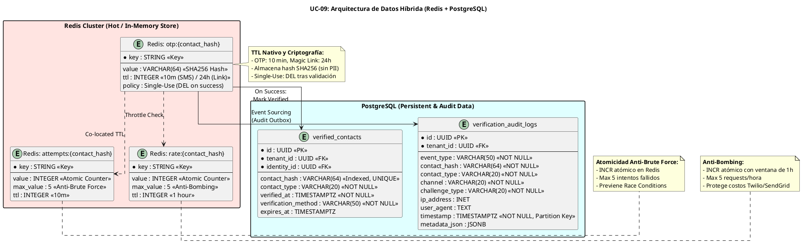

# UC-09: Verificación de Contactos - Modelo de Datos Físico Específico (Atomic Redis & PII Protection)

| Metadatos del Documento | |
| :--- | :--- |
| **Proyecto:** | SHUGO - Identity & Access Platform |
| **Caso de Uso:** | UC-09 - Verificación de Contactos (Out-of-Band Verification) |
| **Documento:** | 10_UC_Specific_Data_Model.md |
| **Metodología:** | Physical Data Modeling + Redis Atomic Operations + PII Protection (Hashing) + Temporal State Management |
| **Base de Datos:** | Redis 7+ (Cache/Atomic Store) + PostgreSQL 15+ (Audit & Persistent State) |
| **Autor:** | Gastón Ruiz |
| **Versión Actual:** | 1.0.0 |
| **Fecha:** | 10/09/2026 |

---

## Historial de Versiones

| Versión | Fecha | Autor | Descripción de Cambios | Impacto |
| :--- | :--- | :--- | :--- | :--- |
| **1.0.0** | 10/09/2026 | Gastón Ruiz | **Creación inicial.** Definición del modelo de datos físico híbrido para UC-09. Introduce la arquitectura dual: Redis para OTPs/tokens efímeros con atomicidad nativa y TTL automático, PostgreSQL para auditoría forense y estado persistente de contactos verificados. Define la estrategia de hashing SHA256 para protección de PII, la estructura de claves Redis para rate limiting y anti-brute force, y las políticas de retención para cumplimiento normativo (NIST SP 800-63A, SOC 2). | Documento de referencia para DBAs, SREs y desarrolladores backend. Define cómo se implementa físicamente la verificación Out-of-Band con máxima seguridad, rendimiento y trazabilidad forense. |

---

## 1. Introducción y Propósito

Este documento define las extensiones y consideraciones físicas específicas para soportar el **UC-09 (Verificación de Contactos)**.

A diferencia de los UCs previos que usan PostgreSQL como almacén principal, el UC-09 introduce una **arquitectura de datos híbrida** debido a sus requisitos únicos:

1. **Alta Velocidad y Atomicidad:** Las operaciones de validación de OTPs requieren atomicidad estricta para prevenir Race Conditions bajo carga concurrente. Redis proporciona operaciones atómicas nativas (`INCR`, `DEL`, `EXPIRE`).
2. **TTL Automático:** Los OTPs y Magic Links tienen vida corta (10 min / 24h). Redis maneja la expiración automáticamente, eliminando la necesidad de jobs de limpieza.
3. **Protección de PII:** Los contactos (email/teléfono) se almacenan como hashes SHA256, nunca en texto plano, protegiendo la base de datos de usuarios en caso de compromiso.
4. **Auditoría Forense:** Aunque los tokens viven en Redis, los eventos de verificación (initiated, completed, failed) se persisten en PostgreSQL para cumplimiento normativo y análisis forense.
5. **Rate Limiting Distribuido:** Los límites de frecuencia (anti-bombing, anti-brute force) se gestionan en Redis para alta disponibilidad y consistencia eventual.

---

## 2. Arquitectura de Datos Híbrida

### 2.1. Diagrama de Arquitectura de Datos



### 2.2. Justificación de la Arquitectura Híbrida

| Capa | Tecnología | Justificación |
| :--- | :--- | :--- |
| **Hot Data (Tokens/OTPs)** | Redis | Atomicidad nativa (`INCR`), TTL automático, latencia sub-milisegundo, alta disponibilidad. |
| **Cold Data (Auditoría)** | PostgreSQL | Durabilidad ACID, consultas complejas para forense, cumplimiento normativo (SOC 2, GDPR). |
| **Persistent State (Verified Contacts)** | PostgreSQL | Estado persistente de contactos verificados, relaciones con identidades, consultas de unicidad. |

---

## 3. Estructura de Claves en Redis

### 3.1. Convenciones de Nomenclatura

```
{namespace}:{entity}:{identifier}
```

| Clave | Formato | TTL | Valor | Operaciones |
| :--- | :--- | :--- | :--- | :--- |
| **OTP/Token** | `otp:{contact_hash}` | 10 min (SMS) / 24h (Email) | SHA256 hash del código/token | `SET`, `GET`, `DEL` |
| **Intentos** | `attempts:{contact_hash}` | 10 min | Contador entero (0-5) | `INCR`, `GET`, `DEL` |
| **Rate Limit** | `rate:{contact_hash}` | 1 hora | Contador entero (0-5) | `INCR`, `GET`, `EXPIRE` |

### 3.2. Estrategia de Hashing para Contactos

Los contactos **nunca** se almacenan en texto plano en Redis. Se usa SHA256 para:
- **Protección de PII:** Si Redis es comprometido, los contactos no pueden ser recuperados.
- **Búsquedas Eficientes:** Las claves son hashes fijos de 64 caracteres, permitiendo búsquedas O(1).
- **Prevención de Enumeración:** Un atacante no puede construir una lista de contactos verificados.

**Implementación en C#:**

```csharp
public static string HashContact(string contactValue)
{
    // Normalizar: lowercase para emails, E.164 para teléfonos
    var normalized = contactValue.ToLowerInvariant().Trim();
    
    // Hash SHA256
    var hash = SHA256.HashData(Encoding.UTF8.GetBytes(normalized));
    return Convert.ToBase64String(hash);
}

// Ejemplo de uso:
var contactHash = HashContact("user@khcs.com");
// Resultado: "k8X9pL2mN5vQ7rT3wY6zA1bC4dE8fG0hI2jK5lM7nO9pQ1rS3tU5vW7xY9zA1b="
```

### 3.3. Operaciones Atómicas en Redis

#### 3.3.1. Creación de OTP (Iniciación)

```csharp
public async Task InitiateOtpAsync(string contactHash, string otpHash, TimeSpan ttl, CancellationToken ct)
{
    var db = _redis.GetDatabase();
    var otpKey = $"otp:{contactHash}";
    var rateKey = $"rate:{contactHash}";
    
    // 1. Verificar Rate Limit (atómico)
    var rateCount = await db.StringIncrementAsync(rateKey);
    if (rateCount == 1)
    {
        await db.KeyExpireAsync(rateKey, TimeSpan.FromHours(1));
    }
    
    if (rateCount > 5)
    {
        throw new RateLimitExceededException("Too many verification requests.");
    }
    
    // 2. Almacenar OTP con TTL (atómico)
    await db.StringSetAsync(otpKey, otpHash, ttl);
    
    // 3. Inicializar contador de intentos
    var attemptsKey = $"attempts:{contactHash}";
    await db.StringSetAsync(attemptsKey, 0, ttl);
}
```

#### 3.3.2. Validación de OTP (Completación)

```csharp
public async Task<bool> ValidateOtpAsync(string contactHash, string providedOtpHash, CancellationToken ct)
{
    var db = _redis.GetDatabase();
    var otpKey = $"otp:{contactHash}";
    var attemptsKey = $"attempts:{contactHash}";
    
    // 1. Incrementar intentos atómicamente (previene Race Conditions)
    var newAttempts = await db.StringIncrementAsync(attemptsKey);
    
    // 2. Verificar límite de intentos
    if (newAttempts > 5)
    {
        // Invalidar OTP inmediatamente
        await db.KeyDeleteAsync(otpKey);
        await db.KeyDeleteAsync(attemptsKey);
        throw new BruteForceDetectedException("Maximum attempts exceeded.");
    }
    
    // 3. Recuperar OTP almacenado
    var storedHash = await db.StringGetAsync(otpKey);
    if (storedHash.IsNullOrEmpty)
    {
        return false; // Expirado o no existe
    }
    
    // 4. SecureCompare (tiempo constante)
    var isValid = CryptographicOperations.FixedTimeEquals(
        Encoding.UTF8.GetBytes(storedHash),
        Encoding.UTF8.GetBytes(providedOtpHash)
    );
    
    if (isValid)
    {
        // 5. Éxito: Invalidar OTP (Single-Use)
        await db.KeyDeleteAsync(otpKey);
        await db.KeyDeleteAsync(attemptsKey);
        return true;
    }
    
    return false; // Intento fallido, pero OTP sigue válido
}
```

### 3.4. Configuración de Redis Cluster

```ini
# redis.conf (Producción)

# Memoria
maxmemory 2gb
maxmemory-policy allkeys-lru

# Persistencia (deshabilitada para OTPs efímeros)
save ""
appendonly no

# Seguridad
requirepass ${REDIS_PASSWORD}
rename-command FLUSHDB ""
rename-command FLUSHALL ""
rename-command DEBUG ""

# Cluster (para alta disponibilidad)
cluster-enabled yes
cluster-config-file nodes.conf
cluster-node-timeout 5000

# Performance
tcp-keepalive 300
timeout 0
tcp-backlog 511
```

---

## 4. Scripts DDL: Tablas de PostgreSQL

### 4.1. Tabla `verification_audit_logs` (Auditoría Forense)

```sql
SET search_path TO kagami_audit;

-- Tabla de auditoría para eventos de verificación
CREATE TABLE IF NOT EXISTS verification_audit_logs (
    id UUID PRIMARY KEY DEFAULT gen_random_uuid(),
    tenant_id UUID NOT NULL,
    
    -- Evento de verificación
    event_type VARCHAR(50) NOT NULL 
        CHECK (event_type IN (
            'VERIFICATION_INITIATED',
            'VERIFICATION_COMPLETED',
            'VERIFICATION_FAILED',
            'VERIFICATION_EXPIRED',
            'BRUTE_FORCE_DETECTED',
            'RATE_LIMIT_EXCEEDED'
        )),
    
    -- Contacto (hash SHA256, nunca texto plano)
    contact_hash VARCHAR(64) NOT NULL,
    contact_type VARCHAR(20) NOT NULL 
        CHECK (contact_type IN ('EMAIL', 'PHONE')),
    
    -- Desafío
    channel VARCHAR(20) NOT NULL 
        CHECK (channel IN ('EMAIL', 'SMS')),
    challenge_type VARCHAR(20) NOT NULL 
        CHECK (challenge_type IN ('OTP', 'MAGIC_LINK')),
    
    -- Contexto de seguridad
    ip_address INET,
    user_agent TEXT,
    
    -- Metadata adicional (JSON)
    metadata_json JSONB DEFAULT '{}'::jsonb,
    
    -- Timestamp
    timestamp TIMESTAMPTZ NOT NULL DEFAULT NOW()
) PARTITION BY RANGE (timestamp); -- Particionado por tiempo

-- Índices optimizados para consultas forenses
CREATE INDEX IF NOT EXISTS val_tenant_timestamp_idx 
    ON verification_audit_logs(tenant_id, timestamp DESC);

CREATE INDEX IF NOT EXISTS val_contact_hash_timestamp_idx 
    ON verification_audit_logs(contact_hash, timestamp DESC);

CREATE INDEX IF NOT EXISTS val_event_type_idx 
    ON verification_audit_logs(event_type);

CREATE INDEX IF NOT EXISTS val_metadata_gin_idx 
    ON verification_audit_logs USING GIN (metadata_json);

COMMENT ON TABLE verification_audit_logs IS 'Logs de auditoría forense para eventos de verificación Out-of-Band. Cumple con NIST SP 800-63A y SOC 2.';
COMMENT ON COLUMN verification_audit_logs.contact_hash IS 'SHA256 hash del contacto. Nunca almacenar email/teléfono en texto plano.';
COMMENT ON COLUMN verification_audit_logs.metadata_json IS 'Metadata adicional en formato JSON (ej. identity_id, failure_reason, attempts_count).';
```

### 4.2. Tabla `verified_contacts` (Estado Persistente)

```sql
SET search_path TO kagami_identity;

-- Tabla de contactos verificados (estado persistente)
CREATE TABLE IF NOT EXISTS verified_contacts (
    id UUID PRIMARY KEY DEFAULT gen_random_uuid(),
    tenant_id UUID NOT NULL,
    identity_id UUID NOT NULL,
    
    -- Contacto (hash SHA256)
    contact_hash VARCHAR(64) NOT NULL,
    contact_type VARCHAR(20) NOT NULL 
        CHECK (contact_type IN ('EMAIL', 'PHONE')),
    
    -- Estado de verificación
    verified_at TIMESTAMPTZ NOT NULL DEFAULT NOW(),
    verification_method VARCHAR(50) NOT NULL 
        CHECK (verification_method IN ('OTP_SMS', 'OTP_EMAIL', 'MAGIC_LINK')),
    
    -- Expiración de la verificación (opcional, para re-verificación periódica)
    expires_at TIMESTAMPTZ,
    
    -- Metadata
    last_verified_ip INET,
    last_verified_user_agent TEXT,
    
    -- Restricciones de unicidad
    CONSTRAINT verified_contacts_unique_hash UNIQUE (tenant_id, contact_hash),
    CONSTRAINT verified_contacts_identity_fk FOREIGN KEY (identity_id) 
        REFERENCES identities(id) ON DELETE CASCADE
);

-- Índices optimizados
CREATE INDEX IF NOT EXISTS vc_tenant_identity_idx 
    ON verified_contacts(tenant_id, identity_id);

CREATE INDEX IF NOT EXISTS vc_contact_hash_idx 
    ON verified_contacts(contact_hash);

CREATE INDEX IF NOT EXISTS vc_expires_at_idx 
    ON verified_contacts(expires_at) 
    WHERE expires_at IS NOT NULL;

COMMENT ON TABLE verified_contacts IS 'Estado persistente de contactos verificados. Permite consultas de unicidad y verificación de estado actual.';
COMMENT ON COLUMN verified_contacts.expires_at IS 'Fecha de expiración de la verificación. NULL significa verificación permanente.';
```

### 4.3. Particionamiento de `verification_audit_logs`

```sql
-- Crear particiones mensuales para 2026
CREATE TABLE verification_audit_logs_2026_01 PARTITION OF verification_audit_logs
    FOR VALUES FROM ('2026-01-01') TO ('2026-02-01');

CREATE TABLE verification_audit_logs_2026_02 PARTITION OF verification_audit_logs
    FOR VALUES FROM ('2026-02-01') TO ('2026-03-01');

-- Partición default para capturar datos fuera de rango
CREATE TABLE verification_audit_logs_default PARTITION OF verification_audit_logs DEFAULT;

-- Job automático para crear particiones futuras (ejecutar mensualmente)
CREATE OR REPLACE FUNCTION create_verification_audit_partitions()
RETURNS void AS $$
DECLARE
    next_month DATE := DATE_TRUNC('month', NOW() + INTERVAL '1 month');
    partition_name TEXT;
BEGIN
    partition_name := 'verification_audit_logs_' || TO_CHAR(next_month, 'YYYY_MM');
    
    EXECUTE format(
        'CREATE TABLE IF NOT EXISTS %I PARTITION OF verification_audit_logs FOR VALUES FROM (%L) TO (%L)',
        partition_name,
        next_month,
        next_month + INTERVAL '1 month'
    );
END;
$$ LANGUAGE plpgsql;
```

---

## 5. Seguridad a Nivel de Base de Datos

### 5.1. Row-Level Security (RLS) para Auditoría

```sql
-- Habilitar RLS en tabla de auditoría
ALTER TABLE kagami_audit.verification_audit_logs ENABLE ROW LEVEL SECURITY;
ALTER TABLE kagami_audit.verification_audit_logs FORCE ROW LEVEL SECURITY;

-- Política de INSERT: Solo el servicio de verificación puede insertar
CREATE POLICY val_insert_verification_service ON kagami_audit.verification_audit_logs
    FOR INSERT
    WITH CHECK (current_setting('app.service_role', true) = 'verification_service');

-- Política de SELECT: Solo administradores de compliance o el propio usuario (vía identity_id)
CREATE POLICY val_select_compliance ON kagami_audit.verification_audit_logs
    FOR SELECT
    USING (
        current_setting('app.service_role', true) IN ('compliance_admin', 'audit_service')
        OR EXISTS (
            SELECT 1 FROM kagami_identity.verified_contacts vc
            WHERE vc.contact_hash = verification_audit_logs.contact_hash
            AND vc.identity_id = current_setting('app.current_identity_id', true)::uuid
        )
    );

-- NO permitir UPDATE o DELETE (inmutabilidad)
REVOKE UPDATE, DELETE ON kagami_audit.verification_audit_logs FROM PUBLIC;
```

### 5.2. Row-Level Security (RLS) para Contactos Verificados

```sql
-- Habilitar RLS en tabla de contactos verificados
ALTER TABLE kagami_identity.verified_contacts ENABLE ROW LEVEL SECURITY;
ALTER TABLE kagami_identity.verified_contacts FORCE ROW LEVEL SECURITY;

-- Política de SELECT: Solo el propio usuario o servicios autorizados
CREATE POLICY vc_select_owner ON kagami_identity.verified_contacts
    FOR SELECT
    USING (
        identity_id = current_setting('app.current_identity_id', true)::uuid
        OR current_setting('app.service_role', true) IN ('verification_service', 'admin_service')
    );

-- Política de INSERT/UPDATE: Solo el servicio de verificación
CREATE POLICY vc_write_verification_service ON kagami_identity.verified_contacts
    FOR INSERT
    WITH CHECK (current_setting('app.service_role', true) = 'verification_service');

CREATE POLICY vc_update_verification_service ON kagami_identity.verified_contacts
    FOR UPDATE
    USING (current_setting('app.service_role', true) = 'verification_service');
```

### 5.3. Roles de Base de Datos

```sql
-- Rol para el servicio de verificación
CREATE ROLE app_verification_service WITH LOGIN PASSWORD '${VERIFICATION_DB_PASSWORD}';

GRANT CONNECT ON DATABASE shugo_kagami TO app_verification_service;
GRANT USAGE ON SCHEMA kagami_identity TO app_verification_service;
GRANT USAGE ON SCHEMA kagami_audit TO app_verification_service;

-- Permisos específicos
GRANT INSERT, SELECT ON kagami_audit.verification_audit_logs TO app_verification_service;
GRANT INSERT, SELECT, UPDATE ON kagami_identity.verified_contacts TO app_verification_service;
GRANT SELECT ON kagami_identity.identities TO app_verification_service; -- Para validar identity_id

-- Rol para auditoría/compliance
CREATE ROLE app_compliance_admin WITH LOGIN PASSWORD '${COMPLIANCE_DB_PASSWORD}';

GRANT CONNECT ON DATABASE shugo_kagami TO app_compliance_admin;
GRANT USAGE ON SCHEMA kagami_audit TO app_compliance_admin;

GRANT SELECT ON kagami_audit.verification_audit_logs TO app_compliance_admin;
```

---

## 6. Estrategias de Optimización

### 6.1. Optimistic Concurrency Control (OCC) en PostgreSQL

Aunque Redis maneja la atomicidad de los OTPs, las actualizaciones a `verified_contacts` requieren OCC para prevenir Race Conditions.

```sql
-- Agregar columna row_version para OCC
ALTER TABLE kagami_identity.verified_contacts 
    ADD COLUMN row_version UUID NOT NULL DEFAULT gen_random_uuid();

-- Configurar en EF Core
public class VerifiedContactConfiguration : IEntityTypeConfiguration<VerifiedContact>
{
    public void Configure(EntityTypeBuilder<VerifiedContact> builder)
    {
        builder.Property(vc => vc.RowVersion)
            .IsConcurrencyToken()
            .HasDefaultValueSql("gen_random_uuid()");
    }
}
```

### 6.2. Índices GIN para Metadata JSON

```sql
-- Índice GIN para búsquedas en metadata_json
CREATE INDEX IF NOT EXISTS val_metadata_gin_idx 
    ON verification_audit_logs USING GIN (metadata_json);

-- Ejemplo de consulta optimizada:
SELECT * FROM kagami_audit.verification_audit_logs
WHERE metadata_json @> '{"failure_reason": "INVALID_CODE"}'::jsonb
AND timestamp > NOW() - INTERVAL '24 hours';
```

### 6.3. Configuración de PostgreSQL para Alta Escritura

```ini
# postgresql.conf - Optimizaciones para UC-09

# WAL y Checkpoints (crítico para auditoría de alta escritura)
wal_level = replica
max_wal_size = 4GB
min_wal_size = 1GB
checkpoint_completion_target = 0.9
checkpoint_timeout = 10min
wal_buffers = 64MB

# Autovacuum agresivo para tablas de auditoría
autovacuum_max_workers = 5
autovacuum_vacuum_scale_factor = 0.01    # Vaciar cuando 1% de filas cambian
autovacuum_analyze_scale_factor = 0.005  # Analizar cuando 0.5% de filas cambian

# Memoria compartida
shared_buffers = 8GB
effective_cache_size = 24GB
work_mem = 128MB  # Para operaciones de ordenamiento en consultas forenses
```

---

## 7. Políticas de Retención y Archivado

### 7.1. Retención de Logs de Auditoría

Por cumplimiento normativo (SOC 2, ISO 27001, NIST SP 800-63A), los logs de auditoría deben conservarse por un mínimo de **7 años**.

**Estrategia de Archivado:**

```sql
-- Función para archivar logs antiguos a almacenamiento frío
CREATE OR REPLACE FUNCTION archive_verification_audit_logs(p_months_to_keep INT DEFAULT 12)
RETURNS INT AS $$
DECLARE
    v_cutoff_date TIMESTAMPTZ;
    v_archived_count INT;
BEGIN
    v_cutoff_date := NOW() - (p_months_to_keep || ' months')::INTERVAL;
    
    -- Mover datos antiguos a tabla de archivo (en tablespace de almacenamiento frío)
    INSERT INTO kagami_audit.verification_audit_logs_archive
    SELECT * FROM kagami_audit.verification_audit_logs
    WHERE timestamp < v_cutoff_date;
    
    GET DIAGNOSTICS v_archived_count = ROW_COUNT;
    
    -- Eliminar particiones antiguas
    -- DROP TABLE kagami_audit.verification_audit_logs_2023_01;
    
    RETURN v_archived_count;
END;
$$ LANGUAGE plpgsql;

-- Job programado (ejecutar mensualmente)
SELECT cron.schedule(
    'archive-verification-logs',
    '0 2 1 * *',  -- 2:00 AM del día 1 de cada mes
    $$SELECT archive_verification_audit_logs(12)$$
);
```

### 7.2. Retención de Contactos Verificados

Los contactos verificados se mantienen mientras la identidad exista. Si la identidad se purga (UC-05), los contactos verificados se eliminan automáticamente vía `ON DELETE CASCADE`.

```sql
-- La FK ya está configurada con CASCADE
CONSTRAINT verified_contacts_identity_fk FOREIGN KEY (identity_id) 
    REFERENCES identities(id) ON DELETE CASCADE
```

### 7.3. Limpieza Automática en Redis

Redis maneja la expiración automáticamente mediante TTL nativo. No se requieren jobs de limpieza.

**Configuración de TTLs:**

| Tipo de Dato | TTL | Justificación |
| :--- | :--- | :--- |
| OTP (SMS) | 10 minutos | NIST SP 800-63A: OTPs de corta duración para SMS |
| Magic Link (Email) | 24 horas | Permite al usuario hacer clic en el link dentro de un día |
| Contador de Intentos | 10 minutos | Coincide con el TTL del OTP |
| Rate Limit | 1 hora | Ventana de tiempo para prevenir bombing |

---

## 8. Monitoreo y Diagnóstico

### 8.1. Consultas para Diagnosticar Problemas de Verificación

```sql
-- Top 10 contactos con más intentos de fuerza bruta en las últimas 24h
SELECT 
    contact_hash,
    COUNT(*) FILTER (WHERE event_type = 'VERIFICATION_FAILED') as failed_attempts,
    COUNT(*) FILTER (WHERE event_type = 'BRUTE_FORCE_DETECTED') as brute_force_blocks,
    MAX(timestamp) as last_attempt
FROM kagami_audit.verification_audit_logs
WHERE timestamp > NOW() - INTERVAL '24 hours'
GROUP BY contact_hash
HAVING COUNT(*) FILTER (WHERE event_type = 'VERIFICATION_FAILED') > 5
ORDER BY failed_attempts DESC
LIMIT 10;

-- Tasa de éxito de verificación por tenant (últimos 7 días)
SELECT 
    tenant_id,
    COUNT(*) FILTER (WHERE event_type = 'VERIFICATION_INITIATED') as initiated,
    COUNT(*) FILTER (WHERE event_type = 'VERIFICATION_COMPLETED') as completed,
    ROUND(
        COUNT(*) FILTER (WHERE event_type = 'VERIFICATION_COMPLETED')::NUMERIC / 
        NULLIF(COUNT(*) FILTER (WHERE event_type = 'VERIFICATION_INITIATED'), 0) * 100, 
        2
    ) as success_rate_pct
FROM kagami_audit.verification_audit_logs
WHERE timestamp > NOW() - INTERVAL '7 days'
GROUP BY tenant_id
ORDER BY success_rate_pct ASC;

-- Contactos verificados que están por expirar (próximos 7 días)
SELECT 
    vc.id,
    vc.tenant_id,
    vc.identity_id,
    vc.contact_hash,
    vc.contact_type,
    vc.verified_at,
    vc.expires_at,
    AGE(vc.expires_at, NOW()) as time_remaining
FROM kagami_identity.verified_contacts vc
WHERE vc.expires_at IS NOT NULL
AND vc.expires_at BETWEEN NOW() AND NOW() + INTERVAL '7 days'
ORDER BY vc.expires_at ASC;

-- IPs con más solicitudes de verificación (posible bombing)
SELECT 
    ip_address,
    COUNT(*) as request_count,
    COUNT(DISTINCT contact_hash) as unique_contacts,
    MAX(timestamp) as last_request
FROM kagami_audit.verification_audit_logs
WHERE timestamp > NOW() - INTERVAL '1 hour'
GROUP BY ip_address
HAVING COUNT(*) > 50
ORDER BY request_count DESC
LIMIT 10;
```

### 8.2. Métricas de Base de Datos para OpenTelemetry

```csharp
public class VerificationDatabaseMetrics
{
    private readonly Meter _meter;
    private readonly Counter<long> _auditLogsInserted;
    private readonly Counter<long> _verifiedContactsCreated;
    private readonly Histogram<double> _auditLogInsertLatency;
    private readonly Histogram<double> _verifiedContactQueryLatency;

    public VerificationDatabaseMetrics(IMeterFactory meterFactory)
    {
        _meter = meterFactory.Create("shugo.verification.database");
        _auditLogsInserted = _meter.CreateCounter<long>("verification.audit_logs_inserted_total");
        _verifiedContactsCreated = _meter.CreateCounter<long>("verification.verified_contacts_created_total");
        _auditLogInsertLatency = _meter.CreateHistogram<double>("verification.audit_log_insert_latency", "ms");
        _verifiedContactQueryLatency = _meter.CreateHistogram<double>("verification.verified_contact_query_latency", "ms");
    }

    public void RecordAuditLogInserted(string tenantId, string eventType)
    {
        _auditLogsInserted.Add(1,
            new KeyValuePair<string, object?>("tenant_id", tenantId),
            new KeyValuePair<string, object?>("event_type", eventType));
    }

    public void RecordVerifiedContactCreated(string tenantId, string contactType)
    {
        _verifiedContactsCreated.Add(1,
            new KeyValuePair<string, object?>("tenant_id", tenantId),
            new KeyValuePair<string, object?>("contact_type", contactType));
    }

    public void RecordAuditLogInsertLatency(string tenantId, double latencyMs)
    {
        _auditLogInsertLatency.Record(latencyMs,
            new KeyValuePair<string, object?>("tenant_id", tenantId));
    }
}
```

### 8.3. Monitoreo de Redis

```bash
# Comandos útiles para monitoreo de Redis

# Ver uso de memoria
redis-cli INFO memory

# Ver claves con TTL
redis-cli --scan --pattern "otp:*" | head -20

# Ver estadísticas de operaciones
redis-cli INFO stats

# Ver clientes conectados
redis-cli CLIENT LIST

# Ver lentitud de comandos
redis-cli --latency

# Ver top comandos más lentos
redis-cli --slowlog get 10
```

---

## 9. Trazabilidad

| Documento | Relación |
| :--- | :--- |
| `04_Initial_Domain_Model.md` | Define los Value Objects `ContactInfo` (hashing SHA256) y `VerificationChallenge` (almacenamiento en Redis). |
| `05_State_Machine_Diagram.md` | Las transiciones de estado (PENDING → VALIDATED/EXPIRED/BRUTE_FORCED) se reflejan en la estructura de claves Redis. |
| `07_Sequence_Diagram.md` | Muestra las operaciones atómicas en Redis (`INCR`, `DEL`, `EXPIRE`) que se optimizan con esta estructura. |
| `08_Final_Class_Design.md` | El `RedisVerificationRepository` implementa las operaciones definidas aquí. |
| `09_Modern_Artifacts.md` | Las métricas de OpenTelemetry se alimentan de los contadores definidos aquí. |
| `11_UC_Specific_Security_Threats.md` | Las mitigaciones de "PII Protection" y "Atomic Operations" se validan mediante el hashing SHA256 y las operaciones atómicas de Redis. |
| `12_UC_Specific_Performance_Benchmarks.md` | Los SLAs de latencia (<50ms para validación) se validan con la estructura de claves Redis y los índices de PostgreSQL. |
| `SHUGO_Data_Model_Master.md` (Transversal) | Este documento extiende el modelo maestro con la arquitectura híbrida Redis + PostgreSQL. |

---

## 10. Anexos: Glosario de Base de Datos (UC-09)

| Término | Definición en Contexto UC-09 |
| :--- | :--- |
| **Hybrid Data Architecture** | Arquitectura que combina Redis (hot data, atomicidad, TTL) con PostgreSQL (cold data, durabilidad, consultas complejas). |
| **Contact Hash** | SHA256 hash del email/teléfono. Nunca almacenar contactos en texto plano para proteger PII. |
| **Atomic Operations (Redis)** | Operaciones como `INCR`, `DEL`, `EXPIRE` que son atómicas por diseño en Redis, previniendo Race Conditions. |
| **TTL (Time-To-Live)** | Tiempo de vida automático de una clave en Redis. Tras expirar, la clave se elimina automáticamente. |
| **Single-Use Token** | Token que se invalida inmediatamente tras una validación exitosa (operación `DEL` en Redis). |
| **Rate Limiting** | Mecanismo para limitar el número de solicitudes de verificación por contacto/IP, previniendo SMS/Email Bombing. |
| **Anti-Brute Force** | Contador atómico de intentos fallidos en Redis. Tras 5 intentos, el OTP se invalida. |
| **SecureCompare** | Comparación en tiempo constante que previene Timing Attacks en validación de OTPs/Tokens. |
| **PII Protection** | Protección de Personally Identifiable Information mediante hashing SHA256. |
| **Forensic Audit** | Registro inmutable de todos los eventos de verificación para cumplimiento normativo y análisis forense. |
| **Outbox Pattern** | Patrón para garantizar que los eventos de dominio se publiquen de forma confiable, incluso si la transacción principal falla. |
| **Partitioning by Range** | Estrategia de dividir la tabla de auditoría en particiones mensuales basadas en la columna `timestamp`. |

---
*Fin del Documento 10_UC_Specific_Data_Model para UC-09*