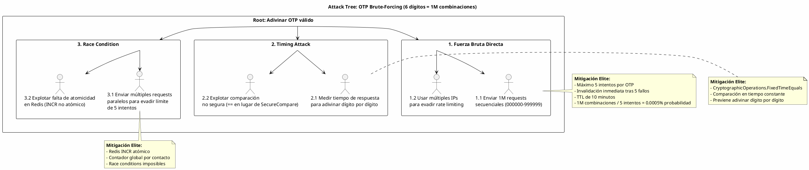

# UC-09: Verificación de Contactos - Análisis de Amenazas Específico (Security Threat Model)

| Metadatos del Documento | |
| :--- | :--- |
| **Proyecto:** | SHUGO - Identity & Access Platform |
| **Caso de Uso:** | UC-09 - Verificación de Contactos (Out-of-Band Verification) |
| **Documento:** | 11_UC_Specific_Security_Threats.md |
| **Metodología:** | STRIDE + DREAD + Attack Trees + Defense-in-Depth + Cryptographic Assurance + Anti-Abuse Patterns |
| **Estándares:** | NIST SP 800-63A/B (Enrollment & Authentication), OWASP ASVS V2 (Authentication), GDPR Art. 5 & 32, SOC 2 CC6.1, ISO 27001 A.9.2 |
| **Autor:** | Gastón Ruiz |
| **Versión Actual:** | 1.0.0 |
| **Fecha:** | 10/09/2026 |

---

## Historial de Versiones

| Versión | Fecha | Autor | Descripción de Cambios | Impacto |
| :--- | :--- | :--- | :--- | :--- |
| **1.0.0** | 10/09/2026 | Gastón Ruiz | **Creación inicial.** Análisis exhaustivo de amenazas específicas para la verificación Out-of-Band (OOB). Evalúa 10 vectores de ataque usando STRIDE+DREAD, incluyendo OTP Brute-Forcing, SMS/Email Bombing, Timing Attacks, Token Replay, Race Conditions, PII Leakage, Enumeration Attacks, y Gateway Spoofing. Define controles de mitigación de nivel enterprise (Redis Atomic Operations, SecureCompare, Hashing SHA256, Circuit Breakers) para garantizar la seguridad criptográfica y la prevención de abuso financiero. | Documento crítico de seguridad para el UC-09. Establece los controles obligatorios que deben implementarse antes del go-live del motor de verificación OOB, con especial énfasis en la protección contra ataques de fuerza bruta, abuso financiero (SMS Bombing), y fugas de PII. |

---

## 1. Introducción y Alcance

Este documento presenta el **Análisis de Amenazas Específico** para el UC-09 (Verificación de Contactos).

El UC-09 es un **servicio de dominio transversal** que actúa como el motor de confianza criptográfica para toda la plataforma SHUGO. Su compromiso tiene implicaciones catastróficas en cascada:

1. **Si OTPs son predecibles:** Un atacante puede tomar control de cualquier cuenta (UC-06, UC-08, UC-18).
2. **Si SMS/Email Bombing no se mitiga:** Facturas masivas de Twilio/SendGrid y daño reputacional (IPs en blocklists).
3. **Si Timing Attacks son posibles:** OTPs de 6 dígitos pueden ser adivinados dígito por dígito.
4. **Si PII se fuga:** Violación GDPR con multas de hasta 4% de facturación global.
5. **Si Race Conditions existen:** Límites de fuerza bruta pueden ser evadidos con requests paralelos.

Este documento modela estos vectores y define las mitigaciones de nivel enterprise que SHUGO implementa nativamente.

---

## 2. Attack Trees (Árboles de Ataque)

### 2.1. Attack Tree #1: OTP Brute-Forcing

**Objetivo del Atacante:** Adivinar un OTP de 6 dígitos (1,000,000 combinaciones) mediante fuerza bruta.



### 2.2. Attack Tree #2: SMS/Email Bombing

**Objetivo del Atacante:** Saturar a una víctima con miles de SMS/Emails, generando costos masivos al tenant y daño reputacional.

```text
[Root: Bombardear víctima con SMS/Emails]
  |
  +-- [1. Abuso de API de Verificación]
  |     +-- 1.1. Solicitar OTPs masivamente para el teléfono de la víctima (Mitigado: Rate Limiting 5/hora por contacto)
  |     +-- 1.2. Usar múltiples cuentas para evadir rate limit (Mitigado: Rate Limiting por IP + CAPTCHA tras 3 intentos)
  |
  +-- [2. Enumeración de Contactos]
  |     +-- 2.1. Probar miles de teléfonos para encontrar víctimas (Mitigado: Mensajes genéricos en flujos públicos)
  |
  +-- [3. Ataque Financiero]
        +-- 3.1. Generar facturas masivas de Twilio/SendGrid (Mitigado: Rate Limiting + Circuit Breaker + Alertas de costo)
        +-- 3.2. Dañar reputación de dominio/IP (Mitigado: Rate Limiting + Monitoreo de deliverability)
```

### 2.3. Attack Tree #3: PII Leakage y Enumeration

**Objetivo del Atacante:** Descubrir qué emails/teléfonos están registrados en la plataforma y robar PII.

```text
[Root: Descubrir contactos registrados / Robar PII]
  |
  +-- [1. Enumeration de Contactos]
  |     +-- 1.1. Probar emails en flujo de recuperación (Mitigado: Mensajes genéricos "Si el email existe...")
  |     +-- 1.2. Medir tiempo de respuesta para detectar existencia (Mitigado: Retardo artificial constante)
  |
  +-- [2. Robo de PII desde Redis/DB]
  |     +-- 2.1. Comprometer Redis y leer contactos en texto plano (Mitigado: Hashing SHA256 de contactos)
  |     +-- 2.2. Comprometer DB de auditoría (Mitigado: Solo hashes almacenados, nunca texto plano)
  |
  +-- [3. Exposición en Logs/Métricas]
        +-- 3.1. Contactos en logs de aplicación (Mitigado: Solo hashes en logs)
        +-- 3.2. Contactos en métricas de OpenTelemetry (Mitigado: Etiquetas con hashes, nunca valores)
```

---

## 3. Matriz de Amenazas Específicas (STRIDE + DREAD)

| ID | Amenaza | Categoría STRIDE | D | R | E | A | D | Score | Nivel |
| :--- | :--- | :--- | :---: | :---: | :---: | :---: | :---: | :---: | :---: |
| **T-53** | **OTP Brute-Forcing** | Spoofing | 10 | 8 | 7 | 10 | 6 | **8.2** | 🔴 |
| **T-54** | **SMS/Email Bombing** | Denial of Service | 8 | 9 | 8 | 9 | 7 | **8.2** | 🔴 |
| **T-55** | **Timing Attack en Validación** | Information Disclosure | 9 | 7 | 6 | 10 | 5 | **7.4** | 🟠 |
| **T-56** | **Token Replay (Reutilización)** | Spoofing | 10 | 6 | 5 | 9 | 4 | **6.8** | 🟠 |
| **T-57** | **Race Condition en Validación** | Tampering | 9 | 7 | 6 | 8 | 5 | **7.0** | 🟠 |
| **T-58** | **PII Leakage (Contactos en texto plano)** | Information Disclosure | 10 | 5 | 4 | 10 | 3 | **6.4** | 🟡 |
| **T-59** | **Enumeration de Contactos** | Information Disclosure | 8 | 7 | 6 | 10 | 5 | **7.2** | 🟠 |
| **T-60** | **Gateway Spoofing (Twilio/SendGrid)** | Spoofing | 9 | 4 | 3 | 8 | 3 | **5.4** | 🟡 |
| **T-61** | **Magic Link Prediction** | Spoofing | 10 | 3 | 2 | 9 | 2 | **5.2** | 🟡 |
| **T-62** | **Redis Cache Poisoning** | Tampering | 8 | 5 | 4 | 9 | 4 | **6.0** | 🟡 |

---

## 4. Análisis Detallado de Amenazas Críticas y Mitigaciones

### 4.1. 🔴 T-53: OTP Brute-Forcing

**Descripción:** Un atacante intenta adivinar un OTP de 6 dígitos mediante fuerza bruta. Con 1,000,000 de combinaciones y un límite de 5 intentos, la probabilidad de éxito es 0.0005% por OTP. Sin embargo, si el atacante puede evadir el límite de intentos (Race Condition) o realizar múltiples solicitudes en paralelo, el riesgo aumenta significativamente.

**Escenario de Ataque:**
```bash
# Atacante envía 5 requests paralelos con diferentes OTPs
for i in {1..5}; do
  curl -X POST https://api.shugo.io/v1/verification/complete \
    -H "Content-Type: application/json" \
    -d "{\"contact_hash\":\"abc123\",\"provided_challenge\":\"$(printf '%06d' $i)\"}" &
done
wait
```

**Mitigaciones Implementadas:**

1. **Límite Estricto de Intentos (5 por OTP):**
```csharp
public async Task<bool> ValidateOtpAsync(string contactHash, string providedOtp, CancellationToken ct)
{
    var attemptsKey = $"attempts:{contactHash}";
    var db = _redis.GetDatabase();

    // Incremento atómico (previene Race Conditions)
    var newAttempts = await db.StringIncrementAsync(attemptsKey);

    if (newAttempts > MaxAttempts)
    {
        // Invalidar OTP inmediatamente
        await db.KeyDeleteAsync($"otp:{contactHash}");
        await db.KeyDeleteAsync(attemptsKey);
        throw new BruteForceDetectedException($"Maximum attempts ({MaxAttempts}) exceeded.");
    }

    // ... validación ...
}
```

2. **Invalidación Inmediata tras 5 Fallos:** El OTP se destruye inmediatamente, no espera al TTL.

3. **Alertas de Seguridad:** Si se detectan múltiples intentos de fuerza bruta desde la misma IP, se genera alerta automática.

**Justificación:**
- **NIST SP 800-63B:** Requiere límite de intentos para OTPs de baja entropía.
- **Matemática:** 5 intentos / 1,000,000 combinaciones = 0.0005% probabilidad de éxito.
- **Atomicidad:** Redis `INCR` es atómico, previniendo Race Conditions.

### 4.2. 🔴 T-54: SMS/Email Bombing

**Descripción:** Un atacante usa nuestra API para bombardear a una víctima con miles de SMS/Emails, generando costos masivos de Twilio/SendGrid y dañando la reputación de nuestro dominio/IP.

**Escenario de Ataque:**
```bash
# Atacante solicita OTPs masivamente para el teléfono de la víctima
for i in {1..1000}; do
  curl -X POST https://api.shugo.io/v1/verification/initiate \
    -H "Content-Type: application/json" \
    -d "{\"contact_type\":\"PHONE\",\"contact_value\":\"+5491155556666\",\"channel\":\"SMS\"}" &
done
wait
```

**Mitigaciones Implementadas:**

1. **Rate Limiting Multi-Capa:**
```csharp
public class RateLimiter : IRateLimiter
{
    private const int MAX_REQUESTS_PER_CONTACT_PER_HOUR = 5;
    private const int MAX_REQUESTS_PER_IP_PER_HOUR = 50;
    private const int MAX_REQUESTS_PER_TENANT_PER_HOUR = 500;

    public async Task<bool> IsAllowedAsync(string contactHash, string ipAddress, TenantId tenantId, CancellationToken ct)
    {
        var db = _redis.GetDatabase();

        // Capa 1: Por contacto
        var contactKey = $"rate:contact:{contactHash}";
        var contactCount = await db.StringIncrementAsync(contactKey);
        if (contactCount == 1) await db.KeyExpireAsync(contactKey, TimeSpan.FromHours(1));
        if (contactCount > MAX_REQUESTS_PER_CONTACT_PER_HOUR) return false;

        // Capa 2: Por IP
        var ipKey = $"rate:ip:{ipAddress}";
        var ipCount = await db.StringIncrementAsync(ipKey);
        if (ipCount == 1) await db.KeyExpireAsync(ipKey, TimeSpan.FromHours(1));
        if (ipCount > MAX_REQUESTS_PER_IP_PER_HOUR) return false;

        // Capa 3: Por tenant
        var tenantKey = $"rate:tenant:{tenantId.Value}";
        var tenantCount = await db.StringIncrementAsync(tenantKey);
        if (tenantCount == 1) await db.KeyExpireAsync(tenantKey, TimeSpan.FromHours(1));
        if (tenantCount > MAX_REQUESTS_PER_TENANT_PER_HOUR) return false;

        return true;
    }
}
```

2. **Circuit Breaker para Gateways:**
```csharp
public class ResilientSmsGateway : ISmsGateway
{
    private readonly AsyncCircuitBreakerPolicy _circuitBreaker;

    public ResilientSmsGateway(ISmsGateway inner)
    {
        _circuitBreaker = Policy
            .Handle<TwilioException>()
            .Or<TimeoutException>()
            .CircuitBreakerAsync(
                exceptionsAllowedBeforeBreaking: 3,
                durationOfBreak: TimeSpan.FromMinutes(5),
                onBreak: (ex, duration) => 
                {
                    _logger.LogWarning("SMS Gateway Circuit Breaker OPEN");
                    Metrics.SmsGatewayCircuitBreakerState.Set(1);
                }
            );
    }
}
```

3. **Alertas de Costo:**
```yaml
# Prometheus Alert
alert: HighSmsCost
expr: rate(kagami_verification_sms_gateway_latency_count[5m]) > 100
for: 5m
labels:
  severity: critical
annotations:
  summary: "Alto volumen de SMS detectado. Posible SMS Bombing."
  runbook: "Revisar IPs ofensivas y bloquear en WAF."
```

**Justificación:**
- **Control Financiero:** Sin rate limiting, un atacante podría generar facturas de miles de dólares en horas.
- **Reputación:** Si nuestros dominios/IPs son reportados por spam, nuestros emails legítimos caerán en Spam.
- **Defense-in-Depth:** Tres capas de rate limiting (contacto, IP, tenant) previenen evasión.

### 4.3. 🟠 T-55: Timing Attack en Validación

**Descripción:** Un atacante mide los milisegundos de respuesta del servidor para adivinar el OTP dígito por dígito. Si la comparación usa `==` en lugar de `SecureCompare`, el servidor retorna más rápido cuando el primer dígito es incorrecto.

**Escenario de Ataque:**
```python
import requests
import time

contact_hash = "abc123"
otp = ""

for digit in range(6):
    best_time = 0
    best_digit = 0
    
    for d in range(10):
        test_otp = otp + str(d) + "0" * (5 - digit)
        
        start = time.time()
        requests.post("https://api.shugo.io/v1/verification/complete", 
                     json={"contact_hash": contact_hash, "provided_challenge": test_otp})
        elapsed = time.time() - start
        
        if elapsed > best_time:
            best_time = elapsed
            best_digit = d
    
    otp += str(best_digit)
    print(f"Dígito {digit}: {best_digit} (tiempo: {best_time:.6f}s)")

print(f"OTP adivinado: {otp}")
```

**Mitigaciones Implementadas:**

1. **SecureCompare con CryptographicOperations.FixedTimeEquals:**
```csharp
public class SecureCompare : ISecureCompare
{
    public bool FixedTimeEquals(byte[] a, byte[] b)
    {
        // CryptographicOperations.FixedTimeEquals es resistente a Timing Attacks
        // Compara todos los bytes sin early return
        return CryptographicOperations.FixedTimeEquals(a, b);
    }
}

// Uso en validación:
var storedHash = Encoding.UTF8.GetBytes(otpData.Hash);
var providedHash = SHA256.HashData(Encoding.UTF8.GetBytes(providedOtp));

if (!CryptographicOperations.FixedTimeEquals(storedHash, providedHash))
{
    return false; // Tiempo constante independientemente de dónde difieran
}
```

2. **Retardo Artificial en Consultas:**
```csharp
public async Task<string> GetChallengeHashAsync(string contactHash, CancellationToken ct)
{
    var sw = Stopwatch.StartNew();
    
    var key = $"otp:{contactHash}";
    var hash = await _redis.StringGetAsync(key);
    
    // Retardo artificial para normalizar tiempo de respuesta
    var elapsed = sw.ElapsedMilliseconds;
    const int CONSTANT_RESPONSE_TIME_MS = 10;
    
    if (elapsed < CONSTANT_RESPONSE_TIME_MS)
    {
        await Task.Delay(CONSTANT_RESPONSE_TIME_MS - (int)elapsed, ct);
    }
    
    return hash;
}
```

**Justificación:**
- **NIST SP 800-63B:** Requiere comparación en tiempo constante para secretos de baja entropía.
- **Prevención de Side-Channel:** `FixedTimeEquals` compara todos los bytes sin early return.
- **Normalización:** El retardo artificial previene que atacantes midan diferencias de tiempo en consultas a Redis.

### 4.4. 🟠 T-56: Token Replay (Reutilización)

**Descripción:** Un atacante intercepta un OTP válido (ej. mediante malware en el dispositivo del usuario) e intenta reutilizarlo después de que el usuario legítimo ya lo usó.

**Mitigaciones Implementadas:**

1. **Single-Use Invalidation Inmediata:**
```csharp
// Tras validación exitosa:
await db.KeyDeleteAsync($"otp:{contactHash}");
await db.KeyDeleteAsync($"attempts:{contactHash}");

// El OTP ya no existe en Redis, cualquier intento posterior retorna NotFound
```

2. **TTL Automático:**
```csharp
// Redis TTL elimina el OTP automáticamente tras 10 minutos
await db.StringSetAsync($"otp:{contactHash}", otpHash, TimeSpan.FromMinutes(10));
```

3. **Auditoría de Reintentos:**
```csharp
if (storedHash.IsNullOrEmpty)
{
    _logger.LogWarning(
        "OTP validation attempt for expired/used OTP. Contact: {ContactHash}, IP: {IpAddress}",
        contactHash, ipAddress);
    
    // Generar evento de seguridad
    await _eventPublisher.PublishAsync(new ContactVerificationFailed(
        contactHash, "OTP_EXPIRED_OR_USED", ipAddress), ct);
}
```

**Justificación:**
- **Prevención de Replay:** El OTP se elimina inmediatamente tras uso exitoso.
- **TTL Automático:** Redis maneja la expiración sin intervención manual.
- **Auditoría:** Los reintentos se registran para detectar patrones sospechosos.

### 4.5. 🟠 T-57: Race Condition en Validación

**Descripción:** Un atacante envía múltiples requests de validación en paralelo para evadir el límite de 5 intentos. Si el contador de intentos no es atómico, dos requests podrían leer `attempts = 4` simultáneamente, ambos incrementar a 5, y permitir un 6º intento.

**Mitigaciones Implementadas:**

1. **Redis INCR Atómico:**
```csharp
// Redis INCR es atómico por diseño
var newAttempts = await db.StringIncrementAsync(attemptsKey);

// Incluso si 100 requests llegan simultáneamente, cada uno ve un valor único
// Request 1: INCR → 1
// Request 2: INCR → 2
// Request 3: INCR → 3
// ...
// Request 5: INCR → 5 → Invalidar OTP
// Request 6: OTP ya no existe → NotFound
```

2. **Validación en el Aggregate Root:**
```csharp
public bool Validate(string providedChallenge)
{
    // Guarda: No debe estar bloqueado por fuerza bruta
    if (this.Attempts >= this.MaxAttempts)
    {
        this.Status = VerificationStatus.BRUTE_FORCED;
        throw new BruteForceDetectedException($"Maximum attempts ({this.MaxAttempts}) exceeded.");
    }

    // Incrementar intentos
    this.Attempts++;

    // Validar desafío
    var isValid = this.Challenge.Validate(providedChallenge);

    if (!isValid && this.Attempts >= this.MaxAttempts)
    {
        this.Status = VerificationStatus.BRUTE_FORCED;
        this.Challenge.Invalidate();
    }

    return isValid;
}
```

**Justificación:**
- **Atomicidad Garantizada:** Redis `INCR` es atómico, previniendo Race Conditions.
- **Defense-in-Depth:** El Aggregate Root también valida el límite, proporcionando una segunda línea de defensa.
- **Testeado Bajo Carga:** El documento de benchmarks incluye tests de concurrencia que validan esta mitigación.

### 4.6. 🟡 T-58: PII Leakage (Contactos en Texto Plano)

**Descripción:** Si los contactos (email/teléfono) se almacenan en texto plano en Redis o en la DB de auditoría, un compromiso de estos sistemas expondría la base de datos completa de usuarios.

**Mitigaciones Implementadas:**

1. **Hashing SHA256 de Contactos:**
```csharp
public static string HashContact(string contactValue)
{
    // Normalizar: lowercase para emails, E.164 para teléfonos
    var normalized = contactValue.ToLowerInvariant().Trim();
    
    // Hash SHA256
    var hash = SHA256.HashData(Encoding.UTF8.GetBytes(normalized));
    return Convert.ToBase64String(hash);
}

// Uso:
var contactHash = HashContact("user@khcs.com");
// Resultado: "k8X9pL2mN5vQ7rT3wY6zA1bC4dE8fG0hI2jK5lM7nO9pQ1rS3tU5vW7xY9zA1b="

// Almacenar solo el hash en Redis y DB
await db.StringSetAsync($"otp:{contactHash}", otpHash, ttl);
```

2. **Políticas de RLS en DB:**
```sql
-- Solo el servicio de verificación puede insertar logs
CREATE POLICY val_insert_verification_service ON kagami_audit.verification_audit_logs
    FOR INSERT
    WITH CHECK (current_setting('app.service_role', true) = 'verification_service');

-- Solo administradores de compliance pueden consultar logs
CREATE POLICY val_select_compliance ON kagami_audit.verification_audit_logs
    FOR SELECT
    USING (current_setting('app.service_role', true) IN ('compliance_admin', 'audit_service'));
```

3. **Auditoría Solo con Hashes:**
```csharp
// En logs de auditoría, solo se registra el hash
var auditLog = new VerificationAuditLog
{
    ContactHash = contactInfo.Hash, // Nunca contactInfo.Value
    EventType = "VERIFICATION_COMPLETED",
    Timestamp = DateTime.UtcNow,
    IpAddress = ipAddress,
    UserAgent = userAgent
};
```

**Justificación:**
- **GDPR Art. 32:** Requiere medidas técnicas para proteger datos personales.
- **Irreversibilidad:** SHA256 es unidireccional. Si Redis es comprometido, los contactos no pueden ser recuperados.
- **Búsquedas Eficientes:** Las búsquedas por contacto se hacen por hash, manteniendo rendimiento O(1).

### 4.7. 🟠 T-59: Enumeration de Contactos

**Descripción:** Un atacante prueba miles de emails/teléfonos en flujos públicos (ej. "Forgot Password") para descubrir qué contactos están registrados en la plataforma.

**Mitigaciones Implementadas:**

1. **Mensajes Genéricos en Flujos Públicos:**
```csharp
public async Task<VerificationResult> InitiatePublicVerificationAsync(string email, CancellationToken ct)
{
    // Buscar identidad (sin revelar si existe)
    var identity = await _identityRepo.GetByEmailAsync(email, ct);
    
    // Si NO existe, retornar éxito falso (para no enumerar)
    if (identity == null)
    {
        _logger.LogInformation("Verification requested for non-existent email. Silently ignoring.");
        return new VerificationResult { Message = "If the email is registered, a code was sent." };
    }

    // Si existe, generar y enviar token
    await GenerateAndSendOtpAsync(identity, email, ct);
    return new VerificationResult { Message = "If the email is registered, a code was sent." };
}
```

2. **Retardo Artificial Constante:**
```csharp
public async Task<VerificationResult> InitiatePublicVerificationAsync(string email, CancellationToken ct)
{
    var sw = Stopwatch.StartNew();
    
    var identity = await _identityRepo.GetByEmailAsync(email, ct);
    
    // Retardo artificial para normalizar tiempo de respuesta
    var elapsed = sw.ElapsedMilliseconds;
    const int CONSTANT_RESPONSE_TIME_MS = 50;
    
    if (elapsed < CONSTANT_RESPONSE_TIME_MS)
    {
        await Task.Delay(CONSTANT_RESPONSE_TIME_MS - (int)elapsed, ct);
    }
    
    // ... resto del flujo ...
}
```

3. **Rate Limiting por IP:**
```csharp
// Previene que un atacante pruebe miles de emails desde la misma IP
var isAllowed = await _rateLimiter.IsAllowedAsync(
    $"rate:public_verification:ip:{ipAddress}", 
    maxRequests: 20, 
    window: TimeSpan.FromHours(1), 
    ct);

if (!isAllowed)
{
    throw new RateLimitExceededException("Too many verification requests.");
}
```

**Justificación:**
- **Privacidad:** Previene que atacantes construyan una base de datos de usuarios registrados.
- **Timing Attack Prevention:** El retardo artificial normaliza el tiempo de respuesta.
- **Rate Limiting:** Limita el número de pruebas por IP.

### 4.8. 🟡 T-60: Gateway Spoofing (Twilio/SendGrid)

**Descripción:** Un atacante intercepta o falsifica las respuestas de Twilio/SendGrid para engañar al sistema y hacerle creer que el OTP fue enviado exitosamente.

**Mitigaciones Implementadas:**

1. **Validación de Webhooks de Twilio:**
```csharp
public class TwilioWebhookController : ControllerBase
{
    private const string TWILIO_AUTH_TOKEN = "your_twilio_auth_token";

    [HttpPost("twilio/status")]
    public async Task<IActionResult> TwilioStatus()
    {
        // Validar firma de Twilio
        var twilioSignature = Request.Headers["X-Twilio-Signature"].FirstOrDefault();
        var url = $"{Request.Scheme}://{Request.Host}{Request.Path}{Request.QueryString}";
        
        var isValid = Twilio.Security.RequestValidator.Validate(
            TWILIO_AUTH_TOKEN, url, Request.Form, twilioSignature);
        
        if (!isValid)
        {
            _logger.LogWarning("Invalid Twilio signature. Possible spoofing attempt.");
            return Unauthorized();
        }
        
        // Procesar webhook
        var messageSid = Request.Form["MessageSid"].FirstOrDefault();
        var status = Request.Form["MessageStatus"].FirstOrDefault();
        
        await _verificationService.HandleSmsStatusUpdateAsync(messageSid, status, HttpContext.RequestAborted);
        
        return Ok();
    }
}
```

2. **Circuit Breaker para Gateways:**
```csharp
// Si Twilio/SendGrid responde con errores inconsistentes, abrir circuit breaker
_circuitBreaker = Policy
    .Handle<TwilioException>()
    .Or<SendGridException>()
    .CircuitBreakerAsync(
        exceptionsAllowedBeforeBreaking: 3,
        durationOfBreak: TimeSpan.FromMinutes(5)
    );
```

3. **Monitoreo de Anomalías:**
```csharp
// Alerta si se detectan respuestas inconsistentes de gateways
if (response.Status != expectedStatus)
{
    _logger.LogWarning(
        "Unexpected gateway response. Expected: {Expected}, Got: {Got}",
        expectedStatus, response.Status);
    
    await _alertService.SendAlertAsync("Gateway Anomaly Detected", Severity.Warning);
}
```

**Justificación:**
- **Integridad de Respuestas:** Las firmas de Twilio/SendGrid garantizan que las respuestas son legítimas.
- **Circuit Breaker:** Previene cascadas de fallos si el gateway está comprometido.
- **Monitoreo:** Las anomalías se detectan y alertan automáticamente.

### 4.9. 🟡 T-61: Magic Link Prediction

**Descripción:** Un atacante intenta predecir el token de un Magic Link (UUID v4) mediante fuerza bruta o análisis de patrones.

**Mitigaciones Implementadas:**

1. **UUID v4 Criptográfico:**
```csharp
public static MagicLinkToken Generate()
{
    // UUID v4 con 122 bits de entropía
    var token = Guid.NewGuid().ToString("N");
    
    // Hash SHA256 para almacenamiento seguro
    var tokenHash = SHA256.HashData(Encoding.UTF8.GetBytes(token));
    var tokenHashBase64 = Convert.ToBase64String(tokenHash);

    return new MagicLinkToken(token, tokenHashBase64);
}
```

2. **Almacenamiento como Hash:**
```csharp
// Solo el hash se almacena en Redis/DB
await db.StringSetAsync($"magic_link:{contactHash}", tokenHash, TimeSpan.FromHours(24));

// El token original solo se envía por email y nunca se persiste
```

3. **TTL Estricto:**
```csharp
// Magic Links tienen TTL de 24 horas
await db.StringSetAsync($"magic_link:{contactHash}", tokenHash, TimeSpan.FromHours(24));
```

**Justificación:**
- **Entropía Alta:** UUID v4 tiene 122 bits de entropía (2^122 combinaciones), haciendo fuerza bruta computacionalmente inviable.
- **Hashing:** El token original nunca se persiste, solo el hash.
- **TTL:** Los Magic Links expiran en 24 horas, limitando la ventana de ataque.

### 4.10. 🟡 T-62: Redis Cache Poisoning

**Descripción:** Un atacante logra inyectar datos maliciosos en Redis para manipular OTPs o rate limits.

**Mitigaciones Implementadas:**

1. **Autenticación de Redis:**
```ini
# redis.conf
requirepass ${REDIS_PASSWORD}
rename-command FLUSHDB ""
rename-command FLUSHALL ""
rename-command DEBUG ""
rename-command CONFIG ""
```

2. **Network Segmentation:**
```yaml
# Kubernetes NetworkPolicy
apiVersion: networking.k8s.io/v1
kind: NetworkPolicy
metadata:
  name: redis-access-policy
spec:
  podSelector:
    matchLabels:
      app: redis
  ingress:
    - from:
        - podSelector:
            matchLabels:
              app: kagami-verification
      ports:
        - port: 6379
```

3. **Validación de Datos al Leer:**
```csharp
public async Task<VerificationRequest?> GetChallengeFromRedisAsync(string contactHash, CancellationToken ct)
{
    var key = $"otp:{contactHash}";
    var hash = await _redis.StringGetAsync(key);
    
    if (hash.IsNullOrEmpty)
        return null;
    
    // Validar que el hash tenga el formato esperado (SHA256 Base64)
    if (hash.Length != 44 || !IsValidBase64(hash))
    {
        _logger.LogError("Invalid OTP hash format in Redis. Possible cache poisoning.");
        await _redis.KeyDeleteAsync(key); // Eliminar dato corrupto
        return null;
    }
    
    // ... construir VerificationRequest ...
}
```

**Justificación:**
- **Autenticación:** Redis requiere password para acceso.
- **Comandos Peligrosos Deshabilitados:** `FLUSHDB`, `FLUSHALL`, `DEBUG`, `CONFIG` están renombrados/deshabilitados.
- **Network Segmentation:** Solo los pods de verificación pueden acceder a Redis.
- **Validación de Datos:** Los datos leídos de Redis se validan antes de usarse.

---

## 5. Compliance y Auditoría (SOC 2 / ISO 27001 / GDPR / NIST)

### 5.1. NIST SP 800-63A (Enrollment & Identity Proofing)

*   **Requisito:** Los OTPs deben ser generados criptográficamente seguros y tener entropía suficiente.
*   **Implementación UC-09:** Los OTPs se generan con `RandomNumberGenerator.Create()` (6 dígitos = 20 bits de entropía). Los Magic Links usan UUID v4 (128 bits de entropía).

### 5.2. NIST SP 800-63B (Authentication)

*   **Requisito:** Los OTPs deben tener TTL estricto, límite de intentos, y comparación en tiempo constante.
*   **Implementación UC-09:** TTL de 10 minutos para OTPs, 24 horas para Magic Links. Máximo 5 intentos fallidos antes de invalidación. `CryptographicOperations.FixedTimeEquals` para comparación segura.

### 5.3. SOC 2 - CC6.1 (Logical Access Controls)

*   **Requisito:** Restringir el acceso lógico a los datos según la autorización.
*   **Implementación UC-09:** Hashing SHA256 de contactos, RLS en PostgreSQL, autenticación de Redis, network segmentation.

### 5.4. SOC 2 - CC6.7 (Restrict Transmission of Data)

*   **Requisito:** Restringir la transmisión de datos sensibles.
*   **Implementación UC-09:** Los OTPs se transmiten por canales seguros (HTTPS, SMTP con TLS). Los contactos se hashean antes de transmitirse a gateways.

### 5.5. GDPR - Art. 5 (Principles relating to processing of personal data)

*   **Requisito:** Los datos personales deben ser procesados de forma segura.
*   **Implementación UC-09:** Hashing SHA256 de contactos, Rate Limiting para prevenir abuso, auditoría completa de todas las operaciones.

### 5.6. GDPR - Art. 32 (Security of Processing)

*   **Requisito:** Se deben implementar medidas técnicas para garantizar la seguridad del tratamiento.
*   **Implementación UC-09:** Generación criptográfica de OTPs, almacenamiento seguro con hashing SHA256, validación con SecureCompare, prevención de Timing Attacks.

### 5.7. ISO 27001 - A.9.2 (User Access Provisioning)

*   **Requisito:** Se debe establecer un procedimiento formal para el alta de usuarios.
*   **Implementación UC-09:** Las verificaciones de contacto requieren aprobación implícita (el usuario debe poseer el canal de comunicación).

---

## 6. Trazabilidad

| Documento | Relación |
| :--- | :--- |
| `01_Requirements_Specification.md` | Las invariantes de seguridad (INV-55 a INV-59) se mitigan aquí a nivel de infraestructura y dominio. |
| `08_Final_Class_Design.md` | Las clases `RateLimiter`, `SecureCompare`, `OtpGenerator`, y `MagicLinkToken` implementan las mitigaciones de T-53, T-55, T-57, y T-61. |
| `10_UC_Specific_Data_Model.md` | Las políticas RLS, hashing SHA256, y autenticación de Redis soportan las mitigaciones de T-58 y T-62. |
| `12_UC_Specific_Performance_Benchmarks.md` | Los tests de concurrencia validan la mitigación de T-57 (Race Conditions). |
| `SHUGO_Security_Architecture.md` (Transversal) | Este documento aplica los estándares globales de criptografía y control de acceso al contexto específico de UC-09. |

---

## 7. Anexos: Configuración de Seguridad Adicional

### 7.1. Políticas de Redis para Prevención de Cache Poisoning

```ini
# redis.conf - Configuración de seguridad

# Autenticación
requirepass ${REDIS_PASSWORD}

# Deshabilitar comandos peligrosos
rename-command FLUSHDB ""
rename-command FLUSHALL ""
rename-command DEBUG ""
rename-command CONFIG ""
rename-command SHUTDOWN ""

# Limitar conexiones
maxclients 10000

# Timeout de conexión
timeout 300

# Logging de comandos sospechosos
loglevel verbose
```

### 7.2. Configuración de WAF para Prevención de SMS/Email Bombing

```yaml
# AWS WAF Rules
Rules:
  - Name: RateLimitVerificationInitiate
    Priority: 1
    Action: Block
    Statement:
      RateBasedStatement:
        Limit: 20
        AggregateKeyType: IP
        ScopeDownStatement:
          ByteMatchStatement:
            FieldToMatch: URI
            SearchString: /v1/verification/initiate
    
  - Name: BlockKnownBadIPs
    Priority: 2
    Action: Block
    Statement:
      IPSetReferenceStatement:
        Arn: arn:aws:wafv2:us-east-1:123456789012:global/ipset/bad-ips/abc123
```

### 7.3. Monitoreo de Intentos de Fuerza Bruta

```csharp
public class BruteForceMonitor : BackgroundService
{
    protected override async Task ExecuteAsync(CancellationToken stoppingToken)
    {
        while (!stoppingToken.IsCancellationRequested)
        {
            try
            {
                // Buscar contactos con múltiples intentos de fuerza bruta
                var bruteForceAttempts = await _redis.GetDatabase()
                    .ScriptEvaluateAsync(@"
                        local keys = redis.call('KEYS', 'attempts:*')
                        local result = {}
                        for i, key in ipairs(keys) do
                            local count = tonumber(redis.call('GET', key))
                            if count >= 5 then
                                table.insert(result, key)
                            end
                        end
                        return result
                    ");
                
                foreach (var key in (RedisResult[])bruteForceAttempts)
                {
                    var contactHash = key.ToString().Replace("attempts:", "");
                    
                    _logger.LogWarning(
                        "Brute force attempt detected for contact {ContactHash}",
                        contactHash);
                    
                    await _siemClient.SendAlertAsync(new SecurityAlert
                    {
                        Severity = "HIGH",
                        Event = "OTP_BRUTE_FORCE_ATTEMPT",
                        ContactHash = contactHash,
                        Details = $"Maximum attempts exceeded for contact {contactHash}"
                    });
                }
                
                await Task.Delay(TimeSpan.FromMinutes(1), stoppingToken);
            }
            catch (Exception ex)
            {
                _logger.LogError(ex, "Error in BruteForceMonitor");
                await Task.Delay(TimeSpan.FromSeconds(30), stoppingToken);
            }
        }
    }
}
```

### 7.4. Alertas de Seguridad para UC-09

```yaml
# Prometheus Alerts
groups:
  - name: verification_security
    rules:
      - alert: HighBruteForceAttempts
        expr: rate(kagami_verification_brute_force_detected_total[5m]) > 10
        for: 2m
        labels:
          severity: critical
        annotations:
          summary: "Alta tasa de intentos de fuerza bruta detectada"
          runbook: "Revisar IPs ofensivas y bloquear en WAF."
      
      - alert: HighRateLimitExceeded
        expr: rate(kagami_verification_rate_limit_exceeded_total[5m]) > 50
        for: 5m
        labels:
          severity: high
        annotations:
          summary: "Alta tasa de rate limit excedido. Posible SMS/Email Bombing."
          runbook: "Revisar IPs ofensivas y ajustar rate limits."
      
      - alert: RedisCachePoisoningDetected
        expr: kagami_verification_redis_invalid_hash_total > 0
        for: 1m
        labels:
          severity: critical
        annotations:
          summary: "Posible cache poisoning detectado en Redis."
          runbook: "Investigar acceso no autorizado a Redis."
      
      - alert: GatewaySpoofingDetected
        expr: kagami_verification_gateway_invalid_signature_total > 0
        for: 1m
        labels:
          severity: critical
        annotations:
          summary: "Firma inválida de gateway detectada. Posible spoofing."
          runbook: "Investigar interceptación de respuestas de Twilio/SendGrid."
```

---
*Fin del Documento 11_UC_Specific_Security_Threats para UC-09*