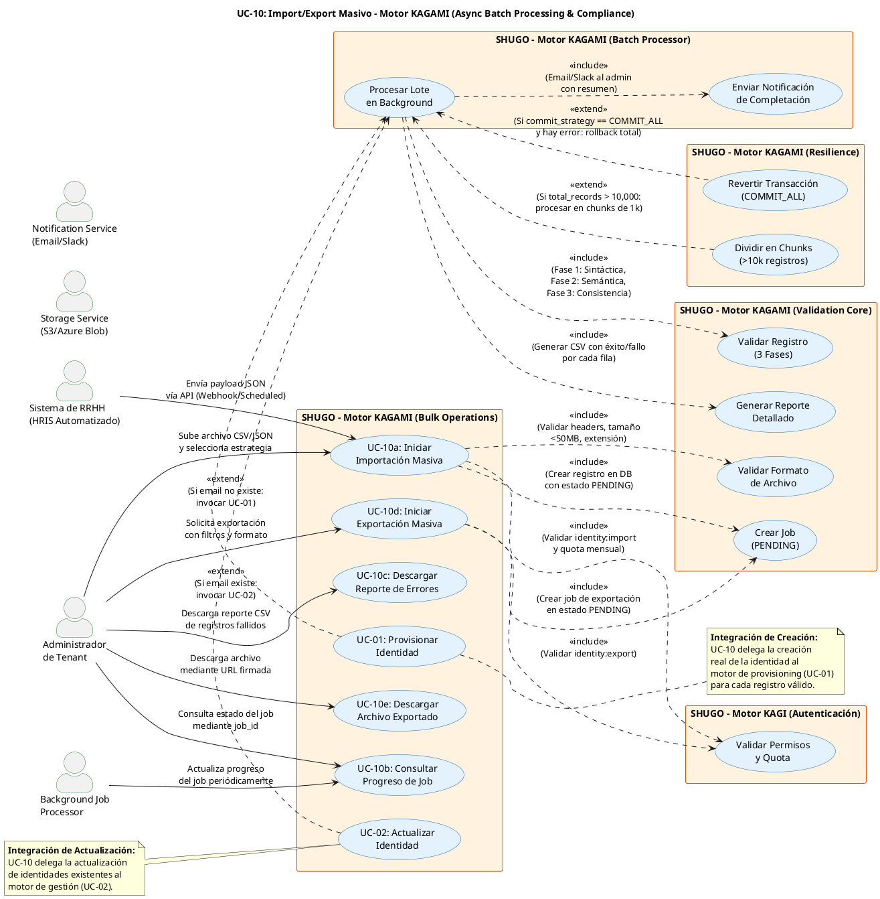

# UC-10: Import/Export Masivo - Diagrama de Caso de Uso

| Metadatos del Documento | |
| :--- | :--- |
| **Proyecto:** | SHUGO - Identity & Access Platform |
| **Caso de Uso:** | UC-10 - Import/Export Masivo (Bulk Identity Operations) |
| **Documento:** | 02_Use_Case_Diagram.md |
| **Metodología:** | UML 2.5 + ICONIX + Domain-Driven Design + Async Processing Patterns |
| **Autor:** | Gastón Ruiz |
| **Versión Actual:** | 1.0.0 |
| **Fecha:** | 11/09/2026 |

---

## Historial de Versiones

| Versión | Fecha | Autor | Descripción de Cambios | Impacto |
| :--- | :--- | :--- | :--- | :--- |
| **1.0.0** | [11/09/2026] | Gastón Ruiz | **Creación inicial.** Diagrama de Caso de Uso UML para UC-10. Modela las operaciones masivas de importación y exportación de identidades como un flujo asíncrono controlado, introduciendo actores automatizados (HRIS, Background Job Processor), validaciones en múltiples fases, estrategias de transaccionalidad (commit total/parcial), y la integración con sistemas de almacenamiento y notificación. | Documento base del paquete de diseño Tier 1 del UC-10. Establece las fronteras del sistema, los actores y las integraciones críticas para garantizar migraciones enterprise seguras, trazables y resilientes, cumpliendo con SOC 2 y GDPR. |

---

## 1. Diagrama de Caso de Uso (PlantUML)

A continuación, se presenta el Diagrama de Casos de Uso UML para el UC-10. Este diagrama modela las operaciones masivas no como transacciones síncronas, sino como **flujos asíncronos orientados a jobs**, diferenciando claramente entre la iniciación (síncrona) y el procesamiento (asíncrono).

---

## 2. Explicación del Diagrama

### 2.1. Límite del Sistema (System Boundary)

El diagrama identifica **cuatro límites de sistema claramente diferenciados**:

1. **Motor KAGAMI - Bulk Operations (UC-10a a UC-10e):** El sistema principal que gestiona el ciclo de vida de las operaciones masivas. Incluye la iniciación, consulta de progreso, y descarga de resultados.
2. **Motor KAGI (Autenticación y Autorización):** Sistema que valida que el actor tenga los permisos específicos (`identity:import` o `identity:export`) y que el tenant no haya excedido su quota mensual.
3. **Validation Core & Batch Processor:** Módulos internos que encapsulan la lógica de validación en tres fases y el procesamiento asíncrono de lotes, respectivamente.
4. **Sistemas Externos (Storage & Notifier):** Servicios de infraestructura que almacenan los archivos procesados (S3/Azure Blob) y notifican al administrador upon completion.

**Justificación de los Límites:**
- La separación entre la **iniciación del job** (UC-10a/10d) y el **procesamiento en background** (UC_ProcesarLote) refleja el patrón arquitectónico asíncrono, esencial para no bloquear la UI del administrador ni agotar los timeouts de HTTP.
- Los **actores secundarios** (JobProcessor, Storage, Notifier) se modelan explícitamente porque la operación masiva depende críticamente de su disponibilidad y correcto funcionamiento.

### 2.2. Actores del Sistema

#### Actores Primarios: **Administrador** y **Sistema de RRHH (HRIS)**

*   **Administrador de Tenant (humano):** Ejecuta la operación masiva manualmente, generalmente en dos escenarios:
    *   **Migración Inicial:** Importar miles de empleados desde un sistema legacy (LDAP, Excel).
    *   **Auditoría/Compliance:** Exportar el estado actual de las identidades para reportes SOC 2 o GDPR.
    *   **Meta:** Procesar grandes volúmenes de datos de forma eficiente y con retroalimentación clara de errores.
    *   **Permisos:** `identity:import` o `identity:export`.

*   **Sistema de RRHH (HRIS Automatizado):** Representa sistemas como Workday, BambooHR o SAP SuccessFactors que automatizan la sincronización de identidades.
    *   **Evento:** Sincronización programada (ej. cada noche) o webhook ante cambios masivos.
    *   **Meta:** Mantener el estado de las identidades en SHUGO sincronizado con la fuente de verdad de RRHH sin intervención manual.
    *   **Permisos:** Service Account con scope `identity:import` (solo vía API).

#### Actores Secundarios (Sistemas Dependientes)

*   **Background Job Processor:** Actor automatizado que monitorea la cola de jobs, toma los jobs en estado `PENDING`, los procesa, y actualiza su estado a `PROCESSING`, `COMPLETED`, o `FAILED`.
*   **Storage Service (S3/Azure Blob):** Almacena temporalmente el archivo subido por el usuario y el reporte de resultados generado, liberando al servidor de aplicación de manejar archivos grandes.
*   **Notification Service:** Envía correos electrónicos o mensajes de Slack/Teams al administrador cuando el job finaliza, proporcionando un resumen de alto nivel y un enlace al reporte detallado.

### 2.3. Relaciones UML

#### Relaciones `<<include>>`: UC-10a/10d → UC_ValidarPermisos, UC_ValidarFormato, UC_CrearJob

*   **Dirección:** La flecha va **DESDE** los casos de uso de iniciación **HACIA** las validaciones.
*   **Semántica:** La iniciación de una operación masiva **depende obligatoriamente** de estas validaciones. No se crea ningún job si el archivo es inválido o el usuario no tiene permisos.
*   **Justificación Arquitectónica:** Fail-Fast. Rechazar archivos malformados o solicitudes no autorizadas inmediatamente, antes de consumir recursos de cola o almacenamiento.

#### Relaciones `<<include>>`: UC_ProcesarLote → UC_ValidarRegistro, UC_GenerarReporte, UC_EnviarNotificacion

*   **Dirección:** La flecha va **DESDE** el procesamiento en background **HACIA** las acciones de validación, reporte y notificación.
*   **Semántica:** El procesamiento de un lote **siempre** debe validar cada registro individualmente, generar un reporte de resultados, y notificar al usuario al finalizar.
*   **Justificación:** Garantiza que cada operación masiva sea trazable, auditable y que el usuario tenga visibilidad total del resultado, cumpliendo con principios de transparencia y compliance.

#### Relaciones `<<extend>>`: UC_DividirChunks, UC_RevertirTransaccion, UC-01, UC-02 → UC_ProcesarLote

*   **Dirección:** La flecha va **DESDE** los casos de uso extend **HACIA** UC_ProcesarLote.
*   **Semántica:** Son comportamientos **condicionales** que se activan bajo circunstancias específicas durante el procesamiento del lote.
*   **Justificación:**
    *   **UC_DividirChunks:** Optimiza el rendimiento y el uso de memoria para lotes masivos (>10.000 registros) procesándolos en paralelo.
    *   **UC_RevertirTransaccion:** Garantiza la integridad de los datos cuando la estrategia seleccionada es `COMMIT_ALL` (todo o nada).
    *   **UC-01 / UC-02:** UC-10 no reinventa la rueda; delega la lógica de creación o actualización de identidades a los casos de uso especializados, asegurando consistencia en las reglas de negocio.

---

## 3. Análisis de Coherencia con la Especificación Analítica

Este diagrama es **100% coherente** con el documento `01_Requirements_Specification.md`:

| Elemento del Diagrama | Referencia en Especificación |
| :--- | :--- |
| Actores: Admin, HRIS, JobProcessor, Storage, Notifier | Sección 2 (Descripción Analítica) - Actores Principales y Secundarios |
| Relación <<include>> con UC_ValidarPermisos | Sección 2 (Precondiciones) - Permisos `identity:import`/`export` y quota |
| Relación <<include>> con UC_ValidarFormato | Sección 3 (INV-61, INV-62) - Tamaño máximo y formatos soportados |
| Relación <<include>> con UC_CrearJob | Sección 2.1 (Escenario Principal, Paso 5) - Creación de job PENDING |
| Relación <<include>> con UC_ValidarRegistro | Sección 3 (INV-63) - Validación en Tres Fases |
| Relación <<include>> con UC_GenerarReporte | Sección 3 (INV-68) - Reporte Detallado |
| Relación <<include>> con UC_EnviarNotificacion | Sección 3 (RN-12) - Notificaciones Multi-Canal |
| Relación <<extend>> con UC_DividirChunks | Sección 3 (RN-10) - Chunking para Lotes Grandes |
| Relación <<extend>> con UC_RevertirTransaccion | Sección 3 (INV-64) - Estrategia de Commit (COMMIT_ALL) |
| Relación <<extend>> con UC-01 / UC-02 | Sección 1.2 (Relación con Otros UCs) - Consumidor de Provisionar/Actualizar |

---

## 4. Consideraciones de Diseño y Arquitectura (DDD + Async Patterns)

### 4.1. Patrón de Procesamiento Asíncrono (Fire-and-Forget con Polling/Webhooks)

El diagrama modela explícitamente la separación entre la **iniciación** (UC-10a/10d) y el **procesamiento** (UC_ProcesarLote).

*   **Iniciación (Síncrona, <2s):** Valida el archivo, crea el job en la base de datos, sube el archivo a Storage y encola el mensaje. Retorna HTTP 202 Accepted con un `job_id`.
*   **Procesamiento (Asíncrono, minutos/horas):** El Background Job Processor toma el mensaje, ejecuta la validación en tres fases, procesa los registros, genera el reporte y notifica.

**Justificación:**
- **UX Responsiva:** El administrador no queda bloqueado esperando una respuesta de un servidor que está procesando 50.000 registros.
- **Resiliencia:** Si el servidor de aplicación se reinicia, el job permanece en la cola y será procesado por otro nodo, garantizando la entrega (At-Least-Once).

### 4.2. Validación en Tres Fases (Fail-Fast Optimizado)

La relación `<<include>>` con `UC_ValidarRegistro` representa un flujo interno crítico que se ejecuta por cada fila del lote:

1.  **Fase 1 (Sintáctica):** ¿El email tiene formato válido? ¿La contraseña cumple la longitud mínima? (Rápido, no requiere DB).
2.  **Fase 2 (Semántica):** ¿El email ya existe en este tenant? ¿El rol "manager" existe en el catálogo? (Requiere consultas a DB/Cache).
3.  **Fase 3 (Consistencia):** ¿El `manager_id` referenciado existe dentro del mismo lote o en el sistema? (Requiere validación cruzada).

**Justificación:**
- **Eficiencia:** Detectar un error de formato en la Fase 1 evita realizar costosas consultas a la base de datos en las Fases 2 y 3.
- **Claridad en Errores:** Permite generar mensajes de error específicos y accionables para el usuario (ej. "Fila 42: El email no tiene formato válido" vs "Fila 42: El rol no existe").

### 4.3. Estrategias de Transaccionalidad (Commit All vs Commit Valid)

La relación `<<extend>>` con `UC_RevertirTransaccion` modela el comportamiento cuando se selecciona la estrategia `COMMIT_ALL`.

*   **COMMIT_VALID (Default):** Procesa los registros válidos y marca los inválidos como `FAILED` en el reporte. Es resiliente a datos sucios.
*   **COMMIT_ALL (Strict):** Si *cualquier* registro falla la validación, se aborta todo el lote y se revierten los cambios ya realizados (Rollback).

**Justificación:**
- **Flexibilidad Empresarial:** Algunos clientes prefieren importar el 99% de los datos y corregir el 1% después (`COMMIT_VALID`). Otros (ej. migraciones financieras o de compliance estricto) requieren que el 100% sea perfecto o no se aplique nada (`COMMIT_ALL`).

### 4.4. Seguridad en la Exportación (Signed URLs)

La relación entre UC-10e y el Storage Service implica el uso de **URLs firmadas (Presigned URLs)**.

*   **Mecanismo:** El sistema genera una URL que incluye una firma criptográfica y una fecha de expiración (TTL de 24 horas).
*   **Justificación:** Previene que un enlace de descarga de datos sensibles (PII) sea compartido o accesible indefinidamente, cumpliendo con GDPR Art. 32 (Security of Processing) y SOC 2 CC6.7.

---

## 5. Trazabilidad con Otros Documentos del Paquete

Este diagrama se relaciona con los siguientes documentos del paquete de diseño:

| Documento | Relación |
| :--- | :--- |
| `01_Requirements_Specification.md` | Define los flujos, invariantes (INV-60 a INV-69) y criterios de aceptación que este diagrama visualiza. |
| `03_Activity_Diagram.md` | Mostrará el flujo de trabajo interno del Background Job Processor, destacando la bifurcación lógica de las 3 fases de validación y el manejo de errores. |
| `04_Initial_Domain_Model.md` | Definirá el Aggregate Root `BulkImportJob`, los Value Objects `ImportOptions`, `RecordError`, y los Domain Services `BulkImportHandler`, `BulkImportProcessor`. |
| `05_State_Machine_Diagram.md` | Mostrará la máquina de estados del job (`PENDING` → `PROCESSING` → `COMPLETED`/`FAILED`/`COMPLETED_WITH_ERRORS`). |
| `06_Robustness_Diagram.md` | Mostrará la colaboración entre el Bulk Import Handler, la cola de mensajes, el Storage Service y los validadores. |
| `07_Sequence_Diagram.md` | Detallará el orden temporal exacto de las llamadas: validación de archivo → creación de job → encolado → procesamiento por chunks → generación de reporte. |
| `08_Final_Class_Design.md` | Definirá las firmas exactas de los métodos: `BulkImportHandler.InitiateAsync()`, `BulkImportProcessor.ProcessChunkAsync()`. |
| `UC-01/02_Requirements_Specification.md` | Documentos hermanos que definen la lógica de negocio que UC-10 delega para cada registro individual. |

---

## 6. Notas de Implementación

### 6.1. Generación del Diagrama
- **Herramienta:** PlantUML (Diagrams as Code).
- **Ventaja:** Versionable en Git, reproducible, sin dependencias de software propietario.
- **Renderizado:** VS Code (extensión PlantUML), GitHub, o Pandoc para exportación a PDF.

### 6.2. Estilos Aplicados
- `<style>` block: Para evitar advertencias de `skinparam` deprecados en versiones modernas de PlantUML.
- `left to right direction`: Organiza el flujo de izquierda a derecha (Actores Primarios → Sistema Principal / Casos de Uso → Actores Secundarios / Sistemas Externos).
- `skinparam actorStyle awesome`: Íconos modernos para actores.
- `skinparam usecaseBackgroundColor #E3F2FD`: Color azul claro para casos de uso de KAGAMI.
- `skinparam rectangleBackgroundColor #FFF3E0`: Color naranja claro para sistemas secundarios y externos.

### 6.3. Convenciones de Nomenclatura
- **Actores:** Nombres descriptivos que indican su rol y nivel de automatización (Administrador, HRIS, Background Job Processor).
- **Casos de Uso:** Verbos en infinitivo que describen la meta del actor o la responsabilidad del sistema (ej. "Iniciar Importación Masiva", "Validar Registro (3 Fases)").
- **Sistemas:** Nombres que reflejan el Bounded Context de DDD (ej. "Motor KAGAMI (Validation Core)", "Storage Service").
- **Relaciones:** Etiquetas descriptivas que explican el propósito de la relación (ej. "<<include>> (Validar identity:import y quota mensual)").

### 6.4. Diferenciación Visual entre UC-10 y UC-01/UC-02
Para facilitar la comprensión de la delegación de responsabilidades:
- **UC-10 (Bulk Operations):** Color azul claro (#E3F2FD) para los casos de uso de orquestación masiva.
- **UC-01 / UC-02 (Individual):** Mismo color azul claro, conectados por relación `<<extend>>` desde el procesamiento del lote, mostrando que UC-10 *utiliza* la lógica de UC-01/UC-02, pero no la reemplaza.

### 6.5. Patrones de Resiliencia Visibles
El diagrama modela explícitamente tres patrones de resiliencia críticos:
- **Fail-Fast Validation:** UC_ValidarFormato rechaza archivos inválidos antes de crear el job.
- **Chunking:** UC_DividirChunks previene OutOfMemoryErrors en el servidor al procesar lotes gigantes.
- **Transactional Integrity:** UC_RevertirTransaccion garantiza que no queden estados inconsistentes cuando se requiere atomicidad total.

---
*Fin del Documento 02_Use_Case_Diagram para UC-10*