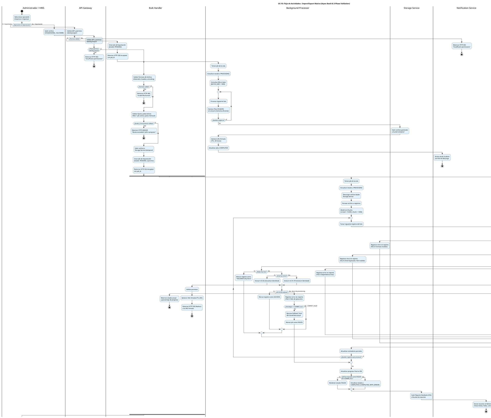

# UC-10: Import/Export Masivo - Diagrama de Actividades

| Metadatos del Documento | |
| :--- | :--- |
| **Proyecto:** | SHUGO - Identity & Access Platform |
| **Caso de Uso:** | UC-10 - Import/Export Masivo (Bulk Identity Operations) |
| **Documento:** | 03_Activity_Diagram.md |
| **Metodología:** | UML 2.5 + ICONIX + Domain-Driven Design + Async Batch Processing Patterns |
| **Autor:** | Gastón Ruiz |
| **Versión Actual:** | 1.0.0 |
| **Fecha:** | 11/09/2026 |

---

## Historial de Versiones

| Versión | Fecha | Autor | Descripción de Cambios | Impacto |
| :--- | :--- | :--- | :--- | :--- |
| **1.0.0** | 11/09/2026 | Gastón Ruiz | **Creación inicial.** Modelado del flujo de trabajo interno asíncrono para operaciones masivas de importación y exportación. Destaca la validación en tres fases (Fail-Fast), el procesamiento por chunks para eficiencia de memoria, las estrategias transaccionales (COMMIT_ALL vs COMMIT_VALID), el modo Dry Run, y la generación de reportes granulares con URLs firmadas. | Documento base del paquete de diseño Tier 1 del UC-10. Establece la lógica de negocio, los puntos de decisión críticos y las garantías de resiliencia y compliance para el procesamiento de grandes volúmenes de datos en el motor KAGAMI. |

---

## 1. Introducción y Propósito

El **Diagrama de Actividades** para el UC-10 visualiza el flujo de control, decisiones y orquestación necesario para gestionar operaciones masivas de identidades en el motor **KAGAMI** de SHUGO.

A diferencia de los UCs transaccionales individuales, el UC-10 introduce complejidades arquitectónicas únicas orientadas al **procesamiento de grandes volúmenes de datos (Big Data patterns)**:

1. **Separación Síncrona/Asíncrona:** La iniciación es síncrona y rápida (<2s), mientras que el procesamiento es asíncrono, gestionado por un Background Job Processor.
2. **Validación en Tres Fases (Fail-Fast):** Cada registro se valida en capas (Sintáctica → Semántica → Consistencia) para detectar errores lo antes posible y minimizar consultas costosas a la base de datos.
3. **Procesamiento por Chunks:** Los archivos grandes (>10.000 registros) se dividen en lotes manejables para prevenir OutOfMemoryErrors y permitir procesamiento paralelo o con retroceso (backpressure).
4. **Estrategias Transaccionales Flexibles:** Soporte para `COMMIT_VALID` (procesar lo válido, reportar lo inválido) y `COMMIT_ALL` (rollback total ante el primer error).
5. **Modo Dry Run:** Capacidad de validar un archivo completo sin realizar cambios persistentes en la base de datos.

Utilizamos carriles (swimlanes) para separar las responsabilidades entre el Usuario/HRIS, API Gateway, Bulk Handler, Validation Core, Background Processor, Storage Service, Notification Service y Database.

---

## 2. Diagrama de Actividades (PlantUML)

A continuación, se presenta el diagrama que cubre el Escenario Principal (Importación asíncrona con COMMIT_VALID), el flujo de Exportación, y los flujos de excepción (COMMIT_ALL, Dry Run, Errores Críticos).



---

## 3. Explicación Detallada del Flujo

### 3.1. Carriles (Partitions / Swimlanes)

El diagrama está dividido en ocho carriles que representan las capas y responsabilidades de la arquitectura:

1. **`|Administrador / HRIS|` (Actor):** Inicia la operación masiva subiendo un archivo o solicitando una exportación. También consulta el progreso y descarga reportes.
2. **`|API Gateway|` (Capa de Entrada):** Valida autenticación, autorización (`identity:import` / `identity:export`) y protege contra solicitudes malformadas.
3. **`|Bulk Handler|` (Capa de Aplicación - Síncrona):** Orquesta la iniciación. Valida el formato del archivo, verifica quotas, sube el archivo a storage temporal y crea el registro del job en la base de datos.
4. **`|Validation Core|` (Capa de Dominio):** Ejecuta la validación en tres fases (Sintáctica, Semántica, Consistencia) para cada registro individual.
5. **`|Background Processor|` (Capa de Aplicación - Asíncrona):** Toma el job de la cola, lo divide en chunks, itera sobre los registros, invoca UC-01/UC-02, maneja la lógica de `COMMIT_ALL` vs `COMMIT_VALID`, y actualiza el progreso.
6. **`|Storage Service|` (Infraestructura):** Almacena el archivo original subido, el archivo exportado generado y el reporte de resultados (CSV).
7. **`|Notification Service|` (Infraestructura):** Envía correos electrónicos o mensajes de Slack con el resumen de la operación y los enlaces de descarga.
8. **`|Database|` (Persistencia):** Almacena el estado del job, el progreso y, finalmente, las identidades creadas/actualizadas (vía UC-01/UC-02).

### 3.2. Puntos de Decisión Críticos (Rombos)

1. **Validación de Formato (Fail-Fast Temprano):**
   - **Pregunta:** ¿El archivo tiene la extensión correcta, los headers esperados y un tamaño <50MB?
   - **Si falla:** Retorna HTTP 400 inmediatamente. No se crea ningún job.
   - **Justificación:** Previene el consumo innecesario de recursos de cola y storage por archivos corruptos o malformados.

2. **Validación de Quota y Concurrencia:**
   - **Pregunta:** ¿El tenant tiene un job en progreso o ha excedido su quota mensual?
   - **Si falla:** Retorna HTTP 409 (Conflict) o 429 (Too Many Requests).
   - **Justificación:** Protege la infraestructura de sobrecarga y asegura un uso justo de los recursos (Fair Usage Policy).

3. **Fases de Validación (1, 2 y 3):**
   - **Fase 1 (Sintáctica):** Valida reglas que no requieren DB (ej. formato de email). Si falla, se registra el error y se salta al siguiente registro.
   - **Fase 2 (Semántica):** Valida reglas que requieren consultas ligeras a DB/Cache (ej. unicidad de email, existencia de roles).
   - **Fase 3 (Consistencia):** Valida dependencias complejas (ej. que el `manager_id` referenciado exista).
   - **Justificación:** El orden es crucial. Validar la consistencia (Fase 3) antes que la sintaxis (Fase 1) sería un desperdicio masivo de ciclos de CPU y consultas a la base de datos.

4. **Modo Dry Run:**
   - **Pregunta:** ¿El job se configuró como `is_dry_run = true`?
   - **Si es sí:** Omite la invocación a UC-01/UC-02 y solo registra el resultado de la validación.
   - **Justificación:** Permite a los administradores pre-validar archivos grandes sin riesgo de corromper datos en producción.

5. **Estrategia de Commit (COMMIT_ALL vs COMMIT_VALID):**
   - **Pregunta:** Si un registro falla durante la ejecución de UC-01/UC-02, ¿la estrategia es `COMMIT_ALL`?
   - **Si es sí:** Ejecuta un Rollback Total del chunk/lote y marca el job como `FAILED`.
   - **Si es no (`COMMIT_VALID`):** Registra el error en el reporte y continúa con el siguiente registro.
   - **Justificación:** Ofrece flexibilidad empresarial. `COMMIT_VALID` es resiliente a datos sucios; `COMMIT_ALL` garantiza integridad transaccional estricta.

---

## 4. Alineación con la Especificación de Requisitos

Este diagrama es la representación visual exacta del documento `01_Requirements_Specification.md`:

| Sección en Requisitos | Representación en el Diagrama |
| :--- | :--- |
| **2.1 Escenario Principal (Importación)** | Flujo completo desde "Subir archivo" hasta "Enviar resumen al Administrador". |
| **2.2 Escenario Alternativo (Exportación)** | Rama inicial "¿Operación es Exportación?" con procesamiento en lotes (streaming) y URL firmada. |
| **2.3 Escenario Alternativo (Errores Parciales)** | Ramas de las 3 fases de validación que registran errores y continúan (COMMIT_VALID). |
| **2.4 Excepción 3.1 (Archivo Inválido)** | Rombo "¿Formato inválido?" y rama "Sí" (HTTP 400). |
| **2.4 Excepción 7.1 (Quota Excedida)** | Rombo "¿Quota excedida o job en progreso?" y rama "Sí" (HTTP 409/429). |
| **3 INV-63** | Validación en Tres Fases (Sintáctica, Semántica, Consistencia) modelada explícitamente. |
| **3 INV-64** | Estrategia de Commit (COMMIT_ALL con rollback, COMMIT_VALID con continuación). |
| **3 RN-10** | División en Chunks (si total > 10.000, chunk = 1.000). |
| **3 RN-15** | Modo Dry Run (valida sin ejecutar UC-01/UC-02). |

---

## 5. Consideraciones de Arquitectura y Diseño (Resilience & Performance)

### 5.1. Eficiencia de Memoria con Streaming y Chunking

El diagrama muestra que el archivo se divide en **Chunks** antes de procesar. 

*   **Problema:** Cargar un CSV de 50MB (aprox. 500.000 filas) en memoria de una sola vez causaría un `OutOfMemoryError` en el servidor de aplicaciones.
*   **Solución:** El `Background Processor` lee y procesa el archivo en bloques de 1.000 registros. Esto mantiene el uso de memoria constante y predecible, independientemente del tamaño del archivo.
*   **Exportación:** Para la exportación, el diagrama especifica "Generar filas en stream", lo que significa que el archivo CSV/JSON se escribe directamente en el stream de salida hacia el Storage Service, sin acumularse en la RAM del servidor.

### 5.2. Aislamiento de Fallos (Fault Tolerance)

La validación en tres fases actúa como un filtro de malla fina:
*   Un error de formato (Fase 1) no dispara una consulta a la base de datos para verificar unicidad (Fase 2).
*   Esto reduce drásticamente la carga en la base de datos cuando se importan archivos con datos de baja calidad.

### 5.3. Transaccionalidad en COMMIT_ALL

Cuando se selecciona `COMMIT_ALL`, el sistema debe garantizar que **ningún** registro se persista si **uno** falla.
*   **Implementación:** El `Background Processor` envuelve el procesamiento de cada chunk (o del lote completo, según la configuración de memoria) en una transacción de base de datos. Si `UC-01` o `UC-02` lanza una excepción, se ejecuta un `ROLLBACK` y el job se marca inmediatamente como `FAILED`, deteniendo el procesamiento posterior.

### 5.4. Seguridad en la Descarga de Reportes

El carril `Bulk Handler` para la descarga del reporte muestra:
1. Validar permisos del solicitante.
2. Generar URL firmada (Presigned URL) con TTL de 24 horas.
3. Retornar HTTP 302 Redirect.
*   **Justificación:** Nunca se sirven archivos masivos (que contienen PII) directamente a través del backend de la aplicación. La URL firmada delega la descarga al Storage Service (S3/Azure Blob), que está optimizado para transferencias de archivos grandes y limita el acceso temporalmente, cumpliendo con GDPR Art. 32.

---

## 6. Trazabilidad con Otros Documentos del Paquete

| Documento | Relación |
| :--- | :--- |
| `01_Requirements_Specification.md` | Este diagrama visualiza los flujos de texto, las invariantes de dominio y los criterios de aceptación. |
| `02_Use_Case_Diagram.md` | Muestra el límite del sistema y los actores; este diagrama muestra el flujo interno y las decisiones lógicas. |
| `04_Initial_Domain_Model.md` | Las acciones de los carriles "Validation Core" y "Background Processor" se implementan aquí como Domain Services (`BulkImportProcessor`, `RecordValidator`). |
| `05_State_Machine_Diagram.md` | Las transiciones de estado del job (`PENDING` → `PROCESSING` → `COMPLETED`/`FAILED`) se ejecutan en los puntos de decisión de este diagrama. |
| `06_Robustness_Diagram.md` | Mostrará la colaboración entre el Bulk Handler, la cola de mensajes, el Storage Service y los validadores. |
| `07_Sequence_Diagram.md` | Detallará el orden temporal exacto de las llamadas: validación de archivo → creación de job → encolado → procesamiento por chunks → generación de reporte. |
| `08_Final_Class_Design.md` | Definirá las firmas exactas de los métodos: `BulkImportHandler.InitiateAsync()`, `BulkImportProcessor.ProcessChunkAsync()`. |

---

## 7. Notas de Implementación

### 7.1. Generación del Diagrama
- **Herramienta:** PlantUML (Diagrams as Code).
- **Ventaja:** Versionable en Git, reproducible, sin dependencias de software propietario.
- **Sintaxis:** Uso de `if/else/endif`, `repeat/while` para bucles de procesamiento, `fork` para concurrencia de consultas de estado, y carriles para separar responsabilidades.

### 7.2. Código de Ejemplo (C# - Procesamiento por Chunks con Validación)

```csharp
public class BulkImportProcessor : IBulkImportProcessor
{
    public async Task ProcessJobAsync(BulkImportJob job, CancellationToken ct)
    {
        // 1. Descargar archivo desde Storage
        using var fileStream = await _storageService.DownloadAsync(job.FileUrl, ct);
        
        // 2. Parsear y procesar en Chunks (ej. 1000 registros por chunk)
        var records = _csvParser.ParseStream(fileStream);
        var chunks = records.Chunk(1000);
        
        int processedCount = 0;
        int successCount = 0;
        var errors = new List<RecordError>();

        foreach (var chunk in chunks)
        {
            // Opcional: Usar TransactionScope si la estrategia es COMMIT_ALL
            using var transaction = job.Options.CommitStrategy == CommitStrategy.COMMIT_ALL 
                ? await _dbContext.Database.BeginTransactionAsync(ct) 
                : null;

            try
            {
                foreach (var (record, index) in chunk.Select((r, i) => (r, i)))
                {
                    var rowNumber = processedCount + index + 1;

                    try
                    {
                        // Fases 1, 2 y 3 de validación
                        await _validator.ValidateAsync(record, rowNumber, job.TenantId, ct);

                        if (!job.Options.IsDryRun)
                        {
                            // Delegar a UC-01 o UC-02
                            if (record.EmailExists)
                                await _identityUpdateService.UpdateAsync(record, ct);
                            else
                                await _identityProvisioningService.ProvisionAsync(record, ct);
                        }
                        successCount++;
                    }
                    catch (ValidationException ex)
                    {
                        errors.Add(new RecordError { RowNumber = rowNumber, Message = ex.Message });
                        
                        if (job.Options.CommitStrategy == CommitStrategy.COMMIT_ALL)
                        {
                            // Rollback total y aborto del job
                            await transaction?.RollbackAsync(ct);
                            await _jobRepository.UpdateStatusAsync(job.Id, JobStatus.FAILED, ct);
                            return; // Salir del procesamiento
                        }
                    }
                }

                // Commit del chunk si es COMMIT_ALL, o simplemente continuar si es COMMIT_VALID
                if (transaction != null) await transaction.CommitAsync(ct);

                processedCount += chunk.Length;
                await _jobRepository.UpdateProgressAsync(job.Id, processedCount, successCount, errors.Count, ct);
            }
            catch (Exception ex)
            {
                await transaction?.RollbackAsync(ct);
                _logger.LogError(ex, "Critical error processing chunk for job {JobId}", job.Id);
                await _jobRepository.UpdateStatusAsync(job.Id, JobStatus.FAILED, ct);
                return;
            }
        }

        // 3. Finalización exitosa
        var finalStatus = errors.Any() ? JobStatus.COMPLETED_WITH_ERRORS : JobStatus.COMPLETED;
        var reportUrl = await _reportGenerator.GenerateAndUploadAsync(job.Id, successCount, errors, ct);
        
        await _jobRepository.CompleteJobAsync(job.Id, finalStatus, reportUrl, ct);
        await _notificationService.SendCompletionEmailAsync(job.InitiatedBy, job.Id, successCount, errors.Count, reportUrl, ct);
    }
}
```

### 7.3. Complejidad del Diagrama
Este es uno de los diagramas más complejos del sistema debido a la necesidad de modelar tanto el flujo síncrono de iniciación como el flujo asíncrono de procesamiento, incluyendo bucles, validaciones en capas y manejo de transacciones. Sin embargo, esta complejidad es necesaria para capturar la robustez requerida en operaciones de migración de datos enterprise.

---
*Fin del Documento 03_Activity_Diagram para UC-10*