# UC-10: Import Export Masivo - 04 Initial Domain Model.md

Documento en construcci�n para UC-10.
# UC-10: Import/Export Masivo - Modelo de Dominio Inicial

| Metadatos del Documento | |
| :--- | :--- |
| **Proyecto:** | SHUGO - Identity & Access Platform |
| **Caso de Uso:** | UC-10 - Import/Export Masivo (Bulk Identity Operations) |
| **Documento:** | 04_Initial_Domain_Model.md |
| **Metodología:** | ICONIX (Modelo de Análisis) + DDD (Domain-Driven Design) + Async Batch Processing Patterns |
| **Autor:** | Gastón Ruiz |
| **Versión Actual:** | 1.0.0 |
| **Fecha:** | 11/09/2026 |

---

## Historial de Versiones

| Versión | Fecha | Autor | Descripción de Cambios | Impacto |
| :--- | :--- | :--- | :--- | :--- |
| **1.0.0** | 11/09/2026 | Gastón Ruiz | **Creación inicial.** Definición del Modelo de Dominio Conceptual para operaciones masivas de importación y exportación. Introduce los Aggregate Roots `BulkImportJob` y `BulkExportJob` con máquinas de estados completas (PENDING → PROCESSING → COMPLETED/FAILED/COMPLETED_WITH_ERRORS), los Value Objects de configuración (`ImportOptions`, `ExportOptions`, `CommitStrategy`, `FileFormat`, `RecordError`, `JobProgress`), los Domain Services especializados (`BulkImportHandler`, `BulkImportProcessor`, `RecordValidator`, `ReportGenerator`), y los eventos de dominio para notificación asíncrona. | Documento base del paquete de diseño Tier 1 del UC-10. Establece cómo el dominio gestiona el ciclo de vida completo de las operaciones masivas, garantizando procesamiento resiliente, validación en tres fases, estrategias transaccionales flexibles, y trazabilidad forense completa. |

---

## 1. Introducción y Propósito

Este documento presenta el **Modelo de Dominio Inicial** para el Caso de Uso UC-10 (Import/Export Masivo).

A diferencia de los UCs transaccionales previos (UC-01 a UC-09) que procesan una identidad a la vez, el UC-10 introduce complejidades únicas debido a su naturaleza de **procesamiento masivo asíncrono**:

1. **Separación de Responsabilidades:** El dominio distingue entre la **iniciación** del job (síncrona, rápida) y el **procesamiento** del job (asíncrono, largo).
2. **Aggregate Roots Especializados:** `BulkImportJob` y `BulkExportJob` son Aggregate Roots independientes que encapsulan el ciclo de vida completo de cada operación masiva.
3. **Validación en Tres Fases:** El `RecordValidator` encapsula las tres fases de validación (Sintáctica → Semántica → Consistencia) como un Domain Service especializado.
4. **Estrategias Transaccionales:** El Value Object `CommitStrategy` encapsula la lógica de `COMMIT_ALL` vs `COMMIT_VALID`.
5. **Procesamiento por Chunks:** El `BulkImportProcessor` divide los archivos grandes en lotes manejables para eficiencia de memoria.
6. **Modo Dry Run:** Soporte para validar archivos sin ejecutar cambios persistentes.
7. **Reportes Granulares:** El `ReportGenerator` genera reportes detallados con el resultado de cada registro individual.

El modelo se centra en:
- **Resiliencia:** Procesamiento tolerante a fallos con reintentos y rollback controlado.
- **Eficiencia:** Uso óptimo de memoria mediante chunking y streaming.
- **Trazabilidad:** Auditoría completa de cada operación masiva con métricas detalladas.
- **Flexibilidad:** Adaptación a diferentes requisitos empresariales (commit total vs parcial, dry run, etc.).

---

## 2. Diagrama de Modelo de Dominio Conceptual (PlantUML)

A continuación, se presenta el diagrama de clases conceptual, enfocándose en los objetos de dominio, servicios y eventos introducidos para UC-10.

```plantuml
@startuml UC-10_DominioConceptual
<style>
diagram {
  BackgroundColor #FFFFFF
}
</style>
skinparam classAttributeIconSize 0
skinparam classBackgroundColor #FFFFFF
skinparam classBorderColor #1565C0
skinparam classHeaderBackgroundColor #E3F2FD

title UC-10: Modelo de Dominio Conceptual - Import/Export Masivo (Async Batch & 3-Phase Validation)

' ============================================
' AGGREGATE ROOTS
' ============================================
class BulkImportJob <<Aggregate Root>> {
  - id: JobId
  - tenantId: TenantId
  - initiatedBy: IdentityId
  - status: JobStatus
  - fileName: string
  - fileUrl: string
  - fileSizeBytes: long
  - totalRecords: int
  - processedRecords: int
  - successfulRecords: int
  - failedRecords: int
  - options: ImportOptions
  - errors: List<RecordError>
  - reportUrl: string
  - startedAt: DateTime?
  - completedAt: DateTime?
  - domainEvents: List<IDomainEvent>
  
  + Initiate(tenantId, initiatedBy, fileName, fileUrl, fileSizeBytes, totalRecords, options): BulkImportJob
  + StartProcessing(): void
  + UpdateProgress(processed, successful, failed): void
  + MarkAsCompleted(reportUrl): void
  + MarkAsCompletedWithErrors(reportUrl): void
  + MarkAsFailed(reason: string): void
  + AddError(error: RecordError): void
  - ValidateTransition(newStatus: JobStatus): void
}

class BulkExportJob <<Aggregate Root>> {
  - id: JobId
  - tenantId: TenantId
  - initiatedBy: IdentityId
  - status: JobStatus
  - filters: ExportFilters
  - format: FileFormat
  - fields: List<string>
  - totalRecords: int
  - exportedRecords: int
  - fileUrl: string
  - fileSizeBytes: long
  - downloadUrl: string
  - downloadUrlExpiresAt: DateTime?
  - startedAt: DateTime?
  - completedAt: DateTime?
  - domainEvents: List<IDomainEvent>
  
  + Initiate(tenantId, initiatedBy, filters, format, fields): BulkExportJob
  + StartProcessing(): void
  + UpdateProgress(exported, total): void
  + MarkAsCompleted(fileUrl, fileSizeBytes, downloadUrl, expiresAt): void
  + MarkAsFailed(reason: string): void
  - ValidateTransition(newStatus: JobStatus): void
}

' ============================================
' VALUE OBJECTS
' ============================================
class ImportOptions <<Value Object>> {
  - commitStrategy: CommitStrategy
  - isDryRun: bool
  - fileFormat: FileFormat
  - encoding: string
  - delimiter: char
  - hasHeaders: bool
  + ImportOptions(commitStrategy, isDryRun, fileFormat, encoding, delimiter, hasHeaders)
}

class ExportOptions <<Value Object>> {
  - format: FileFormat
  - fields: List<string>
  - includeMetadata: bool
  + ExportOptions(format, fields, includeMetadata)
}

class CommitStrategy <<Value Object>> {
  - value: string
  + COMMIT_ALL: CommitStrategy
  + COMMIT_VALID: CommitStrategy
  + CommitStrategy(value: string)
}

class FileFormat <<Value Object>> {
  - value: string
  + CSV: FileFormat
  + JSON: FileFormat
  + XML: FileFormat
  + FileFormat(value: string)
}

class RecordError <<Value Object>> {
  - rowNumber: int
  - errorCode: string
  - errorMessage: string
  - recordData: JsonDocument
  - phase: ValidationPhase
  + RecordError(rowNumber, errorCode, errorMessage, recordData, phase)
}

class JobProgress <<Value Object>> {
  - totalRecords: int
  - processedRecords: int
  - successfulRecords: int
  - failedRecords: int
  - percentage: double
  + JobProgress(total, processed, successful, failed)
  + CalculatePercentage(): double
}

class ExportFilters <<Value Object>> {
  - roles: List<string>
  - status: string
  - createdAfter: DateTime?
  - createdBefore: DateTime?
  - customFilters: JsonDocument
  + ExportFilters(roles, status, createdAfter, createdBefore, customFilters)
}

class ValidationPhase <<Value Object>> {
  - value: string
  + SYNTACTIC: ValidationPhase
  + SEMANTIC: ValidationPhase
  + CONSISTENCY: ValidationPhase
  + ValidationPhase(value: string)
}

class JobStatus <<Value Object>> {
  - value: string
  + PENDING: JobStatus
  + PROCESSING: JobStatus
  + COMPLETED: JobStatus
  + COMPLETED_WITH_ERRORS: JobStatus
  + FAILED: JobStatus
  + JobStatus(value: string)
  + CanTransitionTo(newStatus: JobStatus): bool
}

class JobId <<Value Object>> {
  - value: Guid
  + JobId(value: Guid)
}

class TenantId <<Value Object>> {
  - value: Guid
  + TenantId(value: Guid)
}

class IdentityId <<Value Object>> {
  - value: Guid
  + IdentityId(value: Guid)
}

' ============================================
' DOMAIN SERVICES
' ============================================
class BulkImportHandler <<Domain Service>> {
  - jobRepo: IJobRepository
  - fileValidator: IFileValidator
  - storageService: IStorageService
  - jobQueue: IJobQueue
  - quotaService: IQuotaService
  - eventPublisher: IEventPublisher
  
  + InitiateImport(command: InitiateImportCommand): Task<JobId>
  - ValidateFileFormat(fileStream, fileName): Task<ValidationResult>
  - ValidateQuotaAndConcurrency(tenantId, recordCount): Task
  - UploadFileToStorage(fileStream, jobId): Task<string>
  - EnqueueJob(jobId, fileUrl, options): Task
}

class BulkImportProcessor <<Domain Service>> {
  - jobRepo: IJobRepository
  - storageService: IStorageService
  - recordValidator: IRecordValidator
  - identityProvisioningService: IIdentityProvisioningService
  - identityUpdateService: IIdentityUpdateService
  - reportGenerator: IReportGenerator
  - notificationService: INotificationService
  
  + ProcessJobAsync(jobId: JobId): Task
  - ProcessChunkAsync(chunk: List<Record>, job: BulkImportJob): Task<ChunkResult>
  - HandleCommitAllError(error: Exception, job: BulkImportJob): Task
}

class RecordValidator <<Domain Service>> {
  - identityRepo: IIdentityRepository
  - roleRepo: IRoleRepository
  - tenantConfigRepo: ITenantConfigRepository
  
  + ValidateAsync(record: Record, rowNumber: int, tenantId: TenantId, ct: CancellationToken): Task
  - ValidateSyntacticPhase(record: Record, rowNumber: int): void
  - ValidateSemanticPhase(record: Record, rowNumber: int, tenantId: TenantId): Task
  - ValidateConsistencyPhase(record: Record, rowNumber: int, tenantId: TenantId): Task
}

class ReportGenerator <<Domain Service>> {
  - storageService: IStorageService
  
  + GenerateImportReportAsync(jobId: JobId, successfulRecords: List<SuccessRecord>, errors: List<RecordError>): Task<string>
  + GenerateExportFileAsync(records: IAsyncEnumerable<Record>, format: FileFormat, fields: List<string>): Task<string>
}

class BulkExportHandler <<Domain Service>> {
  - jobRepo: IJobRepository
  - identityRepo: IIdentityRepository
  - storageService: IStorageService
  - reportGenerator: IReportGenerator
  - jobQueue: IJobQueue
  
  + InitiateExport(command: InitiateExportCommand): Task<JobId>
  + ProcessExportJobAsync(jobId: JobId): Task
}

' ============================================
' DOMAIN EVENTS
' ============================================
class BulkImportInitiated <<Domain Event>> {
  + jobId: JobId
  + tenantId: TenantId
  + initiatedBy: IdentityId
  + totalRecords: int
  + fileFormat: FileFormat
  + commitStrategy: CommitStrategy
  + isDryRun: bool
}

class BulkImportCompleted <<Domain Event>> {
  + jobId: JobId
  + tenantId: TenantId
  + status: JobStatus
  + totalRecords: int
  + successfulRecords: int
  + failedRecords: int
  + processingTimeSeconds: int
  + reportUrl: string
}

class BulkExportInitiated <<Domain Event>> {
  + jobId: JobId
  + tenantId: TenantId
  + initiatedBy: IdentityId
  + filters: ExportFilters
  + format: FileFormat
}

class BulkExportCompleted <<Domain Event>> {
  + jobId: JobId
  + tenantId: TenantId
  + totalRecords: int
  + fileUrl: string
  + downloadUrl: string
  + downloadUrlExpiresAt: DateTime
}

' ============================================
' INTERFACES
' ============================================
interface IJobRepository {
  + SaveAsync(job: BulkImportJob | BulkExportJob): Task
  + GetByIdAsync(jobId: JobId): Task<BulkImportJob | BulkExportJob?>
  + GetActiveJobsByTenantAsync(tenantId: TenantId): Task<List<BulkImportJob | BulkExportJob>>
  + UpdateProgressAsync(jobId: JobId, progress: JobProgress): Task
}

interface IStorageService {
  + UploadAsync(stream: Stream, key: string): Task<string>
  + DownloadAsync(url: string): Task<Stream>
  + GenerateSignedUrlAsync(key: string, expiration: TimeSpan): Task<string>
}

interface IJobQueue {
  + EnqueueAsync(message: BulkImportMessage | BulkExportMessage): Task
  + DequeueAsync(): Task<BulkImportMessage | BulkExportMessage?>
}

interface IRecordValidator {
  + ValidateAsync(record: Record, rowNumber: int, tenantId: TenantId, ct: CancellationToken): Task
}

interface IQuotaService {
  + ValidateQuotaAsync(tenantId: TenantId, requestedRecords: int): Task
  + ConsumeQuotaAsync(tenantId: TenantId, consumedRecords: int): Task
}

' ============================================
' RELACIONES
' ============================================
BulkImportJob *-- ImportOptions : "configuración"
BulkImportJob *-- JobStatus : "estado actual"
BulkImportJob *-- JobProgress : "progreso"
BulkImportJob *-- RecordError : "errores (0..*)"
BulkImportJob *-- TenantId : "pertenece a"
BulkImportJob *-- IdentityId : "iniciado por"

BulkExportJob *-- ExportOptions : "configuración"
BulkExportJob *-- ExportFilters : "filtros"
BulkExportJob *-- JobStatus : "estado actual"
BulkExportJob *-- TenantId : "pertenece a"
BulkExportJob *-- IdentityId : "iniciado por"

ImportOptions *-- CommitStrategy : "estrategia"
ImportOptions *-- FileFormat : "formato"

RecordError *-- ValidationPhase : "fase de error"

BulkImportHandler --> IJobRepository : "persiste"
BulkImportHandler --> IStorageService : "almacena archivos"
BulkImportHandler --> IJobQueue : "encola jobs"
BulkImportHandler --> IQuotaService : "valida quota"

BulkImportProcessor --> IJobRepository : "actualiza progreso"
BulkImportProcessor --> IStorageService : "descarga archivos"
BulkImportProcessor --> IRecordValidator : "valida registros"
BulkImportProcessor --> IReportGenerator : "genera reportes"

RecordValidator --> IIdentityRepository : "valida unicidad"
RecordValidator --> IRoleRepository : "valida roles"

note right of BulkImportJob
  **Aggregate Root:**
  - Encapsula ciclo de vida completo
  - Valida transiciones de estado
  - Genera eventos de dominio
  - Tracking granular de progreso
end note

note right of RecordValidator
  **Validación en 3 Fases:**
  - Fase 1: Sintáctica (rápido, sin DB)
  - Fase 2: Semántica (consultas ligeras)
  - Fase 3: Consistencia (dependencias)
  - Fail-Fast optimizado
end note

note bottom of BulkImportProcessor
  **Orquestación Asíncrona:**
  - Procesamiento por chunks
  - Manejo de COMMIT_ALL vs COMMIT_VALID
  - Soporte Dry Run
  - Delegación a UC-01/UC-02
end note

@enduml
```



---

## 3. Detalle de Conceptos de Dominio (DDD)

### 3.1. Aggregate Root: `BulkImportJob`

El Aggregate Root `BulkImportJob` encapsula el ciclo de vida completo de una operación masiva de importación, desde su iniciación hasta su completación o fallo.

**Código (C#):**

```csharp
public class BulkImportJob : AggregateRoot
{
    public JobId Id { get; private set; }
    public TenantId TenantId { get; private set; }
    public IdentityId InitiatedBy { get; private set; }
    public JobStatus Status { get; private set; }
    public string FileName { get; private set; }
    public string FileUrl { get; private set; }
    public long FileSizeBytes { get; private set; }
    public int TotalRecords { get; private set; }
    public int ProcessedRecords { get; private set; }
    public int SuccessfulRecords { get; private set; }
    public int FailedRecords { get; private set; }
    public ImportOptions Options { get; private set; }
    public List<RecordError> Errors { get; private set; }
    public string? ReportUrl { get; private set; }
    public DateTime CreatedAt { get; private set; }
    public DateTime? StartedAt { get; private set; }
    public DateTime? CompletedAt { get; private set; }
    
    private readonly List<IDomainEvent> _domainEvents = new();

    // Constructor privado para EF Core
    private BulkImportJob() 
    {
        Errors = new List<RecordError>();
    }

    /// <summary>
    /// Método de fábrica para crear un nuevo job de importación en estado PENDING.
    /// </summary>
    public static BulkImportJob Initiate(
        TenantId tenantId,
        IdentityId initiatedBy,
        string fileName,
        string fileUrl,
        long fileSizeBytes,
        int totalRecords,
        ImportOptions options)
    {
        var job = new BulkImportJob
        {
            Id = new JobId(Guid.NewGuid()),
            TenantId = tenantId,
            InitiatedBy = initiatedBy,
            Status = JobStatus.PENDING,
            FileName = fileName,
            FileUrl = fileUrl,
            FileSizeBytes = fileSizeBytes,
            TotalRecords = totalRecords,
            ProcessedRecords = 0,
            SuccessfulRecords = 0,
            FailedRecords = 0,
            Options = options,
            Errors = new List<RecordError>(),
            CreatedAt = DateTime.UtcNow
        };

        job.ValidateInitialState();
        
        // Generar evento de dominio
        job.AddDomainEvent(new BulkImportInitiated(
            job.Id,
            job.TenantId,
            job.InitiatedBy,
            job.TotalRecords,
            job.Options.FileFormat,
            job.Options.CommitStrategy,
            job.Options.IsDryRun
        ));

        return job;
    }

    /// <summary>
    /// Transición: PENDING → PROCESSING
    /// </summary>
    public void StartProcessing()
    {
        ValidateTransition(JobStatus.PROCESSING);
        
        this.Status = JobStatus.PROCESSING;
        this.StartedAt = DateTime.UtcNow;
    }

    /// <summary>
    /// Actualiza el progreso del job.
    /// </summary>
    public void UpdateProgress(int processed, int successful, int failed)
    {
        if (this.Status != JobStatus.PROCESSING)
            throw new DomainException("Cannot update progress when job is not processing.");

        this.ProcessedRecords = processed;
        this.SuccessfulRecords = successful;
        this.FailedRecords = failed;
    }

    /// <summary>
    /// Transición: PROCESSING → COMPLETED
    /// </summary>
    public void MarkAsCompleted(string reportUrl)
    {
        ValidateTransition(JobStatus.COMPLETED);
        
        this.Status = JobStatus.COMPLETED;
        this.ReportUrl = reportUrl;
        this.CompletedAt = DateTime.UtcNow;

        AddDomainEvent(new BulkImportCompleted(
            this.Id,
            this.TenantId,
            this.Status,
            this.TotalRecords,
            this.SuccessfulRecords,
            this.FailedRecords,
            (int)(this.CompletedAt.Value - this.StartedAt!.Value).TotalSeconds,
            this.ReportUrl
        ));
    }

    /// <summary>
    /// Transición: PROCESSING → COMPLETED_WITH_ERRORS
    /// </summary>
    public void MarkAsCompletedWithErrors(string reportUrl)
    {
        ValidateTransition(JobStatus.COMPLETED_WITH_ERRORS);
        
        this.Status = JobStatus.COMPLETED_WITH_ERRORS;
        this.ReportUrl = reportUrl;
        this.CompletedAt = DateTime.UtcNow;

        AddDomainEvent(new BulkImportCompleted(
            this.Id,
            this.TenantId,
            this.Status,
            this.TotalRecords,
            this.SuccessfulRecords,
            this.FailedRecords,
            (int)(this.CompletedAt.Value - this.StartedAt!.Value).TotalSeconds,
            this.ReportUrl
        ));
    }

    /// <summary>
    /// Transición: PROCESSING → FAILED
    /// </summary>
    public void MarkAsFailed(string reason)
    {
        ValidateTransition(JobStatus.FAILED);
        
        this.Status = JobStatus.FAILED;
        this.CompletedAt = DateTime.UtcNow;

        AddDomainEvent(new BulkImportCompleted(
            this.Id,
            this.TenantId,
            this.Status,
            this.TotalRecords,
            this.SuccessfulRecords,
            this.FailedRecords,
            (int)(this.CompletedAt.Value - this.StartedAt!.Value).TotalSeconds,
            null
        ));
    }

    /// <summary>
    /// Agrega un error de registro al job.
    /// </summary>
    public void AddError(RecordError error)
    {
        this.Errors.Add(error);
        this.FailedRecords = this.Errors.Count;
    }

    /// <summary>
    /// Valida invariantes del estado inicial.
    /// </summary>
    private void ValidateInitialState()
    {
        if (this.Status != JobStatus.PENDING)
            throw new DomainException("New bulk import job must be in PENDING status.");

        if (string.IsNullOrWhiteSpace(this.FileName))
            throw new DomainException("File name cannot be empty.");

        if (string.IsNullOrWhiteSpace(this.FileUrl))
            throw new DomainException("File URL cannot be empty.");

        if (this.TotalRecords <= 0)
            throw new DomainException("Total records must be greater than zero.");

        if (this.Options == null)
            throw new DomainException("Import options cannot be null.");
    }

    /// <summary>
    /// Valida que la transición de estado sea permitida.
    /// </summary>
    private void ValidateTransition(JobStatus newStatus)
    {
        if (!this.Status.CanTransitionTo(newStatus))
            throw new InvalidTransitionException(
                $"Cannot transition from {this.Status} to {newStatus}.");
    }

    public IReadOnlyCollection<IDomainEvent> GetDomainEvents() => _domainEvents.AsReadOnly();
    
    protected void AddDomainEvent(IDomainEvent evt) => _domainEvents.Add(evt);
}
```

### 3.2. Aggregate Root: `BulkExportJob`

El Aggregate Root `BulkExportJob` encapsula el ciclo de vida completo de una operación masiva de exportación.

**Código (C#):**

```csharp
public class BulkExportJob : AggregateRoot
{
    public JobId Id { get; private set; }
    public TenantId TenantId { get; private set; }
    public IdentityId InitiatedBy { get; private set; }
    public JobStatus Status { get; private set; }
    public ExportFilters Filters { get; private set; }
    public FileFormat Format { get; private set; }
    public List<string> Fields { get; private set; }
    public int TotalRecords { get; private set; }
    public int ExportedRecords { get; private set; }
    public string? FileUrl { get; private set; }
    public long FileSizeBytes { get; private set; }
    public string? DownloadUrl { get; private set; }
    public DateTime? DownloadUrlExpiresAt { get; private set; }
    public DateTime CreatedAt { get; private set; }
    public DateTime? StartedAt { get; private set; }
    public DateTime? CompletedAt { get; private set; }
    
    private readonly List<IDomainEvent> _domainEvents = new();

    private BulkExportJob() 
    {
        Fields = new List<string>();
    }

    /// <summary>
    /// Método de fábrica para crear un nuevo job de exportación en estado PENDING.
    /// </summary>
    public static BulkExportJob Initiate(
        TenantId tenantId,
        IdentityId initiatedBy,
        ExportFilters filters,
        FileFormat format,
        List<string> fields)
    {
        var job = new BulkExportJob
        {
            Id = new JobId(Guid.NewGuid()),
            TenantId = tenantId,
            InitiatedBy = initiatedBy,
            Status = JobStatus.PENDING,
            Filters = filters,
            Format = format,
            Fields = fields,
            TotalRecords = 0,
            ExportedRecords = 0,
            CreatedAt = DateTime.UtcNow
        };

        job.ValidateInitialState();
        
        // Generar evento de dominio
        job.AddDomainEvent(new BulkExportInitiated(
            job.Id,
            job.TenantId,
            job.InitiatedBy,
            job.Filters,
            job.Format
        ));

        return job;
    }

    /// <summary>
    /// Transición: PENDING → PROCESSING
    /// </summary>
    public void StartProcessing()
    {
        ValidateTransition(JobStatus.PROCESSING);
        
        this.Status = JobStatus.PROCESSING;
        this.StartedAt = DateTime.UtcNow;
    }

    /// <summary>
    /// Actualiza el progreso del job.
    /// </summary>
    public void UpdateProgress(int exported, int total)
    {
        if (this.Status != JobStatus.PROCESSING)
            throw new DomainException("Cannot update progress when job is not processing.");

        this.ExportedRecords = exported;
        this.TotalRecords = total;
    }

    /// <summary>
    /// Transición: PROCESSING → COMPLETED
    /// </summary>
    public void MarkAsCompleted(string fileUrl, long fileSizeBytes, string downloadUrl, DateTime expiresAt)
    {
        ValidateTransition(JobStatus.COMPLETED);
        
        this.Status = JobStatus.COMPLETED;
        this.FileUrl = fileUrl;
        this.FileSizeBytes = fileSizeBytes;
        this.DownloadUrl = downloadUrl;
        this.DownloadUrlExpiresAt = expiresAt;
        this.CompletedAt = DateTime.UtcNow;

        AddDomainEvent(new BulkExportCompleted(
            this.Id,
            this.TenantId,
            this.TotalRecords,
            this.FileUrl,
            this.DownloadUrl,
            this.DownloadUrlExpiresAt.Value
        ));
    }

    /// <summary>
    /// Transición: PROCESSING → FAILED
    /// </summary>
    public void MarkAsFailed(string reason)
    {
        ValidateTransition(JobStatus.FAILED);
        
        this.Status = JobStatus.FAILED;
        this.CompletedAt = DateTime.UtcNow;
    }

    private void ValidateInitialState()
    {
        if (this.Status != JobStatus.PENDING)
            throw new DomainException("New bulk export job must be in PENDING status.");

        if (this.Filters == null)
            throw new DomainException("Export filters cannot be null.");

        if (this.Format == null)
            throw new DomainException("Export format cannot be null.");

        if (this.Fields == null || !this.Fields.Any())
            throw new DomainException("At least one field must be specified for export.");
    }

    private void ValidateTransition(JobStatus newStatus)
    {
        if (!this.Status.CanTransitionTo(newStatus))
            throw new InvalidTransitionException(
                $"Cannot transition from {this.Status} to {newStatus}.");
    }

    public IReadOnlyCollection<IDomainEvent> GetDomainEvents() => _domainEvents.AsReadOnly();
    
    protected void AddDomainEvent(IDomainEvent evt) => _domainEvents.Add(evt);
}
```

### 3.3. Value Objects de Configuración y Estado

#### **ImportOptions**

Value Object que encapsula las opciones de configuración para una importación masiva.

```csharp
public class ImportOptions : ValueObject
{
    public CommitStrategy CommitStrategy { get; }
    public bool IsDryRun { get; }
    public FileFormat FileFormat { get; }
    public string Encoding { get; }
    public char Delimiter { get; }
    public bool HasHeaders { get; }

    public ImportOptions(
        CommitStrategy commitStrategy,
        bool isDryRun,
        FileFormat fileFormat,
        string encoding = "UTF-8",
        char delimiter = ',',
        bool hasHeaders = true)
    {
        if (commitStrategy == null)
            throw new DomainException("Commit strategy cannot be null.");

        if (fileFormat == null)
            throw new DomainException("File format cannot be null.");

        if (string.IsNullOrWhiteSpace(encoding))
            throw new DomainException("Encoding cannot be empty.");

        CommitStrategy = commitStrategy;
        IsDryRun = isDryRun;
        FileFormat = fileFormat;
        Encoding = encoding;
        Delimiter = delimiter;
        HasHeaders = hasHeaders;
    }

    protected override IEnumerable<object> GetEqualityComponents()
    {
        yield return CommitStrategy;
        yield return IsDryRun;
        yield return FileFormat;
        yield return Encoding;
        yield return Delimiter;
        yield return HasHeaders;
    }
}
```

#### **CommitStrategy**

Value Object que encapsula la estrategia de transaccionalidad para la importación.

```csharp
public class CommitStrategy : ValueObject
{
    public string Value { get; }

    private CommitStrategy(string value)
    {
        if (string.IsNullOrWhiteSpace(value))
            throw new DomainException("Commit strategy value cannot be empty.");

        Value = value.ToUpperInvariant();
    }

    public static CommitStrategy COMMIT_ALL => new CommitStrategy("COMMIT_ALL");
    public static CommitStrategy COMMIT_VALID => new CommitStrategy("COMMIT_VALID");

    public bool IsCommitAll => Value == "COMMIT_ALL";
    public bool IsCommitValid => Value == "COMMIT_VALID";

    protected override IEnumerable<object> GetEqualityComponents()
    {
        yield return Value;
    }
}
```

#### **FileFormat**

Value Object que encapsula el formato de archivo soportado.

```csharp
public class FileFormat : ValueObject
{
    public string Value { get; }

    private FileFormat(string value)
    {
        if (string.IsNullOrWhiteSpace(value))
            throw new DomainException("File format value cannot be empty.");

        Value = value.ToUpperInvariant();
    }

    public static FileFormat CSV => new FileFormat("CSV");
    public static FileFormat JSON => new FileFormat("JSON");
    public static FileFormat XML => new FileFormat("XML");

    public bool IsCsv => Value == "CSV";
    public bool IsJson => Value == "JSON";
    public bool IsXml => Value == "XML";

    public string GetFileExtension()
    {
        return Value switch
        {
            "CSV" => ".csv",
            "JSON" => ".json",
            "XML" => ".xml",
            _ => throw new DomainException($"Unknown file format: {Value}")
        };
    }

    protected override IEnumerable<object> GetEqualityComponents()
    {
        yield return Value;
    }
}
```

#### **RecordError**

Value Object que encapsula un error específico de un registro individual dentro de un lote.

```csharp
public class RecordError : ValueObject
{
    public int RowNumber { get; }
    public string ErrorCode { get; }
    public string ErrorMessage { get; }
    public JsonDocument? RecordData { get; }
    public ValidationPhase Phase { get; }

    public RecordError(
        int rowNumber,
        string errorCode,
        string errorMessage,
        JsonDocument? recordData = null,
        ValidationPhase? phase = null)
    {
        if (rowNumber <= 0)
            throw new DomainException("Row number must be greater than zero.");

        if (string.IsNullOrWhiteSpace(errorCode))
            throw new DomainException("Error code cannot be empty.");

        if (string.IsNullOrWhiteSpace(errorMessage))
            throw new DomainException("Error message cannot be empty.");

        RowNumber = rowNumber;
        ErrorCode = errorCode;
        ErrorMessage = errorMessage;
        RecordData = recordData;
        Phase = phase ?? ValidationPhase.SYNTACTIC;
    }

    protected override IEnumerable<object> GetEqualityComponents()
    {
        yield return RowNumber;
        yield return ErrorCode;
        yield return ErrorMessage;
        yield return Phase;
    }
}
```

#### **JobProgress**

Value Object que encapsula el progreso actual de un job.

```csharp
public class JobProgress : ValueObject
{
    public int TotalRecords { get; }
    public int ProcessedRecords { get; }
    public int SuccessfulRecords { get; }
    public int FailedRecords { get; }
    public double Percentage { get; }

    public JobProgress(int totalRecords, int processedRecords, int successfulRecords, int failedRecords)
    {
        if (totalRecords < 0)
            throw new DomainException("Total records cannot be negative.");

        if (processedRecords < 0)
            throw new DomainException("Processed records cannot be negative.");

        if (successfulRecords < 0)
            throw new DomainException("Successful records cannot be negative.");

        if (failedRecords < 0)
            throw new DomainException("Failed records cannot be negative.");

        TotalRecords = totalRecords;
        ProcessedRecords = processedRecords;
        SuccessfulRecords = successfulRecords;
        FailedRecords = failedRecords;
        Percentage = CalculatePercentage();
    }

    private double CalculatePercentage()
    {
        if (TotalRecords == 0)
            return 0.0;

        return Math.Round((double)ProcessedRecords / TotalRecords * 100, 2);
    }

    protected override IEnumerable<object> GetEqualityComponents()
    {
        yield return TotalRecords;
        yield return ProcessedRecords;
        yield return SuccessfulRecords;
        yield return FailedRecords;
    }
}
```

#### **JobStatus**

Value Object que encapsula el estado de un job con validación de transiciones permitidas.

```csharp
public class JobStatus : ValueObject
{
    public string Value { get; }

    private JobStatus(string value)
    {
        if (string.IsNullOrWhiteSpace(value))
            throw new DomainException("Status value cannot be empty.");

        Value = value.ToUpperInvariant();
    }

    public static JobStatus PENDING => new JobStatus("PENDING");
    public static JobStatus PROCESSING => new JobStatus("PROCESSING");
    public static JobStatus COMPLETED => new JobStatus("COMPLETED");
    public static JobStatus COMPLETED_WITH_ERRORS => new JobStatus("COMPLETED_WITH_ERRORS");
    public static JobStatus FAILED => new JobStatus("FAILED");

    /// <summary>
    /// Valida si la transición al nuevo estado es permitida.
    /// </summary>
    public bool CanTransitionTo(JobStatus newStatus)
    {
        // Matriz de transiciones permitidas
        var allowedTransitions = new Dictionary<string, HashSet<string>>
        {
            { "PENDING", new HashSet<string> { "PROCESSING", "FAILED" } },
            { "PROCESSING", new HashSet<string> { "COMPLETED", "COMPLETED_WITH_ERRORS", "FAILED" } },
            { "COMPLETED", new HashSet<string>() }, // Estado terminal
            { "COMPLETED_WITH_ERRORS", new HashSet<string>() }, // Estado terminal
            { "FAILED", new HashSet<string>() } // Estado terminal
        };

        if (allowedTransitions.TryGetValue(this.Value, out var allowed))
        {
            return allowed.Contains(newStatus.Value);
        }

        return false;
    }

    public bool IsTerminal => Value == "COMPLETED" || Value == "COMPLETED_WITH_ERRORS" || Value == "FAILED";

    public override string ToString() => Value;

    protected override IEnumerable<object> GetEqualityComponents()
    {
        yield return Value;
    }
}
```

### 3.4. Domain Services

#### **BulkImportHandler**

Domain Service que orquesta la iniciación de una importación masiva (fase síncrona).

```csharp
public class BulkImportHandler : IBulkImportHandler
{
    private readonly IJobRepository _jobRepo;
    private readonly IFileValidator _fileValidator;
    private readonly IStorageService _storageService;
    private readonly IJobQueue _jobQueue;
    private readonly IQuotaService _quotaService;
    private readonly IEventPublisher _eventPublisher;
    private readonly ILogger<BulkImportHandler> _logger;

    public BulkImportHandler(
        IJobRepository jobRepo,
        IFileValidator fileValidator,
        IStorageService storageService,
        IJobQueue jobQueue,
        IQuotaService quotaService,
        IEventPublisher eventPublisher,
        ILogger<BulkImportHandler> logger)
    {
        _jobRepo = jobRepo;
        _fileValidator = fileValidator;
        _storageService = storageService;
        _jobQueue = jobQueue;
        _quotaService = quotaService;
        _eventPublisher = eventPublisher;
        _logger = logger;
    }

    /// <summary>
    /// Inicia una nueva importación masiva (fase síncrona, rápida).
    /// </summary>
    public async Task<JobId> InitiateImportAsync(InitiateImportCommand command, CancellationToken ct)
    {
        // 1. Validar formato de archivo (síncrono, rápido)
        var validationResult = await _fileValidator.ValidateAsync(
            command.FileStream, 
            command.FileName, 
            ct);
        
        if (!validationResult.IsValid)
            throw new InvalidFileException(validationResult.ErrorMessage);

        // 2. Validar quota y concurrencia
        await _quotaService.ValidateQuotaAsync(command.TenantId, validationResult.TotalRecords);
        
        var activeJobs = await _jobRepo.GetActiveJobsByTenantAsync(command.TenantId);
        if (activeJobs.Any())
            throw new BulkOperationInProgressException(
                "Another bulk operation is already in progress. Please wait for it to complete.");

        // 3. Subir archivo a storage temporal
        var jobId = new JobId(Guid.NewGuid());
        var fileKey = $"imports/{command.TenantId.Value}/{jobId.Value}/{command.FileName}";
        var fileUrl = await _storageService.UploadAsync(command.FileStream, fileKey);

        // 4. Crear Aggregate Root
        var job = BulkImportJob.Initiate(
            command.TenantId,
            command.InitiatedBy,
            command.FileName,
            fileUrl,
            command.FileStream.Length,
            validationResult.TotalRecords,
            command.Options
        );

        // 5. Persistir job
        await _jobRepo.SaveAsync(job, ct);

        // 6. Encolar job para procesamiento asíncrono
        await _jobQueue.EnqueueAsync(new BulkImportMessage
        {
            JobId = job.Id,
            FileUrl = fileUrl,
            Options = command.Options
        }, ct);

        _logger.LogInformation(
            "Bulk import job {JobId} initiated by {AdminId} for tenant {TenantId} with {TotalRecords} records",
            job.Id, command.InitiatedBy, command.TenantId, job.TotalRecords);

        // 7. Publicar eventos de dominio
        await _eventPublisher.PublishAsync(job.GetDomainEvents(), ct);

        return job.Id;
    }
}
```

#### **BulkImportProcessor**

Domain Service que orquesta el procesamiento asíncrono de un job de importación.

```csharp
public class BulkImportProcessor : IBulkImportProcessor
{
    private const int CHUNK_SIZE = 1000;

    private readonly IJobRepository _jobRepo;
    private readonly IStorageService _storageService;
    private readonly IRecordValidator _recordValidator;
    private readonly IIdentityProvisioningService _identityProvisioningService;
    private readonly IIdentityUpdateService _identityUpdateService;
    private readonly IReportGenerator _reportGenerator;
    private readonly INotificationService _notificationService;
    private readonly IUnitOfWork _unitOfWork;
    private readonly ILogger<BulkImportProcessor> _logger;

    public BulkImportProcessor(
        IJobRepository jobRepo,
        IStorageService storageService,
        IRecordValidator recordValidator,
        IIdentityProvisioningService identityProvisioningService,
        IIdentityUpdateService identityUpdateService,
        IReportGenerator reportGenerator,
        INotificationService notificationService,
        IUnitOfWork unitOfWork,
        ILogger<BulkImportProcessor> logger)
    {
        _jobRepo = jobRepo;
        _storageService = storageService;
        _recordValidator = recordValidator;
        _identityProvisioningService = identityProvisioningService;
        _identityUpdateService = identityUpdateService;
        _reportGenerator = reportGenerator;
        _notificationService = notificationService;
        _unitOfWork = unitOfWork;
        _logger = logger;
    }

    /// <summary>
    /// Procesa un job de importación de forma asíncrona.
    /// </summary>
    public async Task ProcessJobAsync(JobId jobId, CancellationToken ct)
    {
        // 1. Cargar job
        var job = await _jobRepo.GetByIdAsync(jobId);
        if (job == null)
            throw new JobNotFoundException($"Job {jobId} not found.");

        // 2. Transicionar a PROCESSING
        job.StartProcessing();
        await _jobRepo.SaveAsync(job, ct);

        try
        {
            // 3. Descargar archivo desde storage
            using var fileStream = await _storageService.DownloadAsync(job.FileUrl);
            
            // 4. Parsear archivo y procesar en chunks
            var records = await ParseFileAsync(fileStream, job.Options, ct);
            var chunks = records.Chunk(CHUNK_SIZE);

            var successfulRecords = new List<SuccessRecord>();
            var errors = new List<RecordError>();
            int processedCount = 0;

            foreach (var chunk in chunks)
            {
                var chunkResult = await ProcessChunkAsync(chunk, job, ct);
                
                successfulRecords.AddRange(chunkResult.SuccessfulRecords);
                errors.AddRange(chunkResult.Errors);
                processedCount += chunk.Length;

                // 5. Actualizar progreso
                job.UpdateProgress(processedCount, successfulRecords.Count, errors.Count);
                await _jobRepo.SaveAsync(job, ct);

                // Si es COMMIT_ALL y hubo error, abortar
                if (job.Options.CommitStrategy.IsCommitAll && chunkResult.HasErrors)
                {
                    await HandleCommitAllErrorAsync(job, chunkResult.Errors, ct);
                    return;
                }
            }

            // 6. Generar reporte
            var reportUrl = await _reportGenerator.GenerateImportReportAsync(
                job.Id, successfulRecords, errors, ct);

            // 7. Marcar job como completado
            if (errors.Any())
                job.MarkAsCompletedWithErrors(reportUrl);
            else
                job.MarkAsCompleted(reportUrl);

            await _jobRepo.SaveAsync(job, ct);

            // 8. Consumir quota
            await _quotaService.ConsumeQuotaAsync(job.TenantId, job.SuccessfulRecords);

            // 9. Notificar al administrador
            await _notificationService.SendCompletionNotificationAsync(
                job.InitiatedBy,
                job.Id,
                job.SuccessfulRecords,
                job.FailedRecords,
                reportUrl,
                ct);

            // 10. Publicar eventos de dominio
            await _eventPublisher.PublishAsync(job.GetDomainEvents(), ct);

            _logger.LogInformation(
                "Bulk import job {JobId} completed. Successful: {Successful}, Failed: {Failed}",
                job.Id, job.SuccessfulRecords, job.FailedRecords);
        }
        catch (Exception ex)
        {
            _logger.LogError(ex, "Critical error processing bulk import job {JobId}", jobId);
            job.MarkAsFailed(ex.Message);
            await _jobRepo.SaveAsync(job, ct);
            throw;
        }
    }

    /// <summary>
    /// Procesa un chunk de registros.
    /// </summary>
    private async Task<ChunkResult> ProcessChunkAsync(
        IEnumerable<Record> chunk, 
        BulkImportJob job, 
        CancellationToken ct)
    {
        var successfulRecords = new List<SuccessRecord>();
        var errors = new List<RecordError>();

        // Si es COMMIT_ALL, usar transacción
        using var transaction = job.Options.CommitStrategy.IsCommitAll 
            ? await _unitOfWork.BeginTransactionAsync(ct) 
            : null;

        try
        {
            int rowNumber = 0;
            foreach (var record in chunk)
            {
                rowNumber++;

                try
                {
                    // Validación en 3 fases
                    await _recordValidator.ValidateAsync(record, rowNumber, job.TenantId, ct);

                    // Si es Dry Run, solo validar, no procesar
                    if (!job.Options.IsDryRun)
                    {
                        // Delegar a UC-01 o UC-02
                        if (record.EmailExists)
                            await _identityUpdateService.UpdateAsync(record, ct);
                        else
                            await _identityProvisioningService.ProvisionAsync(record, ct);
                    }

                    successfulRecords.Add(new SuccessRecord
                    {
                        RowNumber = rowNumber,
                        Email = record.Email,
                        IsNew = !record.EmailExists,
                        IdentityId = record.IdentityId
                    });
                }
                catch (ValidationException ex)
                {
                    errors.Add(new RecordError(
                        rowNumber,
                        ex.ErrorCode,
                        ex.Message,
                        record.ToJson(),
                        ex.Phase
                    ));

                    // Si es COMMIT_ALL, abortar inmediatamente
                    if (job.Options.CommitStrategy.IsCommitAll)
                    {
                        await transaction?.RollbackAsync(ct);
                        return new ChunkResult(successfulRecords, errors, hasErrors: true);
                    }
                }
            }

            // Commit del chunk si es COMMIT_ALL
            if (transaction != null)
                await transaction.CommitAsync(ct);

            return new ChunkResult(successfulRecords, errors, hasErrors: errors.Any());
        }
        catch (Exception ex)
        {
            await transaction?.RollbackAsync(ct);
            _logger.LogError(ex, "Error processing chunk for job {JobId}", job.Id);
            throw;
        }
    }

    /// <summary>
    /// Maneja el error en estrategia COMMIT_ALL (rollback total).
    /// </summary>
    private async Task HandleCommitAllErrorAsync(
        BulkImportJob job, 
        List<RecordError> errors, 
        CancellationToken ct)
    {
        _logger.LogWarning(
            "COMMIT_ALL strategy: Aborting job {JobId} due to validation error at row {RowNumber}",
            job.Id, errors.First().RowNumber);

        job.MarkAsFailed($"Validation failed at row {errors.First().RowNumber}: {errors.First().ErrorMessage}");
        await _jobRepo.SaveAsync(job, ct);

        // Notificar al administrador
        await _notificationService.SendFailureNotificationAsync(
            job.InitiatedBy,
            job.Id,
            errors.First().ErrorMessage,
            ct);
    }
}
```

#### **RecordValidator**

Domain Service que implementa la validación en tres fases para cada registro.

```csharp
public class RecordValidator : IRecordValidator
{
    private readonly IIdentityRepository _identityRepo;
    private readonly IRoleRepository _roleRepo;
    private readonly ITenantConfigRepository _tenantConfigRepo;

    public RecordValidator(
        IIdentityRepository identityRepo,
        IRoleRepository roleRepo,
        ITenantConfigRepository tenantConfigRepo)
    {
        _identityRepo = identityRepo;
        _roleRepo = roleRepo;
        _tenantConfigRepo = tenantConfigRepo;
    }

    /// <summary>
    /// Valida un registro en tres fases (Fail-Fast optimizado).
    /// </summary>
    public async Task ValidateAsync(Record record, int rowNumber, TenantId tenantId, CancellationToken ct)
    {
        // Fase 1: Validación Sintáctica (rápido, sin DB)
        ValidateSyntacticPhase(record, rowNumber);

        // Fase 2: Validación Semántica (consultas ligeras a DB/Cache)
        await ValidateSemanticPhaseAsync(record, rowNumber, tenantId, ct);

        // Fase 3: Validación de Consistencia (dependencias complejas)
        await ValidateConsistencyPhaseAsync(record, rowNumber, tenantId, ct);
    }

    /// <summary>
    /// Fase 1: Validación Sintáctica (formato, longitud, etc.)
    /// </summary>
    private void ValidateSyntacticPhase(Record record, int rowNumber)
    {
        // Validar email
        if (string.IsNullOrWhiteSpace(record.Email))
            throw new ValidationException("INVALID_EMAIL_FORMAT", $"Row {rowNumber}: Email cannot be empty.", ValidationPhase.SYNTACTIC);

        if (!IsValidEmail(record.Email))
            throw new ValidationException("INVALID_EMAIL_FORMAT", $"Row {rowNumber}: Email '{record.Email}' has invalid format.", ValidationPhase.SYNTACTIC);

        // Validar password (si se proporciona)
        if (!string.IsNullOrWhiteSpace(record.Password))
        {
            if (record.Password.Length < 12)
                throw new ValidationException("PASSWORD_TOO_SHORT", $"Row {rowNumber}: Password must be at least 12 characters.", ValidationPhase.SYNTACTIC);
        }

        // Validar display_name
        if (string.IsNullOrWhiteSpace(record.DisplayName))
            throw new ValidationException("DISPLAY_NAME_REQUIRED", $"Row {rowNumber}: Display name is required.", ValidationPhase.SYNTACTIC);

        if (record.DisplayName.Length > 100)
            throw new ValidationException("DISPLAY_NAME_TOO_LONG", $"Row {rowNumber}: Display name cannot exceed 100 characters.", ValidationPhase.SYNTACTIC);
    }

    /// <summary>
    /// Fase 2: Validación Semántica (unicidad, roles válidos, dominio permitido)
    /// </summary>
    private async Task ValidateSemanticPhaseAsync(Record record, int rowNumber, TenantId tenantId, CancellationToken ct)
    {
        // Validar unicidad de email
        var emailExists = await _identityRepo.EmailExistsAsync(record.Email, tenantId, ct);
        record.EmailExists = emailExists;

        // Validar roles
        if (record.Roles != null && record.Roles.Any())
        {
            var validRoles = await _roleRepo.GetByTenantIdAsync(tenantId, ct);
            var validRoleNames = validRoles.Select(r => r.Name).ToHashSet(StringComparer.OrdinalIgnoreCase);

            var invalidRoles = record.Roles.Where(r => !validRoleNames.Contains(r)).ToList();
            if (invalidRoles.Any())
                throw new ValidationException(
                    "INVALID_ROLES", 
                    $"Row {rowNumber}: Invalid roles: {string.Join(", ", invalidRoles)}", 
                    ValidationPhase.SEMANTIC);
        }

        // Validar dominio de email permitido
        var tenantConfig = await _tenantConfigRepository.GetByIdAsync(tenantId, ct);
        if (tenantConfig.AllowedEmailDomains != null && tenantConfig.AllowedEmailDomains.Any())
        {
            var emailDomain = record.Email.Split('@')[1];
            if (!tenantConfig.AllowedEmailDomains.Contains(emailDomain, StringComparer.OrdinalIgnoreCase))
                throw new ValidationException(
                    "EMAIL_DOMAIN_NOT_ALLOWED", 
                    $"Row {rowNumber}: Email domain '{emailDomain}' is not allowed for this tenant.", 
                    ValidationPhase.SEMANTIC);
        }
    }

    /// <summary>
    /// Fase 3: Validación de Consistencia (dependencias, ej. manager_id)
    /// </summary>
    private async Task ValidateConsistencyPhaseAsync(Record record, int rowNumber, TenantId tenantId, CancellationToken ct)
    {
        // Validar manager_id (si se proporciona)
        if (!string.IsNullOrWhiteSpace(record.ManagerId))
        {
            var managerExists = await _identityRepo.ExistsByIdAsync(record.ManagerId, tenantId, ct);
            if (!managerExists)
                throw new ValidationException(
                    "MANAGER_NOT_FOUND", 
                    $"Row {rowNumber}: Manager with ID '{record.ManagerId}' does not exist.", 
                    ValidationPhase.CONSISTENCY);
        }
    }

    private bool IsValidEmail(string email)
    {
        try
        {
            var addr = new System.Net.Mail.MailAddress(email);
            return addr.Address == email;
        }
        catch
        {
            return false;
        }
    }
}
```

### 3.5. Domain Events

#### **BulkImportInitiated**

Se genera cuando se inicia una nueva importación masiva.

```csharp
public class BulkImportInitiated : IDomainEvent
{
    public Guid EventId { get; } = Guid.NewGuid();
    public DateTime Timestamp { get; } = DateTime.UtcNow;
    
    public JobId JobId { get; }
    public TenantId TenantId { get; }
    public IdentityId InitiatedBy { get; }
    public int TotalRecords { get; }
    public FileFormat FileFormat { get; }
    public CommitStrategy CommitStrategy { get; }
    public bool IsDryRun { get; }

    public BulkImportInitiated(
        JobId jobId,
        TenantId tenantId,
        IdentityId initiatedBy,
        int totalRecords,
        FileFormat fileFormat,
        CommitStrategy commitStrategy,
        bool isDryRun)
    {
        JobId = jobId;
        TenantId = tenantId;
        InitiatedBy = initiatedBy;
        TotalRecords = totalRecords;
        FileFormat = fileFormat;
        CommitStrategy = commitStrategy;
        IsDryRun = isDryRun;
    }
}
```

**Consumidores:**
1. **KAGE (Audit):** Registra el inicio de la operación masiva.
2. **TORII (Webhooks):** Notifica a sistemas externos (HRIS) que se inició una importación.
3. **Notification Service:** Envía email al administrador confirmando que el job fue aceptado.

#### **BulkImportCompleted**

Se genera cuando se completa una importación masiva (exitosa, con errores, o fallida).

```csharp
public class BulkImportCompleted : IDomainEvent
{
    public Guid EventId { get; } = Guid.NewGuid();
    public DateTime Timestamp { get; } = DateTime.UtcNow;
    
    public JobId JobId { get; }
    public TenantId TenantId { get; }
    public JobStatus Status { get; }
    public int TotalRecords { get; }
    public int SuccessfulRecords { get; }
    public int FailedRecords { get; }
    public int ProcessingTimeSeconds { get; }
    public string? ReportUrl { get; }

    public BulkImportCompleted(
        JobId jobId,
        TenantId tenantId,
        JobStatus status,
        int totalRecords,
        int successfulRecords,
        int failedRecords,
        int processingTimeSeconds,
        string? reportUrl)
    {
        JobId = jobId;
        TenantId = tenantId;
        Status = status;
        TotalRecords = totalRecords;
        SuccessfulRecords = successfulRecords;
        FailedRecords = failedRecords;
        ProcessingTimeSeconds = processingTimeSeconds;
        ReportUrl = reportUrl;
    }
}
```

**Consumidores:**
1. **KAGE (Audit):** Registra la completación con métricas detalladas.
2. **TORII (Webhooks):** Notifica a sistemas externos que la importación finalizó.
3. **Notification Service:** Envía email al administrador con resumen y link al reporte.
4. **Metrics Service:** Actualiza métricas de throughput y tasa de éxito.

---

## 4. Decisiones de Diseño DDD (ADR)

### 4.1. ¿Por qué dos Aggregate Roots separados (`BulkImportJob` y `BulkExportJob`)?

**Decisión:** `BulkImportJob` y `BulkExportJob` son Aggregate Roots independientes, no una jerarquía de herencia.

**Justificación:**
- **Diferencias Significativas:** La importación tiene lógica de validación en 3 fases, estrategias de commit, y manejo de errores granular. La exportación tiene filtros, streaming, y URLs firmadas.
- **Ciclos de Vida Diferentes:** Los estados y transiciones son distintos (ej. la exportación no tiene `COMPLETED_WITH_ERRORS`).
- **Principio de Separación de Responsabilidades:** Cada Aggregate Root encapsula su propia lógica de negocio, facilitando el mantenimiento y testing.

### 4.2. ¿Por qué `RecordValidator` es un Domain Service en lugar de lógica en el Aggregate?

**Decisión:** `RecordValidator` es un Domain Service que implementa la validación en tres fases.

**Justificación:**
- **Dependencias Externas:** La validación requiere acceso a repositorios (IdentityRepository, RoleRepository, TenantConfigRepository) para verificar unicidad, roles válidos, y dominios permitidos.
- **Reutilización:** El mismo validador puede usarse en otros contextos (ej. UC-01 Provisionar, UC-02 Actualizar).
- **Testeabilidad:** Al ser un servicio, puede ser mockeado en tests unitarios del `BulkImportProcessor`.

### 4.3. ¿Por qué `CommitStrategy` es un Value Object en lugar de un enum?

**Decisión:** `CommitStrategy` es un Value Object con métodos de fábrica estáticos (`COMMIT_ALL`, `COMMIT_VALID`).

**Justificación:**
- **Inmutabilidad:** Las estrategias no cambian durante el ciclo de vida del job.
- **Validación en Constructor:** El Value Object puede validar que el valor sea uno de los permitidos.
- **Extensibilidad:** Si en el futuro se agrega una nueva estrategia (ej. `COMMIT_WITH_WARNINGS`), solo se agrega un nuevo método de fábrica.
- **Comparación por Valor:** Dos estrategias con el mismo valor son equivalentes.

### 4.4. ¿Por qué el procesamiento se hace por chunks de 1.000 registros?

**Decisión:** El `BulkImportProcessor` divide los archivos en chunks de 1.000 registros.

**Justificación:**
- **Eficiencia de Memoria:** Cargar 500.000 registros en memoria causaría `OutOfMemoryError`. Procesar en chunks mantiene el uso de memoria constante.
- **Control de Progreso Granular:** Permite actualizar el progreso del job cada 1.000 registros, proporcionando feedback al usuario.
- **Transaccionalidad por Chunk:** En estrategia `COMMIT_ALL`, se puede hacer rollback de un chunk específico sin afectar chunks anteriores.
- **Backpressure:** Si un chunk tarda mucho, el sistema puede pausar la lectura del siguiente chunk.

### 4.5. ¿Por qué la iniciación es síncrona y el procesamiento es asíncrono?

**Decisión:** La iniciación del job (validación de archivo, creación de job, encolado) es síncrona y rápida (<2s). El procesamiento es asíncrono, gestionado por un Background Job Processor.

**Justificación:**
- **UX Responsiva:** El administrador no queda bloqueado esperando una respuesta de un servidor que está procesando 50.000 registros.
- **Resiliencia:** Si el servidor de aplicación se reinicia, el job permanece en la cola y será procesado por otro nodo.
- **Escalabilidad:** El procesamiento asíncrono permite escalar horizontalmente los workers de procesamiento independientemente de los servidores de API.

---

## 5. Trazabilidad

| Documento | Relación |
| :--- | :--- |
| `01_Requirements_Specification.md` | Define las invariantes (INV-60 a INV-69) y reglas de negocio (RN-10 a RN-15) que este modelo implementa. |
| `02_Use_Case_Diagram.md` | Muestra los actores y sistemas; este modelo define los objetos de dominio con los que interactúan. |
| `03_Activity_Diagram.md` | Los carriles de actividad (Bulk Handler, Validation Core, Background Processor) se implementan aquí como Domain Services y Aggregate Roots. |
| `05_State_Machine_Diagram.md` | Las máquinas de estados (PENDING → PROCESSING → COMPLETED/FAILED/COMPLETED_WITH_ERRORS) se implementan en el Value Object `JobStatus`. |
| `06_Robustness_Diagram.md` | Mostrará la colaboración entre el Bulk Handler, la cola de mensajes, el Storage Service y los validadores. |
| `07_Sequence_Diagram.md` | Detallará el orden temporal de las llamadas: validación de archivo → creación de job → encolado → procesamiento por chunks → generación de reporte. |
| `08_Final_Class_Design.md` | Definirá las firmas exactas de los métodos: `BulkImportJob.Initiate()`, `RecordValidator.ValidateAsync()`, `BulkImportProcessor.ProcessChunkAsync()`. |
| `UC-01/01_Requirements_Specification.md` | Documento hermano que define el provisioning individual (UC-10 delega en UC-01 para cada registro válido). |
| `UC-02/01_Requirements_Specification.md` | Documento hermano que define la actualización individual (UC-10 delega en UC-02 para registros existentes). |

---

## 6. Notas para la Implementación

### 6.1. Ubicación en Clean Architecture

- **Dominio (`SHUGO.Domain`):** `BulkImportJob`, `BulkExportJob`, `ImportOptions`, `ExportOptions`, `CommitStrategy`, `FileFormat`, `RecordError`, `JobProgress`, `JobStatus`, `ExportFilters`, `ValidationPhase`, `BulkImportHandler`, `BulkImportProcessor`, `RecordValidator`, `ReportGenerator`, `BulkExportHandler`.
- **Infraestructura (`SHUGO.Infrastructure`):** Implementaciones de `IJobRepository`, `IStorageService`, `IJobQueue`, `IRecordValidator`, `IQuotaService`.
- **Aplicación (`SHUGO.Application`):** `InitiateImportCommand`, `InitiateExportCommand`, `BulkImportMessage`, `BulkExportMessage`, adaptadores de Application Service que delegan al Domain Service.

### 6.2. Configuración de Chunking

```csharp
public class BulkProcessingConfig
{
    public int ChunkSize { get; set; } = 1000;
    public int MaxConcurrentJobs { get; set; } = 1;
    public int MaxJobsPerHour { get; set; } = 10;
    public int MaxRecordsPerMonth { get; set; } = 10000;
    public long MaxFileSizeBytes { get; set; } = 50 * 1024 * 1024; // 50MB
    public TimeSpan SignedUrlExpiration { get; set; } = TimeSpan.FromHours(24);
}
```

### 6.3. Testeo Unitario

```csharp
[Test]
public void BulkImportJob_Initiate_WithValidData_CreatesInPendingStatus()
{
    // Arrange
    var tenantId = new TenantId(Guid.NewGuid());
    var initiatedBy = new IdentityId(Guid.NewGuid());
    var options = new ImportOptions(
        CommitStrategy.COMMIT_VALID,
        isDryRun: false,
        FileFormat.CSV);

    // Act
    var job = BulkImportJob.Initiate(
        tenantId,
        initiatedBy,
        "identities.csv",
        "https://storage.shugo.io/imports/job-123/identities.csv",
        2048576,
        500,
        options);

    // Assert
    job.Status.Should().Be(JobStatus.PENDING);
    job.TotalRecords.Should().Be(500);
    job.ProcessedRecords.Should().Be(0);
    job.SuccessfulRecords.Should().Be(0);
    job.FailedRecords.Should().Be(0);
    job.Options.Should().Be(options);
    job.GetDomainEvents().Should().HaveCount(1);
    job.GetDomainEvents().First().Should().BeOfType<BulkImportInitiated>();
}

[Test]
public void BulkImportJob_StartProcessing_TransitionsToProcessing()
{
    // Arrange
    var job = BulkImportJob.Initiate(
        new TenantId(Guid.NewGuid()),
        new IdentityId(Guid.NewGuid()),
        "test.csv",
        "https://storage.shugo.io/test.csv",
        1024,
        100,
        new ImportOptions(CommitStrategy.COMMIT_VALID, false, FileFormat.CSV));

    // Act
    job.StartProcessing();

    // Assert
    job.Status.Should().Be(JobStatus.PROCESSING);
    job.StartedAt.Should().NotBeNull();
}

[Test]
public void BulkImportJob_MarkAsCompletedWithErrors_TransitionsCorrectly()
{
    // Arrange
    var job = BulkImportJob.Initiate(
        new TenantId(Guid.NewGuid()),
        new IdentityId(Guid.NewGuid()),
        "test.csv",
        "https://storage.shugo.io/test.csv",
        1024,
        100,
        new ImportOptions(CommitStrategy.COMMIT_VALID, false, FileFormat.CSV));

    job.StartProcessing();
    job.UpdateProgress(100, 95, 5);

    // Act
    job.MarkAsCompletedWithErrors("https://storage.shugo.io/reports/job-123.csv");

    // Assert
    job.Status.Should().Be(JobStatus.COMPLETED_WITH_ERRORS);
    job.ReportUrl.Should().Be("https://storage.shugo.io/reports/job-123.csv");
    job.CompletedAt.Should().NotBeNull();
}

[Test]
public void JobStatus_CanTransitionTo_WithValidTransition_ReturnsTrue()
{
    // Arrange
    var pending = JobStatus.PENDING;
    var processing = JobStatus.PROCESSING;

    // Act & Assert
    pending.CanTransitionTo(processing).Should().BeTrue();
    processing.CanTransitionTo(JobStatus.COMPLETED).Should().BeTrue();
    processing.CanTransitionTo(JobStatus.COMPLETED_WITH_ERRORS).Should().BeTrue();
    processing.CanTransitionTo(JobStatus.FAILED).Should().BeTrue();
}

[Test]
public void JobStatus_CanTransitionTo_WithInvalidTransition_ReturnsFalse()
{
    // Arrange
    var completed = JobStatus.COMPLETED;
    var pending = JobStatus.PENDING;

    // Act & Assert
    completed.CanTransitionTo(pending).Should().BeFalse(); // Estado terminal
    completed.CanTransitionTo(JobStatus.PROCESSING).Should().BeFalse();
}

[Test]
public void RecordError_WithValidData_CreatesSuccessfully()
{
    // Arrange & Act
    var error = new RecordError(
        rowNumber: 42,
        errorCode: "INVALID_EMAIL_FORMAT",
        errorMessage: "Row 42: Email 'invalid-email' has invalid format.",
        recordData: null,
        phase: ValidationPhase.SYNTACTIC);

    // Assert
    error.RowNumber.Should().Be(42);
    error.ErrorCode.Should().Be("INVALID_EMAIL_FORMAT");
    error.Phase.Should().Be(ValidationPhase.SYNTACTIC);
}

[Test]
public void ImportOptions_WithNullCommitStrategy_ThrowsDomainException()
{
    // Act
    var act = () => new ImportOptions(
        commitStrategy: null,
        isDryRun: false,
        fileFormat: FileFormat.CSV);

    // Assert
    act.Should().Throw<DomainException>()
       .WithMessage("*Commit strategy cannot be null*");
}
```

---

## 7. Consideraciones de Seguridad

### 7.1. Validación de Quota y Concurrencia

El `BulkImportHandler` valida que el tenant no haya excedido su quota mensual y que no haya otro job en progreso:

```csharp
// Validar quota
await _quotaService.ValidateQuotaAsync(command.TenantId, validationResult.TotalRecords);

// Validar concurrencia
var activeJobs = await _jobRepo.GetActiveJobsByTenantAsync(command.TenantId);
if (activeJobs.Any())
    throw new BulkOperationInProgressException(
        "Another bulk operation is already in progress. Please wait for it to complete.");
```

**Justificación:** Previene abuso del sistema y garantiza un uso justo de los recursos (Fair Usage Policy).

### 7.2. URLs Firmadas para Descarga de Reportes

Los reportes y archivos de exportación se sirven mediante URLs firmadas con TTL:

```csharp
var downloadUrl = await _storageService.GenerateSignedUrlAsync(
    fileKey, 
    TimeSpan.FromHours(24));
```

**Justificación:** Previene que enlaces de descarga de datos sensibles (PII) sean compartidos o accesibles indefinidamente, cumpliendo con GDPR Art. 32.

### 7.3. Auditoría Completa

Cada operación masiva se registra con metadata completa:

```csharp
job.AddDomainEvent(new BulkImportInitiated(
    job.Id,
    job.TenantId,
    job.InitiatedBy,
    job.TotalRecords,
    job.Options.FileFormat,
    job.Options.CommitStrategy,
    job.Options.IsDryRun
));
```

**Justificación:** Cumple con requisitos SOC 2 y GDPR de trazabilidad completa de operaciones masivas.

---

## 8. Glosario de Términos Específicos de UC-10

| Término | Definición |
| :--- | :--- |
| **BulkImportJob (Aggregate Root)** | Objeto de dominio que encapsula el ciclo de vida completo de una operación masiva de importación. |
| **BulkExportJob (Aggregate Root)** | Objeto de dominio que encapsula el ciclo de vida completo de una operación masiva de exportación. |
| **ImportOptions (Value Object)** | Configuración inmutable de una importación: estrategia de commit, modo dry run, formato de archivo, encoding, delimitador. |
| **CommitStrategy (Value Object)** | Estrategia de transaccionalidad: `COMMIT_ALL` (todo o nada) o `COMMIT_VALID` (procesar válidos, rechazar inválidos). |
| **FileFormat (Value Object)** | Formato de archivo soportado: CSV, JSON, XML. |
| **RecordError (Value Object)** | Error específico de un registro individual con número de fila, código de error, mensaje, datos del registro, y fase de validación. |
| **JobProgress (Value Object)** | Progreso actual de un job: total, procesados, exitosos, fallidos, porcentaje. |
| **JobStatus (Value Object)** | Estado de un job con validación de transiciones permitidas: PENDING, PROCESSING, COMPLETED, COMPLETED_WITH_ERRORS, FAILED. |
| **ValidationPhase (Value Object)** | Fase de validación: SYNTACTIC (rápido, sin DB), SEMANTIC (consultas ligeras), CONSISTENCY (dependencias). |
| **ExportFilters (Value Object)** | Filtros para exportación: roles, status, fechas de creación, filtros personalizados. |
| **Chunking** | División de un archivo grande en lotes más pequeños (ej. 1.000 registros) para procesamiento eficiente de memoria. |
| **Dry Run** | Modo de validación que procesa el archivo sin ejecutar cambios persistentes, útil para pre-validar datos. |
| **Signed URL** | URL con firma criptográfica y TTL que permite descarga segura de archivos desde storage. |
| **Fail-Fast** | Patrón de validación que detecta errores lo antes posible para minimizar procesamiento innecesario. |

---
*Fin del Documento 04_Initial_Domain_Model para UC-10*