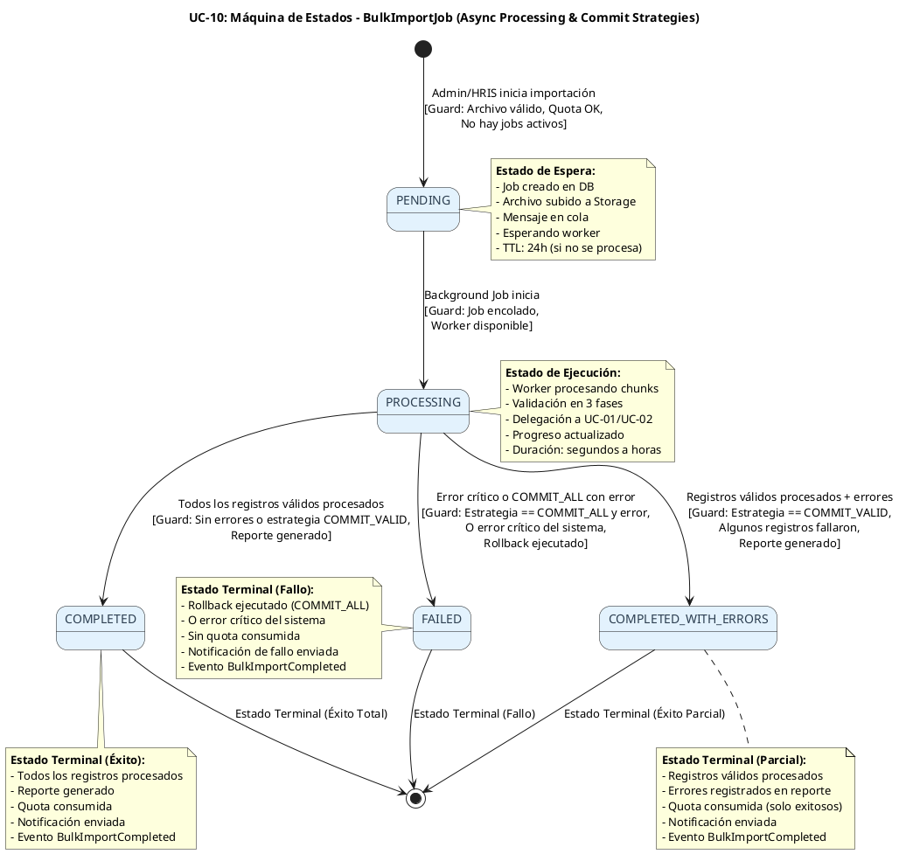
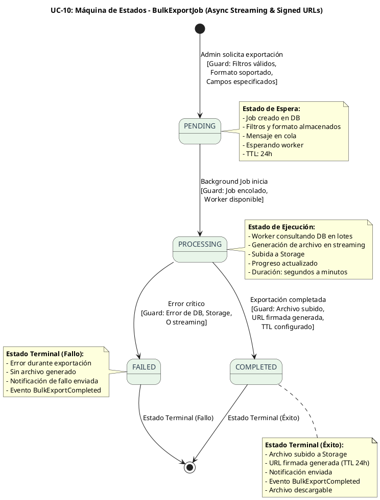

# UC-10: Import/Export Masivo - Diagrama de Máquina de Estados

| Metadatos del Documento | |
| :--- | :--- |
| **Proyecto:** | SHUGO - Identity & Access Platform |
| **Caso de Uso:** | UC-10 - Import/Export Masivo (Bulk Identity Operations) |
| **Documento:** | 05_State_Machine_Diagram.md |
| **Metodología:** | UML 2.5 + ICONIX + Domain-Driven Design (State Pattern) + Async State Transitions |
| **Autor:** | Gastón Ruiz |
| **Versión Actual:** | 1.0.0 |
| **Fecha:** | 12/09/2026 |

---

## Historial de Versiones

| Versión | Fecha | Autor | Descripción de Cambios | Impacto |
| :--- | :--- | :--- | :--- | :--- |
| **1.0.0** | 12/09/2026 | Gastón Ruiz | **Creación inicial.** Definición de las máquinas de estados específicas para las operaciones masivas. Se modelan dos máquinas críticas: (1) Ciclo de Vida de BulkImportJob (PENDING → PROCESSING → COMPLETED/COMPLETED_WITH_ERRORS/FAILED) con manejo de estrategias COMMIT_ALL vs COMMIT_VALID, y (2) Ciclo de Vida de BulkExportJob (PENDING → PROCESSING → COMPLETED/FAILED). Se abordan las transiciones asíncronas, el modo Dry Run, y el rollback transaccional. | Documento base del paquete de diseño Tier 1 del UC-10. Establece las reglas de transición, las guardas de seguridad y la lógica temporal que garantiza el procesamiento asíncrono resiliente, la trazabilidad forense completa, y la flexibilidad transaccional para operaciones masivas enterprise. |

---

## 1. Introducción y Propósito

El **Diagrama de Máquina de Estados** para el UC-10 visualiza las restricciones de comportamiento temporal y las reglas de transición que gobiernan el ciclo de vida de las operaciones masivas de importación y exportación.

A diferencia de los UCs transaccionales individuales (UC-01 a UC-09) que tienen ciclos de vida cortos y síncronos, el UC-10 introduce complejidades únicas debido a su naturaleza de **procesamiento masivo asíncrono de larga duración**:

1. **Ciclos de Vida Extendidos:** Los jobs pueden durar desde segundos (100 registros) hasta horas (50.000+ registros), requiriendo estados intermedios de progreso.
3. **Transiciones Asíncronas:** Las transiciones de estado ocurren en diferentes momentos y procesos (iniciación síncrona, procesamiento asíncrono, notificación final).
5. **Estrategias Transaccionales Flexibles:** La estrategia `COMMIT_ALL` introduce transiciones condicionales con rollback, mientras que `COMMIT_VALID` permite continuaciones parciales.
7. **Modo Dry Run:** El modo Dry Run afecta las transiciones al omitir la persistencia real de datos.
11. **Múltiples Estados de Completación:** A diferencia de otros UCs, el UC-10 tiene tres estados terminales posibles: `COMPLETED` (todo exitoso), `COMPLETED_WITH_ERRORS` (parcialmente exitoso), y `FAILED` (fallido).

Estas máquinas garantizan:
- **Trazabilidad Forense:** Cada transición de estado se registra con timestamps, métricas y eventos de dominio.
- **Resiliencia:** Manejo robusto de fallos con rollback y notificación.
- **Flexibilidad Empresarial:** Soporte para diferentes requisitos de integridad de datos (todo o nada vs procesamiento parcial).
- **Transparencia:** Estados intermedios que permiten consultar el progreso en tiempo real.

---

## 2. Máquina de Estados #1: BulkImportJob

### 2.1. Descripción

Esta máquina modela el ciclo de vida completo de una operación masiva de importación, desde su iniciación síncrona hasta su completación o fallo asíncrono. Es la máquina más compleja del UC-10 debido a las estrategias transaccionales y el modo Dry Run.

### 2.2. Diagrama de Máquina de Estados (PlantUML)



### 2.3. Descripción de Estados y Transiciones

| Estado | Descripción | Transiciones de Salida | Invariante Clave |
| :--- | :--- | :--- | :--- |
| **PENDING** | Job creado y encolado, esperando ser tomado por un worker. Archivo subido a Storage. | → `PROCESSING` (worker inicia), → `FAILED` (timeout o error crítico) | Job en DB, archivo en Storage, mensaje en cola. TTL: 24h. |
| **PROCESSING** | Worker procesando chunks de registros. Validación en 3 fases, delegación a UC-01/UC-02. | → `COMPLETED` (sin errores), → `COMPLETED_WITH_ERRORS` (errores con COMMIT_VALID), → `FAILED` (COMMIT_ALL con error o error crítico) | Worker activo, progreso actualizado, chunks procesándose. |
| **COMPLETED** | Todos los registros procesados exitosamente. Reporte generado y notificación enviada. | Ninguna (estado terminal) | Todos los registros exitosos, reporte disponible, quota consumida. |
| **COMPLETED_WITH_ERRORS** | Registros válidos procesados, algunos fallaron. Reporte con errores generado. | Ninguna (estado terminal) | Registros exitosos procesados, errores en reporte, quota consumida (solo exitosos). |
| **FAILED** | Error crítico o COMMIT_ALL con error. Rollback ejecutado. | Ninguna (estado terminal) | Rollback ejecutado, sin quota consumida, notificación de fallo enviada. |

### 2.4. Guardas (Guards) de las Transiciones

#### Transición: `[*]` → `PENDING` (Iniciación Síncrona)

```csharp
public static BulkImportJob Initiate(
    TenantId tenantId,
    IdentityId initiatedBy,
    string fileName,
    string fileUrl,
    long fileSizeBytes,
    int totalRecords,
    ImportOptions options)
{
    // Guarda 1: Archivo válido (validado en BulkImportHandler)
    if (string.IsNullOrWhiteSpace(fileName))
        throw new DomainException("File name cannot be empty.");

    if (string.IsNullOrWhiteSpace(fileUrl))
        throw new DomainException("File URL cannot be empty.");

    // Guarda 2: Total records > 0
    if (totalRecords <= 0)
        throw new DomainException("Total records must be greater than zero.");

    // Guarda 3: Options no null
    if (options == null)
        throw new DomainException("Import options cannot be null.");

    var job = new BulkImportJob
    {
        Id = new JobId(Guid.NewGuid()),
        TenantId = tenantId,
        InitiatedBy = initiatedBy,
        Status = JobStatus.PENDING,
        FileName = fileName,
        FileUrl = fileUrl,
        FileSizeBytes = fileSizeBytes,
        TotalRecords = totalRecords,
        ProcessedRecords = 0,
        SuccessfulRecords = 0,
        FailedRecords = 0,
        Options = options,
        Errors = new List<RecordError>(),
        CreatedAt = DateTime.UtcNow
    };

    // Generar evento de dominio
    job.AddDomainEvent(new BulkImportInitiated(
        job.Id,
        job.TenantId,
        job.InitiatedBy,
        job.TotalRecords,
        job.Options.FileFormat,
        job.Options.CommitStrategy,
        job.Options.IsDryRun
    ));

    return job;
}
```

#### Transición: `PENDING` → `PROCESSING` (Inicio de Procesamiento Asíncrono)

```csharp
public void StartProcessing()
{
    // Guarda 1: Estado debe ser PENDING
    if (this.Status != JobStatus.PENDING)
        throw new InvalidTransitionException(
            $"Cannot start processing. Current status is {this.Status}.");

    // Transición de estado
    this.Status = JobStatus.PROCESSING;
    this.StartedAt = DateTime.UtcNow;
}
```

#### Transición: `PROCESSING` → `COMPLETED` (Éxito Total)

```csharp
public void MarkAsCompleted(string reportUrl)
{
    // Guarda 1: Estado debe ser PROCESSING
    if (this.Status != JobStatus.PROCESSING)
        throw new InvalidTransitionException(
            $"Cannot mark as completed. Current status is {this.Status}.");

    // Guarda 2: No debe haber errores (o todos fueron procesados en COMMIT_VALID)
    if (this.FailedRecords > 0)
        throw new DomainException(
            "Cannot mark as completed when there are failed records. Use MarkAsCompletedWithErrors.");

    // Transición de estado
    this.Status = JobStatus.COMPLETED;
    this.ReportUrl = reportUrl;
    this.CompletedAt = DateTime.UtcNow;

    // Generar evento de dominio
    AddDomainEvent(new BulkImportCompleted(
        this.Id,
        this.TenantId,
        this.Status,
        this.TotalRecords,
        this.SuccessfulRecords,
        this.FailedRecords,
        (int)(this.CompletedAt.Value - this.StartedAt!.Value).TotalSeconds,
        this.ReportUrl
    ));
}
```

#### Transición: `PROCESSING` → `COMPLETED_WITH_ERRORS` (Éxito Parcial)

```csharp
public void MarkAsCompletedWithErrors(string reportUrl)
{
    // Guarda 1: Estado debe ser PROCESSING
    if (this.Status != JobStatus.PROCESSING)
        throw new InvalidTransitionException(
            $"Cannot mark as completed with errors. Current status is {this.Status}.");

    // Guarda 2: Debe haber errores
    if (this.FailedRecords == 0)
        throw new DomainException(
            "Cannot mark as completed with errors when there are no failed records. Use MarkAsCompleted.");

    // Guarda 3: Estrategia debe ser COMMIT_VALID (COMMIT_ALL no permite este estado)
    if (this.Options.CommitStrategy.IsCommitAll)
        throw new DomainException(
            "Cannot mark as completed with errors when strategy is COMMIT_ALL. Use MarkAsFailed.");

    // Transición de estado
    this.Status = JobStatus.COMPLETED_WITH_ERRORS;
    this.ReportUrl = reportUrl;
    this.CompletedAt = DateTime.UtcNow;

    // Generar evento de dominio
    AddDomainEvent(new BulkImportCompleted(
        this.Id,
        this.TenantId,
        this.Status,
        this.TotalRecords,
        this.SuccessfulRecords,
        this.FailedRecords,
        (int)(this.CompletedAt.Value - this.StartedAt!.Value).TotalSeconds,
        this.ReportUrl
    ));
}
```

#### Transición: `PROCESSING` → `FAILED` (Fallo)

```csharp
public void MarkAsFailed(string reason)
{
    // Guarda 1: Estado debe ser PROCESSING (o PENDING si timeout)
    if (this.Status != JobStatus.PROCESSING && this.Status != JobStatus.PENDING)
        throw new InvalidTransitionException(
            $"Cannot mark as failed. Current status is {this.Status}.");

    // Transición de estado
    this.Status = JobStatus.FAILED;
    this.CompletedAt = DateTime.UtcNow;

    // Generar evento de dominio
    AddDomainEvent(new BulkImportCompleted(
        this.Id,
        this.TenantId,
        this.Status,
        this.TotalRecords,
        this.SuccessfulRecords,
        this.FailedRecords,
        this.StartedAt.HasValue 
            ? (int)(this.CompletedAt.Value - this.StartedAt.Value).TotalSeconds 
            : 0,
        null
    ));
}
```

### 2.5. Invariantes de la Máquina de Importación

1. **Unicidad de Job Activo:** Solo puede haber un job en estado `PENDING` o `PROCESSING` por tenant a la vez.
2. **Transiciones Válidas:** Las transiciones deben seguir la matriz definida en `JobStatus.CanTransitionTo()`.
4. **Reporte Obligatorio:** Los estados `COMPLETED` y `COMPLETED_WITH_ERRORS` deben tener un `ReportUrl` válido.
6. **Quota Consumption:** Solo los estados `COMPLETED` y `COMPLETED_WITH_ERRORS` consumen quota (y solo por registros exitosos).
9. **Eventos de Dominio:** Cada transición terminal genera un evento `BulkImportCompleted` con métricas completas.
11. **Dry Run:** En modo Dry Run, el job transiciona a `COMPLETED` sin invocar UC-01/UC-02, pero con validación completa.

---

## 3. Máquina de Estados #2: BulkExportJob

### 3.1. Descripción

Esta máquina modela el ciclo de vida completo de una operación masiva de exportación. Es más simple que la de importación porque no tiene estrategias de commit ni validación en 3 fases, pero tiene el manejo de URLs firmadas y streaming.

### 3.2. Diagrama de Máquina de Estados (PlantUML)



### 3.3. Descripción de Estados y Transiciones

| Estado | Descripción | Transiciones de Salida | Invariante Clave |
| :--- | :--- | :--- | :--- |
| **PENDING** | Job creado y encolado, esperando ser tomado por un worker. Filtros y formato almacenados. | → `PROCESSING` (worker inicia), → `FAILED` (timeout o error crítico) | Job en DB, mensaje en cola. TTL: 24h. |
| **PROCESSING** | Worker consultando DB en lotes, generando archivo en streaming, y subiéndolo a Storage. | → `COMPLETED` (archivo generado), → `FAILED` (error crítico) | Worker activo, progreso actualizado, streaming en curso. |
| **COMPLETED** | Archivo exportado generado y URL firmada creada. | Ninguna (estado terminal) | Archivo en Storage, URL firmada con TTL 24h, notificación enviada. |
| **FAILED** | Error crítico durante la exportación. | Ninguna (estado terminal) | Sin archivo generado, notificación de fallo enviada. |

### 3.4. Guardas (Guards) de las Transiciones

#### Transición: `[*]` → `PENDING` (Iniciación Síncrona)

```csharp
public static BulkExportJob Initiate(
    TenantId tenantId,
    IdentityId initiatedBy,
    ExportFilters filters,
    FileFormat format,
    List<string> fields)
{
    // Guarda 1: Filtros no null
    if (filters == null)
        throw new DomainException("Export filters cannot be null.");

    // Guarda 2: Formato válido
    if (format == null)
        throw new DomainException("Export format cannot be null.");

    // Guarda 3: Al menos un campo especificado
    if (fields == null || !fields.Any())
        throw new DomainException("At least one field must be specified for export.");

    var job = new BulkExportJob
    {
        Id = new JobId(Guid.NewGuid()),
        TenantId = tenantId,
        InitiatedBy = initiatedBy,
        Status = JobStatus.PENDING,
        Filters = filters,
        Format = format,
        Fields = fields,
        TotalRecords = 0,
        ExportedRecords = 0,
        CreatedAt = DateTime.UtcNow
    };

    // Generar evento de dominio
    job.AddDomainEvent(new BulkExportInitiated(
        job.Id,
        job.TenantId,
        job.InitiatedBy,
        job.Filters,
        job.Format
    ));

    return job;
}
```

#### Transición: `PROCESSING` → `COMPLETED` (Éxito)

```csharp
public void MarkAsCompleted(string fileUrl, long fileSizeBytes, string downloadUrl, DateTime expiresAt)
{
    // Guarda 1: Estado debe ser PROCESSING
    if (this.Status != JobStatus.PROCESSING)
        throw new InvalidTransitionException(
            $"Cannot mark as completed. Current status is {this.Status}.");

    // Guarda 2: URL de archivo no vacía
    if (string.IsNullOrWhiteSpace(fileUrl))
        throw new DomainException("File URL cannot be empty.");

    // Guarda 3: URL de descarga no vacía
    if (string.IsNullOrWhiteSpace(downloadUrl))
        throw new DomainException("Download URL cannot be empty.");

    // Guarda 4: Expiración en el futuro
    if (expiresAt <= DateTime.UtcNow)
        throw new DomainException("Download URL expiration must be in the future.");

    // Transición de estado
    this.Status = JobStatus.COMPLETED;
    this.FileUrl = fileUrl;
    this.FileSizeBytes = fileSizeBytes;
    this.DownloadUrl = downloadUrl;
    this.DownloadUrlExpiresAt = expiresAt;
    this.CompletedAt = DateTime.UtcNow;

    // Generar evento de dominio
    AddDomainEvent(new BulkExportCompleted(
        this.Id,
        this.TenantId,
        this.TotalRecords,
        this.FileUrl,
        this.DownloadUrl,
        this.DownloadUrlExpiresAt.Value
    ));
}
```

### 3.5. Invariantes de la Máquina de Exportación

1. **Unicidad de Job Activo:** Solo puede haber un job en estado `PENDING` o `PROCESSING` por tenant a la vez.
3. **Transiciones Válidas:** Las transiciones deben seguir la matriz definida en `JobStatus.CanTransitionTo()`.
5. **URL Firmada Obligatoria:** El estado `COMPLETED` debe tener un `DownloadUrl` válido con expiración futura.
7. **TTL de URL:** La URL firmada debe tener un TTL de 24 horas (configurable).
9. **Eventos de Dominio:** Cada transición terminal genera un evento `BulkExportCompleted` con metadata completa.

---

## 4. Máquina de Estados Compartida: JobStatus

### 4.1. Descripción

El Value Object `JobStatus` encapsula la matriz de transiciones permitidas para ambos tipos de jobs (importación y exportación). Es compartido entre `BulkImportJob` y `BulkExportJob`.

### 4.2. Implementación del Value Object `JobStatus`

```csharp
public class JobStatus : ValueObject
{
    public string Value { get; }

    private JobStatus(string value)
    {
        if (string.IsNullOrWhiteSpace(value))
            throw new DomainException("Status value cannot be empty.");

        Value = value.ToUpperInvariant();
    }

    public static JobStatus PENDING => new JobStatus("PENDING");
    public static JobStatus PROCESSING => new JobStatus("PROCESSING");
    public static JobStatus COMPLETED => new JobStatus("COMPLETED");
    public static JobStatus COMPLETED_WITH_ERRORS => new JobStatus("COMPLETED_WITH_ERRORS");
    public static JobStatus FAILED => new JobStatus("FAILED");

    /// <summary>
    /// Valida si la transición al nuevo estado es permitida.
    /// </summary>
    public bool CanTransitionTo(JobStatus newStatus)
    {
        // Matriz de transiciones permitidas
        var allowedTransitions = new Dictionary<string, HashSet<string>>
        {
            { "PENDING", new HashSet<string> { "PROCESSING", "FAILED" } },
            { "PROCESSING", new HashSet<string> { "COMPLETED", "COMPLETED_WITH_ERRORS", "FAILED" } },
            { "COMPLETED", new HashSet<string>() }, // Estado terminal
            { "COMPLETED_WITH_ERRORS", new HashSet<string>() }, // Estado terminal
            { "FAILED", new HashSet<string>() } // Estado terminal
        };

        if (allowedTransitions.TryGetValue(this.Value, out var allowed))
        {
            return allowed.Contains(newStatus.Value);
        }

        return false;
    }

    /// <summary>
    /// Indica si el estado es terminal (no hay transiciones de salida).
    /// </summary>
    public bool IsTerminal => Value == "COMPLETED" || Value == "COMPLETED_WITH_ERRORS" || Value == "FAILED";

    /// <summary>
    /// Indica si el estado representa un éxito (total o parcial).
    /// </summary>
    public bool IsSuccess => Value == "COMPLETED" || Value == "COMPLETED_WITH_ERRORS";

    /// <summary>
    /// Indica si el estado representa un fallo.
    /// </summary>
    public bool IsFailure => Value == "FAILED";

    public override string ToString() => Value;

    protected override IEnumerable<object> GetEqualityComponents()
    {
        yield return Value;
    }
}
```

---

## 5. Implementación en el Dominio (Código C#)

### 5.1. Aggregate Root `BulkImportJob` con Máquina de Estados

```csharp
public class BulkImportJob : AggregateRoot
{
    public JobId Id { get; private set; }
    public TenantId TenantId { get; private set; }
    public IdentityId InitiatedBy { get; private set; }
    public JobStatus Status { get; private set; }
    public string FileName { get; private set; }
    public string FileUrl { get; private set; }
    public long FileSizeBytes { get; private set; }
    public int TotalRecords { get; private set; }
    public int ProcessedRecords { get; private set; }
    public int SuccessfulRecords { get; private set; }
    public int FailedRecords { get; private set; }
    public ImportOptions Options { get; private set; }
    public List<RecordError> Errors { get; private set; }
    public string? ReportUrl { get; private set; }
    public DateTime CreatedAt { get; private set; }
    public DateTime? StartedAt { get; private set; }
    public DateTime? CompletedAt { get; private set; }
    
    private readonly List<IDomainEvent> _domainEvents = new();

    private BulkImportJob() 
    {
        Errors = new List<RecordError>();
    }

    public static BulkImportJob Initiate(
        TenantId tenantId,
        IdentityId initiatedBy,
        string fileName,
        string fileUrl,
        long fileSizeBytes,
        int totalRecords,
        ImportOptions options)
    {
        var job = new BulkImportJob
        {
            Id = new JobId(Guid.NewGuid()),
            TenantId = tenantId,
            InitiatedBy = initiatedBy,
            Status = JobStatus.PENDING,
            FileName = fileName,
            FileUrl = fileUrl,
            FileSizeBytes = fileSizeBytes,
            TotalRecords = totalRecords,
            ProcessedRecords = 0,
            SuccessfulRecords = 0,
            FailedRecords = 0,
            Options = options,
            Errors = new List<RecordError>(),
            CreatedAt = DateTime.UtcNow
        };

        job.ValidateInitialState();
        
        job.AddDomainEvent(new BulkImportInitiated(
            job.Id,
            job.TenantId,
            job.InitiatedBy,
            job.TotalRecords,
            job.Options.FileFormat,
            job.Options.CommitStrategy,
            job.Options.IsDryRun
        ));

        return job;
    }

    public void StartProcessing()
    {
        if (this.Status != JobStatus.PENDING)
            throw new InvalidTransitionException(
                $"Cannot start processing. Current status is {this.Status}.");

        this.Status = JobStatus.PROCESSING;
        this.StartedAt = DateTime.UtcNow;
    }

    public void UpdateProgress(int processed, int successful, int failed)
    {
        if (this.Status != JobStatus.PROCESSING)
            throw new DomainException("Cannot update progress when job is not processing.");

        this.ProcessedRecords = processed;
        this.SuccessfulRecords = successful;
        this.FailedRecords = failed;
    }

    public void MarkAsCompleted(string reportUrl)
    {
        if (this.Status != JobStatus.PROCESSING)
            throw new InvalidTransitionException(
                $"Cannot mark as completed. Current status is {this.Status}.");

        if (this.FailedRecords > 0)
            throw new DomainException(
                "Cannot mark as completed when there are failed records. Use MarkAsCompletedWithErrors.");

        this.Status = JobStatus.COMPLETED;
        this.ReportUrl = reportUrl;
        this.CompletedAt = DateTime.UtcNow;

        AddDomainEvent(new BulkImportCompleted(
            this.Id,
            this.TenantId,
            this.Status,
            this.TotalRecords,
            this.SuccessfulRecords,
            this.FailedRecords,
            (int)(this.CompletedAt.Value - this.StartedAt!.Value).TotalSeconds,
            this.ReportUrl
        ));
    }

    public void MarkAsCompletedWithErrors(string reportUrl)
    {
        if (this.Status != JobStatus.PROCESSING)
            throw new InvalidTransitionException(
                $"Cannot mark as completed with errors. Current status is {this.Status}.");

        if (this.FailedRecords == 0)
            throw new DomainException(
                "Cannot mark as completed with errors when there are no failed records. Use MarkAsCompleted.");

        if (this.Options.CommitStrategy.IsCommitAll)
            throw new DomainException(
                "Cannot mark as completed with errors when strategy is COMMIT_ALL. Use MarkAsFailed.");

        this.Status = JobStatus.COMPLETED_WITH_ERRORS;
        this.ReportUrl = reportUrl;
        this.CompletedAt = DateTime.UtcNow;

        AddDomainEvent(new BulkImportCompleted(
            this.Id,
            this.TenantId,
            this.Status,
            this.TotalRecords,
            this.SuccessfulRecords,
            this.FailedRecords,
            (int)(this.CompletedAt.Value - this.StartedAt!.Value).TotalSeconds,
            this.ReportUrl
        ));
    }

    public void MarkAsFailed(string reason)
    {
        if (this.Status != JobStatus.PROCESSING && this.Status != JobStatus.PENDING)
            throw new InvalidTransitionException(
                $"Cannot mark as failed. Current status is {this.Status}.");

        this.Status = JobStatus.FAILED;
        this.CompletedAt = DateTime.UtcNow;

        AddDomainEvent(new BulkImportCompleted(
            this.Id,
            this.TenantId,
            this.Status,
            this.TotalRecords,
            this.SuccessfulRecords,
            this.FailedRecords,
            this.StartedAt.HasValue 
                ? (int)(this.CompletedAt.Value - this.StartedAt.Value).TotalSeconds 
                : 0,
            null
        ));
    }

    public void AddError(RecordError error)
    {
        this.Errors.Add(error);
        this.FailedRecords = this.Errors.Count;
    }

    private void ValidateInitialState()
    {
        if (this.Status != JobStatus.PENDING)
            throw new DomainException("New bulk import job must be in PENDING status.");

        if (string.IsNullOrWhiteSpace(this.FileName))
            throw new DomainException("File name cannot be empty.");

        if (string.IsNullOrWhiteSpace(this.FileUrl))
            throw new DomainException("File URL cannot be empty.");

        if (this.TotalRecords <= 0)
            throw new DomainException("Total records must be greater than zero.");

        if (this.Options == null)
            throw new DomainException("Import options cannot be null.");
    }

    public IReadOnlyCollection<IDomainEvent> GetDomainEvents() => _domainEvents.AsReadOnly();
    
    protected void AddDomainEvent(IDomainEvent evt) => _domainEvents.Add(evt);
}
```

### 5.2. Manejo de Estrategias Transaccionales en el Processor

```csharp
public class BulkImportProcessor : IBulkImportProcessor
{
    private const int CHUNK_SIZE = 1000;

    private readonly IJobRepository _jobRepo;
    private readonly IRecordValidator _recordValidator;
    private readonly IIdentityProvisioningService _identityProvisioningService;
    private readonly IIdentityUpdateService _identityUpdateService;
    private readonly IReportGenerator _reportGenerator;
    private readonly INotificationService _notificationService;
    private readonly IUnitOfWork _unitOfWork;
    private readonly IQuotaService _quotaService;
    private readonly IEventPublisher _eventPublisher;
    private readonly ILogger<BulkImportProcessor> _logger;

    public async Task ProcessJobAsync(JobId jobId, CancellationToken ct)
    {
        var job = await _jobRepo.GetByIdAsync(jobId);
        if (job == null)
            throw new JobNotFoundException($"Job {jobId} not found.");

        // Transición: PENDING → PROCESSING
        job.StartProcessing();
        await _jobRepo.SaveAsync(job, ct);

        try
        {
            // Procesar chunks
            var chunks = await GetChunksAsync(job, ct);
            var successfulRecords = new List<SuccessRecord>();
            var errors = new List<RecordError>();
            int processedCount = 0;

            foreach (var chunk in chunks)
            {
                var chunkResult = await ProcessChunkAsync(chunk, job, ct);
                
                successfulRecords.AddRange(chunkResult.SuccessfulRecords);
                errors.AddRange(chunkResult.Errors);
                processedCount += chunk.Length;

                // Actualizar progreso
                job.UpdateProgress(processedCount, successfulRecords.Count, errors.Count);
                await _jobRepo.SaveAsync(job, ct);

                // Si es COMMIT_ALL y hubo error, abortar
                if (job.Options.CommitStrategy.IsCommitAll && chunkResult.HasErrors)
                {
                    await HandleCommitAllErrorAsync(job, chunkResult.Errors, ct);
                    return;
                }
            }

            // Generar reporte
            var reportUrl = await _reportGenerator.GenerateImportReportAsync(
                job.Id, successfulRecords, errors, ct);

            // Transición final según resultados
            if (errors.Any())
            {
                if (job.Options.CommitStrategy.IsCommitValid)
                {
                    // Transición: PROCESSING → COMPLETED_WITH_ERRORS
                    job.MarkAsCompletedWithErrors(reportUrl);
                }
                else
                {
                    // COMMIT_ALL no debería llegar aquí (ya se abortó arriba)
                    throw new InvalidOperationException("COMMIT_ALL strategy should have aborted earlier.");
                }
            }
            else
            {
                // Transición: PROCESSING → COMPLETED
                job.MarkAsCompleted(reportUrl);
            }

            await _jobRepo.SaveAsync(job, ct);

            // Consumir quota (solo si no es Dry Run y hay éxito)
            if (!job.Options.IsDryRun && job.SuccessfulRecords > 0)
            {
                await _quotaService.ConsumeQuotaAsync(job.TenantId, job.SuccessfulRecords);
            }

            // Notificar al administrador
            await _notificationService.SendCompletionNotificationAsync(
                job.InitiatedBy,
                job.Id,
                job.SuccessfulRecords,
                job.FailedRecords,
                reportUrl,
                ct);

            // Publicar eventos de dominio
            await _eventPublisher.PublishAsync(job.GetDomainEvents(), ct);

            _logger.LogInformation(
                "Bulk import job {JobId} completed. Status: {Status}, Successful: {Successful}, Failed: {Failed}",
                job.Id, job.Status, job.SuccessfulRecords, job.FailedRecords);
        }
        catch (Exception ex)
        {
            _logger.LogError(ex, "Critical error processing bulk import job {JobId}", jobId);
            
            // Transición: PROCESSING → FAILED
            job.MarkAsFailed(ex.Message);
            await _jobRepo.SaveAsync(job, ct);

            // Notificar fallo
            await _notificationService.SendFailureNotificationAsync(
                job.InitiatedBy,
                job.Id,
                ex.Message,
                ct);

            throw;
        }
    }

    private async Task<ChunkResult> ProcessChunkAsync(
        IEnumerable<Record> chunk, 
        BulkImportJob job, 
        CancellationToken ct)
    {
        var successfulRecords = new List<SuccessRecord>();
        var errors = new List<RecordError>();

        // Si es COMMIT_ALL, usar transacción
        using var dbTransaction = job.Options.CommitStrategy.IsCommitAll 
            ? await _unitOfWork.BeginTransactionAsync(ct) 
            : null;

        try
        {
            int rowNumber = 0;
            foreach (var record in chunk)
            {
                rowNumber++;

                try
                {
                    // Validación en 3 fases
                    await _recordValidator.ValidateAsync(record, rowNumber, job.TenantId, ct);

                    // Si NO es Dry Run, procesar (UC-01 o UC-02)
                    if (!job.Options.IsDryRun)
                    {
                        if (record.EmailExists)
                            await _identityUpdateService.UpdateAsync(record, ct);
                        else
                            await _identityProvisioningService.ProvisionAsync(record, ct);
                    }

                    successfulRecords.Add(new SuccessRecord
                    {
                        RowNumber = rowNumber,
                        Email = record.Email,
                        IsNew = !record.EmailExists,
                        IdentityId = record.IdentityId
                    });
                }
                catch (ValidationException ex)
                {
                    errors.Add(new RecordError(
                        rowNumber,
                        ex.ErrorCode,
                        ex.Message,
                        record.ToJson(),
                        ex.Phase
                    ));

                    // Si es COMMIT_ALL, abortar inmediatamente
                    if (job.Options.CommitStrategy.IsCommitAll)
                    {
                        await dbTransaction?.RollbackAsync(ct);
                        return new ChunkResult(successfulRecords, errors, hasErrors: true);
                    }
                }
            }

            // Commit del chunk si es COMMIT_ALL
            if (dbTransaction != null)
                await dbTransaction.CommitAsync(ct);

            return new ChunkResult(successfulRecords, errors, hasErrors: errors.Any());
        }
        catch (Exception ex)
        {
            await dbTransaction?.RollbackAsync(ct);
            _logger.LogError(ex, "Error processing chunk for job {JobId}", job.Id);
            throw;
        }
    }

    private async Task HandleCommitAllErrorAsync(
        BulkImportJob job, 
        List<RecordError> errors, 
        CancellationToken ct)
    {
        _logger.LogWarning(
            "COMMIT_ALL strategy: Aborting job {JobId} due to validation error at row {RowNumber}",
            job.Id, errors.First().RowNumber);

        // Transición: PROCESSING → FAILED
        job.MarkAsFailed($"Validation failed at row {errors.First().RowNumber}: {errors.First().ErrorMessage}");
        await _jobRepo.SaveAsync(job, ct);

        // Notificar al administrador
        await _notificationService.SendFailureNotificationAsync(
            job.InitiatedBy,
            job.Id,
            errors.First().ErrorMessage,
            ct);

        // Publicar eventos de dominio
        await _eventPublisher.PublishAsync(job.GetDomainEvents(), ct);
    }
}
```

---

## 6. Trazabilidad con Otros Documentos del Paquete

| Documento | Relación |
| :--- | :--- |
| `01_Requirements_Specification.md` | Las invariantes de estado (INV-63 a INV-69) y reglas de negocio (RN-10 a RN-15) se definen aquí y se hacen cumplir en estas máquinas. |
| `02_Use_Case_Diagram.md` | Muestra los actores y sistemas; estas máquinas definen cómo el sistema responde a sus acciones de importación/exportación a lo largo del tiempo. |
| `03_Activity_Diagram.md` | Los carriles de actividad (Bulk Handler, Validation Core, Background Processor) se implementan aquí como máquinas de estados. |
| `04_Initial_Domain_Model.md` | Los Aggregate Roots `BulkImportJob` y `BulkExportJob`, el Value Object `JobStatus`, y los Domain Services `BulkImportHandler` y `BulkImportProcessor` son la implementación directa de estas máquinas. |
| `06_Robustness_Diagram.md` | Mostrará cómo los objetos colaboran para ejecutar estas transiciones de estado de forma segura. |
| `07_Sequence_Diagram.md` | Detallará el orden temporal exacto de las llamadas que disparan estas transiciones. |
| `09_Modern_Artifacts.md` | Las métricas de progreso y completación se monitorean con las configuraciones definidas aquí. |
| `10_UC_Specific_Data_Model.md` | Define las columnas físicas (`status`, `processed_records`, `successful_records`, `failed_records`, `report_url`) que persisten estos estados en PostgreSQL. |

---

## 7. Notas de Implementación

### 7.1. Testing de Máquinas de Estados

Cada transición y guarda definida en estas máquinas debe tener al menos dos tests unitarios:

```csharp
[Test]
public void BulkImportJob_Initiate_WithValidData_CreatesInPendingStatus()
{
    // Arrange
    var tenantId = new TenantId(Guid.NewGuid());
    var initiatedBy = new IdentityId(Guid.NewGuid());
    var options = new ImportOptions(
        CommitStrategy.COMMIT_VALID,
        isDryRun: false,
        FileFormat.CSV);

    // Act
    var job = BulkImportJob.Initiate(
        tenantId,
        initiatedBy,
        "identities.csv",
        "https://storage.shugo.io/imports/job-123/identities.csv",
        2048576,
        500,
        options);

    // Assert
    job.Status.Should().Be(JobStatus.PENDING);
    job.TotalRecords.Should().Be(500);
    job.ProcessedRecords.Should().Be(0);
    job.SuccessfulRecords.Should().Be(0);
    job.FailedRecords.Should().Be(0);
    job.Options.Should().Be(options);
    job.GetDomainEvents().Should().HaveCount(1);
    job.GetDomainEvents().First().Should().BeOfType<BulkImportInitiated>();
}

[Test]
public void BulkImportJob_StartProcessing_TransitionsToProcessing()
{
    // Arrange
    var job = BulkImportJob.Initiate(
        new TenantId(Guid.NewGuid()),
        new IdentityId(Guid.NewGuid()),
        "test.csv",
        "https://storage.shugo.io/test.csv",
        1024,
        100,
        new ImportOptions(CommitStrategy.COMMIT_VALID, false, FileFormat.CSV));

    // Act
    job.StartProcessing();

    // Assert
    job.Status.Should().Be(JobStatus.PROCESSING);
    job.StartedAt.Should().NotBeNull();
}

[Test]
public void BulkImportJob_MarkAsCompletedWithErrors_WithCommitValid_TransitionsCorrectly()
{
    // Arrange
    var job = BulkImportJob.Initiate(
        new TenantId(Guid.NewGuid()),
        new IdentityId(Guid.NewGuid()),
        "test.csv",
        "https://storage.shugo.io/test.csv",
        1024,
        100,
        new ImportOptions(CommitStrategy.COMMIT_VALID, false, FileFormat.CSV));

    job.StartProcessing();
    job.UpdateProgress(100, 95, 5);

    // Act
    job.MarkAsCompletedWithErrors("https://storage.shugo.io/reports/job-123.csv");

    // Assert
    job.Status.Should().Be(JobStatus.COMPLETED_WITH_ERRORS);
    job.ReportUrl.Should().Be("https://storage.shugo.io/reports/job-123.csv");
    job.CompletedAt.Should().NotBeNull();
}

[Test]
public void BulkImportJob_MarkAsCompletedWithErrors_WithCommitAll_ThrowsDomainException()
{
    // Arrange
    var job = BulkImportJob.Initiate(
        new TenantId(Guid.NewGuid()),
        new IdentityId(Guid.NewGuid()),
        "test.csv",
        "https://storage.shugo.io/test.csv",
        1024,
        100,
        new ImportOptions(CommitStrategy.COMMIT_ALL, false, FileFormat.CSV));

    job.StartProcessing();
    job.UpdateProgress(100, 95, 5);

    // Act
    var act = () => job.MarkAsCompletedWithErrors("https://storage.shugo.io/reports/job-123.csv");

    // Assert
    act.Should().Throw<DomainException>()
       .WithMessage("*cannot mark as completed with errors when strategy is COMMIT_ALL*");
}

[Test]
public void BulkImportJob_MarkAsFailed_TransitionsToFailed()
{
    // Arrange
    var job = BulkImportJob.Initiate(
        new TenantId(Guid.NewGuid()),
        new IdentityId(Guid.NewGuid()),
        "test.csv",
        "https://storage.shugo.io/test.csv",
        1024,
        100,
        new ImportOptions(CommitStrategy.COMMIT_VALID, false, FileFormat.CSV));

    job.StartProcessing();

    // Act
    job.MarkAsFailed("Critical error: Database connection lost");

    // Assert
    job.Status.Should().Be(JobStatus.FAILED);
    job.CompletedAt.Should().NotBeNull();
}

[Test]
public void JobStatus_CanTransitionTo_WithValidTransition_ReturnsTrue()
{
    // Arrange
    var pending = JobStatus.PENDING;
    var processing = JobStatus.PROCESSING;

    // Act & Assert
    pending.CanTransitionTo(processing).Should().BeTrue();
    processing.CanTransitionTo(JobStatus.COMPLETED).Should().BeTrue();
    processing.CanTransitionTo(JobStatus.COMPLETED_WITH_ERRORS).Should().BeTrue();
    processing.CanTransitionTo(JobStatus.FAILED).Should().BeTrue();
}

[Test]
public void JobStatus_CanTransitionTo_WithInvalidTransition_ReturnsFalse()
{
    // Arrange
    var completed = JobStatus.COMPLETED;
    var pending = JobStatus.PENDING;

    // Act & Assert
    completed.CanTransitionTo(pending).Should().BeFalse(); // Estado terminal
    completed.CanTransitionTo(JobStatus.PROCESSING).Should().BeFalse();
}

[Test]
public void BulkExportJob_Initiate_WithValidData_CreatesInPendingStatus()
{
    // Arrange
    var tenantId = new TenantId(Guid.NewGuid());
    var initiatedBy = new IdentityId(Guid.NewGuid());
    var filters = new ExportFilters(
        new List<string> { "employee" },
        "ACTIVE",
        null,
        null,
        null);
    var format = FileFormat.CSV;
    var fields = new List<string> { "email", "display_name", "roles" };

    // Act
    var job = BulkExportJob.Initiate(tenantId, initiatedBy, filters, format, fields);

    // Assert
    job.Status.Should().Be(JobStatus.PENDING);
    job.Filters.Should().Be(filters);
    job.Format.Should().Be(format);
    job.Fields.Should().BeEquivalentTo(fields);
    job.GetDomainEvents().Should().HaveCount(1);
    job.GetDomainEvents().First().Should().BeOfType<BulkExportInitiated>();
}

[Test]
public void BulkExportJob_MarkAsCompleted_WithValidData_TransitionsCorrectly()
{
    // Arrange
    var job = BulkExportJob.Initiate(
        new TenantId(Guid.NewGuid()),
        new IdentityId(Guid.NewGuid()),
        new ExportFilters(new List<string> { "employee" }, "ACTIVE", null, null, null),
        FileFormat.CSV,
        new List<string> { "email", "display_name" });

    job.StartProcessing();
    job.UpdateProgress(1000, 1000);

    var expiresAt = DateTime.UtcNow.AddHours(24);

    // Act
    job.MarkAsCompleted(
        "https://storage.shugo.io/exports/job-456.csv",
        52428800,
        "https://storage.shugo.io/exports/job-456.csv?signature=abc123",
        expiresAt);

    // Assert
    job.Status.Should().Be(JobStatus.COMPLETED);
    job.FileUrl.Should().Be("https://storage.shugo.io/exports/job-456.csv");
    job.DownloadUrl.Should().Be("https://storage.shugo.io/exports/job-456.csv?signature=abc123");
    job.DownloadUrlExpiresAt.Should().Be(expiresAt);
    job.CompletedAt.Should().NotBeNull();
}
```

### 7.2. Concurrencia y Jobs Huérfanos

Dado que los jobs pueden quedar en estado `PENDING` o `PROCESSING` indefinidamente si el worker falla, se debe implementar un mecanismo de limpieza:

```csharp
public class OrphanedJobCleanupJob : BackgroundService
{
    private readonly IJobRepository _jobRepo;
    private readonly INotificationService _notificationService;
    private readonly ILogger<OrphanedJobCleanupJob> _logger;

    protected override async Task ExecuteAsync(CancellationToken stoppingToken)
    {
        while (!stoppingToken.IsCancellationRequested)
        {
            try
            {
                // Buscar jobs huérfanos (PENDING > 24h o PROCESSING > 2h)
                var orphanedJobs = await _jobRepo.GetOrphanedJobsAsync(stoppingToken);

                foreach (var job in orphanedJobs)
                {
                    _logger.LogWarning(
                        "Marking orphaned job {JobId} as failed (stuck in {Status} since {StartedAt})",
                        job.Id, job.Status, job.StartedAt ?? job.CreatedAt);

                    job.MarkAsFailed("Job timeout: no progress for too long");
                    await _jobRepo.SaveAsync(job, stoppingToken);

                    await _notificationService.SendFailureNotificationAsync(
                        job.InitiatedBy,
                        job.Id,
                        "Job timeout: no progress for too long",
                        stoppingToken);
                }

                // Ejecutar cada hora
                await Task.Delay(TimeSpan.FromHours(1), stoppingToken);
            }
            catch (Exception ex)
            {
                _logger.LogError(ex, "Error in OrphanedJobCleanupJob");
                await Task.Delay(TimeSpan.FromMinutes(5), stoppingToken);
            }
        }
    }
}
```

---

## 8. Glosario de Términos Específicos de UC-10

| Término | Definición |
| :--- | :--- |
| **BulkImportJob (Aggregate Root)** | Objeto de dominio que encapsula el ciclo de vida completo de una operación masiva de importación con máquina de estados completa. |
| **BulkExportJob (Aggregate Root)** | Objeto de dominio que encapsula el ciclo de vida completo de una operación masiva de exportación con máquina de estados simplificada. |
| **JobStatus (Value Object)** | Estado de un job con validación de transiciones permitidas: PENDING, PROCESSING, COMPLETED, COMPLETED_WITH_ERRORS, FAILED. |
| **Estado Terminal** | Estado del que no hay transiciones de salida: COMPLETED, COMPLETED_WITH_ERRORS, FAILED. |
| **Transición Asíncrona** | Transición de estado que ocurre en un momento diferente al de la iniciación (ej. PENDING → PROCESSING ocurre cuando un worker toma el job). |
| **COMMIT_ALL** | Estrategia transaccional que requiere que todos los registros sean válidos. Si uno falla, se ejecuta rollback total y el job transiciona a FAILED. |
| **COMMIT_VALID** | Estrategia transaccional que procesa los registros válidos y reporta los inválidos. El job puede transicionar a COMPLETED_WITH_ERRORS. |
| **Dry Run** | Modo de validación que omite la persistencia real de datos. El job transiciona a COMPLETED sin invocar UC-01/UC-02. |
| **Job Huérfano** | Job que queda en estado PENDING o PROCESSING indefinidamente debido a fallo del worker. Limpiado por OrphanedJobCleanupJob. |
| **Rollback Transaccional** | Operación que revierte todos los cambios de un chunk/lote cuando se detecta un error en estrategia COMMIT_ALL. |
| **Matriz de Transiciones** | Estructura de datos que define qué transiciones de estado son válidas desde cada estado actual. |
| **Guarda de Transición** | Condición que debe cumplirse para que una transición de estado sea permitida (ej. "estado debe ser PROCESSING"). |

---
*Fin del Documento 05_State_Machine_Diagram para UC-10*