# UC-10: Import/Export Masivo - Diagrama de Robustez

| Metadatos del Documento | |
| :--- | :--- |
| **Proyecto:** | SHUGO - Identity & Access Platform |
| **Caso de Uso:** | UC-10 - Import/Export Masivo (Bulk Identity Operations) |
| **Documento:** | 06_Robustness_Diagram.md |
| **Metodología:** | ICONIX (Diagrama de Robustez) + DDD + Async Batch Processing Patterns |
| **Autor:** | Gastón Ruiz |
| **Versión Actual:** | 1.0.0 |
| **Fecha:** | 12/09/2026 |

---

## Historial de Versiones

| Versión | Fecha | Autor | Descripción de Cambios | Impacto |
| :--- | :--- | :--- | :--- | :--- |
| **1.0.0** | 12/09/2026 | Gastón Ruiz | **Creación inicial.** Diagrama de Robustez para UC-10, validando la arquitectura del motor KAGAMI para operaciones masivas asíncronas. Muestra la colaboración estricta entre Boundaries (API Gateway, Bulk API Endpoint), Controls (BulkImportHandler, BulkExportHandler, RecordValidator, ReportGenerator, JobQueue), y Entities (BulkImportJob, BulkExportJob, ImportOptions, RecordError, JobStatus). Valida la separación entre iniciación síncrona y procesamiento asíncrono, la validación en tres fases, las estrategias transaccionales (COMMIT_ALL vs COMMIT_VALID), y la generación de reportes granulares. | Documento base del paquete de diseño Tier 1 del UC-10. Sirve como puente crítico entre el Modelo de Dominio (04) y el Diagrama de Secuencia (07), asegurando que la arquitectura soporta el procesamiento resiliente, la trazabilidad forense, y la flexibilidad transaccional antes de codificar. |

---

## 1. Introducción y Propósito

El **Diagrama de Robustez** para el UC-10 valida que el flujo de operaciones masivas puede ser orquestado respetando las reglas estrictas de acoplamiento de **ICONIX** y los principios de **Domain-Driven Design (DDD)**, **Async Batch Processing**, y **Enterprise Integration Patterns**.

El desafío específico de este caso de uso es séptuple:

1. **Separación Síncrona/Asíncrona:** La iniciación es síncrona y rápida (<2s), mientras que el procesamiento es asíncrono y puede durar horas.
2. **Validación en Tres Fases:** Cada registro se valida en capas (Sintáctica → Semántica → Consistencia) para detectar errores tempranamente.
3. **Procesamiento por Chunks:** Los archivos grandes se dividen en lotes manejables para eficiencia de memoria.
4. **Estrategias Transaccionales Flexibles:** Soporte para `COMMIT_ALL` (todo o nada) y `COMMIT_VALID` (procesar válidos, reportar inválidos).
5. **Modo Dry Run:** Capacidad de validar sin ejecutar cambios persistentes.
6. **Reportes Granulares:** Generación de reportes detallados con el resultado de cada registro individual.
7. **URLs Firmadas para Descarga:** Los archivos exportados se sirven mediante URLs firmadas con TTL para seguridad.

---

## 2. Diagrama de Robustez (PlantUML)

A continuación, se presenta el Diagrama de Robustez organizado de izquierda a derecha para mostrar el flujo natural: **Actor → Boundary → Control → Entity**.

```plantuml
@startuml UC-10_Robustez
<style>
diagram {
  BackgroundColor #FEFEFE
}
</style>
left to right direction
skinparam roundcorner 20
skinparam maxMessageSize 150

title UC-10: Diagrama de Robustez - Motor KAGAMI (Async Batch Processing & 3-Phase Validation)

' ============================================
' ACTORES
' ============================================
actor :Administrador\n(Admin/HRIS): as Admin
actor "Background Job\nProcessor" as JobProcessor
actor "Storage Service\n(S3/Azure Blob)" as Storage
actor "Notification Service\n(Email/Slack)" as Notifier

' ============================================
' BOUNDARY OBJECTS (UI / API)
' ============================================
boundary "API Gateway" as GW
boundary "Bulk API\nEndpoint" as API

' ============================================
' CONTROL OBJECTS (Aplicación / Dominio)
' ============================================
control "Bulk Import Handler\n<<Application Service>>" as ImportHandler
control "Bulk Export Handler\n<<Application Service>>" as ExportHandler
control "Record Validator\n<<Domain Service>>" as Validator
control "Report Generator\n<<Domain Service>>" as ReportGen
control "Job Queue\n<<Infrastructure>>" as Queue

' ============================================
' ENTITY OBJECTS (Dominio / Persistencia)
' ============================================
entity "BulkImportJob\n<<Aggregate Root>>" as ImportJob
entity "BulkExportJob\n<<Aggregate Root>>" as ExportJob
entity "ImportOptions\n<<Value Object>>" as ImportOpts
entity "ExportFilters\n<<Value Object>>" as ExportFilters
entity "RecordError\n<<Value Object>>" as RecordError
entity "JobStatus\n<<Value Object>>" as JobStatus
entity "FileFormat\n<<Value Object>>" as FileFormat
entity "Job Repository\n<<Infrastructure>>" as JobRepo
entity "PostgreSQL\n<<Database>>" as DB

' ============================================
' NOTAS EXPLICATIVAS
' ============================================
note top of ImportHandler
  **Regla de Oro (Async Processing):**
  La iniciación es síncrona (<2s),
  el procesamiento es asíncrono
  (segundos a horas).
end note

note bottom of Validator
  **Validación en 3 Fases:**
  - Fase 1: Sintáctica (rápido)
  - Fase 2: Semántica (DB/Cache)
  - Fase 3: Consistencia (dependencias)
  - Fail-Fast optimizado
end note

note right of ReportGen
  **Reportes Granulares:**
  - CSV con resultado por fila
  - Éxito/Fallo/Advertencia
  - URL firmada (TTL 24h)
  - Descarga segura
end note

' ============================================
' FLUJO DE INICIACIÓN DE IMPORTACIÓN (Síncrono)
' ============================================

' Actor -> Boundary
Admin --> GW : 1. POST /identities/import\n(archivo CSV/JSON, opciones)
GW --> API : 2. Forward request\n(tenant_id, admin_id, payload)

' Boundary -> Control
API --> ImportHandler : 3. InitiateImport(command)

' Control -> Control (Validaciones)
ImportHandler --> ImportHandler : 4. Validar formato archivo\n(extensión, headers, tamaño <50MB)

ImportHandler --> ImportHandler : 5. Validar quota y concurrencia\n(quota mensual, jobs activos)

' Control -> Actor (Subida a Storage)
ImportHandler --> Storage : 6. UploadAsync(fileStream, key)
Storage --> Storage : 7. Guardar archivo temporal
Storage --> ImportHandler : 8. fileUrl

' Control -> Entity (Creación de Job)
ImportHandler --> ImportOpts : 9. new ImportOptions\n(commitStrategy, isDryRun, format)
ImportHandler --> ImportJob : 10. BulkImportJob.Initiate(\ntenantId, adminId, fileName, fileUrl,\nfileSizeBytes, totalRecords, options)
ImportJob --> ImportJob : 11. Status = PENDING
ImportJob --> ImportJob : 12. AddDomainEvent\n(BulkImportInitiated)
ImportJob --> ImportHandler : 13. BulkImportJob (PENDING)

' Control -> Entity (Persistencia)
ImportHandler --> JobRepo : 14. SaveAsync(job)
JobRepo --> DB : 15. INSERT bulk_import_jobs
DB --> JobRepo : 16. Success
JobRepo --> ImportHandler : 17. Job saved

' Control -> Control (Encolado)
ImportHandler --> Queue : 18. EnqueueAsync(BulkImportMessage)
Queue --> Queue : 19. Agregar mensaje a cola
Queue --> ImportHandler : 20. Enqueued

ImportHandler --> API : 21. HTTP 202 Accepted\n(job_id, message)
API --> GW : 22. Response
GW --> Admin : 23. Response JSON\n{"job_id": "...", "status": "PENDING"}

' ============================================
' FLUJO DE PROCESAMIENTO ASÍNCRONO (Background)
' ============================================

JobProcessor --> Queue : 24. DequeueAsync()
Queue --> JobProcessor : 25. BulkImportMessage

JobProcessor --> JobRepo : 26. GetByIdAsync(jobId)
JobRepo --> DB : 27. SELECT * FROM bulk_import_jobs
DB --> JobRepo : 28. Job data
JobRepo --> JobProcessor : 29. BulkImportJob

JobProcessor --> ImportJob : 30. StartProcessing()
ImportJob --> ImportJob : 31. Status = PROCESSING
JobProcessor --> JobRepo : 32. SaveAsync(job)

JobProcessor --> Storage : 33. DownloadAsync(fileUrl)
Storage --> JobProcessor : 34. fileStream

JobProcessor --> JobProcessor : 35. Parsear archivo\n(dividir en chunks de 1000)

' --- CORRECCIÓN DE BUCLES Y CONDICIONALES PARA COMPONENTES/ROBUSTEZ ---
JobProcessor --> JobProcessor : 36. [LOOP: Por cada chunk]\nProcesar chunk

' Validación en 3 Fases por Registro
JobProcessor --> Validator : 37. [LOOP: Por cada registro]\nValidateAsync(record, rowNumber)

Validator --> Validator : 38. Fase 1: Sintáctica\n(formato email, longitud password)
Validator --> Validator : 39. Fase 2: Semántica\n(email único, roles válidos)
Validator --> Validator : 40. Fase 3: Consistencia\n(manager_id existe)

' Flujo: Validación Exitosa
Validator --> JobProcessor : 41. [Si OK] Retorna Válido
JobProcessor --> JobProcessor : 42a. [Si Dry Run]\nMarcar "VALIDADO (Dry Run)"
JobProcessor --> JobProcessor : 42b. [Si Real] Invocar UC-01 o UC-02\n(Provisionar/Actualizar)
JobProcessor --> JobProcessor : 43. Marcar registro como SUCCESS

' Flujo: Validación Falla
Validator --> JobProcessor : 44. [Si Falla] ValidationException
JobProcessor --> RecordError : 45. new RecordError\n(rowNumber, errorCode, message, phase)
JobProcessor --> ImportJob : 46. AddError(error)

' Estrategias de Error
JobProcessor --> ImportJob : 47a. [Si COMMIT_ALL] MarkAsFailed(reason)
ImportJob --> ImportJob : 48a. Status = FAILED
JobProcessor --> JobRepo : 49a. SaveAsync(job)
JobProcessor --> JobProcessor : 50a. Abortar procesamiento

JobProcessor --> JobProcessor : 47b. [Si COMMIT_VALID]\nContinuar con siguiente registro

JobProcessor --> ImportJob : 51. UpdateProgress(processed, successful, failed)
JobProcessor --> JobRepo : 52. SaveAsync(job)

' Generación de Reporte
JobProcessor --> ReportGen : 53. GenerateImportReportAsync\n(jobId, successfulRecords, errors)
ReportGen --> ReportGen : 54. Generar CSV con resultados
ReportGen --> Storage : 55. UploadAsync(reportStream, key)
Storage --> ReportGen : 56. reportUrl
ReportGen --> JobProcessor : 57. reportUrl

' Transición Final
JobProcessor --> ImportJob : 58a. [Si sin errores] MarkAsCompleted(reportUrl)
ImportJob --> ImportJob : 59a. Status = COMPLETED

JobProcessor --> ImportJob : 58b. [Si con errores y COMMIT_VALID]\nMarkAsCompletedWithErrors(reportUrl)
ImportJob --> ImportJob : 59b. Status = COMPLETED_WITH_ERRORS

JobProcessor --> JobRepo : 60. SaveAsync(job)

' Notificación
JobProcessor --> Notifier : 61. SendCompletionNotificationAsync\n(adminId, jobId, successCount, failCount, reportUrl)
Notifier --> Notifier : 62. Enviar email/Slack\ncon resumen y link al reporte
Notifier --> Admin : 63. Notificación\n"Importación completada"

' ============================================
' FLUJO DE EXPORTACIÓN (Asíncrono)
' ============================================

Admin --> GW : 64. POST /identities/export\n(filtros, formato, campos)
GW --> API : 65. Forward request

API --> ExportHandler : 66. InitiateExport(command)

ExportHandler --> ExportFilters : 67. new ExportFilters\n(roles, status, dates)
ExportHandler --> FileFormat : 68. new FileFormat(format)
ExportHandler --> ExportJob : 69. BulkExportJob.Initiate(\ntenantId, adminId, filters, format, fields)
ExportJob --> ExportJob : 70. Status = PENDING

ExportHandler --> JobRepo : 71. SaveAsync(job)
ExportHandler --> Queue : 72. EnqueueAsync(BulkExportMessage)
ExportHandler --> API : 73. HTTP 202 Accepted\n(job_id)
API --> GW : 74. Response
GW --> Admin : 75. Response JSON
@enduml

```



---

## 3. Explicación Detallada de los Objetos

### 3.1. Boundary Objects (Objetos de Límite)

| Objeto | Responsabilidad | Mapeo a Clean Architecture |
| :--- | :--- | :--- |
| **`API Gateway`** | Valida el JWT del administrador, extrae `tenant_id` y `admin_id`, y aplica rate limiting global. Es la primera línea de defensa contra accesos no autorizados. | Middleware (Kong, AWS API Gateway). |
| **`Bulk API Endpoint`** | Recibe las requests HTTP (`POST /identities/import`, `POST /identities/export`), deserializa payloads, y los pasa a los Handlers correspondientes. | Controller (ASP.NET Core Controller). |

### 3.2. Control Objects (Objetos de Control)

| Objeto | Responsabilidad | Mapeo a Clean Architecture |
| :--- | :--- | :--- |
| **`Bulk Import Handler`** | **Application Service (Fase Síncrona).** Orquesta la iniciación de importaciones. Coordina las validaciones de formato, quota y concurrencia, sube el archivo a Storage, crea el job en estado PENDING, y lo encola para procesamiento asíncrono. | Command Handler / Application Service. |
| **`Bulk Export Handler`** | **Application Service (Fase Síncrona).** Orquesta la iniciación de exportaciones. Crea el job con filtros y formato, lo persiste, y lo encola para procesamiento asíncrono. | Command Handler / Application Service. |
| **`Record Validator`** | **Domain Service.** Implementa la validación en tres fases (Sintáctica → Semántica → Consistencia) para cada registro individual durante el procesamiento asíncrono. | Domain Service. |
| **`Report Generator`** | **Domain Service.** Genera reportes detallados (CSV) con el resultado de cada registro individual para importaciones, y archivos de exportación (CSV/JSON) en streaming para exportaciones. | Domain Service. |
| **`Job Queue`** | **Infrastructure Service.** Gestiona la cola de mensajes para procesamiento asíncrono. Permite que la iniciación sea rápida (<2s) y el procesamiento sea escalable. | Infrastructure Service (RabbitMQ, Azure Service Bus, AWS SQS). |

### 3.3. Entity Objects (Objetos de Entidad)

| Objeto | Responsabilidad | Mapeo a DDD |
| :--- | :--- | :--- |
| **`BulkImportJob`** | **Aggregate Root.** Encapsula el ciclo de vida completo de una operación masiva de importación con máquina de estados completa (PENDING → PROCESSING → COMPLETED/COMPLETED_WITH_ERRORS/FAILED). | Aggregate Root. |
| **`BulkExportJob`** | **Aggregate Root.** Encapsula el ciclo de vida completo de una operación masiva de exportación con máquina de estados simplificada (PENDING → PROCESSING → COMPLETED/FAILED). | Aggregate Root. |
| **`ImportOptions`** | **Value Object.** Configuración inmutable de una importación: estrategia de commit (COMMIT_ALL/COMMIT_VALID), modo dry run, formato de archivo, encoding, delimitador. | Value Object. |
| **`ExportFilters`** | **Value Object.** Filtros para exportación: roles, status, fechas de creación, filtros personalizados. | Value Object. |
| **`RecordError`** | **Value Object.** Error específico de un registro individual con número de fila, código de error, mensaje, datos del registro, y fase de validación. | Value Object. |
| **`JobStatus`** | **Value Object.** Estado de un job con validación de transiciones permitidas: PENDING, PROCESSING, COMPLETED, COMPLETED_WITH_ERRORS, FAILED. | Value Object. |
| **`FileFormat`** | **Value Object.** Formato de archivo soportado: CSV, JSON, XML. | Value Object. |
| **`Job Repository`** | **Infrastructure.** Abstrae la persistencia de jobs. Implementa operaciones atómicas para actualización de progreso y transiciones de estado. | Repository Interface (Domain) / Implementation (Infra). |

---

## 4. Reglas de Robustez de ICONIX (Validación del Diagrama)

Verifiquemos que nuestro diagrama cumple estrictamente las reglas de acoplamiento de ICONIX:

### ✅ Regla 1: Actor → Boundary
- **Cumplida:** Los `Actores` (Admin, JobProcessor, Storage, Notifier) interactúan solo con el `API Gateway` (para Admin) o directamente con los controles (para JobProcessor, Storage, Notifier).

### ✅ Regla 2: Boundary → Boundary
- **Cumplida:** El `API Gateway` forward la request al `Bulk API Endpoint`.

### ✅ Regla 3: Boundary → Control
- **Cumplida:** El `Bulk API Endpoint` envía el command al `Bulk Import Handler` o `Bulk Export Handler`.

### ✅ Regla 4: Control → Control
- **Cumplida y Crítica:** Los Handlers delegan a controles específicos:
  - `Bulk Import Handler` → `Job Queue` (encolado)
  - `JobProcessor` → `Record Validator` (validación en 3 fases)
  - `JobProcessor` → `Report Generator` (generación de reportes)
  - `JobProcessor` → `Notifier` (notificación de completación)
- **Validación:** Esto mantiene los Handlers delgados y permite que las reglas de validación y generación de reportes sean reutilizables y testeables.

### ✅ Regla 5: Control → Entity
- **Cumplida:**
  - `Bulk Import Handler` crea los Value Objects `ImportOptions` y el Aggregate Root `BulkImportJob`.
  - `Bulk Export Handler` crea los Value Objects `ExportFilters`, `FileFormat` y el Aggregate Root `BulkExportJob`.
  - `JobProcessor` invoca métodos de `BulkImportJob` y `BulkExportJob` para transiciones de estado.
  - `Record Validator` crea `RecordError` cuando detecta errores.
  - `JobProcessor` llama a `Job Repository` para persistir jobs.

### ✅ Regla 6: NO Entity → Control / Boundary
- **Cumplida:** Ninguna entidad (`BulkImportJob`, `BulkExportJob`, `ImportOptions`, `ExportFilters`, `RecordError`, `JobStatus`, `FileFormat`, `JobRepo`) envía mensajes de vuelta a los controles o boundaries. Solo retornan datos como respuesta a una invocación.

### ✅ Regla 7: NO Entity → Entity (Directo sin Control)
- **Cumplida:** Los controles (`Bulk Import Handler`, `Bulk Export Handler`, `JobProcessor`) son los únicos que orquestan la interacción entre las entidades. Las entidades no se crean entre sí directamente desde el diagrama de flujo principal.

---

## 5. Consideraciones de Arquitectura (Async Processing & Resilience)

### 5.1. Separación Síncrona/Asíncrona

El diagrama valida visualmente la **separación crítica** entre la iniciación síncrona y el procesamiento asíncrono:

**Fase Síncrona (Pasos 1-23):**
1. `Bulk Import Handler` valida formato, quota y concurrencia (<500ms).
2. `Bulk Import Handler` sube archivo a Storage (<1s).
3. `Bulk Import Handler` crea job en estado PENDING y lo encola (<200ms).
4. `Bulk Import Handler` retorna HTTP 202 Accepted (<2s total).

**Fase Asíncrona (Pasos 24-63):**
1. `JobProcessor` toma el job de la cola.
2. `JobProcessor` procesa chunks con validación en 3 fases.
3. `JobProcessor` genera reporte y notifica al administrador.

**Justificación:**
- **UX Responsiva:** El administrador no queda bloqueado esperando una respuesta de un servidor que está procesando 50.000 registros.
- **Resiliencia:** Si el servidor de aplicación se reinicia, el job permanece en la cola y será procesado por otro nodo.
- **Escalabilidad:** El procesamiento asíncrono permite escalar horizontalmente los workers de procesamiento independientemente de los servidores de API.

### 5.2. Validación en Tres Fases (Fail-Fast Optimizado)

El diagrama muestra cómo el `Record Validator` implementa la validación en tres fases (Pasos 38-40):

1. **Fase 1 (Sintáctica):** Valida formato de email, longitud de password, etc. (Rápido, sin DB).
2. **Fase 2 (Semántica):** Valida unicidad de email, roles válidos, dominio permitido (Consultas ligeras a DB/Cache).
3. **Fase 3 (Consistencia):** Valida dependencias como `manager_id` (Consultas complejas).

**Justificación:**
- **Eficiencia:** Detectar un error de formato en la Fase 1 evita realizar costosas consultas a la base de datos en las Fases 2 y 3.
- **Claridad en Errores:** Permite generar mensajes de error específicos y accionables para el usuario.

### 5.3. Estrategias Transaccionales Flexibles

El diagrama modela explícitamente las dos estrategias de commit (Pasos 47a-47b):

**COMMIT_ALL (Todo o Nada):**
- Si un registro falla, se ejecuta rollback del chunk/lote.
- El job transiciona a `FAILED`.
- No se procesan más registros.

**COMMIT_VALID (Procesar Válidos):**
- Si un registro falla, se registra el error y se continúa con el siguiente.
- El job transiciona a `COMPLETED_WITH_ERRORS`.
- Se procesan todos los registros válidos.

**Justificación:**
- **Flexibilidad Empresarial:** Algunos clientes prefieren importar el 99% de los datos y corregir el 1% después (`COMMIT_VALID`). Otros requieren que el 100% sea perfecto o no se aplique nada (`COMMIT_ALL`).

### 5.4. Modo Dry Run

El diagrama muestra la bifurcación para el modo Dry Run (Pasos 42a-42b):

- **Dry Run = true:** Solo se valida, no se invoca UC-01/UC-02. El job transiciona a `COMPLETED` sin cambios persistentes.
- **Dry Run = false:** Se valida y se procesa (UC-01 o UC-02).

**Justificación:**
- **Pre-validación:** Permite a los administradores validar archivos grandes sin riesgo de corromper datos en producción.
- **Reducción de Errores:** Detecta problemas antes de la importación real.

### 5.5. Reportes Granulares y URLs Firmadas

El diagrama muestra cómo el `Report Generator` genera reportes detallados (Pasos 53-57) y cómo se sirven mediante URLs firmadas (Pasos 96-97):

1. **Generación de Reporte:** CSV con resultado de cada registro (éxito, error, advertencia).
2. **Subida a Storage:** Reporte almacenado en S3/Azure Blob.
3. **URL Firmada:** URL con firma criptográfica y TTL de 24 horas.
4. **Descarga Segura:** El administrador descarga el reporte mediante la URL firmada.

**Justificación:**
- **Trazabilidad Forense:** Cada registro tiene un resultado específico con detalles del error.
- **Seguridad:** Las URLs firmadas previenen que enlaces de descarga de datos sensibles (PII) sean compartidos o accesibles indefinidamente.

---

## 6. Trazabilidad con Otros Documentos del Paquete

| Documento | Relación |
| :--- | :--- |
| `01_Requirements_Specification.md` | Este diagrama valida que los requisitos de procesamiento asíncrono, validación en 3 fases, estrategias transaccionales, y reportes granulares pueden ser implementados con los objetos definidos. |
| `02_Use_Case_Diagram.md` | Muestra los actores y sistemas; este diagrama muestra cómo colaboran los objetos internos. |
| `03_Activity_Diagram.md` | Los carriles de actividad (Bulk Handler, Validation Core, Background Processor, Report Generator) se mapean directamente a los objetos de Control de este diagrama. |
| `04_Initial_Domain_Model.md` | Los objetos `BulkImportJob`, `BulkExportJob`, `ImportOptions`, `ExportFilters`, `RecordError`, `JobStatus`, `FileFormat` y los servicios `BulkImportHandler`, `BulkExportHandler`, `RecordValidator`, `ReportGenerator` son exactamente las clases definidas en el modelo de dominio. |
| `05_State_Machine_Diagram.md` | Las máquinas de estados (PENDING → PROCESSING → COMPLETED/FAILED/COMPLETED_WITH_ERRORS) se ejecutan cuando el `JobProcessor` invoca los métodos de transición de los Aggregate Roots. |
| `07_Sequence_Diagram.md` | Este diagrama define "qué objetos colaboran"; el de secuencia definirá "en qué orden temporal exacto" se envían los mensajes. |
| `08_Final_Class_Design.md` | Definirá las firmas exactas de los métodos mostrados en este diagrama (ej. `BulkImportJob.Initiate()`, `RecordValidator.ValidateAsync()`, `ReportGenerator.GenerateImportReportAsync()`). |

---

## 7. Notas de Implementación

### 7.1. Inyección de Dependencias

El `Bulk Import Handler` y `JobProcessor` deben tener inyectados los servicios de dominio e infraestructura:

```csharp
// Bulk Import Handler (Fase Síncrona)
public class BulkImportHandler : IBulkImportHandler
{
    private readonly IJobRepository _jobRepo;
    private readonly IFileValidator _fileValidator;
    private readonly IStorageService _storageService;
    private readonly IJobQueue _jobQueue;
    private readonly IQuotaService _quotaService;
    private readonly IEventPublisher _eventPublisher;
    private readonly ILogger<BulkImportHandler> _logger;

    public BulkImportHandler(
        IJobRepository jobRepo,
        IFileValidator fileValidator,
        IStorageService storageService,
        IJobQueue jobQueue,
        IQuotaService quotaService,
        IEventPublisher eventPublisher,
        ILogger<BulkImportHandler> logger)
    {
        _jobRepo = jobRepo;
        _fileValidator = fileValidator;
        _storageService = storageService;
        _jobQueue = jobQueue;
        _quotaService = quotaService;
        _eventPublisher = eventPublisher;
        _logger = logger;
    }
}

// Job Processor (Fase Asíncrona)
public class BulkImportProcessor : IBulkImportProcessor
{
    private readonly IJobRepository _jobRepo;
    private readonly IStorageService _storageService;
    private readonly IRecordValidator _recordValidator;
    private readonly IIdentityProvisioningService _identityProvisioningService;
    private readonly IIdentityUpdateService _identityUpdateService;
    private readonly IReportGenerator _reportGenerator;
    private readonly INotificationService _notificationService;
    private readonly IUnitOfWork _unitOfWork;
    private readonly IQuotaService _quotaService;
    private readonly IEventPublisher _eventPublisher;
    private readonly ILogger<BulkImportProcessor> _logger;

    public BulkImportProcessor(
        IJobRepository jobRepo,
        IStorageService storageService,
        IRecordValidator recordValidator,
        IIdentityProvisioningService identityProvisioningService,
        IIdentityUpdateService identityUpdateService,
        IReportGenerator reportGenerator,
        INotificationService notificationService,
        IUnitOfWork unitOfWork,
        IQuotaService quotaService,
        IEventPublisher eventPublisher,
        ILogger<BulkImportProcessor> logger)
    {
        _jobRepo = jobRepo;
        _storageService = storageService;
        _recordValidator = recordValidator;
        _identityProvisioningService = identityProvisioningService;
        _identityUpdateService = identityUpdateService;
        _reportGenerator = reportGenerator;
        _notificationService = notificationService;
        _unitOfWork = unitOfWork;
        _quotaService = quotaService;
        _eventPublisher = eventPublisher;
        _logger = logger;
    }
}
```

### 7.2. Flujo de Ejecución Simplificado (Código)

```csharp
// FASE SÍNCRONA: Iniciación de Importación
public async Task<JobId> InitiateImportAsync(InitiateImportCommand command, CancellationToken ct)
{
    // 1. Validar formato de archivo (síncrono, rápido)
    var validationResult = await _fileValidator.ValidateAsync(command.FileStream, command.FileName, ct);
    if (!validationResult.IsValid)
        throw new InvalidFileException(validationResult.ErrorMessage);

    // 2. Validar quota y concurrencia
    await _quotaService.ValidateQuotaAsync(command.TenantId, validationResult.TotalRecords);
    var activeJobs = await _jobRepo.GetActiveJobsByTenantAsync(command.TenantId);
    if (activeJobs.Any())
        throw new BulkOperationInProgressException("Another bulk operation is already in progress.");

    // 3. Subir archivo a storage temporal
    var jobId = new JobId(Guid.NewGuid());
    var fileKey = $"imports/{command.TenantId.Value}/{jobId.Value}/{command.FileName}";
    var fileUrl = await _storageService.UploadAsync(command.FileStream, fileKey);

    // 4. Crear Aggregate Root
    var job = BulkImportJob.Initiate(
        command.TenantId,
        command.InitiatedBy,
        command.FileName,
        fileUrl,
        command.FileStream.Length,
        validationResult.TotalRecords,
        command.Options
    );

    // 5. Persistir job
    await _jobRepo.SaveAsync(job, ct);

    // 6. Encolar job para procesamiento asíncrono
    await _jobQueue.EnqueueAsync(new BulkImportMessage
    {
        JobId = job.Id,
        FileUrl = fileUrl,
        Options = command.Options
    }, ct);

    // 7. Publicar eventos de dominio
    await _eventPublisher.PublishAsync(job.GetDomainEvents(), ct);

    return job.Id;
}

// FASE ASÍNCRONA: Procesamiento de Importación
public async Task ProcessJobAsync(JobId jobId, CancellationToken ct)
{
    var job = await _jobRepo.GetByIdAsync(jobId);
    if (job == null)
        throw new JobNotFoundException($"Job {jobId} not found.");

    // Transición: PENDING → PROCESSING
    job.StartProcessing();
    await _jobRepo.SaveAsync(job, ct);

    try
    {
        // Descargar archivo desde storage
        using var fileStream = await _storageService.DownloadAsync(job.FileUrl);
        
        // Parsear archivo y procesar en chunks
        var records = await ParseFileAsync(fileStream, job.Options, ct);
        var chunks = records.Chunk(CHUNK_SIZE);

        var successfulRecords = new List<SuccessRecord>();
        var errors = new List<RecordError>();
        int processedCount = 0;

        foreach (var chunk in chunks)
        {
            var chunkResult = await ProcessChunkAsync(chunk, job, ct);
            
            successfulRecords.AddRange(chunkResult.SuccessfulRecords);
            errors.AddRange(chunkResult.Errors);
            processedCount += chunk.Length;

            // Actualizar progreso
            job.UpdateProgress(processedCount, successfulRecords.Count, errors.Count);
            await _jobRepo.SaveAsync(job, ct);

            // Si es COMMIT_ALL y hubo error, abortar
            if (job.Options.CommitStrategy.IsCommitAll && chunkResult.HasErrors)
            {
                await HandleCommitAllErrorAsync(job, chunkResult.Errors, ct);
                return;
            }
        }

        // Generar reporte
        var reportUrl = await _reportGenerator.GenerateImportReportAsync(
            job.Id, successfulRecords, errors, ct);

        // Transición final según resultados
        if (errors.Any())
        {
            if (job.Options.CommitStrategy.IsCommitValid)
                job.MarkAsCompletedWithErrors(reportUrl);
            else
                throw new InvalidOperationException("COMMIT_ALL strategy should have aborted earlier.");
        }
        else
        {
            job.MarkAsCompleted(reportUrl);
        }

        await _jobRepo.SaveAsync(job, ct);

        // Consumir quota (solo si no es Dry Run y hay éxito)
        if (!job.Options.IsDryRun && job.SuccessfulRecords > 0)
            await _quotaService.ConsumeQuotaAsync(job.TenantId, job.SuccessfulRecords);

        // Notificar al administrador
        await _notificationService.SendCompletionNotificationAsync(
            job.InitiatedBy, job.Id, job.SuccessfulRecords, job.FailedRecords, reportUrl, ct);

        // Publicar eventos de dominio
        await _eventPublisher.PublishAsync(job.GetDomainEvents(), ct);
    }
    catch (Exception ex)
    {
        _logger.LogError(ex, "Critical error processing bulk import job {JobId}", jobId);
        job.MarkAsFailed(ex.Message);
        await _jobRepo.SaveAsync(job, ct);
        await _notificationService.SendFailureNotificationAsync(job.InitiatedBy, job.Id, ex.Message, ct);
        throw;
    }
}
```

---
*Fin del Documento 06_Robustness_Diagram para UC-10*