# UC-10: Import/Export Masivo - Diagrama de Secuencia

| Metadatos del Documento | |
| :--- | :--- |
| **Proyecto:** | SHUGO - Identity & Access Platform |
| **Caso de Uso:** | UC-10 - Import/Export Masivo (Bulk Identity Operations) |
| **Documento:** | 07_Sequence_Diagram.md |
| **Metodología:** | ICONIX (Diagrama de Secuencia) + DDD + Async Batch Processing Patterns |
| **Autor:** | Gastón Ruiz |
| **Versión Actual:** | 1.0.0 |
| **Fecha:** | 12/09/2026 |

---

## Historial de Versiones

| Versión | Fecha | Autor | Descripción de Cambios | Impacto |
| :--- | :--- | :--- | :--- | :--- |
| **1.0.0** | 12/09/2026 | Gastón Ruiz | **Creación inicial.** Diagrama de Secuencia completo para UC-10. Modela la orquestación temporal exacta de las operaciones masivas asíncronas, destacando la separación entre iniciación síncrona (<2s) y procesamiento asíncrono (segundos a horas), la validación en tres fases por registro, el procesamiento por chunks, las estrategias transaccionales (COMMIT_ALL vs COMMIT_VALID), el modo Dry Run, la generación de reportes granulares, y las URLs firmadas para exportación. | Documento base del paquete de diseño Tier 1 del UC-10. Sirve como guion exacto para la codificación del `BulkImportHandler`, `BulkImportProcessor`, `RecordValidator`, y `ReportGenerator`, garantizando que el procesamiento resiliente, la trazabilidad forense, y la flexibilidad transaccional se implementen correctamente. |

---

## 1. Introducción y Propósito

El **Diagrama de Secuencia** para el UC-10 materializa temporalmente las colaboraciones definidas en el Diagrama de Robustez. Su propósito es:

1. **Definir el orden exacto de las operaciones en ambas fases:** Establecer la secuencia crítica donde la Fase 1 (Iniciación Síncrona) es rápida (<2s) y la Fase 2 (Procesamiento Asíncrono) es larga (segundos a horas).
2. **Modelar la Validación en Tres Fases:** Mostrar cómo cada registro se valida en capas (Sintáctica → Semántica → Consistencia) para detectar errores tempranamente.
3. **Visualizar el Procesamiento por Chunks:** Demostrar cómo los archivos grandes se dividen en lotes de 1.000 registros para eficiencia de memoria.
4. **Demostrar las Estrategias Transaccionales:** Mostrar cómo `COMMIT_ALL` ejecuta rollback ante el primer error, mientras `COMMIT_VALID` continúa procesando registros válidos.
5. **Modelar el Modo Dry Run:** Mostrar cómo el sistema valida sin ejecutar cambios persistentes.
6. **Visualizar la Generación de Reportes Granulares:** Mostrar cómo se generan reportes CSV con el resultado de cada registro individual.
7. **Modelar las URLs Firmadas para Exportación:** Mostrar cómo los archivos exportados se sirven mediante URLs firmadas con TTL de 24 horas.
8. **Modelar los Flujos de Excepción:** Mostrar cómo cada fallo (archivo inválido, quota excedida, error crítico, COMMIT_ALL con error) retorna un código HTTP específico o transiciona el job a estado FAILED.

---

## 2. Diagrama de Secuencia - Escenario Principal (PlantUML)

A continuación, se presenta el Diagrama de Secuencia para el **Escenario Principal (iniciación + procesamiento asíncrono con COMMIT_VALID)** y sus variaciones de excepción.

```plantuml
@startuml UC-10_Secuencia
<style>
diagram {
  BackgroundColor #FEFEFE
}
sequence {
  ArrowThickness 2
  ArrowColor #2C3E50
  ParticipantPadding 20
  BoxPadding 10
}
</style>

title UC-10: Diagrama de Secuencia - Import/Export Masivo (Async Batch & 3-Phase Validation)

' ============================================
' PARTICIPANTES (Lifelines)
' ============================================
actor "Administrador\n(Admin/HRIS)" as Admin
participant "API Gateway" as GW
participant "Bulk API\nEndpoint" as API
participant "Bulk Import Handler\n<<Application>>" as ImportHandler
participant "File Validator\n<<Domain>>" as FileValidator
participant "Storage Service\n<<S3/Azure>>" as Storage
participant "Job Queue\n<<Infrastructure>>" as Queue
participant "Background Job\nProcessor" as JobProcessor
participant "Record Validator\n<<Domain>>" as Validator
participant "Report Generator\n<<Domain>>" as ReportGen
participant "Notification Service\n<<Email/Slack>>" as Notifier
participant "Job Repository\n<<Infrastructure>>" as JobRepo
database "PostgreSQL\n<<Database>>" as DB

' ============================================
' FASE 1: INICIACIÓN SÍNCRONA DE IMPORTACIÓN (<2s)
' ============================================
Admin -> GW : 1. POST /identities/import\n(archivo CSV, opciones)
activate GW

GW -> GW : 2. Validar JWT y extraer\ntenant_id, admin_id
GW -> API : 3. Forward request\n(tenant_id, admin_id, payload)
deactivate GW

activate API
API -> API : 4. Deserializar payload\n(InitiateImportCommand)
API -> ImportHandler : 5. InitiateImport(command)
deactivate API

activate ImportHandler

' Validación de Formato (Fail-Fast)
ImportHandler -> FileValidator : 6. ValidateAsync(fileStream, fileName)
activate FileValidator
FileValidator -> FileValidator : 7. Validar extensión\n(.csv, .json, .xml)
FileValidator -> FileValidator : 8. Validar tamaño\n(<50MB)
FileValidator -> FileValidator : 9. Validar headers\n(campos requeridos)
FileValidator --> ImportHandler : 10. ValidationResult\n(isValid, totalRecords)
deactivate FileValidator

alt Archivo inválido
  ImportHandler --> API : 11a. HTTP 400\n"Invalid file format"
  activate API
  API --> GW : 12a. Response
  activate GW
  GW --> Admin : 13a. Error JSON
  deactivate GW
  deactivate API
  deactivate ImportHandler
else Archivo válido
  ' Validación de Quota y Concurrencia
  ImportHandler -> ImportHandler : 11b. Validar quota mensual\ny jobs activos
  
  alt Quota excedida o job activo
    ImportHandler --> API : 12b. HTTP 409/429\n"Quota exceeded / Job in progress"
    activate API
    API --> GW : 13b. Response
    activate GW
    GW --> Admin : 14b. Error JSON
    deactivate GW
    deactivate API
    deactivate ImportHandler
  else Validación OK
    ' Subida de Archivo a Storage
    ImportHandler -> Storage : 15b. UploadAsync(fileStream, key)
    activate Storage
    Storage -> Storage : 16b. Guardar archivo\ntemporal en S3/Azure
    Storage --> ImportHandler : 17b. fileUrl
    deactivate Storage
    
    ' Creación de Aggregate Root
    ImportHandler -> ImportHandler : 18b. Construir ImportOptions\n(commitStrategy, isDryRun, format)
    
    ImportHandler -> ImportHandler : 19b. BulkImportJob.Initiate(\ntenantId, adminId, fileName,\nfileUrl, totalRecords, options)
    ImportHandler -> ImportHandler : 20b. Status = PENDING
    ImportHandler -> ImportHandler : 21b. AddDomainEvent\n(BulkImportInitiated)
    
    ' Persistencia de Job
    ImportHandler -> JobRepo : 22b. SaveAsync(job)
    activate JobRepo
    JobRepo -> DB : 23b. INSERT bulk_import_jobs
    DB --> JobRepo : 24b. Success
    JobRepo --> ImportHandler : 25b. Job saved
    deactivate JobRepo
    
    ' Encolado para Procesamiento Asíncrono
    ImportHandler -> Queue : 26b. EnqueueAsync(BulkImportMessage)
    activate Queue
    Queue -> Queue : 27b. Agregar mensaje a cola
    Queue --> ImportHandler : 28b. Enqueued
    deactivate Queue
    
    ' Respuesta Inmediata al Administrador
    ImportHandler --> API : 29b. HTTP 202 Accepted\n(job_id, message)
    activate API
    API --> GW : 30b. Response
    activate GW
    GW --> Admin : 31b. Response JSON\n{"job_id": "...", "status": "PENDING"}
    deactivate GW
    deactivate API
    deactivate ImportHandler
  end
end

' ============================================
' FASE 2: PROCESAMIENTO ASÍNCRONO (Background Job)
' ============================================
Queue -> JobProcessor : 32. DequeueAsync()
activate JobProcessor
JobProcessor -> JobProcessor : 33. BulkImportMessage

' Carga de Job desde DB
JobProcessor -> JobRepo : 34. GetByIdAsync(jobId)
activate JobRepo
JobRepo -> DB : 35. SELECT * FROM bulk_import_jobs\nWHERE id = ?
DB --> JobRepo : 36. Job data
JobRepo --> JobProcessor : 37. BulkImportJob
deactivate JobRepo

' Transición: PENDING → PROCESSING
JobProcessor -> JobProcessor : 38. job.StartProcessing()
JobProcessor -> JobProcessor : 39. Status = PROCESSING
JobProcessor -> JobRepo : 40. SaveAsync(job)
activate JobRepo
JobRepo -> DB : 41. UPDATE bulk_import_jobs\nSET status = 'PROCESSING'
DB --> JobRepo : 42. Success
JobRepo --> JobProcessor : 43. Updated
deactivate JobRepo

' Descarga de Archivo desde Storage
JobProcessor -> Storage : 44. DownloadAsync(fileUrl)
activate Storage
Storage -> Storage : 45. Leer archivo desde S3/Azure
Storage --> JobProcessor : 46. fileStream
deactivate Storage

' Parseo y División en Chunks
JobProcessor -> JobProcessor : 47. Parsear archivo\n(dividir en chunks de 1000)

' ============================================
' BUCLE PRINCIPAL: Procesamiento de Chunks
' ============================================
loop Para cada chunk (1000 registros)
  
  ' ============================================
  ' BUCLE INTERNO: Procesamiento de Registros
  ' ============================================
  loop Para cada registro en chunk
    
    ' Validación en 3 Fases
    JobProcessor -> Validator : 48. ValidateAsync(record, rowNumber)
    activate Validator
    
    ' Fase 1: Validación Sintáctica (Rápido, sin DB)
    Validator -> Validator : 49. Fase 1: Sintáctica\n(formato email, longitud password,\ncampos requeridos)
    
    alt Fase 1 falla
      Validator --> JobProcessor : 50a. ValidationException\n(phase: SYNTACTIC)
      deactivate Validator
    else Fase 1 OK
      ' Fase 2: Validación Semántica (Consultas ligeras a DB/Cache)
      Validator -> DB : 51. SELECT COUNT(*) FROM identities\nWHERE email = ? AND tenant_id = ?
      DB --> Validator : 52. count
      Validator -> DB : 53. SELECT * FROM roles\nWHERE tenant_id = ?
      DB --> Validator : 54. roles
      
      Validator -> Validator : 55. Fase 2: Semántica\n(email único, roles válidos,\ndominio permitido)
      
      alt Fase 2 falla
        Validator --> JobProcessor : 56a. ValidationException\n(phase: SEMANTIC)
        deactivate Validator
      else Fase 2 OK
        ' Fase 3: Validación de Consistencia (Dependencias)
        Validator -> DB : 57. SELECT COUNT(*) FROM identities\nWHERE id = ? AND tenant_id = ?
        DB --> Validator : 58. count
        
        Validator -> Validator : 59. Fase 3: Consistencia\n(manager_id existe, dependencias OK)
        
        alt Fase 3 falla
          Validator --> JobProcessor : 60a. ValidationException\n(phase: CONSISTENCY)
          deactivate Validator
        else Validación Exitosa
          Validator --> JobProcessor : 60b. OK (Válido)
          deactivate Validator
        end
      end
    end
    
    ' Manejo de Resultado de Validación
    alt Validación Exitosa
      alt Modo Dry Run
        JobProcessor -> JobProcessor : 61a. Marcar como "VALIDADO (Dry Run)"\n(NO invocar UC-01/UC-02)
      else Procesamiento Real
        alt Email ya existe
          JobProcessor -> JobProcessor : 61b. Invocar UC-02\n(Actualizar Identidad)
        else Email no existe
          JobProcessor -> JobProcessor : 61c. Invocar UC-01\n(Provisionar Identidad)
        end
      end
      
      JobProcessor -> JobProcessor : 62. Marcar registro como SUCCESS
      
    else Validación Falla
      JobProcessor -> JobProcessor : 63. Crear RecordError\n(rowNumber, errorCode, message, phase)
      JobProcessor -> JobProcessor : 64. job.AddError(error)
      
      alt Estrategia == COMMIT_ALL
        JobProcessor -> JobProcessor : 65a. job.MarkAsFailed(reason)
        JobProcessor -> JobProcessor : 66a. Status = FAILED
        JobProcessor -> JobRepo : 67a. SaveAsync(job)
        activate JobRepo
        JobRepo -> DB : 68a. UPDATE bulk_import_jobs\nSET status = 'FAILED'
        DB --> JobRepo : 69a. Success
        JobRepo --> JobProcessor : 70a. Updated
        deactivate JobRepo
        
        JobProcessor -> JobProcessor : 71a. Abortar procesamiento\n(ROMPER bucles)
      else Estrategia == COMMIT_VALID
        JobProcessor -> JobProcessor : 65b. Continuar con\nsiguiente registro
      end
    end
  end
  
  ' Actualización de Progreso del Job
  JobProcessor -> JobProcessor : 73. job.UpdateProgress(\nprocessed, successful, failed)
  JobProcessor -> JobRepo : 74. SaveAsync(job)
  activate JobRepo
  JobRepo -> DB : 75. UPDATE bulk_import_jobs\nSET processed_records = ?,\nsuccessful_records = ?,\nfailed_records = ?
  DB --> JobRepo : 76. Success
  JobRepo --> JobProcessor : 77. Updated
deactivate JobRepo

end

' ============================================
' FASE 3: GENERACIÓN DE REPORTE Y FINALIZACIÓN
' ============================================
alt Job fue marcado como FAILED (COMMIT_ALL)
  JobProcessor -> Notifier : 78a. SendFailureNotificationAsync\n(adminId, jobId, reason)
  activate Notifier
  Notifier -> Notifier : 79a. Enviar email/Slack\n"Importación fallida: {reason}"
  Notifier --> Admin : 80a. Notificación de fallo
  deactivate Notifier
else Job completó (COMPLETED o COMPLETED_WITH_ERRORS)
  ' Generación de Reporte Granular
  JobProcessor -> ReportGen : 78b. GenerateImportReportAsync(\njobId, successfulRecords, errors)
  activate ReportGen
  ReportGen -> ReportGen : 79b. Generar CSV con resultado\npor registro (éxito/fallo/error)
  ReportGen -> Storage : 80b. UploadAsync(reportStream, key)
  activate Storage
  Storage -> Storage : 82b. Subir reporte a S3/Azure
  Storage --> ReportGen : 83b. reportUrl
  deactivate Storage
  ReportGen --> JobProcessor : 84b. reportUrl
  deactivate ReportGen
  
  ' Transición Final del Job
  alt Sin errores
    JobProcessor -> JobProcessor : 85b. job.MarkAsCompleted(reportUrl)
    JobProcessor -> JobProcessor : 86b. Status = COMPLETED
  else Con errores (COMMIT_VALID)
    JobProcessor -> JobProcessor : 85c. job.MarkAsCompletedWithErrors(reportUrl)
    JobProcessor -> JobProcessor : 86c. Status = COMPLETED_WITH_ERRORS
  end
  
  JobProcessor -> JobRepo : 87b. SaveAsync(job)
  activate JobRepo
  JobRepo -> DB : 88b. UPDATE bulk_import_jobs\nSET status = ?,\nreport_url = ?
  DB --> JobRepo : 89b. Success
  JobRepo --> JobProcessor : 90b. Updated
  deactivate JobRepo
  
  ' Consumo de Quota (solo si no es Dry Run y hay éxito)
  alt No es Dry Run y hay registros exitosos
    JobProcessor -> JobProcessor : 91b. Consumir quota\n(solo registros exitosos)
  end
  
  ' Notificación de Completación
  JobProcessor -> Notifier : 92b. SendCompletionNotificationAsync\n(adminId, jobId, successCount,\nfailCount, reportUrl)
  activate Notifier
  Notifier -> Notifier : 93b. Enviar email/Slack\n"Importación completada:\n{successCount} éxitos, {failCount} fallos"
  Notifier --> Admin : 94b. Notificación con resumen\ny link al reporte
  deactivate Notifier
end

deactivate JobProcessor

' ============================================
' FLUJO DE EXPORTACIÓN (Asíncrono)
' ============================================
Admin -> GW : 95. POST /identities/export\n(filtros, formato, campos)
activate GW

GW -> API : 96. Forward request
deactivate GW

activate API
API -> API : 97. Deserializar payload\n(InitiateExportCommand)
API -> ImportHandler : 98. InitiateExport(command)
deactivate API

activate ImportHandler

ImportHandler -> ImportHandler : 99. Construir ExportFilters\n(roles, status, dates)
ImportHandler -> ImportHandler : 100. Construir FileFormat\n(CSV, JSON)

ImportHandler -> ImportHandler : 101. BulkExportJob.Initiate(\ntenantId, adminId, filters,\nformat, fields)
ImportHandler -> ImportHandler : 102. Status = PENDING
ImportHandler -> ImportHandler : 103. AddDomainEvent\n(BulkExportInitiated)

ImportHandler -> JobRepo : 104. SaveAsync(job)
activate JobRepo
JobRepo -> DB : 105. INSERT bulk_export_jobs
DB --> JobRepo : 106. Success
JobRepo --> ImportHandler : 107. Job saved
deactivate JobRepo

ImportHandler -> Queue : 108. EnqueueAsync(BulkExportMessage)
activate Queue
Queue -> Queue : 109. Agregar mensaje a cola
Queue --> ImportHandler : 110. Enqueued
deactivate Queue

ImportHandler --> API : 111. HTTP 202 Accepted\n(job_id, message)
activate API
API --> GW : 112. Response
activate GW
GW --> Admin : 113. Response JSON\n{"job_id": "...", "status": "PENDING"}
deactivate GW
deactivate API
deactivate ImportHandler

' Procesamiento asíncrono de exportación
Queue -> JobProcessor : 114. DequeueAsync()
activate JobProcessor
JobProcessor -> JobProcessor : 115. BulkExportMessage

JobProcessor -> JobRepo : 116. GetByIdAsync(jobId)
activate JobRepo
JobRepo -> DB : 117. SELECT * FROM bulk_export_jobs
DB --> JobRepo : 118. Job data
JobRepo --> JobProcessor : 119. BulkExportJob
deactivate JobRepo

JobProcessor -> JobProcessor : 120. job.StartProcessing()
JobProcessor -> JobProcessor : 121. Status = PROCESSING
JobProcessor -> JobRepo : 122. SaveAsync(job)
activate JobRepo
JobRepo -> DB : 123. UPDATE bulk_export_jobs\nSET status = 'PROCESSING'
DB --> JobRepo : 124. Success
JobRepo --> JobProcessor : 125. Updated
deactivate JobRepo

' Consulta de Identidades según Filtros (en lotes)
JobProcessor -> DB : 126. SELECT * FROM identities\nWHERE tenant_id = ? AND ...\n(en lotes de 1000)
DB --> JobProcessor : 127. Registros

' Generación de Archivo en Streaming
JobProcessor -> ReportGen : 128. GenerateExportFileAsync\n(records, format, fields)
activate ReportGen
ReportGen -> ReportGen : 129. Generar archivo CSV/JSON\nen streaming (memoria eficiente)
ReportGen -> Storage : 130. UploadAsync(fileStream, key)
activate Storage
Storage -> Storage : 131. Subir archivo a S3/Azure
Storage --> ReportGen : 132. fileUrl, fileSizeBytes
deactivate Storage
ReportGen --> JobProcessor : 133. fileUrl, fileSizeBytes
deactivate ReportGen

' Generación de URL Firmada
JobProcessor -> Storage : 134. GenerateSignedUrlAsync\n(key, TTL 24h)
activate Storage
Storage -> Storage : 135. Generar URL firmada\ncon expiración
Storage --> JobProcessor : 136. downloadUrl, expiresAt
deactivate Storage

' Transición Final
JobProcessor -> JobProcessor : 137. job.MarkAsCompleted(\nfileUrl, fileSizeBytes,\ndownloadUrl, expiresAt)
JobProcessor -> JobProcessor : 138. Status = COMPLETED
JobProcessor -> JobRepo : 139. SaveAsync(job)
activate JobRepo
JobRepo -> DB : 140. UPDATE bulk_export_jobs\nSET status = 'COMPLETED',\nfile_url = ?,\ndownload_url = ?
DB --> JobRepo : 141. Success
JobRepo --> JobProcessor : 142. Updated
deactivate JobRepo

' Notificación con Link de Descarga
JobProcessor -> Notifier : 143. SendCompletionNotificationAsync\n(adminId, jobId, downloadUrl)
activate Notifier
Notifier -> Notifier : 144. Enviar email/Slack\n"Exportación completada.\nLink de descarga (válido 24h)"
Notifier --> Admin : 145. Notificación con link\nde descarga
deactivate Notifier

deactivate JobProcessor

@enduml
```



---

## 3. Análisis Detallado del Flujo

### 3.1. Fase 1: Iniciación Síncrona de Importación (Pasos 1-31)

**Participantes:** `Administrador`, `API Gateway`, `Bulk API Endpoint`, `Bulk Import Handler`, `File Validator`, `Storage Service`, `Job Queue`, `Job Repository`, `PostgreSQL`

#### Validación de Formato (Pasos 6-10)

*   **Pregunta:** ¿El archivo tiene extensión válida (.csv, .json, .xml), tamaño <50MB, y headers correctos?
*   **Implementación:** `FileValidator.ValidateAsync()` ejecuta validaciones rápidas sin acceso a DB.
*   **Si falla:** Retorna HTTP 400 "Invalid file format" inmediatamente.
*   **Justificación:** Fail-Fast. Rechazar archivos malformados antes de consumir recursos de storage o cola.

#### Validación de Quota y Concurrencia (Pasos 11b-14b)

*   **Pregunta:** ¿El tenant tiene quota disponible y no hay otro job en progreso?
*   **Implementación:** `BulkImportHandler` consulta la DB para verificar quota mensual y jobs activos.
*   **Si falla:** Retorna HTTP 409 (Conflict) o 429 (Too Many Requests).
*   **Justificación:** Protege la infraestructura de sobrecarga y asegura un uso justo de los recursos.

#### Subida de Archivo a Storage (Pasos 15b-17b)

*   **Acción:** El archivo se sube a S3/Azure Blob con una clave única (`imports/{tenantId}/{jobId}/{fileName}`).
*   **Justificación:** Libera al servidor de aplicación de manejar archivos grandes. El archivo persiste incluso si el servidor se reinicia.

#### Creación de Job y Encolado (Pasos 18b-28b)

*   **Acción:** Se crea el Aggregate Root `BulkImportJob` en estado `PENDING`, se persiste en DB, y se encola un mensaje para procesamiento asíncrono.
*   **Justificación:** La iniciación es rápida (<2s) porque el procesamiento pesado se delega a un worker en background.

#### Respuesta Inmediata (Pasos 29b-31b)

*   **Acción:** Se retorna HTTP 202 Accepted con `job_id` al administrador.
*   **Justificación:** El administrador puede consultar el progreso del job mediante `GET /jobs/{job_id}` sin bloquear la UI.

### 3.2. Fase 2: Procesamiento Asíncrono (Pasos 32-77)

**Participantes:** `Job Queue`, `Background Job Processor`, `Job Repository`, `Storage Service`, `Record Validator`, `PostgreSQL`

#### Carga de Job y Transición a PROCESSING (Pasos 32-43)

*   **Acción:** El `JobProcessor` toma el mensaje de la cola, carga el job desde DB, y transiciona a estado `PROCESSING`.
*   **Justificación:** El job puede ser procesado por cualquier worker disponible, permitiendo escalado horizontal.

#### Descarga y Parseo de Archivo (Pasos 44-47)

*   **Acción:** El archivo se descarga desde Storage y se divide en chunks de 1.000 registros.
*   **Justificación:** El procesamiento por chunks previene `OutOfMemoryError` y permite actualización de progreso granular.

#### Validación en Tres Fases (Pasos 48-60)

**Fase 1: Validación Sintáctica (Paso 49)**
*   **Pregunta:** ¿El email tiene formato válido? ¿La contraseña cumple longitud mínima? ¿Campos requeridos presentes?
*   **Implementación:** Validaciones en memoria, sin acceso a DB.
*   **Si falla:** Retorna `ValidationException` con `phase: SYNTACTIC`.
*   **Justificación:** Fail-Fast. Detectar errores de formato antes de consultar DB.

**Fase 2: Validación Semántica (Pasos 51-56)**
*   **Pregunta:** ¿El email ya existe en el tenant? ¿Los roles son válidos? ¿El dominio de email está permitido?
*   **Implementación:** Consultas ligeras a DB/Cache (unicidad de email, catálogo de roles).
*   **Si falla:** Retorna `ValidationException` con `phase: SEMANTIC`.
*   **Justificación:** Validar reglas de negocio que requieren acceso a datos persistentes.

**Fase 3: Validación de Consistencia (Pasos 57-60)**
*   **Pregunta:** ¿El `manager_id` referenciado existe en el sistema?
*   **Implementación:** Consultas de dependencias.
*   **Si falla:** Retorna `ValidationException` con `phase: CONSISTENCY`.
*   **Justificación:** Validar integridad referencial y dependencias complejas.

#### Manejo de Resultados (Pasos 61-71)

**Validación Exitosa:**
*   **Dry Run = true:** Solo se marca como "VALIDADO (Dry Run)", no se invoca UC-01/UC-02.
*   **Dry Run = false:** Se invoca UC-01 (Provisionar) o UC-02 (Actualizar) según corresponda.

**Validación Falla:**
*   Se crea un `RecordError` con detalles del error (número de fila, código, mensaje, fase).
*   Se agrega el error al job.

**Estrategia COMMIT_ALL:**
*   Si un registro falla, el job transiciona a `FAILED` y se aborta el procesamiento.
*   **Justificación:** Garantiza integridad transaccional estricta (todo o nada).

**Estrategia COMMIT_VALID:**
*   Si un registro falla, se registra el error y se continúa con el siguiente registro.
*   **Justificación:** Permite procesar el 99% de registros válidos y corregir el 1% después.

#### Actualización de Progreso (Pasos 73-77)

*   **Acción:** Al finalizar cada chunk, se actualiza el progreso del job (procesados, exitosos, fallidos).
*   **Justificación:** Permite al administrador consultar el progreso en tiempo real mediante `GET /jobs/{job_id}`.

### 3.3. Fase 3: Generación de Reporte y Finalización (Pasos 78-94)

**Participantes:** `Background Job Processor`, `Report Generator`, `Storage Service`, `Notification Service`, `Job Repository`, `PostgreSQL`

#### Generación de Reporte Granular (Pasos 78b-84b)

*   **Acción:** Se genera un archivo CSV con el resultado de cada registro individual (éxito, fallo, error específico).
*   **Implementación:** `ReportGenerator.GenerateImportReportAsync()` crea el CSV y lo sube a Storage.
*   **Justificación:** Permite al administrador identificar y corregir errores específicos fila por fila.

#### Transición Final del Job (Pasos 85b-90b)

*   **Sin errores:** Job transiciona a `COMPLETED`.
*   **Con errores (COMMIT_VALID):** Job transiciona a `COMPLETED_WITH_ERRORS`.
*   **Justificación:** Diferenciación clara entre éxito total y éxito parcial.

#### Consumo de Quota (Pasos 91b)

*   **Acción:** Solo se consume quota por registros exitosos (y solo si no es Dry Run).
*   **Justificación:** No penalizar al usuario por registros fallidos o validaciones en Dry Run.

#### Notificación de Completación (Pasos 92b-94b)

*   **Acción:** Se envía un email/Slack al administrador con resumen (éxitos, fallos) y link al reporte.
*   **Justificación:** El administrador no necesita monitorear constantemente el job. Recibe notificación automática al finalizar.

### 3.4. Flujo de Exportación (Pasos 95-145)

**Participantes:** `Administrador`, `API Gateway`, `Bulk API Endpoint`, `Bulk Import Handler`, `Job Queue`, `Background Job Processor`, `Job Repository`, `Storage Service`, `Report Generator`, `Notification Service`, `PostgreSQL`

#### Iniciación Síncrona (Pasos 95-113)

*   **Acción:** Similar a la importación, pero más simple (no hay archivo que subir, solo filtros y formato).
*   **Justificación:** Creación rápida de job en estado `PENDING` y encolado para procesamiento asíncrono.

#### Procesamiento Asíncrono (Pasos 114-145)

*   **Consulta de Identidades (Pasos 126-127):** Se consultan las identidades según filtros en lotes de 1.000 registros para no saturar memoria.
*   **Generación de Archivo en Streaming (Pasos 128-133):** El archivo CSV/JSON se genera en streaming directamente a Storage, sin acumularse en memoria.
*   **Generación de URL Firmada (Pasos 134-136):** Se genera una URL firmada con TTL de 24 horas para descarga segura.
*   **Notificación con Link (Pasos 143-145):** Se envía notificación al administrador con el link de descarga.
*   **Justificación:** Las URLs firmadas previenen que enlaces de descarga de datos sensibles (PII) sean compartidos o accesibles indefinidamente.

---

## 4. Flujos Alternativos y Excepciones

### 4.1. Flujo Alternativo: Archivo Inválido

Si el archivo no cumple el formato esperado:

```
Admin -> GW -> API -> ImportHandler -> FileValidator (ValidateAsync) -> FileValidator (invalid) -> FileValidator -> ImportHandler -> ImportHandler -> API -> GW -> Admin (HTTP 400 "Invalid file format")
```

**Pasos:** 1-11a, detección de archivo inválido, retorno 400.
**Tiempo total:** ~200ms.
**Justificación:** Fail-Fast. Rechazar archivos malformados antes de consumir recursos.

### 4.2. Flujo Alternativo: Quota Excedida o Job Activo

Si el tenant ha excedido su quota mensual o hay otro job en progreso:

```
Admin -> GW -> API -> ImportHandler -> ImportHandler (validar quota/jobs) -> ImportHandler (excedido) -> ImportHandler -> API -> GW -> Admin (HTTP 409/429)
```

**Pasos:** 1-12b, detección de quota/jobs, retorno 409/429.
**Tiempo total:** ~300ms.
**Justificación:** Protege la infraestructura de sobrecarga.

### 4.3. Flujo Alternativo: COMMIT_ALL con Error

Si la estrategia es `COMMIT_ALL` y un registro falla la validación:

```
JobProcessor -> Validator (validar registro) -> Validator (falla) -> Validator -> JobProcessor -> JobProcessor (MarkAsFailed) -> JobProcessor -> JobRepo (SaveAsync) -> JobRepo -> DB (UPDATE) -> DB -> JobRepo -> JobProcessor -> JobProcessor (abortar) -> JobProcessor -> Notifier (SendFailureNotification) -> Notifier -> Admin (Notificación de fallo)
```

**Pasos:** 48-80a, detección de error, transición a FAILED, notificación de fallo.
**Tiempo total:** Depende de cuándo ocurre el error.
**Justificación:** Garantiza integridad transaccional estricta (todo o nada).

### 4.4. Flujo Alternativo: COMMIT_VALID con Errores

Si la estrategia es `COMMIT_VALID` y algunos registros fallan:

```
JobProcessor -> Validator (validar registros) -> Validator (algunos fallan) -> Validator -> JobProcessor -> JobProcessor (AddError para cada fallo) -> JobProcessor -> JobProcessor (continuar con siguientes) -> ... -> JobProcessor -> ReportGen (GenerateImportReportAsync) -> ReportGen -> Storage (UploadAsync) -> Storage -> ReportGen -> JobProcessor -> JobProcessor (MarkAsCompletedWithErrors) -> JobProcessor -> JobRepo (SaveAsync) -> JobRepo -> DB (UPDATE) -> DB -> JobRepo -> JobProcessor -> Notifier (SendCompletionNotification) -> Notifier -> Admin (Notificación con resumen y link al reporte)
```

**Pasos:** 48-94b, procesamiento de todos los registros, generación de reporte con errores, transición a COMPLETED_WITH_ERRORS.
**Tiempo total:** Depende del tamaño del archivo.
**Justificación:** Permite procesar el 99% de registros válidos y corregir el 1% después.

### 4.5. Flujo Alternativo: Modo Dry Run

Si el modo Dry Run está activado:

```
JobProcessor -> Validator (validar registros) -> Validator (todos válidos) -> Validator -> JobProcessor -> JobProcessor (Marcar como "VALIDADO (Dry Run)" - NO invocar UC-01/UC-02) -> JobProcessor -> JobProcessor (MarkAsCompleted) -> JobProcessor -> JobRepo (SaveAsync) -> JobRepo -> DB (UPDATE) -> DB -> JobRepo -> JobProcessor -> Notifier (SendCompletionNotification) -> Notifier -> Admin (Notificación "Validación completada sin cambios")
```

**Pasos:** 48-94b, validación completa sin ejecución de UC-01/UC-02, transición a COMPLETED.
**Tiempo total:** Más rápido que procesamiento real (no hay writes a DB de identidades).
**Justificación:** Permite pre-validar archivos sin riesgo de corromper datos en producción.

### 4.6. Flujo de Excepción: Error Crítico del Sistema

Si ocurre un error crítico durante el procesamiento (ej. DB caída, Storage lleno):

```
JobProcessor -> JobProcessor (Exception) -> JobProcessor -> JobProcessor (MarkAsFailed) -> JobProcessor -> JobRepo (SaveAsync) -> JobRepo -> DB (UPDATE) -> DB -> JobRepo -> JobProcessor -> Notifier (SendFailureNotification) -> Notifier -> Admin (Notificación de fallo)
```

**Pasos:** 32-80a, excepción no manejada, transición a FAILED, notificación de fallo.
**Tiempo total:** Depende de cuándo ocurre el error.
**Justificación:** Manejo robusto de fallos con notificación automática al administrador.

---

## 5. Consideraciones de Arquitectura (Async Processing & Resilience)

### 5.1. Separación Síncrona/Asíncrona

El diagrama modela explícitamente la **separación crítica** entre la iniciación síncrona y el procesamiento asíncrono:

**Fase Síncrona (<2s):**
1. Validación de formato (~200ms).
2. Validación de quota y concurrencia (~100ms).
3. Subida de archivo a Storage (~500ms).
4. Creación de job y encolado (~200ms).
5. Respuesta HTTP 202 (~10ms).

**Fase Asíncrona (segundos a horas):**
1. Descarga de archivo desde Storage.
2. Parseo y división en chunks.
3. Validación en 3 fases por registro.
4. Invocación de UC-01/UC-02 (si no es Dry Run).
5. Generación de reporte.
6. Notificación de completación.

**Justificación:**
- **UX Responsiva:** El administrador no queda bloqueado esperando una respuesta de un servidor que está procesando 50.000 registros.
- **Resiliencia:** Si el servidor de aplicación se reinicia, el job permanece en la cola y será procesado por otro nodo.
- **Escalabilidad:** El procesamiento asíncrono permite escalar horizontalmente los workers de procesamiento independientemente de los servidores de API.

### 5.2. Validación en Tres Fases (Fail-Fast Optimizado)

El diagrama modela la **validación en tres fases** (Pasos 49, 55, 59):

1. **Fase 1 (Sintáctica):** Valida formato de email, longitud de password, campos requeridos. Sin acceso a DB.
2. **Fase 2 (Semántica):** Valida unicidad de email, roles válidos, dominio permitido. Consultas ligeras a DB/Cache.
3. **Fase 3 (Consistencia):** Valida dependencias como `manager_id`. Consultas complejas.

**Justificación:**
- **Eficiencia:** Detectar un error de formato en la Fase 1 evita realizar costosas consultas a la base de datos en las Fases 2 y 3.
- **Claridad en Errores:** Permite generar mensajes de error específicos y accionables para el usuario (ej. "Fila 42: Email inválido" vs "Fila 42: Error de consistencia").

### 5.3. Procesamiento por Chunks

El diagrama muestra el **procesamiento por chunks** (Pasos 47, bucle externo):

*   **Tamaño de Chunk:** 1.000 registros.
*   **Actualización de Progreso:** Al finalizar cada chunk, se actualiza el progreso del job.
*   **Manejo de Memoria:** Solo se cargan 1.000 registros en memoria a la vez, previniendo `OutOfMemoryError`.

**Justificación:**
- **Eficiencia de Memoria:** Permite procesar archivos de 50MB (aprox. 500.000 registros) sin saturar la memoria del servidor.
- **Control de Progreso Granular:** Permite al administrador ver el progreso en tiempo real (ej. "Procesados 25.000 de 500.000").
- **Backpressure:** Si un chunk tarda mucho, el sistema puede pausar la lectura del siguiente chunk.

### 5.4. Estrategias Transaccionales Flexibles

El diagrama modela las **dos estrategias de commit** (Pasos 65a-65b):

**COMMIT_ALL (Todo o Nada):**
*   Si un registro falla, se ejecuta rollback del chunk/lote.
*   El job transiciona a `FAILED`.
*   No se procesan más registros.
*   **Justificación:** Garantiza integridad transaccional estricta para migraciones críticas.

**COMMIT_VALID (Procesar Válidos):**
*   Si un registro falla, se registra el error y se continúa con el siguiente.
*   El job transiciona a `COMPLETED_WITH_ERRORS`.
*   Se procesan todos los registros válidos.
*   **Justificación:** Permite procesar el 99% de registros válidos y corregir el 1% después.

### 5.5. Modo Dry Run

El diagrama muestra el **modo Dry Run** (Pasos 61a):

*   **Dry Run = true:** Solo se valida, no se invoca UC-01/UC-02. El job transiciona a `COMPLETED` sin cambios persistentes.
*   **Dry Run = false:** Se valida y se procesa (UC-01 o UC-02).

**Justificación:**
- **Pre-validación:** Permite a los administradores validar archivos grandes sin riesgo de corromper datos en producción.
- **Reducción de Errores:** Detecta problemas antes de la importación real.
- **Ahorro de Quota:** No consume quota porque no hay registros exitosos.

### 5.6. URLs Firmadas para Exportación

El diagrama modela las **URLs firmadas** (Pasos 134-136):

1. **Generación:** Se genera una URL con firma criptográfica y TTL de 24 horas.
2. **Seguridad:** La URL solo es válida por 24 horas y solo para el archivo específico.
3. **Descarga:** El administrador descarga el archivo directamente desde Storage (S3/Azure Blob) sin pasar por el servidor de aplicación.

**Justificación:**
- **Seguridad:** Previene que enlaces de descarga de datos sensibles (PII) sean compartidos o accesibles indefinidamente.
- **Rendimiento:** La descarga se sirve directamente desde Storage, sin cargar el servidor de aplicación.
- **Cumplimiento GDPR:** Las URLs firmadas con TTL limitado cumplen con requisitos de seguridad de datos personales.

---

## 6. Trazabilidad con Otros Documentos del Paquete

| Documento | Relación |
| :--- | :--- |
| `01_Requirements_Specification.md` | Este diagrama visualiza los flujos de texto, las invariantes de dominio (INV-60 a INV-69) y los criterios de aceptación. |
| `02_Use_Case_Diagram.md` | Muestra el límite del sistema y los actores; este diagrama muestra el flujo interno y las decisiones lógicas. |
| `03_Activity_Diagram.md` | Los carriles de actividad se mapean directamente a los participantes de este diagrama. |
| `04_Initial_Domain_Model.md` | Los Aggregate Roots (`BulkImportJob`, `BulkExportJob`), Value Objects (`ImportOptions`, `ExportFilters`, `RecordError`, `JobStatus`, `FileFormat`), y Domain Services (`BulkImportHandler`, `BulkImportProcessor`, `RecordValidator`, `ReportGenerator`) de este diagrama son exactamente las clases definidas en el modelo. |
| `05_State_Machine_Diagram.md` | Este diagrama muestra la colaboración de objetos; las máquinas de estados muestran las transiciones internas de cada objeto (ej. `BulkImportJob.Status` transiciona de PENDING a PROCESSING en el paso 39). |
| `06_Robustness_Diagram.md` | Este diagrama define "qué objetos colaboran"; el de robustez muestra la colaboración de forma más abstracta. |
| `08_Final_Class_Design.md` | Definirá las firmas exactas de los métodos mostrados en este diagrama (ej. `BulkImportJob.Initiate()`, `RecordValidator.ValidateAsync()`, `ReportGenerator.GenerateImportReportAsync()`). |
| `UC-01/01_Requirements_Specification.md` | Documento hermano que define el provisioning individual (UC-10 delega en UC-01 para cada registro válido). |
| `UC-02/01_Requirements_Specification.md` | Documento hermano que define la actualización individual (UC-10 delega en UC-02 para registros existentes). |

---

## 7. Notas de Implementación

### 7.1. Inyección de Dependencias y Scope

El `Bulk Import Handler` debe ser registrado como **Scoped** (por request) en el contenedor de DI, mientras que el `JobProcessor` debe ser **Singleton** o **Scoped por mensaje de cola**.

```csharp
// Program.cs / Startup.cs

// Fase Síncrona (por request HTTP)
services.AddScoped<IBulkImportHandler, BulkImportHandler>();
services.AddScoped<IBulkExportHandler, BulkExportHandler>();

// Fase Asíncrona (por mensaje de cola)
services.AddScoped<IBulkImportProcessor, BulkImportProcessor>();
services.AddScoped<IRecordValidator, RecordValidator>();
services.AddScoped<IReportGenerator, ReportGenerator>();

// Infraestructura
services.AddScoped<IJobRepository, JobRepository>();
services.AddSingleton<IStorageService, S3StorageService>(); // Singleton para conexión pooling
services.AddSingleton<IJobQueue, RabbitMqJobQueue>(); // Singleton para conexión pooling
services.AddScoped<INotificationService, EmailNotificationService>();
services.AddScoped<IQuotaService, QuotaService>();
```

### 7.2. Manejo de la Transacción y Estrategias de Commit

Si se utiliza Entity Framework Core, las estrategias de commit se manejan de la siguiente manera:

```csharp
public async Task<ChunkResult> ProcessChunkAsync(
    IEnumerable<Record> chunk, 
    BulkImportJob job, 
    CancellationToken ct)
{
    var successfulRecords = new List<SuccessRecord>();
    var errors = new List<RecordError>();

    // Si es COMMIT_ALL, usar transacción
    using var dbTransaction = job.Options.CommitStrategy.IsCommitAll 
        ? await _unitOfWork.BeginTransactionAsync(ct) 
        : null;

    try
    {
        int rowNumber = 0;
        foreach (var record in chunk)
        {
            rowNumber++;

            try
            {
                // Validación en 3 fases
                await _recordValidator.ValidateAsync(record, rowNumber, job.TenantId, ct);

                // Si NO es Dry Run, procesar (UC-01 o UC-02)
                if (!job.Options.IsDryRun)
                {
                    if (record.EmailExists)
                        await _identityUpdateService.UpdateAsync(record, ct);
                    else
                        await _identityProvisioningService.ProvisionAsync(record, ct);
                }

                successfulRecords.Add(new SuccessRecord
                {
                    RowNumber = rowNumber,
                    Email = record.Email,
                    IsNew = !record.EmailExists,
                    IdentityId = record.IdentityId
                });
            }
            catch (ValidationException ex)
            {
                errors.Add(new RecordError(
                    rowNumber,
                    ex.ErrorCode,
                    ex.Message,
                    record.ToJson(),
                    ex.Phase
                ));

                // Si es COMMIT_ALL, abortar inmediatamente
                if (job.Options.CommitStrategy.IsCommitAll)
                {
                    await dbTransaction?.RollbackAsync(ct);
                    return new ChunkResult(successfulRecords, errors, hasErrors: true);
                }
            }
        }

        // Commit del chunk si es COMMIT_ALL
        if (dbTransaction != null)
            await dbTransaction.CommitAsync(ct);

        return new ChunkResult(successfulRecords, errors, hasErrors: errors.Any());
    }
    catch (Exception ex)
    {
        await dbTransaction?.RollbackAsync(ct);
        _logger.LogError(ex, "Error processing chunk for job {JobId}", job.Id);
        throw;
    }
}
```

### 7.3. Configuración de Timeouts para Resiliencia

```csharp
// Configuración de timeouts para Storage Service
services.AddHttpClient<IStorageService, S3StorageService>(client =>
{
    client.Timeout = TimeSpan.FromMinutes(5); // Timeout para subida de archivos grandes
});

// Configuración de timeouts para Job Queue
services.AddSingleton<IJobQueue>(sp =>
{
    var options = new RabbitMqOptions
    {
        PrefetchCount = 1, // Procesar un mensaje a la vez
        Timeout = TimeSpan.FromHours(2) // Timeout para procesamiento largo
    };
    return new RabbitMqJobQueue(options);
});
```

---

## 8. Consideraciones de Seguridad Adicionales

### 8.1. Validación de Quota y Concurrencia

La validación de quota y concurrencia ocurre en la fase síncrona (Pasos 11b-14b):

```csharp
public async Task ValidateQuotaAndConcurrencyAsync(TenantId tenantId, int requestedRecords, CancellationToken ct)
{
    // Validar quota mensual
    var monthlyImports = await _jobRepo.GetMonthlyImportCountAsync(tenantId, ct);
    if (monthlyImports + requestedRecords > MAX_RECORDS_PER_MONTH)
        throw new QuotaExceededException(
            $"Monthly import quota exceeded. Current: {monthlyImports}, Requested: {requestedRecords}, Limit: {MAX_RECORDS_PER_MONTH}");

    // Validar concurrencia (máximo 1 job activo por tenant)
    var activeJobs = await _jobRepo.GetActiveJobsByTenantAsync(tenantId, ct);
    if (activeJobs.Any())
        throw new BulkOperationInProgressException(
            "Another bulk operation is already in progress. Please wait for it to complete.");
}
```

**Justificación:** Previene abuso del sistema y garantiza un uso justo de los recursos (Fair Usage Policy).

### 8.2. URLs Firmadas para Descarga de Reportes

Los reportes y archivos de exportación se sirven mediante URLs firmadas con TTL:

```csharp
public async Task<string> GenerateSignedDownloadUrlAsync(string fileKey, TimeSpan expiration, CancellationToken ct)
{
    // Generar URL firmada con AWS S3 Presigned URL
    var request = new GetPreSignedUrlRequest
    {
        BucketName = _config.BucketName,
        Key = fileKey,
        Expires = DateTime.UtcNow.Add(expiration),
        Verb = HttpVerb.GET
    };

    var url = _s3Client.GetPreSignedURL(request);
    return url;
}
```

**Justificación:** Previene que enlaces de descarga de datos sensibles (PII) sean compartidos o accesibles indefinidamente, cumpliendo con GDPR Art. 32.

### 8.4. Logging de Auditoría

Todas las operaciones masivas se registran con metadata completa:

```csharp
_logger.LogInformation(
    "Bulk import job {JobId} initiated by {AdminId} for tenant {TenantId} with {TotalRecords} records",
    job.Id, job.InitiatedBy, job.TenantId, job.TotalRecords);

_logger.LogInformation(
    "Bulk import job {JobId} completed. Status: {Status}, Successful: {Successful}, Failed: {Failed}",
    job.Id, job.Status, job.SuccessfulRecords, job.FailedRecords);
```

**Justificación:** Cumple con requisitos SOC 2 y GDPR de trazabilidad completa de operaciones masivas.

---
*Fin del Documento 07_Sequence_Diagram para UC-10*