# UC-10: Import/Export Masivo - Diagrama de Clases de Diseño Final

| Metadatos del Documento | |
| :--- | :--- |
| **Proyecto:** | SHUGO - Identity & Access Platform |
| **Caso de Uso:** | UC-10 - Import/Export Masivo (Bulk Identity Operations) |
| **Documento:** | 08_Final_Class_Design.md |
| **Metodología:** | ICONIX (Modelo de Diseño) + DDD + Clean Architecture + Async Batch Processing |
| **Autor:** | Gastón Ruiz |
| **Versión Actual:** | 1.0.0 |
| **Fecha:** | 12/09/2026 |

---

## Historial de Versiones

| Versión | Fecha | Autor | Descripción de Cambios | Impacto |
| :--- | :--- | :--- | :--- | :--- |
| **1.0.0** | 12/09/2026 | Gastón Ruiz | **Creación inicial.** Definición del Modelo de Diseño (Clases de Implementación) para UC-10. Se detallan las firmas exactas del Application Service (`BulkImportHandler`, `BulkExportHandler`), Domain Services (`RecordValidator`, `ReportGenerator`), Aggregate Roots (`BulkImportJob`, `BulkExportJob` con máquinas de estados completas), Value Objects (`ImportOptions`, `ExportOptions`, `CommitStrategy`, `FileFormat`, `RecordError`, `JobStatus`, `ExportFilters`, `ValidationPhase`), y las interfaces de infraestructura. Se incluyen patrones de diseño (Async Processing, 3-Phase Validation, Chunking, Signed URLs) y consideraciones de concurrencia. | Documento base del paquete de diseño Tier 1 del UC-10. Sirve como plano exacto para la codificación del endpoint de importación/exportación masiva, garantizando que el procesamiento asíncrono resiliente, la validación en tres fases, las estrategias transaccionales flexibles, y la generación de reportes granulares se implementen correctamente. |

---

## 1. Introducción y Propósito

Este documento presenta el **Modelo de Diseño** (Diagrama de Clases de Implementación) para el Caso de Uso UC-10 (Import/Export Masivo).

A diferencia del Modelo de Dominio Inicial (documento 04), que era conceptual, este documento define las **clases concretas con firmas de métodos específicas**, visibilidad, manejo de `CancellationToken`, y patrones de resiliencia, listas para implementar en C# / .NET 8. El diseño debe garantizar:

1. **Separación Síncrona/Asíncrona:** La iniciación es rápida (<2s) y el procesamiento es asíncrono (segundos a horas).
2. **Validación en Tres Fases:** `RecordValidator` implementa las fases Sintáctica → Semántica → Consistencia con Fail-Fast optimizado.
3. **Procesamiento por Chunks:** `BulkImportProcessor` divide archivos grandes en lotes de 1.000 registros para eficiencia de memoria.
4. **Estrategias Transaccionales Flexibles:** Soporte para `COMMIT_ALL` (rollback total) y `COMMIT_VALID` (procesar válidos).
5. **Modo Dry Run:** Capacidad de validar sin ejecutar cambios persistentes.
6. **Reportes Granulares:** `ReportGenerator` genera reportes CSV con resultado por registro individual.
7. **URLs Firmadas:** Los archivos exportados se sirven mediante URLs firmadas con TTL de 24 horas.

---

## 2. Diagrama de Clases de Diseño (PlantUML)

A continuación, se presenta el diagrama de clases organizado por capas arquitectónicas.

```plantuml
@startuml UC-10_ClasesDiseno
<style>
diagram {
  BackgroundColor #FFFFFF
}
</style>
skinparam classAttributeIconSize 0
skinparam classBackgroundColor #FFFFFF
skinparam classBorderColor #34495E
skinparam classHeaderBackgroundColor #E3F2FD

title UC-10: Diagrama de Clases de Diseño Final - Motor KAGAMI (Async Batch & 3-Phase Validation)

' ============================================
' CAPA DE APLICACIÓN (Application Layer)
' ============================================
package "Aplicación (Application Layer)" {

    class BulkImportHandler <<Application Service>> {
        - fileValidator: IFileValidator
        - jobRepo: IJobRepository
        - storageService: IStorageService
        - jobQueue: IJobQueue
        - quotaService: IQuotaService
        - eventPublisher: IEventPublisher
        - logger: ILogger<BulkImportHandler>

        + InitiateImportAsync(command: InitiateImportCommand, ct: CancellationToken): Task<JobId>
        - ValidateFileFormatAsync(fileStream: Stream, fileName: string, ct: CancellationToken): Task<FileValidationResult>
        - ValidateQuotaAndConcurrencyAsync(tenantId: TenantId, totalRecords: int, ct: CancellationToken): Task
    }

    class BulkExportHandler <<Application Service>> {
        - jobRepo: IJobRepository
        - jobQueue: IJobQueue
        - eventPublisher: IEventPublisher
        - logger: ILogger<BulkExportHandler>

        + InitiateExportAsync(command: InitiateExportCommand, ct: CancellationToken): Task<JobId>
    }

    class BulkImportProcessor <<Application Service>> {
        - jobRepo: IJobRepository
        - storageService: IStorageService
        - recordValidator: IRecordValidator
        - identityProvisioningService: IIdentityProvisioningService
        - identityUpdateService: IIdentityUpdateService
        - reportGenerator: IReportGenerator
        - notificationService: INotificationService
        - unitOfWork: IUnitOfWork
        - quotaService: IQuotaService
        - eventPublisher: IEventPublisher
        - logger: ILogger<BulkImportProcessor>

        + ProcessJobAsync(jobId: JobId, ct: CancellationToken): Task
        - ProcessChunkAsync(chunk: List<Record>, job: BulkImportJob, ct: CancellationToken): Task<ChunkResult>
        - HandleCommitAllErrorAsync(job: BulkImportJob, errors: List<RecordError>, ct: CancellationToken): Task
    }

    class InitiateImportCommand <<DTO>> {
        + TenantId: Guid
        + InitiatedBy: Guid
        + FileStream: Stream
        + FileName: string
        + Options: ImportOptions
    }

    class InitiateExportCommand <<DTO>> {
        + TenantId: Guid
        + InitiatedBy: Guid
        + Filters: ExportFilters
        + Format: FileFormat
        + Fields: List<string>
    }

    class FileValidationResult <<DTO>> {
        + IsValid: bool
        + ErrorMessage: string
        + TotalRecords: int
    }

    class ChunkResult <<DTO>> {
        + SuccessfulRecords: List<SuccessRecord>
        + Errors: List<RecordError>
        + HasErrors: bool
    }
}

' ============================================
' CAPA DE DOMINIO (Domain Layer)
' ============================================
package "Dominio (Domain Layer)" {

    ' Aggregate Roots
    class BulkImportJob <<Aggregate Root>> {
        - id: JobId
        - tenantId: TenantId
        - initiatedBy: IdentityId
        - status: JobStatus
        - fileName: string
        - fileUrl: string
        - fileSizeBytes: long
        - totalRecords: int
        - processedRecords: int
        - successfulRecords: int
        - failedRecords: int
        - options: ImportOptions
        - errors: List<RecordError>
        - reportUrl: string
        - createdAt: DateTime
        - startedAt: DateTime?
        - completedAt: DateTime?
        - domainEvents: List<IDomainEvent>

        + {static} Initiate(tenantId, initiatedBy, fileName, fileUrl, fileSizeBytes, totalRecords, options): BulkImportJob
        + StartProcessing(): void
        + UpdateProgress(processed: int, successful: int, failed: int): void
        + MarkAsCompleted(reportUrl: string): void
        + MarkAsCompletedWithErrors(reportUrl: string): void
        + MarkAsFailed(reason: string): void
        + AddError(error: RecordError): void
        - ValidateInitialState(): void
        + GetDomainEvents(): IReadOnlyList<IDomainEvent>
    }

    class BulkExportJob <<Aggregate Root>> {
        - id: JobId
        - tenantId: TenantId
        - initiatedBy: IdentityId
        - status: JobStatus
        - filters: ExportFilters
        - format: FileFormat
        - fields: List<string>
        - totalRecords: int
        - exportedRecords: int
        - fileUrl: string
        - fileSizeBytes: long
        - downloadUrl: string
        - downloadUrlExpiresAt: DateTime?
        - createdAt: DateTime
        - startedAt: DateTime?
        - completedAt: DateTime?
        - domainEvents: List<IDomainEvent>

        + {static} Initiate(tenantId, initiatedBy, filters, format, fields): BulkExportJob
        + StartProcessing(): void
        + UpdateProgress(exported: int, total: int): void
        + MarkAsCompleted(fileUrl: string, fileSizeBytes: long, downloadUrl: string, expiresAt: DateTime): void
        + MarkAsFailed(reason: string): void
        - ValidateInitialState(): void
        + GetDomainEvents(): IReadOnlyList<IDomainEvent>
    }

    ' Domain Services
    class RecordValidator <<Domain Service>> {
        - identityRepo: IIdentityRepository
        - roleRepo: IRoleRepository
        - tenantConfigRepo: ITenantConfigRepository

        + ValidateAsync(record: Record, rowNumber: int, tenantId: TenantId, ct: CancellationToken): Task
        - ValidateSyntacticPhase(record: Record, rowNumber: int): void
        - ValidateSemanticPhaseAsync(record: Record, rowNumber: int, tenantId: TenantId, ct: CancellationToken): Task
        - ValidateConsistencyPhaseAsync(record: Record, rowNumber: int, tenantId: TenantId, ct: CancellationToken): Task
    }

    class ReportGenerator <<Domain Service>> {
        - storageService: IStorageService

        + GenerateImportReportAsync(jobId: JobId, successfulRecords: List<SuccessRecord>, errors: List<RecordError>, ct: CancellationToken): Task<string>
        + GenerateExportFileAsync(records: IAsyncEnumerable<Record>, format: FileFormat, fields: List<string>, ct: CancellationToken): Task<string>
    }

    ' Value Objects
    class ImportOptions <<Value Object>> {
        - commitStrategy: CommitStrategy
        - isDryRun: bool
        - fileFormat: FileFormat
        - encoding: string
        - delimiter: char
        - hasHeaders: bool
        + ImportOptions(commitStrategy, isDryRun, fileFormat, encoding, delimiter, hasHeaders)
    }

    class ExportOptions <<Value Object>> {
        - format: FileFormat
        - fields: List<string>
        - includeMetadata: bool
        + ExportOptions(format, fields, includeMetadata)
    }

    class CommitStrategy <<Value Object>> {
        - value: string
        + COMMIT_ALL: CommitStrategy
        + COMMIT_VALID: CommitStrategy
        + IsCommitAll: bool
        + IsCommitValid: bool
    }

    class FileFormat <<Value Object>> {
        - value: string
        + CSV: FileFormat
        + JSON: FileFormat
        + XML: FileFormat
        + IsCsv: bool
        + IsJson: bool
        + IsXml: bool
        + GetFileExtension(): string
    }

    class RecordError <<Value Object>> {
        - rowNumber: int
        - errorCode: string
        - errorMessage: string
        - recordData: JsonDocument
        - phase: ValidationPhase
        + RecordError(rowNumber, errorCode, errorMessage, recordData, phase)
    }

    class JobStatus <<Value Object>> {
        - value: string
        + PENDING: JobStatus
        + PROCESSING: JobStatus
        + COMPLETED: JobStatus
        + COMPLETED_WITH_ERRORS: JobStatus
        + FAILED: JobStatus
        + CanTransitionTo(newStatus: JobStatus): bool
        + IsTerminal: bool
        + IsSuccess: bool
        + IsFailure: bool
    }

    class ExportFilters <<Value Object>> {
        - roles: List<string>
        - status: string
        - createdAfter: DateTime?
        - createdBefore: DateTime?
        - customFilters: JsonDocument
        + ExportFilters(roles, status, createdAfter, createdBefore, customFilters)
    }

    class ValidationPhase <<Value Object>> {
        - value: string
        + SYNTACTIC: ValidationPhase
        + SEMANTIC: ValidationPhase
        + CONSISTENCY: ValidationPhase
    }

    ' Interfaces
    interface IJobRepository {
        + SaveAsync(job: BulkImportJob | BulkExportJob, ct: CancellationToken): Task
        + GetByIdAsync(jobId: JobId, ct: CancellationToken): Task<BulkImportJob | BulkExportJob?>
        + GetActiveJobsByTenantAsync(tenantId: TenantId, ct: CancellationToken): Task<List<BulkImportJob | BulkExportJob>>
        + UpdateProgressAsync(jobId: JobId, progress: JobProgress, ct: CancellationToken): Task
        + GetMonthlyImportCountAsync(tenantId: TenantId, ct: CancellationToken): Task<int>
    }

    interface IStorageService {
        + UploadAsync(stream: Stream, key: string, ct: CancellationToken): Task<string>
        + DownloadAsync(url: string, ct: CancellationToken): Task<Stream>
        + GenerateSignedUrlAsync(key: string, expiration: TimeSpan, ct: CancellationToken): Task<string>
    }

    interface IJobQueue {
        + EnqueueAsync(message: BulkImportMessage | BulkExportMessage, ct: CancellationToken): Task
        + DequeueAsync(ct: CancellationToken): Task<BulkImportMessage | BulkExportMessage?>
    }

    interface IRecordValidator {
        + ValidateAsync(record: Record, rowNumber: int, tenantId: TenantId, ct: CancellationToken): Task
    }

    interface IReportGenerator {
        + GenerateImportReportAsync(jobId: JobId, successfulRecords: List<SuccessRecord>, errors: List<RecordError>, ct: CancellationToken): Task<string>
        + GenerateExportFileAsync(records: IAsyncEnumerable<Record>, format: FileFormat, fields: List<string>, ct: CancellationToken): Task<string>
    }

    interface IQuotaService {
        + ValidateQuotaAsync(tenantId: TenantId, requestedRecords: int, ct: CancellationToken): Task
        + ConsumeQuotaAsync(tenantId: TenantId, consumedRecords: int, ct: CancellationToken): Task
    }

    interface IFileValidator {
        + ValidateAsync(fileStream: Stream, fileName: string, ct: CancellationToken): Task<FileValidationResult>
    }

    interface INotificationService {
        + SendCompletionNotificationAsync(initiatedBy: IdentityId, jobId: JobId, successCount: int, failCount: int, reportUrl: string, ct: CancellationToken): Task
        + SendFailureNotificationAsync(initiatedBy: IdentityId, jobId: JobId, reason: string, ct: CancellationToken): Task
    }
}

' ============================================
' CAPA DE INFRAESTRUCTURA (Infrastructure Layer)
' ============================================
package "Infraestructura (Infrastructure Layer)" {

    class JobRepositoryImpl <<Infrastructure>> {
        - dbContext: AppDbContext
        + SaveAsync(job: BulkImportJob | BulkExportJob, ct: CancellationToken): Task
        + GetByIdAsync(jobId: JobId, ct: CancellationToken): Task<BulkImportJob | BulkExportJob?>
    }

    class S3StorageService <<Infrastructure>> {
        - s3Client: IAmazonS3
        + UploadAsync(stream: Stream, key: string, ct: CancellationToken): Task<string>
        + DownloadAsync(url: string, ct: CancellationToken): Task<Stream>
        + GenerateSignedUrlAsync(key: string, expiration: TimeSpan, ct: CancellationToken): Task<string>
    }

    class RabbitMqJobQueue <<Infrastructure>> {
        - connection: IConnection
        + EnqueueAsync(message: BulkImportMessage | BulkExportMessage, ct: CancellationToken): Task
        + DequeueAsync(ct: CancellationToken): Task<BulkImportMessage | BulkExportMessage?>
    }
}

' ============================================
' RELACIONES
' ============================================
JobRepositoryImpl ..|> IJobRepository
S3StorageService ..|> IStorageService
RabbitMqJobQueue ..|> IJobQueue

BulkImportHandler --> IFileValidator
BulkImportHandler --> IJobRepository
BulkImportHandler --> IStorageService
BulkImportHandler --> IJobQueue
BulkImportHandler --> IQuotaService

BulkExportHandler --> IJobRepository
BulkExportHandler --> IJobQueue

BulkImportProcessor --> IJobRepository
BulkImportProcessor --> IStorageService
BulkImportProcessor --> IRecordValidator
BulkImportProcessor --> IReportGenerator
BulkImportProcessor --> INotificationService

RecordValidator --> IIdentityRepository
RecordValidator --> IRoleRepository
RecordValidator --> ITenantConfigRepository

ReportGenerator --> IStorageService

BulkImportJob *-- ImportOptions
BulkImportJob *-- JobStatus
BulkImportJob *-- RecordError

BulkExportJob *-- ExportFilters
BulkExportJob *-- FileFormat
BulkExportJob *-- JobStatus

ImportOptions *-- CommitStrategy
ImportOptions *-- FileFormat

RecordError *-- ValidationPhase

@enduml
```



---

## 3. Detalle de Clases por Capa

### 3.1. Capa de Aplicación (Application Layer)

#### **BulkImportHandler**

**Responsabilidad:** Orquestar la fase síncrona de iniciación de importaciones. Valida formato, quota, concurrencia, sube el archivo a Storage, crea el job en estado PENDING, y lo encola para procesamiento asíncrono.

**Firmas de Métodos:**

```csharp
public class BulkImportHandler : IBulkImportHandler
{
    private readonly IFileValidator _fileValidator;
    private readonly IJobRepository _jobRepo;
    private readonly IStorageService _storageService;
    private readonly IJobQueue _jobQueue;
    private readonly IQuotaService _quotaService;
    private readonly IEventPublisher _eventPublisher;
    private readonly ILogger<BulkImportHandler> _logger;

    public BulkImportHandler(
        IFileValidator fileValidator,
        IJobRepository jobRepo,
        IStorageService storageService,
        IJobQueue jobQueue,
        IQuotaService quotaService,
        IEventPublisher eventPublisher,
        ILogger<BulkImportHandler> logger)
    {
        _fileValidator = fileValidator;
        _jobRepo = jobRepo;
        _storageService = storageService;
        _jobQueue = jobQueue;
        _quotaService = quotaService;
        _eventPublisher = eventPublisher;
        _logger = logger;
    }

    /// <summary>
    /// Inicia una nueva importación masiva (fase síncrona, <2s).
    /// </summary>
    public async Task<JobId> InitiateImportAsync(InitiateImportCommand command, CancellationToken ct)
    {
        // 1. Validar formato de archivo (Fail-Fast)
        var validationResult = await ValidateFileFormatAsync(command.FileStream, command.FileName, ct);
        if (!validationResult.IsValid)
            throw new InvalidFileException(validationResult.ErrorMessage);

        // 2. Validar quota y concurrencia
        await ValidateQuotaAndConcurrencyAsync(command.TenantId, validationResult.TotalRecords, ct);

        // 3. Subir archivo a storage temporal
        var jobId = new JobId(Guid.NewGuid());
        var fileKey = $"imports/{command.TenantId.Value}/{jobId.Value}/{command.FileName}";
        var fileUrl = await _storageService.UploadAsync(command.FileStream, fileKey, ct);

        // 4. Crear Aggregate Root
        var job = BulkImportJob.Initiate(
            new TenantId(command.TenantId),
            new IdentityId(command.InitiatedBy),
            command.FileName,
            fileUrl,
            command.FileStream.Length,
            validationResult.TotalRecords,
            command.Options
        );

        // 5. Persistir job
        await _jobRepo.SaveAsync(job, ct);

        // 6. Encolar job para procesamiento asíncrono
        await _jobQueue.EnqueueAsync(new BulkImportMessage
        {
            JobId = job.Id,
            FileUrl = fileUrl,
            Options = command.Options
        }, ct);

        _logger.LogInformation(
            "Bulk import job {JobId} initiated by {AdminId} for tenant {TenantId} with {TotalRecords} records",
            job.Id, command.InitiatedBy, command.TenantId, validationResult.TotalRecords);

        // 7. Publicar eventos de dominio
        await _eventPublisher.PublishAsync(job.GetDomainEvents(), ct);

        return job.Id;
    }

    private async Task<FileValidationResult> ValidateFileFormatAsync(FileStream fileStream, string fileName, CancellationToken ct)
    {
        return await _fileValidator.ValidateAsync(fileStream, fileName, ct);
    }

    private async Task ValidateQuotaAndConcurrencyAsync(Guid tenantId, int totalRecords, CancellationToken ct)
    {
        await _quotaService.ValidateQuotaAsync(new TenantId(tenantId), totalRecords, ct);

        var activeJobs = await _jobRepo.GetActiveJobsByTenantAsync(new TenantId(tenantId), ct);
        if (activeJobs.Any())
            throw new BulkOperationInProgressException(
                "Another bulk operation is already in progress. Please wait for it to complete.");
    }
}
```

#### **BulkImportProcessor**

**Responsabilidad:** Orquestar el procesamiento asíncrono de un job de importación. Descarga el archivo, lo procesa en chunks, ejecuta la validación en 3 fases, invoca UC-01/UC-02, genera reportes, y notifica al administrador.

```csharp
public class BulkImportProcessor : IBulkImportProcessor
{
    private const int CHUNK_SIZE = 1000;

    private readonly IJobRepository _jobRepo;
    private readonly IStorageService _storageService;
    private readonly IRecordValidator _recordValidator;
    private readonly IIdentityProvisioningService _identityProvisioningService;
    private readonly IIdentityUpdateService _identityUpdateService;
    private readonly IReportGenerator _reportGenerator;
    private readonly INotificationService _notificationService;
    private readonly IUnitOfWork _unitOfWork;
    private readonly IQuotaService _quotaService;
    private readonly IEventPublisher _eventPublisher;
    private readonly ILogger<BulkImportProcessor> _logger;

    public BulkImportProcessor(
        IJobRepository jobRepo,
        IStorageService storageService,
        IRecordValidator recordValidator,
        IIdentityProvisioningService identityProvisioningService,
        IIdentityUpdateService identityUpdateService,
        IReportGenerator reportGenerator,
        INotificationService notificationService,
        IUnitOfWork unitOfWork,
        IQuotaService quotaService,
        IEventPublisher eventPublisher,
        ILogger<BulkImportProcessor> logger)
    {
        _jobRepo = jobRepo;
        _storageService = storageService;
        _recordValidator = recordValidator;
        _identityProvisioningService = identityProvisioningService;
        _identityUpdateService = identityUpdateService;
        _reportGenerator = reportGenerator;
        _notificationService = notificationService;
        _unitOfWork = unitOfWork;
        _quotaService = quotaService;
        _eventPublisher = eventPublisher;
        _logger = logger;
    }

    /// <summary>
    /// Procesa un job de importación de forma asíncrona.
    /// </summary>
    public async Task ProcessJobAsync(JobId jobId, CancellationToken ct)
    {
        // 1. Cargar job
        var job = await _jobRepo.GetByIdAsync(jobId, ct);
        if (job == null)
            throw new JobNotFoundException($"Job {jobId} not found.");

        // 2. Transicionar a PROCESSING
        job.StartProcessing();
        await _jobRepo.SaveAsync(job, ct);

        try
        {
            // 3. Descargar archivo desde storage
            using var fileStream = await _storageService.DownloadAsync(job.FileUrl, ct);
            
            // 4. Parsear archivo y procesar en chunks
            var records = await ParseFileAsync(fileStream, job.Options, ct);
            var chunks = records.Chunk(CHUNK_SIZE);

            var successfulRecords = new List<SuccessRecord>();
            var errors = new List<RecordError>();
            int processedCount = 0;

            foreach (var chunk in chunks)
            {
                var chunkResult = await ProcessChunkAsync(chunk.ToList(), job, ct);
                
                successfulRecords.AddRange(chunkResult.SuccessfulRecords);
                errors.AddRange(chunkResult.Errors);
                processedCount += chunk.Length;

                // 5. Actualizar progreso
                job.UpdateProgress(processedCount, successfulRecords.Count, errors.Count);
                await _jobRepo.SaveAsync(job, ct);

                // Si es COMMIT_ALL y hubo error, abortar
                if (job.Options.CommitStrategy.IsCommitAll && chunkResult.HasErrors)
                {
                    await HandleCommitAllErrorAsync(job, chunkResult.Errors, ct);
                    return;
                }
            }

            // 6. Generar reporte
            var reportUrl = await _reportGenerator.GenerateImportReportAsync(
                job.Id, successfulRecords, errors, ct);

            // 7. Transición final según resultados
            if (errors.Any())
            {
                if (job.Options.CommitStrategy.IsCommitValid)
                    job.MarkAsCompletedWithErrors(reportUrl);
                else
                    throw new InvalidOperationException("COMMIT_ALL strategy should have aborted earlier.");
            }
            else
            {
                job.MarkAsCompleted(reportUrl);
            }

            await _jobRepo.SaveAsync(job, ct);

            // 8. Consumir quota (solo si no es Dry Run y hay éxito)
            if (!job.Options.IsDryRun && job.SuccessfulRecords > 0)
            {
                await _quotaService.ConsumeQuotaAsync(job.TenantId, job.SuccessfulRecords, ct);
            }

            // 10. Notificar al administrador
            await _notificationService.SendCompletionNotificationAsync(
                job.InitiatedBy,
                job.Id,
                job.SuccessfulRecords,
                job.FailedRecords,
                reportUrl,
                ct);

            // 11. Publicar eventos de dominio
            await _eventPublisher.PublishAsync(job.GetDomainEvents(), ct);

            _logger.LogInformation(
                "Bulk import job {JobId} completed. Status: {Status}, Successful: {Successful}, Failed: {Failed}",
                job.Id, job.Status, job.SuccessfulRecords, job.FailedRecords);
        }
        catch (Exception ex)
        {
            _logger.LogError(ex, "Critical error processing bulk import job {JobId}", jobId);
            job.MarkAsFailed(ex.Message);
            await _jobRepo.SaveAsync(job, ct);
            await _notificationService.SendFailureNotificationAsync(job.InitiatedBy, job.Id, ex.Message, ct);
            throw;
        }
    }

    /// <summary>
    /// Procesa un chunk de registros.
    /// </summary>
    private async Task<ChunkResult> ProcessChunkAsync(List<Record> chunk, BulkImportJob job, CancellationToken ct)
    {
        var successfulRecords = new List<SuccessRecord>();
        var errors = new List<RecordError>();

        // Si es COMMIT_ALL, usar transacción
        using var dbTransaction = job.Options.CommitStrategy.IsCommitAll 
            ? await _unitOfWork.BeginTransactionAsync(ct) 
            : null;

        try
        {
            int rowNumber = 0;
            foreach (var record in chunk)
            {
                rowNumber++;

                try
                {
                    // Validación en 3 fases
                    await _recordValidator.ValidateAsync(record, rowNumber, job.TenantId, ct);

                    // Si NO es Dry Run, procesar (UC-01 o UC-02)
                    if (!job.Options.IsDryRun)
                    {
                        if (record.EmailExists)
                            await _identityUpdateService.UpdateAsync(record, ct);
                        else
                            await _identityProvisioningService.ProvisionAsync(record, ct);
                    }

                    successfulRecords.Add(new SuccessRecord
                    {
                        RowNumber = rowNumber,
                        Email = record.Email,
                        IsNew = !record.EmailExists,
                        IdentityId = record.IdentityId
                    });
                }
                catch (ValidationException ex)
                {
                    errors.Add(new RecordError(
                        rowNumber,
                        ex.ErrorCode,
                        ex.Message,
                        record.ToJson(),
                        ex.Phase
                    ));

                    // Si es COMMIT_ALL, abortar inmediatamente
                    if (job.Options.CommitStrategy.IsCommitAll)
                    {
                        await dbTransaction?.RollbackAsync(ct);
                        return new ChunkResult(successfulRecords, errors, hasErrors: true);
                    }
                }
            }

            // Commit del chunk si es COMMIT_ALL
            if (dbTransaction != null)
                await dbTransaction.CommitAsync(ct);

            return new ChunkResult(successfulRecords, errors, hasErrors: errors.Any());
        }
        catch (Exception ex)
        {
            await dbTransaction?.RollbackAsync(ct);
            _logger.LogError(ex, "Error processing chunk for job {JobId}", job.Id);
            throw;
        }
    }

    /// <summary>
    /// Maneja el error en estrategia COMMIT_ALL (rollback total).
    /// </summary>
    private async Task HandleCommitAllErrorAsync(BulkImportJob job, List<RecordError> errors, CancellationToken ct)
    {
        _logger.LogWarning(
            "COMMIT_ALL strategy: Aborting job {JobId} due to validation error at row {RowNumber}",
            job.Id, errors.First().RowNumber);

        job.MarkAsFailed($"Validation failed at row {errors.First().RowNumber}: {errors.First().ErrorMessage}");
        await _jobRepo.SaveAsync(job, ct);

        await _notificationService.SendFailureNotificationAsync(
            job.InitiatedBy,
            job.Id,
            errors.First().ErrorMessage,
            ct);

        await _eventPublisher.PublishAsync(job.GetDomainEvents(), ct);
    }
}
```

### 3.2. Capa de Dominio (Domain Layer)

#### **BulkImportJob (Aggregate Root)**

**Responsabilidad:** Encapsular el ciclo de vida completo de una operación masiva de importación con máquina de estados completa (PENDING → PROCESSING → COMPLETED/COMPLETED_WITH_ERRORS/FAILED).

```csharp
public class BulkImportJob : AggregateRoot
{
    public JobId Id { get; private set; }
    public TenantId TenantId { get; private set; }
    public IdentityId InitiatedBy { get; private set; }
    public JobStatus Status { get; private set; }
    public string FileName { get; private set; }
    public string FileUrl { get; private set; }
    public long FileSizeBytes { get; private set; }
    public int TotalRecords { get; private set; }
    public int ProcessedRecords { get; private set; }
    public int SuccessfulRecords { get; private set; }
    public int FailedRecords { get; private set; }
    public ImportOptions Options { get; private set; }
    public List<RecordError> Errors { get; private set; }
    public string? ReportUrl { get; private set; }
    public DateTime CreatedAt { get; private set; }
    public DateTime? StartedAt { get; private set; }
    public DateTime? CompletedAt { get; private set; }
    
    private readonly List<IDomainEvent> _domainEvents = new();

    private BulkImportJob() 
    {
        Errors = new List<RecordError>();
    }

    /// <summary>
    /// Método de fábrica para crear un nuevo job de importación en estado PENDING.
    /// </summary>
    public static BulkImportJob Initiate(
        TenantId tenantId,
        IdentityId initiatedBy,
        string fileName,
        string fileUrl,
        long fileSizeBytes,
        int totalRecords,
        ImportOptions options)
    {
        var job = new BulkImportJob
        {
            Id = new JobId(Guid.NewGuid()),
            TenantId = tenantId,
            InitiatedBy = initiatedBy,
            Status = JobStatus.PENDING,
            FileName = fileName,
            FileUrl = fileUrl,
            FileSizeBytes = fileSizeBytes,
            TotalRecords = totalRecords,
            ProcessedRecords = 0,
            SuccessfulRecords = 0,
            FailedRecords = 0,
            Options = options,
            Errors = new List<RecordError>(),
            CreatedAt = DateTime.UtcNow
        };

        job.ValidateInitialState();
        
        job.AddDomainEvent(new BulkImportInitiated(
            job.Id,
            job.TenantId,
            job.InitiatedBy,
            job.TotalRecords,
            job.Options.FileFormat,
            job.Options.CommitStrategy,
            job.Options.IsDryRun
        ));

        return job;
    }

    /// <summary>
    /// Transición: PENDING → PROCESSING
    /// </summary>
    public void StartProcessing()
    {
        if (this.Status != JobStatus.PENDING)
            throw new InvalidTransitionException(
                $"Cannot start processing. Current status is {this.Status}.");

        this.Status = JobStatus.PROCESSING;
        this.StartedAt = DateTime.UtcNow;
    }

    /// <summary>
    /// Actualiza el progreso del job.
    /// </summary>
    public void UpdateProgress(int processed, int successful, int failed)
    {
        if (this.Status != JobStatus.PROCESSING)
            throw new DomainException("Cannot update progress when job is not processing.");

        this.ProcessedRecords = processed;
        this.SuccessfulRecords = successful;
        this.FailedRecords = failed;
    }

    /// <summary>
    /// Transición: PROCESSING → COMPLETED
    /// </summary>
    public void MarkAsCompleted(string reportUrl)
    {
        if (this.Status != JobStatus.PROCESSING)
            throw new InvalidTransitionException(
                $"Cannot mark as completed. Current status is {this.Status}.");

        if (this.FailedRecords > 0)
            throw new DomainException(
                "Cannot mark as completed when there are failed records. Use MarkAsCompletedWithErrors.");

        this.Status = JobStatus.COMPLETED;
        this.ReportUrl = reportUrl;
        this.CompletedAt = DateTime.UtcNow;

        AddDomainEvent(new BulkImportCompleted(
            this.Id,
            this.TenantId,
            this.Status,
            this.TotalRecords,
            this.SuccessfulRecords,
            this.FailedRecords,
            (int)(this.CompletedAt.Value - this.StartedAt!.Value).TotalSeconds,
            this.ReportUrl
        ));
    }

    /// <summary>
    /// Transición: PROCESSING → COMPLETED_WITH_ERRORS
    /// </summary>
    public void MarkAsCompletedWithErrors(string reportUrl)
    {
        if (this.Status != JobStatus.PROCESSING)
            throw new InvalidTransitionException(
                $"Cannot mark as completed with errors. Current status is {this.Status}.");

        if (this.FailedRecords == 0)
            throw new DomainException(
                "Cannot mark as completed with errors when there are no failed records. Use MarkAsCompleted.");

        if (this.Options.CommitStrategy.IsCommitAll)
            throw new DomainException(
                "Cannot mark as completed with errors when strategy is COMMIT_ALL. Use MarkAsFailed.");

        this.Status = JobStatus.COMPLETED_WITH_ERRORS;
        this.ReportUrl = reportUrl;
        this.CompletedAt = DateTime.UtcNow;

        AddDomainEvent(new BulkImportCompleted(
            this.Id,
            this.TenantId,
            this.Status,
            this.TotalRecords,
            this.SuccessfulRecords,
            this.FailedRecords,
            (int)(this.CompletedAt.Value - this.StartedAt!.Value).TotalSeconds,
            this.ReportUrl
        ));
    }

    /// <summary>
    /// Transición: PROCESSING → FAILED
    /// </summary>
    public void MarkAsFailed(string reason)
    {
        if (this.Status != JobStatus.PROCESSING && this.Status != JobStatus.PENDING)
            throw new InvalidTransitionException(
                $"Cannot mark as failed. Current status is {this.Status}.");

        this.Status = JobStatus.FAILED;
        this.CompletedAt = DateTime.UtcNow;

        AddDomainEvent(new BulkImportCompleted(
            this.Id,
            this.TenantId,
            this.Status,
            this.TotalRecords,
            this.SuccessfulRecords,
            this.FailedRecords,
            this.StartedAt.HasValue 
                ? (int)(this.CompletedAt.Value - this.StartedAt.Value).TotalSeconds 
                : 0,
            null
        ));
    }

    /// <summary>
    /// Agrega un error de registro al job.
    /// </summary>
    public void AddError(RecordError error)
    {
        this.Errors.Add(error);
        this.FailedRecords = this.Errors.Count;
    }

    private void ValidateInitialState()
    {
        if (this.Status != JobStatus.PENDING)
            throw new DomainException("New bulk import job must be in PENDING status.");

        if (string.IsNullOrWhiteSpace(this.FileName))
            throw new DomainException("File name cannot be empty.");

        if (string.IsNullOrWhiteSpace(this.FileUrl))
            throw new DomainException("File URL cannot be empty.");

        if (this.TotalRecords <= 0)
            throw new DomainException("Total records must be greater than zero.");

        if (this.Options == null)
            throw new DomainException("Import options cannot be null.");
    }

    public IReadOnlyCollection<IDomainEvent> GetDomainEvents() => _domainEvents.AsReadOnly();
    
    protected void AddDomainEvent(IDomainEvent evt) => _domainEvents.Add(evt);
}
```

#### **RecordValidator (Domain Service)**

**Responsabilidad:** Implementar la validación en tres fases (Sintáctica → Semántica → Consistencia) para cada registro individual durante el procesamiento asíncrono.

```csharp
public class RecordValidator : IRecordValidator
{
    private readonly IIdentityRepository _identityRepo;
    private readonly IRoleRepository _roleRepo;
    private readonly ITenantConfigRepository _tenantConfigRepo;

    public RecordValidator(
        IIdentityRepository identityRepo,
        IRoleRepository roleRepo,
        ITenantConfigRepository tenantConfigRepo)
    {
        _identityRepo = identityRepo;
        _roleRepo = roleRepo;
        _tenantConfigRepo = tenantConfigRepo;
    }

    /// <summary>
    /// Valida un registro en tres fases (Fail-Fast optimizado).
    /// </summary>
    public async Task ValidateAsync(Record record, int rowNumber, TenantId tenantId, CancellationToken ct)
    {
        // Fase 1: Validación Sintáctica (rápido, sin DB)
        ValidateSyntacticPhase(record, rowNumber);

        // Fase 2: Validación Semántica (consultas ligeras a DB/Cache)
        await ValidateSemanticPhaseAsync(record, rowNumber, tenantId, ct);

        // Fase 3: Validación de Consistencia (dependencias complejas)
        await ValidateConsistencyPhaseAsync(record, rowNumber, tenantId, ct);
    }

    /// <summary>
    /// Fase 1: Validación Sintáctica (formato, longitud, etc.)
    /// </summary>
    private void ValidateSyntacticPhase(Record record, int rowNumber)
    {
        if (string.IsNullOrWhiteSpace(record.Email))
            throw new ValidationException("INVALID_EMAIL_FORMAT", $"Row {rowNumber}: Email cannot be empty.", ValidationPhase.SYNTACTIC);

        if (!IsValidEmail(record.Email))
            throw new ValidationException("INVALID_EMAIL_FORMAT", $"Row {rowNumber}: Email '{record.Email}' has invalid format.", ValidationPhase.SYNTACTIC);

        if (!string.IsNullOrWhiteSpace(record.Password))
        {
            if (record.Password.Length < 12)
                throw new ValidationException("PASSWORD_TOO_SHORT", $"Row {rowNumber}: Password must be at least 12 characters.", ValidationPhase.SYNTACTIC);
        }

        if (string.IsNullOrWhiteSpace(record.DisplayName))
            throw new ValidationException("DISPLAY_NAME_REQUIRED", $"Row {rowNumber}: Display name is required.", ValidationPhase.SYNTACTIC);

        if (record.DisplayName.Length > 100)
            throw new ValidationException("DISPLAY_NAME_TOO_LONG", $"Row {rowNumber}: Display name cannot exceed 100 characters.", ValidationPhase.SYNTACTIC);
    }

    /// <summary>
    /// Fase 2: Validación Semántica (unicidad, roles válidos, dominio permitido)
    /// </summary>
    private async Task ValidateSemanticPhaseAsync(Record record, int rowNumber, TenantId tenantId, CancellationToken ct)
    {
        var emailExists = await _identityRepo.EmailExistsAsync(record.Email, tenantId, ct);
        record.EmailExists = emailExists;

        if (record.Roles != null && record.Roles.Any())
        {
            var validRoles = await _roleRepo.GetByTenantIdAsync(tenantId, ct);
            var validRoleNames = validRoles.Select(r => r.Name).ToHashSet(StringComparer.OrdinalIgnoreCase);

            var invalidRoles = record.Roles.Where(r => !validRoleNames.Contains(r)).ToList();
            if (invalidRoles.Any())
                throw new ValidationException(
                    "INVALID_ROLES", 
                    $"Row {rowNumber}: Invalid roles: {string.Join(", ", invalidRoles)}", 
                    ValidationPhase.SEMANTIC);
        }

        var tenantConfig = await _tenantConfigRepo.GetByIdAsync(tenantId, ct);
        if (tenantConfig.AllowedEmailDomains != null && tenantConfig.AllowedEmailDomains.Any())
        {
            var emailDomain = record.Email.Split('@')[1];
            if (!tenantConfig.AllowedEmailDomains.Contains(emailDomain, StringComparer.OrdinalIgnoreCase))
                throw new ValidationException(
                    "EMAIL_DOMAIN_NOT_ALLOWED", 
                    $"Row {rowNumber}: Email domain '{emailDomain}' is not allowed for this tenant.", 
                    ValidationPhase.SEMANTIC);
        }
    }

    /// <summary>
    /// Fase 3: Validación de Consistencia (dependencias, ej. manager_id)
    /// </summary>
    private async Task ValidateConsistencyPhaseAsync(Record record, int rowNumber, TenantId tenantId, CancellationToken ct)
    {
        if (!string.IsNullOrWhiteSpace(record.ManagerId))
        {
            var managerExists = await _identityRepo.ExistsByIdAsync(record.ManagerId, tenantId, ct);
            if (!managerExists)
                throw new ValidationException(
                    "MANAGER_NOT_FOUND", 
                    $"Row {rowNumber}: Manager with ID '{record.ManagerId}' does not exist.", 
                    ValidationPhase.CONSISTENCY);
        }
    }

    private bool IsValidEmail(string email)
    {
        try
        {
            var addr = new System.Net.Mail.MailAddress(email);
            return addr.Address == email;
        }
        catch
        {
            return false;
        }
    }
}
```

---

## 4. Patrones de Diseño Aplicados

### 4.1. Async Batch Processing (Procesamiento Asíncrono por Lotes)
**Dónde se aplica:** `BulkImportHandler` (iniciación) y `BulkImportProcessor` (procesamiento).
**Beneficio:** La iniciación es rápida (<2s) porque el procesamiento pesado se delega a un worker en background. Esto mejora la UX y permite escalabilidad horizontal.

### 4.2. 3-Phase Validation (Validación en Tres Fases)
**Dónde se aplica:** `RecordValidator.ValidateAsync()`.
**Beneficio:** Fail-Fast optimizado. Detectar un error de formato en la Fase 1 evita realizar costosas consultas a la base de datos en las Fases 2 y 3.

### 4.3. Chunking (Procesamiento por Chunks)
**Dónde se aplica:** `BulkImportProcessor.ProcessJobAsync()`.
**Beneficio:** Divide archivos grandes en lotes de 1.000 registros, previniendo `OutOfMemoryError` y permitiendo actualización de progreso granular.

### 4.4. Strategy Pattern (Estrategias Transaccionales)
**Dónde se aplica:** `CommitStrategy` Value Object y `BulkImportProcessor.ProcessChunkAsync()`.
**Beneficio:** Soporte flexible para `COMMIT_ALL` (rollback total) y `COMMIT_VALID` (procesar válidos), adaptándose a diferentes requisitos empresariales.

### 4.5. Signed URLs (URLs Firmadas)
**Dónde se aplica:** `IStorageService.GenerateSignedUrlAsync()`.
**Beneficio:** Los archivos exportados se sirven mediante URLs firmadas con TTL de 24 horas, previniendo que enlaces de descarga de datos sensibles sean compartidos indefinidamente.

---

## 5. Consideraciones de Concurrencia y Transaccionalidad

### 5.1. Estrategias de Commit con Transacciones
Para `COMMIT_ALL`, se utiliza una transacción de base de datos que abarca todo el chunk:

```csharp
using var dbTransaction = job.Options.CommitStrategy.IsCommitAll 
    ? await _unitOfWork.BeginTransactionAsync(ct) 
    : null;

try
{
    // Procesar registros...
    
    if (dbTransaction != null)
        await dbTransaction.CommitAsync(ct);
}
catch (Exception ex)
{
    await dbTransaction?.RollbackAsync(ct);
    throw;
}
```

### 5.2. Actualización Atómica de Progreso
El progreso del job se actualiza al finalizar cada chunk, permitiendo al administrador consultar el progreso en tiempo real.

### 5.3. Prevención de Jobs Huérfanos
Un job de limpieza en background detecta y marca como FAILED los jobs que quedan huérfanos por fallo del worker.

---

## 6. Manejo de Errores y Mapeo a HTTP

| Excepción de Dominio/Infra | Código HTTP | Código de Error | Descripción |
| :--- | :--- | :--- | :--- |
| `InvalidFileException` | 400 Bad Request | `INVALID_FILE_FORMAT` | El archivo no cumple el formato esperado. |
| `BulkOperationInProgressException` | 409 Conflict | `BULK_OPERATION_IN_PROGRESS` | Ya hay un job activo en el tenant. |
| `QuotaExceededException` | 429 Too Many Requests | `QUOTA_EXCEEDED` | Quota mensual de importación excedida. |
| `JobNotFoundException` | 404 Not Found | `JOB_NOT_FOUND` | El job no existe. |
| `ValidationException` | N/A (interno) | `VALIDATION_ERROR` | Error de validación en un registro (Fase 1, 2, o 3). |
| `InvalidTransitionException` | 500 Internal Server Error | `INVALID_TRANSITION` | Transición de estado inválida en el job. |

---

## 7. Trazabilidad con Otros Documentos del Paquete

| Documento | Relación |
| :--- | :--- |
| `01_Requirements_Specification.md` | Define las invariantes (INV-60 a INV-69) y reglas de negocio que este diseño implementa. |
| `02_Use_Case_Diagram.md` | Muestra los actores y sistemas externos; este diseño define las clases internas. |
| `03_Activity_Diagram.md` | Los carriles de actividad se mapean directamente a las clases de este diseño. |
| `04_Initial_Domain_Model.md` | Este diseño toma las clases conceptuales y les agrega firmas de métodos específicas, visibilidad, y manejo de `CancellationToken`. |
| `05_State_Machine_Diagram.md` | Las máquinas de estados (PENDING → PROCESSING → COMPLETED/FAILED/COMPLETED_WITH_ERRORS) se implementan en los Aggregate Roots. |
| `06_Robustness_Diagram.md` | Este diseño define las firmas exactas de los métodos mostrados en el diagrama de robustez. |
| `07_Sequence_Diagram.md` | Este diseño define las firmas exactas de los métodos mostrados en el diagrama de secuencia. |
| `09_Modern_Artifacts.md` | Definirá los contratos OpenAPI, las métricas OpenTelemetry, y los patrones de resiliencia que se implementan en estas clases. |

---

## 8. Notas de Implementación

### 8.1. Inyección de Dependencias

```csharp
// Capa de Aplicación (Fase Síncrona)
services.AddScoped<IBulkImportHandler, BulkImportHandler>();
services.AddScoped<IBulkExportHandler, BulkExportHandler>();

// Capa de Aplicación (Fase Asíncrona)
services.AddScoped<IBulkImportProcessor, BulkImportProcessor>();

// Capa de Dominio
services.AddScoped<IRecordValidator, RecordValidator>();
services.AddScoped<IReportGenerator, ReportGenerator>();

// Capa de Infraestructura
services.AddScoped<IJobRepository, JobRepositoryImpl>();
services.AddSingleton<IStorageService, S3StorageService>();
services.AddSingleton<IJobQueue, RabbitMqJobQueue>();
services.AddScoped<INotificationService, EmailNotificationService>();
services.AddScoped<IQuotaService, QuotaService>();
services.AddScoped<IFileValidator, FileValidator>();
```

### 8.2. Testeo Unitario

```csharp
[Test]
public void BulkImportJob_Initiate_WithValidData_CreatesInPendingStatus()
{
    // Arrange
    var tenantId = new TenantId(Guid.NewGuid());
    var initiatedBy = new IdentityId(Guid.NewGuid());
    var options = new ImportOptions(
        CommitStrategy.COMMIT_VALID,
        isDryRun: false,
        FileFormat.CSV);

    // Act
    var job = BulkImportJob.Initiate(
        tenantId,
        initiatedBy,
        "identities.csv",
        "https://storage.shugo.io/imports/job-123/identities.csv",
        2048576,
        500,
        options);

    // Assert
    job.Status.Should().Be(JobStatus.PENDING);
    job.TotalRecords.Should().Be(500);
    job.ProcessedRecords.Should().Be(0);
    job.SuccessfulRecords.Should().Be(0);
    job.FailedRecords.Should().Be(0);
    job.Options.Should().Be(options);
    job.GetDomainEvents().Should().HaveCount(1);
    job.GetDomainEvents().First().Should().BeOfType<BulkImportInitiated>();
}

[Test]
public void BulkImportJob_MarkAsCompletedWithErrors_WithCommitAll_ThrowsDomainException()
{
    // Arrange
    var job = BulkImportJob.Initiate(
        new TenantId(Guid.NewGuid()),
        new IdentityId(Guid.NewGuid()),
        "test.csv",
        "https://storage.shugo.io/test.csv",
        1024,
        100,
        new ImportOptions(CommitStrategy.COMMIT_ALL, false, FileFormat.CSV));

    job.StartProcessing();
    job.UpdateProgress(100, 95, 5);

    // Act
    var act = () => job.MarkAsCompletedWithErrors("https://storage.shugo.io/reports/job-123.csv");

    // Assert
    act.Should().Throw<DomainException>()
       .WithMessage("*cannot mark as completed with errors when strategy is COMMIT_ALL*");
}

[Test]
public async Task RecordValidator_ValidateAsync_WithInvalidEmail_ThrowsValidationException()
{
    // Arrange
    var mockIdentityRepo = new Mock<IIdentityRepository>();
    var mockRoleRepo = new Mock<IRoleRepository>();
    var mockTenantConfigRepo = new Mock<ITenantConfigRepository>();
    
    var validator = new RecordValidator(
        mockIdentityRepo.Object,
        mockRoleRepo.Object,
        mockTenantConfigRepo.Object);

    var record = new Record { Email = "invalid-email", DisplayName = "Test User" };

    // Act
    var act = () => validator.ValidateAsync(record, 1, new TenantId(Guid.NewGuid()), CancellationToken.None);

    // Assert
    await act.Should().ThrowAsync<ValidationException>()
       .Where(e => e.Phase == ValidationPhase.SYNTACTIC && e.ErrorCode == "INVALID_EMAIL_FORMAT");
}

[Test]
public async Task BulkImportProcessor_ProcessChunkAsync_WithCommitAllAndError_RollsBack()
{
    // Arrange
    var mockJobRepo = new Mock<IJobRepository>();
    var mockStorageService = new Mock<IStorageService>();
    var mockRecordValidator = new Mock<IRecordValidator>();
    var mockUnitOfWork = new Mock<IUnitOfWork>();
    var mockTransaction = new Mock<IDbTransaction>();
    
    mockUnitOfWork.Setup(u => u.BeginTransactionAsync(It.IsAny<CancellationToken>()))
                  .ReturnsAsync(mockTransaction.Object);

    mockRecordValidator.Setup(v => v.ValidateAsync(It.IsAny<Record>(), It.IsAny<int>(), It.IsAny<TenantId>(), It.IsAny<CancellationToken>()))
                       .ThrowsAsync(new ValidationException("INVALID_EMAIL", "Invalid email", ValidationPhase.SYNTACTIC));

    var processor = new BulkImportProcessor(
        mockJobRepo.Object,
        mockStorageService.Object,
        mockRecordValidator.Object,
        Mock.Of<IIdentityProvisioningService>(),
        Mock.Of<IIdentityUpdateService>(),
        Mock.Of<IReportGenerator>(),
        Mock.Of<INotificationService>(),
        mockUnitOfWork.Object,
        Mock.Of<IQuotaService>(),
        Mock.Of<IEventPublisher>(),
        Mock.Of<ILogger<BulkImportProcessor>>());

    var job = BulkImportJob.Initiate(
        new TenantId(Guid.NewGuid()),
        new IdentityId(Guid.NewGuid()),
        "test.csv",
        "https://storage.shugo.io/test.csv",
        1024,
        100,
        new ImportOptions(CommitStrategy.COMMIT_ALL, false, FileFormat.CSV));

    var chunk = new List<Record> { new Record { Email = "invalid-email" } };

    // Act
    var result = await processor.ProcessChunkAsync(chunk, job, CancellationToken.None);

    // Assert
    result.HasErrors.Should().BeTrue();
    mockTransaction.Verify(t => t.RollbackAsync(It.IsAny<CancellationToken>()), Times.Once);
}
```

---
*Fin del Documento 08_Final_Class_Design para UC-10*