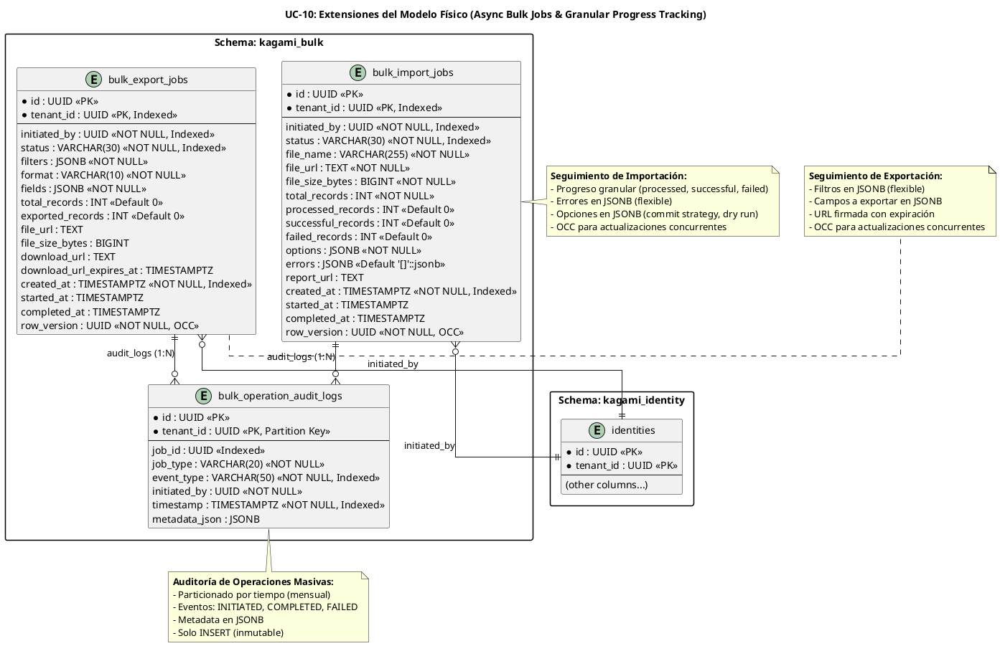

# UC-10: Import/Export Masivo - Modelo de Datos Físico Específico (Async Jobs & Granular Audit)

| Metadatos del Documento | |
| :--- | :--- |
| **Proyecto:** | SHUGO - Identity & Access Platform |
| **Caso de Uso:** | UC-10 - Import/Export Masivo (Bulk Identity Operations) |
| **Documento:** | 10_UC_Specific_Data_Model.md |
| **Metodología:** | Physical Data Modeling + Multi-Tenant Isolation (RLS) + Async Job Tracking + JSONB for Flexible Schemas |
| **Base de Datos:** | PostgreSQL 15+ (Primary + Read Replicas) |
| **Autor:** | Gastón Ruiz |
| **Versión Actual:** | 1.0.0 |
| **Fecha:** | 14/09/2026 |

---

## Historial de Versiones

| Versión | Fecha | Autor | Descripción de Cambios | Impacto |
| :--- | :--- | :--- | :--- | :--- |
| **1.0.0** | 14/09/2026 | Gastón Ruiz | **Creación inicial.** Definición del modelo de datos físico para operaciones masivas asíncronas. Introduce tablas específicas para jobs de importación (`bulk_import_jobs`) y exportación (`bulk_export_jobs`) con seguimiento de progreso granular, almacenamiento de errores en formato JSONB, índices optimizados para consultas de estado y progreso, políticas de Row-Level Security (RLS) para aislamiento multi-tenant, y estrategias de particionamiento por tiempo para logs de auditoría de operaciones masivas. | Documento de referencia para DBAs y desarrolladores backend. Define cómo se implementa físicamente el seguimiento de operaciones masivas de larga duración con máxima seguridad, rendimiento para consultas de progreso en tiempo real, y trazabilidad forense completa. |

---

## 1. Introducción y Propósito

Este documento define las extensiones y consideraciones físicas específicas en PostgreSQL para soportar el **UC-10 (Import/Export Masivo)**.

A diferencia de los UCs transaccionales previos, el UC-10 introduce desafíos físicos únicos orientados al **seguimiento de operaciones asíncronas de larga duración**:

1. **Tablas de Jobs Dedicadas:** Estructuras específicas para rastrear el ciclo de vida completo de operaciones masivas, desde iniciación hasta completación o fallo.
2. **Seguimiento de Progreso Granular:** Columnas para rastrear registros procesados, exitosos y fallidos, permitiendo consultas de progreso en tiempo real.
3. **Almacenamiento de Errores en JSONB:** Los errores de validación se almacenan como arrays JSONB, permitiendo flexibilidad en la estructura del error sin requerir tablas relacionales complejas.
4. **Índices Optimizados para Patrones de Acceso:** Índices para consultas frecuentes como "jobs activos por tenant", "progreso de job específico", y "jobs completados en rango de fechas".
5. **Row-Level Security (RLS) para Multi-Tenancy:** Aislamiento estricto de jobs por tenant, previniendo fugas de datos entre organizaciones.
6. **Particionamiento por Tiempo para Auditoría:** Las tablas de auditoría de operaciones masivas se particionan por mes para facilitar retención y consultas de rango temporal.
7. **Optimistic Concurrency Control (OCC):** Uso de `row_version` para prevenir actualizaciones perdidas cuando múltiples workers intentan actualizar el progreso del mismo job.

---

## 2. Diagrama de Modelo de Datos Físico (ERD Extendido)



---

## 3. Scripts DDL: Tablas Específicas para UC-10

### 3.1. Esquema `kagami_bulk`

```sql
-- Crear esquema para operaciones masivas
CREATE SCHEMA IF NOT EXISTS kagami_bulk;
SET search_path TO kagami_bulk;
```

### 3.2. Tabla `bulk_import_jobs` (Seguimiento de Importaciones)

```sql
SET search_path TO kagami_bulk;

-- Tabla de jobs de importación masiva
CREATE TABLE IF NOT EXISTS bulk_import_jobs (
    id UUID PRIMARY KEY DEFAULT gen_random_uuid(),
    tenant_id UUID NOT NULL,
    
    -- Metadata de iniciación
    initiated_by UUID NOT NULL,
    
    -- Estado y progreso
    status VARCHAR(30) NOT NULL DEFAULT 'PENDING'
        CHECK (status IN ('PENDING', 'PROCESSING', 'COMPLETED', 'COMPLETED_WITH_ERRORS', 'FAILED')),
    file_name VARCHAR(255) NOT NULL,
    file_url TEXT NOT NULL,
    file_size_bytes BIGINT NOT NULL CHECK (file_size_bytes >= 0),
    total_records INT NOT NULL CHECK (total_records > 0),
    
    -- Progreso granular
    processed_records INT NOT NULL DEFAULT 0 CHECK (processed_records >= 0),
    successful_records INT NOT NULL DEFAULT 0 CHECK (successful_records >= 0),
    failed_records INT NOT NULL DEFAULT 0 CHECK (failed_records >= 0),
    
    -- Configuración flexible (JSONB)
    options JSONB NOT NULL DEFAULT '{}'::jsonb,
    
    -- Errores de validación (JSONB array)
    errors JSONB NOT NULL DEFAULT '[]'::jsonb,
    
    -- Reporte de resultados
    report_url TEXT,
    
    -- Timestamps
    created_at TIMESTAMPTZ NOT NULL DEFAULT NOW(),
    started_at TIMESTAMPTZ,
    completed_at TIMESTAMPTZ,
    
    -- Optimistic Concurrency Control
    row_version UUID NOT NULL DEFAULT gen_random_uuid(),
    
    -- Restricciones de integridad
    CONSTRAINT chk_import_progress_consistency CHECK (
        processed_records = successful_records + failed_records
    ),
    CONSTRAINT chk_import_processed_not_exceed_total CHECK (
        processed_records <= total_records
    ),
    CONSTRAINT chk_import_completed_has_report CHECK (
        status NOT IN ('COMPLETED', 'COMPLETED_WITH_ERRORS') OR report_url IS NOT NULL
    ),
    CONSTRAINT chk_import_processing_has_started CHECK (
        status != 'PROCESSING' OR started_at IS NOT NULL
    ),
    CONSTRAINT chk_import_completed_has_completed_at CHECK (
        status NOT IN ('COMPLETED', 'COMPLETED_WITH_ERRORS', 'FAILED') OR completed_at IS NOT NULL
    )
);

-- Índices optimizados
CREATE INDEX IF NOT EXISTS idx_bij_tenant_status 
    ON bulk_import_jobs(tenant_id, status);

CREATE INDEX IF NOT EXISTS idx_bij_tenant_created 
    ON bulk_import_jobs(tenant_id, created_at DESC);

CREATE INDEX IF NOT EXISTS idx_bij_initiated_by 
    ON bulk_import_jobs(initiated_by);

CREATE INDEX IF NOT EXISTS idx_bij_status_created 
    ON bulk_import_jobs(status, created_at DESC);

-- Índice GIN para consultas en JSONB (options, errors)
CREATE INDEX IF NOT EXISTS idx_bij_options_gin 
    ON bulk_import_jobs USING GIN (options);

CREATE INDEX IF NOT EXISTS idx_bij_errors_gin 
    ON bulk_import_jobs USING GIN (errors);

-- Índice parcial para jobs activos (PENDING o PROCESSING)
CREATE INDEX IF NOT EXISTS idx_bij_active_jobs 
    ON bulk_import_jobs(tenant_id, created_at DESC)
    WHERE status IN ('PENDING', 'PROCESSING');

-- Comentarios de documentación
COMMENT ON TABLE bulk_import_jobs IS 'Jobs de importación masiva de identidades. Seguimiento asíncrono con progreso granular.';
COMMENT ON COLUMN bulk_import_jobs.options IS 'Configuración de importación en JSONB: {commit_strategy, is_dry_run, file_format, encoding, delimiter, has_headers}';
COMMENT ON COLUMN bulk_import_jobs.errors IS 'Array JSONB de errores de validación: [{row_number, error_code, error_message, phase}]';
COMMENT ON COLUMN bulk_import_jobs.row_version IS 'UUID para Optimistic Concurrency Control. Cambia en cada UPDATE.';
```

### 3.3. Tabla `bulk_export_jobs` (Seguimiento de Exportaciones)

```sql
SET search_path TO kagami_bulk;

-- Tabla de jobs de exportación masiva
CREATE TABLE IF NOT EXISTS bulk_export_jobs (
    id UUID PRIMARY KEY DEFAULT gen_random_uuid(),
    tenant_id UUID NOT NULL,
    
    -- Metadata de iniciación
    initiated_by UUID NOT NULL,
    
    -- Estado y progreso
    status VARCHAR(30) NOT NULL DEFAULT 'PENDING'
        CHECK (status IN ('PENDING', 'PROCESSING', 'COMPLETED', 'FAILED')),
    
    -- Filtros y configuración (JSONB)
    filters JSONB NOT NULL DEFAULT '{}'::jsonb,
    format VARCHAR(10) NOT NULL CHECK (format IN ('CSV', 'JSON')),
    fields JSONB NOT NULL DEFAULT '[]'::jsonb,
    
    -- Progreso
    total_records INT NOT NULL DEFAULT 0 CHECK (total_records >= 0),
    exported_records INT NOT NULL DEFAULT 0 CHECK (exported_records >= 0),
    
    -- Archivo generado
    file_url TEXT,
    file_size_bytes BIGINT CHECK (file_size_bytes >= 0),
    
    -- URL firmada para descarga
    download_url TEXT,
    download_url_expires_at TIMESTAMPTZ,
    
    -- Timestamps
    created_at TIMESTAMPTZ NOT NULL DEFAULT NOW(),
    started_at TIMESTAMPTZ,
    completed_at TIMESTAMPTZ,
    
    -- Optimistic Concurrency Control
    row_version UUID NOT NULL DEFAULT gen_random_uuid(),
    
    -- Restricciones de integridad
    CONSTRAINT chk_export_completed_has_file CHECK (
        status != 'COMPLETED' OR (file_url IS NOT NULL AND download_url IS NOT NULL)
    ),
    CONSTRAINT chk_export_processing_has_started CHECK (
        status != 'PROCESSING' OR started_at IS NOT NULL
    ),
    CONSTRAINT chk_export_completed_has_completed_at CHECK (
        status NOT IN ('COMPLETED', 'FAILED') OR completed_at IS NOT NULL
    )
);

-- Índices optimizados
CREATE INDEX IF NOT EXISTS idx_bej_tenant_status 
    ON bulk_export_jobs(tenant_id, status);

CREATE INDEX IF NOT EXISTS idx_bej_tenant_created 
    ON bulk_export_jobs(tenant_id, created_at DESC);

CREATE INDEX IF NOT EXISTS idx_bej_initiated_by 
    ON bulk_export_jobs(initiated_by);

CREATE INDEX IF NOT EXISTS idx_bej_status_created 
    ON bulk_export_jobs(status, created_at DESC);

-- Índice GIN para consultas en JSONB (filters, fields)
CREATE INDEX IF NOT EXISTS idx_bej_filters_gin 
    ON bulk_export_jobs USING GIN (filters);

CREATE INDEX IF NOT EXISTS idx_bej_fields_gin 
    ON bulk_export_jobs USING GIN (fields);

-- Índice parcial para jobs activos
CREATE INDEX IF NOT EXISTS idx_bej_active_jobs 
    ON bulk_export_jobs(tenant_id, created_at DESC)
    WHERE status IN ('PENDING', 'PROCESSING');

-- Comentarios de documentación
COMMENT ON TABLE bulk_export_jobs IS 'Jobs de exportación masiva de identidades. Seguimiento asíncrono con filtros flexibles.';
COMMENT ON COLUMN bulk_export_jobs.filters IS 'Filtros de exportación en JSONB: {roles, status, created_after, created_before, custom_filters}';
COMMENT ON COLUMN bulk_export_jobs.fields IS 'Array JSONB de campos a exportar: ["email", "display_name", "roles", ...]';
COMMENT ON COLUMN bulk_export_jobs.download_url IS 'URL firmada para descarga directa desde Storage (TTL 24h)';
COMMENT ON COLUMN bulk_export_jobs.row_version IS 'UUID para Optimistic Concurrency Control. Cambia en cada UPDATE.';
```

### 3.4. Tabla `bulk_operation_audit_logs` (Auditoría de Operaciones Masivas)

```sql
SET search_path TO kagami_bulk;

-- Tabla de auditoría para operaciones masivas (particionada por tiempo)
CREATE TABLE IF NOT EXISTS bulk_operation_audit_logs (
    id UUID NOT NULL DEFAULT gen_random_uuid(),
    tenant_id UUID NOT NULL,
    
    -- Referencia al job
    job_id UUID NOT NULL,
    job_type VARCHAR(20) NOT NULL CHECK (job_type IN ('IMPORT', 'EXPORT')),
    
    -- Evento de auditoría
    event_type VARCHAR(50) NOT NULL 
        CHECK (event_type IN (
            'JOB_INITIATED',
            'JOB_STARTED',
            'JOB_PROGRESS_UPDATED',
            'JOB_COMPLETED',
            'JOB_COMPLETED_WITH_ERRORS',
            'JOB_FAILED',
            'FILE_UPLOADED',
            'FILE_DOWNLOADED',
            'REPORT_GENERATED'
        )),
    
    -- Metadata del evento
    initiated_by UUID NOT NULL,
    timestamp TIMESTAMPTZ NOT NULL DEFAULT NOW(),
    metadata_json JSONB DEFAULT '{}'::jsonb,
    
    -- Primary key incluye timestamp para particionamiento
    PRIMARY KEY (id, timestamp)
) PARTITION BY RANGE (timestamp);

-- Crear particiones mensuales para 2026
CREATE TABLE bulk_operation_audit_logs_2026_01 PARTITION OF bulk_operation_audit_logs
    FOR VALUES FROM ('2026-01-01') TO ('2026-02-01');

CREATE TABLE bulk_operation_audit_logs_2026_02 PARTITION OF bulk_operation_audit_logs
    FOR VALUES FROM ('2026-02-01') TO ('2026-03-01');

CREATE TABLE bulk_operation_audit_logs_2026_03 PARTITION OF bulk_operation_audit_logs
    FOR VALUES FROM ('2026-03-01') TO ('2026-04-01');

-- Partición default para capturar datos fuera de rango
CREATE TABLE bulk_operation_audit_logs_default PARTITION OF bulk_operation_audit_logs DEFAULT;

-- Índices optimizados para consultas de auditoría
CREATE INDEX IF NOT EXISTS idx_boal_tenant_timestamp 
    ON bulk_operation_audit_logs(tenant_id, timestamp DESC);

CREATE INDEX IF NOT EXISTS idx_boal_job_id 
    ON bulk_operation_audit_logs(job_id, timestamp DESC);

CREATE INDEX IF NOT EXISTS idx_boal_event_type 
    ON bulk_operation_audit_logs(event_type);

CREATE INDEX IF NOT EXISTS idx_boal_initiated_by 
    ON bulk_operation_audit_logs(initiated_by, timestamp DESC);

-- Índice GIN para consultas en metadata_json
CREATE INDEX IF NOT EXISTS idx_boal_metadata_gin 
    ON bulk_operation_audit_logs USING GIN (metadata_json);

-- Comentarios de documentación
COMMENT ON TABLE bulk_operation_audit_logs IS 'Logs de auditoría para operaciones masivas. Particionada por tiempo para retención eficiente.';
COMMENT ON COLUMN bulk_operation_audit_logs.metadata_json IS 'Metadata del evento en JSONB: {total_records, successful_records, failed_records, processing_time_seconds, error_message, ...}';
```

---

## 4. Seguridad a Nivel de Base de Datos

### 4.1. Row-Level Security (RLS) para Jobs de Importación

```sql
-- Habilitar RLS en tabla de jobs de importación
ALTER TABLE kagami_bulk.bulk_import_jobs ENABLE ROW LEVEL SECURITY;
ALTER TABLE kagami_bulk.bulk_import_jobs FORCE ROW LEVEL SECURITY;

-- Política de lectura: Solo puede leer jobs de su propio tenant
CREATE POLICY bij_tenant_isolation_read ON kagami_bulk.bulk_import_jobs
    FOR SELECT
    USING (tenant_id = current_setting('app.current_tenant_id')::uuid);

-- Política de escritura: Solo puede crear/modificar jobs de su propio tenant
CREATE POLICY bij_tenant_isolation_write ON kagami_bulk.bulk_import_jobs
    FOR ALL
    USING (tenant_id = current_setting('app.current_tenant_id')::uuid)
    WITH CHECK (tenant_id = current_setting('app.current_tenant_id')::uuid);
```

### 4.2. Row-Level Security (RLS) para Jobs de Exportación

```sql
-- Habilitar RLS en tabla de jobs de exportación
ALTER TABLE kagami_bulk.bulk_export_jobs ENABLE ROW LEVEL SECURITY;
ALTER TABLE kagami_bulk.bulk_export_jobs FORCE ROW LEVEL SECURITY;

-- Política de lectura: Solo puede leer jobs de su propio tenant
CREATE POLICY bej_tenant_isolation_read ON kagami_bulk.bulk_export_jobs
    FOR SELECT
    USING (tenant_id = current_setting('app.current_tenant_id')::uuid);

-- Política de escritura: Solo puede crear/modificar jobs de su propio tenant
CREATE POLICY bej_tenant_isolation_write ON kagami_bulk.bulk_export_jobs
    FOR ALL
    USING (tenant_id = current_setting('app.current_tenant_id')::uuid)
    WITH CHECK (tenant_id = current_setting('app.current_tenant_id')::uuid);
```

### 4.3. Row-Level Security (RLS) para Auditoría

```sql
-- Habilitar RLS en tabla de auditoría
ALTER TABLE kagami_bulk.bulk_operation_audit_logs ENABLE ROW LEVEL SECURITY;
ALTER TABLE kagami_bulk.bulk_operation_audit_logs FORCE ROW LEVEL SECURITY;

-- Política de lectura: Solo puede leer logs de su propio tenant
CREATE POLICY boal_tenant_isolation_read ON kagami_bulk.bulk_operation_audit_logs
    FOR SELECT
    USING (tenant_id = current_setting('app.current_tenant_id')::uuid);

-- Política de escritura: Solo el servicio de auditoría puede insertar
CREATE POLICY boal_audit_service_insert ON kagami_bulk.bulk_operation_audit_logs
    FOR INSERT
    WITH CHECK (
        tenant_id = current_setting('app.current_tenant_id')::uuid
        AND current_setting('app.service_role', true) = 'audit_service'
    );

-- No permitir UPDATE ni DELETE (inmutabilidad)
-- Esto se refuerza revocando permisos a nivel de rol
```

### 4.4. Roles de Base de Datos para Operaciones Masivas

```sql
-- Crear rol específico para el servicio de operaciones masivas
CREATE ROLE app_kagami_bulk_operations WITH LOGIN PASSWORD '...';

-- Grant permisos específicos
GRANT CONNECT ON DATABASE shugo_kagami TO app_kagami_bulk_operations;
GRANT USAGE ON SCHEMA kagami_bulk TO app_kagami_bulk_operations;

-- Puede leer y crear jobs de importación
GRANT SELECT, INSERT, UPDATE ON kagami_bulk.bulk_import_jobs TO app_kagami_bulk_operations;

-- Puede leer y crear jobs de exportación
GRANT SELECT, INSERT, UPDATE ON kagami_bulk.bulk_export_jobs TO app_kagami_bulk_operations;

-- Puede insertar logs de auditoría (solo INSERT, no UPDATE/DELETE)
GRANT SELECT, INSERT ON kagami_bulk.bulk_operation_audit_logs TO app_kagami_bulk_operations;

-- No puede eliminar jobs (solo actualizar estado)
REVOKE DELETE ON kagami_bulk.bulk_import_jobs FROM app_kagami_bulk_operations;
REVOKE DELETE ON kagami_bulk.bulk_export_jobs FROM app_kagami_bulk_operations;
REVOKE UPDATE, DELETE ON kagami_bulk.bulk_operation_audit_logs FROM app_kagami_bulk_operations;

-- Crear rol específico para consultas de compliance/auditoría
CREATE ROLE app_compliance_admin WITH LOGIN PASSWORD '...';

GRANT CONNECT ON DATABASE shugo_kagami TO app_compliance_admin;
GRANT USAGE ON SCHEMA kagami_bulk TO app_compliance_admin;

-- Solo puede leer (no modificar)
GRANT SELECT ON kagami_bulk.bulk_import_jobs TO app_compliance_admin;
GRANT SELECT ON kagami_bulk.bulk_export_jobs TO app_compliance_admin;
GRANT SELECT ON kagami_bulk.bulk_operation_audit_logs TO app_compliance_admin;
```

---

## 5. Estrategias de Optimización

### 5.1. Optimistic Concurrency Control (OCC)

Para prevenir actualizaciones perdidas cuando múltiples workers intentan actualizar el progreso del mismo job:

```sql
-- La columna row_version ya está definida en las tablas
-- En EF Core, se configura como ConcurrencyToken:

-- Ejemplo de UPDATE con OCC:
UPDATE kagami_bulk.bulk_import_jobs
SET 
    processed_records = @processed,
    successful_records = @successful,
    failed_records = @failed,
    row_version = gen_random_uuid() -- Nuevo row_version
WHERE id = @jobId
  AND row_version = @expectedRowVersion; -- Verificar row_version

-- Si no se actualiza ninguna fila, significa que otro worker actualizó el job
-- (Concurrency Conflict)
```

### 5.2. Actualización Atómica de Progreso

Para prevenir race conditions en la actualización de progreso:

```sql
-- Función para actualizar progreso de forma atómica
CREATE OR REPLACE FUNCTION kagami_bulk.update_import_progress(
    p_job_id UUID,
    p_increment_processed INT,
    p_increment_successful INT,
    p_increment_failed INT
)
RETURNS TABLE(
    processed_records INT,
    successful_records INT,
    failed_records INT
) AS $$
BEGIN
    RETURN QUERY
    UPDATE kagami_bulk.bulk_import_jobs
    SET 
        processed_records = processed_records + p_increment_processed,
        successful_records = successful_records + p_increment_successful,
        failed_records = failed_records + p_increment_failed,
        row_version = gen_random_uuid()
    WHERE id = p_job_id
    RETURNING processed_records, successful_records, failed_records;
END;
$$ LANGUAGE plpgsql;

-- Uso:
-- SELECT * FROM kagami_bulk.update_import_progress('job-uuid', 1000, 950, 50);
```

### 5.3. Consultas de Progreso en Tiempo Real

```sql
-- Consulta optimizada para obtener progreso de un job específico
CREATE OR REPLACE FUNCTION kagami_bulk.get_job_progress(p_job_id UUID, p_job_type VARCHAR)
RETURNS TABLE(
    job_id UUID,
    status VARCHAR,
    total_records INT,
    processed_records INT,
    successful_records INT,
    failed_records INT,
    percentage NUMERIC,
    started_at TIMESTAMPTZ,
    estimated_completion_at TIMESTAMPTZ
) AS $$
BEGIN
    IF p_job_type = 'IMPORT' THEN
        RETURN QUERY
        SELECT 
            bij.id,
            bij.status,
            bij.total_records,
            bij.processed_records,
            bij.successful_records,
            bij.failed_records,
            CASE 
                WHEN bij.total_records > 0 
                THEN ROUND((bij.processed_records::NUMERIC / bij.total_records) * 100, 2)
                ELSE 0
            END AS percentage,
            bij.started_at,
            -- Estimación basada en velocidad actual
            CASE 
                WHEN bij.processed_records > 0 AND bij.started_at IS NOT NULL THEN
                    bij.started_at + (
                        (NOW() - bij.started_at) * (bij.total_records::NUMERIC / bij.processed_records)
                    )
                ELSE NULL
            END AS estimated_completion_at
        FROM kagami_bulk.bulk_import_jobs bij
        WHERE bij.id = p_job_id;
    ELSE
        RETURN QUERY
        SELECT 
            bej.id,
            bej.status,
            bej.total_records,
            bej.exported_records AS processed_records,
            bej.exported_records AS successful_records,
            0 AS failed_records,
            CASE 
                WHEN bej.total_records > 0 
                THEN ROUND((bej.exported_records::NUMERIC / bej.total_records) * 100, 2)
                ELSE 0
            END AS percentage,
            bej.started_at,
            CASE 
                WHEN bej.exported_records > 0 AND bej.started_at IS NOT NULL THEN
                    bej.started_at + (
                        (NOW() - bej.started_at) * (bej.total_records::NUMERIC / bej.exported_records)
                    )
                ELSE NULL
            END AS estimated_completion_at
        FROM kagami_bulk.bulk_export_jobs bej
        WHERE bej.id = p_job_id;
    END IF;
END;
$$ LANGUAGE plpgsql;
```

### 5.4. Limpieza de Jobs Antiguos

```sql
-- Función para archivar jobs antiguos (mayores a 90 días)
CREATE OR REPLACE FUNCTION kagami_bulk.archive_old_bulk_jobs(p_days_to_keep INT DEFAULT 90)
RETURNS INT AS $$
DECLARE
    v_cutoff_date TIMESTAMPTZ;
    v_archived_count INT := 0;
BEGIN
    v_cutoff_date := NOW() - (p_days_to_keep || ' days')::INTERVAL;
    
    -- Mover jobs antiguos a tabla de archivo
    INSERT INTO kagami_bulk.bulk_import_jobs_archive
    SELECT * FROM kagami_bulk.bulk_import_jobs
    WHERE completed_at < v_cutoff_date
      AND status IN ('COMPLETED', 'COMPLETED_WITH_ERRORS', 'FAILED');
    
    GET DIAGNOSTICS v_archived_count = ROW_COUNT;
    
    -- Eliminar de tabla principal
    DELETE FROM kagami_bulk.bulk_import_jobs
    WHERE completed_at < v_cutoff_date
      AND status IN ('COMPLETED', 'COMPLETED_WITH_ERRORS', 'FAILED');
    
    -- Hacer lo mismo para exportaciones
    INSERT INTO kagami_bulk.bulk_export_jobs_archive
    SELECT * FROM kagami_bulk.bulk_export_jobs
    WHERE completed_at < v_cutoff_date
      AND status IN ('COMPLETED', 'FAILED');
    
    GET DIAGNOSTICS v_archived_count = v_archived_count + ROW_COUNT;
    
    DELETE FROM kagami_bulk.bulk_export_jobs
    WHERE completed_at < v_cutoff_date
      AND status IN ('COMPLETED', 'FAILED');
    
    RETURN v_archived_count;
END;
$$ LANGUAGE plpgsql;

-- Job programado (ejecutar diariamente)
-- SELECT cron.schedule('archive-old-bulk-jobs', '0 2 * * *', $$SELECT kagami_bulk.archive_old_bulk_jobs(90)$$);
```

---

## 6. Configuración de Rendimiento

### 6.1. Configuración de PostgreSQL para Operaciones de Escritura Intensiva

```ini
# postgresql.conf - Optimizaciones para UC-10

# WAL y Checkpoints (crítico para actualizaciones frecuentes de progreso)
wal_level = replica
max_wal_size = 4GB
min_wal_size = 1GB
checkpoint_completion_target = 0.9
checkpoint_timeout = 10min
wal_buffers = 64MB

# Autovacuum agresivo para tablas de jobs (actualizaciones frecuentes)
autovacuum_max_workers = 5
autovacuum_vacuum_scale_factor = 0.01    # Vaciar cuando 1% de filas cambian
autovacuum_analyze_scale_factor = 0.005  # Analizar cuando 0.5% de filas cambian
autovacuum_vacuum_threshold = 100
autovacuum_analyze_threshold = 50

# Memoria compartida
shared_buffers = 8GB
effective_cache_size = 24GB
work_mem = 128MB  # Para operaciones de ordenamiento en consultas de progreso

# Logging para monitoreo de rendimiento
log_min_duration_statement = 100         # Log queries > 100ms
log_checkpoints = on
log_lock_waits = on
```

### 6.2. Configuración de PgBouncer para Operaciones Masivas

```ini
# pgbouncer.ini - Pool de conexiones optimizado para UC-10

[databases]
shugo_kagami = host=postgres-primary port=5432 dbname=shugo_kagami

[pgbouncer]
pool_mode = transaction
max_client_conn = 2000
default_pool_size = 100
min_pool_size = 20
reserve_pool_size = 50  # Reserva alta para picos de actualizaciones de progreso
reserve_pool_timeout = 2
server_connect_timeout = 5
query_timeout = 10  # Timeout estricto para consultas de progreso
```

---

## 7. Políticas de Retención y Archivado

### 7.1. Retención de Jobs Completados

```sql
-- Política: Jobs completados se archivan tras 90 días
-- Implementado via función archive_old_bulk_jobs (ver sección 5.4)

-- Configuración de retención en tenant_configs
ALTER TABLE kagami_config.tenant_configs 
    ADD COLUMN IF NOT EXISTS bulk_job_retention_days INT NOT NULL DEFAULT 90;

COMMENT ON COLUMN kagami_config.tenant_configs.bulk_job_retention_days IS 'Días de retención de jobs completados antes de archivar. Default: 90 días.';
```

### 7.2. Retención de Logs de Auditoría

```sql
-- Política: Logs de auditoría se retienen según configuración de tenant
-- Implementado via particionamiento por tiempo (ver sección 3.4)

-- Configuración de retención en tenant_configs
ALTER TABLE kagami_config.tenant_configs 
    ADD COLUMN IF NOT EXISTS bulk_audit_log_retention_years INT NOT NULL DEFAULT 7;

COMMENT ON COLUMN kagami_config.tenant_configs.bulk_audit_log_retention_years IS 'Años de retención de logs de auditoría de operaciones masivas. Default: 7 años.';

-- Función para eliminar particiones antiguas de audit_logs
CREATE OR REPLACE FUNCTION kagami_bulk.drop_old_audit_log_partitions(p_retention_years INT DEFAULT 7)
RETURNS INT AS $$
DECLARE
    v_dropped_count INT := 0;
    v_partition_name TEXT;
BEGIN
    FOR v_partition_name IN 
        SELECT inhrelid::regclass::text 
        FROM pg_inherits 
        WHERE inhparent = 'kagami_bulk.bulk_operation_audit_logs'::regclass
          AND inhrelid::regclass::text < 'bulk_operation_audit_logs_' || TO_CHAR(NOW() - INTERVAL '1 year' * p_retention_years, 'YYYY_MM')
    LOOP
        EXECUTE 'DROP TABLE IF EXISTS kagami_bulk.' || v_partition_name;
        v_dropped_count := v_dropped_count + 1;
    END LOOP;
    
    RETURN v_dropped_count;
END;
$$ LANGUAGE plpgsql;
```

---

## 8. Monitoreo y Diagnóstico

### 8.1. Consultas para Diagnosticar Problemas de Operaciones Masivas

```sql
-- Jobs activos por tenant (posible congestión)
SELECT 
    tenant_id,
    COUNT(*) FILTER (WHERE status = 'PENDING') AS pending_jobs,
    COUNT(*) FILTER (WHERE status = 'PROCESSING') AS processing_jobs,
    COUNT(*) AS total_active_jobs
FROM kagami_bulk.bulk_import_jobs
WHERE status IN ('PENDING', 'PROCESSING')
GROUP BY tenant_id
ORDER BY total_active_jobs DESC;

-- Jobs con progreso estancado (posible worker caído)
SELECT 
    id,
    tenant_id,
    status,
    processed_records,
    total_records,
    ROUND((processed_records::NUMERIC / total_records) * 100, 2) AS percentage,
    started_at,
    NOW() - started_at AS duration,
    CASE 
        WHEN processed_records > 0 THEN
            (NOW() - started_at) / processed_records * (total_records - processed_records)
        ELSE NULL
    END AS estimated_time_remaining
FROM kagami_bulk.bulk_import_jobs
WHERE status = 'PROCESSING'
  AND started_at < NOW() - INTERVAL '30 minutes'  -- Jobs procesando por más de 30 min
ORDER BY duration DESC;

-- Jobs con alta tasa de errores (posible problema de calidad de datos)
SELECT 
    id,
    tenant_id,
    total_records,
    failed_records,
    ROUND((failed_records::NUMERIC / total_records) * 100, 2) AS error_rate_pct,
    report_url
FROM kagami_bulk.bulk_import_jobs
WHERE status = 'COMPLETED_WITH_ERRORS'
  AND failed_records > 0
  AND completed_at > NOW() - INTERVAL '7 days'
ORDER BY error_rate_pct DESC
LIMIT 20;

-- Análisis de errores más comunes (desde JSONB)
SELECT 
    error->>'error_code' AS error_code,
    error->>'phase' AS validation_phase,
    COUNT(*) AS occurrence_count
FROM kagami_bulk.bulk_import_jobs,
     jsonb_array_elements(errors) AS error
WHERE completed_at > NOW() - INTERVAL '30 days'
GROUP BY error->>'error_code', error->>'phase'
ORDER BY occurrence_count DESC
LIMIT 20;

-- Throughput de operaciones masivas por tenant (últimos 30 días)
SELECT 
    tenant_id,
    COUNT(*) FILTER (WHERE job_type = 'IMPORT') AS import_jobs,
    COUNT(*) FILTER (WHERE job_type = 'EXPORT') AS export_jobs,
    SUM(CASE WHEN job_type = 'IMPORT' THEN (metadata_json->>'total_records')::INT ELSE 0 END) AS total_imported_records,
    SUM(CASE WHEN job_type = 'EXPORT' THEN (metadata_json->>'total_records')::INT ELSE 0 END) AS total_exported_records
FROM kagami_bulk.bulk_operation_audit_logs
WHERE event_type = 'JOB_COMPLETED'
  AND timestamp > NOW() - INTERVAL '30 days'
GROUP BY tenant_id
ORDER BY total_imported_records DESC;
```

### 8.2. Métricas de Base de Datos para OpenTelemetry

```csharp
public class BulkOperationsDatabaseMetrics
{
    private readonly Meter _meter;
    private readonly Counter<long> _importJobsCreated;
    private readonly Counter<long> _importJobsCompleted;
    private readonly Counter<long> _exportJobsCreated;
    private readonly Counter<long> _exportJobsCompleted;
    private readonly Counter<long> _recordsProcessed;
    private readonly Histogram<double> _jobProcessingDuration;
    private readonly Histogram<double> _progressUpdateLatency;

    public BulkOperationsDatabaseMetrics(IMeterFactory meterFactory)
    {
        _meter = meterFactory.Create("shugo.bulk_operations.database");
        _importJobsCreated = _meter.CreateCounter<long>("bulk.import_jobs_created");
        _importJobsCompleted = _meter.CreateCounter<long>("bulk.import_jobs_completed");
        _exportJobsCreated = _meter.CreateCounter<long>("bulk.export_jobs_created");
        _exportJobsCompleted = _meter.CreateCounter<long>("bulk.export_jobs_completed");
        _recordsProcessed = _meter.CreateCounter<long>("bulk.records_processed");
        _jobProcessingDuration = _meter.CreateHistogram<double>("bulk.job_processing_duration", "s");
        _progressUpdateLatency = _meter.CreateHistogram<double>("bulk.progress_update_latency", "ms");
    }

    public void RecordImportJobCreated(string tenantId, int totalRecords)
    {
        _importJobsCreated.Add(1,
            new KeyValuePair<string, object?>("tenant_id", tenantId));
    }

    public void RecordImportJobCompleted(string tenantId, string status, int totalRecords, int successfulRecords, double processingTimeSeconds)
    {
        _importJobsCompleted.Add(1,
            new KeyValuePair<string, object?>("tenant_id", tenantId),
            new KeyValuePair<string, object?>("status", status));
        
        _recordsProcessed.Add(successfulRecords,
            new KeyValuePair<string, object?>("tenant_id", tenantId),
            new KeyValuePair<string, object?>("job_type", "IMPORT"));
        
        _jobProcessingDuration.Record(processingTimeSeconds,
            new KeyValuePair<string, object?>("tenant_id", tenantId),
            new KeyValuePair<string, object?>("job_type", "IMPORT"));
    }

    public void RecordProgressUpdate(string tenantId, double latencyMs)
    {
        _progressUpdateLatency.Record(latencyMs,
            new KeyValuePair<string, object?>("tenant_id", tenantId));
    }
}
```

---

## 9. Trazabilidad

| Documento | Relación |
| :--- | :--- |
| `04_Initial_Domain_Model.md` | Define los Aggregate Roots `BulkImportJob` y `BulkExportJob` que se mapean a las tablas físicas `bulk_import_jobs` y `bulk_export_jobs`. |
| `05_State_Machine_Diagram.md` | Las máquinas de estados (PENDING → PROCESSING → COMPLETED/FAILED) se reflejan en la columna `status` con CHECK constraints. |
| `07_Sequence_Diagram.md` | Muestra las consultas a PostgreSQL (actualizaciones de progreso, inserción de logs de auditoría) que se optimizan con estos índices. |
| `08_Final_Class_Design.md` | El `JobRepository` implementa las consultas optimizadas definidas aquí, incluyendo OCC con `row_version`. |
| `09_Modern_Artifacts.md` | Las métricas de progreso y completación se monitorean con las configuraciones definidas aquí. |
| `11_UC_Specific_Security_Threats.md` | Las mitigaciones de "Job Tampering" y "PII Leakage" se validan mediante las políticas RLS y el almacenamiento de errores en JSONB. |
| `12_UC_Specific_Performance_Benchmarks.md` | Los SLAs de latencia de actualización de progreso (<50ms) se validan con los índices y configuraciones de pooling definidos aquí. |
| `SHUGO_Data_Model_Master.md` (Transversal) | Este documento extiende el modelo maestro con tablas específicas de operaciones masivas asíncronas. |

---

## 10. Anexos: Glosario de Base de Datos (UC-10)

| Término | Definición en Contexto UC-10 |
| :--- | :--- |
| **Bulk Job** | Registro que representa una operación masiva de importación o exportación con seguimiento de progreso granular. |
| **Progress Tracking** | Columnas `processed_records`, `successful_records`, `failed_records` que permiten consultar el progreso en tiempo real. |
| **JSONB Errors** | Array JSONB que almacena errores de validación con estructura flexible: `{row_number, error_code, error_message, phase}`. |
| **JSONB Options/Filters** | Campos JSONB que almacenan configuración flexible (commit strategy, dry run, filtros de exportación) sin requerir columnas adicionales. |
| **Row-Level Security (RLS)** | Mecanismo de PostgreSQL que restringe acceso a filas basado en `tenant_id`, previniendo fugas de datos entre tenants. |
| **Optimistic Concurrency Control (OCC)** | Uso de columna `row_version` (UUID) para prevenir actualizaciones perdidas cuando múltiples workers actualizan el mismo job. |
| **Partitioning by Range** | Estrategia de dividir la tabla de auditoría en particiones mensuales basadas en la columna `timestamp`, facilitando retención y consultas de rango temporal. |
| **GIN Index** | Índice de Inversión Generalizada en PostgreSQL, utilizado aquí para indexar campos JSONB (`options`, `filters`, `errors`) y permitir búsquedas eficientes dentro del JSON. |
| **Partial Index** | Índice que solo incluye filas que cumplen una condición (ej. `WHERE status IN ('PENDING', 'PROCESSING')`), reduciendo tamaño y mejorando rendimiento para consultas de jobs activos. |
| **Signed URL** | URL con firma criptográfica y TTL que permite descarga segura de archivos desde Storage sin pasar por el servidor de aplicación. |
| **Atomic Progress Update** | Función SQL que actualiza el progreso de un job de forma atómica, previniendo race conditions cuando múltiples workers actualizan simultáneamente. |

---
*Fin del Documento 10_UC_Specific_Data_Model para UC-10*